# Run 18cc12b7 — dry\_run — completed

| | |
|---|---|
| Run ID | `18cc12b7-c8f0-437b-a0d7-e125facd13b9` |
| Requested by | github:itsDevsArun |
| Started | 2026-11-02 17:00:52 UTC |
| Finished | 2026-11-02 17:03:19 UTC |
| Finish reason | queue\_exhausted |
| GitHub Actions | https://github.com/itsDevsArun/aeo-geo/actions/runs/41469315389 |

CSV for this run: [runs/2026-11-02_dry_run_18cc12b7.csv](2026-11-02_dry_run_18cc12b7.csv)

## Attempts (20)

### helixmechanical.com — dry\_run\_failed (dry run)

| | |
|---|---|
| Attempt ID | `0a2a6a8d-2915-456d-9c96-9422e5a0bc9e` |
| Form URL | https://helixmechanical.com/contact/ |
| Final URL | https://helixmechanical.com/contact/ |
| Reserved | 2026-11-02 17:00:52 UTC |
| Submit attempted | — |
| Template | standard v2 |
| Confirmation text | none observed |
| Result / error | Mapped field "First Name \*" not found uniquely |

Exact message:

~~~text
Subject: Helping customers find your business in AI search (AEO + GEO)

Hi there,

I'm Arun from Devs Arun. More and more customers now ask ChatGPT, Gemini, Perplexity or Google's AI Overviews questions like "who should I hire for this in my area?" before they call anyone. These tools answer from websites they can clearly understand, and they tend to recommend businesses whose pages answer real customer questions.

That is what AEO + GEO (Answer Engine and Generative Engine Optimization) is for. I improve your existing service pages so they clearly answer the questions your customers ask, add structured data that matches the page, and make the call, quote or enquiry step obvious. The benefit: your business gets a better chance of being mentioned or linked in AI answers, and visitors who arrive find it easy to contact you.

The AEO + GEO Starter is a one-time $199 (about ₹16,999, negotiable) for one website: a basic audit, 10 customer questions, improvements to two existing pages, relevant structured data and an action plan, with one revision round.

You can read the full details, send an enquiry or book online here:
https://devsarun.io/aeo-geo/

If this isn't relevant, just reply and I won't contact you again.

Best,
Arun
Devs Arun
itschool408@gmail.com · +91 7654534323
~~~

Submitted field values:

- \#forminator-field-name-1\_6ae7ff023fd3c: Arun
- \#forminator-field-email-1\_6ae7ff023fd3c: itschool408@gmail.com
- \#forminator-field-phone-1\_6ae7ff023fd3c: +91 7654534323
- \#forminator-field-textarea-1\_6ae7ff023fd3c: Hi there, I'm Arun from Devs Arun. More and more customers now ask ChatGPT, Gemini, Perplexity or Google's AI Overviews 

**Inspected page** — `run-18cc12b7_attempt-0a2a6a8d_inspection_2026-11-02T17-00-56-117Z.jpg`

### knoxvilleelectrician.com — dry\_run\_failed (dry run)

| | |
|---|---|
| Attempt ID | `c2ec1e0d-0afa-4233-8794-2e88d842d243` |
| Form URL | https://knoxvilleelectrician.com/contact-us/ |
| Final URL | https://knoxvilleelectrician.com/contact-us/ |
| Reserved | 2026-11-02 17:01:01 UTC |
| Submit attempted | — |
| Template | standard v2 |
| Confirmation text | none observed |
| Result / error | Mapped field "Name" not found uniquely |

Exact message:

~~~text
Subject: Helping customers find your business in AI search (AEO + GEO)

Hi there,

I'm Arun from Devs Arun. More and more customers now ask ChatGPT, Gemini, Perplexity or Google's AI Overviews questions like "who should I hire for this in my area?" before they call anyone. These tools answer from websites they can clearly understand, and they tend to recommend businesses whose pages answer real customer questions.

That is what AEO + GEO (Answer Engine and Generative Engine Optimization) is for. I improve your existing service pages so they clearly answer the questions your customers ask, add structured data that matches the page, and make the call, quote or enquiry step obvious. The benefit: your business gets a better chance of being mentioned or linked in AI answers, and visitors who arrive find it easy to contact you.

The AEO + GEO Starter is a one-time $199 (about ₹16,999, negotiable) for one website: a basic audit, 10 customer questions, improvements to two existing pages, relevant structured data and an action plan, with one revision round.

You can read the full details, send an enquiry or book online here:
https://devsarun.io/aeo-geo/

If this isn't relevant, just reply and I won't contact you again.

Best,
Arun
Devs Arun
itschool408@gmail.com · +91 7654534323
~~~

Submitted field values:

- \#form-field-1b7221: itschool408@gmail.com
- \#form-field-2fa3ac: +91 7654534323
- \#form-field-96f51f: Arun
- \#form-field-fed9d8: Hi there, I'm Arun from Devs Arun. More and more customers now ask ChatGPT, Gemini, Perplexity or Google's AI Overviews 

**Inspected page** — `run-18cc12b7_attempt-c2ec1e0d_inspection_2026-11-02T17-01-05-117Z.jpg`

### glescoelectric.com — dry\_run\_ok (dry run)

| | |
|---|---|
| Attempt ID | `34eded26-7c3c-48c9-89bc-5a4d28496846` |
| Form URL | https://www.glescoelectric.com/contact |
| Final URL | https://www.glescoelectric.com/contact |
| Reserved | 2026-11-02 17:01:10 UTC |
| Submit attempted | — |
| Template | standard v2 |
| Confirmation text | none observed |
| Result / error | Selectors verified; fields not typed (domain not in dry-run fill list); not submitted |

Exact message:

~~~text
Subject: Helping customers find your business in AI search (AEO + GEO)

Hi there,

I'm Arun from Devs Arun. More and more customers now ask ChatGPT, Gemini, Perplexity or Google's AI Overviews questions like "who should I hire for this in my area?" before they call anyone. These tools answer from websites they can clearly understand, and they tend to recommend businesses whose pages answer real customer questions.

That is what AEO + GEO (Answer Engine and Generative Engine Optimization) is for. I improve your existing service pages so they clearly answer the questions your customers ask, add structured data that matches the page, and make the call, quote or enquiry step obvious. The benefit: your business gets a better chance of being mentioned or linked in AI answers, and visitors who arrive find it easy to contact you.

The AEO + GEO Starter is a one-time $199 (about ₹16,999, negotiable) for one website: a basic audit, 10 customer questions, improvements to two existing pages, relevant structured data and an action plan, with one revision round.

You can read the full details, send an enquiry or book online here:
https://devsarun.io/aeo-geo/

If this isn't relevant, just reply and I won't contact you again.

Best,
Arun
Devs Arun
itschool408@gmail.com · +91 7654534323
~~~

Submitted field values:

- \#input\_comp-kq7zyxcj: Arun
- \#input\_comp-kq7zyxcx: Helping customers find your business in AI search (AEO + GEO)
- \#input\_comp-kq7zyxcu1: itschool408@gmail.com
- \#textarea\_comp-kq7zyxd1: Hi there, I'm Arun from Devs Arun. More and more customers now ask ChatGPT, Gemini, Perplexity or Google's AI Overviews 

**Inspected page** — `run-18cc12b7_attempt-34eded26_inspection_2026-11-02T17-01-12-510Z.jpg`

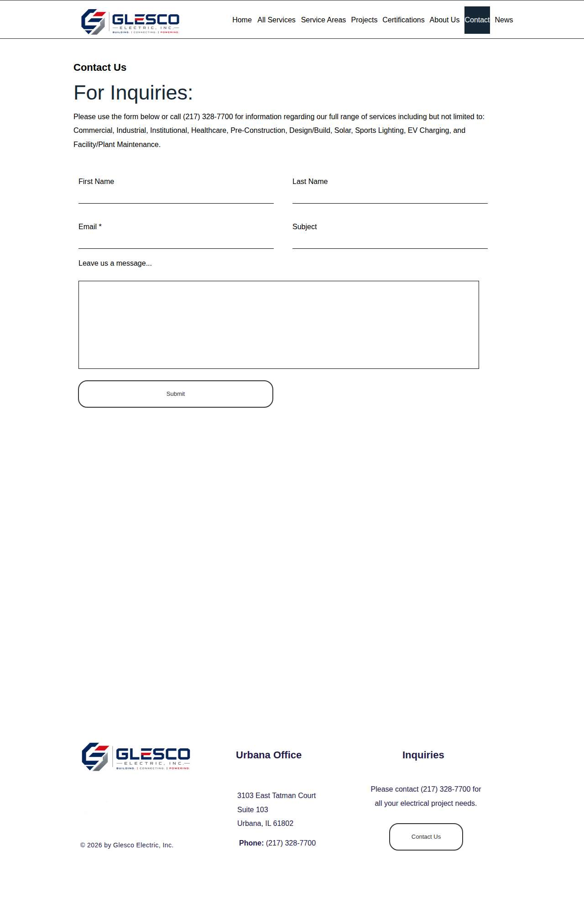

### atlas-pellizzari.com — dry\_run\_ok (dry run)

| | |
|---|---|
| Attempt ID | `febb61cb-8cb2-4b0f-8220-dfc4c9acc220` |
| Form URL | https://www.atlas-pellizzari.com/contact/ |
| Final URL | https://www.atlas-pellizzari.com/contact/ |
| Reserved | 2026-11-02 17:01:17 UTC |
| Submit attempted | — |
| Template | standard v2 |
| Confirmation text | none observed |
| Result / error | Selectors verified; fields not typed (domain not in dry-run fill list); not submitted |

Exact message:

~~~text
Subject: Helping customers find your business in AI search (AEO + GEO)

Hi there,

I'm Arun from Devs Arun. More and more customers now ask ChatGPT, Gemini, Perplexity or Google's AI Overviews questions like "who should I hire for this in my area?" before they call anyone. These tools answer from websites they can clearly understand, and they tend to recommend businesses whose pages answer real customer questions.

That is what AEO + GEO (Answer Engine and Generative Engine Optimization) is for. I improve your existing service pages so they clearly answer the questions your customers ask, add structured data that matches the page, and make the call, quote or enquiry step obvious. The benefit: your business gets a better chance of being mentioned or linked in AI answers, and visitors who arrive find it easy to contact you.

The AEO + GEO Starter is a one-time $199 (about ₹16,999, negotiable) for one website: a basic audit, 10 customer questions, improvements to two existing pages, relevant structured data and an action plan, with one revision round.

You can read the full details, send an enquiry or book online here:
https://devsarun.io/aeo-geo/

If this isn't relevant, just reply and I won't contact you again.

Best,
Arun
Devs Arun
itschool408@gmail.com · +91 7654534323
~~~

Submitted field values:

- \#input\_1\_2: Arun
- \#input\_1\_3: Devs Arun
- \#input\_1\_4: itschool408@gmail.com
- \#input\_1\_5: +91 7654534323
- \#input\_1\_6: Helping customers find your business in AI search (AEO + GEO)
- \#input\_1\_10: Hi there, I'm Arun from Devs Arun. More and more customers now ask ChatGPT, Gemini, Perplexity or Google's AI Overviews 

**Inspected page** — `run-18cc12b7_attempt-febb61cb_inspection_2026-11-02T17-01-19-845Z.jpg`

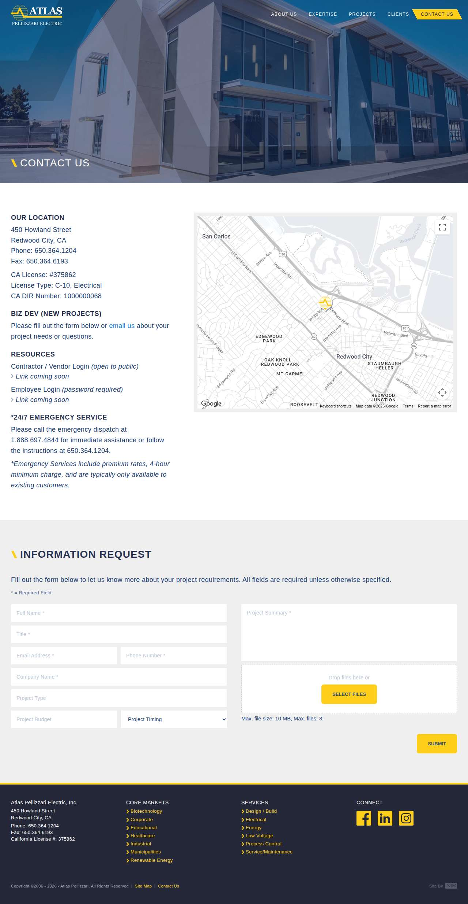

### budgetemllc.com — dry\_run\_ok (dry run)

| | |
|---|---|
| Attempt ID | `64065d91-3e10-46b4-b812-c75ec08313d5` |
| Form URL | https://www.budgetemllc.com/ |
| Final URL | https://www.budgetemllc.com/ |
| Reserved | 2026-11-02 17:01:24 UTC |
| Submit attempted | — |
| Template | standard v2 |
| Confirmation text | none observed |
| Result / error | Selectors verified; fields not typed (domain not in dry-run fill list); not submitted |

Exact message:

~~~text
Subject: Helping customers find your business in AI search (AEO + GEO)

Hi there,

I'm Arun from Devs Arun. More and more customers now ask ChatGPT, Gemini, Perplexity or Google's AI Overviews questions like "who should I hire for this in my area?" before they call anyone. These tools answer from websites they can clearly understand, and they tend to recommend businesses whose pages answer real customer questions.

That is what AEO + GEO (Answer Engine and Generative Engine Optimization) is for. I improve your existing service pages so they clearly answer the questions your customers ask, add structured data that matches the page, and make the call, quote or enquiry step obvious. The benefit: your business gets a better chance of being mentioned or linked in AI answers, and visitors who arrive find it easy to contact you.

The AEO + GEO Starter is a one-time $199 (about ₹16,999, negotiable) for one website: a basic audit, 10 customer questions, improvements to two existing pages, relevant structured data and an action plan, with one revision round.

You can read the full details, send an enquiry or book online here:
https://devsarun.io/aeo-geo/

If this isn't relevant, just reply and I won't contact you again.

Best,
Arun
Devs Arun
itschool408@gmail.com · +91 7654534323
~~~

Submitted field values:

- input\[name="email"\]: itschool408@gmail.com
- input\[name="phone"\]: +91 7654534323
- input\[name="firstName"\]: Arun
- textarea\[name="message"\]: Hi there, I'm Arun from Devs Arun. More and more customers now ask ChatGPT, Gemini, Perplexity or Google's AI Overviews 

**Inspected page** — `run-18cc12b7_attempt-64065d91_inspection_2026-11-02T17-01-27-130Z.jpg`

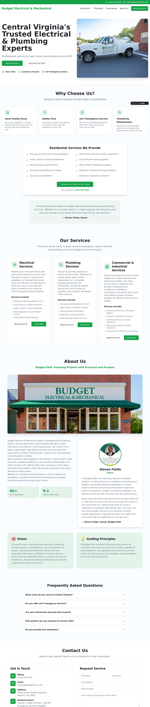

### arizonaelectricians.pro — dry\_run\_ok (dry run)

| | |
|---|---|
| Attempt ID | `d4cb46ef-d623-4639-b36d-93d56dd2ced6` |
| Form URL | https://arizonaelectricians.pro/contact-info.htm |
| Final URL | https://arizonaelectricians.pro/contact-info.htm |
| Reserved | 2026-11-02 17:01:32 UTC |
| Submit attempted | — |
| Template | standard v2 |
| Confirmation text | none observed |
| Result / error | Selectors verified; fields not typed (domain not in dry-run fill list); not submitted |

Exact message:

~~~text
Subject: Helping customers find your business in AI search (AEO + GEO)

Hi there,

I'm Arun from Devs Arun. More and more customers now ask ChatGPT, Gemini, Perplexity or Google's AI Overviews questions like "who should I hire for this in my area?" before they call anyone. These tools answer from websites they can clearly understand, and they tend to recommend businesses whose pages answer real customer questions.

That is what AEO + GEO (Answer Engine and Generative Engine Optimization) is for. I improve your existing service pages so they clearly answer the questions your customers ask, add structured data that matches the page, and make the call, quote or enquiry step obvious. The benefit: your business gets a better chance of being mentioned or linked in AI answers, and visitors who arrive find it easy to contact you.

The AEO + GEO Starter is a one-time $199 (about ₹16,999, negotiable) for one website: a basic audit, 10 customer questions, improvements to two existing pages, relevant structured data and an action plan, with one revision round.

You can read the full details, send an enquiry or book online here:
https://devsarun.io/aeo-geo/

If this isn't relevant, just reply and I won't contact you again.

Best,
Arun
Devs Arun
itschool408@gmail.com · +91 7654534323
~~~

Submitted field values:

- input\[name="name"\]: Arun
- input\[name="email"\]: itschool408@gmail.com
- input\[name="phone"\]: +91 7654534323
- textarea\[name="message"\]: Hi there, I'm Arun from Devs Arun. More and more customers now ask ChatGPT, Gemini, Perplexity or Google's AI Overviews 

**Inspected page** — `run-18cc12b7_attempt-d4cb46ef_inspection_2026-11-02T17-01-33-598Z.jpg`

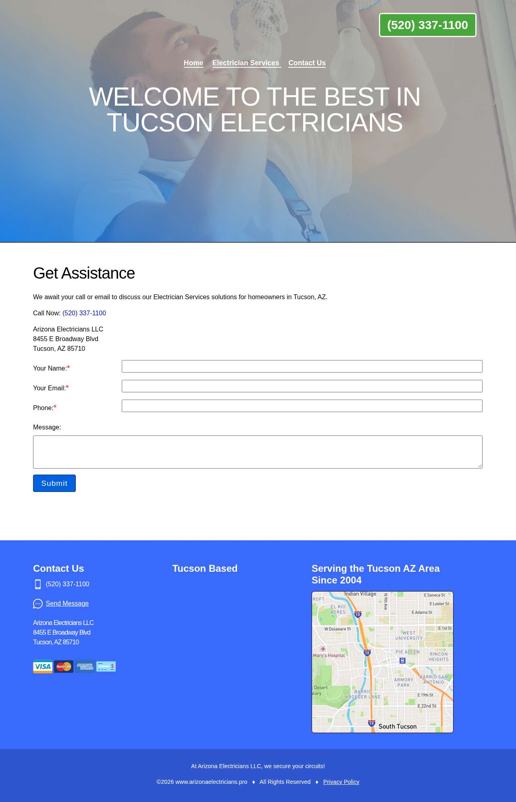

### us.com — dry\_run\_ok (dry run)

| | |
|---|---|
| Attempt ID | `027e9fd9-e5d2-4bce-a5e4-da1af7108f63` |
| Form URL | https://oeg.us.com/ |
| Final URL | https://oeg.us.com/ |
| Reserved | 2026-11-02 17:01:38 UTC |
| Submit attempted | — |
| Template | standard v2 |
| Confirmation text | none observed |
| Result / error | Selectors verified; fields not typed (domain not in dry-run fill list); not submitted |

Exact message:

~~~text
Subject: Helping customers find your business in AI search (AEO + GEO)

Hi there,

I'm Arun from Devs Arun. More and more customers now ask ChatGPT, Gemini, Perplexity or Google's AI Overviews questions like "who should I hire for this in my area?" before they call anyone. These tools answer from websites they can clearly understand, and they tend to recommend businesses whose pages answer real customer questions.

That is what AEO + GEO (Answer Engine and Generative Engine Optimization) is for. I improve your existing service pages so they clearly answer the questions your customers ask, add structured data that matches the page, and make the call, quote or enquiry step obvious. The benefit: your business gets a better chance of being mentioned or linked in AI answers, and visitors who arrive find it easy to contact you.

The AEO + GEO Starter is a one-time $199 (about ₹16,999, negotiable) for one website: a basic audit, 10 customer questions, improvements to two existing pages, relevant structured data and an action plan, with one revision round.

You can read the full details, send an enquiry or book online here:
https://devsarun.io/aeo-geo/

If this isn't relevant, just reply and I won't contact you again.

Best,
Arun
Devs Arun
itschool408@gmail.com · +91 7654534323
~~~

Submitted field values:

- \#input\_1\_1: Arun
- \#input\_1\_2: itschool408@gmail.com
- \#input\_1\_3: Hi there, I'm Arun from Devs Arun. More and more customers now ask ChatGPT, Gemini, Perplexity or Google's AI Overviews 
- \#input\_1\_4: Helping customers find your business in AI search (AEO + GEO)

**Inspected page** — `run-18cc12b7_attempt-027e9fd9_inspection_2026-11-02T17-01-39-971Z.jpg`

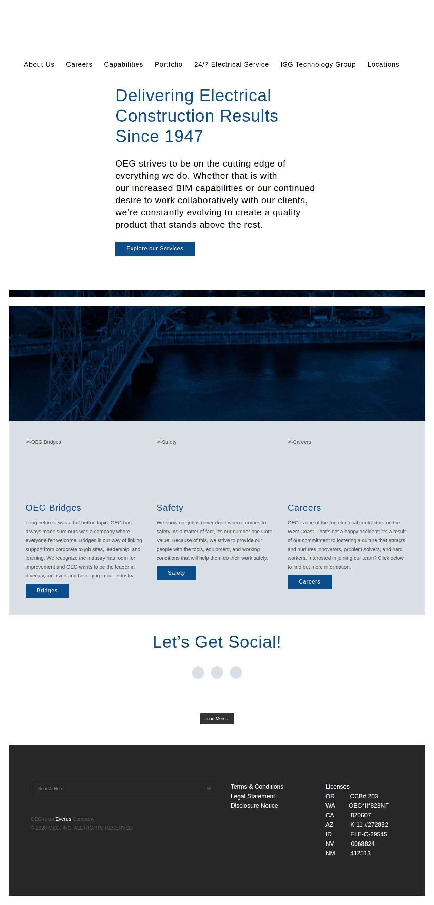

### electricianfortpiercefl.com — dry\_run\_ok (dry run)

| | |
|---|---|
| Attempt ID | `d064eaab-7c62-4837-af5c-ce1267fd87b0` |
| Form URL | https://electricianfortpiercefl.com/contact/ |
| Final URL | https://electricianfortpiercefl.com/contact/ |
| Reserved | 2026-11-02 17:01:44 UTC |
| Submit attempted | — |
| Template | standard v2 |
| Confirmation text | none observed |
| Result / error | Selectors verified; fields not typed (domain not in dry-run fill list); not submitted |

Exact message:

~~~text
Subject: Helping customers find your business in AI search (AEO + GEO)

Hi there,

I'm Arun from Devs Arun. More and more customers now ask ChatGPT, Gemini, Perplexity or Google's AI Overviews questions like "who should I hire for this in my area?" before they call anyone. These tools answer from websites they can clearly understand, and they tend to recommend businesses whose pages answer real customer questions.

That is what AEO + GEO (Answer Engine and Generative Engine Optimization) is for. I improve your existing service pages so they clearly answer the questions your customers ask, add structured data that matches the page, and make the call, quote or enquiry step obvious. The benefit: your business gets a better chance of being mentioned or linked in AI answers, and visitors who arrive find it easy to contact you.

The AEO + GEO Starter is a one-time $199 (about ₹16,999, negotiable) for one website: a basic audit, 10 customer questions, improvements to two existing pages, relevant structured data and an action plan, with one revision round.

You can read the full details, send an enquiry or book online here:
https://devsarun.io/aeo-geo/

If this isn't relevant, just reply and I won't contact you again.

Best,
Arun
Devs Arun
itschool408@gmail.com · +91 7654534323
~~~

Submitted field values:

- \#contact-name: Arun
- \#contact-email: itschool408@gmail.com
- \#contact-message: Hi there, I'm Arun from Devs Arun. More and more customers now ask ChatGPT, Gemini, Perplexity or Google's AI Overviews 

**Inspected page** — `run-18cc12b7_attempt-d064eaab_inspection_2026-11-02T17-01-46-217Z.jpg`

### gowatts.com — dry\_run\_ok (dry run)

| | |
|---|---|
| Attempt ID | `395c76a7-a8d5-4479-b53f-f320011f5756` |
| Form URL | https://gowatts.com/contact-us |
| Final URL | https://gowatts.com/contact-us |
| Reserved | 2026-11-02 17:01:51 UTC |
| Submit attempted | — |
| Template | standard v2 |
| Confirmation text | none observed |
| Result / error | Selectors verified; fields not typed (domain not in dry-run fill list); not submitted |

Exact message:

~~~text
Subject: Helping customers find your business in AI search (AEO + GEO)

Hi there,

I'm Arun from Devs Arun. More and more customers now ask ChatGPT, Gemini, Perplexity or Google's AI Overviews questions like "who should I hire for this in my area?" before they call anyone. These tools answer from websites they can clearly understand, and they tend to recommend businesses whose pages answer real customer questions.

That is what AEO + GEO (Answer Engine and Generative Engine Optimization) is for. I improve your existing service pages so they clearly answer the questions your customers ask, add structured data that matches the page, and make the call, quote or enquiry step obvious. The benefit: your business gets a better chance of being mentioned or linked in AI answers, and visitors who arrive find it easy to contact you.

The AEO + GEO Starter is a one-time $199 (about ₹16,999, negotiable) for one website: a basic audit, 10 customer questions, improvements to two existing pages, relevant structured data and an action plan, with one revision round.

You can read the full details, send an enquiry or book online here:
https://devsarun.io/aeo-geo/

If this isn't relevant, just reply and I won't contact you again.

Best,
Arun
Devs Arun
itschool408@gmail.com · +91 7654534323
~~~

Submitted field values:

- \#edit-name: Arun
- \#edit-email: itschool408@gmail.com
- \#edit-phone: +91 7654534323
- \#edit-message: Hi there, I'm Arun from Devs Arun. More and more customers now ask ChatGPT, Gemini, Perplexity or Google's AI Overviews 

**Inspected page** — `run-18cc12b7_attempt-395c76a7_inspection_2026-11-02T17-01-52-456Z.jpg`

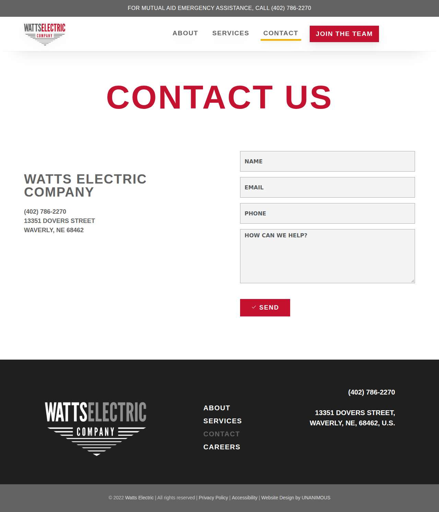

### all-propower.com — dry\_run\_ok (dry run)

| | |
|---|---|
| Attempt ID | `07cc43c8-e460-4937-a084-b19bf7753d29` |
| Form URL | https://all-propower.com/contact/ |
| Final URL | https://all-propower.com/contact/ |
| Reserved | 2026-11-02 17:01:57 UTC |
| Submit attempted | — |
| Template | standard v2 |
| Confirmation text | none observed |
| Result / error | Selectors verified; fields not typed (domain not in dry-run fill list); not submitted |

Exact message:

~~~text
Subject: Helping customers find your business in AI search (AEO + GEO)

Hi there,

I'm Arun from Devs Arun. More and more customers now ask ChatGPT, Gemini, Perplexity or Google's AI Overviews questions like "who should I hire for this in my area?" before they call anyone. These tools answer from websites they can clearly understand, and they tend to recommend businesses whose pages answer real customer questions.

That is what AEO + GEO (Answer Engine and Generative Engine Optimization) is for. I improve your existing service pages so they clearly answer the questions your customers ask, add structured data that matches the page, and make the call, quote or enquiry step obvious. The benefit: your business gets a better chance of being mentioned or linked in AI answers, and visitors who arrive find it easy to contact you.

The AEO + GEO Starter is a one-time $199 (about ₹16,999, negotiable) for one website: a basic audit, 10 customer questions, improvements to two existing pages, relevant structured data and an action plan, with one revision round.

You can read the full details, send an enquiry or book online here:
https://devsarun.io/aeo-geo/

If this isn't relevant, just reply and I won't contact you again.

Best,
Arun
Devs Arun
itschool408@gmail.com · +91 7654534323
~~~

Submitted field values:

- \#form-field-name: Arun
- \#form-field-email: itschool408@gmail.com
- \#form-field-message: Hi there, I'm Arun from Devs Arun. More and more customers now ask ChatGPT, Gemini, Perplexity or Google's AI Overviews 

**Inspected page** — `run-18cc12b7_attempt-07cc43c8_inspection_2026-11-02T17-01-59-004Z.jpg`

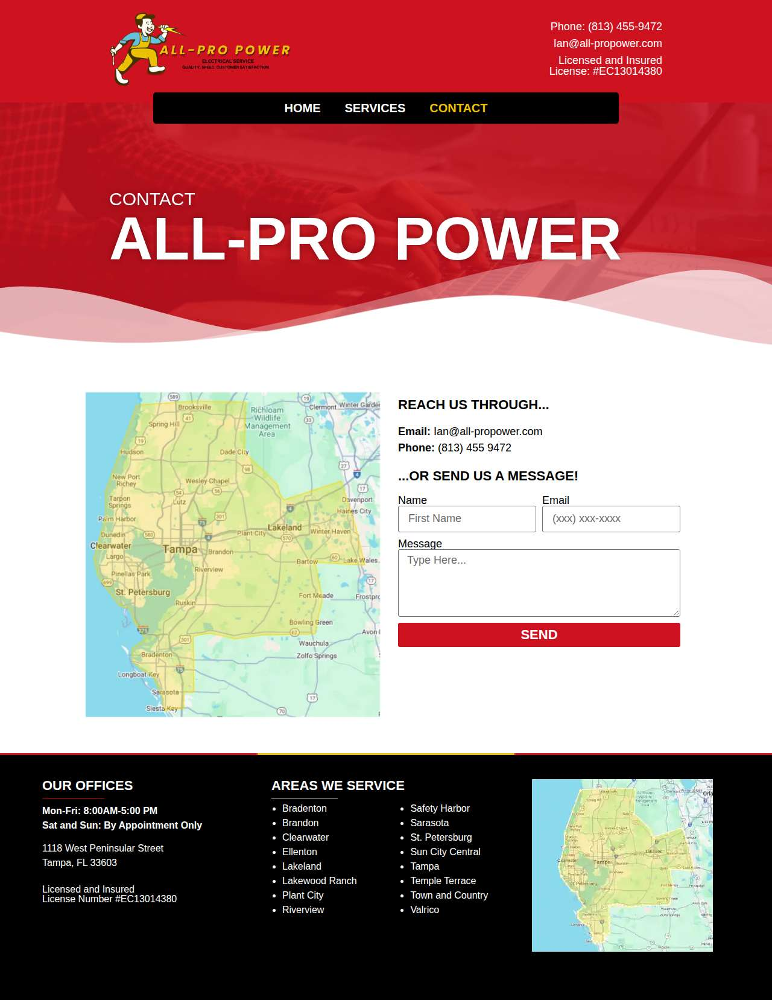

### gm-electric.com — dry\_run\_ok (dry run)

| | |
|---|---|
| Attempt ID | `ba5184d3-268e-48aa-bf24-73e7ff2e8a00` |
| Form URL | https://www.gm-electric.com/ |
| Final URL | https://www.gm-electric.com/ |
| Reserved | 2026-11-02 17:02:04 UTC |
| Submit attempted | — |
| Template | standard v2 |
| Confirmation text | none observed |
| Result / error | Selectors verified; fields not typed (domain not in dry-run fill list); not submitted |

Exact message:

~~~text
Subject: Helping customers find your business in AI search (AEO + GEO)

Hi there,

I'm Arun from Devs Arun. More and more customers now ask ChatGPT, Gemini, Perplexity or Google's AI Overviews questions like "who should I hire for this in my area?" before they call anyone. These tools answer from websites they can clearly understand, and they tend to recommend businesses whose pages answer real customer questions.

That is what AEO + GEO (Answer Engine and Generative Engine Optimization) is for. I improve your existing service pages so they clearly answer the questions your customers ask, add structured data that matches the page, and make the call, quote or enquiry step obvious. The benefit: your business gets a better chance of being mentioned or linked in AI answers, and visitors who arrive find it easy to contact you.

The AEO + GEO Starter is a one-time $199 (about ₹16,999, negotiable) for one website: a basic audit, 10 customer questions, improvements to two existing pages, relevant structured data and an action plan, with one revision round.

You can read the full details, send an enquiry or book online here:
https://devsarun.io/aeo-geo/

If this isn't relevant, just reply and I won't contact you again.

Best,
Arun
Devs Arun
itschool408@gmail.com · +91 7654534323
~~~

Submitted field values:

- \#input\_comp-kfywkut8: Arun
- \#input\_comp-kfywkutk: itschool408@gmail.com
- \#input\_comp-kfywkutp: Helping customers find your business in AI search (AEO + GEO)
- \#textarea\_comp-kfywkutt1: Hi there, I'm Arun from Devs Arun. More and more customers now ask ChatGPT, Gemini, Perplexity or Google's AI Overviews 

**Inspected page** — `run-18cc12b7_attempt-ba5184d3_inspection_2026-11-02T17-02-06-215Z.jpg`

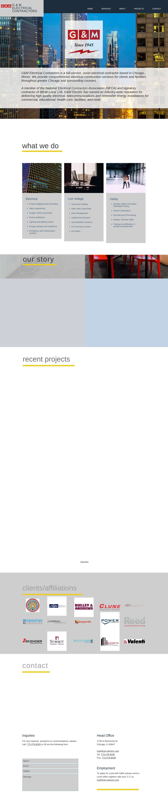

### jimstagnittaelectric.com — dry\_run\_ok (dry run)

| | |
|---|---|
| Attempt ID | `c60b8383-4e48-478a-9d04-079220b5509a` |
| Form URL | https://www.jimstagnittaelectric.com/ |
| Final URL | https://www.jimstagnittaelectric.com/ |
| Reserved | 2026-11-02 17:02:11 UTC |
| Submit attempted | — |
| Template | standard v2 |
| Confirmation text | none observed |
| Result / error | Selectors verified; fields not typed (domain not in dry-run fill list); not submitted |

Exact message:

~~~text
Subject: Helping customers find your business in AI search (AEO + GEO)

Hi there,

I'm Arun from Devs Arun. More and more customers now ask ChatGPT, Gemini, Perplexity or Google's AI Overviews questions like "who should I hire for this in my area?" before they call anyone. These tools answer from websites they can clearly understand, and they tend to recommend businesses whose pages answer real customer questions.

That is what AEO + GEO (Answer Engine and Generative Engine Optimization) is for. I improve your existing service pages so they clearly answer the questions your customers ask, add structured data that matches the page, and make the call, quote or enquiry step obvious. The benefit: your business gets a better chance of being mentioned or linked in AI answers, and visitors who arrive find it easy to contact you.

The AEO + GEO Starter is a one-time $199 (about ₹16,999, negotiable) for one website: a basic audit, 10 customer questions, improvements to two existing pages, relevant structured data and an action plan, with one revision round.

You can read the full details, send an enquiry or book online here:
https://devsarun.io/aeo-geo/

If this isn't relevant, just reply and I won't contact you again.

Best,
Arun
Devs Arun
itschool408@gmail.com · +91 7654534323
~~~

Submitted field values:

- \#input\_comp-kco1a0ox: Arun
- \#input\_comp-kco1a0pf: itschool408@gmail.com
- \#textarea\_comp-kco1a0pu: Hi there, I'm Arun from Devs Arun. More and more customers now ask ChatGPT, Gemini, Perplexity or Google's AI Overviews 

**Inspected page** — `run-18cc12b7_attempt-c60b8383_inspection_2026-11-02T17-02-13-552Z.jpg`

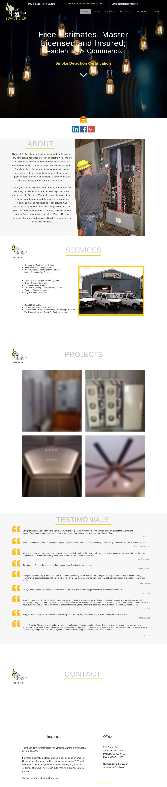

### wbelectric-tn.com — dry\_run\_ok (dry run)

| | |
|---|---|
| Attempt ID | `867438c4-91c7-4ece-a4ba-0b8e7ecc8e77` |
| Form URL | https://wbelectric-tn.com/contact/ |
| Final URL | https://wbelectric-tn.com/contact/ |
| Reserved | 2026-11-02 17:02:18 UTC |
| Submit attempted | — |
| Template | standard v2 |
| Confirmation text | none observed |
| Result / error | Selectors verified; fields not typed (domain not in dry-run fill list); not submitted |

Exact message:

~~~text
Subject: Helping customers find your business in AI search (AEO + GEO)

Hi there,

I'm Arun from Devs Arun. More and more customers now ask ChatGPT, Gemini, Perplexity or Google's AI Overviews questions like "who should I hire for this in my area?" before they call anyone. These tools answer from websites they can clearly understand, and they tend to recommend businesses whose pages answer real customer questions.

That is what AEO + GEO (Answer Engine and Generative Engine Optimization) is for. I improve your existing service pages so they clearly answer the questions your customers ask, add structured data that matches the page, and make the call, quote or enquiry step obvious. The benefit: your business gets a better chance of being mentioned or linked in AI answers, and visitors who arrive find it easy to contact you.

The AEO + GEO Starter is a one-time $199 (about ₹16,999, negotiable) for one website: a basic audit, 10 customer questions, improvements to two existing pages, relevant structured data and an action plan, with one revision round.

You can read the full details, send an enquiry or book online here:
https://devsarun.io/aeo-geo/

If this isn't relevant, just reply and I won't contact you again.

Best,
Arun
Devs Arun
itschool408@gmail.com · +91 7654534323
~~~

Submitted field values:

- \#input\_2\_3: itschool408@gmail.com
- \#input\_2\_4: +91 7654534323
- \#input\_2\_18: Hi there, I'm Arun from Devs Arun. More and more customers now ask ChatGPT, Gemini, Perplexity or Google's AI Overviews 
- \#input\_2\_1\_3: Arun

**Inspected page** — `run-18cc12b7_attempt-867438c4_inspection_2026-11-02T17-02-20-200Z.jpg`

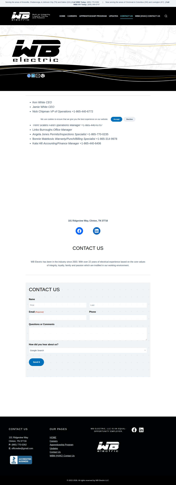

### duggerelectric.com — dry\_run\_ok (dry run)

| | |
|---|---|
| Attempt ID | `e6540e60-d9f8-43f7-ab8c-be52c245b390` |
| Form URL | https://www.duggerelectric.com/contact/ |
| Final URL | https://www.duggerelectric.com/contact/ |
| Reserved | 2026-11-02 17:02:25 UTC |
| Submit attempted | — |
| Template | standard v2 |
| Confirmation text | none observed |
| Result / error | Selectors verified; fields not typed (domain not in dry-run fill list); not submitted |

Exact message:

~~~text
Subject: Helping customers find your business in AI search (AEO + GEO)

Hi there,

I'm Arun from Devs Arun. More and more customers now ask ChatGPT, Gemini, Perplexity or Google's AI Overviews questions like "who should I hire for this in my area?" before they call anyone. These tools answer from websites they can clearly understand, and they tend to recommend businesses whose pages answer real customer questions.

That is what AEO + GEO (Answer Engine and Generative Engine Optimization) is for. I improve your existing service pages so they clearly answer the questions your customers ask, add structured data that matches the page, and make the call, quote or enquiry step obvious. The benefit: your business gets a better chance of being mentioned or linked in AI answers, and visitors who arrive find it easy to contact you.

The AEO + GEO Starter is a one-time $199 (about ₹16,999, negotiable) for one website: a basic audit, 10 customer questions, improvements to two existing pages, relevant structured data and an action plan, with one revision round.

You can read the full details, send an enquiry or book online here:
https://devsarun.io/aeo-geo/

If this isn't relevant, just reply and I won't contact you again.

Best,
Arun
Devs Arun
itschool408@gmail.com · +91 7654534323
~~~

Submitted field values:

- \#field238169685ea6-15: Hi there, I'm Arun from Devs Arun. More and more customers now ask ChatGPT, Gemini, Perplexity or Google's AI Overviews 
- \#field23816976dc20-c5: +91 7654534323
- \#field238169b14333-8f: Arun
- \#field238169c5abcd-00: itschool408@gmail.com

**Inspected page** — `run-18cc12b7_attempt-e6540e60_inspection_2026-11-02T17-02-28-530Z.jpg`

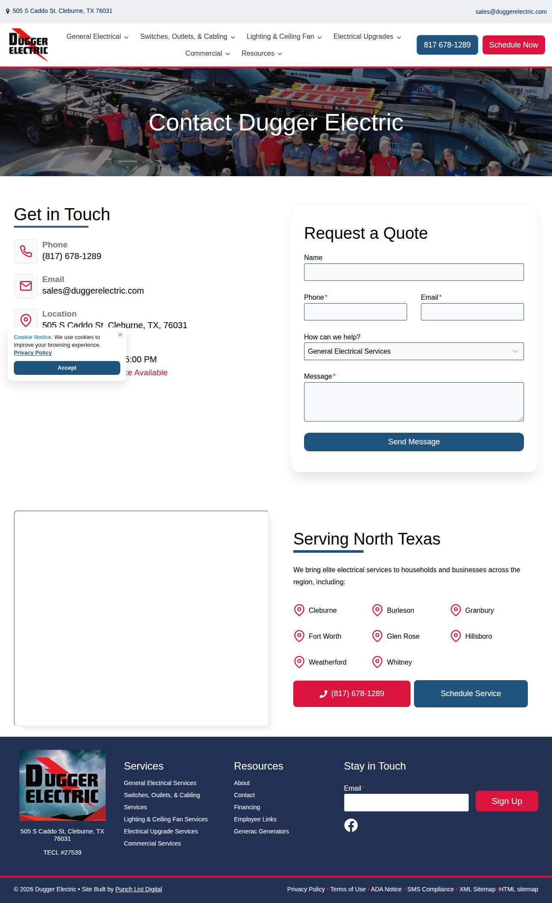

### gnelectricinc.com — dry\_run\_ok (dry run)

| | |
|---|---|
| Attempt ID | `43f1bc85-94d7-4b2d-aa78-8149d033eb2c` |
| Form URL | https://www.gnelectricinc.com/contact/ |
| Final URL | https://www.gnelectricinc.com/contact/ |
| Reserved | 2026-11-02 17:02:33 UTC |
| Submit attempted | — |
| Template | standard v2 |
| Confirmation text | none observed |
| Result / error | Selectors verified; fields not typed (domain not in dry-run fill list); not submitted |

Exact message:

~~~text
Subject: Helping customers find your business in AI search (AEO + GEO)

Hi there,

I'm Arun from Devs Arun. More and more customers now ask ChatGPT, Gemini, Perplexity or Google's AI Overviews questions like "who should I hire for this in my area?" before they call anyone. These tools answer from websites they can clearly understand, and they tend to recommend businesses whose pages answer real customer questions.

That is what AEO + GEO (Answer Engine and Generative Engine Optimization) is for. I improve your existing service pages so they clearly answer the questions your customers ask, add structured data that matches the page, and make the call, quote or enquiry step obvious. The benefit: your business gets a better chance of being mentioned or linked in AI answers, and visitors who arrive find it easy to contact you.

The AEO + GEO Starter is a one-time $199 (about ₹16,999, negotiable) for one website: a basic audit, 10 customer questions, improvements to two existing pages, relevant structured data and an action plan, with one revision round.

You can read the full details, send an enquiry or book online here:
https://devsarun.io/aeo-geo/

If this isn't relevant, just reply and I won't contact you again.

Best,
Arun
Devs Arun
itschool408@gmail.com · +91 7654534323
~~~

Submitted field values:

- \#kb\_field\_12\_3ec66d-c6\_0: Arun
- \#kb\_field\_12\_3ec66d-c6\_1: itschool408@gmail.com
- \#kb\_field\_12\_3ec66d-c6\_2: Hi there, I'm Arun from Devs Arun. More and more customers now ask ChatGPT, Gemini, Perplexity or Google's AI Overviews 

**Inspected page** — `run-18cc12b7_attempt-43f1bc85_inspection_2026-11-02T17-02-36-623Z.jpg`

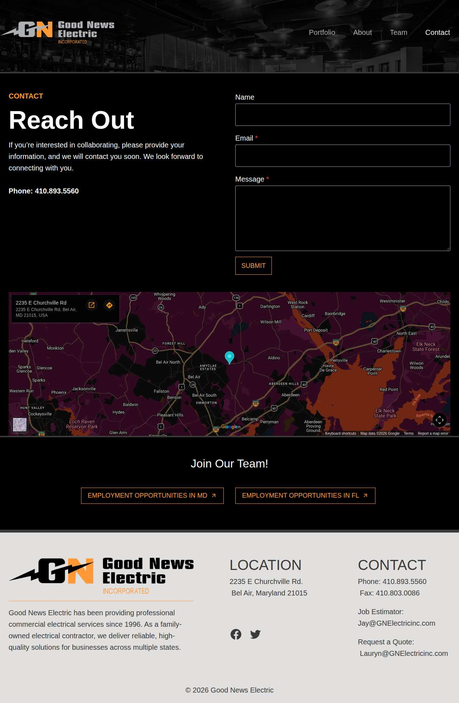

### gatewoodelectricmotors.com — dry\_run\_ok (dry run)

| | |
|---|---|
| Attempt ID | `801f9c8a-9980-4329-abe9-bfff52e9b827` |
| Form URL | https://www.gatewoodelectricmotors.com/contact.html |
| Final URL | https://www.gatewoodelectricmotors.com/contact.html |
| Reserved | 2026-11-02 17:02:41 UTC |
| Submit attempted | — |
| Template | standard v2 |
| Confirmation text | none observed |
| Result / error | Selectors verified; fields not typed (domain not in dry-run fill list); not submitted |

Exact message:

~~~text
Subject: Helping customers find your business in AI search (AEO + GEO)

Hi there,

I'm Arun from Devs Arun. More and more customers now ask ChatGPT, Gemini, Perplexity or Google's AI Overviews questions like "who should I hire for this in my area?" before they call anyone. These tools answer from websites they can clearly understand, and they tend to recommend businesses whose pages answer real customer questions.

That is what AEO + GEO (Answer Engine and Generative Engine Optimization) is for. I improve your existing service pages so they clearly answer the questions your customers ask, add structured data that matches the page, and make the call, quote or enquiry step obvious. The benefit: your business gets a better chance of being mentioned or linked in AI answers, and visitors who arrive find it easy to contact you.

The AEO + GEO Starter is a one-time $199 (about ₹16,999, negotiable) for one website: a basic audit, 10 customer questions, improvements to two existing pages, relevant structured data and an action plan, with one revision round.

You can read the full details, send an enquiry or book online here:
https://devsarun.io/aeo-geo/

If this isn't relevant, just reply and I won't contact you again.

Best,
Arun
Devs Arun
itschool408@gmail.com · +91 7654534323
~~~

Submitted field values:

- input\[name="1"\]: Arun
- input\[name="2"\]: itschool408@gmail.com
- textarea\[name="3"\]: Hi there, I'm Arun from Devs Arun. More and more customers now ask ChatGPT, Gemini, Perplexity or Google's AI Overviews 

**Inspected page** — `run-18cc12b7_attempt-801f9c8a_inspection_2026-11-02T17-02-44-668Z.jpg`

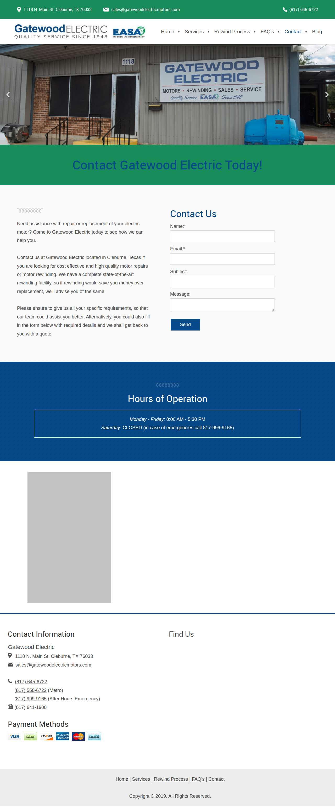

### rcipowerinc.com — dry\_run\_ok (dry run)

| | |
|---|---|
| Attempt ID | `9e692413-cbb1-44d3-b484-ca0da845c970` |
| Form URL | https://www.rcipowerinc.com/ |
| Final URL | https://www.rcipowerinc.com/ |
| Reserved | 2026-11-02 17:02:49 UTC |
| Submit attempted | — |
| Template | standard v2 |
| Confirmation text | none observed |
| Result / error | Selectors verified; fields not typed (domain not in dry-run fill list); not submitted |

Exact message:

~~~text
Subject: Helping customers find your business in AI search (AEO + GEO)

Hi there,

I'm Arun from Devs Arun. More and more customers now ask ChatGPT, Gemini, Perplexity or Google's AI Overviews questions like "who should I hire for this in my area?" before they call anyone. These tools answer from websites they can clearly understand, and they tend to recommend businesses whose pages answer real customer questions.

That is what AEO + GEO (Answer Engine and Generative Engine Optimization) is for. I improve your existing service pages so they clearly answer the questions your customers ask, add structured data that matches the page, and make the call, quote or enquiry step obvious. The benefit: your business gets a better chance of being mentioned or linked in AI answers, and visitors who arrive find it easy to contact you.

The AEO + GEO Starter is a one-time $199 (about ₹16,999, negotiable) for one website: a basic audit, 10 customer questions, improvements to two existing pages, relevant structured data and an action plan, with one revision round.

You can read the full details, send an enquiry or book online here:
https://devsarun.io/aeo-geo/

If this isn't relevant, just reply and I won't contact you again.

Best,
Arun
Devs Arun
itschool408@gmail.com · +91 7654534323
~~~

Submitted field values:

- \#contact\_email: itschool408@gmail.com
- \#contact\_phone: +91 7654534323
- \#contact\_message: Hi there, I'm Arun from Devs Arun. More and more customers now ask ChatGPT, Gemini, Perplexity or Google's AI Overviews 

**Inspected page** — `run-18cc12b7_attempt-9e692413_inspection_2026-11-02T17-02-51-464Z.jpg`

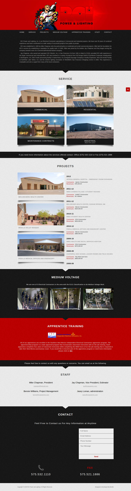

### humphreyelectricoh.com — dry\_run\_ok (dry run)

| | |
|---|---|
| Attempt ID | `8ddadb51-514f-47d0-ba3f-0a7a07900f95` |
| Form URL | https://humphreyelectricoh.com/contact/ |
| Final URL | https://humphreyelectricoh.com/contact/ |
| Reserved | 2026-11-02 17:02:56 UTC |
| Submit attempted | — |
| Template | standard v2 |
| Confirmation text | none observed |
| Result / error | Selectors verified; fields not typed (domain not in dry-run fill list); not submitted |

Exact message:

~~~text
Subject: Helping customers find your business in AI search (AEO + GEO)

Hi there,

I'm Arun from Devs Arun. More and more customers now ask ChatGPT, Gemini, Perplexity or Google's AI Overviews questions like "who should I hire for this in my area?" before they call anyone. These tools answer from websites they can clearly understand, and they tend to recommend businesses whose pages answer real customer questions.

That is what AEO + GEO (Answer Engine and Generative Engine Optimization) is for. I improve your existing service pages so they clearly answer the questions your customers ask, add structured data that matches the page, and make the call, quote or enquiry step obvious. The benefit: your business gets a better chance of being mentioned or linked in AI answers, and visitors who arrive find it easy to contact you.

The AEO + GEO Starter is a one-time $199 (about ₹16,999, negotiable) for one website: a basic audit, 10 customer questions, improvements to two existing pages, relevant structured data and an action plan, with one revision round.

You can read the full details, send an enquiry or book online here:
https://devsarun.io/aeo-geo/

If this isn't relevant, just reply and I won't contact you again.

Best,
Arun
Devs Arun
itschool408@gmail.com · +91 7654534323
~~~

Submitted field values:

- \#name: Arun
- \#email: itschool408@gmail.com
- \#phone: +91 7654534323
- \#message: Hi there, I'm Arun from Devs Arun. More and more customers now ask ChatGPT, Gemini, Perplexity or Google's AI Overviews 

**Inspected page** — `run-18cc12b7_attempt-8ddadb51_inspection_2026-11-02T17-02-58-198Z.jpg`

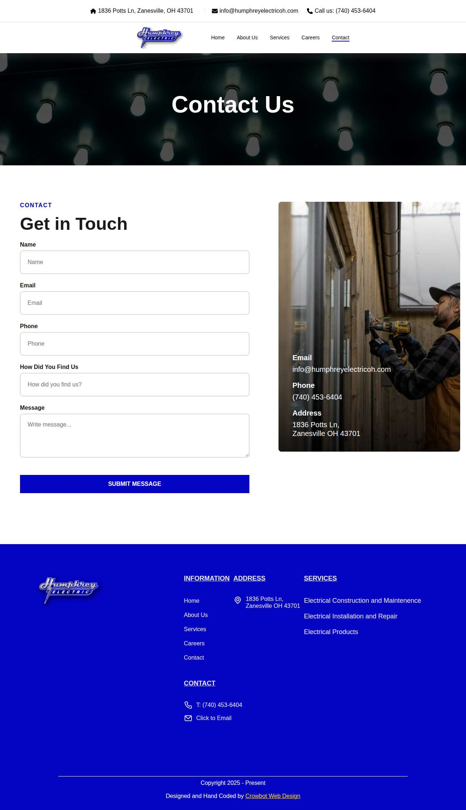

### stasneyelectric.com — dry\_run\_ok (dry run)

| | |
|---|---|
| Attempt ID | `1589a742-3f30-40d7-91e5-631d48e98d34` |
| Form URL | https://www.stasneyelectric.com/contact-us/4842370 |
| Final URL | https://www.stasneyelectric.com/contact-us/4842370 |
| Reserved | 2026-11-02 17:03:03 UTC |
| Submit attempted | — |
| Template | standard v2 |
| Confirmation text | none observed |
| Result / error | Selectors verified; fields not typed (domain not in dry-run fill list); not submitted |

Exact message:

~~~text
Subject: Helping customers find your business in AI search (AEO + GEO)

Hi there,

I'm Arun from Devs Arun. More and more customers now ask ChatGPT, Gemini, Perplexity or Google's AI Overviews questions like "who should I hire for this in my area?" before they call anyone. These tools answer from websites they can clearly understand, and they tend to recommend businesses whose pages answer real customer questions.

That is what AEO + GEO (Answer Engine and Generative Engine Optimization) is for. I improve your existing service pages so they clearly answer the questions your customers ask, add structured data that matches the page, and make the call, quote or enquiry step obvious. The benefit: your business gets a better chance of being mentioned or linked in AI answers, and visitors who arrive find it easy to contact you.

The AEO + GEO Starter is a one-time $199 (about ₹16,999, negotiable) for one website: a basic audit, 10 customer questions, improvements to two existing pages, relevant structured data and an action plan, with one revision round.

You can read the full details, send an enquiry or book online here:
https://devsarun.io/aeo-geo/

If this isn't relevant, just reply and I won't contact you again.

Best,
Arun
Devs Arun
itschool408@gmail.com · +91 7654534323
~~~

Submitted field values:

- \#\\31 148272865: Hi there, I'm Arun from Devs Arun. More and more customers now ask ChatGPT, Gemini, Perplexity or Google's AI Overviews 
- \#\\31 259643272: Arun
- \#\\31 444324975: +91 7654534323
- \#\\31 944118556: itschool408@gmail.com

**Inspected page** — `run-18cc12b7_attempt-1589a742_inspection_2026-11-02T17-03-05-338Z.jpg`

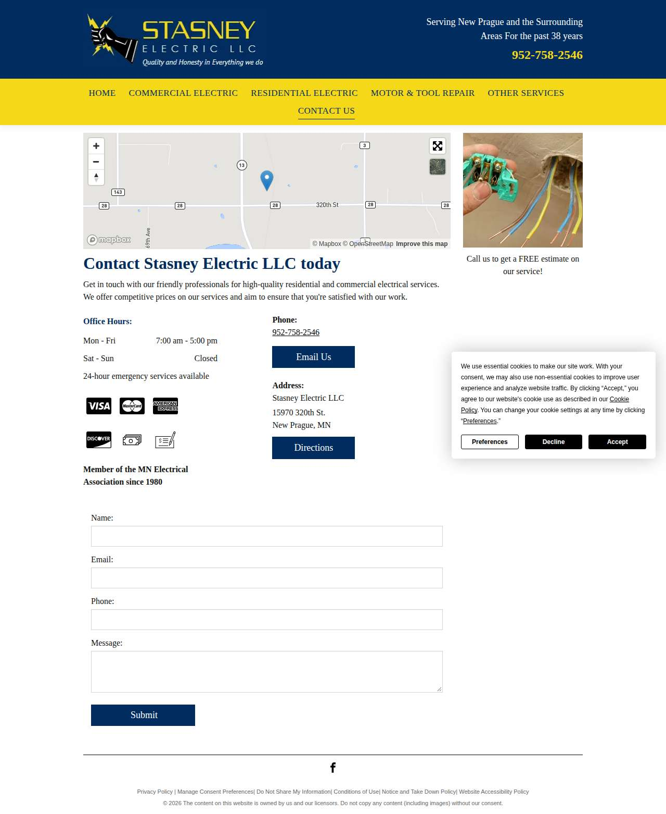

### ableelectric.biz — dry\_run\_ok (dry run)

| | |
|---|---|
| Attempt ID | `f7084d6f-63fa-456c-9bb1-117b36904ef0` |
| Form URL | https://www.ableelectric.biz/contact-us |
| Final URL | https://www.ableelectric.biz/contact-us |
| Reserved | 2026-11-02 17:03:10 UTC |
| Submit attempted | — |
| Template | standard v2 |
| Confirmation text | none observed |
| Result / error | Selectors verified; fields not typed (domain not in dry-run fill list); not submitted |

Exact message:

~~~text
Subject: Helping customers find your business in AI search (AEO + GEO)

Hi there,

I'm Arun from Devs Arun. More and more customers now ask ChatGPT, Gemini, Perplexity or Google's AI Overviews questions like "who should I hire for this in my area?" before they call anyone. These tools answer from websites they can clearly understand, and they tend to recommend businesses whose pages answer real customer questions.

That is what AEO + GEO (Answer Engine and Generative Engine Optimization) is for. I improve your existing service pages so they clearly answer the questions your customers ask, add structured data that matches the page, and make the call, quote or enquiry step obvious. The benefit: your business gets a better chance of being mentioned or linked in AI answers, and visitors who arrive find it easy to contact you.

The AEO + GEO Starter is a one-time $199 (about ₹16,999, negotiable) for one website: a basic audit, 10 customer questions, improvements to two existing pages, relevant structured data and an action plan, with one revision round.

You can read the full details, send an enquiry or book online here:
https://devsarun.io/aeo-geo/

If this isn't relevant, just reply and I won't contact you again.

Best,
Arun
Devs Arun
itschool408@gmail.com · +91 7654534323
~~~

Submitted field values:

- \#\\31 249999350: +91 7654534323
- \#\\31 410846120: Hi there, I'm Arun from Devs Arun. More and more customers now ask ChatGPT, Gemini, Perplexity or Google's AI Overviews 
- \#\\31 697819165: Helping customers find your business in AI search (AEO + GEO)
- \#\\31 920320209: itschool408@gmail.com
- \#\\31 947248170: Arun

**Inspected page** — `run-18cc12b7_attempt-f7084d6f_inspection_2026-11-02T17-03-14-400Z.jpg`

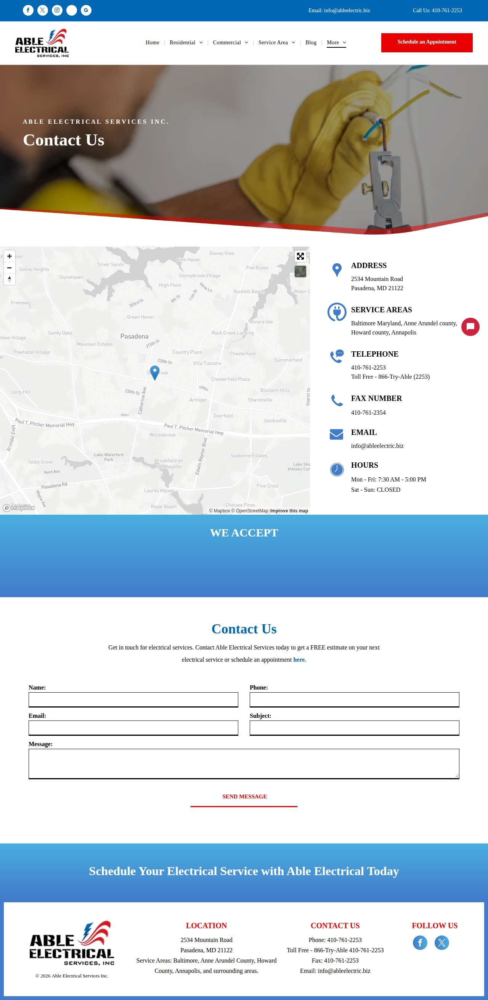

## Events (104)

| Time (UTC) | Event | Website | Details |
|---|---|---|---|
| 17:00:49 | run\_queued | — | dry\_run run requested by github:itsDevsArun |
| 17:00:49 | run\_dispatched | — | dispatch disabled (local test mode) |
| 17:00:52 | run\_started | — | Runner claimed dry\_run run |
| 17:00:52 | website\_selected | helixmechanical.com | Dry-run target helixmechanical.com |
| 17:00:52 | draft\_prepared | helixmechanical.com | Draft prepared with template standard v2 |
| 17:00:56 | page\_opened | helixmechanical.com | Opened form page |
| 17:00:56 | screenshot\_saved | helixmechanical.com | inspection screenshot saved (54 KB) |
| 17:00:56 | review\_required | helixmechanical.com | dry run failed: Mapped field "First Name \*" not found uniquely |
| 17:01:01 | website\_selected | knoxvilleelectrician.com | Dry-run target knoxvilleelectrician.com |
| 17:01:01 | draft\_prepared | knoxvilleelectrician.com | Draft prepared with template standard v2 |
| 17:01:05 | page\_opened | knoxvilleelectrician.com | Opened form page |
| 17:01:05 | screenshot\_saved | knoxvilleelectrician.com | inspection screenshot saved (137 KB) |
| 17:01:05 | review\_required | knoxvilleelectrician.com | dry run failed: Mapped field "Name" not found uniquely |
| 17:01:10 | website\_selected | glescoelectric.com | Dry-run target glescoelectric.com |
| 17:01:10 | draft\_prepared | glescoelectric.com | Draft prepared with template standard v2 |
| 17:01:12 | page\_opened | glescoelectric.com | Opened form page |
| 17:01:12 | screenshot\_saved | glescoelectric.com | inspection screenshot saved (73 KB) |
| 17:01:12 | dry\_run\_checked | glescoelectric.com | dry run ok: Selectors verified; fields not typed (domain not in dry-run fill list); not submitted |
| 17:01:17 | website\_selected | atlas-pellizzari.com | Dry-run target atlas-pellizzari.com |
| 17:01:17 | draft\_prepared | atlas-pellizzari.com | Draft prepared with template standard v2 |
| 17:01:19 | page\_opened | atlas-pellizzari.com | Opened form page |
| 17:01:19 | screenshot\_saved | atlas-pellizzari.com | inspection screenshot saved (191 KB) |
| 17:01:19 | dry\_run\_checked | atlas-pellizzari.com | dry run ok: Selectors verified; fields not typed (domain not in dry-run fill list); not submitted |
| 17:01:24 | website\_selected | budgetemllc.com | Dry-run target budgetemllc.com |
| 17:01:24 | draft\_prepared | budgetemllc.com | Draft prepared with template standard v2 |
| 17:01:26 | page\_opened | budgetemllc.com | Opened form page |
| 17:01:27 | screenshot\_saved | budgetemllc.com | inspection screenshot saved (517 KB) |
| 17:01:27 | dry\_run\_checked | budgetemllc.com | dry run ok: Selectors verified; fields not typed (domain not in dry-run fill list); not submitted |
| 17:01:32 | website\_selected | arizonaelectricians.pro | Dry-run target arizonaelectricians.pro |
| 17:01:32 | draft\_prepared | arizonaelectricians.pro | Draft prepared with template standard v2 |
| 17:01:33 | page\_opened | arizonaelectricians.pro | Opened form page |
| 17:01:33 | screenshot\_saved | arizonaelectricians.pro | inspection screenshot saved (114 KB) |
| 17:01:33 | dry\_run\_checked | arizonaelectricians.pro | dry run ok: Selectors verified; fields not typed (domain not in dry-run fill list); not submitted |
| 17:01:38 | website\_selected | us.com | Dry-run target us.com |
| 17:01:38 | draft\_prepared | us.com | Draft prepared with template standard v2 |
| 17:01:39 | page\_opened | us.com | Opened form page |
| 17:01:39 | screenshot\_saved | us.com | inspection screenshot saved (163 KB) |
| 17:01:39 | dry\_run\_checked | us.com | dry run ok: Selectors verified; fields not typed (domain not in dry-run fill list); not submitted |
| 17:01:44 | website\_selected | electricianfortpiercefl.com | Dry-run target electricianfortpiercefl.com |
| 17:01:44 | draft\_prepared | electricianfortpiercefl.com | Draft prepared with template standard v2 |
| 17:01:46 | page\_opened | electricianfortpiercefl.com | Opened form page |
| 17:01:46 | screenshot\_saved | electricianfortpiercefl.com | inspection screenshot saved (263 KB) |
| 17:01:46 | dry\_run\_checked | electricianfortpiercefl.com | dry run ok: Selectors verified; fields not typed (domain not in dry-run fill list); not submitted |
| 17:01:51 | website\_selected | gowatts.com | Dry-run target gowatts.com |
| 17:01:51 | draft\_prepared | gowatts.com | Draft prepared with template standard v2 |
| 17:01:52 | page\_opened | gowatts.com | Opened form page |
| 17:01:52 | screenshot\_saved | gowatts.com | inspection screenshot saved (70 KB) |
| 17:01:52 | dry\_run\_checked | gowatts.com | dry run ok: Selectors verified; fields not typed (domain not in dry-run fill list); not submitted |
| 17:01:57 | website\_selected | all-propower.com | Dry-run target all-propower.com |
| 17:01:57 | draft\_prepared | all-propower.com | Draft prepared with template standard v2 |
| 17:01:58 | page\_opened | all-propower.com | Opened form page |
| 17:01:59 | screenshot\_saved | all-propower.com | inspection screenshot saved (133 KB) |
| 17:01:59 | dry\_run\_checked | all-propower.com | dry run ok: Selectors verified; fields not typed (domain not in dry-run fill list); not submitted |
| 17:02:04 | website\_selected | gm-electric.com | Dry-run target gm-electric.com |
| 17:02:04 | draft\_prepared | gm-electric.com | Draft prepared with template standard v2 |
| 17:02:06 | page\_opened | gm-electric.com | Opened form page |
| 17:02:06 | screenshot\_saved | gm-electric.com | inspection screenshot saved (358 KB) |
| 17:02:06 | dry\_run\_checked | gm-electric.com | dry run ok: Selectors verified; fields not typed (domain not in dry-run fill list); not submitted |
| 17:02:11 | website\_selected | jimstagnittaelectric.com | Dry-run target jimstagnittaelectric.com |
| 17:02:11 | draft\_prepared | jimstagnittaelectric.com | Draft prepared with template standard v2 |
| 17:02:13 | page\_opened | jimstagnittaelectric.com | Opened form page |
| 17:02:13 | screenshot\_saved | jimstagnittaelectric.com | inspection screenshot saved (436 KB) |
| 17:02:13 | dry\_run\_checked | jimstagnittaelectric.com | dry run ok: Selectors verified; fields not typed (domain not in dry-run fill list); not submitted |
| 17:02:18 | website\_selected | wbelectric-tn.com | Dry-run target wbelectric-tn.com |
| 17:02:18 | draft\_prepared | wbelectric-tn.com | Draft prepared with template standard v2 |
| 17:02:20 | page\_opened | wbelectric-tn.com | Opened form page |
| 17:02:20 | screenshot\_saved | wbelectric-tn.com | inspection screenshot saved (170 KB) |
| 17:02:20 | dry\_run\_checked | wbelectric-tn.com | dry run ok: Selectors verified; fields not typed (domain not in dry-run fill list); not submitted |
| 17:02:25 | website\_selected | duggerelectric.com | Dry-run target duggerelectric.com |
| 17:02:25 | draft\_prepared | duggerelectric.com | Draft prepared with template standard v2 |
| 17:02:28 | page\_opened | duggerelectric.com | Opened form page |
| 17:02:28 | screenshot\_saved | duggerelectric.com | inspection screenshot saved (165 KB) |
| 17:02:28 | dry\_run\_checked | duggerelectric.com | dry run ok: Selectors verified; fields not typed (domain not in dry-run fill list); not submitted |
| 17:02:33 | website\_selected | gnelectricinc.com | Dry-run target gnelectricinc.com |
| 17:02:33 | draft\_prepared | gnelectricinc.com | Draft prepared with template standard v2 |
| 17:02:36 | page\_opened | gnelectricinc.com | Opened form page |
| 17:02:36 | screenshot\_saved | gnelectricinc.com | inspection screenshot saved (163 KB) |
| 17:02:36 | dry\_run\_checked | gnelectricinc.com | dry run ok: Selectors verified; fields not typed (domain not in dry-run fill list); not submitted |
| 17:02:41 | website\_selected | gatewoodelectricmotors.com | Dry-run target gatewoodelectricmotors.com |
| 17:02:41 | draft\_prepared | gatewoodelectricmotors.com | Draft prepared with template standard v2 |
| 17:02:44 | page\_opened | gatewoodelectricmotors.com | Opened form page |
| 17:02:44 | screenshot\_saved | gatewoodelectricmotors.com | inspection screenshot saved (184 KB) |
| 17:02:44 | dry\_run\_checked | gatewoodelectricmotors.com | dry run ok: Selectors verified; fields not typed (domain not in dry-run fill list); not submitted |
| 17:02:49 | website\_selected | rcipowerinc.com | Dry-run target rcipowerinc.com |
| 17:02:49 | draft\_prepared | rcipowerinc.com | Draft prepared with template standard v2 |
| 17:02:51 | page\_opened | rcipowerinc.com | Opened form page |
| 17:02:51 | screenshot\_saved | rcipowerinc.com | inspection screenshot saved (641 KB) |
| 17:02:51 | dry\_run\_checked | rcipowerinc.com | dry run ok: Selectors verified; fields not typed (domain not in dry-run fill list); not submitted |
| 17:02:56 | website\_selected | humphreyelectricoh.com | Dry-run target humphreyelectricoh.com |
| 17:02:56 | draft\_prepared | humphreyelectricoh.com | Draft prepared with template standard v2 |
| 17:02:58 | page\_opened | humphreyelectricoh.com | Opened form page |
| 17:02:58 | screenshot\_saved | humphreyelectricoh.com | inspection screenshot saved (123 KB) |
| 17:02:58 | dry\_run\_checked | humphreyelectricoh.com | dry run ok: Selectors verified; fields not typed (domain not in dry-run fill list); not submitted |
| 17:03:03 | website\_selected | stasneyelectric.com | Dry-run target stasneyelectric.com |
| 17:03:03 | draft\_prepared | stasneyelectric.com | Draft prepared with template standard v2 |
| 17:03:05 | page\_opened | stasneyelectric.com | Opened form page |
| 17:03:05 | screenshot\_saved | stasneyelectric.com | inspection screenshot saved (115 KB) |
| 17:03:05 | dry\_run\_checked | stasneyelectric.com | dry run ok: Selectors verified; fields not typed (domain not in dry-run fill list); not submitted |
| 17:03:10 | website\_selected | ableelectric.biz | Dry-run target ableelectric.biz |
| 17:03:10 | draft\_prepared | ableelectric.biz | Draft prepared with template standard v2 |
| 17:03:14 | page\_opened | ableelectric.biz | Opened form page |
| 17:03:14 | screenshot\_saved | ableelectric.biz | inspection screenshot saved (173 KB) |
| 17:03:14 | dry\_run\_checked | ableelectric.biz | dry run ok: Selectors verified; fields not typed (domain not in dry-run fill list); not submitted |
| 17:03:19 | run\_completed | — | Run completed (queue\_exhausted) |
