# Run 4034880e — dry\_run — completed

| | |
|---|---|
| Run ID | `4034880e-736f-4c13-a37e-83ef29f67d9b` |
| Requested by | github:itsDevsArun |
| Started | 2026-11-02 06:15:36 UTC |
| Finished | 2026-11-02 06:18:01 UTC |
| Finish reason | queue\_exhausted |
| GitHub Actions | https://github.com/itsDevsArun/aeo-geo/actions/runs/41379081570 |

CSV for this run: [runs/2026-11-02_dry_run_4034880e.csv](2026-11-02_dry_run_4034880e.csv)

## Attempts (20)

### helixmechanical.com — dry\_run\_failed (dry run)

| | |
|---|---|
| Attempt ID | `b14ba9a0-7c89-499f-8e2c-92f42b998933` |
| Form URL | https://helixmechanical.com/contact/ |
| Final URL | https://helixmechanical.com/contact/ |
| Reserved | 2026-11-02 06:15:36 UTC |
| Submit attempted | — |
| Template | standard v2 |
| Confirmation text | none observed |
| Result / error | Mapped field "First Name \*" not found uniquely |

Exact message:

~~~text
Subject: Helping customers find your business in AI search (AEO + GEO)

Hi there,

I'm Arun from Devs Arun. More and more customers now ask ChatGPT, Gemini, Perplexity or Google's AI Overviews questions like "who should I hire for this in my area?" before they call anyone. These tools answer from websites they can clearly understand, and they tend to recommend businesses whose pages answer real customer questions.

That is what AEO + GEO (Answer Engine and Generative Engine Optimization) is for. I improve your existing service pages so they clearly answer the questions your customers ask, add structured data that matches the page, and make the call, quote or enquiry step obvious. The benefit: your business gets a better chance of being mentioned or linked in AI answers, and visitors who arrive find it easy to contact you.

The AEO + GEO Starter is a one-time $199 (about ₹16,999, negotiable) for one website: a basic audit, 10 customer questions, improvements to two existing pages, relevant structured data and an action plan, with one revision round.

You can read the full details, send an enquiry or book online here:
https://devsarun.io/aeo-geo/

If this isn't relevant, just reply and I won't contact you again.

Best,
Arun
Devs Arun
itschool408@gmail.com · +91 7654534323
~~~

Submitted field values:

- \#forminator-field-name-1\_6ae7ff023fd3c: Arun
- \#forminator-field-email-1\_6ae7ff023fd3c: itschool408@gmail.com
- \#forminator-field-phone-1\_6ae7ff023fd3c: +91 7654534323
- \#forminator-field-textarea-1\_6ae7ff023fd3c: Hi there, I'm Arun from Devs Arun. More and more customers now ask ChatGPT, Gemini, Perplexity or Google's AI Overviews 

**Inspected page** — `run-4034880e_attempt-b14ba9a0_inspection_2026-11-02T06-15-38-463Z.jpg`

### coastproducts.com — dry\_run\_ok (dry run)

| | |
|---|---|
| Attempt ID | `a1de0d36-09cf-4656-a351-97613cea8a29` |
| Form URL | http://coastproducts.com/contact/ |
| Final URL | http://coastproducts.com/contact/ |
| Reserved | 2026-11-02 06:15:43 UTC |
| Submit attempted | — |
| Template | standard v2 |
| Confirmation text | none observed |
| Result / error | Selectors verified; fields not typed (domain not in dry-run fill list); not submitted |

Exact message:

~~~text
Subject: Helping customers find your business in AI search (AEO + GEO)

Hi there,

I'm Arun from Devs Arun. More and more customers now ask ChatGPT, Gemini, Perplexity or Google's AI Overviews questions like "who should I hire for this in my area?" before they call anyone. These tools answer from websites they can clearly understand, and they tend to recommend businesses whose pages answer real customer questions.

That is what AEO + GEO (Answer Engine and Generative Engine Optimization) is for. I improve your existing service pages so they clearly answer the questions your customers ask, add structured data that matches the page, and make the call, quote or enquiry step obvious. The benefit: your business gets a better chance of being mentioned or linked in AI answers, and visitors who arrive find it easy to contact you.

The AEO + GEO Starter is a one-time $199 (about ₹16,999, negotiable) for one website: a basic audit, 10 customer questions, improvements to two existing pages, relevant structured data and an action plan, with one revision round.

You can read the full details, send an enquiry or book online here:
https://devsarun.io/aeo-geo/

If this isn't relevant, just reply and I won't contact you again.

Best,
Arun
Devs Arun
itschool408@gmail.com · +91 7654534323
~~~

Submitted field values:

- input\[name="your-tel"\]: +91 7654534323
- input\[name="your-name"\]: Arun
- input\[name="your-email"\]: itschool408@gmail.com
- input\[name="your-company"\]: Devs Arun
- input\[name="your-subject"\]: Helping customers find your business in AI search (AEO + GEO)
- textarea\[name="your-message"\]: Hi there, I'm Arun from Devs Arun. More and more customers now ask ChatGPT, Gemini, Perplexity or Google's AI Overviews 

**Inspected page** — `run-4034880e_attempt-a1de0d36_inspection_2026-11-02T06-15-46-215Z.jpg`

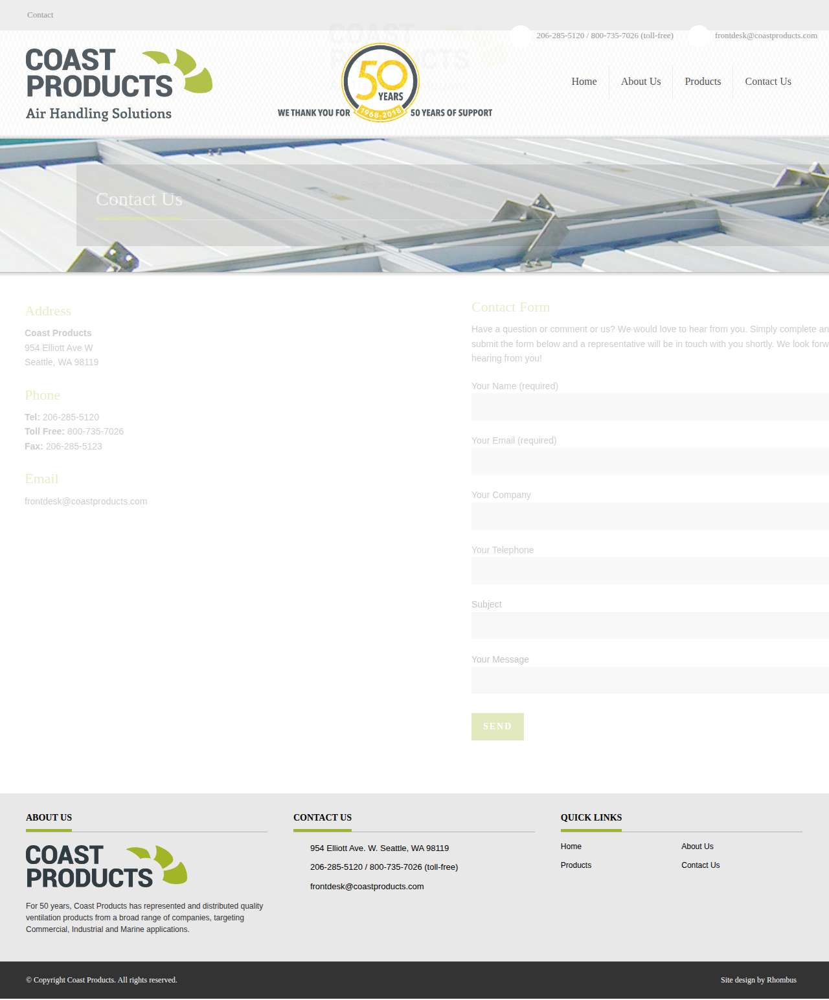

### gnlhvac.com — dry\_run\_ok (dry run)

| | |
|---|---|
| Attempt ID | `80e1522b-171f-41fe-a2b6-ade548121f48` |
| Form URL | https://www.gnlhvac.com/contact |
| Final URL | https://www.gnlhvac.com/contact |
| Reserved | 2026-11-02 06:15:51 UTC |
| Submit attempted | — |
| Template | standard v2 |
| Confirmation text | none observed |
| Result / error | Selectors verified; fields not typed (domain not in dry-run fill list); not submitted |

Exact message:

~~~text
Subject: Helping customers find your business in AI search (AEO + GEO)

Hi there,

I'm Arun from Devs Arun. More and more customers now ask ChatGPT, Gemini, Perplexity or Google's AI Overviews questions like "who should I hire for this in my area?" before they call anyone. These tools answer from websites they can clearly understand, and they tend to recommend businesses whose pages answer real customer questions.

That is what AEO + GEO (Answer Engine and Generative Engine Optimization) is for. I improve your existing service pages so they clearly answer the questions your customers ask, add structured data that matches the page, and make the call, quote or enquiry step obvious. The benefit: your business gets a better chance of being mentioned or linked in AI answers, and visitors who arrive find it easy to contact you.

The AEO + GEO Starter is a one-time $199 (about ₹16,999, negotiable) for one website: a basic audit, 10 customer questions, improvements to two existing pages, relevant structured data and an action plan, with one revision round.

You can read the full details, send an enquiry or book online here:
https://devsarun.io/aeo-geo/

If this isn't relevant, just reply and I won't contact you again.

Best,
Arun
Devs Arun
itschool408@gmail.com · +91 7654534323
~~~

Submitted field values:

- \#input\_comp-kge1vcy5: itschool408@gmail.com
- \#input\_comp-kge1vcy9: Helping customers find your business in AI search (AEO + GEO)
- \#input\_comp-kge1vcxu1: Arun
- \#textarea\_comp-kge1vcyd: Hi there, I'm Arun from Devs Arun. More and more customers now ask ChatGPT, Gemini, Perplexity or Google's AI Overviews 

**Inspected page** — `run-4034880e_attempt-80e1522b_inspection_2026-11-02T06-15-54-113Z.jpg`

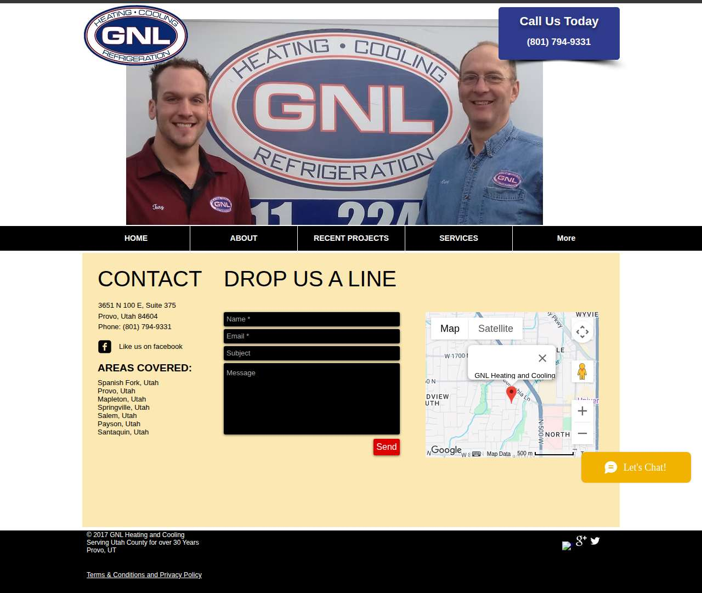

### saddlebackplumbing.com — dry\_run\_ok (dry run)

| | |
|---|---|
| Attempt ID | `8834751e-f21d-4dc7-abbc-e6d7b51134c3` |
| Form URL | https://www.saddlebackplumbing.com/contact/message |
| Final URL | https://www.saddlebackplumbing.com/contact/message |
| Reserved | 2026-11-02 06:15:59 UTC |
| Submit attempted | — |
| Template | standard v2 |
| Confirmation text | none observed |
| Result / error | Selectors verified; fields not typed (domain not in dry-run fill list); not submitted |

Exact message:

~~~text
Subject: Helping customers find your business in AI search (AEO + GEO)

Hi there,

I'm Arun from Devs Arun. More and more customers now ask ChatGPT, Gemini, Perplexity or Google's AI Overviews questions like "who should I hire for this in my area?" before they call anyone. These tools answer from websites they can clearly understand, and they tend to recommend businesses whose pages answer real customer questions.

That is what AEO + GEO (Answer Engine and Generative Engine Optimization) is for. I improve your existing service pages so they clearly answer the questions your customers ask, add structured data that matches the page, and make the call, quote or enquiry step obvious. The benefit: your business gets a better chance of being mentioned or linked in AI answers, and visitors who arrive find it easy to contact you.

The AEO + GEO Starter is a one-time $199 (about ₹16,999, negotiable) for one website: a basic audit, 10 customer questions, improvements to two existing pages, relevant structured data and an action plan, with one revision round.

You can read the full details, send an enquiry or book online here:
https://devsarun.io/aeo-geo/

If this isn't relevant, just reply and I won't contact you again.

Best,
Arun
Devs Arun
itschool408@gmail.com · +91 7654534323
~~~

Submitted field values:

- \#list-response-form-1-item-3: itschool408@gmail.com
- \#list-response-form-1-item-4: +91 7654534323
- \#list-response-form-1-item-12: Hi there, I'm Arun from Devs Arun. More and more customers now ask ChatGPT, Gemini, Perplexity or Google's AI Overviews 
- \#list-response-form-1-item-62: Arun

**Inspected page** — `run-4034880e_attempt-8834751e_inspection_2026-11-02T06-16-01-329Z.jpg`

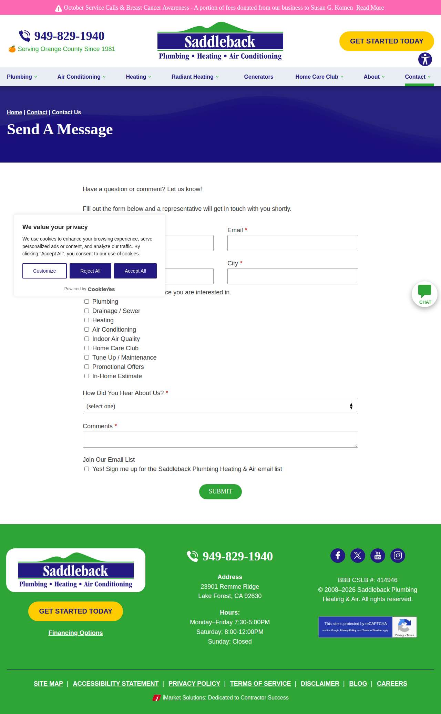

### perfectefficiency.com — dry\_run\_ok (dry run)

| | |
|---|---|
| Attempt ID | `35fcf554-7cab-4872-9c41-2d78fd1f2d80` |
| Form URL | https://www.perfectefficiency.com/ |
| Final URL | https://www.perfectefficiency.com/ |
| Reserved | 2026-11-02 06:16:06 UTC |
| Submit attempted | — |
| Template | standard v2 |
| Confirmation text | none observed |
| Result / error | Selectors verified; fields not typed (domain not in dry-run fill list); not submitted |

Exact message:

~~~text
Subject: Helping customers find your business in AI search (AEO + GEO)

Hi there,

I'm Arun from Devs Arun. More and more customers now ask ChatGPT, Gemini, Perplexity or Google's AI Overviews questions like "who should I hire for this in my area?" before they call anyone. These tools answer from websites they can clearly understand, and they tend to recommend businesses whose pages answer real customer questions.

That is what AEO + GEO (Answer Engine and Generative Engine Optimization) is for. I improve your existing service pages so they clearly answer the questions your customers ask, add structured data that matches the page, and make the call, quote or enquiry step obvious. The benefit: your business gets a better chance of being mentioned or linked in AI answers, and visitors who arrive find it easy to contact you.

The AEO + GEO Starter is a one-time $199 (about ₹16,999, negotiable) for one website: a basic audit, 10 customer questions, improvements to two existing pages, relevant structured data and an action plan, with one revision round.

You can read the full details, send an enquiry or book online here:
https://devsarun.io/aeo-geo/

If this isn't relevant, just reply and I won't contact you again.

Best,
Arun
Devs Arun
itschool408@gmail.com · +91 7654534323
~~~

Submitted field values:

- \#input\_comp-jx4lmi5l: Arun
- \#input\_comp-jx4lmi7g: itschool408@gmail.com
- \#input\_comp-jx4lmi8s: Helping customers find your business in AI search (AEO + GEO)
- \#textarea\_comp-jx4lmia0: Hi there, I'm Arun from Devs Arun. More and more customers now ask ChatGPT, Gemini, Perplexity or Google's AI Overviews 

**Inspected page** — `run-4034880e_attempt-35fcf554_inspection_2026-11-02T06-16-09-532Z.jpg`

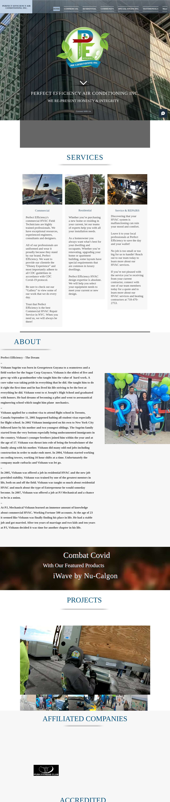

### nationalheatandair.com — dry\_run\_ok (dry run)

| | |
|---|---|
| Attempt ID | `ecaa0d4b-fdf7-45c9-a166-c6974af6d9c6` |
| Form URL | https://www.nationalheatandair.com/contact/ |
| Final URL | https://www.nationalheatandair.com/contact/ |
| Reserved | 2026-11-02 06:16:14 UTC |
| Submit attempted | — |
| Template | standard v2 |
| Confirmation text | none observed |
| Result / error | Selectors verified; fields not typed (domain not in dry-run fill list); not submitted |

Exact message:

~~~text
Subject: Helping customers find your business in AI search (AEO + GEO)

Hi there,

I'm Arun from Devs Arun. More and more customers now ask ChatGPT, Gemini, Perplexity or Google's AI Overviews questions like "who should I hire for this in my area?" before they call anyone. These tools answer from websites they can clearly understand, and they tend to recommend businesses whose pages answer real customer questions.

That is what AEO + GEO (Answer Engine and Generative Engine Optimization) is for. I improve your existing service pages so they clearly answer the questions your customers ask, add structured data that matches the page, and make the call, quote or enquiry step obvious. The benefit: your business gets a better chance of being mentioned or linked in AI answers, and visitors who arrive find it easy to contact you.

The AEO + GEO Starter is a one-time $199 (about ₹16,999, negotiable) for one website: a basic audit, 10 customer questions, improvements to two existing pages, relevant structured data and an action plan, with one revision round.

You can read the full details, send an enquiry or book online here:
https://devsarun.io/aeo-geo/

If this isn't relevant, just reply and I won't contact you again.

Best,
Arun
Devs Arun
itschool408@gmail.com · +91 7654534323
~~~

Submitted field values:

- select\[name="how"\]: General Inquiry
- input\[name="email"\]: itschool408@gmail.com
- input\[name="fname"\]: Arun
- input\[name="phone"\]: +91 7654534323
- textarea\[name="message"\]: Hi there, I'm Arun from Devs Arun. More and more customers now ask ChatGPT, Gemini, Perplexity or Google's AI Overviews 

**Inspected page** — `run-4034880e_attempt-ecaa0d4b_inspection_2026-11-02T06-16-17-024Z.jpg`

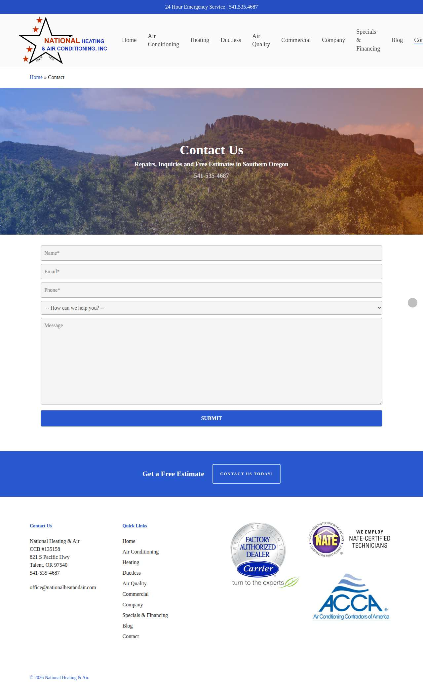

### airproheating.com — dry\_run\_ok (dry run)

| | |
|---|---|
| Attempt ID | `965ba45c-e625-4c6f-b2ba-66a6d547f3eb` |
| Form URL | https://airproheating.com/contact-us/ |
| Final URL | https://airproheating.com/contact-us/ |
| Reserved | 2026-11-02 06:16:22 UTC |
| Submit attempted | — |
| Template | standard v2 |
| Confirmation text | none observed |
| Result / error | Selectors verified; fields not typed (domain not in dry-run fill list); not submitted |

Exact message:

~~~text
Subject: Helping customers find your business in AI search (AEO + GEO)

Hi there,

I'm Arun from Devs Arun. More and more customers now ask ChatGPT, Gemini, Perplexity or Google's AI Overviews questions like "who should I hire for this in my area?" before they call anyone. These tools answer from websites they can clearly understand, and they tend to recommend businesses whose pages answer real customer questions.

That is what AEO + GEO (Answer Engine and Generative Engine Optimization) is for. I improve your existing service pages so they clearly answer the questions your customers ask, add structured data that matches the page, and make the call, quote or enquiry step obvious. The benefit: your business gets a better chance of being mentioned or linked in AI answers, and visitors who arrive find it easy to contact you.

The AEO + GEO Starter is a one-time $199 (about ₹16,999, negotiable) for one website: a basic audit, 10 customer questions, improvements to two existing pages, relevant structured data and an action plan, with one revision round.

You can read the full details, send an enquiry or book online here:
https://devsarun.io/aeo-geo/

If this isn't relevant, just reply and I won't contact you again.

Best,
Arun
Devs Arun
itschool408@gmail.com · +91 7654534323
~~~

Submitted field values:

- \#input\_1\_2: Other
- \#input\_1\_3: +91 7654534323
- \#input\_1\_4: itschool408@gmail.com
- \#input\_1\_5: Hi there, I'm Arun from Devs Arun. More and more customers now ask ChatGPT, Gemini, Perplexity or Google's AI Overviews 
- \#input\_1\_6: Arun

**Inspected page** — `run-4034880e_attempt-965ba45c_inspection_2026-11-02T06-16-23-632Z.jpg`

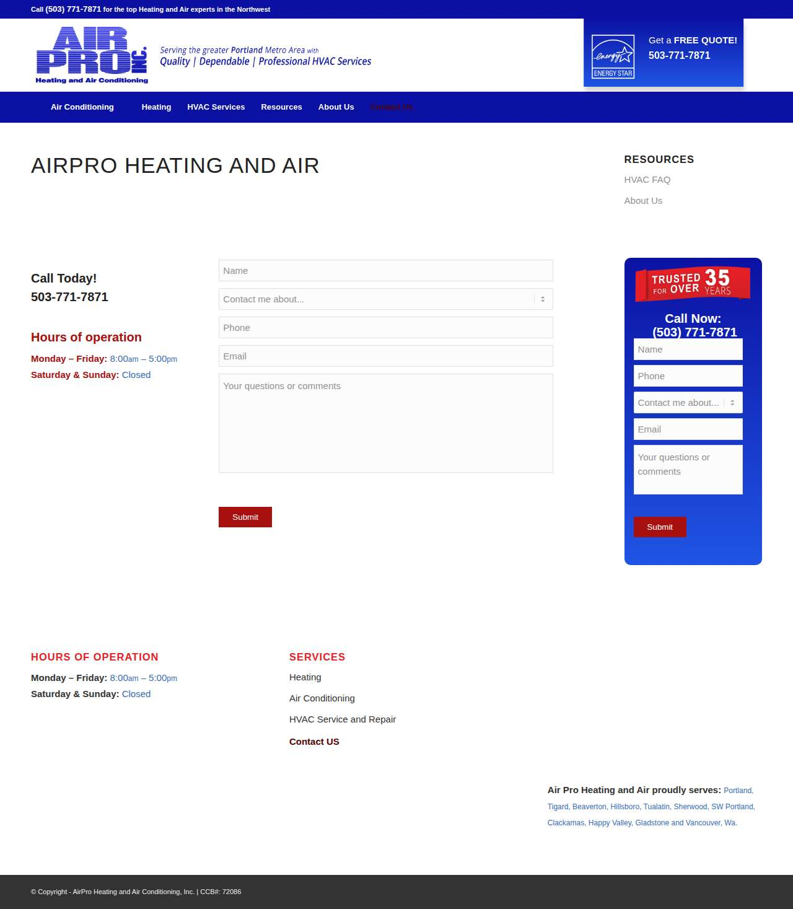

### lovottiair.com — dry\_run\_ok (dry run)

| | |
|---|---|
| Attempt ID | `21e7032d-5414-4c8e-8980-5b6c806211f7` |
| Form URL | https://lovottiinc.com/contact-us/ |
| Final URL | https://lovottiinc.com/contact-us/ |
| Reserved | 2026-11-02 06:16:28 UTC |
| Submit attempted | — |
| Template | standard v2 |
| Confirmation text | none observed |
| Result / error | Selectors verified; fields not typed (domain not in dry-run fill list); not submitted |

Exact message:

~~~text
Subject: Helping customers find your business in AI search (AEO + GEO)

Hi there,

I'm Arun from Devs Arun. More and more customers now ask ChatGPT, Gemini, Perplexity or Google's AI Overviews questions like "who should I hire for this in my area?" before they call anyone. These tools answer from websites they can clearly understand, and they tend to recommend businesses whose pages answer real customer questions.

That is what AEO + GEO (Answer Engine and Generative Engine Optimization) is for. I improve your existing service pages so they clearly answer the questions your customers ask, add structured data that matches the page, and make the call, quote or enquiry step obvious. The benefit: your business gets a better chance of being mentioned or linked in AI answers, and visitors who arrive find it easy to contact you.

The AEO + GEO Starter is a one-time $199 (about ₹16,999, negotiable) for one website: a basic audit, 10 customer questions, improvements to two existing pages, relevant structured data and an action plan, with one revision round.

You can read the full details, send an enquiry or book online here:
https://devsarun.io/aeo-geo/

If this isn't relevant, just reply and I won't contact you again.

Best,
Arun
Devs Arun
itschool408@gmail.com · +91 7654534323
~~~

Submitted field values:

- \#nf-field-1: Arun
- \#nf-field-2: itschool408@gmail.com
- \#nf-field-3: Hi there, I'm Arun from Devs Arun. More and more customers now ask ChatGPT, Gemini, Perplexity or Google's AI Overviews 
- \#nf-field-5: Devs Arun
- \#nf-field-7: +91 7654534323
- \#nf-field-8: Email

**Inspected page** — `run-4034880e_attempt-21e7032d_inspection_2026-11-02T06-16-30-636Z.jpg`

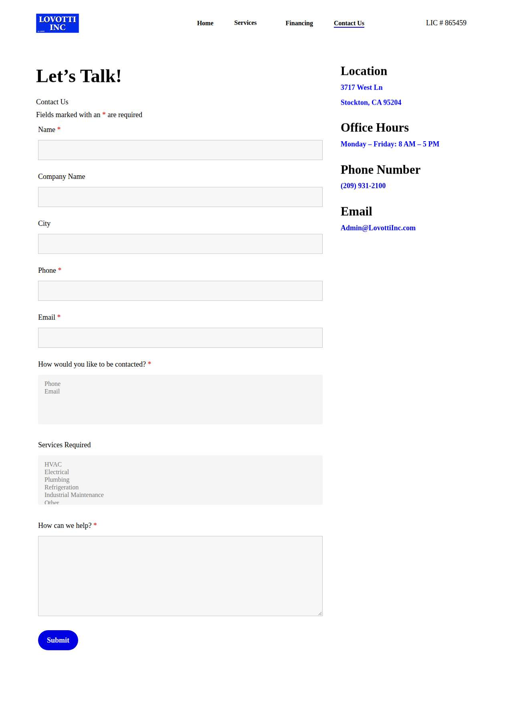

### cleanairactheatingandac.com — dry\_run\_ok (dry run)

| | |
|---|---|
| Attempt ID | `f1055301-9d58-4d82-a4bc-fcf016a708dd` |
| Form URL | https://www.cleanairactheatingandac.com/contact-us |
| Final URL | https://www.cleanairactheatingandac.com/contact-us |
| Reserved | 2026-11-02 06:16:35 UTC |
| Submit attempted | — |
| Template | standard v2 |
| Confirmation text | none observed |
| Result / error | Selectors verified; fields not typed (domain not in dry-run fill list); not submitted |

Exact message:

~~~text
Subject: Helping customers find your business in AI search (AEO + GEO)

Hi there,

I'm Arun from Devs Arun. More and more customers now ask ChatGPT, Gemini, Perplexity or Google's AI Overviews questions like "who should I hire for this in my area?" before they call anyone. These tools answer from websites they can clearly understand, and they tend to recommend businesses whose pages answer real customer questions.

That is what AEO + GEO (Answer Engine and Generative Engine Optimization) is for. I improve your existing service pages so they clearly answer the questions your customers ask, add structured data that matches the page, and make the call, quote or enquiry step obvious. The benefit: your business gets a better chance of being mentioned or linked in AI answers, and visitors who arrive find it easy to contact you.

The AEO + GEO Starter is a one-time $199 (about ₹16,999, negotiable) for one website: a basic audit, 10 customer questions, improvements to two existing pages, relevant structured data and an action plan, with one revision round.

You can read the full details, send an enquiry or book online here:
https://devsarun.io/aeo-geo/

If this isn't relevant, just reply and I won't contact you again.

Best,
Arun
Devs Arun
itschool408@gmail.com · +91 7654534323
~~~

Submitted field values:

- \#\\31 107452278: Arun
- \#\\31 217451286: +91 7654534323
- \#\\31 854427406: itschool408@gmail.com
- \#\\31 999646951: Hi there, I'm Arun from Devs Arun. More and more customers now ask ChatGPT, Gemini, Perplexity or Google's AI Overviews 

**Inspected page** — `run-4034880e_attempt-f1055301_inspection_2026-11-02T06-16-38-379Z.jpg`

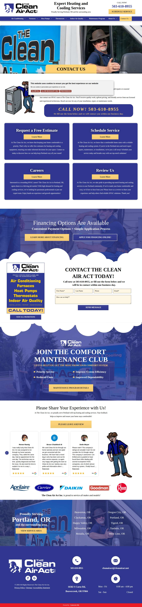

### fulmerheatcool.com — dry\_run\_ok (dry run)

| | |
|---|---|
| Attempt ID | `fee0dede-1cea-41c4-bf53-f0eb660607b0` |
| Form URL | https://www.fulmerheatcool.com/contact/send-message |
| Final URL | https://www.fulmerheatcool.com/contact/send-message |
| Reserved | 2026-11-02 06:16:43 UTC |
| Submit attempted | — |
| Template | standard v2 |
| Confirmation text | none observed |
| Result / error | Selectors verified; fields not typed (domain not in dry-run fill list); not submitted |

Exact message:

~~~text
Subject: Helping customers find your business in AI search (AEO + GEO)

Hi there,

I'm Arun from Devs Arun. More and more customers now ask ChatGPT, Gemini, Perplexity or Google's AI Overviews questions like "who should I hire for this in my area?" before they call anyone. These tools answer from websites they can clearly understand, and they tend to recommend businesses whose pages answer real customer questions.

That is what AEO + GEO (Answer Engine and Generative Engine Optimization) is for. I improve your existing service pages so they clearly answer the questions your customers ask, add structured data that matches the page, and make the call, quote or enquiry step obvious. The benefit: your business gets a better chance of being mentioned or linked in AI answers, and visitors who arrive find it easy to contact you.

The AEO + GEO Starter is a one-time $199 (about ₹16,999, negotiable) for one website: a basic audit, 10 customer questions, improvements to two existing pages, relevant structured data and an action plan, with one revision round.

You can read the full details, send an enquiry or book online here:
https://devsarun.io/aeo-geo/

If this isn't relevant, just reply and I won't contact you again.

Best,
Arun
Devs Arun
itschool408@gmail.com · +91 7654534323
~~~

Submitted field values:

- \#list-response-form-1-item-1: Arun
- \#list-response-form-1-item-3: itschool408@gmail.com
- \#list-response-form-1-item-4: +91 7654534323
- \#list-response-form-1-item-12: Hi there, I'm Arun from Devs Arun. More and more customers now ask ChatGPT, Gemini, Perplexity or Google's AI Overviews 

**Inspected page** — `run-4034880e_attempt-fee0dede_inspection_2026-11-02T06-16-45-155Z.jpg`

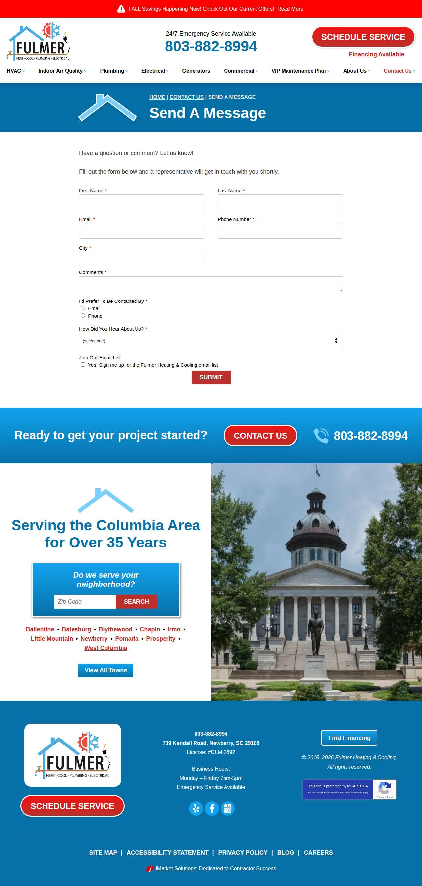

### airclassic.org — dry\_run\_ok (dry run)

| | |
|---|---|
| Attempt ID | `e092eba8-6bb3-4daf-bc65-c3ab5f370bdd` |
| Form URL | https://www.airclassic.org/contact/send-message/ |
| Final URL | https://www.airclassic.org/contact/send-message/ |
| Reserved | 2026-11-02 06:16:50 UTC |
| Submit attempted | — |
| Template | standard v2 |
| Confirmation text | none observed |
| Result / error | Selectors verified; fields not typed (domain not in dry-run fill list); not submitted |

Exact message:

~~~text
Subject: Helping customers find your business in AI search (AEO + GEO)

Hi there,

I'm Arun from Devs Arun. More and more customers now ask ChatGPT, Gemini, Perplexity or Google's AI Overviews questions like "who should I hire for this in my area?" before they call anyone. These tools answer from websites they can clearly understand, and they tend to recommend businesses whose pages answer real customer questions.

That is what AEO + GEO (Answer Engine and Generative Engine Optimization) is for. I improve your existing service pages so they clearly answer the questions your customers ask, add structured data that matches the page, and make the call, quote or enquiry step obvious. The benefit: your business gets a better chance of being mentioned or linked in AI answers, and visitors who arrive find it easy to contact you.

The AEO + GEO Starter is a one-time $199 (about ₹16,999, negotiable) for one website: a basic audit, 10 customer questions, improvements to two existing pages, relevant structured data and an action plan, with one revision round.

You can read the full details, send an enquiry or book online here:
https://devsarun.io/aeo-geo/

If this isn't relevant, just reply and I won't contact you again.

Best,
Arun
Devs Arun
itschool408@gmail.com · +91 7654534323
~~~

Submitted field values:

- \#m-name: Arun
- \#m-email: itschool408@gmail.com
- \#m-phone: +91 7654534323
- \#m-message: Hi there, I'm Arun from Devs Arun. More and more customers now ask ChatGPT, Gemini, Perplexity or Google's AI Overviews 

**Inspected page** — `run-4034880e_attempt-e092eba8_inspection_2026-11-02T06-16-51-550Z.jpg`

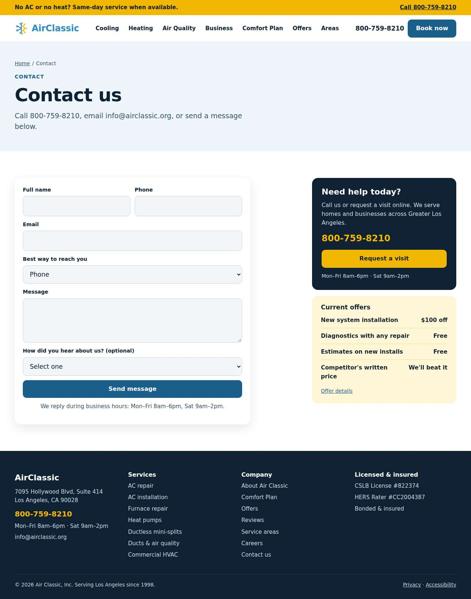

### mrcomfortmd.com — dry\_run\_ok (dry run)

| | |
|---|---|
| Attempt ID | `08f6602d-871c-4ecc-a8d2-5da90448683d` |
| Form URL | https://www.mrcomfortmd.com/Contact |
| Final URL | https://www.mrcomfortmd.com/Contact |
| Reserved | 2026-11-02 06:16:56 UTC |
| Submit attempted | — |
| Template | standard v2 |
| Confirmation text | none observed |
| Result / error | Selectors verified; fields not typed (domain not in dry-run fill list); not submitted |

Exact message:

~~~text
Subject: Helping customers find your business in AI search (AEO + GEO)

Hi there,

I'm Arun from Devs Arun. More and more customers now ask ChatGPT, Gemini, Perplexity or Google's AI Overviews questions like "who should I hire for this in my area?" before they call anyone. These tools answer from websites they can clearly understand, and they tend to recommend businesses whose pages answer real customer questions.

That is what AEO + GEO (Answer Engine and Generative Engine Optimization) is for. I improve your existing service pages so they clearly answer the questions your customers ask, add structured data that matches the page, and make the call, quote or enquiry step obvious. The benefit: your business gets a better chance of being mentioned or linked in AI answers, and visitors who arrive find it easy to contact you.

The AEO + GEO Starter is a one-time $199 (about ₹16,999, negotiable) for one website: a basic audit, 10 customer questions, improvements to two existing pages, relevant structured data and an action plan, with one revision round.

You can read the full details, send an enquiry or book online here:
https://devsarun.io/aeo-geo/

If this isn't relevant, just reply and I won't contact you again.

Best,
Arun
Devs Arun
itschool408@gmail.com · +91 7654534323
~~~

Submitted field values:

- \#\\31 664239012: itschool408@gmail.com
- \#\\31 737494216: Hi there, I'm Arun from Devs Arun. More and more customers now ask ChatGPT, Gemini, Perplexity or Google's AI Overviews 
- \#\\31 792451733: Arun
- \#\\31 871314718: +91 7654534323

**Inspected page** — `run-4034880e_attempt-08f6602d_inspection_2026-11-02T06-16-58-294Z.jpg`

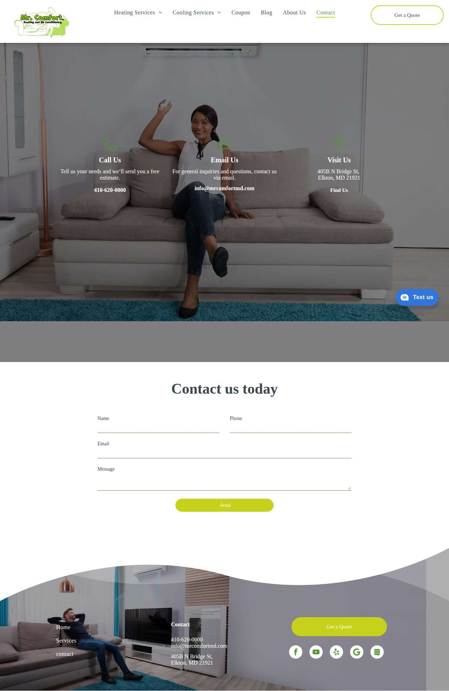

### oasiscooling.com — dry\_run\_ok (dry run)

| | |
|---|---|
| Attempt ID | `dfdbf3b7-8a63-40af-9046-7dbfceffda5b` |
| Form URL | https://www.oasiscooling.com/contact/ |
| Final URL | https://www.oasiscooling.com/contact/ |
| Reserved | 2026-11-02 06:17:03 UTC |
| Submit attempted | — |
| Template | standard v2 |
| Confirmation text | none observed |
| Result / error | Selectors verified; fields not typed (domain not in dry-run fill list); not submitted |

Exact message:

~~~text
Subject: Helping customers find your business in AI search (AEO + GEO)

Hi there,

I'm Arun from Devs Arun. More and more customers now ask ChatGPT, Gemini, Perplexity or Google's AI Overviews questions like "who should I hire for this in my area?" before they call anyone. These tools answer from websites they can clearly understand, and they tend to recommend businesses whose pages answer real customer questions.

That is what AEO + GEO (Answer Engine and Generative Engine Optimization) is for. I improve your existing service pages so they clearly answer the questions your customers ask, add structured data that matches the page, and make the call, quote or enquiry step obvious. The benefit: your business gets a better chance of being mentioned or linked in AI answers, and visitors who arrive find it easy to contact you.

The AEO + GEO Starter is a one-time $199 (about ₹16,999, negotiable) for one website: a basic audit, 10 customer questions, improvements to two existing pages, relevant structured data and an action plan, with one revision round.

You can read the full details, send an enquiry or book online here:
https://devsarun.io/aeo-geo/

If this isn't relevant, just reply and I won't contact you again.

Best,
Arun
Devs Arun
itschool408@gmail.com · +91 7654534323
~~~

Submitted field values:

- \#field\_h3555: +91 7654534323
- \#field\_ugvc5: Website
- \#field\_w8jwz: Bangalore
- \#field\_29yf4d21e096eeead: itschool408@gmail.com
- \#field\_9jv0r12ebb00ef09f: Hi there, I'm Arun from Devs Arun. More and more customers now ask ChatGPT, Gemini, Perplexity or Google's AI Overviews 
- \#field\_qh4icy274e3dae6c0: Arun

**Inspected page** — `run-4034880e_attempt-dfdbf3b7_inspection_2026-11-02T06-17-04-770Z.jpg`

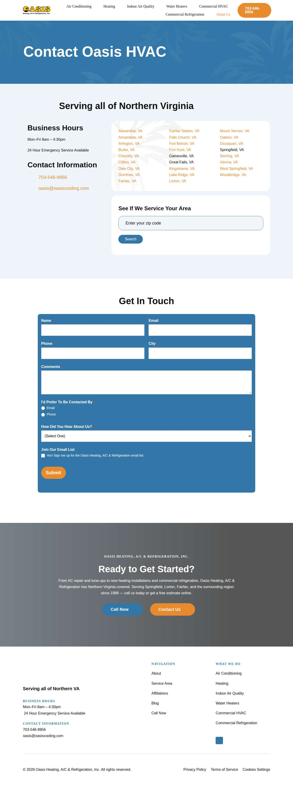

### familyheatandair.com — dry\_run\_ok (dry run)

| | |
|---|---|
| Attempt ID | `28fab878-2f05-409e-9132-92a2822a3bd7` |
| Form URL | https://familyheatandair.com/contact-us/ |
| Final URL | https://familyheatandair.com/contact-us/ |
| Reserved | 2026-11-02 06:17:09 UTC |
| Submit attempted | — |
| Template | standard v2 |
| Confirmation text | none observed |
| Result / error | Selectors verified; fields not typed (domain not in dry-run fill list); not submitted |

Exact message:

~~~text
Subject: Helping customers find your business in AI search (AEO + GEO)

Hi there,

I'm Arun from Devs Arun. More and more customers now ask ChatGPT, Gemini, Perplexity or Google's AI Overviews questions like "who should I hire for this in my area?" before they call anyone. These tools answer from websites they can clearly understand, and they tend to recommend businesses whose pages answer real customer questions.

That is what AEO + GEO (Answer Engine and Generative Engine Optimization) is for. I improve your existing service pages so they clearly answer the questions your customers ask, add structured data that matches the page, and make the call, quote or enquiry step obvious. The benefit: your business gets a better chance of being mentioned or linked in AI answers, and visitors who arrive find it easy to contact you.

The AEO + GEO Starter is a one-time $199 (about ₹16,999, negotiable) for one website: a basic audit, 10 customer questions, improvements to two existing pages, relevant structured data and an action plan, with one revision round.

You can read the full details, send an enquiry or book online here:
https://devsarun.io/aeo-geo/

If this isn't relevant, just reply and I won't contact you again.

Best,
Arun
Devs Arun
itschool408@gmail.com · +91 7654534323
~~~

Submitted field values:

- \#input\_1\_1: Arun
- \#input\_1\_3: itschool408@gmail.com
- \#input\_1\_4: Hi there, I'm Arun from Devs Arun. More and more customers now ask ChatGPT, Gemini, Perplexity or Google's AI Overviews 

**Inspected page** — `run-4034880e_attempt-28fab878_inspection_2026-11-02T06-17-14-287Z.jpg`

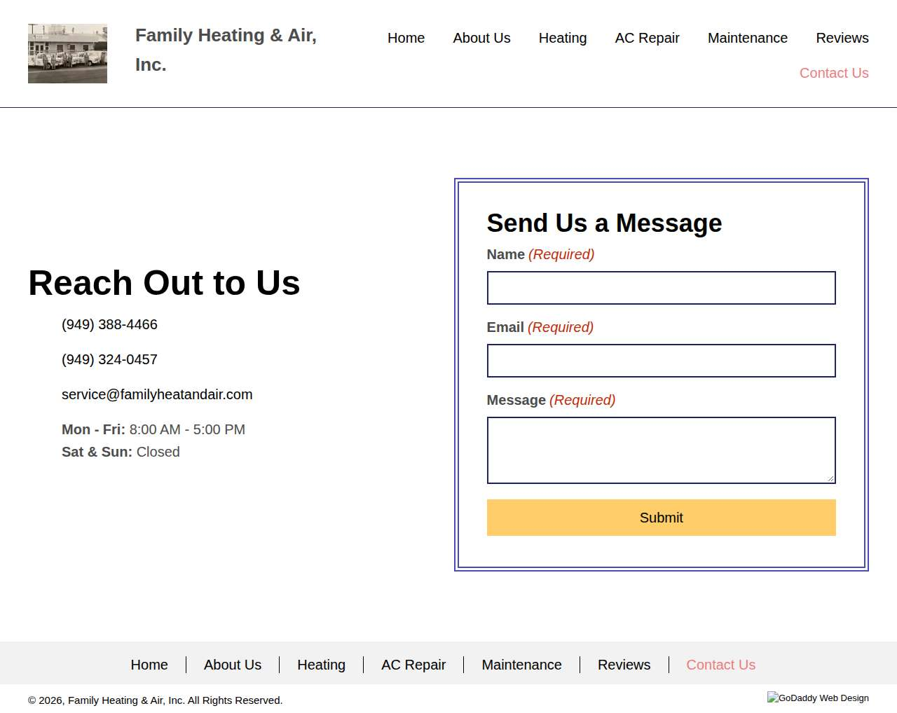

### polarbearairconditioning.com — dry\_run\_ok (dry run)

| | |
|---|---|
| Attempt ID | `0a898360-c64f-4aec-865b-1cf0b0b04e1e` |
| Form URL | https://www.polarbearairconditioning.com/contact |
| Final URL | https://www.polarbearairconditioning.com/contact |
| Reserved | 2026-11-02 06:17:19 UTC |
| Submit attempted | — |
| Template | standard v2 |
| Confirmation text | none observed |
| Result / error | Selectors verified; fields not typed (domain not in dry-run fill list); not submitted |

Exact message:

~~~text
Subject: Helping customers find your business in AI search (AEO + GEO)

Hi there,

I'm Arun from Devs Arun. More and more customers now ask ChatGPT, Gemini, Perplexity or Google's AI Overviews questions like "who should I hire for this in my area?" before they call anyone. These tools answer from websites they can clearly understand, and they tend to recommend businesses whose pages answer real customer questions.

That is what AEO + GEO (Answer Engine and Generative Engine Optimization) is for. I improve your existing service pages so they clearly answer the questions your customers ask, add structured data that matches the page, and make the call, quote or enquiry step obvious. The benefit: your business gets a better chance of being mentioned or linked in AI answers, and visitors who arrive find it easy to contact you.

The AEO + GEO Starter is a one-time $199 (about ₹16,999, negotiable) for one website: a basic audit, 10 customer questions, improvements to two existing pages, relevant structured data and an action plan, with one revision round.

You can read the full details, send an enquiry or book online here:
https://devsarun.io/aeo-geo/

If this isn't relevant, just reply and I won't contact you again.

Best,
Arun
Devs Arun
itschool408@gmail.com · +91 7654534323
~~~

Submitted field values:

- \#list-response-form-1-item-1: Arun
- \#list-response-form-1-item-3: itschool408@gmail.com
- \#list-response-form-1-item-4: +91 7654534323
- \#list-response-form-1-item-12: Hi there, I'm Arun from Devs Arun. More and more customers now ask ChatGPT, Gemini, Perplexity or Google's AI Overviews 

**Inspected page** — `run-4034880e_attempt-0a898360_inspection_2026-11-02T06-17-20-829Z.jpg`

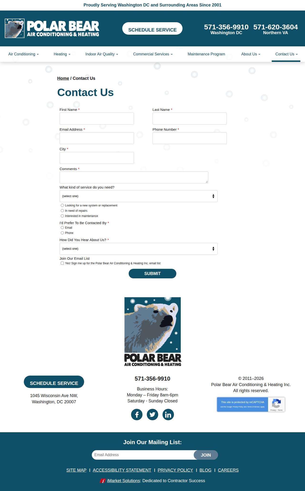

### command-air.com — dry\_run\_ok (dry run)

| | |
|---|---|
| Attempt ID | `db391e0e-6baf-48f6-b145-e694eceab691` |
| Form URL | https://www.commandcomfort.com/contact/send-a-message |
| Final URL | https://www.commandcomfort.com/contact/send-a-message |
| Reserved | 2026-11-02 06:17:25 UTC |
| Submit attempted | — |
| Template | standard v2 |
| Confirmation text | none observed |
| Result / error | Selectors verified; fields not typed (domain not in dry-run fill list); not submitted |

Exact message:

~~~text
Subject: Helping customers find your business in AI search (AEO + GEO)

Hi there,

I'm Arun from Devs Arun. More and more customers now ask ChatGPT, Gemini, Perplexity or Google's AI Overviews questions like "who should I hire for this in my area?" before they call anyone. These tools answer from websites they can clearly understand, and they tend to recommend businesses whose pages answer real customer questions.

That is what AEO + GEO (Answer Engine and Generative Engine Optimization) is for. I improve your existing service pages so they clearly answer the questions your customers ask, add structured data that matches the page, and make the call, quote or enquiry step obvious. The benefit: your business gets a better chance of being mentioned or linked in AI answers, and visitors who arrive find it easy to contact you.

The AEO + GEO Starter is a one-time $199 (about ₹16,999, negotiable) for one website: a basic audit, 10 customer questions, improvements to two existing pages, relevant structured data and an action plan, with one revision round.

You can read the full details, send an enquiry or book online here:
https://devsarun.io/aeo-geo/

If this isn't relevant, just reply and I won't contact you again.

Best,
Arun
Devs Arun
itschool408@gmail.com · +91 7654534323
~~~

Submitted field values:

- \#list-response-form-1-item-1: Arun
- \#list-response-form-1-item-3: itschool408@gmail.com
- \#list-response-form-1-item-4: +91 7654534323
- \#list-response-form-1-item-12: Hi there, I'm Arun from Devs Arun. More and more customers now ask ChatGPT, Gemini, Perplexity or Google's AI Overviews 

**Inspected page** — `run-4034880e_attempt-db391e0e_inspection_2026-11-02T06-17-27-663Z.jpg`

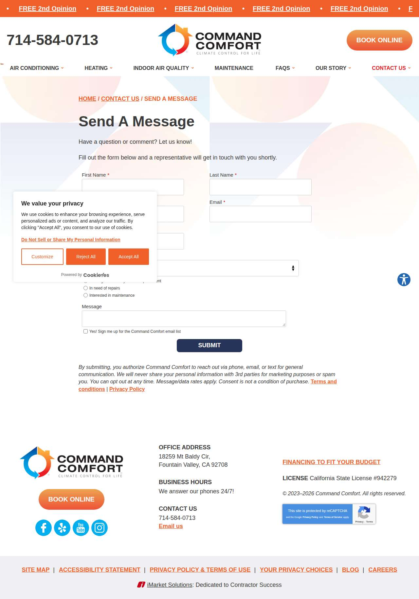

### boehmerheating.com — dry\_run\_ok (dry run)

| | |
|---|---|
| Attempt ID | `a748a2c1-8138-4109-b830-c553d0cf32c8` |
| Form URL | https://www.boehmerheating.com/contact |
| Final URL | https://www.boehmerheating.com/contact |
| Reserved | 2026-11-02 06:17:32 UTC |
| Submit attempted | — |
| Template | standard v2 |
| Confirmation text | none observed |
| Result / error | Selectors verified; fields not typed (domain not in dry-run fill list); not submitted |

Exact message:

~~~text
Subject: Helping customers find your business in AI search (AEO + GEO)

Hi there,

I'm Arun from Devs Arun. More and more customers now ask ChatGPT, Gemini, Perplexity or Google's AI Overviews questions like "who should I hire for this in my area?" before they call anyone. These tools answer from websites they can clearly understand, and they tend to recommend businesses whose pages answer real customer questions.

That is what AEO + GEO (Answer Engine and Generative Engine Optimization) is for. I improve your existing service pages so they clearly answer the questions your customers ask, add structured data that matches the page, and make the call, quote or enquiry step obvious. The benefit: your business gets a better chance of being mentioned or linked in AI answers, and visitors who arrive find it easy to contact you.

The AEO + GEO Starter is a one-time $199 (about ₹16,999, negotiable) for one website: a basic audit, 10 customer questions, improvements to two existing pages, relevant structured data and an action plan, with one revision round.

You can read the full details, send an enquiry or book online here:
https://devsarun.io/aeo-geo/

If this isn't relevant, just reply and I won't contact you again.

Best,
Arun
Devs Arun
itschool408@gmail.com · +91 7654534323
~~~

Submitted field values:

- \#list-response-form-1-item-1: Arun
- \#list-response-form-1-item-3: itschool408@gmail.com
- \#list-response-form-1-item-4: +91 7654534323
- \#list-response-form-1-item-12: Hi there, I'm Arun from Devs Arun. More and more customers now ask ChatGPT, Gemini, Perplexity or Google's AI Overviews 

**Inspected page** — `run-4034880e_attempt-a748a2c1_inspection_2026-11-02T06-17-35-302Z.jpg`

### northwindhvacaz.com — dry\_run\_ok (dry run)

| | |
|---|---|
| Attempt ID | `ebf45dbf-16d3-4bb9-a582-c5606b2a8947` |
| Form URL | https://www.northwindhvacaz.com/contact-us |
| Final URL | https://www.northwindhvacaz.com/contact-us |
| Reserved | 2026-11-02 06:17:40 UTC |
| Submit attempted | — |
| Template | standard v2 |
| Confirmation text | none observed |
| Result / error | Selectors verified; fields not typed (domain not in dry-run fill list); not submitted |

Exact message:

~~~text
Subject: Helping customers find your business in AI search (AEO + GEO)

Hi there,

I'm Arun from Devs Arun. More and more customers now ask ChatGPT, Gemini, Perplexity or Google's AI Overviews questions like "who should I hire for this in my area?" before they call anyone. These tools answer from websites they can clearly understand, and they tend to recommend businesses whose pages answer real customer questions.

That is what AEO + GEO (Answer Engine and Generative Engine Optimization) is for. I improve your existing service pages so they clearly answer the questions your customers ask, add structured data that matches the page, and make the call, quote or enquiry step obvious. The benefit: your business gets a better chance of being mentioned or linked in AI answers, and visitors who arrive find it easy to contact you.

The AEO + GEO Starter is a one-time $199 (about ₹16,999, negotiable) for one website: a basic audit, 10 customer questions, improvements to two existing pages, relevant structured data and an action plan, with one revision round.

You can read the full details, send an enquiry or book online here:
https://devsarun.io/aeo-geo/

If this isn't relevant, just reply and I won't contact you again.

Best,
Arun
Devs Arun
itschool408@gmail.com · +91 7654534323
~~~

Submitted field values:

- \#name: Arun
- \#email: itschool408@gmail.com
- \#phone: +91 7654534323
- \#message: Hi there, I'm Arun from Devs Arun. More and more customers now ask ChatGPT, Gemini, Perplexity or Google's AI Overviews 

**Inspected page** — `run-4034880e_attempt-ebf45dbf_inspection_2026-11-02T06-17-41-874Z.jpg`

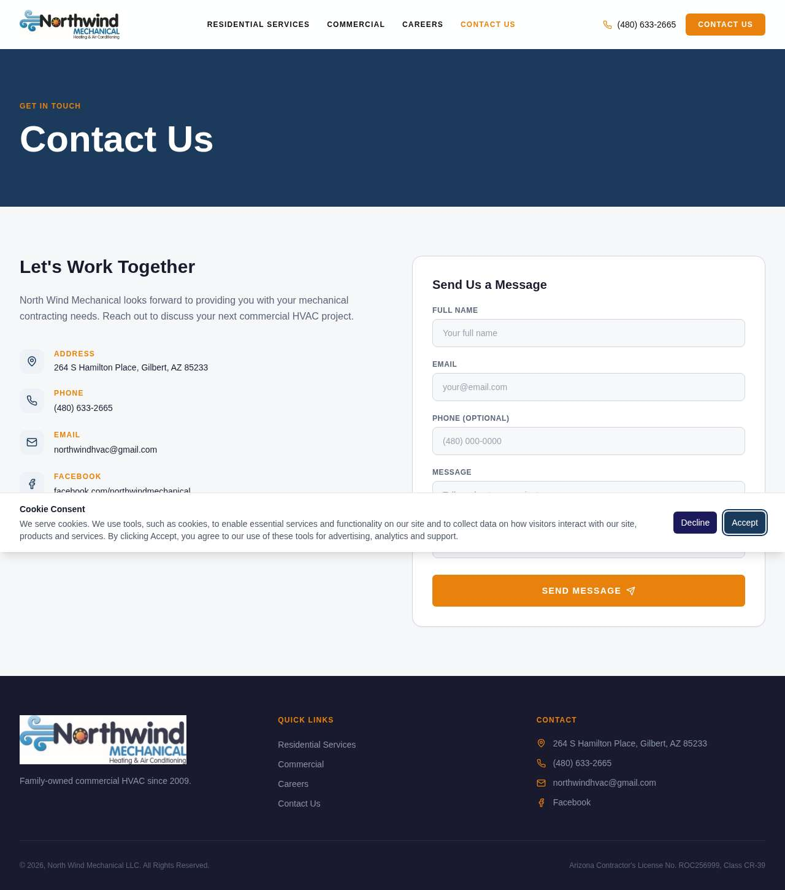

### comfortflow.com — dry\_run\_ok (dry run)

| | |
|---|---|
| Attempt ID | `f138df5d-cc8f-4f85-b5ce-0e0a6df624be` |
| Form URL | https://www.comfortflow.com/contact/send-a-message |
| Final URL | https://www.comfortflow.com/contact/send-a-message |
| Reserved | 2026-11-02 06:17:46 UTC |
| Submit attempted | — |
| Template | standard v2 |
| Confirmation text | none observed |
| Result / error | Selectors verified; fields not typed (domain not in dry-run fill list); not submitted |

Exact message:

~~~text
Subject: Helping customers find your business in AI search (AEO + GEO)

Hi there,

I'm Arun from Devs Arun. More and more customers now ask ChatGPT, Gemini, Perplexity or Google's AI Overviews questions like "who should I hire for this in my area?" before they call anyone. These tools answer from websites they can clearly understand, and they tend to recommend businesses whose pages answer real customer questions.

That is what AEO + GEO (Answer Engine and Generative Engine Optimization) is for. I improve your existing service pages so they clearly answer the questions your customers ask, add structured data that matches the page, and make the call, quote or enquiry step obvious. The benefit: your business gets a better chance of being mentioned or linked in AI answers, and visitors who arrive find it easy to contact you.

The AEO + GEO Starter is a one-time $199 (about ₹16,999, negotiable) for one website: a basic audit, 10 customer questions, improvements to two existing pages, relevant structured data and an action plan, with one revision round.

You can read the full details, send an enquiry or book online here:
https://devsarun.io/aeo-geo/

If this isn't relevant, just reply and I won't contact you again.

Best,
Arun
Devs Arun
itschool408@gmail.com · +91 7654534323
~~~

Submitted field values:

- \#list-response-form-1-item-1: Arun
- \#list-response-form-1-item-3: itschool408@gmail.com
- \#list-response-form-1-item-4: +91 7654534323
- \#list-response-form-1-item-12: Hi there, I'm Arun from Devs Arun. More and more customers now ask ChatGPT, Gemini, Perplexity or Google's AI Overviews 

**Inspected page** — `run-4034880e_attempt-f138df5d_inspection_2026-11-02T06-17-49-726Z.jpg`

### russellsac.com — dry\_run\_ok (dry run)

| | |
|---|---|
| Attempt ID | `a0c74d80-6e77-4b01-825a-e39fbec8f15e` |
| Form URL | https://www.russellsac.com/contact-us/ |
| Final URL | https://www.russellsac.com/contact-us/ |
| Reserved | 2026-11-02 06:17:54 UTC |
| Submit attempted | — |
| Template | standard v2 |
| Confirmation text | none observed |
| Result / error | Selectors verified; fields not typed (domain not in dry-run fill list); not submitted |

Exact message:

~~~text
Subject: Helping customers find your business in AI search (AEO + GEO)

Hi there,

I'm Arun from Devs Arun. More and more customers now ask ChatGPT, Gemini, Perplexity or Google's AI Overviews questions like "who should I hire for this in my area?" before they call anyone. These tools answer from websites they can clearly understand, and they tend to recommend businesses whose pages answer real customer questions.

That is what AEO + GEO (Answer Engine and Generative Engine Optimization) is for. I improve your existing service pages so they clearly answer the questions your customers ask, add structured data that matches the page, and make the call, quote or enquiry step obvious. The benefit: your business gets a better chance of being mentioned or linked in AI answers, and visitors who arrive find it easy to contact you.

The AEO + GEO Starter is a one-time $199 (about ₹16,999, negotiable) for one website: a basic audit, 10 customer questions, improvements to two existing pages, relevant structured data and an action plan, with one revision round.

You can read the full details, send an enquiry or book online here:
https://devsarun.io/aeo-geo/

If this isn't relevant, just reply and I won't contact you again.

Best,
Arun
Devs Arun
itschool408@gmail.com · +91 7654534323
~~~

Submitted field values:

- \#input\_1\_1: Arun
- \#input\_1\_2: itschool408@gmail.com
- \#input\_1\_3: +91 7654534323
- \#input\_1\_5: Hi there, I'm Arun from Devs Arun. More and more customers now ask ChatGPT, Gemini, Perplexity or Google's AI Overviews 

**Inspected page** — `run-4034880e_attempt-a0c74d80_inspection_2026-11-02T06-17-56-887Z.jpg`

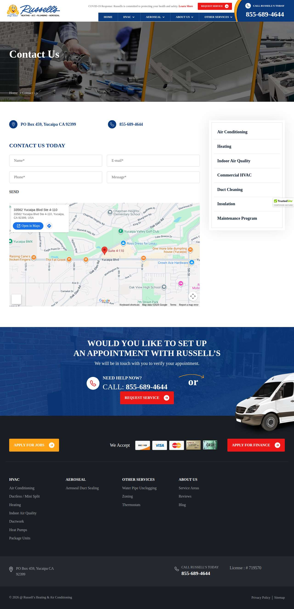

## Events (104)

| Time (UTC) | Event | Website | Details |
|---|---|---|---|
| 06:15:34 | run\_queued | — | dry\_run run requested by github:itsDevsArun |
| 06:15:34 | run\_dispatched | — | dispatch disabled (local test mode) |
| 06:15:36 | run\_started | — | Runner claimed dry\_run run |
| 06:15:36 | website\_selected | helixmechanical.com | Dry-run target helixmechanical.com |
| 06:15:36 | draft\_prepared | helixmechanical.com | Draft prepared with template standard v2 |
| 06:15:38 | page\_opened | helixmechanical.com | Opened form page |
| 06:15:38 | screenshot\_saved | helixmechanical.com | inspection screenshot saved (54 KB) |
| 06:15:38 | review\_required | helixmechanical.com | dry run failed: Mapped field "First Name \*" not found uniquely |
| 06:15:43 | website\_selected | coastproducts.com | Dry-run target coastproducts.com |
| 06:15:43 | draft\_prepared | coastproducts.com | Draft prepared with template standard v2 |
| 06:15:46 | page\_opened | coastproducts.com | Opened form page |
| 06:15:46 | screenshot\_saved | coastproducts.com | inspection screenshot saved (86 KB) |
| 06:15:46 | dry\_run\_checked | coastproducts.com | dry run ok: Selectors verified; fields not typed (domain not in dry-run fill list); not submitted |
| 06:15:51 | website\_selected | gnlhvac.com | Dry-run target gnlhvac.com |
| 06:15:51 | draft\_prepared | gnlhvac.com | Draft prepared with template standard v2 |
| 06:15:53 | page\_opened | gnlhvac.com | Opened form page |
| 06:15:54 | screenshot\_saved | gnlhvac.com | inspection screenshot saved (100 KB) |
| 06:15:54 | dry\_run\_checked | gnlhvac.com | dry run ok: Selectors verified; fields not typed (domain not in dry-run fill list); not submitted |
| 06:15:59 | website\_selected | saddlebackplumbing.com | Dry-run target saddlebackplumbing.com |
| 06:15:59 | draft\_prepared | saddlebackplumbing.com | Draft prepared with template standard v2 |
| 06:16:01 | page\_opened | saddlebackplumbing.com | Opened form page |
| 06:16:01 | screenshot\_saved | saddlebackplumbing.com | inspection screenshot saved (151 KB) |
| 06:16:01 | dry\_run\_checked | saddlebackplumbing.com | dry run ok: Selectors verified; fields not typed (domain not in dry-run fill list); not submitted |
| 06:16:06 | website\_selected | perfectefficiency.com | Dry-run target perfectefficiency.com |
| 06:16:06 | draft\_prepared | perfectefficiency.com | Draft prepared with template standard v2 |
| 06:16:09 | page\_opened | perfectefficiency.com | Opened form page |
| 06:16:09 | screenshot\_saved | perfectefficiency.com | inspection screenshot saved (639 KB) |
| 06:16:09 | dry\_run\_checked | perfectefficiency.com | dry run ok: Selectors verified; fields not typed (domain not in dry-run fill list); not submitted |
| 06:16:14 | website\_selected | nationalheatandair.com | Dry-run target nationalheatandair.com |
| 06:16:14 | draft\_prepared | nationalheatandair.com | Draft prepared with template standard v2 |
| 06:16:16 | page\_opened | nationalheatandair.com | Opened form page |
| 06:16:17 | screenshot\_saved | nationalheatandair.com | inspection screenshot saved (148 KB) |
| 06:16:17 | dry\_run\_checked | nationalheatandair.com | dry run ok: Selectors verified; fields not typed (domain not in dry-run fill list); not submitted |
| 06:16:22 | website\_selected | airproheating.com | Dry-run target airproheating.com |
| 06:16:22 | draft\_prepared | airproheating.com | Draft prepared with template standard v2 |
| 06:16:23 | page\_opened | airproheating.com | Opened form page |
| 06:16:23 | screenshot\_saved | airproheating.com | inspection screenshot saved (86 KB) |
| 06:16:23 | dry\_run\_checked | airproheating.com | dry run ok: Selectors verified; fields not typed (domain not in dry-run fill list); not submitted |
| 06:16:28 | website\_selected | lovottiair.com | Dry-run target lovottiair.com |
| 06:16:28 | draft\_prepared | lovottiair.com | Draft prepared with template standard v2 |
| 06:16:30 | page\_opened | lovottiair.com | Opened form page |
| 06:16:30 | screenshot\_saved | lovottiair.com | inspection screenshot saved (58 KB) |
| 06:16:30 | dry\_run\_checked | lovottiair.com | dry run ok: Selectors verified; fields not typed (domain not in dry-run fill list); not submitted |
| 06:16:35 | website\_selected | cleanairactheatingandac.com | Dry-run target cleanairactheatingandac.com |
| 06:16:35 | draft\_prepared | cleanairactheatingandac.com | Draft prepared with template standard v2 |
| 06:16:37 | page\_opened | cleanairactheatingandac.com | Opened form page |
| 06:16:38 | screenshot\_saved | cleanairactheatingandac.com | inspection screenshot saved (561 KB) |
| 06:16:38 | dry\_run\_checked | cleanairactheatingandac.com | dry run ok: Selectors verified; fields not typed (domain not in dry-run fill list); not submitted |
| 06:16:43 | website\_selected | fulmerheatcool.com | Dry-run target fulmerheatcool.com |
| 06:16:43 | draft\_prepared | fulmerheatcool.com | Draft prepared with template standard v2 |
| 06:16:44 | page\_opened | fulmerheatcool.com | Opened form page |
| 06:16:45 | screenshot\_saved | fulmerheatcool.com | inspection screenshot saved (234 KB) |
| 06:16:45 | dry\_run\_checked | fulmerheatcool.com | dry run ok: Selectors verified; fields not typed (domain not in dry-run fill list); not submitted |
| 06:16:50 | website\_selected | airclassic.org | Dry-run target airclassic.org |
| 06:16:50 | draft\_prepared | airclassic.org | Draft prepared with template standard v2 |
| 06:16:51 | page\_opened | airclassic.org | Opened form page |
| 06:16:51 | screenshot\_saved | airclassic.org | inspection screenshot saved (108 KB) |
| 06:16:51 | dry\_run\_checked | airclassic.org | dry run ok: Selectors verified; fields not typed (domain not in dry-run fill list); not submitted |
| 06:16:56 | website\_selected | mrcomfortmd.com | Dry-run target mrcomfortmd.com |
| 06:16:56 | draft\_prepared | mrcomfortmd.com | Draft prepared with template standard v2 |
| 06:16:58 | page\_opened | mrcomfortmd.com | Opened form page |
| 06:16:58 | screenshot\_saved | mrcomfortmd.com | inspection screenshot saved (104 KB) |
| 06:16:58 | dry\_run\_checked | mrcomfortmd.com | dry run ok: Selectors verified; fields not typed (domain not in dry-run fill list); not submitted |
| 06:17:03 | website\_selected | oasiscooling.com | Dry-run target oasiscooling.com |
| 06:17:03 | draft\_prepared | oasiscooling.com | Draft prepared with template standard v2 |
| 06:17:04 | page\_opened | oasiscooling.com | Opened form page |
| 06:17:04 | screenshot\_saved | oasiscooling.com | inspection screenshot saved (172 KB) |
| 06:17:04 | dry\_run\_checked | oasiscooling.com | dry run ok: Selectors verified; fields not typed (domain not in dry-run fill list); not submitted |
| 06:17:09 | website\_selected | familyheatandair.com | Dry-run target familyheatandair.com |
| 06:17:09 | draft\_prepared | familyheatandair.com | Draft prepared with template standard v2 |
| 06:17:14 | page\_opened | familyheatandair.com | Opened form page |
| 06:17:14 | screenshot\_saved | familyheatandair.com | inspection screenshot saved (62 KB) |
| 06:17:14 | dry\_run\_checked | familyheatandair.com | dry run ok: Selectors verified; fields not typed (domain not in dry-run fill list); not submitted |
| 06:17:19 | website\_selected | polarbearairconditioning.com | Dry-run target polarbearairconditioning.com |
| 06:17:19 | draft\_prepared | polarbearairconditioning.com | Draft prepared with template standard v2 |
| 06:17:20 | page\_opened | polarbearairconditioning.com | Opened form page |
| 06:17:20 | screenshot\_saved | polarbearairconditioning.com | inspection screenshot saved (125 KB) |
| 06:17:20 | dry\_run\_checked | polarbearairconditioning.com | dry run ok: Selectors verified; fields not typed (domain not in dry-run fill list); not submitted |
| 06:17:25 | website\_selected | command-air.com | Dry-run target command-air.com |
| 06:17:25 | draft\_prepared | command-air.com | Draft prepared with template standard v2 |
| 06:17:27 | page\_opened | command-air.com | Opened form page |
| 06:17:27 | screenshot\_saved | command-air.com | inspection screenshot saved (139 KB) |
| 06:17:27 | dry\_run\_checked | command-air.com | dry run ok: Selectors verified; fields not typed (domain not in dry-run fill list); not submitted |
| 06:17:32 | website\_selected | boehmerheating.com | Dry-run target boehmerheating.com |
| 06:17:32 | draft\_prepared | boehmerheating.com | Draft prepared with template standard v2 |
| 06:17:35 | page\_opened | boehmerheating.com | Opened form page |
| 06:17:35 | screenshot\_saved | boehmerheating.com | inspection screenshot saved (237 KB) |
| 06:17:35 | dry\_run\_checked | boehmerheating.com | dry run ok: Selectors verified; fields not typed (domain not in dry-run fill list); not submitted |
| 06:17:40 | website\_selected | northwindhvacaz.com | Dry-run target northwindhvacaz.com |
| 06:17:40 | draft\_prepared | northwindhvacaz.com | Draft prepared with template standard v2 |
| 06:17:41 | page\_opened | northwindhvacaz.com | Opened form page |
| 06:17:41 | screenshot\_saved | northwindhvacaz.com | inspection screenshot saved (86 KB) |
| 06:17:41 | dry\_run\_checked | northwindhvacaz.com | dry run ok: Selectors verified; fields not typed (domain not in dry-run fill list); not submitted |
| 06:17:46 | website\_selected | comfortflow.com | Dry-run target comfortflow.com |
| 06:17:46 | draft\_prepared | comfortflow.com | Draft prepared with template standard v2 |
| 06:17:49 | page\_opened | comfortflow.com | Opened form page |
| 06:17:49 | screenshot\_saved | comfortflow.com | inspection screenshot saved (363 KB) |
| 06:17:49 | dry\_run\_checked | comfortflow.com | dry run ok: Selectors verified; fields not typed (domain not in dry-run fill list); not submitted |
| 06:17:54 | website\_selected | russellsac.com | Dry-run target russellsac.com |
| 06:17:54 | draft\_prepared | russellsac.com | Draft prepared with template standard v2 |
| 06:17:56 | page\_opened | russellsac.com | Opened form page |
| 06:17:56 | screenshot\_saved | russellsac.com | inspection screenshot saved (211 KB) |
| 06:17:56 | dry\_run\_checked | russellsac.com | dry run ok: Selectors verified; fields not typed (domain not in dry-run fill list); not submitted |
| 06:18:01 | run\_completed | — | Run completed (queue\_exhausted) |
