# Run 4ac30249 — dry\_run — completed

| | |
|---|---|
| Run ID | `4ac30249-98f2-42b0-b9f0-f204759872d6` |
| Requested by | github:itsDevsArun |
| Started | 2026-11-02 03:09:04 UTC |
| Finished | 2026-11-02 03:11:14 UTC |
| Finish reason | queue\_exhausted |
| GitHub Actions | https://github.com/itsDevsArun/aeo-geo/actions/runs/41379081570 |

CSV for this run: [runs/2026-11-02_dry_run_4ac30249.csv](2026-11-02_dry_run_4ac30249.csv)

## Attempts (17)

### oneillplumbing.com — dry\_run\_ok (dry run)

| | |
|---|---|
| Attempt ID | `be824dba-7c69-4596-aeee-c528248460e2` |
| Form URL | https://oneillplumbing.com/contact-us/ |
| Final URL | https://oneillplumbing.com/contact-us/ |
| Reserved | 2026-11-02 03:09:04 UTC |
| Submit attempted | — |
| Template | standard v2 |
| Confirmation text | none observed |
| Result / error | Selectors verified; fields not typed (domain not in dry-run fill list); not submitted |

Exact message:

~~~text
Subject: Helping customers find your business in AI search (AEO + GEO)

Hi there,

I'm Arun from Devs Arun. More and more customers now ask ChatGPT, Gemini, Perplexity or Google's AI Overviews questions like "who should I hire for this in my area?" before they call anyone. These tools answer from websites they can clearly understand, and they tend to recommend businesses whose pages answer real customer questions.

That is what AEO + GEO (Answer Engine and Generative Engine Optimization) is for. I improve your existing service pages so they clearly answer the questions your customers ask, add structured data that matches the page, and make the call, quote or enquiry step obvious. The benefit: your business gets a better chance of being mentioned or linked in AI answers, and visitors who arrive find it easy to contact you.

The AEO + GEO Starter is a one-time $199 (about ₹16,999, negotiable) for one website: a basic audit, 10 customer questions, improvements to two existing pages, relevant structured data and an action plan, with one revision round.

You can read the full details, send an enquiry or book online here:
https://devsarun.io/aeo-geo/

If this isn't relevant, just reply and I won't contact you again.

Best,
Arun
Devs Arun
itschool408@gmail.com · +91 7654534323
~~~

Submitted field values:

- \#input\_1\_2: itschool408@gmail.com
- \#input\_1\_3: +91 7654534323
- \#input\_1\_4: Helping customers find your business in AI search (AEO + GEO)
- \#input\_1\_5: Hi there, I'm Arun from Devs Arun. More and more customers now ask ChatGPT, Gemini, Perplexity or Google's AI Overviews 
- \#input\_1\_1\_3: Arun

**Inspected page** — `run-4ac30249_attempt-be824dba_inspection_2026-11-02T03-09-09-576Z.jpg`

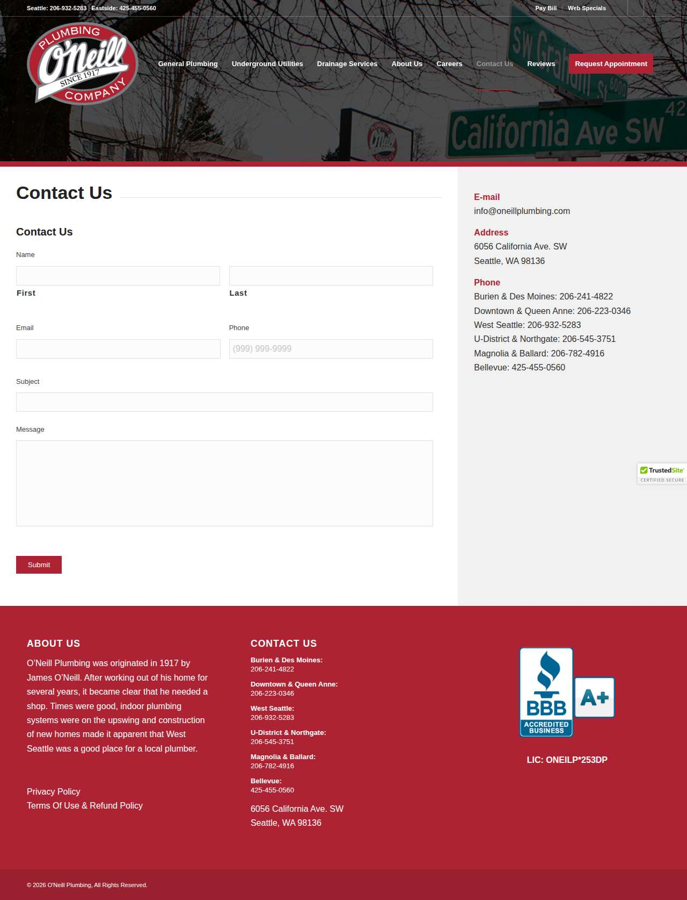

### tureksplumbing.com — dry\_run\_ok (dry run)

| | |
|---|---|
| Attempt ID | `f70525e8-3a11-45b8-8182-0a6b52442db4` |
| Form URL | https://www.tureksplumbing.com/contact/send-message |
| Final URL | https://www.tureksplumbing.com/contact/send-message |
| Reserved | 2026-11-02 03:09:14 UTC |
| Submit attempted | — |
| Template | standard v2 |
| Confirmation text | none observed |
| Result / error | Selectors verified; fields not typed (domain not in dry-run fill list); not submitted |

Exact message:

~~~text
Subject: Helping customers find your business in AI search (AEO + GEO)

Hi there,

I'm Arun from Devs Arun. More and more customers now ask ChatGPT, Gemini, Perplexity or Google's AI Overviews questions like "who should I hire for this in my area?" before they call anyone. These tools answer from websites they can clearly understand, and they tend to recommend businesses whose pages answer real customer questions.

That is what AEO + GEO (Answer Engine and Generative Engine Optimization) is for. I improve your existing service pages so they clearly answer the questions your customers ask, add structured data that matches the page, and make the call, quote or enquiry step obvious. The benefit: your business gets a better chance of being mentioned or linked in AI answers, and visitors who arrive find it easy to contact you.

The AEO + GEO Starter is a one-time $199 (about ₹16,999, negotiable) for one website: a basic audit, 10 customer questions, improvements to two existing pages, relevant structured data and an action plan, with one revision round.

You can read the full details, send an enquiry or book online here:
https://devsarun.io/aeo-geo/

If this isn't relevant, just reply and I won't contact you again.

Best,
Arun
Devs Arun
itschool408@gmail.com · +91 7654534323
~~~

Submitted field values:

- \#list-response-form-1-item-1: Arun
- \#list-response-form-1-item-3: itschool408@gmail.com
- \#list-response-form-1-item-4: +91 7654534323
- \#list-response-form-1-item-12: Hi there, I'm Arun from Devs Arun. More and more customers now ask ChatGPT, Gemini, Perplexity or Google's AI Overviews 

**Inspected page** — `run-4ac30249_attempt-f70525e8_inspection_2026-11-02T03-09-17-461Z.jpg`

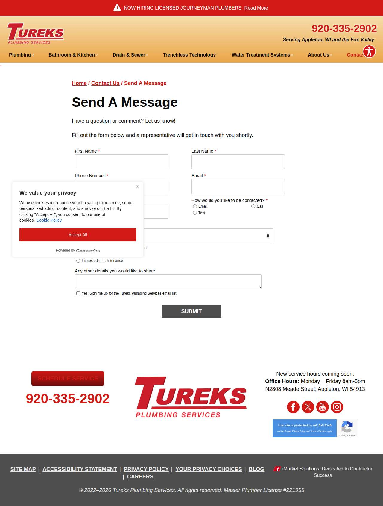

### thomasharkinsplumbing.com — dry\_run\_ok (dry run)

| | |
|---|---|
| Attempt ID | `93b7f8cc-5b5c-43a2-8a51-0f1405a217d6` |
| Form URL | https://www.thomasharkinsplumbing.com/contact |
| Final URL | https://www.thomasharkinsplumbing.com/contact |
| Reserved | 2026-11-02 03:09:22 UTC |
| Submit attempted | — |
| Template | standard v2 |
| Confirmation text | none observed |
| Result / error | Selectors verified; fields not typed (domain not in dry-run fill list); not submitted |

Exact message:

~~~text
Subject: Helping customers find your business in AI search (AEO + GEO)

Hi there,

I'm Arun from Devs Arun. More and more customers now ask ChatGPT, Gemini, Perplexity or Google's AI Overviews questions like "who should I hire for this in my area?" before they call anyone. These tools answer from websites they can clearly understand, and they tend to recommend businesses whose pages answer real customer questions.

That is what AEO + GEO (Answer Engine and Generative Engine Optimization) is for. I improve your existing service pages so they clearly answer the questions your customers ask, add structured data that matches the page, and make the call, quote or enquiry step obvious. The benefit: your business gets a better chance of being mentioned or linked in AI answers, and visitors who arrive find it easy to contact you.

The AEO + GEO Starter is a one-time $199 (about ₹16,999, negotiable) for one website: a basic audit, 10 customer questions, improvements to two existing pages, relevant structured data and an action plan, with one revision round.

You can read the full details, send an enquiry or book online here:
https://devsarun.io/aeo-geo/

If this isn't relevant, just reply and I won't contact you again.

Best,
Arun
Devs Arun
itschool408@gmail.com · +91 7654534323
~~~

Submitted field values:

- \#\\31 162558550: Hi there, I'm Arun from Devs Arun. More and more customers now ask ChatGPT, Gemini, Perplexity or Google's AI Overviews 
- \#\\31 278889256: Arun
- \#\\31 285547171: +91 7654534323
- \#\\31 799664642: itschool408@gmail.com

**Inspected page** — `run-4ac30249_attempt-93b7f8cc_inspection_2026-11-02T03-09-25-722Z.jpg`

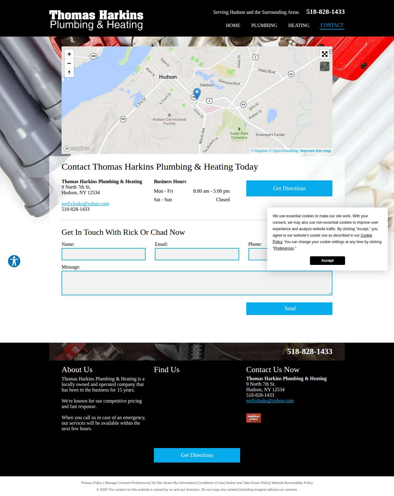

### precisionplumbingoc.com — dry\_run\_ok (dry run)

| | |
|---|---|
| Attempt ID | `21d8144a-14f8-4490-aad2-1090e53f0ee4` |
| Form URL | https://precisionplumbingoc.com/ |
| Final URL | https://precisionplumbingoc.com/ |
| Reserved | 2026-11-02 03:09:30 UTC |
| Submit attempted | — |
| Template | standard v2 |
| Confirmation text | none observed |
| Result / error | Selectors verified; fields not typed (domain not in dry-run fill list); not submitted |

Exact message:

~~~text
Subject: Helping customers find your business in AI search (AEO + GEO)

Hi there,

I'm Arun from Devs Arun. More and more customers now ask ChatGPT, Gemini, Perplexity or Google's AI Overviews questions like "who should I hire for this in my area?" before they call anyone. These tools answer from websites they can clearly understand, and they tend to recommend businesses whose pages answer real customer questions.

That is what AEO + GEO (Answer Engine and Generative Engine Optimization) is for. I improve your existing service pages so they clearly answer the questions your customers ask, add structured data that matches the page, and make the call, quote or enquiry step obvious. The benefit: your business gets a better chance of being mentioned or linked in AI answers, and visitors who arrive find it easy to contact you.

The AEO + GEO Starter is a one-time $199 (about ₹16,999, negotiable) for one website: a basic audit, 10 customer questions, improvements to two existing pages, relevant structured data and an action plan, with one revision round.

You can read the full details, send an enquiry or book online here:
https://devsarun.io/aeo-geo/

If this isn't relevant, just reply and I won't contact you again.

Best,
Arun
Devs Arun
itschool408@gmail.com · +91 7654534323
~~~

Submitted field values:

- div:nth-of-type(2) \> div \> div \> div \> form \> fieldset \> div:nth-of-type(1) \> div \> div:nth-of-type(1) \> div \> div:nth-of-type(2) \> input: Arun
- div:nth-of-type(1) \> div:nth-of-type(2) \> div \> div:nth-of-type(2) \> div \> div \> div \> form \> fieldset \> div:nth-of-type(2) \> div:nth-of-type(2) \> input: itschool408@gmail.com
- div:nth-of-type(1) \> div:nth-of-type(2) \> div \> div:nth-of-type(2) \> div \> div \> div \> form \> fieldset \> div:nth-of-type(3) \> div:nth-of-type(2) \> input: Helping customers find your business in AI search (AEO + GEO)
- div:nth-of-type(1) \> div:nth-of-type(2) \> div \> div:nth-of-type(2) \> div \> div \> div \> form \> fieldset \> div:nth-of-type(4) \> div:nth-of-type(2) \> textarea: Hi there, I'm Arun from Devs Arun. More and more customers now ask ChatGPT, Gemini, Perplexity or Google's AI Overviews 

**Inspected page** — `run-4ac30249_attempt-21d8144a_inspection_2026-11-02T03-09-32-656Z.jpg`

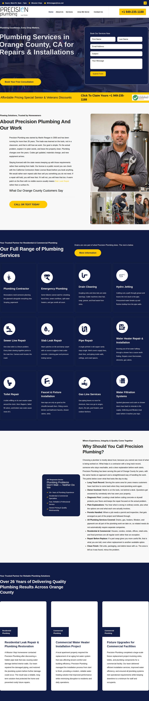

### roddingrooter.com — dry\_run\_ok (dry run)

| | |
|---|---|
| Attempt ID | `43432ce4-c843-4092-b708-5f50e4287a64` |
| Form URL | https://roddingrooter.com/contact/ |
| Final URL | https://roddingrooter.com/contact/ |
| Reserved | 2026-11-02 03:09:37 UTC |
| Submit attempted | — |
| Template | standard v2 |
| Confirmation text | none observed |
| Result / error | Selectors verified; fields not typed (domain not in dry-run fill list); not submitted |

Exact message:

~~~text
Subject: Helping customers find your business in AI search (AEO + GEO)

Hi there,

I'm Arun from Devs Arun. More and more customers now ask ChatGPT, Gemini, Perplexity or Google's AI Overviews questions like "who should I hire for this in my area?" before they call anyone. These tools answer from websites they can clearly understand, and they tend to recommend businesses whose pages answer real customer questions.

That is what AEO + GEO (Answer Engine and Generative Engine Optimization) is for. I improve your existing service pages so they clearly answer the questions your customers ask, add structured data that matches the page, and make the call, quote or enquiry step obvious. The benefit: your business gets a better chance of being mentioned or linked in AI answers, and visitors who arrive find it easy to contact you.

The AEO + GEO Starter is a one-time $199 (about ₹16,999, negotiable) for one website: a basic audit, 10 customer questions, improvements to two existing pages, relevant structured data and an action plan, with one revision round.

You can read the full details, send an enquiry or book online here:
https://devsarun.io/aeo-geo/

If this isn't relevant, just reply and I won't contact you again.

Best,
Arun
Devs Arun
itschool408@gmail.com · +91 7654534323
~~~

Submitted field values:

- \#mf-input-text-655d3b6e: Arun
- \#mf-input-email-3fc8d1db: itschool408@gmail.com
- \#mf-input-telephone-191d3e50: +91 7654534323
- \#mf-input-text-area-38163bab: Hi there, I'm Arun from Devs Arun. More and more customers now ask ChatGPT, Gemini, Perplexity or Google's AI Overviews 

**Inspected page** — `run-4ac30249_attempt-43432ce4_inspection_2026-11-02T03-09-39-978Z.jpg`

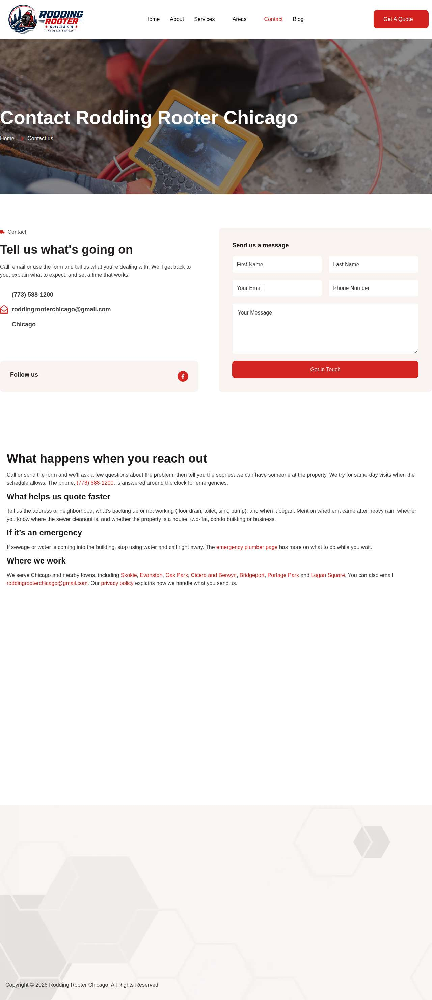

### finkeldeyseptic.com — dry\_run\_ok (dry run)

| | |
|---|---|
| Attempt ID | `8f0be9ab-bd2a-4e84-8f68-32165c1c2de3` |
| Form URL | https://finkeldeyseptic.com/contact-us/ |
| Final URL | https://finkeldeyseptic.com/contact-us/ |
| Reserved | 2026-11-02 03:09:45 UTC |
| Submit attempted | — |
| Template | standard v2 |
| Confirmation text | none observed |
| Result / error | Selectors verified; fields not typed (domain not in dry-run fill list); not submitted |

Exact message:

~~~text
Subject: Helping customers find your business in AI search (AEO + GEO)

Hi there,

I'm Arun from Devs Arun. More and more customers now ask ChatGPT, Gemini, Perplexity or Google's AI Overviews questions like "who should I hire for this in my area?" before they call anyone. These tools answer from websites they can clearly understand, and they tend to recommend businesses whose pages answer real customer questions.

That is what AEO + GEO (Answer Engine and Generative Engine Optimization) is for. I improve your existing service pages so they clearly answer the questions your customers ask, add structured data that matches the page, and make the call, quote or enquiry step obvious. The benefit: your business gets a better chance of being mentioned or linked in AI answers, and visitors who arrive find it easy to contact you.

The AEO + GEO Starter is a one-time $199 (about ₹16,999, negotiable) for one website: a basic audit, 10 customer questions, improvements to two existing pages, relevant structured data and an action plan, with one revision round.

You can read the full details, send an enquiry or book online here:
https://devsarun.io/aeo-geo/

If this isn't relevant, just reply and I won't contact you again.

Best,
Arun
Devs Arun
itschool408@gmail.com · +91 7654534323
~~~

Submitted field values:

- div \> section:nth-of-type(2) \> div \> div:nth-of-type(2) \> div \> div:nth-of-type(3) \> div \> form \> div \> div:nth-of-type(1) \> input: Arun
- div \> section:nth-of-type(2) \> div \> div:nth-of-type(2) \> div \> div:nth-of-type(3) \> div \> form \> div \> div:nth-of-type(2) \> input: itschool408@gmail.com
- div \> section:nth-of-type(2) \> div \> div:nth-of-type(2) \> div \> div:nth-of-type(3) \> div \> form \> div \> div:nth-of-type(3) \> input: +91 7654534323
- div \> section:nth-of-type(2) \> div \> div:nth-of-type(2) \> div \> div:nth-of-type(3) \> div \> form \> div \> div:nth-of-type(5) \> textarea: Hi there, I'm Arun from Devs Arun. More and more customers now ask ChatGPT, Gemini, Perplexity or Google's AI Overviews 

**Inspected page** — `run-4ac30249_attempt-8f0be9ab_inspection_2026-11-02T03-09-46-666Z.jpg`

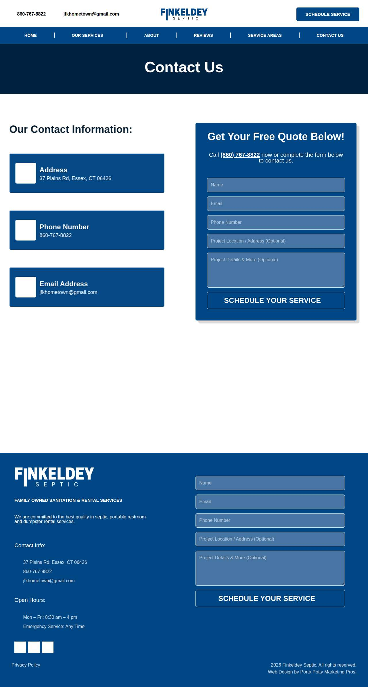

### integrityrepiping.com — dry\_run\_ok (dry run)

| | |
|---|---|
| Attempt ID | `0ae2c1c3-5b62-416a-b5fe-ef107ba268e1` |
| Form URL | https://integrityrepiping.com/contact/ |
| Final URL | https://integrityrepiping.com/contact/ |
| Reserved | 2026-11-02 03:09:51 UTC |
| Submit attempted | — |
| Template | standard v2 |
| Confirmation text | none observed |
| Result / error | Selectors verified; fields not typed (domain not in dry-run fill list); not submitted |

Exact message:

~~~text
Subject: Helping customers find your business in AI search (AEO + GEO)

Hi there,

I'm Arun from Devs Arun. More and more customers now ask ChatGPT, Gemini, Perplexity or Google's AI Overviews questions like "who should I hire for this in my area?" before they call anyone. These tools answer from websites they can clearly understand, and they tend to recommend businesses whose pages answer real customer questions.

That is what AEO + GEO (Answer Engine and Generative Engine Optimization) is for. I improve your existing service pages so they clearly answer the questions your customers ask, add structured data that matches the page, and make the call, quote or enquiry step obvious. The benefit: your business gets a better chance of being mentioned or linked in AI answers, and visitors who arrive find it easy to contact you.

The AEO + GEO Starter is a one-time $199 (about ₹16,999, negotiable) for one website: a basic audit, 10 customer questions, improvements to two existing pages, relevant structured data and an action plan, with one revision round.

You can read the full details, send an enquiry or book online here:
https://devsarun.io/aeo-geo/

If this isn't relevant, just reply and I won't contact you again.

Best,
Arun
Devs Arun
itschool408@gmail.com · +91 7654534323
~~~

Submitted field values:

- \#et\_pb\_contact\_email\_0: itschool408@gmail.com
- \#et\_pb\_contact\_message\_0: Hi there, I'm Arun from Devs Arun. More and more customers now ask ChatGPT, Gemini, Perplexity or Google's AI Overviews 
- \#et\_pb\_contact\_yourname\_0: Arun
- \#et\_pb\_contact\_phonenumber\_0: +91 7654534323

**Inspected page** — `run-4ac30249_attempt-0ae2c1c3_inspection_2026-11-02T03-09-52-892Z.jpg`

### lineyourpipes.com — dry\_run\_ok (dry run)

| | |
|---|---|
| Attempt ID | `6700f1d1-2a97-4525-93cc-67b797d7393c` |
| Form URL | https://www.lineyourpipes.com/contact |
| Final URL | https://www.lineyourpipes.com/contact |
| Reserved | 2026-11-02 03:09:57 UTC |
| Submit attempted | — |
| Template | standard v2 |
| Confirmation text | none observed |
| Result / error | Selectors verified; fields not typed (domain not in dry-run fill list); not submitted |

Exact message:

~~~text
Subject: Helping customers find your business in AI search (AEO + GEO)

Hi there,

I'm Arun from Devs Arun. More and more customers now ask ChatGPT, Gemini, Perplexity or Google's AI Overviews questions like "who should I hire for this in my area?" before they call anyone. These tools answer from websites they can clearly understand, and they tend to recommend businesses whose pages answer real customer questions.

That is what AEO + GEO (Answer Engine and Generative Engine Optimization) is for. I improve your existing service pages so they clearly answer the questions your customers ask, add structured data that matches the page, and make the call, quote or enquiry step obvious. The benefit: your business gets a better chance of being mentioned or linked in AI answers, and visitors who arrive find it easy to contact you.

The AEO + GEO Starter is a one-time $199 (about ₹16,999, negotiable) for one website: a basic audit, 10 customer questions, improvements to two existing pages, relevant structured data and an action plan, with one revision round.

You can read the full details, send an enquiry or book online here:
https://devsarun.io/aeo-geo/

If this isn't relevant, just reply and I won't contact you again.

Best,
Arun
Devs Arun
itschool408@gmail.com · +91 7654534323
~~~

Submitted field values:

- \#input\_comp-kedxzb7p: Arun
- \#input\_comp-kedxzb84: itschool408@gmail.com
- \#input\_comp-kedxzb88: +91 7654534323
- \#input\_comp-kedxzb8b: Helping customers find your business in AI search (AEO + GEO)
- \#textarea\_comp-kedxzb8e1: Hi there, I'm Arun from Devs Arun. More and more customers now ask ChatGPT, Gemini, Perplexity or Google's AI Overviews 

**Inspected page** — `run-4ac30249_attempt-6700f1d1_inspection_2026-11-02T03-10-02-465Z.jpg`

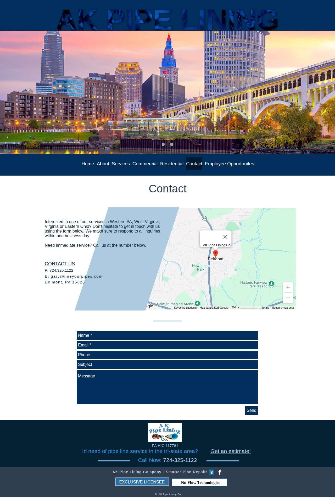

### helpfulplumbing.com — dry\_run\_ok (dry run)

| | |
|---|---|
| Attempt ID | `53723ed2-5c5f-4f98-b056-676f0be6c848` |
| Form URL | https://www.metrowebsites.com/contact |
| Final URL | https://www.metrowebsites.com/contact |
| Reserved | 2026-11-02 03:10:07 UTC |
| Submit attempted | — |
| Template | standard v2 |
| Confirmation text | none observed |
| Result / error | Selectors verified; fields not typed (domain not in dry-run fill list); not submitted |

Exact message:

~~~text
Subject: Helping customers find your business in AI search (AEO + GEO)

Hi there,

I'm Arun from Devs Arun. More and more customers now ask ChatGPT, Gemini, Perplexity or Google's AI Overviews questions like "who should I hire for this in my area?" before they call anyone. These tools answer from websites they can clearly understand, and they tend to recommend businesses whose pages answer real customer questions.

That is what AEO + GEO (Answer Engine and Generative Engine Optimization) is for. I improve your existing service pages so they clearly answer the questions your customers ask, add structured data that matches the page, and make the call, quote or enquiry step obvious. The benefit: your business gets a better chance of being mentioned or linked in AI answers, and visitors who arrive find it easy to contact you.

The AEO + GEO Starter is a one-time $199 (about ₹16,999, negotiable) for one website: a basic audit, 10 customer questions, improvements to two existing pages, relevant structured data and an action plan, with one revision round.

You can read the full details, send an enquiry or book online here:
https://devsarun.io/aeo-geo/

If this isn't relevant, just reply and I won't contact you again.

Best,
Arun
Devs Arun
itschool408@gmail.com · +91 7654534323
~~~

Submitted field values:

- \#name: Arun
- \#email: itschool408@gmail.com
- \#phone: +91 7654534323
- \#message: Hi there, I'm Arun from Devs Arun. More and more customers now ask ChatGPT, Gemini, Perplexity or Google's AI Overviews 

**Inspected page** — `run-4ac30249_attempt-53723ed2_inspection_2026-11-02T03-10-12-103Z.jpg`

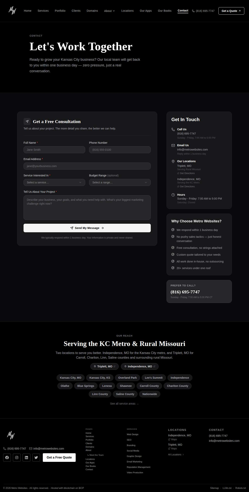

### performanceplumbinginc.com — dry\_run\_ok (dry run)

| | |
|---|---|
| Attempt ID | `fbabb4bc-be93-43d9-a8ab-902f043103b6` |
| Form URL | https://www.performanceplumbinginc.com/contact/schedule-service |
| Final URL | https://www.performanceplumbinginc.com/contact/schedule-service |
| Reserved | 2026-11-02 03:10:17 UTC |
| Submit attempted | — |
| Template | standard v2 |
| Confirmation text | none observed |
| Result / error | Selectors verified; fields not typed (domain not in dry-run fill list); not submitted |

Exact message:

~~~text
Subject: Helping customers find your business in AI search (AEO + GEO)

Hi there,

I'm Arun from Devs Arun. More and more customers now ask ChatGPT, Gemini, Perplexity or Google's AI Overviews questions like "who should I hire for this in my area?" before they call anyone. These tools answer from websites they can clearly understand, and they tend to recommend businesses whose pages answer real customer questions.

That is what AEO + GEO (Answer Engine and Generative Engine Optimization) is for. I improve your existing service pages so they clearly answer the questions your customers ask, add structured data that matches the page, and make the call, quote or enquiry step obvious. The benefit: your business gets a better chance of being mentioned or linked in AI answers, and visitors who arrive find it easy to contact you.

The AEO + GEO Starter is a one-time $199 (about ₹16,999, negotiable) for one website: a basic audit, 10 customer questions, improvements to two existing pages, relevant structured data and an action plan, with one revision round.

You can read the full details, send an enquiry or book online here:
https://devsarun.io/aeo-geo/

If this isn't relevant, just reply and I won't contact you again.

Best,
Arun
Devs Arun
itschool408@gmail.com · +91 7654534323
~~~

Submitted field values:

- \#list-response-form-2-item-1: Arun
- \#list-response-form-2-item-3: itschool408@gmail.com
- \#list-response-form-2-item-4: +91 7654534323
- \#list-response-form-2-item-12: Hi there, I'm Arun from Devs Arun. More and more customers now ask ChatGPT, Gemini, Perplexity or Google's AI Overviews 

**Inspected page** — `run-4ac30249_attempt-fbabb4bc_inspection_2026-11-02T03-10-18-940Z.jpg`

### tri-countyplumbing.com — dry\_run\_ok (dry run)

| | |
|---|---|
| Attempt ID | `33fa6f7f-89b8-46fb-88e9-0b38601a7776` |
| Form URL | https://www.tri-countyplumbing.com/contact |
| Final URL | https://www.tri-countyplumbing.com/contact |
| Reserved | 2026-11-02 03:10:23 UTC |
| Submit attempted | — |
| Template | standard v2 |
| Confirmation text | none observed |
| Result / error | Selectors verified; fields not typed (domain not in dry-run fill list); not submitted |

Exact message:

~~~text
Subject: Helping customers find your business in AI search (AEO + GEO)

Hi there,

I'm Arun from Devs Arun. More and more customers now ask ChatGPT, Gemini, Perplexity or Google's AI Overviews questions like "who should I hire for this in my area?" before they call anyone. These tools answer from websites they can clearly understand, and they tend to recommend businesses whose pages answer real customer questions.

That is what AEO + GEO (Answer Engine and Generative Engine Optimization) is for. I improve your existing service pages so they clearly answer the questions your customers ask, add structured data that matches the page, and make the call, quote or enquiry step obvious. The benefit: your business gets a better chance of being mentioned or linked in AI answers, and visitors who arrive find it easy to contact you.

The AEO + GEO Starter is a one-time $199 (about ₹16,999, negotiable) for one website: a basic audit, 10 customer questions, improvements to two existing pages, relevant structured data and an action plan, with one revision round.

You can read the full details, send an enquiry or book online here:
https://devsarun.io/aeo-geo/

If this isn't relevant, just reply and I won't contact you again.

Best,
Arun
Devs Arun
itschool408@gmail.com · +91 7654534323
~~~

Submitted field values:

- \#input\_comp-lj8yzdr53: Arun
- \#input\_comp-lj8yzdr95: itschool408@gmail.com
- \#input\_comp-lj8yzdrb1: +91 7654534323
- \#textarea\_comp-lj8yzdrc5: Hi there, I'm Arun from Devs Arun. More and more customers now ask ChatGPT, Gemini, Perplexity or Google's AI Overviews 

**Inspected page** — `run-4ac30249_attempt-33fa6f7f_inspection_2026-11-02T03-10-26-333Z.jpg`

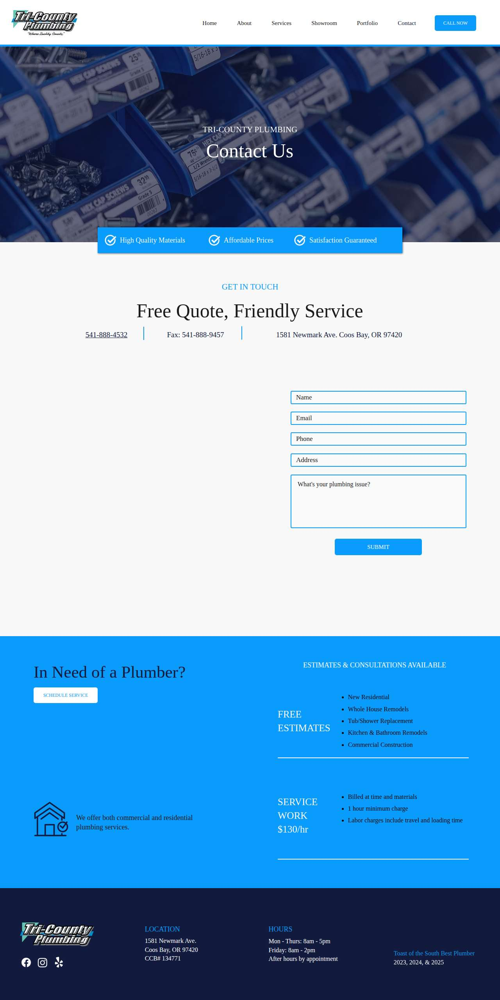

### millcreekplumbingllc.com — dry\_run\_ok (dry run)

| | |
|---|---|
| Attempt ID | `30c10743-0597-4321-86ed-8335fb8bea78` |
| Form URL | http://millcreekplumbingllc.com/contact/ |
| Final URL | http://millcreekplumbingllc.com/contact/ |
| Reserved | 2026-11-02 03:10:31 UTC |
| Submit attempted | — |
| Template | standard v2 |
| Confirmation text | none observed |
| Result / error | Selectors verified; fields not typed (domain not in dry-run fill list); not submitted |

Exact message:

~~~text
Subject: Helping customers find your business in AI search (AEO + GEO)

Hi there,

I'm Arun from Devs Arun. More and more customers now ask ChatGPT, Gemini, Perplexity or Google's AI Overviews questions like "who should I hire for this in my area?" before they call anyone. These tools answer from websites they can clearly understand, and they tend to recommend businesses whose pages answer real customer questions.

That is what AEO + GEO (Answer Engine and Generative Engine Optimization) is for. I improve your existing service pages so they clearly answer the questions your customers ask, add structured data that matches the page, and make the call, quote or enquiry step obvious. The benefit: your business gets a better chance of being mentioned or linked in AI answers, and visitors who arrive find it easy to contact you.

The AEO + GEO Starter is a one-time $199 (about ₹16,999, negotiable) for one website: a basic audit, 10 customer questions, improvements to two existing pages, relevant structured data and an action plan, with one revision round.

You can read the full details, send an enquiry or book online here:
https://devsarun.io/aeo-geo/

If this isn't relevant, just reply and I won't contact you again.

Best,
Arun
Devs Arun
itschool408@gmail.com · +91 7654534323
~~~

Submitted field values:

- input\[name="your-name"\]: Arun
- input\[name="your-email"\]: itschool408@gmail.com
- input\[name="your-subject"\]: Helping customers find your business in AI search (AEO + GEO)
- textarea\[name="your-message"\]: Hi there, I'm Arun from Devs Arun. More and more customers now ask ChatGPT, Gemini, Perplexity or Google's AI Overviews 

**Inspected page** — `run-4ac30249_attempt-30c10743_inspection_2026-11-02T03-10-32-251Z.jpg`

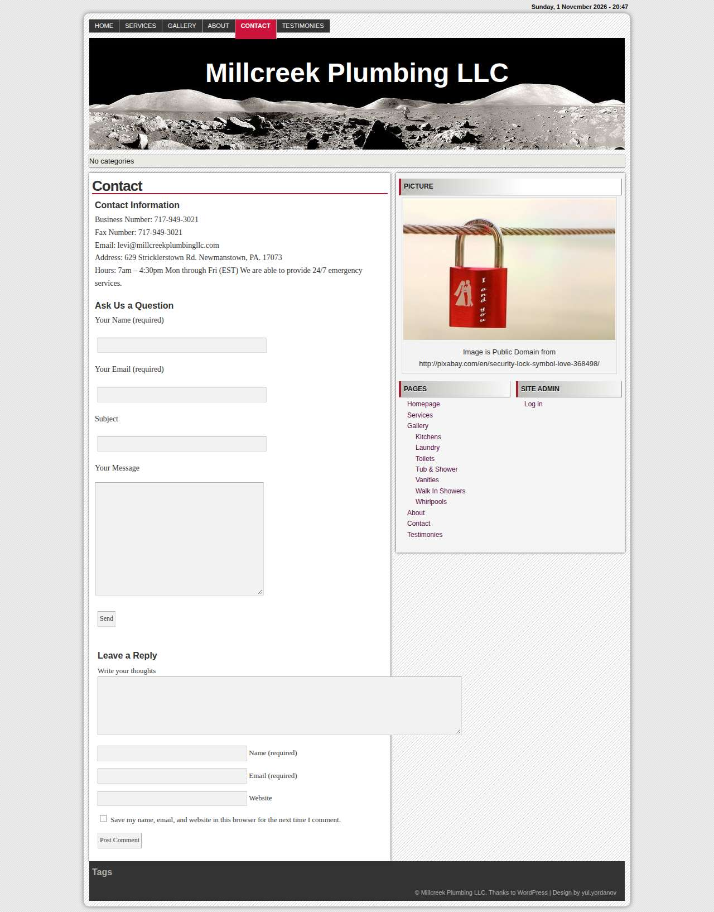

### rotorooterbck.com — dry\_run\_ok (dry run)

| | |
|---|---|
| Attempt ID | `11331503-84b0-4e58-8481-39757a59cc81` |
| Form URL | https://www.rotorooterbck.com/contact-us |
| Final URL | https://www.rotorooterbck.com/contact-us |
| Reserved | 2026-11-02 03:10:37 UTC |
| Submit attempted | — |
| Template | standard v2 |
| Confirmation text | none observed |
| Result / error | Selectors verified; fields not typed (domain not in dry-run fill list); not submitted |

Exact message:

~~~text
Subject: Helping customers find your business in AI search (AEO + GEO)

Hi there,

I'm Arun from Devs Arun. More and more customers now ask ChatGPT, Gemini, Perplexity or Google's AI Overviews questions like "who should I hire for this in my area?" before they call anyone. These tools answer from websites they can clearly understand, and they tend to recommend businesses whose pages answer real customer questions.

That is what AEO + GEO (Answer Engine and Generative Engine Optimization) is for. I improve your existing service pages so they clearly answer the questions your customers ask, add structured data that matches the page, and make the call, quote or enquiry step obvious. The benefit: your business gets a better chance of being mentioned or linked in AI answers, and visitors who arrive find it easy to contact you.

The AEO + GEO Starter is a one-time $199 (about ₹16,999, negotiable) for one website: a basic audit, 10 customer questions, improvements to two existing pages, relevant structured data and an action plan, with one revision round.

You can read the full details, send an enquiry or book online here:
https://devsarun.io/aeo-geo/

If this isn't relevant, just reply and I won't contact you again.

Best,
Arun
Devs Arun
itschool408@gmail.com · +91 7654534323
~~~

Submitted field values:

- \#\\31 065892540: Hi there, I'm Arun from Devs Arun. More and more customers now ask ChatGPT, Gemini, Perplexity or Google's AI Overviews 
- \#\\31 432930920: +91 7654534323
- \#\\31 481085003: itschool408@gmail.com
- \#\\31 731284439: Arun

**Inspected page** — `run-4ac30249_attempt-11331503_inspection_2026-11-02T03-10-39-394Z.jpg`

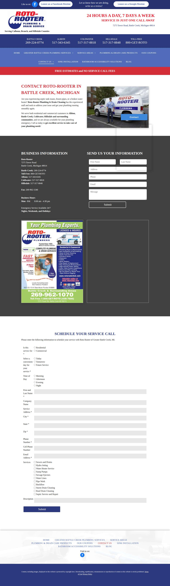

### eliterooter.com — dry\_run\_ok (dry run)

| | |
|---|---|
| Attempt ID | `0c2b44d4-f3ed-42d7-8c26-32eae890188f` |
| Form URL | https://www.eliterooter.com/contact-us/ |
| Final URL | https://www.eliterooter.com/contact-us/ |
| Reserved | 2026-11-02 03:10:44 UTC |
| Submit attempted | — |
| Template | standard v2 |
| Confirmation text | none observed |
| Result / error | Selectors verified; fields not typed (domain not in dry-run fill list); not submitted |

Exact message:

~~~text
Subject: Helping customers find your business in AI search (AEO + GEO)

Hi there,

I'm Arun from Devs Arun. More and more customers now ask ChatGPT, Gemini, Perplexity or Google's AI Overviews questions like "who should I hire for this in my area?" before they call anyone. These tools answer from websites they can clearly understand, and they tend to recommend businesses whose pages answer real customer questions.

That is what AEO + GEO (Answer Engine and Generative Engine Optimization) is for. I improve your existing service pages so they clearly answer the questions your customers ask, add structured data that matches the page, and make the call, quote or enquiry step obvious. The benefit: your business gets a better chance of being mentioned or linked in AI answers, and visitors who arrive find it easy to contact you.

The AEO + GEO Starter is a one-time $199 (about ₹16,999, negotiable) for one website: a basic audit, 10 customer questions, improvements to two existing pages, relevant structured data and an action plan, with one revision round.

You can read the full details, send an enquiry or book online here:
https://devsarun.io/aeo-geo/

If this isn't relevant, just reply and I won't contact you again.

Best,
Arun
Devs Arun
itschool408@gmail.com · +91 7654534323
~~~

Submitted field values:

- input\[name="form\_fields\[name\]"\]: Arun
- input\[name="form\_fields\[email\]"\]: itschool408@gmail.com
- textarea\[name="form\_fields\[message\]"\]: Hi there, I'm Arun from Devs Arun. More and more customers now ask ChatGPT, Gemini, Perplexity or Google's AI Overviews 
- input\[name="form\_fields\[field\_ab3a070\]"\]: +91 7654534323
- input\[name="form\_fields\[field\_cb3b18e\]"\]: Helping customers find your business in AI search (AEO + GEO)

**Inspected page** — `run-4ac30249_attempt-0c2b44d4_inspection_2026-11-02T03-10-46-357Z.jpg`

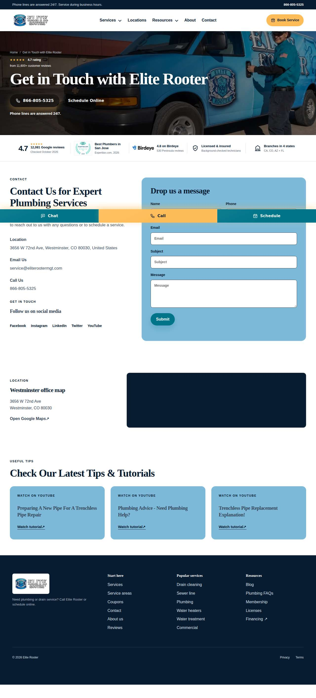

### peninsularplumbing.com — dry\_run\_ok (dry run)

| | |
|---|---|
| Attempt ID | `66444623-5ddb-4b6f-abfe-83c7b10f633d` |
| Form URL | https://peninsularplumbing.com/contact-peninsular-plumbing/ |
| Final URL | https://peninsularplumbing.com/contact-peninsular-plumbing/ |
| Reserved | 2026-11-02 03:10:51 UTC |
| Submit attempted | — |
| Template | standard v2 |
| Confirmation text | none observed |
| Result / error | Selectors verified; fields not typed (domain not in dry-run fill list); not submitted |

Exact message:

~~~text
Subject: Helping customers find your business in AI search (AEO + GEO)

Hi there,

I'm Arun from Devs Arun. More and more customers now ask ChatGPT, Gemini, Perplexity or Google's AI Overviews questions like "who should I hire for this in my area?" before they call anyone. These tools answer from websites they can clearly understand, and they tend to recommend businesses whose pages answer real customer questions.

That is what AEO + GEO (Answer Engine and Generative Engine Optimization) is for. I improve your existing service pages so they clearly answer the questions your customers ask, add structured data that matches the page, and make the call, quote or enquiry step obvious. The benefit: your business gets a better chance of being mentioned or linked in AI answers, and visitors who arrive find it easy to contact you.

The AEO + GEO Starter is a one-time $199 (about ₹16,999, negotiable) for one website: a basic audit, 10 customer questions, improvements to two existing pages, relevant structured data and an action plan, with one revision round.

You can read the full details, send an enquiry or book online here:
https://devsarun.io/aeo-geo/

If this isn't relevant, just reply and I won't contact you again.

Best,
Arun
Devs Arun
itschool408@gmail.com · +91 7654534323
~~~

Submitted field values:

- \#input\_1\_1: Arun
- \#input\_1\_2: itschool408@gmail.com
- \#input\_1\_3: +91 7654534323
- \#input\_1\_4: Hi there, I'm Arun from Devs Arun. More and more customers now ask ChatGPT, Gemini, Perplexity or Google's AI Overviews 

**Inspected page** — `run-4ac30249_attempt-66444623_inspection_2026-11-02T03-10-56-503Z.jpg`

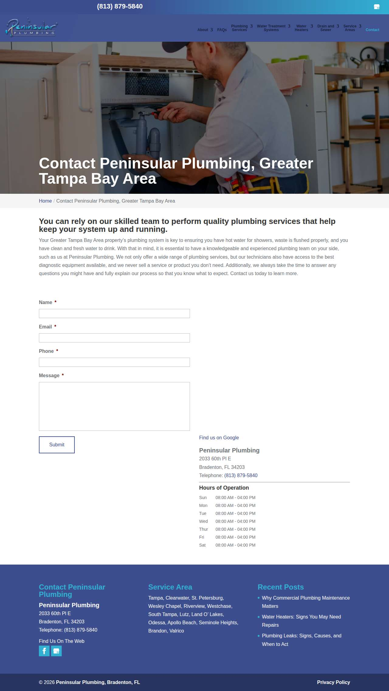

### fredjmoyer.com — dry\_run\_ok (dry run)

| | |
|---|---|
| Attempt ID | `26fef685-7105-4800-980d-e2b49413ad07` |
| Form URL | https://www.fredjmoyer.com/contact |
| Final URL | https://www.fredjmoyer.com/contact |
| Reserved | 2026-11-02 03:11:01 UTC |
| Submit attempted | — |
| Template | standard v2 |
| Confirmation text | none observed |
| Result / error | Selectors verified; fields not typed (domain not in dry-run fill list); not submitted |

Exact message:

~~~text
Subject: Helping customers find your business in AI search (AEO + GEO)

Hi there,

I'm Arun from Devs Arun. More and more customers now ask ChatGPT, Gemini, Perplexity or Google's AI Overviews questions like "who should I hire for this in my area?" before they call anyone. These tools answer from websites they can clearly understand, and they tend to recommend businesses whose pages answer real customer questions.

That is what AEO + GEO (Answer Engine and Generative Engine Optimization) is for. I improve your existing service pages so they clearly answer the questions your customers ask, add structured data that matches the page, and make the call, quote or enquiry step obvious. The benefit: your business gets a better chance of being mentioned or linked in AI answers, and visitors who arrive find it easy to contact you.

The AEO + GEO Starter is a one-time $199 (about ₹16,999, negotiable) for one website: a basic audit, 10 customer questions, improvements to two existing pages, relevant structured data and an action plan, with one revision round.

You can read the full details, send an enquiry or book online here:
https://devsarun.io/aeo-geo/

If this isn't relevant, just reply and I won't contact you again.

Best,
Arun
Devs Arun
itschool408@gmail.com · +91 7654534323
~~~

Submitted field values:

- \#\\31 032434765: Hi there, I'm Arun from Devs Arun. More and more customers now ask ChatGPT, Gemini, Perplexity or Google's AI Overviews 
- \#\\31 442225129: itschool408@gmail.com
- \#\\31 813591936: Arun

**Inspected page** — `run-4ac30249_attempt-26fef685_inspection_2026-11-02T03-11-02-944Z.jpg`

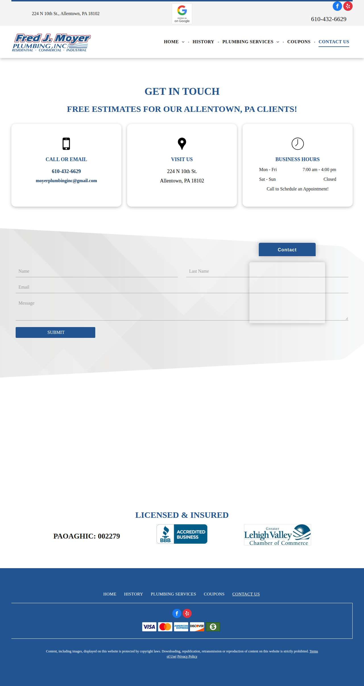

### integrityrepipe.com — dry\_run\_ok (dry run)

| | |
|---|---|
| Attempt ID | `f7bd5749-23eb-49ea-a1ec-0209adb0e318` |
| Form URL | https://www.integrityrepipe.com/ |
| Final URL | https://www.integrityrepipe.com/ |
| Reserved | 2026-11-02 03:11:07 UTC |
| Submit attempted | — |
| Template | standard v2 |
| Confirmation text | none observed |
| Result / error | Selectors verified; fields not typed (domain not in dry-run fill list); not submitted |

Exact message:

~~~text
Subject: Helping customers find your business in AI search (AEO + GEO)

Hi there,

I'm Arun from Devs Arun. More and more customers now ask ChatGPT, Gemini, Perplexity or Google's AI Overviews questions like "who should I hire for this in my area?" before they call anyone. These tools answer from websites they can clearly understand, and they tend to recommend businesses whose pages answer real customer questions.

That is what AEO + GEO (Answer Engine and Generative Engine Optimization) is for. I improve your existing service pages so they clearly answer the questions your customers ask, add structured data that matches the page, and make the call, quote or enquiry step obvious. The benefit: your business gets a better chance of being mentioned or linked in AI answers, and visitors who arrive find it easy to contact you.

The AEO + GEO Starter is a one-time $199 (about ₹16,999, negotiable) for one website: a basic audit, 10 customer questions, improvements to two existing pages, relevant structured data and an action plan, with one revision round.

You can read the full details, send an enquiry or book online here:
https://devsarun.io/aeo-geo/

If this isn't relevant, just reply and I won't contact you again.

Best,
Arun
Devs Arun
itschool408@gmail.com · +91 7654534323
~~~

Submitted field values:

- \#wpcf7-f1907-p8-o2 \> form \> p:nth-of-type(1) \> span \> textarea: Hi there, I'm Arun from Devs Arun. More and more customers now ask ChatGPT, Gemini, Perplexity or Google's AI Overviews 
- \#wpcf7-f1907-p8-o2 \> form \> div:nth-of-type(1) \> p \> span \> input: Arun
- \#wpcf7-f1907-p8-o2 \> form \> div:nth-of-type(2) \> p \> span \> input: +91 7654534323
- \#wpcf7-f1907-p8-o2 \> form \> div:nth-of-type(3) \> p \> span \> input: itschool408@gmail.com
- \#wpcf7-f1907-p8-o2 \> form \> div:nth-of-type(4) \> p \> span \> input: Helping customers find your business in AI search (AEO + GEO)

**Inspected page** — `run-4ac30249_attempt-f7bd5749_inspection_2026-11-02T03-11-09-366Z.jpg`

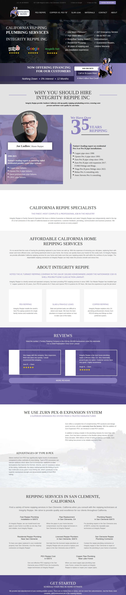

## Events (89)

| Time (UTC) | Event | Website | Details |
|---|---|---|---|
| 03:09:02 | run\_queued | — | dry\_run run requested by github:itsDevsArun |
| 03:09:02 | run\_dispatched | — | dispatch disabled (local test mode) |
| 03:09:04 | run\_started | — | Runner claimed dry\_run run |
| 03:09:04 | website\_selected | oneillplumbing.com | Dry-run target oneillplumbing.com |
| 03:09:04 | draft\_prepared | oneillplumbing.com | Draft prepared with template standard v2 |
| 03:09:09 | page\_opened | oneillplumbing.com | Opened form page |
| 03:09:09 | screenshot\_saved | oneillplumbing.com | inspection screenshot saved (131 KB) |
| 03:09:09 | dry\_run\_checked | oneillplumbing.com | dry run ok: Selectors verified; fields not typed (domain not in dry-run fill list); not submitted |
| 03:09:14 | website\_selected | tureksplumbing.com | Dry-run target tureksplumbing.com |
| 03:09:14 | draft\_prepared | tureksplumbing.com | Draft prepared with template standard v2 |
| 03:09:17 | page\_opened | tureksplumbing.com | Opened form page |
| 03:09:17 | screenshot\_saved | tureksplumbing.com | inspection screenshot saved (122 KB) |
| 03:09:17 | dry\_run\_checked | tureksplumbing.com | dry run ok: Selectors verified; fields not typed (domain not in dry-run fill list); not submitted |
| 03:09:22 | website\_selected | thomasharkinsplumbing.com | Dry-run target thomasharkinsplumbing.com |
| 03:09:22 | draft\_prepared | thomasharkinsplumbing.com | Draft prepared with template standard v2 |
| 03:09:25 | page\_opened | thomasharkinsplumbing.com | Opened form page |
| 03:09:25 | screenshot\_saved | thomasharkinsplumbing.com | inspection screenshot saved (149 KB) |
| 03:09:25 | dry\_run\_checked | thomasharkinsplumbing.com | dry run ok: Selectors verified; fields not typed (domain not in dry-run fill list); not submitted |
| 03:09:30 | website\_selected | precisionplumbingoc.com | Dry-run target precisionplumbingoc.com |
| 03:09:30 | draft\_prepared | precisionplumbingoc.com | Draft prepared with template standard v2 |
| 03:09:32 | page\_opened | precisionplumbingoc.com | Opened form page |
| 03:09:32 | screenshot\_saved | precisionplumbingoc.com | inspection screenshot saved (596 KB) |
| 03:09:32 | dry\_run\_checked | precisionplumbingoc.com | dry run ok: Selectors verified; fields not typed (domain not in dry-run fill list); not submitted |
| 03:09:37 | website\_selected | roddingrooter.com | Dry-run target roddingrooter.com |
| 03:09:37 | draft\_prepared | roddingrooter.com | Draft prepared with template standard v2 |
| 03:09:39 | page\_opened | roddingrooter.com | Opened form page |
| 03:09:39 | screenshot\_saved | roddingrooter.com | inspection screenshot saved (164 KB) |
| 03:09:39 | dry\_run\_checked | roddingrooter.com | dry run ok: Selectors verified; fields not typed (domain not in dry-run fill list); not submitted |
| 03:09:45 | website\_selected | finkeldeyseptic.com | Dry-run target finkeldeyseptic.com |
| 03:09:45 | draft\_prepared | finkeldeyseptic.com | Draft prepared with template standard v2 |
| 03:09:46 | page\_opened | finkeldeyseptic.com | Opened form page |
| 03:09:46 | screenshot\_saved | finkeldeyseptic.com | inspection screenshot saved (131 KB) |
| 03:09:46 | dry\_run\_checked | finkeldeyseptic.com | dry run ok: Selectors verified; fields not typed (domain not in dry-run fill list); not submitted |
| 03:09:51 | website\_selected | integrityrepiping.com | Dry-run target integrityrepiping.com |
| 03:09:51 | draft\_prepared | integrityrepiping.com | Draft prepared with template standard v2 |
| 03:09:52 | page\_opened | integrityrepiping.com | Opened form page |
| 03:09:52 | screenshot\_saved | integrityrepiping.com | inspection screenshot saved (98 KB) |
| 03:09:52 | dry\_run\_checked | integrityrepiping.com | dry run ok: Selectors verified; fields not typed (domain not in dry-run fill list); not submitted |
| 03:09:57 | website\_selected | lineyourpipes.com | Dry-run target lineyourpipes.com |
| 03:09:57 | draft\_prepared | lineyourpipes.com | Draft prepared with template standard v2 |
| 03:10:02 | page\_opened | lineyourpipes.com | Opened form page |
| 03:10:02 | screenshot\_saved | lineyourpipes.com | inspection screenshot saved (200 KB) |
| 03:10:02 | dry\_run\_checked | lineyourpipes.com | dry run ok: Selectors verified; fields not typed (domain not in dry-run fill list); not submitted |
| 03:10:07 | website\_selected | helpfulplumbing.com | Dry-run target helpfulplumbing.com |
| 03:10:07 | draft\_prepared | helpfulplumbing.com | Draft prepared with template standard v2 |
| 03:10:11 | page\_opened | helpfulplumbing.com | Opened form page |
| 03:10:12 | screenshot\_saved | helpfulplumbing.com | inspection screenshot saved (143 KB) |
| 03:10:12 | dry\_run\_checked | helpfulplumbing.com | dry run ok: Selectors verified; fields not typed (domain not in dry-run fill list); not submitted |
| 03:10:17 | website\_selected | performanceplumbinginc.com | Dry-run target performanceplumbinginc.com |
| 03:10:17 | draft\_prepared | performanceplumbinginc.com | Draft prepared with template standard v2 |
| 03:10:18 | page\_opened | performanceplumbinginc.com | Opened form page |
| 03:10:18 | screenshot\_saved | performanceplumbinginc.com | inspection screenshot saved (253 KB) |
| 03:10:18 | dry\_run\_checked | performanceplumbinginc.com | dry run ok: Selectors verified; fields not typed (domain not in dry-run fill list); not submitted |
| 03:10:23 | website\_selected | tri-countyplumbing.com | Dry-run target tri-countyplumbing.com |
| 03:10:23 | draft\_prepared | tri-countyplumbing.com | Draft prepared with template standard v2 |
| 03:10:26 | page\_opened | tri-countyplumbing.com | Opened form page |
| 03:10:26 | screenshot\_saved | tri-countyplumbing.com | inspection screenshot saved (146 KB) |
| 03:10:26 | dry\_run\_checked | tri-countyplumbing.com | dry run ok: Selectors verified; fields not typed (domain not in dry-run fill list); not submitted |
| 03:10:31 | website\_selected | millcreekplumbingllc.com | Dry-run target millcreekplumbingllc.com |
| 03:10:31 | draft\_prepared | millcreekplumbingllc.com | Draft prepared with template standard v2 |
| 03:10:32 | page\_opened | millcreekplumbingllc.com | Opened form page |
| 03:10:32 | screenshot\_saved | millcreekplumbingllc.com | inspection screenshot saved (182 KB) |
| 03:10:32 | dry\_run\_checked | millcreekplumbingllc.com | dry run ok: Selectors verified; fields not typed (domain not in dry-run fill list); not submitted |
| 03:10:37 | website\_selected | rotorooterbck.com | Dry-run target rotorooterbck.com |
| 03:10:37 | draft\_prepared | rotorooterbck.com | Draft prepared with template standard v2 |
| 03:10:39 | page\_opened | rotorooterbck.com | Opened form page |
| 03:10:39 | screenshot\_saved | rotorooterbck.com | inspection screenshot saved (294 KB) |
| 03:10:39 | dry\_run\_checked | rotorooterbck.com | dry run ok: Selectors verified; fields not typed (domain not in dry-run fill list); not submitted |
| 03:10:44 | website\_selected | eliterooter.com | Dry-run target eliterooter.com |
| 03:10:44 | draft\_prepared | eliterooter.com | Draft prepared with template standard v2 |
| 03:10:46 | page\_opened | eliterooter.com | Opened form page |
| 03:10:46 | screenshot\_saved | eliterooter.com | inspection screenshot saved (183 KB) |
| 03:10:46 | dry\_run\_checked | eliterooter.com | dry run ok: Selectors verified; fields not typed (domain not in dry-run fill list); not submitted |
| 03:10:51 | website\_selected | peninsularplumbing.com | Dry-run target peninsularplumbing.com |
| 03:10:51 | draft\_prepared | peninsularplumbing.com | Draft prepared with template standard v2 |
| 03:10:56 | page\_opened | peninsularplumbing.com | Opened form page |
| 03:10:56 | screenshot\_saved | peninsularplumbing.com | inspection screenshot saved (153 KB) |
| 03:10:56 | dry\_run\_checked | peninsularplumbing.com | dry run ok: Selectors verified; fields not typed (domain not in dry-run fill list); not submitted |
| 03:11:01 | website\_selected | fredjmoyer.com | Dry-run target fredjmoyer.com |
| 03:11:01 | draft\_prepared | fredjmoyer.com | Draft prepared with template standard v2 |
| 03:11:02 | page\_opened | fredjmoyer.com | Opened form page |
| 03:11:02 | screenshot\_saved | fredjmoyer.com | inspection screenshot saved (107 KB) |
| 03:11:02 | dry\_run\_checked | fredjmoyer.com | dry run ok: Selectors verified; fields not typed (domain not in dry-run fill list); not submitted |
| 03:11:07 | website\_selected | integrityrepipe.com | Dry-run target integrityrepipe.com |
| 03:11:07 | draft\_prepared | integrityrepipe.com | Draft prepared with template standard v2 |
| 03:11:09 | page\_opened | integrityrepipe.com | Opened form page |
| 03:11:09 | screenshot\_saved | integrityrepipe.com | inspection screenshot saved (506 KB) |
| 03:11:09 | dry\_run\_checked | integrityrepipe.com | dry run ok: Selectors verified; fields not typed (domain not in dry-run fill list); not submitted |
| 03:11:14 | run\_completed | — | Run completed (queue\_exhausted) |
