# Run 136a0655 — live — completed

| | |
|---|---|
| Run ID | `136a0655-6b78-458b-84af-07a659d24d3a` |
| Requested by | github:itsDevsArun |
| Started | 2026-11-02 17:37:24 UTC |
| Finished | 2026-11-02 17:40:46 UTC |
| Finish reason | queue\_exhausted |
| GitHub Actions | https://github.com/itsDevsArun/aeo-geo/actions/runs/41469315389 |

CSV for this run: [runs/2026-11-02_live_136a0655.csv](2026-11-02_live_136a0655.csv)

## Attempts (10)

### clearchoiceplumbingllc.com — failed\_before\_submit (LIVE)

| | |
|---|---|
| Attempt ID | `8d35c11e-dd41-4304-a5a9-b2ca5a1c3145` |
| Form URL | https://clearchoiceplumbingllc.com/contact/ |
| Final URL | — |
| Reserved | 2026-11-02 17:37:25 UTC |
| Submit attempted | — |
| Template | standard v2 |
| Confirmation text | none observed |
| Result / error | locator.fill: Error: Cannot type text into input\[type=number\] |

Exact message:

~~~text
Subject: Helping customers find your business in AI search (AEO + GEO)

Hi there,

I'm Arun from Devs Arun. More and more customers now ask ChatGPT, Gemini, Perplexity or Google's AI Overviews questions like "who should I hire for this in my area?" before they call anyone. These tools answer from websites they can clearly understand, and they tend to recommend businesses whose pages answer real customer questions.

That is what AEO + GEO (Answer Engine and Generative Engine Optimization) is for. I improve your existing service pages so they clearly answer the questions your customers ask, add structured data that matches the page, and make the call, quote or enquiry step obvious. The benefit: your business gets a better chance of being mentioned or linked in AI answers, and visitors who arrive find it easy to contact you.

The AEO + GEO Starter is a one-time $199 (about ₹16,999, negotiable) for one website: a basic audit, 10 customer questions, improvements to two existing pages, relevant structured data and an action plan, with one revision round.

You can read the full details, send an enquiry or book online here:
https://devsarun.io/aeo-geo/

If this isn't relevant, just reply and I won't contact you again.

Best,
Arun
Devs Arun
itschool408@gmail.com · +91 7654534323
~~~

Submitted field values:

- \#wpforms-51-field\_1: Arun
- \#wpforms-51-field\_2: itschool408@gmail.com
- \#wpforms-51-field\_3: Hi there, I'm Arun from Devs Arun. More and more customers now ask ChatGPT, Gemini, Perplexity or Google's AI Overviews 
- \#wpforms-51-field\_5: +91 7654534323

**Inspected page** — `run-136a0655_attempt-8d35c11e_inspection_2026-11-02T17-37-27-248Z.jpg`

### landscape-fx.com — failed\_before\_submit (LIVE)

| | |
|---|---|
| Attempt ID | `807abc71-6198-47ee-aed6-3507bf7e13ff` |
| Form URL | https://www.landscape-fx.com/contact-landscape-fx/ |
| Final URL | https://www.landscape-fx.com/contact-landscape-fx/ |
| Reserved | 2026-11-02 17:37:32 UTC |
| Submit attempted | — |
| Template | standard v2 |
| Confirmation text | none observed |
| Result / error | Field "Telephone number:\*" did not accept the value |

Exact message:

~~~text
Subject: Helping customers find your business in AI search (AEO + GEO)

Hi there,

I'm Arun from Devs Arun. More and more customers now ask ChatGPT, Gemini, Perplexity or Google's AI Overviews questions like "who should I hire for this in my area?" before they call anyone. These tools answer from websites they can clearly understand, and they tend to recommend businesses whose pages answer real customer questions.

That is what AEO + GEO (Answer Engine and Generative Engine Optimization) is for. I improve your existing service pages so they clearly answer the questions your customers ask, add structured data that matches the page, and make the call, quote or enquiry step obvious. The benefit: your business gets a better chance of being mentioned or linked in AI answers, and visitors who arrive find it easy to contact you.

The AEO + GEO Starter is a one-time $199 (about ₹16,999, negotiable) for one website: a basic audit, 10 customer questions, improvements to two existing pages, relevant structured data and an action plan, with one revision round.

You can read the full details, send an enquiry or book online here:
https://devsarun.io/aeo-geo/

If this isn't relevant, just reply and I won't contact you again.

Best,
Arun
Devs Arun
itschool408@gmail.com · +91 7654534323
~~~

Submitted field values:

- \#input\_3\_1: Arun
- \#input\_3\_2: itschool408@gmail.com
- \#input\_3\_3: +91 7654534323
- \#input\_3\_4: Hi there, I'm Arun from Devs Arun. More and more customers now ask ChatGPT, Gemini, Perplexity or Google's AI Overviews 

**Filled form (before submit)** — `run-136a0655_attempt-807abc71_filled_2026-11-02T17-37-34-525Z.jpg`

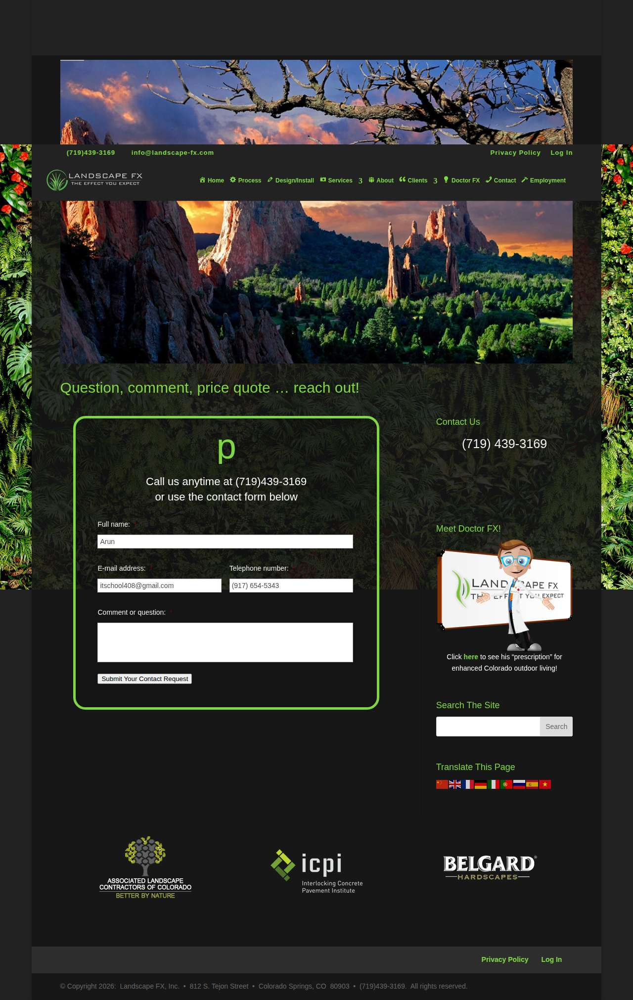

### greatoutdoorsva.com — unclear (LIVE)

| | |
|---|---|
| Attempt ID | `b5414483-107f-41bf-8e34-4b62719c74c7` |
| Form URL | https://www.greatoutdoorsva.com/contact |
| Final URL | https://www.greatoutdoorsva.com/contact |
| Reserved | 2026-11-02 17:37:39 UTC |
| Submit attempted | 2026-11-02 17:37:42 UTC |
| Template | standard v2 |
| Confirmation text | none observed |
| Result / error | No new success marker observed |

Exact message:

~~~text
Subject: Helping customers find your business in AI search (AEO + GEO)

Hi there,

I'm Arun from Devs Arun. More and more customers now ask ChatGPT, Gemini, Perplexity or Google's AI Overviews questions like "who should I hire for this in my area?" before they call anyone. These tools answer from websites they can clearly understand, and they tend to recommend businesses whose pages answer real customer questions.

That is what AEO + GEO (Answer Engine and Generative Engine Optimization) is for. I improve your existing service pages so they clearly answer the questions your customers ask, add structured data that matches the page, and make the call, quote or enquiry step obvious. The benefit: your business gets a better chance of being mentioned or linked in AI answers, and visitors who arrive find it easy to contact you.

The AEO + GEO Starter is a one-time $199 (about ₹16,999, negotiable) for one website: a basic audit, 10 customer questions, improvements to two existing pages, relevant structured data and an action plan, with one revision round.

You can read the full details, send an enquiry or book online here:
https://devsarun.io/aeo-geo/

If this isn't relevant, just reply and I won't contact you again.

Best,
Arun
Devs Arun
itschool408@gmail.com · +91 7654534323
~~~

Submitted field values:

- email \[email\]: itschool408@gmail.com
- name-\* \[name\]: Arun
- Message \[message\]: Hi there, I'm Arun from Devs Arun. More and more customers now ask ChatGPT, Gemini, Perplexity or Google's AI Overviews 
- subject \[subject\]: Helping customers find your business in AI search (AEO + GEO)

**Filled form (before submit)** — `run-136a0655_attempt-b5414483_filled_2026-11-02T17-37-42-067Z.jpg`

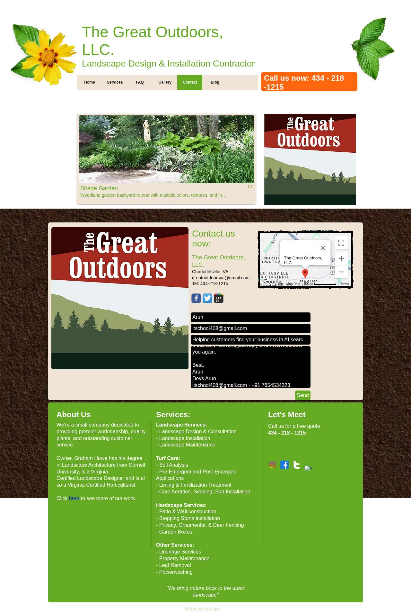

**After submit** — `run-136a0655_attempt-b5414483_post_attempt_2026-11-02T17-38-09-999Z.jpg`

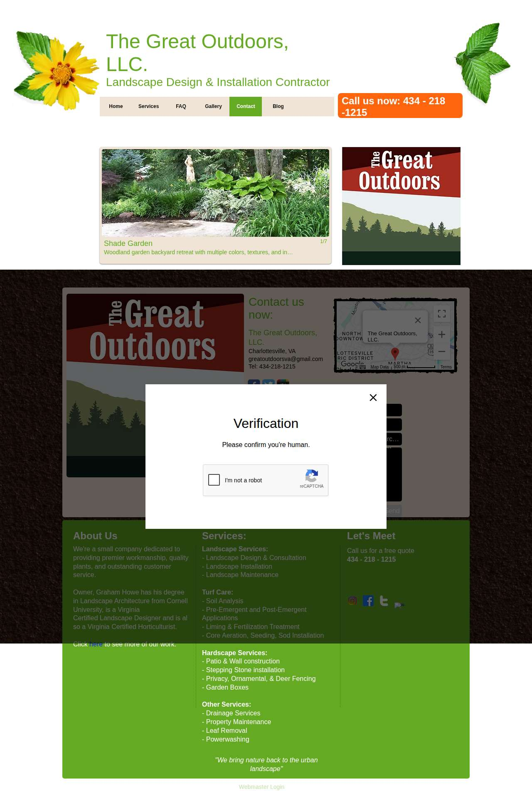

### akehurst.com — error\_after\_submit (LIVE)

| | |
|---|---|
| Attempt ID | `c06f8136-0655-44a9-af1a-f01d804da96a` |
| Form URL | https://www.akehurst.com/request-commercial-landscaping-quote |
| Final URL | https://www.akehurst.com/request-commercial-landscaping-quote |
| Reserved | 2026-11-02 17:38:17 UTC |
| Submit attempted | 2026-11-02 17:38:19 UTC |
| Template | standard v2 |
| Confirmation text | 30 pm Sat - Sun Closed Connect With Us First Name Last Name This field is required Email Phone Message Share by: Contact Let's Talk\! Thanks for stopping by\! We're here to help, pleas |
| Result / error | — |

Exact message:

~~~text
Subject: Helping customers find your business in AI search (AEO + GEO)

Hi there,

I'm Arun from Devs Arun. More and more customers now ask ChatGPT, Gemini, Perplexity or Google's AI Overviews questions like "who should I hire for this in my area?" before they call anyone. These tools answer from websites they can clearly understand, and they tend to recommend businesses whose pages answer real customer questions.

That is what AEO + GEO (Answer Engine and Generative Engine Optimization) is for. I improve your existing service pages so they clearly answer the questions your customers ask, add structured data that matches the page, and make the call, quote or enquiry step obvious. The benefit: your business gets a better chance of being mentioned or linked in AI answers, and visitors who arrive find it easy to contact you.

The AEO + GEO Starter is a one-time $199 (about ₹16,999, negotiable) for one website: a basic audit, 10 customer questions, improvements to two existing pages, relevant structured data and an action plan, with one revision round.

You can read the full details, send an enquiry or book online here:
https://devsarun.io/aeo-geo/

If this isn't relevant, just reply and I won't contact you again.

Best,
Arun
Devs Arun
itschool408@gmail.com · +91 7654534323
~~~

Submitted field values:

- Email \[email\]: itschool408@gmail.com
- Phone \[phone\]: +91 7654534323
- Message \[message\]: Hi there, I'm Arun from Devs Arun. More and more customers now ask ChatGPT, Gemini, Perplexity or Google's AI Overviews 
- First Name \[first\_name\]: Arun

**Filled form (before submit)** — `run-136a0655_attempt-c06f8136_filled_2026-11-02T17-38-19-883Z.jpg`

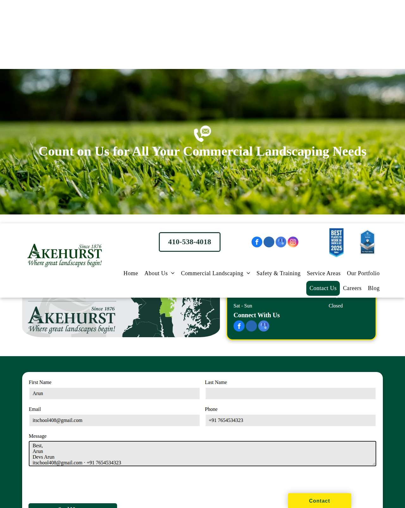

**After submit** — `run-136a0655_attempt-c06f8136_post_attempt_2026-11-02T17-38-23-143Z.jpg`

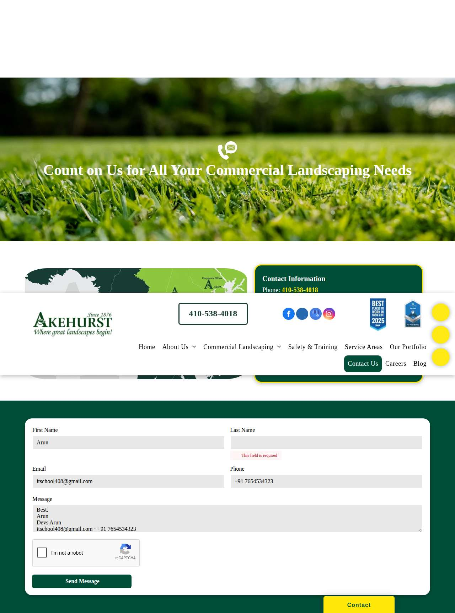

### superiorlandscapeanddesign.com — confirmed (LIVE)

| | |
|---|---|
| Attempt ID | `52cdf163-9b05-4cea-8b65-bb2e4cdbb8b3` |
| Form URL | https://superiorlandscapeanddesign.com/contact |
| Final URL | https://superiorlandscapeanddesign.com/contact |
| Reserved | 2026-11-02 17:38:30 UTC |
| Submit attempted | 2026-11-02 17:38:35 UTC |
| Template | standard v2 |
| Confirmation text | us for a free consultation, or fill out the form below and we'll get back to you promptly. Contact Information CALL US Call for a Free Consultation SERVICE AREA Serving the |
| Result / error | — |

Exact message:

~~~text
Subject: Helping customers find your business in AI search (AEO + GEO)

Hi there,

I'm Arun from Devs Arun. More and more customers now ask ChatGPT, Gemini, Perplexity or Google's AI Overviews questions like "who should I hire for this in my area?" before they call anyone. These tools answer from websites they can clearly understand, and they tend to recommend businesses whose pages answer real customer questions.

That is what AEO + GEO (Answer Engine and Generative Engine Optimization) is for. I improve your existing service pages so they clearly answer the questions your customers ask, add structured data that matches the page, and make the call, quote or enquiry step obvious. The benefit: your business gets a better chance of being mentioned or linked in AI answers, and visitors who arrive find it easy to contact you.

The AEO + GEO Starter is a one-time $199 (about ₹16,999, negotiable) for one website: a basic audit, 10 customer questions, improvements to two existing pages, relevant structured data and an action plan, with one revision round.

You can read the full details, send an enquiry or book online here:
https://devsarun.io/aeo-geo/

If this isn't relevant, just reply and I won't contact you again.

Best,
Arun
Devs Arun
itschool408@gmail.com · +91 7654534323
~~~

Submitted field values:

- Full Name \* \[name\]: Arun
- Phone Number \[phone\]: +91 7654534323
- Email Address \* \[email\]: itschool408@gmail.com
- Tell Us About Your Project \* \[message\]: Hi there, I'm Arun from Devs Arun. More and more customers now ask ChatGPT, Gemini, Perplexity or Google's AI Overviews 

**Filled form (before submit)** — `run-136a0655_attempt-52cdf163_filled_2026-11-02T17-38-35-339Z.jpg`

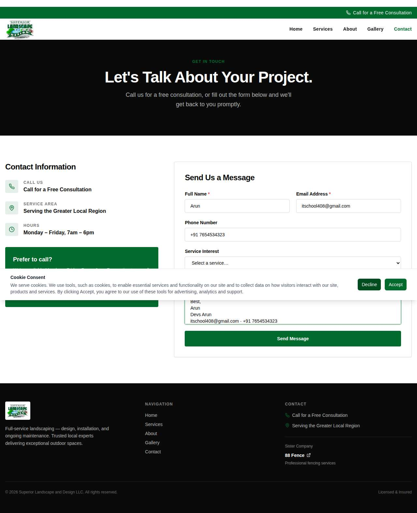

**After submit** — `run-136a0655_attempt-52cdf163_post_attempt_2026-11-02T17-38-45-485Z.jpg`

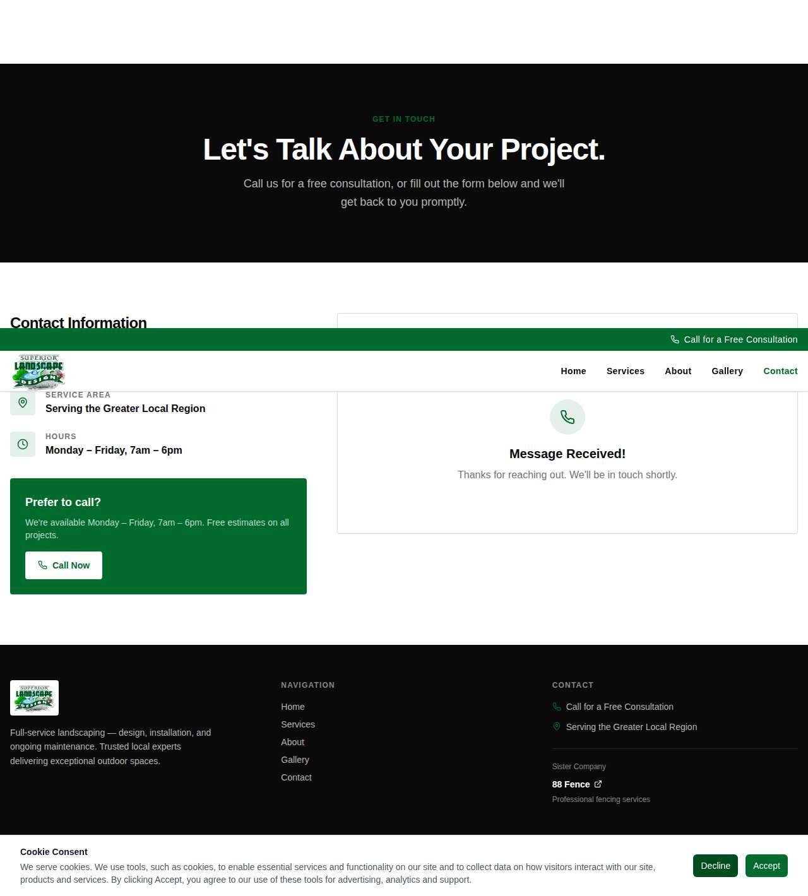

### mottaslandscaping.com — error\_after\_submit (LIVE)

| | |
|---|---|
| Attempt ID | `439b8652-ad60-423f-bf89-d5174f3642b3` |
| Form URL | https://www.mottaslandscaping.com/contact |
| Final URL | https://www.mottaslandscaping.com/contact |
| Reserved | 2026-11-02 17:38:52 UTC |
| Submit attempted | 2026-11-02 17:38:54 UTC |
| Template | standard v2 |
| Confirmation text | none observed |
| Result / error | Submit click error (outcome unknown, not retried): locator.click: Timeout 10000ms exceeded. |

Exact message:

~~~text
Subject: Helping customers find your business in AI search (AEO + GEO)

Hi there,

I'm Arun from Devs Arun. More and more customers now ask ChatGPT, Gemini, Perplexity or Google's AI Overviews questions like "who should I hire for this in my area?" before they call anyone. These tools answer from websites they can clearly understand, and they tend to recommend businesses whose pages answer real customer questions.

That is what AEO + GEO (Answer Engine and Generative Engine Optimization) is for. I improve your existing service pages so they clearly answer the questions your customers ask, add structured data that matches the page, and make the call, quote or enquiry step obvious. The benefit: your business gets a better chance of being mentioned or linked in AI answers, and visitors who arrive find it easy to contact you.

The AEO + GEO Starter is a one-time $199 (about ₹16,999, negotiable) for one website: a basic audit, 10 customer questions, improvements to two existing pages, relevant structured data and an action plan, with one revision round.

You can read the full details, send an enquiry or book online here:
https://devsarun.io/aeo-geo/

If this isn't relevant, just reply and I won't contact you again.

Best,
Arun
Devs Arun
itschool408@gmail.com · +91 7654534323
~~~

Submitted field values:

- Name: \[name\]: Arun
- Email: \[email\]: itschool408@gmail.com
- Phone: \[phone\]: +91 7654534323
- Message: \[message\]: Hi there, I'm Arun from Devs Arun. More and more customers now ask ChatGPT, Gemini, Perplexity or Google's AI Overviews 

**Filled form (before submit)** — `run-136a0655_attempt-439b8652_filled_2026-11-02T17-38-54-364Z.jpg`

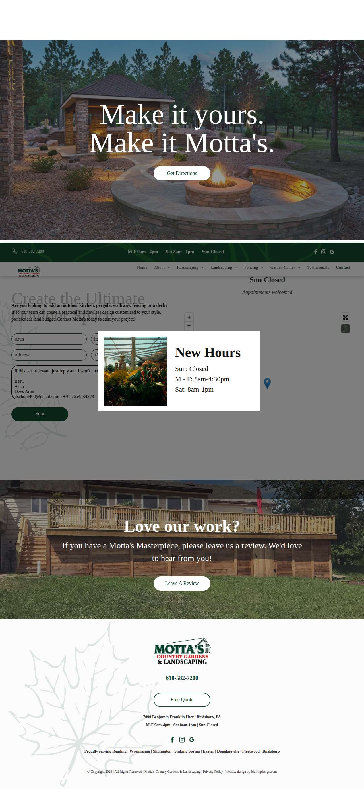

**After submit** — `run-136a0655_attempt-439b8652_post_attempt_2026-11-02T17-39-07-208Z.jpg`

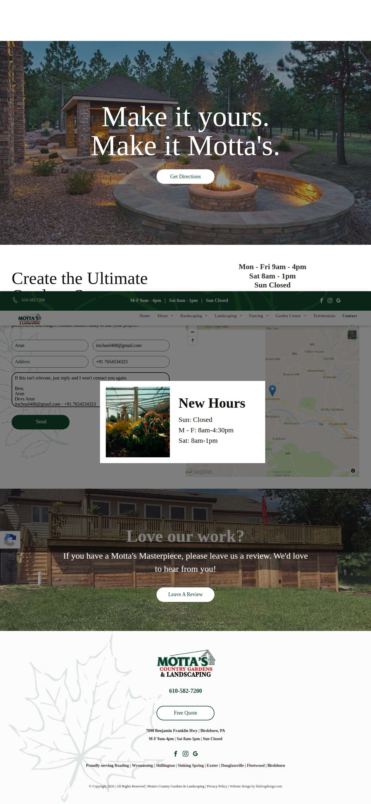

### blacklakelandscapesupplies.com — unclear (LIVE)

| | |
|---|---|
| Attempt ID | `1b6a75fc-20bc-434e-9b2c-7acdb0a6d1f8` |
| Form URL | https://www.blacklakelandscapesupplies.com/contact-us |
| Final URL | https://www.blacklakelandscapesupplies.com/contact-us |
| Reserved | 2026-11-02 17:39:14 UTC |
| Submit attempted | 2026-11-02 17:39:18 UTC |
| Template | standard v2 |
| Confirmation text | none observed |
| Result / error | No new success marker observed |

Exact message:

~~~text
Subject: Helping customers find your business in AI search (AEO + GEO)

Hi there,

I'm Arun from Devs Arun. More and more customers now ask ChatGPT, Gemini, Perplexity or Google's AI Overviews questions like "who should I hire for this in my area?" before they call anyone. These tools answer from websites they can clearly understand, and they tend to recommend businesses whose pages answer real customer questions.

That is what AEO + GEO (Answer Engine and Generative Engine Optimization) is for. I improve your existing service pages so they clearly answer the questions your customers ask, add structured data that matches the page, and make the call, quote or enquiry step obvious. The benefit: your business gets a better chance of being mentioned or linked in AI answers, and visitors who arrive find it easy to contact you.

The AEO + GEO Starter is a one-time $199 (about ₹16,999, negotiable) for one website: a basic audit, 10 customer questions, improvements to two existing pages, relevant structured data and an action plan, with one revision round.

You can read the full details, send an enquiry or book online here:
https://devsarun.io/aeo-geo/

If this isn't relevant, just reply and I won't contact you again.

Best,
Arun
Devs Arun
itschool408@gmail.com · +91 7654534323
~~~

Submitted field values:

- email \[email\]: itschool408@gmail.com
- name-\* \[name\]: Arun
- Message \[message\]: Hi there, I'm Arun from Devs Arun. More and more customers now ask ChatGPT, Gemini, Perplexity or Google's AI Overviews 
- subject \[subject\]: Helping customers find your business in AI search (AEO + GEO)

**Filled form (before submit)** — `run-136a0655_attempt-1b6a75fc_filled_2026-11-02T17-39-18-983Z.jpg`

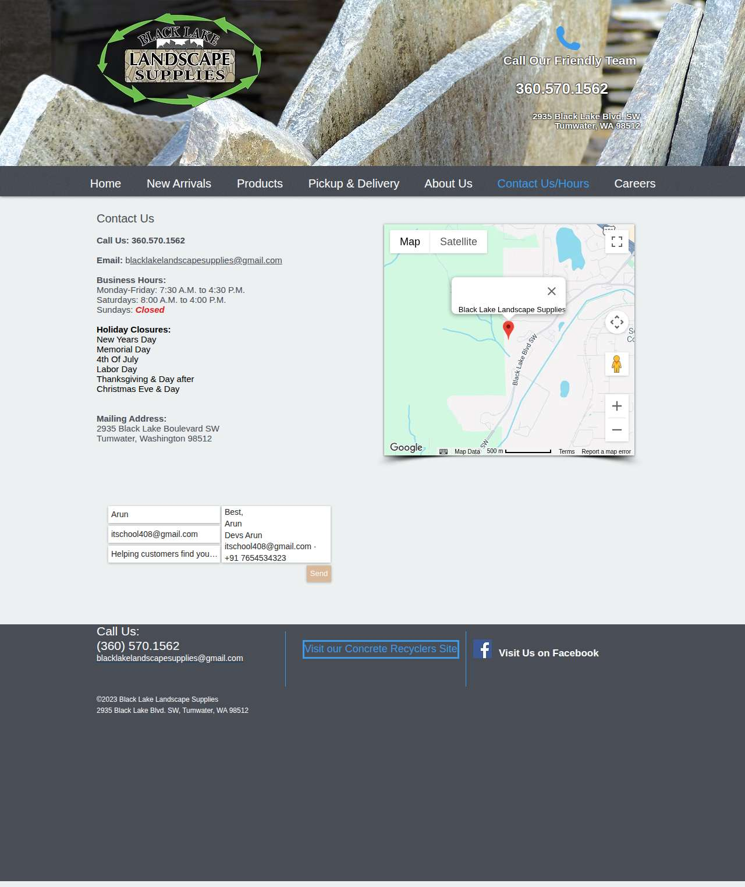

**After submit** — `run-136a0655_attempt-1b6a75fc_post_attempt_2026-11-02T17-39-46-834Z.jpg`

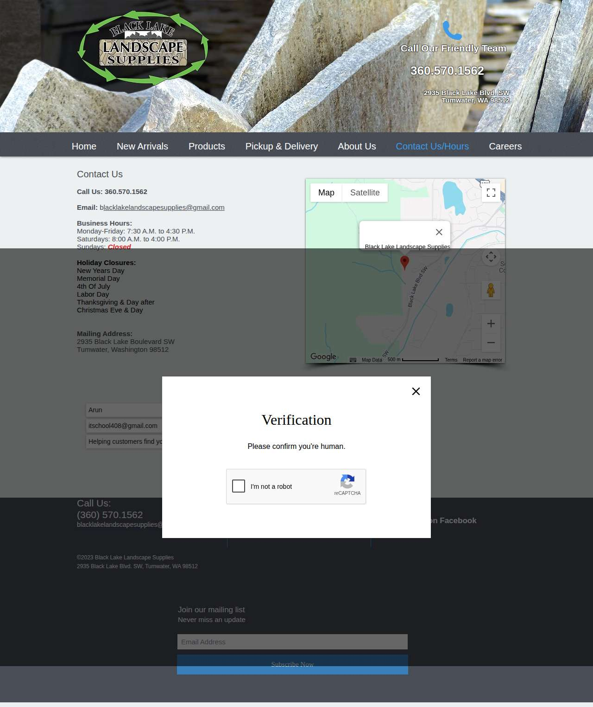

### bennettitreeservice.com — unclear (LIVE)

| | |
|---|---|
| Attempt ID | `eb5718dc-a5b3-4cfb-aa33-d26a7e35745f` |
| Form URL | https://www.bennettitreeservice.com/contact.php |
| Final URL | https://www.bennettitreeservice.com/contact.php |
| Reserved | 2026-11-02 17:39:54 UTC |
| Submit attempted | 2026-11-02 17:39:55 UTC |
| Template | standard v2 |
| Confirmation text | none observed |
| Result / error | No new success marker observed |

Exact message:

~~~text
Subject: Helping customers find your business in AI search (AEO + GEO)

Hi there,

I'm Arun from Devs Arun. More and more customers now ask ChatGPT, Gemini, Perplexity or Google's AI Overviews questions like "who should I hire for this in my area?" before they call anyone. These tools answer from websites they can clearly understand, and they tend to recommend businesses whose pages answer real customer questions.

That is what AEO + GEO (Answer Engine and Generative Engine Optimization) is for. I improve your existing service pages so they clearly answer the questions your customers ask, add structured data that matches the page, and make the call, quote or enquiry step obvious. The benefit: your business gets a better chance of being mentioned or linked in AI answers, and visitors who arrive find it easy to contact you.

The AEO + GEO Starter is a one-time $199 (about ₹16,999, negotiable) for one website: a basic audit, 10 customer questions, improvements to two existing pages, relevant structured data and an action plan, with one revision round.

You can read the full details, send an enquiry or book online here:
https://devsarun.io/aeo-geo/

If this isn't relevant, just reply and I won't contact you again.

Best,
Arun
Devs Arun
itschool408@gmail.com · +91 7654534323
~~~

Submitted field values:

- Name \[name\]: Arun
- Message \[message\]: Hi there, I'm Arun from Devs Arun. More and more customers now ask ChatGPT, Gemini, Perplexity or Google's AI Overviews 
- Email Address \[email\]: itschool408@gmail.com

**Filled form (before submit)** — `run-136a0655_attempt-eb5718dc_filled_2026-11-02T17-39-55-406Z.jpg`

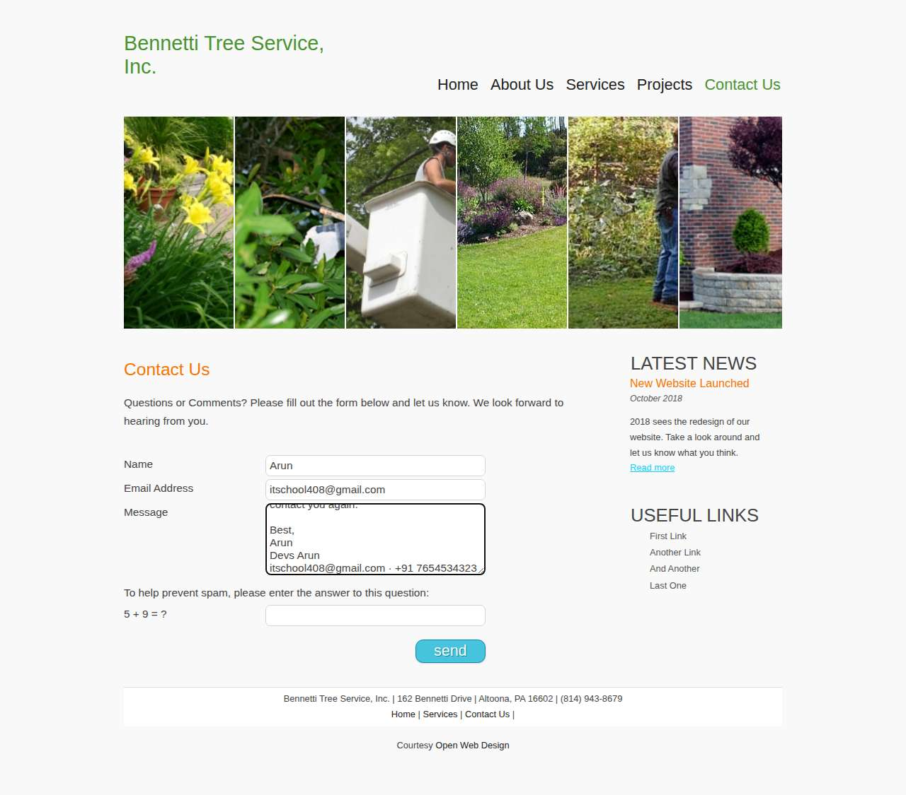

**After submit** — `run-136a0655_attempt-eb5718dc_post_attempt_2026-11-02T17-40-23-473Z.jpg`

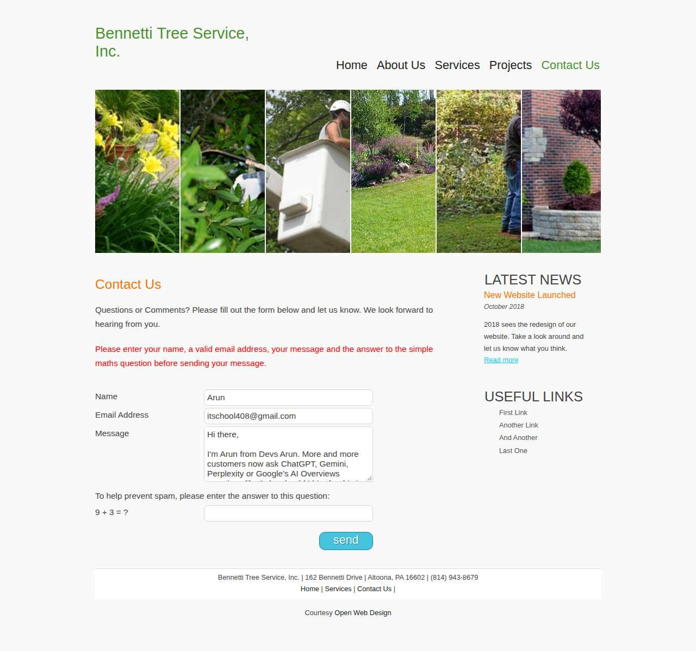

### lkmlandscaping.com — failed\_before\_submit (LIVE)

| | |
|---|---|
| Attempt ID | `4992cbea-9775-4543-b08a-5a154ef48947` |
| Form URL | https://lkmlandscaping.com/contact |
| Final URL | https://lkmlandscaping.com/contact |
| Reserved | 2026-11-02 17:40:30 UTC |
| Submit attempted | — |
| Template | standard v2 |
| Confirmation text | none observed |
| Result / error | Field "phone" did not accept the value |

Exact message:

~~~text
Subject: Helping customers find your business in AI search (AEO + GEO)

Hi there,

I'm Arun from Devs Arun. More and more customers now ask ChatGPT, Gemini, Perplexity or Google's AI Overviews questions like "who should I hire for this in my area?" before they call anyone. These tools answer from websites they can clearly understand, and they tend to recommend businesses whose pages answer real customer questions.

That is what AEO + GEO (Answer Engine and Generative Engine Optimization) is for. I improve your existing service pages so they clearly answer the questions your customers ask, add structured data that matches the page, and make the call, quote or enquiry step obvious. The benefit: your business gets a better chance of being mentioned or linked in AI answers, and visitors who arrive find it easy to contact you.

The AEO + GEO Starter is a one-time $199 (about ₹16,999, negotiable) for one website: a basic audit, 10 customer questions, improvements to two existing pages, relevant structured data and an action plan, with one revision round.

You can read the full details, send an enquiry or book online here:
https://devsarun.io/aeo-geo/

If this isn't relevant, just reply and I won't contact you again.

Best,
Arun
Devs Arun
itschool408@gmail.com · +91 7654534323
~~~

Submitted field values:

- \#Name-4: Arun
- \#Email-5: itschool408@gmail.com
- \#Phone-5: +91 7654534323
- \#Message-3: Hi there, I'm Arun from Devs Arun. More and more customers now ask ChatGPT, Gemini, Perplexity or Google's AI Overviews 

**Filled form (before submit)** — `run-136a0655_attempt-4992cbea_filled_2026-11-02T17-40-33-608Z.jpg`

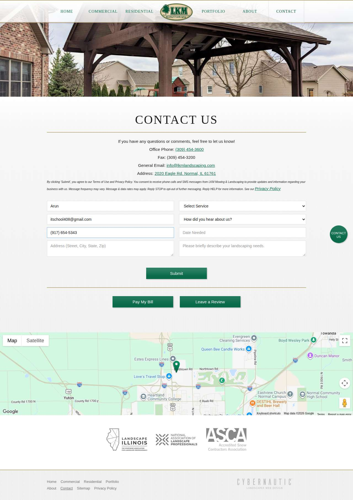

### mosleyag.com — failed\_before\_submit (LIVE)

| | |
|---|---|
| Attempt ID | `3ade24bc-c4ba-4ddb-a19d-2bb186392fa6` |
| Form URL | https://www.mosleyag.com/contact |
| Final URL | https://www.mosleyag.com/contact |
| Reserved | 2026-11-02 17:40:38 UTC |
| Submit attempted | — |
| Template | standard v2 |
| Confirmation text | none observed |
| Result / error | Form validation would block sending: : Please check this box if you want to proceed. |

Exact message:

~~~text
Subject: Helping customers find your business in AI search (AEO + GEO)

Hi there,

I'm Arun from Devs Arun. More and more customers now ask ChatGPT, Gemini, Perplexity or Google's AI Overviews questions like "who should I hire for this in my area?" before they call anyone. These tools answer from websites they can clearly understand, and they tend to recommend businesses whose pages answer real customer questions.

That is what AEO + GEO (Answer Engine and Generative Engine Optimization) is for. I improve your existing service pages so they clearly answer the questions your customers ask, add structured data that matches the page, and make the call, quote or enquiry step obvious. The benefit: your business gets a better chance of being mentioned or linked in AI answers, and visitors who arrive find it easy to contact you.

The AEO + GEO Starter is a one-time $199 (about ₹16,999, negotiable) for one website: a basic audit, 10 customer questions, improvements to two existing pages, relevant structured data and an action plan, with one revision round.

You can read the full details, send an enquiry or book online here:
https://devsarun.io/aeo-geo/

If this isn't relevant, just reply and I won't contact you again.

Best,
Arun
Devs Arun
itschool408@gmail.com · +91 7654534323
~~~

Submitted field values:

- \#input\_comp-kf6eptti: Arun
- \#input\_comp-kf6epttw: itschool408@gmail.com
- \#input\_comp-kf6eptu5: +91 7654534323
- \#input\_comp-kf6eptun: Helping customers find your business in AI search (AEO + GEO)
- \#textarea\_comp-kf6eptuw: Hi there, I'm Arun from Devs Arun. More and more customers now ask ChatGPT, Gemini, Perplexity or Google's AI Overviews 

**Filled form (before submit)** — `run-136a0655_attempt-3ade24bc_filled_2026-11-02T17-40-41-410Z.jpg`

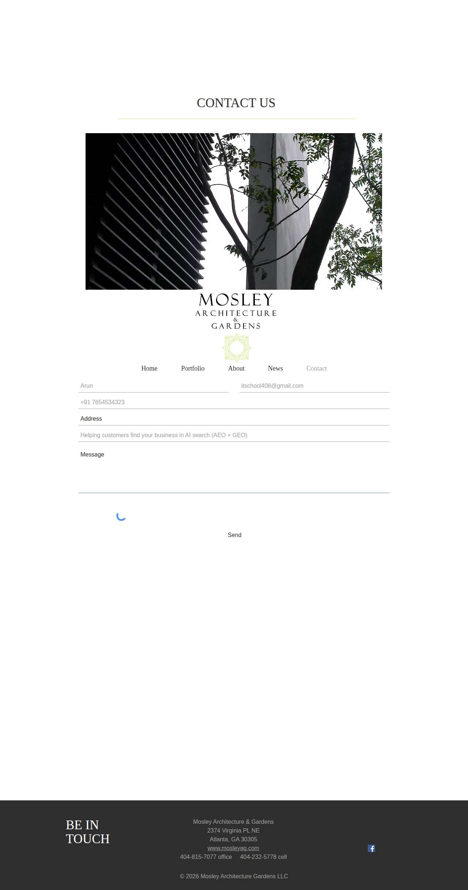

## Events (73)

| Time (UTC) | Event | Website | Details |
|---|---|---|---|
| 17:37:21 | run\_queued | — | live run requested by github:itsDevsArun |
| 17:37:21 | run\_dispatched | — | dispatch disabled (local test mode) |
| 17:37:24 | run\_started | — | Runner claimed live run |
| 17:37:25 | offer\_verified | — | Service page offer facts verified |
| 17:37:25 | website\_selected | clearchoiceplumbingllc.com | Live target clearchoiceplumbingllc.com |
| 17:37:25 | attempt\_reserved | clearchoiceplumbingllc.com | Submission attempt reserved with template standard v2 |
| 17:37:27 | page\_opened | clearchoiceplumbingllc.com | Opened form page |
| 17:37:27 | screenshot\_saved | clearchoiceplumbingllc.com | inspection screenshot saved (145 KB) |
| 17:37:27 | review\_required | clearchoiceplumbingllc.com | failed before submit: locator.fill: Error: Cannot type text into input\[type=number\] |
| 17:37:32 | website\_selected | landscape-fx.com | Live target landscape-fx.com |
| 17:37:32 | attempt\_reserved | landscape-fx.com | Submission attempt reserved with template standard v2 |
| 17:37:34 | page\_opened | landscape-fx.com | Opened form page |
| 17:37:34 | screenshot\_saved | landscape-fx.com | filled screenshot saved (238 KB) |
| 17:37:34 | review\_required | landscape-fx.com | failed before submit: Field "Telephone number:\*" did not accept the value |
| 17:37:39 | website\_selected | greatoutdoorsva.com | Live target greatoutdoorsva.com |
| 17:37:39 | attempt\_reserved | greatoutdoorsva.com | Submission attempt reserved with template standard v2 |
| 17:37:41 | page\_opened | greatoutdoorsva.com | Opened form page |
| 17:37:41 | fields\_filled | greatoutdoorsva.com | filled |
| 17:37:42 | screenshot\_saved | greatoutdoorsva.com | filled screenshot saved (233 KB) |
| 17:37:42 | submit\_attempted | greatoutdoorsva.com | submitting |
| 17:38:10 | screenshot\_saved | greatoutdoorsva.com | post\_attempt screenshot saved (179 KB) |
| 17:38:10 | review\_required | greatoutdoorsva.com | unclear: No new success marker observed |
| 17:38:17 | website\_selected | akehurst.com | Live target akehurst.com |
| 17:38:17 | attempt\_reserved | akehurst.com | Submission attempt reserved with template standard v2 |
| 17:38:19 | page\_opened | akehurst.com | Opened form page |
| 17:38:19 | fields\_filled | akehurst.com | filled |
| 17:38:19 | screenshot\_saved | akehurst.com | filled screenshot saved (132 KB) |
| 17:38:19 | submit\_attempted | akehurst.com | submitting |
| 17:38:23 | screenshot\_saved | akehurst.com | post\_attempt screenshot saved (131 KB) |
| 17:38:23 | error | akehurst.com | error after submit — "30 pm Sat - Sun Closed Connect With Us First Name Last Name This field is required Email Phone Message Share by: Contact" |
| 17:38:30 | website\_selected | superiorlandscapeanddesign.com | Live target superiorlandscapeanddesign.com |
| 17:38:30 | attempt\_reserved | superiorlandscapeanddesign.com | Submission attempt reserved with template standard v2 |
| 17:38:35 | page\_opened | superiorlandscapeanddesign.com | Opened form page |
| 17:38:35 | fields\_filled | superiorlandscapeanddesign.com | filled |
| 17:38:35 | screenshot\_saved | superiorlandscapeanddesign.com | filled screenshot saved (95 KB) |
| 17:38:35 | submit\_attempted | superiorlandscapeanddesign.com | submitting |
| 17:38:45 | screenshot\_saved | superiorlandscapeanddesign.com | post\_attempt screenshot saved (82 KB) |
| 17:38:45 | confirmation\_observed | superiorlandscapeanddesign.com | confirmed — "us for a free consultation, or fill out the form below and we'll get back to you promptly. Contact Information CALL US C" |
| 17:38:52 | website\_selected | mottaslandscaping.com | Live target mottaslandscaping.com |
| 17:38:52 | attempt\_reserved | mottaslandscaping.com | Submission attempt reserved with template standard v2 |
| 17:38:53 | page\_opened | mottaslandscaping.com | Opened form page |
| 17:38:54 | fields\_filled | mottaslandscaping.com | filled |
| 17:38:54 | screenshot\_saved | mottaslandscaping.com | filled screenshot saved (286 KB) |
| 17:38:54 | submit\_attempted | mottaslandscaping.com | submitting |
| 17:39:07 | screenshot\_saved | mottaslandscaping.com | post\_attempt screenshot saved (286 KB) |
| 17:39:07 | error | mottaslandscaping.com | error after submit: Submit click error (outcome unknown, not retried): locator.click: Timeout 10000ms exceeded. |
| 17:39:14 | website\_selected | blacklakelandscapesupplies.com | Live target blacklakelandscapesupplies.com |
| 17:39:14 | attempt\_reserved | blacklakelandscapesupplies.com | Submission attempt reserved with template standard v2 |
| 17:39:18 | page\_opened | blacklakelandscapesupplies.com | Opened form page |
| 17:39:18 | fields\_filled | blacklakelandscapesupplies.com | filled |
| 17:39:18 | screenshot\_saved | blacklakelandscapesupplies.com | filled screenshot saved (133 KB) |
| 17:39:18 | submit\_attempted | blacklakelandscapesupplies.com | submitting |
| 17:39:46 | screenshot\_saved | blacklakelandscapesupplies.com | post\_attempt screenshot saved (130 KB) |
| 17:39:46 | review\_required | blacklakelandscapesupplies.com | unclear: No new success marker observed |
| 17:39:54 | website\_selected | bennettitreeservice.com | Live target bennettitreeservice.com |
| 17:39:54 | attempt\_reserved | bennettitreeservice.com | Submission attempt reserved with template standard v2 |
| 17:39:55 | page\_opened | bennettitreeservice.com | Opened form page |
| 17:39:55 | fields\_filled | bennettitreeservice.com | filled |
| 17:39:55 | screenshot\_saved | bennettitreeservice.com | filled screenshot saved (99 KB) |
| 17:39:55 | submit\_attempted | bennettitreeservice.com | submitting |
| 17:40:23 | screenshot\_saved | bennettitreeservice.com | post\_attempt screenshot saved (107 KB) |
| 17:40:23 | review\_required | bennettitreeservice.com | unclear: No new success marker observed |
| 17:40:30 | website\_selected | lkmlandscaping.com | Live target lkmlandscaping.com |
| 17:40:30 | attempt\_reserved | lkmlandscaping.com | Submission attempt reserved with template standard v2 |
| 17:40:33 | page\_opened | lkmlandscaping.com | Opened form page |
| 17:40:33 | screenshot\_saved | lkmlandscaping.com | filled screenshot saved (165 KB) |
| 17:40:33 | review\_required | lkmlandscaping.com | failed before submit: Field "phone" did not accept the value |
| 17:40:38 | website\_selected | mosleyag.com | Live target mosleyag.com |
| 17:40:38 | attempt\_reserved | mosleyag.com | Submission attempt reserved with template standard v2 |
| 17:40:41 | page\_opened | mosleyag.com | Opened form page |
| 17:40:41 | screenshot\_saved | mosleyag.com | filled screenshot saved (112 KB) |
| 17:40:41 | review\_required | mosleyag.com | failed before submit: Form validation would block sending: : Please check this box if you want to proceed. |
| 17:40:46 | run\_completed | — | Run completed (queue\_exhausted) |
