# Run 1e96412c — live — completed

| | |
|---|---|
| Run ID | `1e96412c-1370-41d6-8a05-9c3629596f1c` |
| Requested by | github:itsDevsArun |
| Started | 2026-11-02 16:22:50 UTC |
| Finished | 2026-11-02 16:30:26 UTC |
| Finish reason | queue\_exhausted |
| GitHub Actions | https://github.com/itsDevsArun/aeo-geo/actions/runs/41469315389 |

CSV for this run: [runs/2026-11-02_live_1e96412c.csv](2026-11-02_live_1e96412c.csv)

## Attempts (17)

### clearchoiceplumbingllc.com — failed\_before\_submit (LIVE)

| | |
|---|---|
| Attempt ID | `b203d280-6969-4890-a740-476ce76cd796` |
| Form URL | https://clearchoiceplumbingllc.com/contact/ |
| Final URL | — |
| Reserved | 2026-11-02 16:22:51 UTC |
| Submit attempted | — |
| Template | standard v2 |
| Confirmation text | none observed |
| Result / error | locator.fill: Error: Cannot type text into input\[type=number\] |

Exact message:

~~~text
Subject: Helping customers find your business in AI search (AEO + GEO)

Hi there,

I'm Arun from Devs Arun. More and more customers now ask ChatGPT, Gemini, Perplexity or Google's AI Overviews questions like "who should I hire for this in my area?" before they call anyone. These tools answer from websites they can clearly understand, and they tend to recommend businesses whose pages answer real customer questions.

That is what AEO + GEO (Answer Engine and Generative Engine Optimization) is for. I improve your existing service pages so they clearly answer the questions your customers ask, add structured data that matches the page, and make the call, quote or enquiry step obvious. The benefit: your business gets a better chance of being mentioned or linked in AI answers, and visitors who arrive find it easy to contact you.

The AEO + GEO Starter is a one-time $199 (about ₹16,999, negotiable) for one website: a basic audit, 10 customer questions, improvements to two existing pages, relevant structured data and an action plan, with one revision round.

You can read the full details, send an enquiry or book online here:
https://devsarun.io/aeo-geo/

If this isn't relevant, just reply and I won't contact you again.

Best,
Arun
Devs Arun
itschool408@gmail.com · +91 7654534323
~~~

Submitted field values:

- \#wpforms-51-field\_1: Arun
- \#wpforms-51-field\_2: itschool408@gmail.com
- \#wpforms-51-field\_3: Hi there, I'm Arun from Devs Arun. More and more customers now ask ChatGPT, Gemini, Perplexity or Google's AI Overviews 
- \#wpforms-51-field\_5: +91 7654534323

**Inspected page** — `run-1e96412c_attempt-b203d280_inspection_2026-11-02T16-22-53-261Z.jpg`

### buddyelectricllc.com — failed\_before\_submit (LIVE)

| | |
|---|---|
| Attempt ID | `67ad0420-a072-49ca-8b6d-8521f0b4a372` |
| Form URL | https://buddyelectricllc.com/contact-us/ |
| Final URL | https://buddyelectricllc.com/contact-us/ |
| Reserved | 2026-11-02 16:22:58 UTC |
| Submit attempted | — |
| Template | standard v2 |
| Confirmation text | none observed |
| Result / error | Field "Phone\*" did not accept the value |

Exact message:

~~~text
Subject: Helping customers find your business in AI search (AEO + GEO)

Hi there,

I'm Arun from Devs Arun. More and more customers now ask ChatGPT, Gemini, Perplexity or Google's AI Overviews questions like "who should I hire for this in my area?" before they call anyone. These tools answer from websites they can clearly understand, and they tend to recommend businesses whose pages answer real customer questions.

That is what AEO + GEO (Answer Engine and Generative Engine Optimization) is for. I improve your existing service pages so they clearly answer the questions your customers ask, add structured data that matches the page, and make the call, quote or enquiry step obvious. The benefit: your business gets a better chance of being mentioned or linked in AI answers, and visitors who arrive find it easy to contact you.

The AEO + GEO Starter is a one-time $199 (about ₹16,999, negotiable) for one website: a basic audit, 10 customer questions, improvements to two existing pages, relevant structured data and an action plan, with one revision round.

You can read the full details, send an enquiry or book online here:
https://devsarun.io/aeo-geo/

If this isn't relevant, just reply and I won't contact you again.

Best,
Arun
Devs Arun
itschool408@gmail.com · +91 7654534323
~~~

Submitted field values:

- \#input\_1\_1: Arun
- \#input\_1\_2: +91 7654534323
- \#input\_1\_3: itschool408@gmail.com
- \#input\_1\_4: Hi there, I'm Arun from Devs Arun. More and more customers now ask ChatGPT, Gemini, Perplexity or Google's AI Overviews 

**Filled form (before submit)** — `run-1e96412c_attempt-67ad0420_filled_2026-11-02T16-23-02-864Z.jpg`

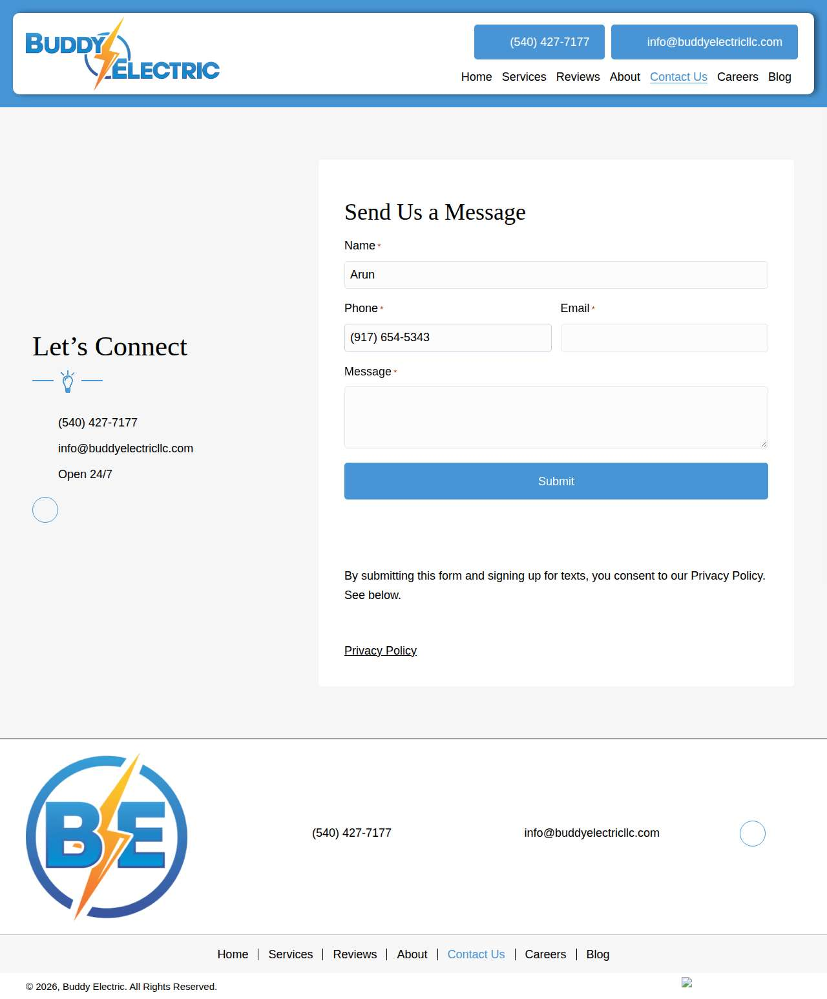

### qcaelectric.com — error\_after\_submit (LIVE)

| | |
|---|---|
| Attempt ID | `222ad30a-9743-496f-bb9e-0dd2ac4d8283` |
| Form URL | https://qcaelectric.com/contact.html |
| Final URL | https://qcaelectric.com/contact.html |
| Reserved | 2026-11-02 16:23:07 UTC |
| Submit attempted | 2026-11-02 16:23:13 UTC |
| Template | standard v2 |
| Confirmation text | llinois Review Us On Follow Name First Name\* Last Name is a required field. Last Name\* Email\* Phone Number\* Comments\* QCA ELECTRIC HomeResidentialCommercialContact 2140 Devil |
| Result / error | — |

Exact message:

~~~text
Subject: Helping customers find your business in AI search (AEO + GEO)

Hi there,

I'm Arun from Devs Arun. More and more customers now ask ChatGPT, Gemini, Perplexity or Google's AI Overviews questions like "who should I hire for this in my area?" before they call anyone. These tools answer from websites they can clearly understand, and they tend to recommend businesses whose pages answer real customer questions.

That is what AEO + GEO (Answer Engine and Generative Engine Optimization) is for. I improve your existing service pages so they clearly answer the questions your customers ask, add structured data that matches the page, and make the call, quote or enquiry step obvious. The benefit: your business gets a better chance of being mentioned or linked in AI answers, and visitors who arrive find it easy to contact you.

The AEO + GEO Starter is a one-time $199 (about ₹16,999, negotiable) for one website: a basic audit, 10 customer questions, improvements to two existing pages, relevant structured data and an action plan, with one revision round.

You can read the full details, send an enquiry or book online here:
https://devsarun.io/aeo-geo/

If this isn't relevant, just reply and I won't contact you again.

Best,
Arun
Devs Arun
itschool408@gmail.com · +91 7654534323
~~~

Submitted field values:

- Email\* \[email\]: itschool408@gmail.com
- Comments\* \[message\]: Hi there, I'm Arun from Devs Arun. More and more customers now ask ChatGPT, Gemini, Perplexity or Google's AI Overviews 
- Phone Number\* \[phone\]: +91 7654534323
- First Name\* \[first\_name\]: Arun

**Filled form (before submit)** — `run-1e96412c_attempt-222ad30a_filled_2026-11-02T16-23-13-043Z.jpg`

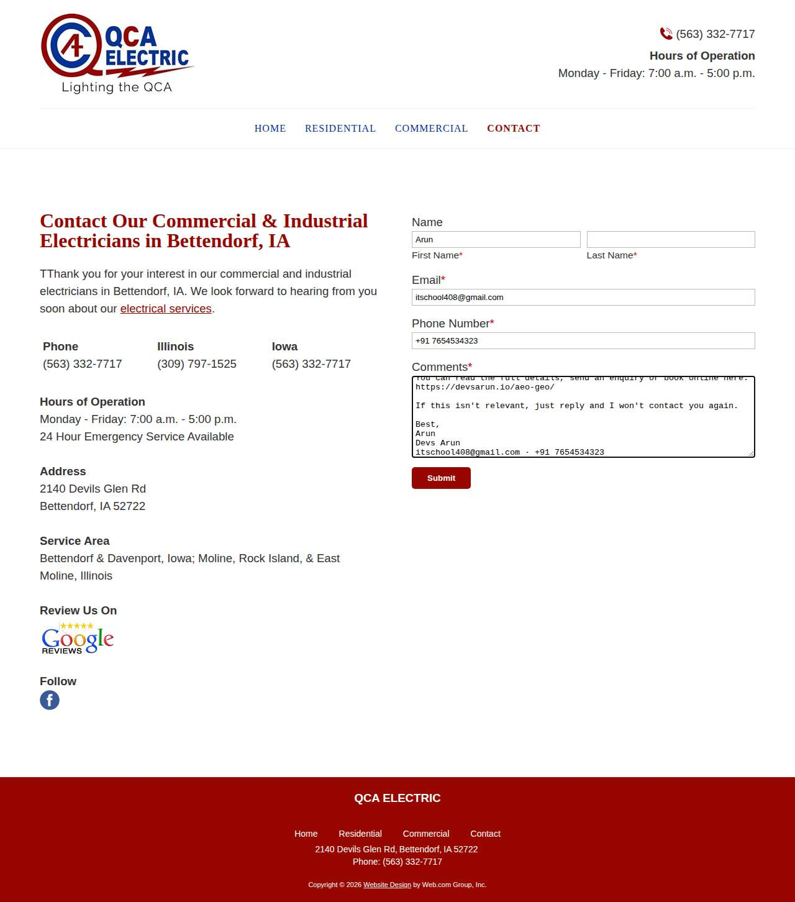

**After submit** — `run-1e96412c_attempt-222ad30a_post_attempt_2026-11-02T16-23-43-561Z.jpg`

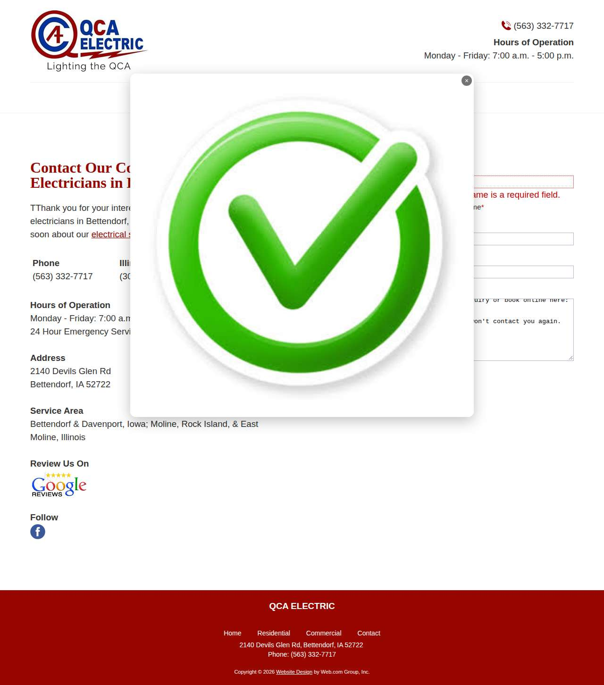

### ccelectrical24.com — unclear (LIVE)

| | |
|---|---|
| Attempt ID | `719f7311-1033-480b-af6b-6427a949ba5d` |
| Form URL | https://ccelectrical24.com/contact-us/ |
| Final URL | https://ccelectrical24.com/contact-us/ |
| Reserved | 2026-11-02 16:23:51 UTC |
| Submit attempted | 2026-11-02 16:23:56 UTC |
| Template | standard v2 |
| Confirmation text | none observed |
| Result / error | No new success marker observed |

Exact message:

~~~text
Subject: Helping customers find your business in AI search (AEO + GEO)

Hi there,

I'm Arun from Devs Arun. More and more customers now ask ChatGPT, Gemini, Perplexity or Google's AI Overviews questions like "who should I hire for this in my area?" before they call anyone. These tools answer from websites they can clearly understand, and they tend to recommend businesses whose pages answer real customer questions.

That is what AEO + GEO (Answer Engine and Generative Engine Optimization) is for. I improve your existing service pages so they clearly answer the questions your customers ask, add structured data that matches the page, and make the call, quote or enquiry step obvious. The benefit: your business gets a better chance of being mentioned or linked in AI answers, and visitors who arrive find it easy to contact you.

The AEO + GEO Starter is a one-time $199 (about ₹16,999, negotiable) for one website: a basic audit, 10 customer questions, improvements to two existing pages, relevant structured data and an action plan, with one revision round.

You can read the full details, send an enquiry or book online here:
https://devsarun.io/aeo-geo/

If this isn't relevant, just reply and I won't contact you again.

Best,
Arun
Devs Arun
itschool408@gmail.com · +91 7654534323
~~~

Submitted field values:

- mf-name \[name\]: Arun
- mf-email \[email\]: itschool408@gmail.com
- mf-message \[message\]: Hi there, I'm Arun from Devs Arun. More and more customers now ask ChatGPT, Gemini, Perplexity or Google's AI Overviews 
- mf-subject \[subject\]: Helping customers find your business in AI search (AEO + GEO)
- mf-phone-number \[phone\]: +91 7654534323

**Filled form (before submit)** — `run-1e96412c_attempt-719f7311_filled_2026-11-02T16-23-56-156Z.jpg`

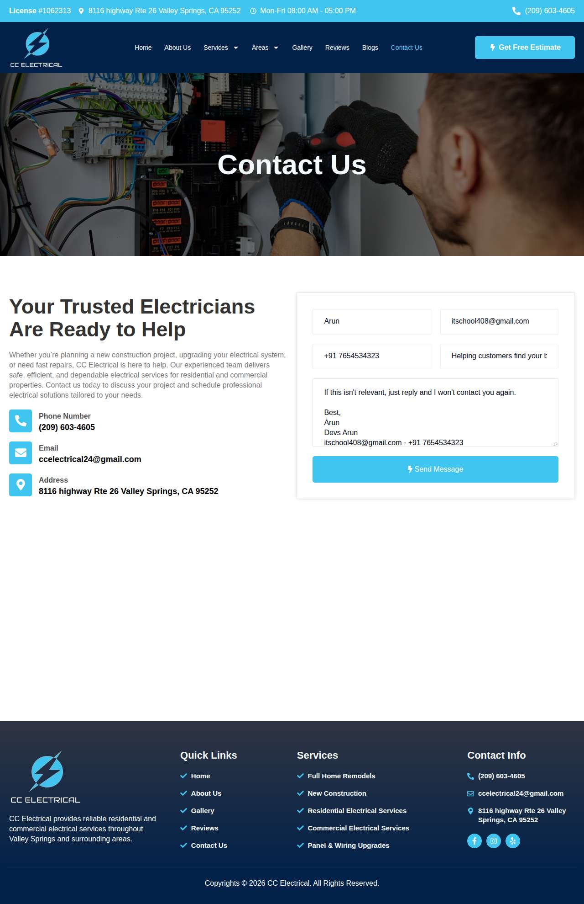

**After submit** — `run-1e96412c_attempt-719f7311_post_attempt_2026-11-02T16-24-32-303Z.jpg`

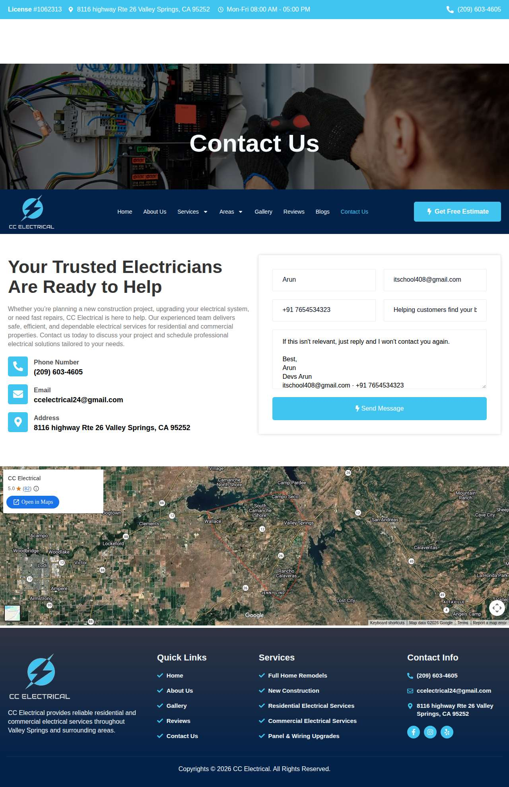

### rtjelectric.com — unclear (LIVE)

| | |
|---|---|
| Attempt ID | `1b207abc-3105-4330-9c21-7a3412c724c6` |
| Form URL | https://www.rtjelectric.com/contact |
| Final URL | https://www.rtjelectric.com/contact |
| Reserved | 2026-11-02 16:24:40 UTC |
| Submit attempted | 2026-11-02 16:24:42 UTC |
| Template | standard v2 |
| Confirmation text | none observed |
| Result / error | No new success marker observed |

Exact message:

~~~text
Subject: Helping customers find your business in AI search (AEO + GEO)

Hi there,

I'm Arun from Devs Arun. More and more customers now ask ChatGPT, Gemini, Perplexity or Google's AI Overviews questions like "who should I hire for this in my area?" before they call anyone. These tools answer from websites they can clearly understand, and they tend to recommend businesses whose pages answer real customer questions.

That is what AEO + GEO (Answer Engine and Generative Engine Optimization) is for. I improve your existing service pages so they clearly answer the questions your customers ask, add structured data that matches the page, and make the call, quote or enquiry step obvious. The benefit: your business gets a better chance of being mentioned or linked in AI answers, and visitors who arrive find it easy to contact you.

The AEO + GEO Starter is a one-time $199 (about ₹16,999, negotiable) for one website: a basic audit, 10 customer questions, improvements to two existing pages, relevant structured data and an action plan, with one revision round.

You can read the full details, send an enquiry or book online here:
https://devsarun.io/aeo-geo/

If this isn't relevant, just reply and I won't contact you again.

Best,
Arun
Devs Arun
itschool408@gmail.com · +91 7654534323
~~~

Submitted field values:

- Email \[email\]: itschool408@gmail.com
- Phone \[phone\]: +91 7654534323
- Message \[message\]: Hi there, I'm Arun from Devs Arun. More and more customers now ask ChatGPT, Gemini, Perplexity or Google's AI Overviews 
- First Name \[first\_name\]: Arun

**Filled form (before submit)** — `run-1e96412c_attempt-1b207abc_filled_2026-11-02T16-24-42-329Z.jpg`

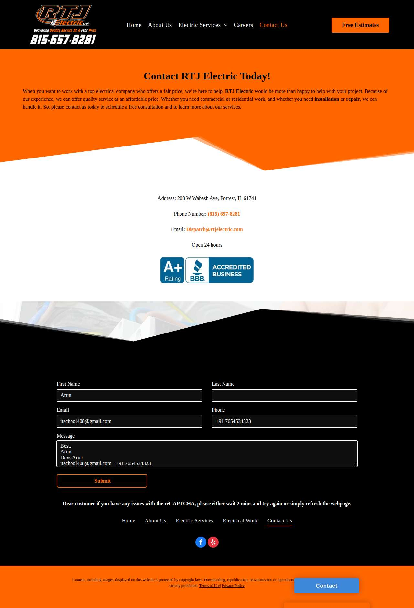

**After submit** — `run-1e96412c_attempt-1b207abc_post_attempt_2026-11-02T16-25-09-754Z.jpg`

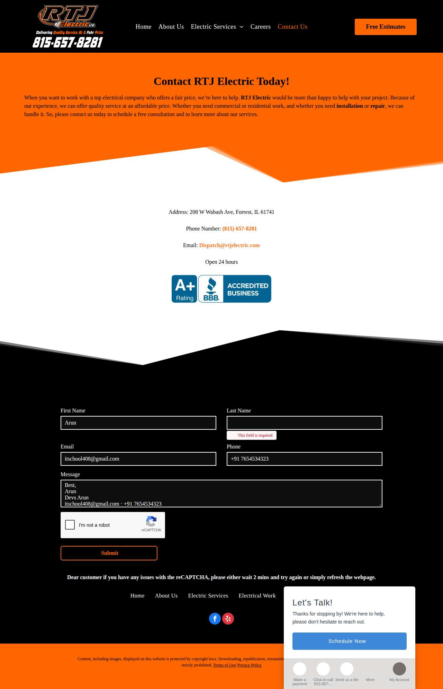

### nw-av.com — error\_after\_submit (LIVE)

| | |
|---|---|
| Attempt ID | `a1228d6b-d47c-41a8-a487-74ea74daa6a2` |
| Form URL | http://nw-av.com/contact/ |
| Final URL | http://nw-av.com/contact/ |
| Reserved | 2026-11-02 16:25:17 UTC |
| Submit attempted | 2026-11-02 16:25:23 UTC |
| Template | standard v2 |
| Confirmation text | none observed |
| Result / error | Submit click error (outcome unknown, not retried): locator.click: Timeout 10000ms exceeded. |

Exact message:

~~~text
Subject: Helping customers find your business in AI search (AEO + GEO)

Hi there,

I'm Arun from Devs Arun. More and more customers now ask ChatGPT, Gemini, Perplexity or Google's AI Overviews questions like "who should I hire for this in my area?" before they call anyone. These tools answer from websites they can clearly understand, and they tend to recommend businesses whose pages answer real customer questions.

That is what AEO + GEO (Answer Engine and Generative Engine Optimization) is for. I improve your existing service pages so they clearly answer the questions your customers ask, add structured data that matches the page, and make the call, quote or enquiry step obvious. The benefit: your business gets a better chance of being mentioned or linked in AI answers, and visitors who arrive find it easy to contact you.

The AEO + GEO Starter is a one-time $199 (about ₹16,999, negotiable) for one website: a basic audit, 10 customer questions, improvements to two existing pages, relevant structured data and an action plan, with one revision round.

You can read the full details, send an enquiry or book online here:
https://devsarun.io/aeo-geo/

If this isn't relevant, just reply and I won't contact you again.

Best,
Arun
Devs Arun
itschool408@gmail.com · +91 7654534323
~~~

Submitted field values:

- Name \* \[name\]: Arun
- E-mail \* \[email\]: itschool408@gmail.com
- Message \[message\]: Hi there, I'm Arun from Devs Arun. More and more customers now ask ChatGPT, Gemini, Perplexity or Google's AI Overviews 
- Telephone \[phone\]: +91 7654534323

**Filled form (before submit)** — `run-1e96412c_attempt-a1228d6b_filled_2026-11-02T16-25-23-142Z.jpg`

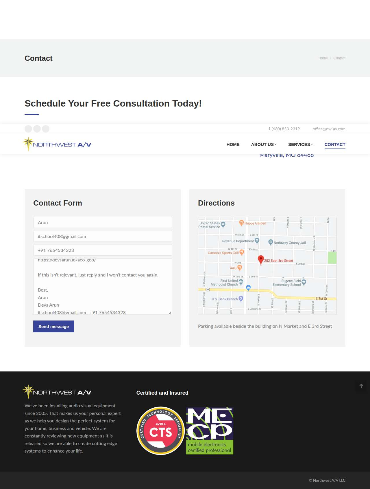

**After submit** — `run-1e96412c_attempt-a1228d6b_post_attempt_2026-11-02T16-25-45-559Z.jpg`

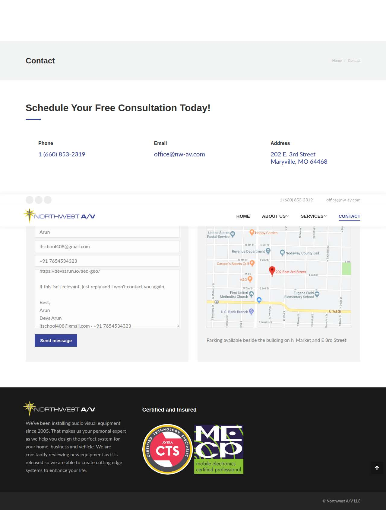

### hewattelectric.com — confirmed (LIVE)

| | |
|---|---|
| Attempt ID | `75e2061f-7e00-4ff9-a0bd-84b6232fdfb1` |
| Form URL | https://www.hewattelectric.com/contact |
| Final URL | https://www.hewattelectric.com/contact |
| Reserved | 2026-11-02 16:25:52 UTC |
| Submit attempted | 2026-11-02 16:25:54 UTC |
| Template | standard v2 |
| Confirmation text | ency Contact Hewatt Electrical Contractors, Inc. Contact Us Thank you\! Your submission has been received\! Servicing the greater Atlanta area 4785 Lee Waters Road, Mariet |
| Result / error | — |

Exact message:

~~~text
Subject: Helping customers find your business in AI search (AEO + GEO)

Hi there,

I'm Arun from Devs Arun. More and more customers now ask ChatGPT, Gemini, Perplexity or Google's AI Overviews questions like "who should I hire for this in my area?" before they call anyone. These tools answer from websites they can clearly understand, and they tend to recommend businesses whose pages answer real customer questions.

That is what AEO + GEO (Answer Engine and Generative Engine Optimization) is for. I improve your existing service pages so they clearly answer the questions your customers ask, add structured data that matches the page, and make the call, quote or enquiry step obvious. The benefit: your business gets a better chance of being mentioned or linked in AI answers, and visitors who arrive find it easy to contact you.

The AEO + GEO Starter is a one-time $199 (about ₹16,999, negotiable) for one website: a basic audit, 10 customer questions, improvements to two existing pages, relevant structured data and an action plan, with one revision round.

You can read the full details, send an enquiry or book online here:
https://devsarun.io/aeo-geo/

If this isn't relevant, just reply and I won't contact you again.

Best,
Arun
Devs Arun
itschool408@gmail.com · +91 7654534323
~~~

Submitted field values:

- EMAIL \[email\]: itschool408@gmail.com
- YOUR NAME \[name\]: Arun
- MESSAGE \[message\]: Hi there, I'm Arun from Devs Arun. More and more customers now ask ChatGPT, Gemini, Perplexity or Google's AI Overviews 

**Filled form (before submit)** — `run-1e96412c_attempt-75e2061f_filled_2026-11-02T16-25-54-940Z.jpg`

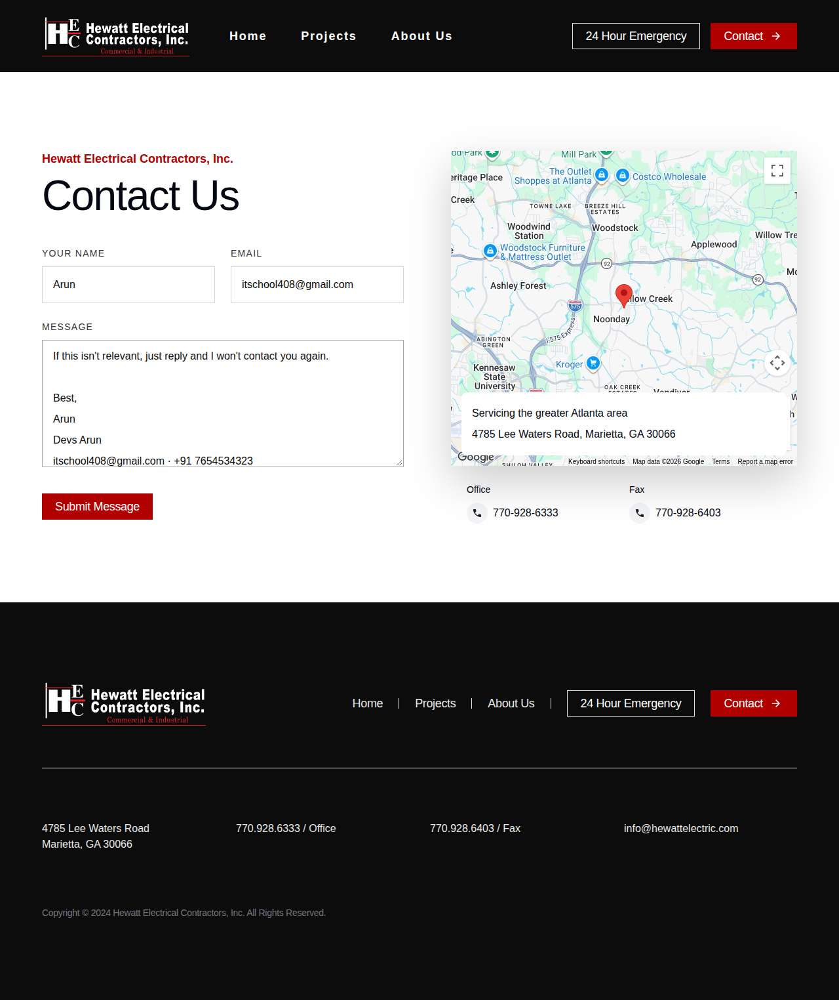

**After submit** — `run-1e96412c_attempt-75e2061f_post_attempt_2026-11-02T16-25-58-822Z.jpg`

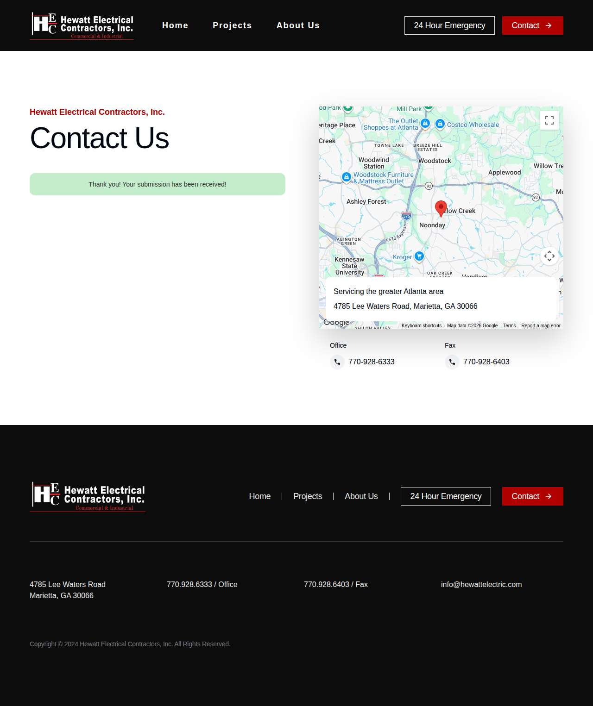

### allphaseelect.net — confirmed (LIVE)

| | |
|---|---|
| Attempt ID | `777312fd-4c78-4489-8225-3bb6b6b95ee9` |
| Form URL | https://allphaseelect.net/contact-us/ |
| Final URL | https://allphaseelect.net/contact-us/ |
| Reserved | 2026-11-02 16:26:06 UTC |
| Submit attempted | 2026-11-02 16:26:13 UTC |
| Template | standard v2 |
| Confirmation text | 683-5328 Fax (323) 734-9455 Email allelect84@gmail.com Your message has been sent. Thanks for contacting us\! Name Arun Email itschool408@gmail.com Comment or Message Hi there, I'm A |
| Result / error | — |

Exact message:

~~~text
Subject: Helping customers find your business in AI search (AEO + GEO)

Hi there,

I'm Arun from Devs Arun. More and more customers now ask ChatGPT, Gemini, Perplexity or Google's AI Overviews questions like "who should I hire for this in my area?" before they call anyone. These tools answer from websites they can clearly understand, and they tend to recommend businesses whose pages answer real customer questions.

That is what AEO + GEO (Answer Engine and Generative Engine Optimization) is for. I improve your existing service pages so they clearly answer the questions your customers ask, add structured data that matches the page, and make the call, quote or enquiry step obvious. The benefit: your business gets a better chance of being mentioned or linked in AI answers, and visitors who arrive find it easy to contact you.

The AEO + GEO Starter is a one-time $199 (about ₹16,999, negotiable) for one website: a basic audit, 10 customer questions, improvements to two existing pages, relevant structured data and an action plan, with one revision round.

You can read the full details, send an enquiry or book online here:
https://devsarun.io/aeo-geo/

If this isn't relevant, just reply and I won't contact you again.

Best,
Arun
Devs Arun
itschool408@gmail.com · +91 7654534323
~~~

Submitted field values:

- Name \* \[name\]: Arun
- Email \* \[email\]: itschool408@gmail.com
- Comment or Message \[message\]: Hi there, I'm Arun from Devs Arun. More and more customers now ask ChatGPT, Gemini, Perplexity or Google's AI Overviews 

**Filled form (before submit)** — `run-1e96412c_attempt-777312fd_filled_2026-11-02T16-26-13-985Z.jpg`

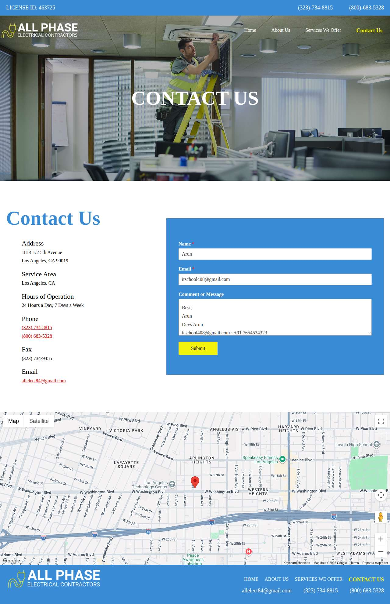

**After submit** — `run-1e96412c_attempt-777312fd_post_attempt_2026-11-02T16-26-17-492Z.jpg`

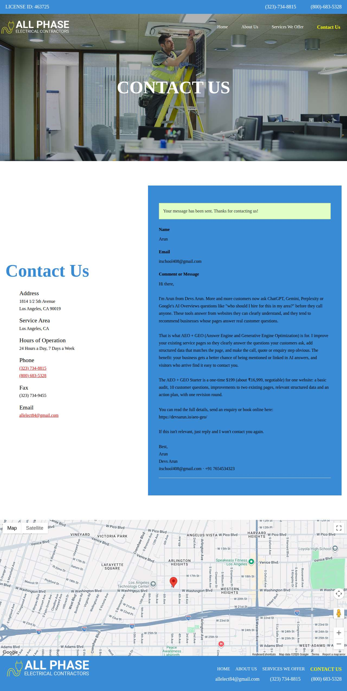

### sccelectricinc.com — unclear (LIVE)

| | |
|---|---|
| Attempt ID | `fc5db58a-ba28-4ddb-9a9d-8a78358e191f` |
| Form URL | https://www.sccelectricinc.com/ |
| Final URL | https://www.sccelectricinc.com/ |
| Reserved | 2026-11-02 16:26:25 UTC |
| Submit attempted | 2026-11-02 16:26:27 UTC |
| Template | standard v2 |
| Confirmation text | none observed |
| Result / error | No new success marker observed |

Exact message:

~~~text
Subject: Helping customers find your business in AI search (AEO + GEO)

Hi there,

I'm Arun from Devs Arun. More and more customers now ask ChatGPT, Gemini, Perplexity or Google's AI Overviews questions like "who should I hire for this in my area?" before they call anyone. These tools answer from websites they can clearly understand, and they tend to recommend businesses whose pages answer real customer questions.

That is what AEO + GEO (Answer Engine and Generative Engine Optimization) is for. I improve your existing service pages so they clearly answer the questions your customers ask, add structured data that matches the page, and make the call, quote or enquiry step obvious. The benefit: your business gets a better chance of being mentioned or linked in AI answers, and visitors who arrive find it easy to contact you.

The AEO + GEO Starter is a one-time $199 (about ₹16,999, negotiable) for one website: a basic audit, 10 customer questions, improvements to two existing pages, relevant structured data and an action plan, with one revision round.

You can read the full details, send an enquiry or book online here:
https://devsarun.io/aeo-geo/

If this isn't relevant, just reply and I won't contact you again.

Best,
Arun
Devs Arun
itschool408@gmail.com · +91 7654534323
~~~

Submitted field values:

- Email \[email\]: itschool408@gmail.com
- Message \[message\]: Hi there, I'm Arun from Devs Arun. More and more customers now ask ChatGPT, Gemini, Perplexity or Google's AI Overviews 
- First Name \[first\_name\]: Arun

**Filled form (before submit)** — `run-1e96412c_attempt-fc5db58a_filled_2026-11-02T16-26-27-462Z.jpg`

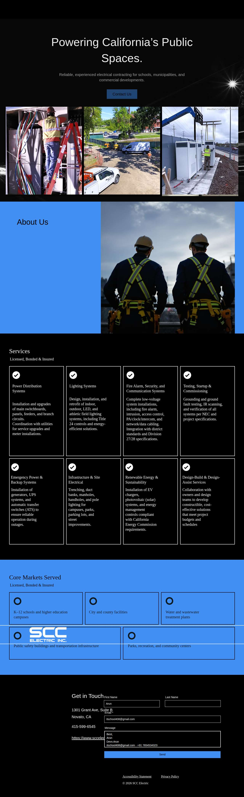

**After submit** — `run-1e96412c_attempt-fc5db58a_post_attempt_2026-11-02T16-26-55-282Z.jpg`

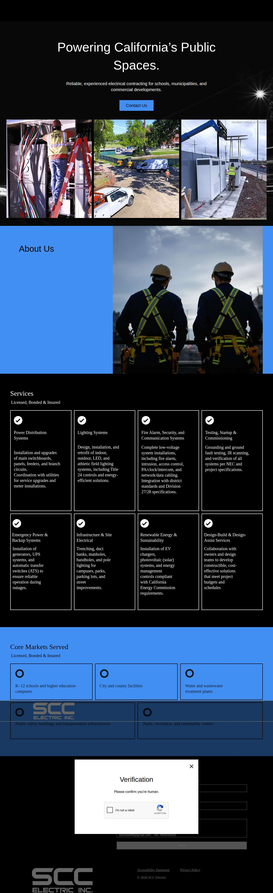

### trelectric.pro — unclear (LIVE)

| | |
|---|---|
| Attempt ID | `ed1752bb-e04d-4ca2-b1ba-c11b72118b02` |
| Form URL | https://trelectric.pro/contact/ |
| Final URL | https://trelectric.pro/contact/ |
| Reserved | 2026-11-02 16:27:02 UTC |
| Submit attempted | 2026-11-02 16:27:06 UTC |
| Template | standard v2 |
| Confirmation text | none observed |
| Result / error | No new success marker observed |

Exact message:

~~~text
Subject: Helping customers find your business in AI search (AEO + GEO)

Hi there,

I'm Arun from Devs Arun. More and more customers now ask ChatGPT, Gemini, Perplexity or Google's AI Overviews questions like "who should I hire for this in my area?" before they call anyone. These tools answer from websites they can clearly understand, and they tend to recommend businesses whose pages answer real customer questions.

That is what AEO + GEO (Answer Engine and Generative Engine Optimization) is for. I improve your existing service pages so they clearly answer the questions your customers ask, add structured data that matches the page, and make the call, quote or enquiry step obvious. The benefit: your business gets a better chance of being mentioned or linked in AI answers, and visitors who arrive find it easy to contact you.

The AEO + GEO Starter is a one-time $199 (about ₹16,999, negotiable) for one website: a basic audit, 10 customer questions, improvements to two existing pages, relevant structured data and an action plan, with one revision round.

You can read the full details, send an enquiry or book online here:
https://devsarun.io/aeo-geo/

If this isn't relevant, just reply and I won't contact you again.

Best,
Arun
Devs Arun
itschool408@gmail.com · +91 7654534323
~~~

Submitted field values:

- Name \[name\]: Arun
- Email \[email\]: itschool408@gmail.com
- Phone \[phone\]: +91 7654534323
- Message \[message\]: Hi there, I'm Arun from Devs Arun. More and more customers now ask ChatGPT, Gemini, Perplexity or Google's AI Overviews 

**Filled form (before submit)** — `run-1e96412c_attempt-ed1752bb_filled_2026-11-02T16-27-06-161Z.jpg`

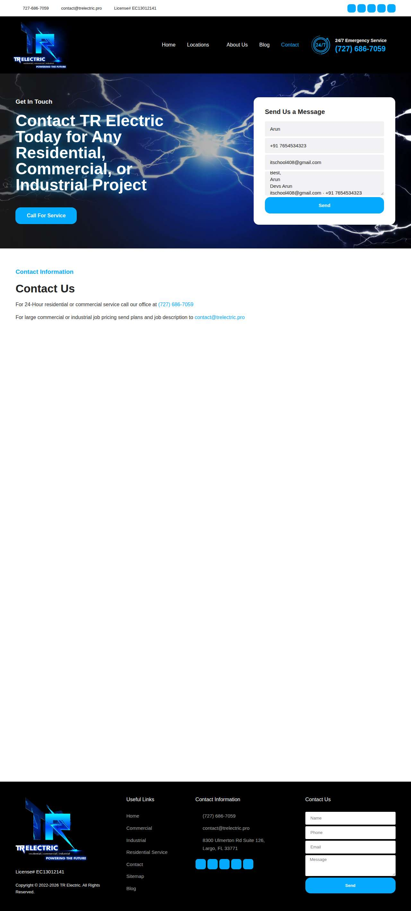

**After submit** — `run-1e96412c_attempt-ed1752bb_post_attempt_2026-11-02T16-27-34-472Z.jpg`

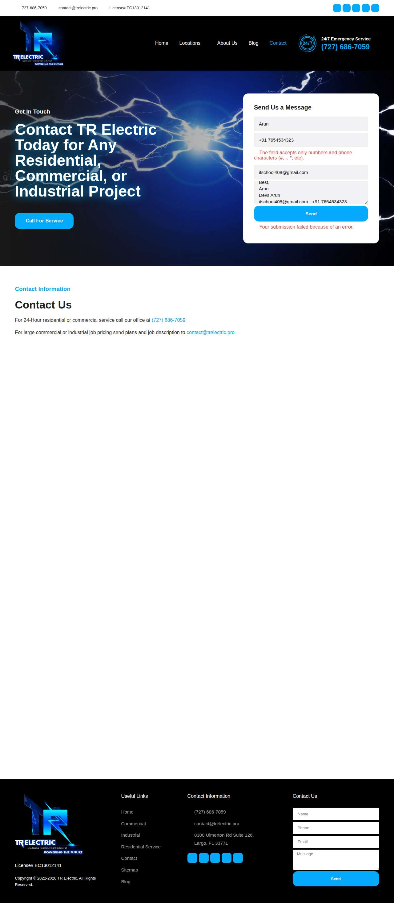

### lacorte.com — confirmed (LIVE)

| | |
|---|---|
| Attempt ID | `24614890-ac17-4769-88e0-a2568240486d` |
| Form URL | https://jfx.gjj.mybluehost.me/contact/ |
| Final URL | https://jfx.gjj.mybluehost.me/contact/ |
| Reserved | 2026-11-02 16:27:41 UTC |
| Submit attempted | 2026-11-02 16:27:44 UTC |
| Template | standard v2 |
| Confirmation text | 12205 (518) 286-6000 service@lacorte.com fax: 518-935-9688 Thank you for your message. It has been sent. Your Name (required) Your Email (required) Your Message Thank you for your messa |
| Result / error | — |

Exact message:

~~~text
Subject: Helping customers find your business in AI search (AEO + GEO)

Hi there,

I'm Arun from Devs Arun. More and more customers now ask ChatGPT, Gemini, Perplexity or Google's AI Overviews questions like "who should I hire for this in my area?" before they call anyone. These tools answer from websites they can clearly understand, and they tend to recommend businesses whose pages answer real customer questions.

That is what AEO + GEO (Answer Engine and Generative Engine Optimization) is for. I improve your existing service pages so they clearly answer the questions your customers ask, add structured data that matches the page, and make the call, quote or enquiry step obvious. The benefit: your business gets a better chance of being mentioned or linked in AI answers, and visitors who arrive find it easy to contact you.

The AEO + GEO Starter is a one-time $199 (about ₹16,999, negotiable) for one website: a basic audit, 10 customer questions, improvements to two existing pages, relevant structured data and an action plan, with one revision round.

You can read the full details, send an enquiry or book online here:
https://devsarun.io/aeo-geo/

If this isn't relevant, just reply and I won't contact you again.

Best,
Arun
Devs Arun
itschool408@gmail.com · +91 7654534323
~~~

Submitted field values:

- your-name \[name\]: Arun
- your-email \[email\]: itschool408@gmail.com
- your-message \[message\]: Hi there, I'm Arun from Devs Arun. More and more customers now ask ChatGPT, Gemini, Perplexity or Google's AI Overviews 

**Filled form (before submit)** — `run-1e96412c_attempt-24614890_filled_2026-11-02T16-27-44-025Z.jpg`

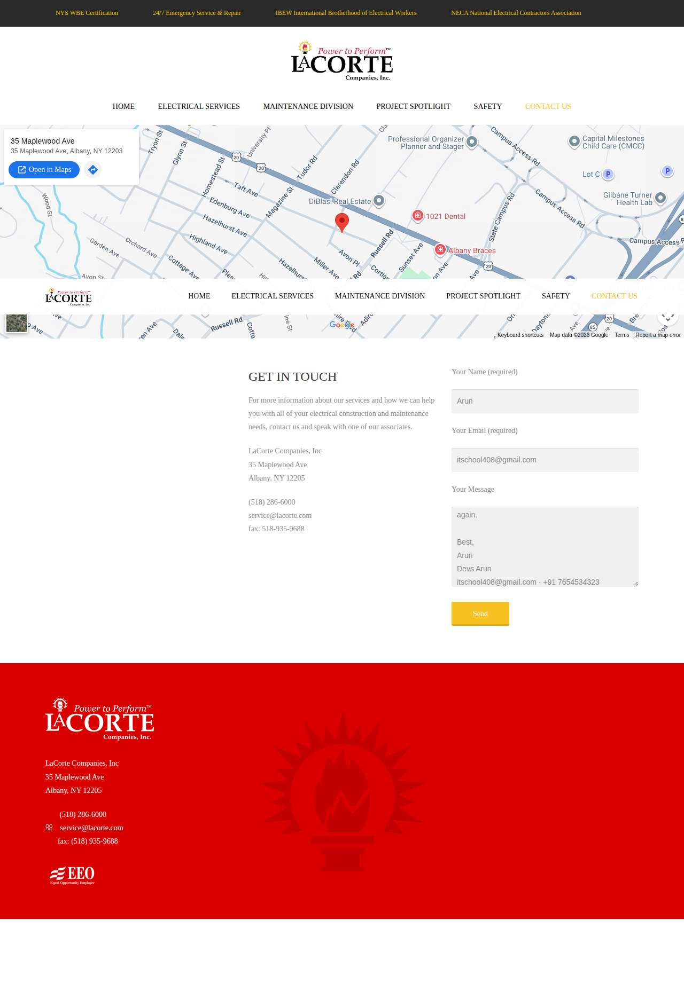

**After submit** — `run-1e96412c_attempt-24614890_post_attempt_2026-11-02T16-27-49-192Z.jpg`

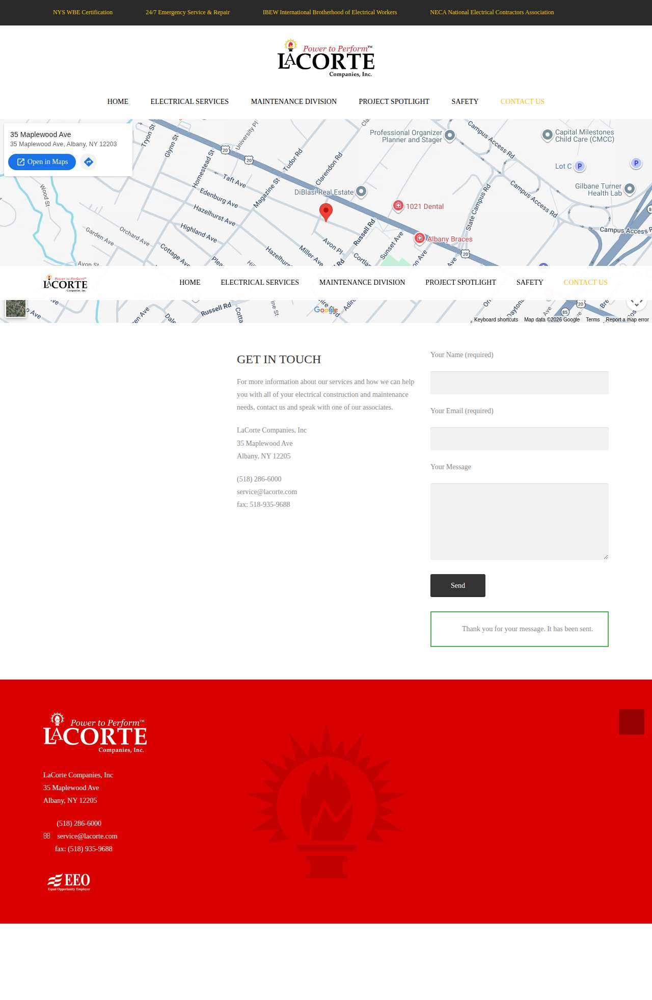

### waynesolarpowersystems.com — unclear (LIVE)

| | |
|---|---|
| Attempt ID | `a92aaf7b-3e54-4fec-b0fb-a84767546d17` |
| Form URL | https://www.waynesolarpowersystems.com/ |
| Final URL | https://www.waynesolarpowersystems.com/ |
| Reserved | 2026-11-02 16:27:56 UTC |
| Submit attempted | 2026-11-02 16:27:58 UTC |
| Template | standard v2 |
| Confirmation text | none observed |
| Result / error | No new success marker observed |

Exact message:

~~~text
Subject: Helping customers find your business in AI search (AEO + GEO)

Hi there,

I'm Arun from Devs Arun. More and more customers now ask ChatGPT, Gemini, Perplexity or Google's AI Overviews questions like "who should I hire for this in my area?" before they call anyone. These tools answer from websites they can clearly understand, and they tend to recommend businesses whose pages answer real customer questions.

That is what AEO + GEO (Answer Engine and Generative Engine Optimization) is for. I improve your existing service pages so they clearly answer the questions your customers ask, add structured data that matches the page, and make the call, quote or enquiry step obvious. The benefit: your business gets a better chance of being mentioned or linked in AI answers, and visitors who arrive find it easy to contact you.

The AEO + GEO Starter is a one-time $199 (about ₹16,999, negotiable) for one website: a basic audit, 10 customer questions, improvements to two existing pages, relevant structured data and an action plan, with one revision round.

You can read the full details, send an enquiry or book online here:
https://devsarun.io/aeo-geo/

If this isn't relevant, just reply and I won't contact you again.

Best,
Arun
Devs Arun
itschool408@gmail.com · +91 7654534323
~~~

Submitted field values:

- Name \[name\]: Arun
- Email \[email\]: itschool408@gmail.com
- Phone \[phone\]: +91 7654534323
- Message \[message\]: Hi there, I'm Arun from Devs Arun. More and more customers now ask ChatGPT, Gemini, Perplexity or Google's AI Overviews 

**Filled form (before submit)** — `run-1e96412c_attempt-a92aaf7b_filled_2026-11-02T16-27-58-326Z.jpg`

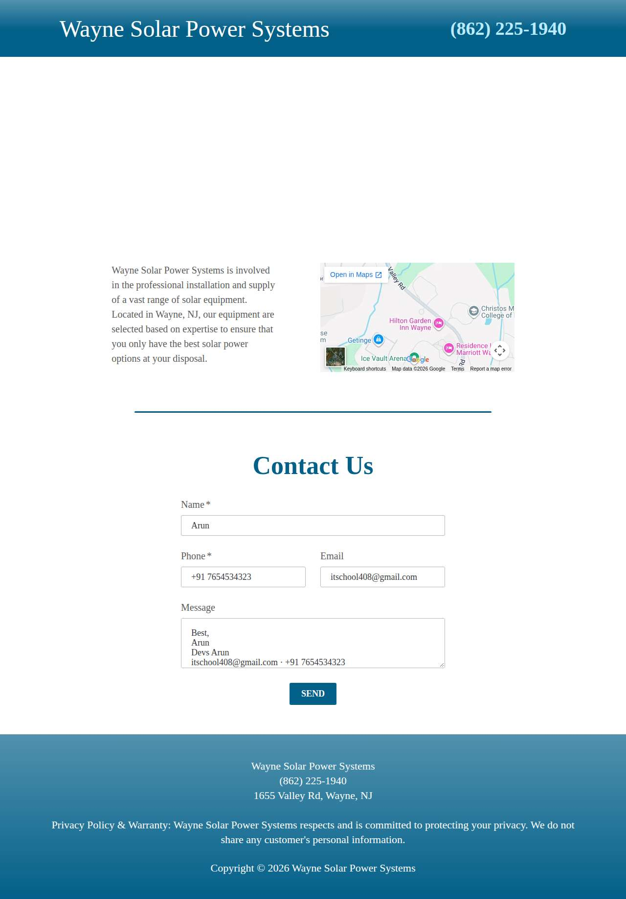

**After submit** — `run-1e96412c_attempt-a92aaf7b_post_attempt_2026-11-02T16-28-26-491Z.jpg`

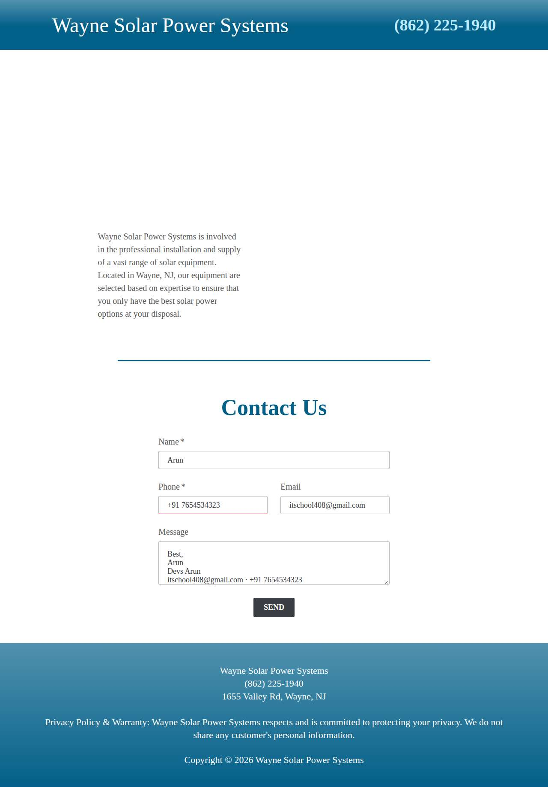

### joedumpllc.com — failed\_before\_submit (LIVE)

| | |
|---|---|
| Attempt ID | `de85feda-6245-4640-94b1-6c6198568b21` |
| Form URL | https://www.joedumpllc.com/ |
| Final URL | https://www.joedumpllc.com/ |
| Reserved | 2026-11-02 16:28:33 UTC |
| Submit attempted | — |
| Template | standard v2 |
| Confirmation text | none observed |
| Result / error | Message field truncated the text; the required link https://devsarun.io/aeo-geo/ would be lost |

Exact message:

~~~text
Subject: Helping customers find your business in AI search (AEO + GEO)

Hi there,

I'm Arun from Devs Arun. More and more customers now ask ChatGPT, Gemini, Perplexity or Google's AI Overviews questions like "who should I hire for this in my area?" before they call anyone. These tools answer from websites they can clearly understand, and they tend to recommend businesses whose pages answer real customer questions.

That is what AEO + GEO (Answer Engine and Generative Engine Optimization) is for. I improve your existing service pages so they clearly answer the questions your customers ask, add structured data that matches the page, and make the call, quote or enquiry step obvious. The benefit: your business gets a better chance of being mentioned or linked in AI answers, and visitors who arrive find it easy to contact you.

The AEO + GEO Starter is a one-time $199 (about ₹16,999, negotiable) for one website: a basic audit, 10 customer questions, improvements to two existing pages, relevant structured data and an action plan, with one revision round.

You can read the full details, send an enquiry or book online here:
https://devsarun.io/aeo-geo/

If this isn't relevant, just reply and I won't contact you again.

Best,
Arun
Devs Arun
itschool408@gmail.com · +91 7654534323
~~~

Submitted field values:

- \#forminator-field-name-1\_6ae247fa46c51: Arun
- \#forminator-field-email-1\_6ae247fa46c51: itschool408@gmail.com
- \#forminator-field-phone-1\_6ae247fa46c51: +91 7654534323
- \#forminator-field-textarea-1\_6ae247fa46c51: Hi there, I'm Arun from Devs Arun. More and more customers now ask ChatGPT, Gemini, Perplexity or Google's AI Overviews 

**Filled form (before submit)** — `run-1e96412c_attempt-de85feda_filled_2026-11-02T16-28-37-307Z.jpg`

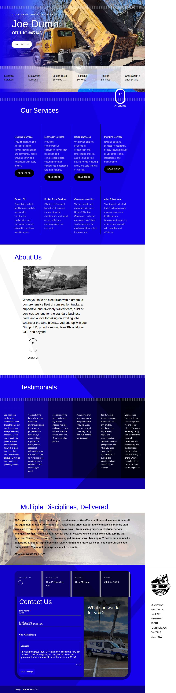

### wirepro.com — confirmed (LIVE)

| | |
|---|---|
| Attempt ID | `e1a27794-1d9a-49fa-a99c-1f321cc4253f` |
| Form URL | https://wirepro.com/contact/ |
| Final URL | https://wirepro.com/contact/ |
| Reserved | 2026-11-02 16:28:42 UTC |
| Submit attempted | 2026-11-02 16:28:44 UTC |
| Template | standard v2 |
| Confirmation text | . All Rights Reserved. Terms and conditions My account Cart Thank You for Reaching Out\! In the meantime.... STAY IN TOUCH Be the first to know about new arrivals and promotions Email SUB |
| Result / error | — |

Exact message:

~~~text
Subject: Helping customers find your business in AI search (AEO + GEO)

Hi there,

I'm Arun from Devs Arun. More and more customers now ask ChatGPT, Gemini, Perplexity or Google's AI Overviews questions like "who should I hire for this in my area?" before they call anyone. These tools answer from websites they can clearly understand, and they tend to recommend businesses whose pages answer real customer questions.

That is what AEO + GEO (Answer Engine and Generative Engine Optimization) is for. I improve your existing service pages so they clearly answer the questions your customers ask, add structured data that matches the page, and make the call, quote or enquiry step obvious. The benefit: your business gets a better chance of being mentioned or linked in AI answers, and visitors who arrive find it easy to contact you.

The AEO + GEO Starter is a one-time $199 (about ₹16,999, negotiable) for one website: a basic audit, 10 customer questions, improvements to two existing pages, relevant structured data and an action plan, with one revision round.

You can read the full details, send an enquiry or book online here:
https://devsarun.io/aeo-geo/

If this isn't relevant, just reply and I won't contact you again.

Best,
Arun
Devs Arun
itschool408@gmail.com · +91 7654534323
~~~

Submitted field values:

- Name \[name\]: Arun
- Email \[email\]: itschool408@gmail.com
- Phone \[phone\]: +91 7654534323
- Message \[message\]: Hi there, I'm Arun from Devs Arun. More and more customers now ask ChatGPT, Gemini, Perplexity or Google's AI Overviews 
- Company Name \[company\]: Devs Arun

**Filled form (before submit)** — `run-1e96412c_attempt-e1a27794_filled_2026-11-02T16-28-44-278Z.jpg`

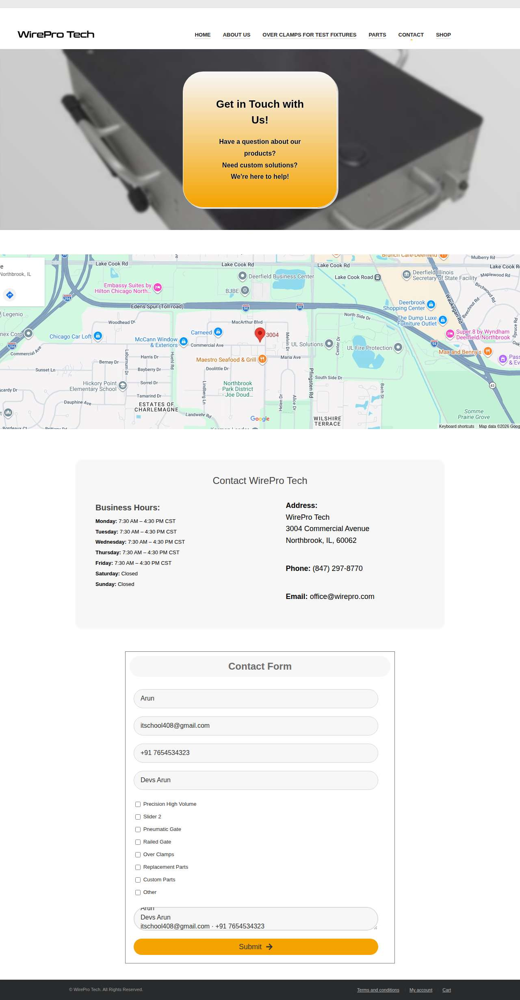

**After submit** — `run-1e96412c_attempt-e1a27794_post_attempt_2026-11-02T16-28-49-613Z.jpg`

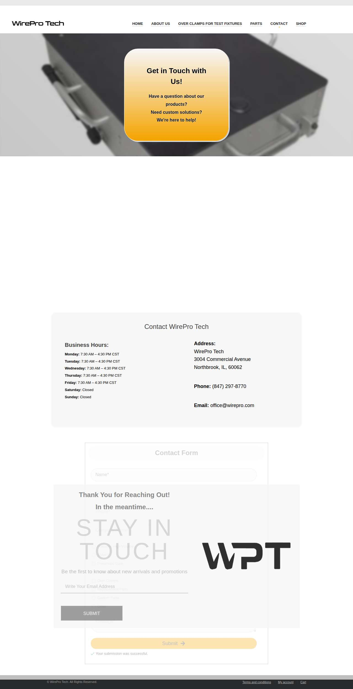

### servicejohnsonelectrical.com — unclear (LIVE)

| | |
|---|---|
| Attempt ID | `ca9d503e-603a-4e41-840a-9bcc0ff18838` |
| Form URL | https://www.servicejohnsonelectrical.com/contact-us |
| Final URL | https://www.servicejohnsonelectrical.com/contact-us |
| Reserved | 2026-11-02 16:28:57 UTC |
| Submit attempted | 2026-11-02 16:28:59 UTC |
| Template | standard v2 |
| Confirmation text | none observed |
| Result / error | No new success marker observed |

Exact message:

~~~text
Subject: Helping customers find your business in AI search (AEO + GEO)

Hi there,

I'm Arun from Devs Arun. More and more customers now ask ChatGPT, Gemini, Perplexity or Google's AI Overviews questions like "who should I hire for this in my area?" before they call anyone. These tools answer from websites they can clearly understand, and they tend to recommend businesses whose pages answer real customer questions.

That is what AEO + GEO (Answer Engine and Generative Engine Optimization) is for. I improve your existing service pages so they clearly answer the questions your customers ask, add structured data that matches the page, and make the call, quote or enquiry step obvious. The benefit: your business gets a better chance of being mentioned or linked in AI answers, and visitors who arrive find it easy to contact you.

The AEO + GEO Starter is a one-time $199 (about ₹16,999, negotiable) for one website: a basic audit, 10 customer questions, improvements to two existing pages, relevant structured data and an action plan, with one revision round.

You can read the full details, send an enquiry or book online here:
https://devsarun.io/aeo-geo/

If this isn't relevant, just reply and I won't contact you again.

Best,
Arun
Devs Arun
itschool408@gmail.com · +91 7654534323
~~~

Submitted field values:

- Name: \[name\]: Arun
- Email: \[email\]: itschool408@gmail.com
- Phone: \[phone\]: +91 7654534323
- Message: \[message\]: Hi there, I'm Arun from Devs Arun. More and more customers now ask ChatGPT, Gemini, Perplexity or Google's AI Overviews 

**Filled form (before submit)** — `run-1e96412c_attempt-ca9d503e_filled_2026-11-02T16-28-59-370Z.jpg`

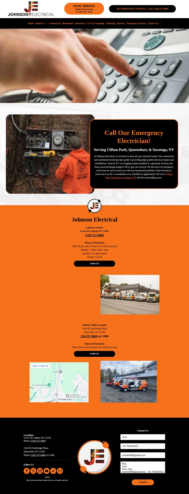

**After submit** — `run-1e96412c_attempt-ca9d503e_post_attempt_2026-11-02T16-29-26-996Z.jpg`

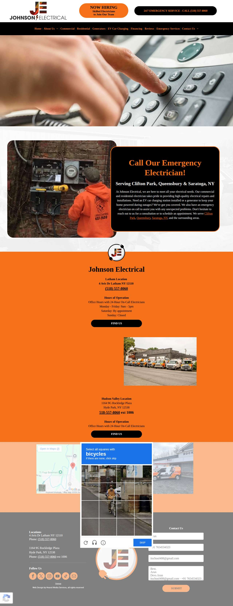

### clearelectricllc.com — confirmed (LIVE)

| | |
|---|---|
| Attempt ID | `41167082-2be1-4415-8151-45746456f595` |
| Form URL | https://www.clearelectricllc.com/contact |
| Final URL | https://www.clearelectricllc.com/contact |
| Reserved | 2026-11-02 16:29:35 UTC |
| Submit attempted | 2026-11-02 16:29:38 UTC |
| Template | standard v2 |
| Confirmation text | Get an Estimate GET AN ESTIMATE Tell us about your project We'll get back to you the same or next business day. For urgent issues, please call. Get a Free Estimate (570) 220 |
| Result / error | — |

Exact message:

~~~text
Subject: Helping customers find your business in AI search (AEO + GEO)

Hi there,

I'm Arun from Devs Arun. More and more customers now ask ChatGPT, Gemini, Perplexity or Google's AI Overviews questions like "who should I hire for this in my area?" before they call anyone. These tools answer from websites they can clearly understand, and they tend to recommend businesses whose pages answer real customer questions.

That is what AEO + GEO (Answer Engine and Generative Engine Optimization) is for. I improve your existing service pages so they clearly answer the questions your customers ask, add structured data that matches the page, and make the call, quote or enquiry step obvious. The benefit: your business gets a better chance of being mentioned or linked in AI answers, and visitors who arrive find it easy to contact you.

The AEO + GEO Starter is a one-time $199 (about ₹16,999, negotiable) for one website: a basic audit, 10 customer questions, improvements to two existing pages, relevant structured data and an action plan, with one revision round.

You can read the full details, send an enquiry or book online here:
https://devsarun.io/aeo-geo/

If this isn't relevant, just reply and I won't contact you again.

Best,
Arun
Devs Arun
itschool408@gmail.com · +91 7654534323
~~~

Submitted field values:

- Name\* \[name\]: Arun
- Email\* \[email\]: itschool408@gmail.com
- Phone\* \[phone\]: +91 7654534323
- Project details \[message\]: Hi there, I'm Arun from Devs Arun. More and more customers now ask ChatGPT, Gemini, Perplexity or Google's AI Overviews 

**Filled form (before submit)** — `run-1e96412c_attempt-41167082_filled_2026-11-02T16-29-38-860Z.jpg`

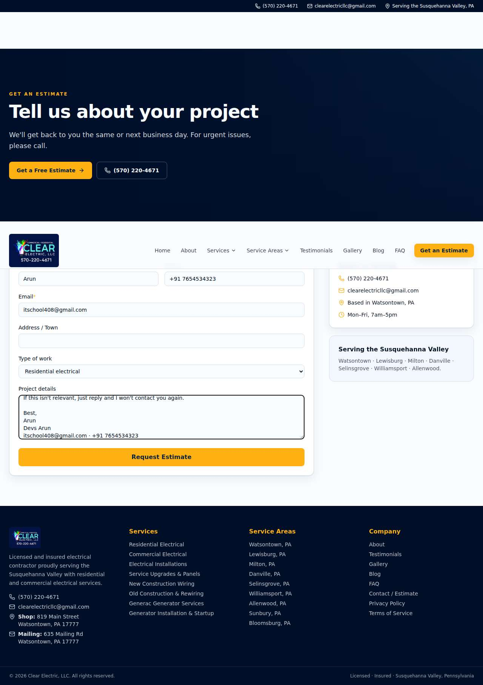

**After submit** — `run-1e96412c_attempt-41167082_post_attempt_2026-11-02T16-29-41-930Z.jpg`

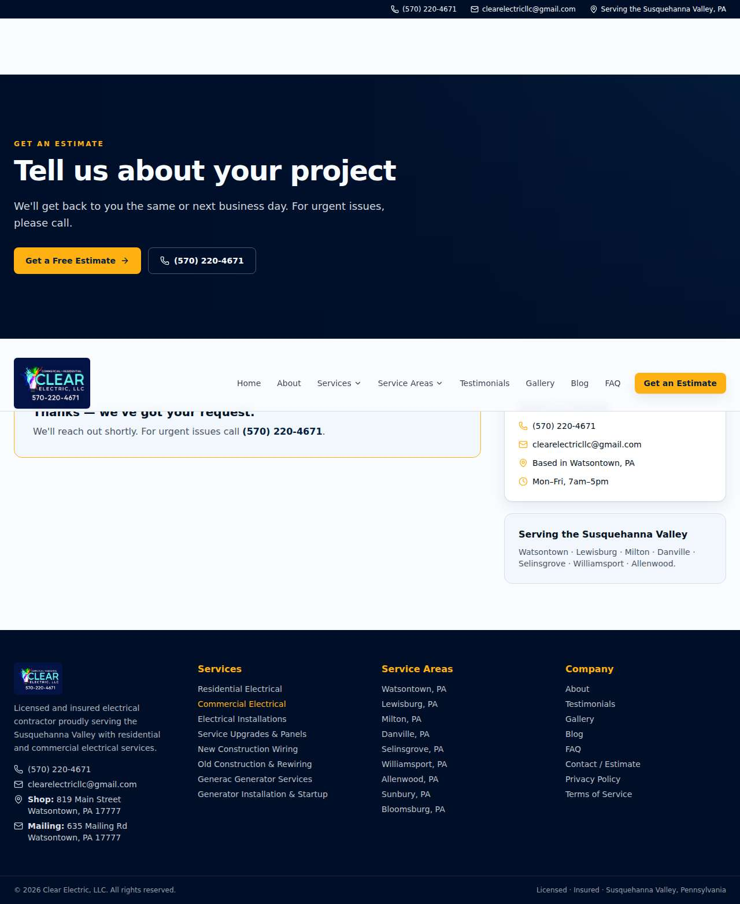

### indianaindustrial.com — unclear (LIVE)

| | |
|---|---|
| Attempt ID | `82108f22-2d76-4c79-91d4-5e8e2542fce7` |
| Form URL | https://www.indianaindustrial.com/contact |
| Final URL | https://www.indianaindustrial.com/contact |
| Reserved | 2026-11-02 16:29:48 UTC |
| Submit attempted | 2026-11-02 16:29:51 UTC |
| Template | standard v2 |
| Confirmation text | none observed |
| Result / error | No new success marker observed |

Exact message:

~~~text
Subject: Helping customers find your business in AI search (AEO + GEO)

Hi there,

I'm Arun from Devs Arun. More and more customers now ask ChatGPT, Gemini, Perplexity or Google's AI Overviews questions like "who should I hire for this in my area?" before they call anyone. These tools answer from websites they can clearly understand, and they tend to recommend businesses whose pages answer real customer questions.

That is what AEO + GEO (Answer Engine and Generative Engine Optimization) is for. I improve your existing service pages so they clearly answer the questions your customers ask, add structured data that matches the page, and make the call, quote or enquiry step obvious. The benefit: your business gets a better chance of being mentioned or linked in AI answers, and visitors who arrive find it easy to contact you.

The AEO + GEO Starter is a one-time $199 (about ₹16,999, negotiable) for one website: a basic audit, 10 customer questions, improvements to two existing pages, relevant structured data and an action plan, with one revision round.

You can read the full details, send an enquiry or book online here:
https://devsarun.io/aeo-geo/

If this isn't relevant, just reply and I won't contact you again.

Best,
Arun
Devs Arun
itschool408@gmail.com · +91 7654534323
~~~

Submitted field values:

- email \[email\]: itschool408@gmail.com
- name-\* \[name\]: Arun
- phone \[phone\]: +91 7654534323
- Message \[message\]: Hi there, I'm Arun from Devs Arun. More and more customers now ask ChatGPT, Gemini, Perplexity or Google's AI Overviews 
- subject \[subject\]: Helping customers find your business in AI search (AEO + GEO)

**Filled form (before submit)** — `run-1e96412c_attempt-82108f22_filled_2026-11-02T16-29-51-060Z.jpg`

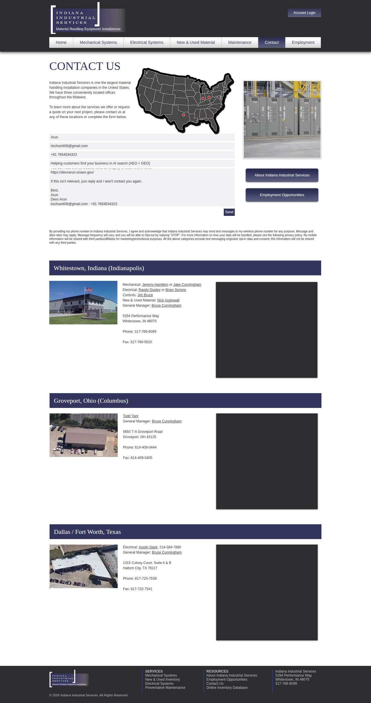

**After submit** — `run-1e96412c_attempt-82108f22_post_attempt_2026-11-02T16-30-19-309Z.jpg`

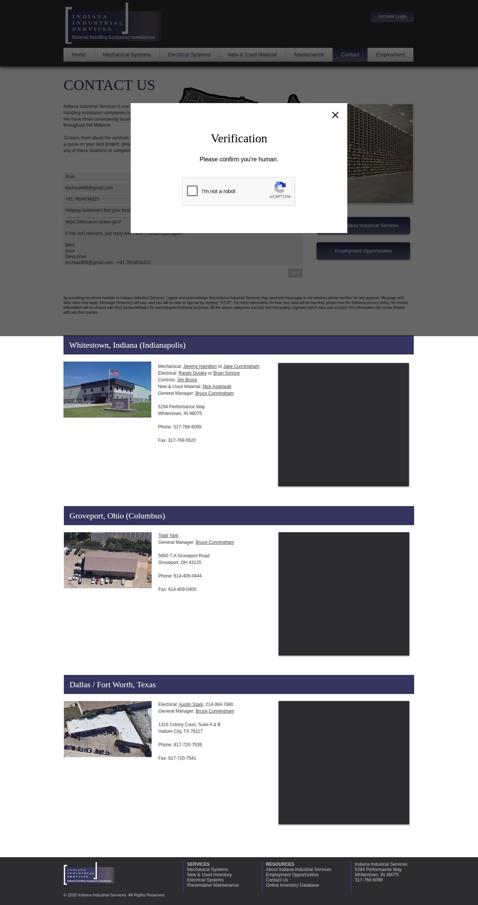

## Events (132)

| Time (UTC) | Event | Website | Details |
|---|---|---|---|
| 16:22:47 | run\_queued | — | live run requested by github:itsDevsArun |
| 16:22:47 | run\_dispatched | — | dispatch disabled (local test mode) |
| 16:22:50 | run\_started | — | Runner claimed live run |
| 16:22:51 | offer\_verified | — | Service page offer facts verified |
| 16:22:51 | website\_selected | clearchoiceplumbingllc.com | Live target clearchoiceplumbingllc.com |
| 16:22:51 | attempt\_reserved | clearchoiceplumbingllc.com | Submission attempt reserved with template standard v2 |
| 16:22:53 | page\_opened | clearchoiceplumbingllc.com | Opened form page |
| 16:22:53 | screenshot\_saved | clearchoiceplumbingllc.com | inspection screenshot saved (145 KB) |
| 16:22:53 | review\_required | clearchoiceplumbingllc.com | failed before submit: locator.fill: Error: Cannot type text into input\[type=number\] |
| 16:22:58 | website\_selected | buddyelectricllc.com | Live target buddyelectricllc.com |
| 16:22:58 | attempt\_reserved | buddyelectricllc.com | Submission attempt reserved with template standard v2 |
| 16:23:02 | page\_opened | buddyelectricllc.com | Opened form page |
| 16:23:02 | screenshot\_saved | buddyelectricllc.com | filled screenshot saved (79 KB) |
| 16:23:02 | review\_required | buddyelectricllc.com | failed before submit: Field "Phone\*" did not accept the value |
| 16:23:07 | website\_selected | qcaelectric.com | Live target qcaelectric.com |
| 16:23:07 | attempt\_reserved | qcaelectric.com | Submission attempt reserved with template standard v2 |
| 16:23:12 | page\_opened | qcaelectric.com | Opened form page |
| 16:23:12 | fields\_filled | qcaelectric.com | filled |
| 16:23:13 | screenshot\_saved | qcaelectric.com | filled screenshot saved (101 KB) |
| 16:23:13 | submit\_attempted | qcaelectric.com | submitting |
| 16:23:43 | screenshot\_saved | qcaelectric.com | post\_attempt screenshot saved (89 KB) |
| 16:23:43 | error | qcaelectric.com | error after submit — "llinois Review Us On Follow Name First Name\* Last Name is a required field. Last Name\* Email\* Phone Number\* Comments\* QC" |
| 16:23:51 | website\_selected | ccelectrical24.com | Live target ccelectrical24.com |
| 16:23:51 | attempt\_reserved | ccelectrical24.com | Submission attempt reserved with template standard v2 |
| 16:23:55 | page\_opened | ccelectrical24.com | Opened form page |
| 16:23:56 | fields\_filled | ccelectrical24.com | filled |
| 16:23:56 | screenshot\_saved | ccelectrical24.com | filled screenshot saved (143 KB) |
| 16:23:56 | submit\_attempted | ccelectrical24.com | submitting |
| 16:24:32 | screenshot\_saved | ccelectrical24.com | post\_attempt screenshot saved (252 KB) |
| 16:24:32 | review\_required | ccelectrical24.com | unclear: No new success marker observed |
| 16:24:40 | website\_selected | rtjelectric.com | Live target rtjelectric.com |
| 16:24:40 | attempt\_reserved | rtjelectric.com | Submission attempt reserved with template standard v2 |
| 16:24:42 | page\_opened | rtjelectric.com | Opened form page |
| 16:24:42 | fields\_filled | rtjelectric.com | filled |
| 16:24:42 | screenshot\_saved | rtjelectric.com | filled screenshot saved (109 KB) |
| 16:24:42 | submit\_attempted | rtjelectric.com | submitting |
| 16:25:09 | screenshot\_saved | rtjelectric.com | post\_attempt screenshot saved (116 KB) |
| 16:25:09 | review\_required | rtjelectric.com | unclear: No new success marker observed |
| 16:25:17 | website\_selected | nw-av.com | Live target nw-av.com |
| 16:25:17 | attempt\_reserved | nw-av.com | Submission attempt reserved with template standard v2 |
| 16:25:22 | page\_opened | nw-av.com | Opened form page |
| 16:25:23 | fields\_filled | nw-av.com | filled |
| 16:25:23 | screenshot\_saved | nw-av.com | filled screenshot saved (91 KB) |
| 16:25:23 | submit\_attempted | nw-av.com | submitting |
| 16:25:45 | screenshot\_saved | nw-av.com | post\_attempt screenshot saved (93 KB) |
| 16:25:45 | error | nw-av.com | error after submit: Submit click error (outcome unknown, not retried): locator.click: Timeout 10000ms exceeded. |
| 16:25:52 | website\_selected | hewattelectric.com | Live target hewattelectric.com |
| 16:25:52 | attempt\_reserved | hewattelectric.com | Submission attempt reserved with template standard v2 |
| 16:25:54 | page\_opened | hewattelectric.com | Opened form page |
| 16:25:54 | fields\_filled | hewattelectric.com | filled |
| 16:25:54 | screenshot\_saved | hewattelectric.com | filled screenshot saved (105 KB) |
| 16:25:54 | submit\_attempted | hewattelectric.com | submitting |
| 16:25:58 | screenshot\_saved | hewattelectric.com | post\_attempt screenshot saved (95 KB) |
| 16:25:58 | confirmation\_observed | hewattelectric.com | confirmed — "ency Contact Hewatt Electrical Contractors, Inc. Contact Us Thank you\! Your submission has been received\! Servicing the " |
| 16:26:06 | website\_selected | allphaseelect.net | Live target allphaseelect.net |
| 16:26:06 | attempt\_reserved | allphaseelect.net | Submission attempt reserved with template standard v2 |
| 16:26:13 | page\_opened | allphaseelect.net | Opened form page |
| 16:26:13 | fields\_filled | allphaseelect.net | filled |
| 16:26:13 | screenshot\_saved | allphaseelect.net | filled screenshot saved (213 KB) |
| 16:26:13 | submit\_attempted | allphaseelect.net | submitting |
| 16:26:17 | screenshot\_saved | allphaseelect.net | post\_attempt screenshot saved (257 KB) |
| 16:26:17 | confirmation\_observed | allphaseelect.net | confirmed — "683-5328 Fax (323) 734-9455 Email allelect84@gmail.com Your message has been sent. Thanks for contacting us\! Name Arun E" |
| 16:26:25 | website\_selected | sccelectricinc.com | Live target sccelectricinc.com |
| 16:26:25 | attempt\_reserved | sccelectricinc.com | Submission attempt reserved with template standard v2 |
| 16:26:27 | page\_opened | sccelectricinc.com | Opened form page |
| 16:26:27 | fields\_filled | sccelectricinc.com | filled |
| 16:26:27 | screenshot\_saved | sccelectricinc.com | filled screenshot saved (377 KB) |
| 16:26:27 | submit\_attempted | sccelectricinc.com | submitting |
| 16:26:55 | screenshot\_saved | sccelectricinc.com | post\_attempt screenshot saved (367 KB) |
| 16:26:55 | review\_required | sccelectricinc.com | unclear: No new success marker observed |
| 16:27:02 | website\_selected | trelectric.pro | Live target trelectric.pro |
| 16:27:02 | attempt\_reserved | trelectric.pro | Submission attempt reserved with template standard v2 |
| 16:27:05 | page\_opened | trelectric.pro | Opened form page |
| 16:27:06 | fields\_filled | trelectric.pro | filled |
| 16:27:06 | screenshot\_saved | trelectric.pro | filled screenshot saved (134 KB) |
| 16:27:06 | submit\_attempted | trelectric.pro | submitting |
| 16:27:34 | screenshot\_saved | trelectric.pro | post\_attempt screenshot saved (138 KB) |
| 16:27:34 | review\_required | trelectric.pro | unclear: No new success marker observed |
| 16:27:41 | website\_selected | lacorte.com | Live target lacorte.com |
| 16:27:41 | attempt\_reserved | lacorte.com | Submission attempt reserved with template standard v2 |
| 16:27:43 | page\_opened | lacorte.com | Opened form page |
| 16:27:43 | fields\_filled | lacorte.com | filled |
| 16:27:44 | screenshot\_saved | lacorte.com | filled screenshot saved (115 KB) |
| 16:27:44 | submit\_attempted | lacorte.com | submitting |
| 16:27:49 | screenshot\_saved | lacorte.com | post\_attempt screenshot saved (116 KB) |
| 16:27:49 | confirmation\_observed | lacorte.com | confirmed — "12205 (518) 286-6000 service@lacorte.com fax: 518-935-9688 Thank you for your message. It has been sent. Your Name (requ" |
| 16:27:56 | website\_selected | waynesolarpowersystems.com | Live target waynesolarpowersystems.com |
| 16:27:56 | attempt\_reserved | waynesolarpowersystems.com | Submission attempt reserved with template standard v2 |
| 16:27:58 | page\_opened | waynesolarpowersystems.com | Opened form page |
| 16:27:58 | fields\_filled | waynesolarpowersystems.com | filled |
| 16:27:58 | screenshot\_saved | waynesolarpowersystems.com | filled screenshot saved (88 KB) |
| 16:27:58 | submit\_attempted | waynesolarpowersystems.com | submitting |
| 16:28:26 | screenshot\_saved | waynesolarpowersystems.com | post\_attempt screenshot saved (77 KB) |
| 16:28:26 | review\_required | waynesolarpowersystems.com | unclear: No new success marker observed |
| 16:28:33 | website\_selected | joedumpllc.com | Live target joedumpllc.com |
| 16:28:33 | attempt\_reserved | joedumpllc.com | Submission attempt reserved with template standard v2 |
| 16:28:37 | page\_opened | joedumpllc.com | Opened form page |
| 16:28:37 | screenshot\_saved | joedumpllc.com | filled screenshot saved (486 KB) |
| 16:28:37 | review\_required | joedumpllc.com | failed before submit: Message field truncated the text; the required link https://devsarun.io/aeo-geo/ would be lost |
| 16:28:42 | website\_selected | wirepro.com | Live target wirepro.com |
| 16:28:42 | attempt\_reserved | wirepro.com | Submission attempt reserved with template standard v2 |
| 16:28:44 | page\_opened | wirepro.com | Opened form page |
| 16:28:44 | fields\_filled | wirepro.com | filled |
| 16:28:44 | screenshot\_saved | wirepro.com | filled screenshot saved (156 KB) |
| 16:28:44 | submit\_attempted | wirepro.com | submitting |
| 16:28:49 | screenshot\_saved | wirepro.com | post\_attempt screenshot saved (90 KB) |
| 16:28:49 | confirmation\_observed | wirepro.com | confirmed — ". All Rights Reserved. Terms and conditions My account Cart Thank You for Reaching Out\! In the meantime.... STAY IN TOUC" |
| 16:28:57 | website\_selected | servicejohnsonelectrical.com | Live target servicejohnsonelectrical.com |
| 16:28:57 | attempt\_reserved | servicejohnsonelectrical.com | Submission attempt reserved with template standard v2 |
| 16:28:58 | page\_opened | servicejohnsonelectrical.com | Opened form page |
| 16:28:59 | fields\_filled | servicejohnsonelectrical.com | filled |
| 16:28:59 | screenshot\_saved | servicejohnsonelectrical.com | filled screenshot saved (274 KB) |
| 16:28:59 | submit\_attempted | servicejohnsonelectrical.com | submitting |
| 16:29:26 | screenshot\_saved | servicejohnsonelectrical.com | post\_attempt screenshot saved (271 KB) |
| 16:29:27 | review\_required | servicejohnsonelectrical.com | unclear: No new success marker observed |
| 16:29:35 | website\_selected | clearelectricllc.com | Live target clearelectricllc.com |
| 16:29:35 | attempt\_reserved | clearelectricllc.com | Submission attempt reserved with template standard v2 |
| 16:29:38 | page\_opened | clearelectricllc.com | Opened form page |
| 16:29:38 | fields\_filled | clearelectricllc.com | filled |
| 16:29:38 | screenshot\_saved | clearelectricllc.com | filled screenshot saved (124 KB) |
| 16:29:38 | submit\_attempted | clearelectricllc.com | submitting |
| 16:29:41 | screenshot\_saved | clearelectricllc.com | post\_attempt screenshot saved (102 KB) |
| 16:29:41 | confirmation\_observed | clearelectricllc.com | confirmed — "Get an Estimate GET AN ESTIMATE Tell us about your project We'll get back to you the same or next business day. For urge" |
| 16:29:48 | website\_selected | indianaindustrial.com | Live target indianaindustrial.com |
| 16:29:48 | attempt\_reserved | indianaindustrial.com | Submission attempt reserved with template standard v2 |
| 16:29:50 | page\_opened | indianaindustrial.com | Opened form page |
| 16:29:50 | fields\_filled | indianaindustrial.com | filled |
| 16:29:51 | screenshot\_saved | indianaindustrial.com | filled screenshot saved (167 KB) |
| 16:29:51 | submit\_attempted | indianaindustrial.com | submitting |
| 16:30:19 | screenshot\_saved | indianaindustrial.com | post\_attempt screenshot saved (133 KB) |
| 16:30:19 | review\_required | indianaindustrial.com | unclear: No new success marker observed |
| 16:30:26 | run\_completed | — | Run completed (queue\_exhausted) |
