# Run 204b82d6 — live — completed

| | |
|---|---|
| Run ID | `204b82d6-b940-4132-b4cb-6a975391d408` |
| Requested by | github:itsDevsArun |
| Started | 2026-11-02 15:44:47 UTC |
| Finished | 2026-11-02 15:51:22 UTC |
| Finish reason | queue\_exhausted |
| GitHub Actions | https://github.com/itsDevsArun/aeo-geo/actions/runs/41469315389 |

CSV for this run: [runs/2026-11-02_live_204b82d6.csv](2026-11-02_live_204b82d6.csv)

## Attempts (16)

### clearchoiceplumbingllc.com — failed\_before\_submit (LIVE)

| | |
|---|---|
| Attempt ID | `150327e0-85b9-4b2c-8727-0ce4ed8e9b5d` |
| Form URL | https://clearchoiceplumbingllc.com/contact/ |
| Final URL | — |
| Reserved | 2026-11-02 15:44:49 UTC |
| Submit attempted | — |
| Template | standard v2 |
| Confirmation text | none observed |
| Result / error | locator.fill: Error: Cannot type text into input\[type=number\] |

Exact message:

~~~text
Subject: Helping customers find your business in AI search (AEO + GEO)

Hi there,

I'm Arun from Devs Arun. More and more customers now ask ChatGPT, Gemini, Perplexity or Google's AI Overviews questions like "who should I hire for this in my area?" before they call anyone. These tools answer from websites they can clearly understand, and they tend to recommend businesses whose pages answer real customer questions.

That is what AEO + GEO (Answer Engine and Generative Engine Optimization) is for. I improve your existing service pages so they clearly answer the questions your customers ask, add structured data that matches the page, and make the call, quote or enquiry step obvious. The benefit: your business gets a better chance of being mentioned or linked in AI answers, and visitors who arrive find it easy to contact you.

The AEO + GEO Starter is a one-time $199 (about ₹16,999, negotiable) for one website: a basic audit, 10 customer questions, improvements to two existing pages, relevant structured data and an action plan, with one revision round.

You can read the full details, send an enquiry or book online here:
https://devsarun.io/aeo-geo/

If this isn't relevant, just reply and I won't contact you again.

Best,
Arun
Devs Arun
itschool408@gmail.com · +91 7654534323
~~~

Submitted field values:

- \#wpforms-51-field\_1: Arun
- \#wpforms-51-field\_2: itschool408@gmail.com
- \#wpforms-51-field\_3: Hi there, I'm Arun from Devs Arun. More and more customers now ask ChatGPT, Gemini, Perplexity or Google's AI Overviews 
- \#wpforms-51-field\_5: +91 7654534323

**Inspected page** — `run-204b82d6_attempt-150327e0_inspection_2026-11-02T15-44-51-286Z.jpg`

### vonsaselectric.com — unclear (LIVE)

| | |
|---|---|
| Attempt ID | `cd1d7ef6-db08-4325-b473-633d3a59b99d` |
| Form URL | http://vonsaselectric.com/contact.html |
| Final URL | chrome-error://chromewebdata/ |
| Reserved | 2026-11-02 15:44:56 UTC |
| Submit attempted | 2026-11-02 15:45:01 UTC |
| Template | standard v2 |
| Confirmation text | none observed |
| Result / error | No new success marker observed |

Exact message:

~~~text
Subject: Helping customers find your business in AI search (AEO + GEO)

Hi there,

I'm Arun from Devs Arun. More and more customers now ask ChatGPT, Gemini, Perplexity or Google's AI Overviews questions like "who should I hire for this in my area?" before they call anyone. These tools answer from websites they can clearly understand, and they tend to recommend businesses whose pages answer real customer questions.

That is what AEO + GEO (Answer Engine and Generative Engine Optimization) is for. I improve your existing service pages so they clearly answer the questions your customers ask, add structured data that matches the page, and make the call, quote or enquiry step obvious. The benefit: your business gets a better chance of being mentioned or linked in AI answers, and visitors who arrive find it easy to contact you.

The AEO + GEO Starter is a one-time $199 (about ₹16,999, negotiable) for one website: a basic audit, 10 customer questions, improvements to two existing pages, relevant structured data and an action plan, with one revision round.

You can read the full details, send an enquiry or book online here:
https://devsarun.io/aeo-geo/

If this isn't relevant, just reply and I won't contact you again.

Best,
Arun
Devs Arun
itschool408@gmail.com · +91 7654534323
~~~

Submitted field values:

- Area Code \[phone\]: +91 7654534323
- Phone Number \[phone\]: +91 7654534323
- Your Message \[message\]: Hi there, I'm Arun from Devs Arun. More and more customers now ask ChatGPT, Gemini, Perplexity or Google's AI Overviews 
- First Name \[first\_name\]: Arun
- Your E-mail Address\* \[email\]: itschool408@gmail.com

**Filled form (before submit)** — `run-204b82d6_attempt-cd1d7ef6_filled_2026-11-02T15-45-01-361Z.jpg`

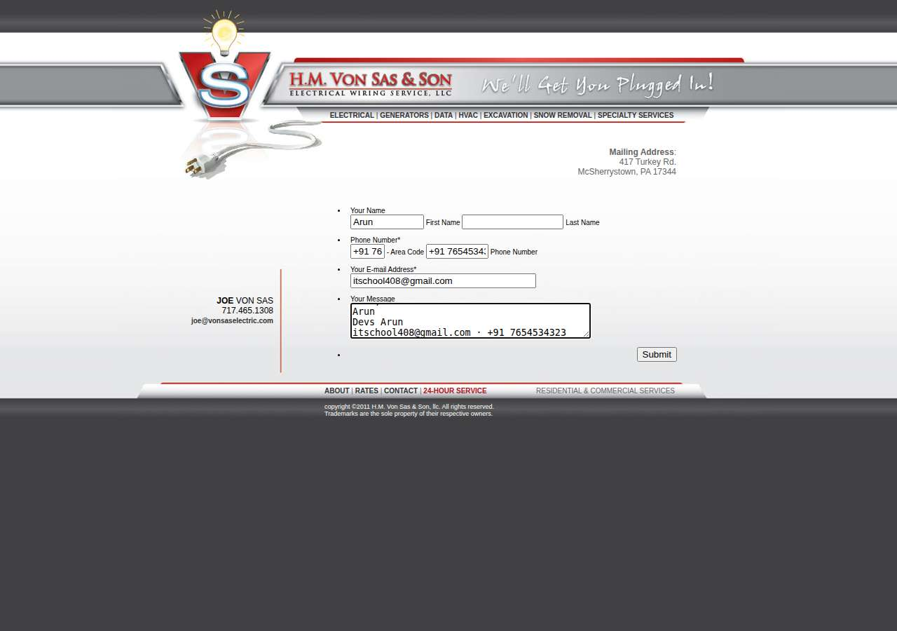

**After submit** — `run-204b82d6_attempt-cd1d7ef6_post_attempt_2026-11-02T15-45-29-222Z.jpg`

### adamshvac.net — unclear (LIVE)

| | |
|---|---|
| Attempt ID | `a8e2c17c-312a-465f-8889-c9fd47f0db3c` |
| Form URL | https://www.adamshvac.net/contact-us |
| Final URL | https://www.adamshvac.net/contact-us |
| Reserved | 2026-11-02 15:45:36 UTC |
| Submit attempted | 2026-11-02 15:45:39 UTC |
| Template | standard v2 |
| Confirmation text | none observed |
| Result / error | No new success marker observed |

Exact message:

~~~text
Subject: Helping customers find your business in AI search (AEO + GEO)

Hi there,

I'm Arun from Devs Arun. More and more customers now ask ChatGPT, Gemini, Perplexity or Google's AI Overviews questions like "who should I hire for this in my area?" before they call anyone. These tools answer from websites they can clearly understand, and they tend to recommend businesses whose pages answer real customer questions.

That is what AEO + GEO (Answer Engine and Generative Engine Optimization) is for. I improve your existing service pages so they clearly answer the questions your customers ask, add structured data that matches the page, and make the call, quote or enquiry step obvious. The benefit: your business gets a better chance of being mentioned or linked in AI answers, and visitors who arrive find it easy to contact you.

The AEO + GEO Starter is a one-time $199 (about ₹16,999, negotiable) for one website: a basic audit, 10 customer questions, improvements to two existing pages, relevant structured data and an action plan, with one revision round.

You can read the full details, send an enquiry or book online here:
https://devsarun.io/aeo-geo/

If this isn't relevant, just reply and I won't contact you again.

Best,
Arun
Devs Arun
itschool408@gmail.com · +91 7654534323
~~~

Submitted field values:

- Email: \[email\]: itschool408@gmail.com
- Telephone: \[phone\]: +91 7654534323
- First Name: \[first\_name\]: Arun
- Nature of problem or additional comments: \[message\]: Hi there, I'm Arun from Devs Arun. More and more customers now ask ChatGPT, Gemini, Perplexity or Google's AI Overviews 
- If re-scheduling, please enter your confirmation \#: \[company\]: Devs Arun

**Filled form (before submit)** — `run-204b82d6_attempt-a8e2c17c_filled_2026-11-02T15-45-39-295Z.jpg`

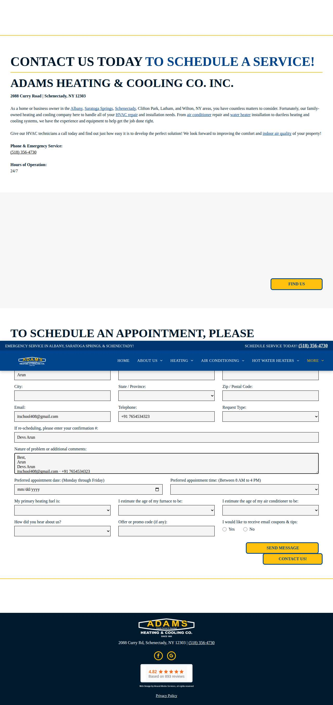

**After submit** — `run-204b82d6_attempt-a8e2c17c_post_attempt_2026-11-02T15-46-06-792Z.jpg`

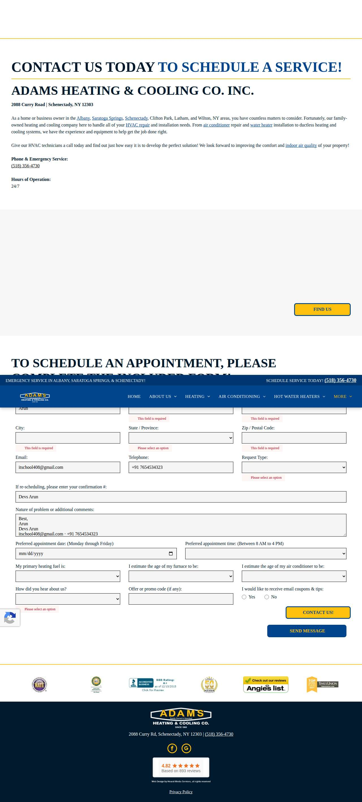

### totalairep.com — confirmed (LIVE)

| | |
|---|---|
| Attempt ID | `d95b695c-0f26-4453-9c3a-7a1b9ae59cb7` |
| Form URL | https://totalairep.com/contact |
| Final URL | https://totalairep.com/form-sent |
| Reserved | 2026-11-02 15:46:13 UTC |
| Submit attempted | 2026-11-02 15:46:16 UTC |
| Template | standard v2 |
| Confirmation text | & HEATING TOTAL COMFORT. TOTAL SAVINGS. TOTAL AIR\! The form has been sent Thank you for your time, feedback and especially your business. Sincerely, Brandon Brooks President |
| Result / error | — |

Exact message:

~~~text
Subject: Helping customers find your business in AI search (AEO + GEO)

Hi there,

I'm Arun from Devs Arun. More and more customers now ask ChatGPT, Gemini, Perplexity or Google's AI Overviews questions like "who should I hire for this in my area?" before they call anyone. These tools answer from websites they can clearly understand, and they tend to recommend businesses whose pages answer real customer questions.

That is what AEO + GEO (Answer Engine and Generative Engine Optimization) is for. I improve your existing service pages so they clearly answer the questions your customers ask, add structured data that matches the page, and make the call, quote or enquiry step obvious. The benefit: your business gets a better chance of being mentioned or linked in AI answers, and visitors who arrive find it easy to contact you.

The AEO + GEO Starter is a one-time $199 (about ₹16,999, negotiable) for one website: a basic audit, 10 customer questions, improvements to two existing pages, relevant structured data and an action plan, with one revision round.

You can read the full details, send an enquiry or book online here:
https://devsarun.io/aeo-geo/

If this isn't relevant, just reply and I won't contact you again.

Best,
Arun
Devs Arun
itschool408@gmail.com · +91 7654534323
~~~

Submitted field values:

- name \[name\]: Arun
- phone \[phone\]: +91 7654534323
- review \[message\]: Hi there, I'm Arun from Devs Arun. More and more customers now ask ChatGPT, Gemini, Perplexity or Google's AI Overviews 
- contactemail \[email\]: itschool408@gmail.com

**Filled form (before submit)** — `run-204b82d6_attempt-d95b695c_filled_2026-11-02T15-46-16-114Z.jpg`

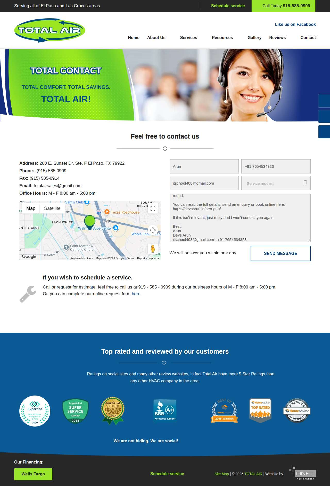

**After submit** — `run-204b82d6_attempt-d95b695c_post_attempt_2026-11-02T15-46-19-685Z.jpg`

### ambientairsolutions.com — error\_after\_submit (LIVE)

| | |
|---|---|
| Attempt ID | `5966e20f-e853-4f47-afda-e854847fee80` |
| Form URL | https://www.ambientairsolutions.com/contact/send-a-message |
| Final URL | https://www.ambientairsolutions.com/contact/send-a-message\#error-container |
| Reserved | 2026-11-02 15:46:26 UTC |
| Submit attempted | 2026-11-02 15:46:29 UTC |
| Template | standard v2 |
| Confirmation text | Skip navigation The Following Errors Occurred Please enter your last name Please enter your city Please let us know the best way to contact you Please enter a |
| Result / error | — |

Exact message:

~~~text
Subject: Helping customers find your business in AI search (AEO + GEO)

Hi there,

I'm Arun from Devs Arun. More and more customers now ask ChatGPT, Gemini, Perplexity or Google's AI Overviews questions like "who should I hire for this in my area?" before they call anyone. These tools answer from websites they can clearly understand, and they tend to recommend businesses whose pages answer real customer questions.

That is what AEO + GEO (Answer Engine and Generative Engine Optimization) is for. I improve your existing service pages so they clearly answer the questions your customers ask, add structured data that matches the page, and make the call, quote or enquiry step obvious. The benefit: your business gets a better chance of being mentioned or linked in AI answers, and visitors who arrive find it easy to contact you.

The AEO + GEO Starter is a one-time $199 (about ₹16,999, negotiable) for one website: a basic audit, 10 customer questions, improvements to two existing pages, relevant structured data and an action plan, with one revision round.

You can read the full details, send an enquiry or book online here:
https://devsarun.io/aeo-geo/

If this isn't relevant, just reply and I won't contact you again.

Best,
Arun
Devs Arun
itschool408@gmail.com · +91 7654534323
~~~

Submitted field values:

- Comments \* \[message\]: Hi there, I'm Arun from Devs Arun. More and more customers now ask ChatGPT, Gemini, Perplexity or Google's AI Overviews 
- Phone Number \* \[phone\]: +91 7654534323
- Email Address \* \[email\]: itschool408@gmail.com
- First Name \* \[first\_name\]: Arun

**Filled form (before submit)** — `run-204b82d6_attempt-5966e20f_filled_2026-11-02T15-46-29-851Z.jpg`

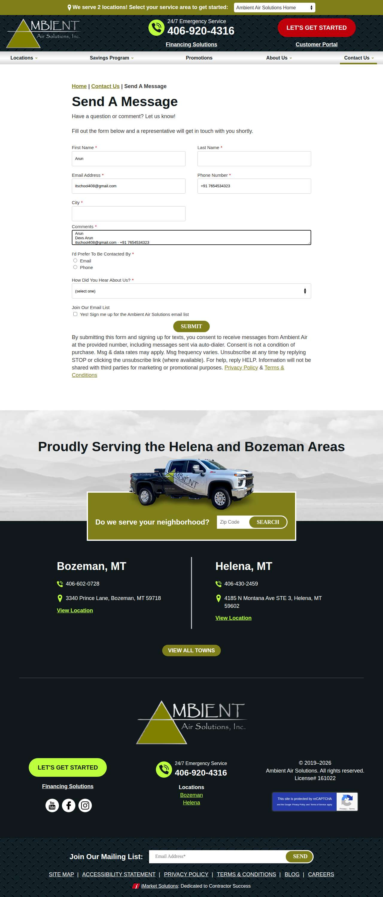

**After submit** — `run-204b82d6_attempt-5966e20f_post_attempt_2026-11-02T15-46-33-456Z.jpg`

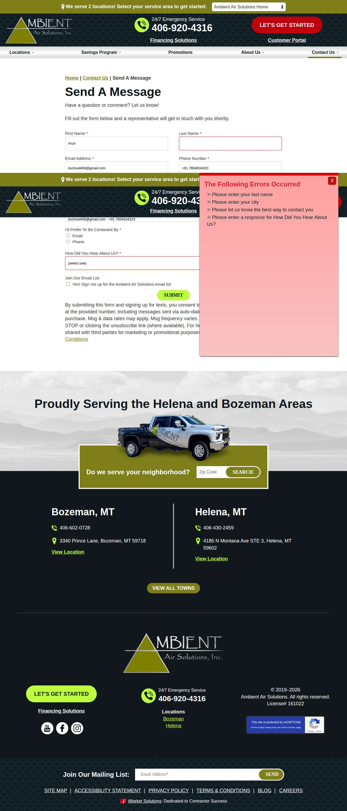

### earlbryant.com — failed\_before\_submit (LIVE)

| | |
|---|---|
| Attempt ID | `da4fbfcc-e9b0-49b8-87bf-35b57758369d` |
| Form URL | https://www.earlbryant.com/contact-3 |
| Final URL | https://www.earlbryant.com/contact-3 |
| Reserved | 2026-11-02 15:46:40 UTC |
| Submit attempted | — |
| Template | standard v2 |
| Confirmation text | none observed |
| Result / error | Form validation would block sending: phone: Please enter between 4 to 17 digits. You can include hyphens (-) or start with a (+), e.g., 555-123-4567 or +(222)987654321. |

Exact message:

~~~text
Subject: Helping customers find your business in AI search (AEO + GEO)

Hi there,

I'm Arun from Devs Arun. More and more customers now ask ChatGPT, Gemini, Perplexity or Google's AI Overviews questions like "who should I hire for this in my area?" before they call anyone. These tools answer from websites they can clearly understand, and they tend to recommend businesses whose pages answer real customer questions.

That is what AEO + GEO (Answer Engine and Generative Engine Optimization) is for. I improve your existing service pages so they clearly answer the questions your customers ask, add structured data that matches the page, and make the call, quote or enquiry step obvious. The benefit: your business gets a better chance of being mentioned or linked in AI answers, and visitors who arrive find it easy to contact you.

The AEO + GEO Starter is a one-time $199 (about ₹16,999, negotiable) for one website: a basic audit, 10 customer questions, improvements to two existing pages, relevant structured data and an action plan, with one revision round.

You can read the full details, send an enquiry or book online here:
https://devsarun.io/aeo-geo/

If this isn't relevant, just reply and I won't contact you again.

Best,
Arun
Devs Arun
itschool408@gmail.com · +91 7654534323
~~~

Submitted field values:

- \#input\_comp-ktio3y9m: Arun
- \#input\_comp-kydg6s0x: +91 7654534323
- \#input\_comp-ktio3y9v1: itschool408@gmail.com
- \#textarea\_comp-ktio3y9y: Hi there, I'm Arun from Devs Arun. More and more customers now ask ChatGPT, Gemini, Perplexity or Google's AI Overviews 

**Filled form (before submit)** — `run-204b82d6_attempt-da4fbfcc_filled_2026-11-02T15-46-43-822Z.jpg`

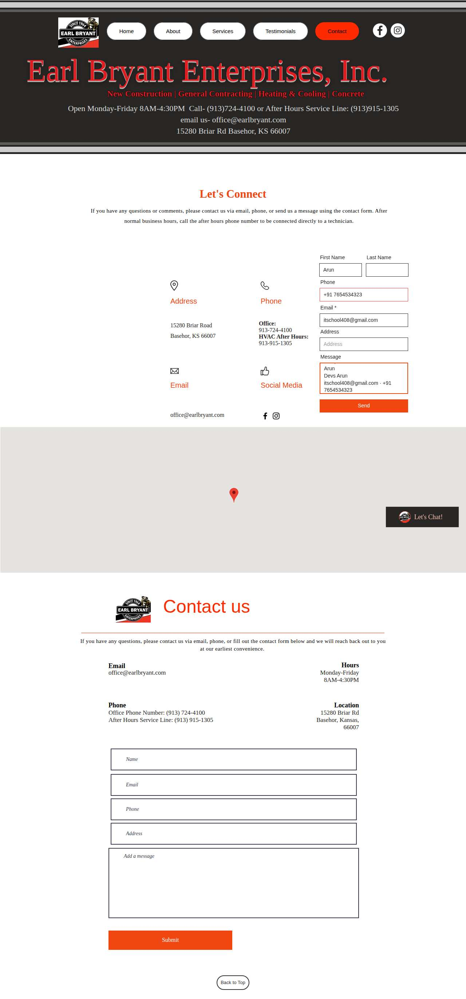

### hvacconceptswi.com — unclear (LIVE)

| | |
|---|---|
| Attempt ID | `0f962ecd-9955-4e35-9133-af1feb4c0d33` |
| Form URL | https://www.hvacconceptswi.com/blank-2 |
| Final URL | https://www.hvacconceptswi.com/blank-2 |
| Reserved | 2026-11-02 15:46:48 UTC |
| Submit attempted | 2026-11-02 15:46:50 UTC |
| Template | standard v2 |
| Confirmation text | none observed |
| Result / error | No new success marker observed |

Exact message:

~~~text
Subject: Helping customers find your business in AI search (AEO + GEO)

Hi there,

I'm Arun from Devs Arun. More and more customers now ask ChatGPT, Gemini, Perplexity or Google's AI Overviews questions like "who should I hire for this in my area?" before they call anyone. These tools answer from websites they can clearly understand, and they tend to recommend businesses whose pages answer real customer questions.

That is what AEO + GEO (Answer Engine and Generative Engine Optimization) is for. I improve your existing service pages so they clearly answer the questions your customers ask, add structured data that matches the page, and make the call, quote or enquiry step obvious. The benefit: your business gets a better chance of being mentioned or linked in AI answers, and visitors who arrive find it easy to contact you.

The AEO + GEO Starter is a one-time $199 (about ₹16,999, negotiable) for one website: a basic audit, 10 customer questions, improvements to two existing pages, relevant structured data and an action plan, with one revision round.

You can read the full details, send an enquiry or book online here:
https://devsarun.io/aeo-geo/

If this isn't relevant, just reply and I won't contact you again.

Best,
Arun
Devs Arun
itschool408@gmail.com · +91 7654534323
~~~

Submitted field values:

- name \[name\]: Arun
- email \[email\]: itschool408@gmail.com
- contact-number \[phone\]: +91 7654534323
- Let us know how we can be of service... \[message\]: Hi there, I'm Arun from Devs Arun. More and more customers now ask ChatGPT, Gemini, Perplexity or Google's AI Overviews 

**Filled form (before submit)** — `run-204b82d6_attempt-0f962ecd_filled_2026-11-02T15-46-50-933Z.jpg`

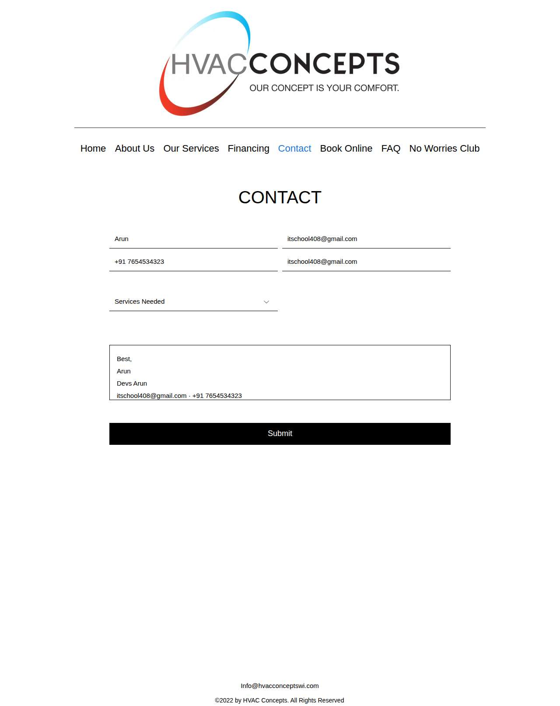

**After submit** — `run-204b82d6_attempt-0f962ecd_post_attempt_2026-11-02T15-47-18-348Z.jpg`

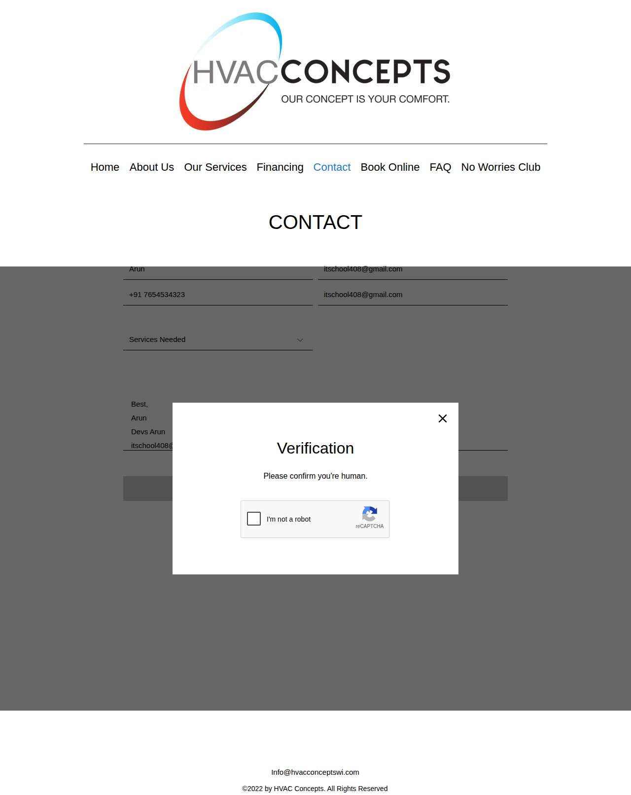

### rangerhvacusa.com — unclear (LIVE)

| | |
|---|---|
| Attempt ID | `6354aae2-9236-41c3-acb9-a671977b9a8a` |
| Form URL | https://rangerhvacusa.com/contact-us/ |
| Final URL | https://rangerhvacusa.com/contact-us/ |
| Reserved | 2026-11-02 15:47:25 UTC |
| Submit attempted | 2026-11-02 15:47:30 UTC |
| Template | standard v2 |
| Confirmation text | none observed |
| Result / error | No new success marker observed |

Exact message:

~~~text
Subject: Helping customers find your business in AI search (AEO + GEO)

Hi there,

I'm Arun from Devs Arun. More and more customers now ask ChatGPT, Gemini, Perplexity or Google's AI Overviews questions like "who should I hire for this in my area?" before they call anyone. These tools answer from websites they can clearly understand, and they tend to recommend businesses whose pages answer real customer questions.

That is what AEO + GEO (Answer Engine and Generative Engine Optimization) is for. I improve your existing service pages so they clearly answer the questions your customers ask, add structured data that matches the page, and make the call, quote or enquiry step obvious. The benefit: your business gets a better chance of being mentioned or linked in AI answers, and visitors who arrive find it easy to contact you.

The AEO + GEO Starter is a one-time $199 (about ₹16,999, negotiable) for one website: a basic audit, 10 customer questions, improvements to two existing pages, relevant structured data and an action plan, with one revision round.

You can read the full details, send an enquiry or book online here:
https://devsarun.io/aeo-geo/

If this isn't relevant, just reply and I won't contact you again.

Best,
Arun
Devs Arun
itschool408@gmail.com · +91 7654534323
~~~

Submitted field values:

- Your\_Name \[name\]: Arun
- Your\_email \[email\]: itschool408@gmail.com
- Phone\_Number \[phone\]: +91 7654534323
- mf-subject \[subject\]: Helping customers find your business in AI search (AEO + GEO)
- Your\_Message \[message\]: Hi there, I'm Arun from Devs Arun. More and more customers now ask ChatGPT, Gemini, Perplexity or Google's AI Overviews 

**Filled form (before submit)** — `run-204b82d6_attempt-6354aae2_filled_2026-11-02T15-47-30-023Z.jpg`

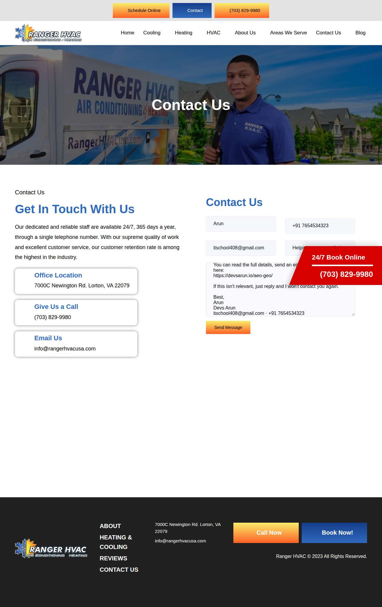

**After submit** — `run-204b82d6_attempt-6354aae2_post_attempt_2026-11-02T15-47-57-362Z.jpg`

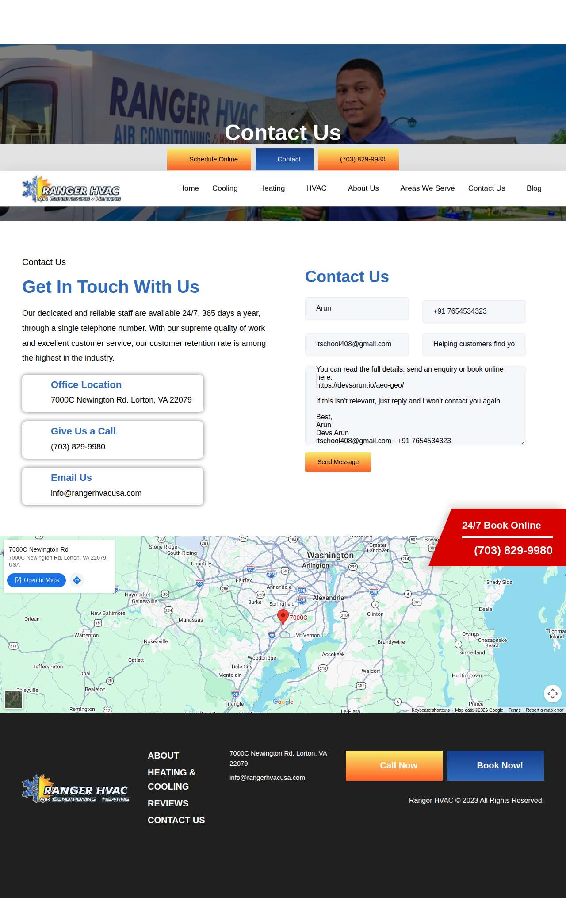

### pamlicoair.com — unclear (LIVE)

| | |
|---|---|
| Attempt ID | `32fc472b-4027-4af8-b490-cb9905801467` |
| Form URL | https://www.pamlicoair.com/about |
| Final URL | https://www.pamlicoair.com/about |
| Reserved | 2026-11-02 15:48:04 UTC |
| Submit attempted | 2026-11-02 15:48:07 UTC |
| Template | standard v2 |
| Confirmation text | none observed |
| Result / error | No new success marker observed |

Exact message:

~~~text
Subject: Helping customers find your business in AI search (AEO + GEO)

Hi there,

I'm Arun from Devs Arun. More and more customers now ask ChatGPT, Gemini, Perplexity or Google's AI Overviews questions like "who should I hire for this in my area?" before they call anyone. These tools answer from websites they can clearly understand, and they tend to recommend businesses whose pages answer real customer questions.

That is what AEO + GEO (Answer Engine and Generative Engine Optimization) is for. I improve your existing service pages so they clearly answer the questions your customers ask, add structured data that matches the page, and make the call, quote or enquiry step obvious. The benefit: your business gets a better chance of being mentioned or linked in AI answers, and visitors who arrive find it easy to contact you.

The AEO + GEO Starter is a one-time $199 (about ₹16,999, negotiable) for one website: a basic audit, 10 customer questions, improvements to two existing pages, relevant structured data and an action plan, with one revision round.

You can read the full details, send an enquiry or book online here:
https://devsarun.io/aeo-geo/

If this isn't relevant, just reply and I won't contact you again.

Best,
Arun
Devs Arun
itschool408@gmail.com · +91 7654534323
~~~

Submitted field values:

- name \[name\]: Arun
- email \[email\]: itschool408@gmail.com
- Message \[message\]: Hi there, I'm Arun from Devs Arun. More and more customers now ask ChatGPT, Gemini, Perplexity or Google's AI Overviews 
- subject \[subject\]: Helping customers find your business in AI search (AEO + GEO)

**Filled form (before submit)** — `run-204b82d6_attempt-32fc472b_filled_2026-11-02T15-48-07-348Z.jpg`

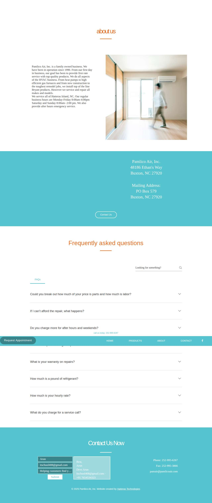

**After submit** — `run-204b82d6_attempt-32fc472b_post_attempt_2026-11-02T15-48-34-920Z.jpg`

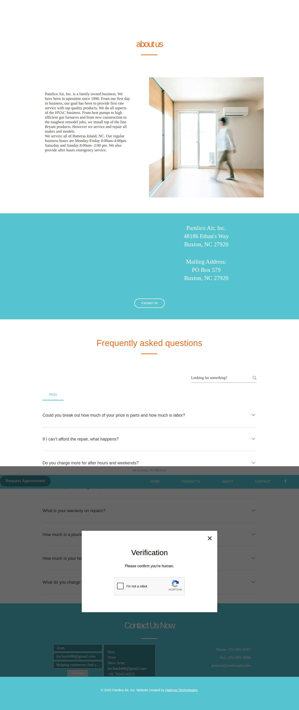

### rockspringhvacr.com — confirmed (LIVE)

| | |
|---|---|
| Attempt ID | `97605748-229c-45c9-8e8b-9e617b29af9a` |
| Form URL | https://rockspringhvacr.com/contact-us |
| Final URL | https://rockspringhvacr.com/contact-us/thanks |
| Reserved | 2026-11-02 15:48:41 UTC |
| Submit attempted | 2026-11-02 15:48:43 UTC |
| Template | standard v2 |
| Confirmation text | s Residential Services Ask the Expert Industries Contact Us Thank you for contacting Rock Spring Heating and Cooling. We will reply as soon as possible. Go back to the homepage Contact |
| Result / error | — |

Exact message:

~~~text
Subject: Helping customers find your business in AI search (AEO + GEO)

Hi there,

I'm Arun from Devs Arun. More and more customers now ask ChatGPT, Gemini, Perplexity or Google's AI Overviews questions like "who should I hire for this in my area?" before they call anyone. These tools answer from websites they can clearly understand, and they tend to recommend businesses whose pages answer real customer questions.

That is what AEO + GEO (Answer Engine and Generative Engine Optimization) is for. I improve your existing service pages so they clearly answer the questions your customers ask, add structured data that matches the page, and make the call, quote or enquiry step obvious. The benefit: your business gets a better chance of being mentioned or linked in AI answers, and visitors who arrive find it easy to contact you.

The AEO + GEO Starter is a one-time $199 (about ₹16,999, negotiable) for one website: a basic audit, 10 customer questions, improvements to two existing pages, relevant structured data and an action plan, with one revision round.

You can read the full details, send an enquiry or book online here:
https://devsarun.io/aeo-geo/

If this isn't relevant, just reply and I won't contact you again.

Best,
Arun
Devs Arun
itschool408@gmail.com · +91 7654534323
~~~

Submitted field values:

- Name \[name\]: Arun
- Email \[email\]: itschool408@gmail.com
- Message \[message\]: Hi there, I'm Arun from Devs Arun. More and more customers now ask ChatGPT, Gemini, Perplexity or Google's AI Overviews 
- Subject \[subject\]: Helping customers find your business in AI search (AEO + GEO)

**Filled form (before submit)** — `run-204b82d6_attempt-97605748_filled_2026-11-02T15-48-43-852Z.jpg`

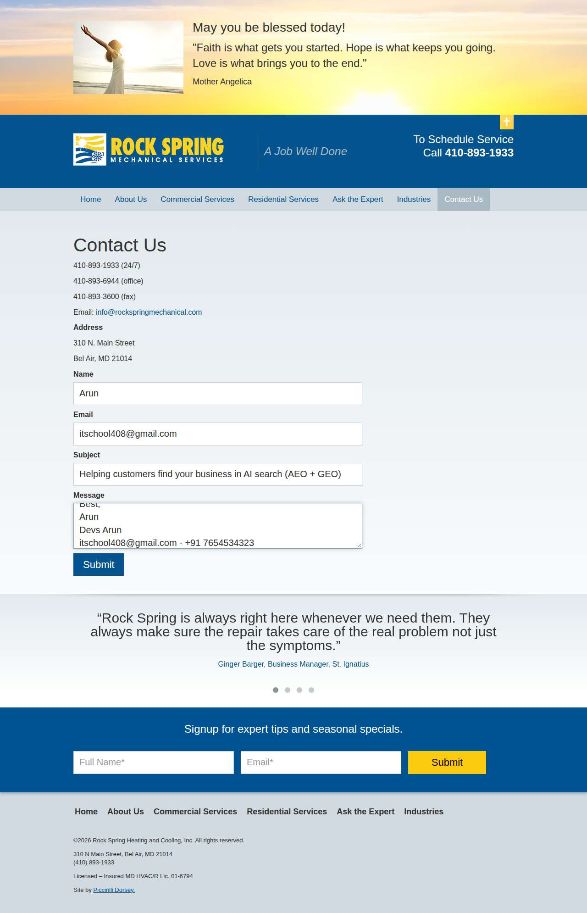

**After submit** — `run-204b82d6_attempt-97605748_post_attempt_2026-11-02T15-48-49-229Z.jpg`

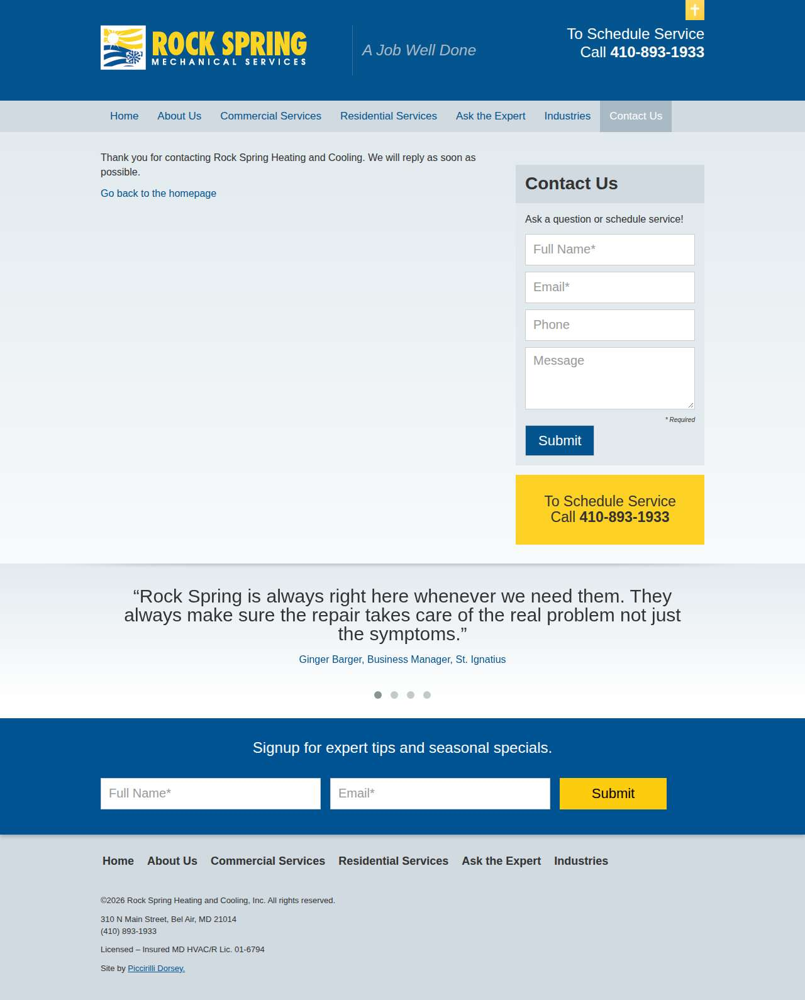

### callfalcone.com — confirmed (LIVE)

| | |
|---|---|
| Attempt ID | `72c6b70d-a6f1-4e06-9caa-e59d90e1d81c` |
| Form URL | https://callfalcone.com/contact-us/ |
| Final URL | https://callfalcone.com/contact-us/ |
| Reserved | 2026-11-02 15:48:56 UTC |
| Submit attempted | 2026-11-02 15:49:00 UTC |
| Template | standard v2 |
| Confirmation text | CALL US NOW CONTACT INFORMATION Don’t Hesitate To Say Hello Thank you for your message. We will get in touch with you shortly Home About Service FAQ Testimonial Contact Privacy Policy Ge |
| Result / error | — |

Exact message:

~~~text
Subject: Helping customers find your business in AI search (AEO + GEO)

Hi there,

I'm Arun from Devs Arun. More and more customers now ask ChatGPT, Gemini, Perplexity or Google's AI Overviews questions like "who should I hire for this in my area?" before they call anyone. These tools answer from websites they can clearly understand, and they tend to recommend businesses whose pages answer real customer questions.

That is what AEO + GEO (Answer Engine and Generative Engine Optimization) is for. I improve your existing service pages so they clearly answer the questions your customers ask, add structured data that matches the page, and make the call, quote or enquiry step obvious. The benefit: your business gets a better chance of being mentioned or linked in AI answers, and visitors who arrive find it easy to contact you.

The AEO + GEO Starter is a one-time $199 (about ₹16,999, negotiable) for one website: a basic audit, 10 customer questions, improvements to two existing pages, relevant structured data and an action plan, with one revision round.

You can read the full details, send an enquiry or book online here:
https://devsarun.io/aeo-geo/

If this isn't relevant, just reply and I won't contact you again.

Best,
Arun
Devs Arun
itschool408@gmail.com · +91 7654534323
~~~

Submitted field values:

- Email \[email\]: itschool408@gmail.com
- Subject \[subject\]: Helping customers find your business in AI search (AEO + GEO)
- Your Message \[message\]: Hi there, I'm Arun from Devs Arun. More and more customers now ask ChatGPT, Gemini, Perplexity or Google's AI Overviews 
- First Name \[first\_name\]: Arun

**Filled form (before submit)** — `run-204b82d6_attempt-72c6b70d_filled_2026-11-02T15-49-00-703Z.jpg`

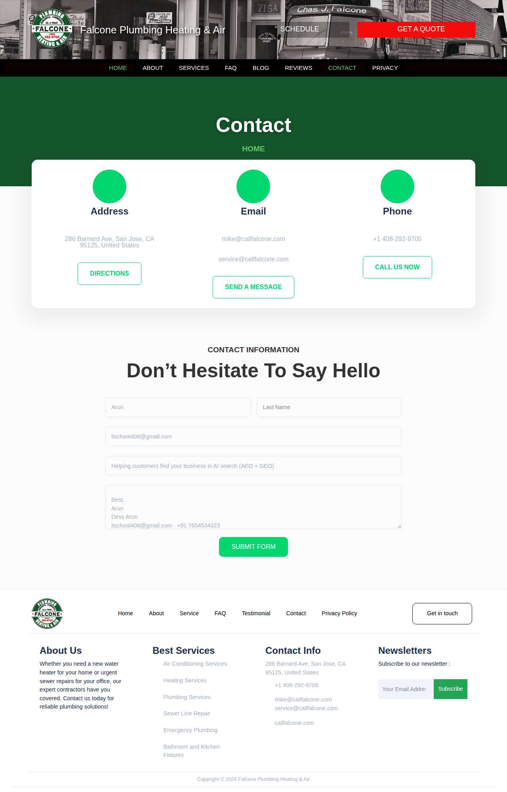

**After submit** — `run-204b82d6_attempt-72c6b70d_post_attempt_2026-11-02T15-49-10-749Z.jpg`

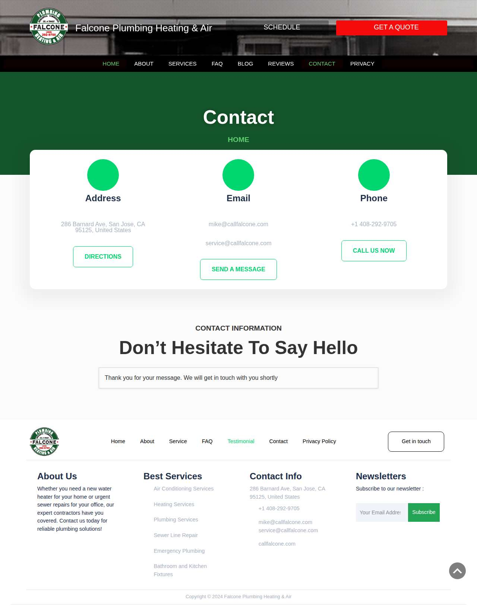

### hvacpremium.com — confirmed (LIVE)

| | |
|---|---|
| Attempt ID | `d8a6a870-5b74-4143-96c6-fe9b2169569c` |
| Form URL | https://hvacpremium.com/pages/contact-hvac-premium |
| Final URL | https://hvacpremium.com/pages/contact-hvac-premium |
| Reserved | 2026-11-02 15:49:17 UTC |
| Submit attempted | 2026-11-02 15:49:23 UTC |
| Template | standard v2 |
| Confirmation text | help\! Please call, email, or fill out our contact form, and we'll be in touch shortly. MILLIONS OF CUSTOMERS SERVED\! CALL US 1-888-404-HVAC (4822) CHAT WITH US Monday to Friday: |
| Result / error | — |

Exact message:

~~~text
Subject: Helping customers find your business in AI search (AEO + GEO)

Hi there,

I'm Arun from Devs Arun. More and more customers now ask ChatGPT, Gemini, Perplexity or Google's AI Overviews questions like "who should I hire for this in my area?" before they call anyone. These tools answer from websites they can clearly understand, and they tend to recommend businesses whose pages answer real customer questions.

That is what AEO + GEO (Answer Engine and Generative Engine Optimization) is for. I improve your existing service pages so they clearly answer the questions your customers ask, add structured data that matches the page, and make the call, quote or enquiry step obvious. The benefit: your business gets a better chance of being mentioned or linked in AI answers, and visitors who arrive find it easy to contact you.

The AEO + GEO Starter is a one-time $199 (about ₹16,999, negotiable) for one website: a basic audit, 10 customer questions, improvements to two existing pages, relevant structured data and an action plan, with one revision round.

You can read the full details, send an enquiry or book online here:
https://devsarun.io/aeo-geo/

If this isn't relevant, just reply and I won't contact you again.

Best,
Arun
Devs Arun
itschool408@gmail.com · +91 7654534323
~~~

Submitted field values:

- Email \* \[email\]: itschool408@gmail.com
- Your Name \* \[name\]: Arun
- Message \* \[message\]: Hi there, I'm Arun from Devs Arun. More and more customers now ask ChatGPT, Gemini, Perplexity or Google's AI Overviews 

**Filled form (before submit)** — `run-204b82d6_attempt-d8a6a870_filled_2026-11-02T15-49-23-833Z.jpg`

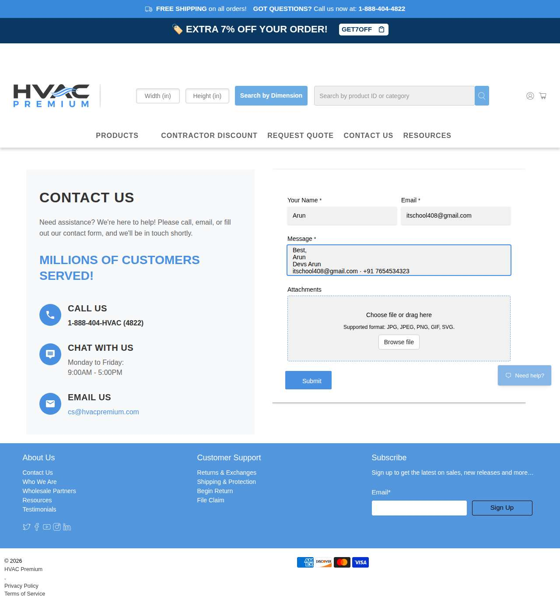

**After submit** — `run-204b82d6_attempt-d8a6a870_post_attempt_2026-11-02T15-49-34-099Z.jpg`

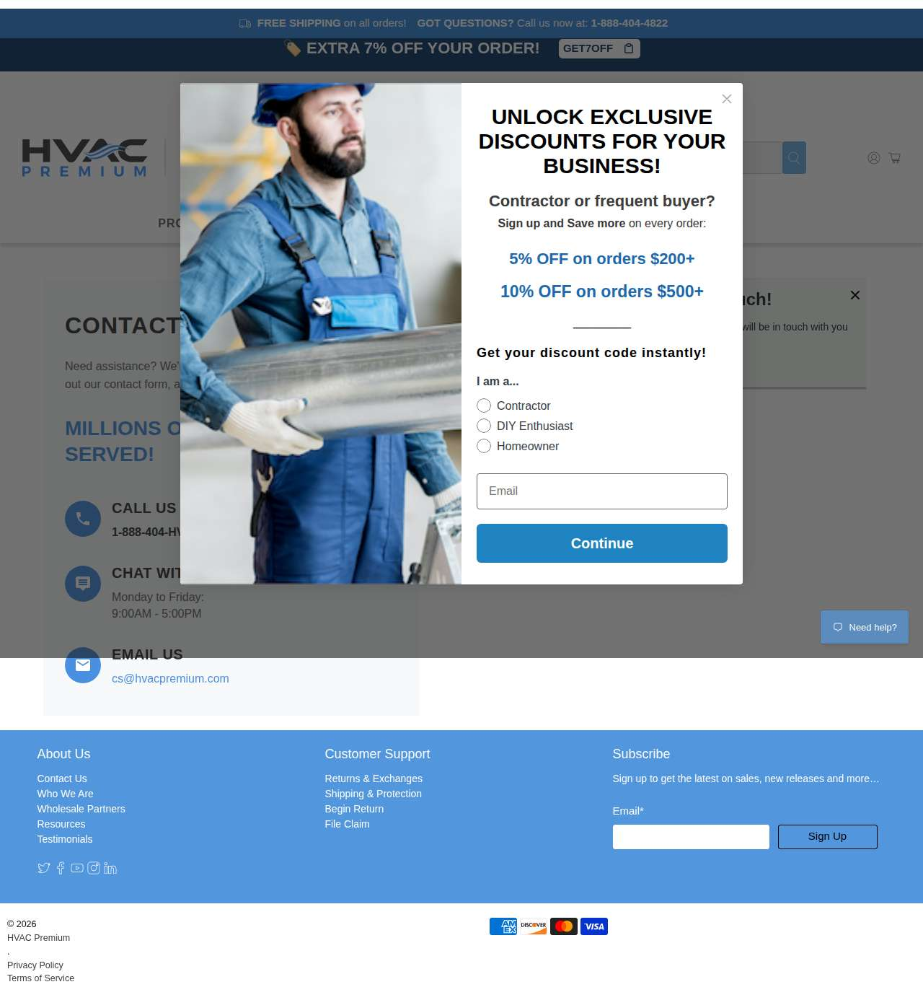

### phoenixaircontrol.com — unclear (LIVE)

| | |
|---|---|
| Attempt ID | `6c37885b-988e-4d15-a490-a349aec1bebf` |
| Form URL | https://phoenixaircontrol.com/contact.htm |
| Final URL | https://phoenixaircontrol.com/\_derived/nortbots.htm |
| Reserved | 2026-11-02 15:49:42 UTC |
| Submit attempted | 2026-11-02 15:49:43 UTC |
| Template | standard v2 |
| Confirmation text | none observed |
| Result / error | No new success marker observed |

Exact message:

~~~text
Subject: Helping customers find your business in AI search (AEO + GEO)

Hi there,

I'm Arun from Devs Arun. More and more customers now ask ChatGPT, Gemini, Perplexity or Google's AI Overviews questions like "who should I hire for this in my area?" before they call anyone. These tools answer from websites they can clearly understand, and they tend to recommend businesses whose pages answer real customer questions.

That is what AEO + GEO (Answer Engine and Generative Engine Optimization) is for. I improve your existing service pages so they clearly answer the questions your customers ask, add structured data that matches the page, and make the call, quote or enquiry step obvious. The benefit: your business gets a better chance of being mentioned or linked in AI answers, and visitors who arrive find it easy to contact you.

The AEO + GEO Starter is a one-time $199 (about ₹16,999, negotiable) for one website: a basic audit, 10 customer questions, improvements to two existing pages, relevant structured data and an action plan, with one revision round.

You can read the full details, send an enquiry or book online here:
https://devsarun.io/aeo-geo/

If this isn't relevant, just reply and I won't contact you again.

Best,
Arun
Devs Arun
itschool408@gmail.com · +91 7654534323
~~~

Submitted field values:

- Name \[name\]: Arun
- Email \[email\]: itschool408@gmail.com
- Phone \[phone\]: +91 7654534323
- Company \[company\]: Devs Arun
- Comments: \[message\]: Hi there, I'm Arun from Devs Arun. More and more customers now ask ChatGPT, Gemini, Perplexity or Google's AI Overviews 

**Filled form (before submit)** — `run-204b82d6_attempt-6c37885b_filled_2026-11-02T15-49-43-232Z.jpg`

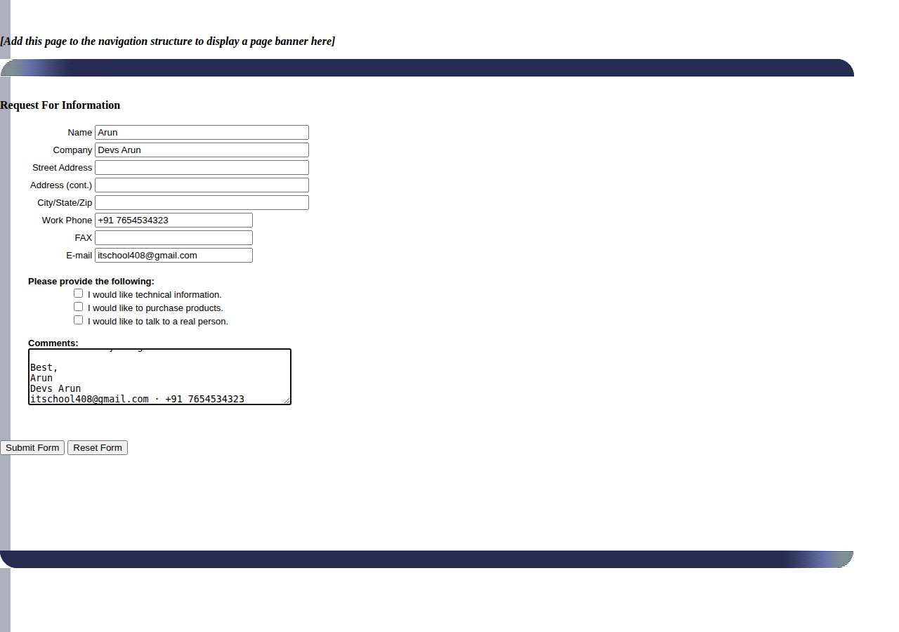

**After submit** — `run-204b82d6_attempt-6c37885b_post_attempt_2026-11-02T15-50-11-012Z.jpg`

### future-connections.com — unclear (LIVE)

| | |
|---|---|
| Attempt ID | `2057e7c6-315d-458e-966d-ec30f57cb8d0` |
| Form URL | https://www.future-connections.com/contact/ |
| Final URL | https://www.future-connections.com/contact/ |
| Reserved | 2026-11-02 15:50:18 UTC |
| Submit attempted | 2026-11-02 15:50:19 UTC |
| Template | standard v2 |
| Confirmation text | none observed |
| Result / error | No new success marker observed |

Exact message:

~~~text
Subject: Helping customers find your business in AI search (AEO + GEO)

Hi there,

I'm Arun from Devs Arun. More and more customers now ask ChatGPT, Gemini, Perplexity or Google's AI Overviews questions like "who should I hire for this in my area?" before they call anyone. These tools answer from websites they can clearly understand, and they tend to recommend businesses whose pages answer real customer questions.

That is what AEO + GEO (Answer Engine and Generative Engine Optimization) is for. I improve your existing service pages so they clearly answer the questions your customers ask, add structured data that matches the page, and make the call, quote or enquiry step obvious. The benefit: your business gets a better chance of being mentioned or linked in AI answers, and visitors who arrive find it easy to contact you.

The AEO + GEO Starter is a one-time $199 (about ₹16,999, negotiable) for one website: a basic audit, 10 customer questions, improvements to two existing pages, relevant structured data and an action plan, with one revision round.

You can read the full details, send an enquiry or book online here:
https://devsarun.io/aeo-geo/

If this isn't relevant, just reply and I won't contact you again.

Best,
Arun
Devs Arun
itschool408@gmail.com · +91 7654534323
~~~

Submitted field values:

- Your Name\* \[name\]: Arun
- Phone Number\* \[phone\]: +91 7654534323
- Email Address\* \[email\]: itschool408@gmail.com
- Description of Service Needed \[message\]: Hi there, I'm Arun from Devs Arun. More and more customers now ask ChatGPT, Gemini, Perplexity or Google's AI Overviews 

**Filled form (before submit)** — `run-204b82d6_attempt-2057e7c6_filled_2026-11-02T15-50-19-763Z.jpg`

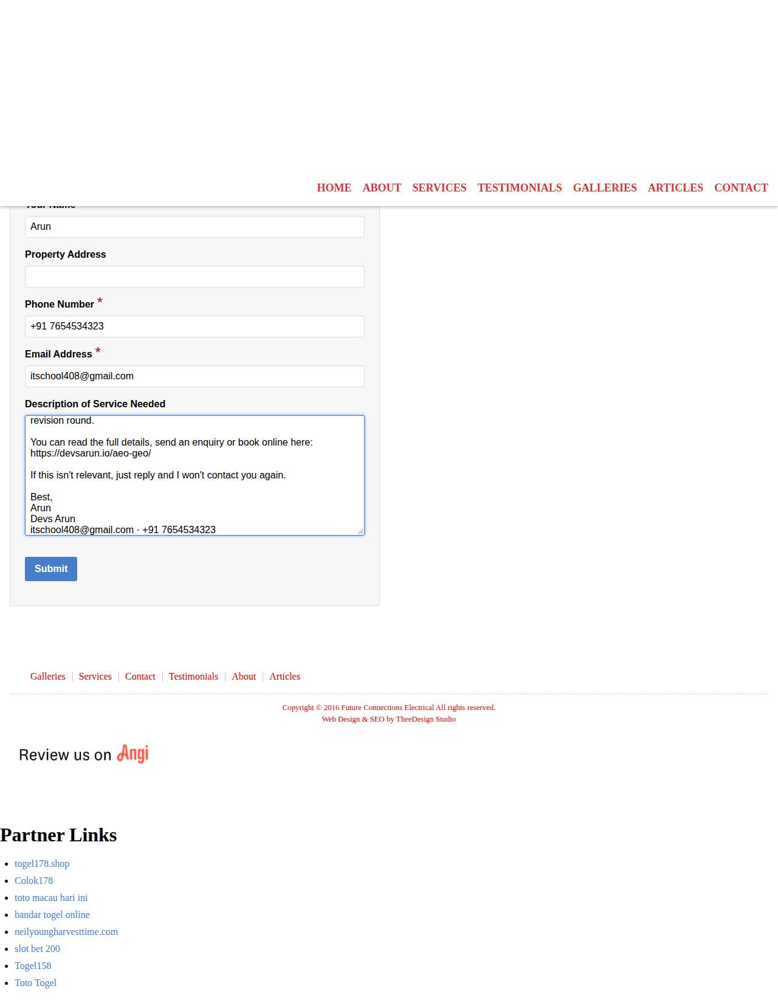

**After submit** — `run-204b82d6_attempt-2057e7c6_post_attempt_2026-11-02T15-50-47-196Z.jpg`

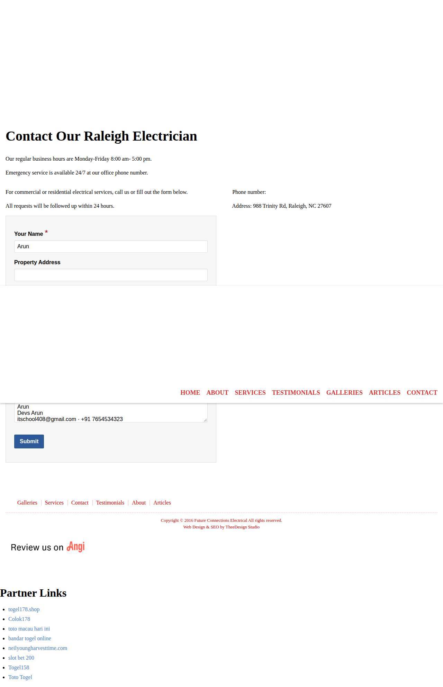

### curtiselectricny.com — confirmed (LIVE)

| | |
|---|---|
| Attempt ID | `8ab8b737-4889-4037-a509-04fc8f15ee2b` |
| Form URL | https://rankwellweb.net/contact |
| Final URL | https://rankwellweb.net/contact |
| Reserved | 2026-11-02 15:50:54 UTC |
| Submit attempted | 2026-11-02 15:50:56 UTC |
| Template | standard v2 |
| Confirmation text | vices today. Your Name Email Address\* Message\* Send Message Thanks for reaching out\! Our Location Serving Westchester County and New York City with trusted electrical expertise. Addre |
| Result / error | — |

Exact message:

~~~text
Subject: Helping customers find your business in AI search (AEO + GEO)

Hi there,

I'm Arun from Devs Arun. More and more customers now ask ChatGPT, Gemini, Perplexity or Google's AI Overviews questions like "who should I hire for this in my area?" before they call anyone. These tools answer from websites they can clearly understand, and they tend to recommend businesses whose pages answer real customer questions.

That is what AEO + GEO (Answer Engine and Generative Engine Optimization) is for. I improve your existing service pages so they clearly answer the questions your customers ask, add structured data that matches the page, and make the call, quote or enquiry step obvious. The benefit: your business gets a better chance of being mentioned or linked in AI answers, and visitors who arrive find it easy to contact you.

The AEO + GEO Starter is a one-time $199 (about ₹16,999, negotiable) for one website: a basic audit, 10 customer questions, improvements to two existing pages, relevant structured data and an action plan, with one revision round.

You can read the full details, send an enquiry or book online here:
https://devsarun.io/aeo-geo/

If this isn't relevant, just reply and I won't contact you again.

Best,
Arun
Devs Arun
itschool408@gmail.com · +91 7654534323
~~~

Submitted field values:

- Your Name \[name\]: Arun
- Message\* \[message\]: Hi there, I'm Arun from Devs Arun. More and more customers now ask ChatGPT, Gemini, Perplexity or Google's AI Overviews 
- Email Address\* \[email\]: itschool408@gmail.com

**Filled form (before submit)** — `run-204b82d6_attempt-8ab8b737_filled_2026-11-02T15-50-56-689Z.jpg`

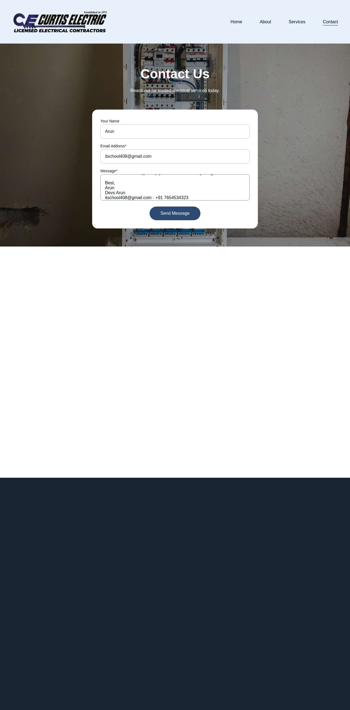

**After submit** — `run-204b82d6_attempt-8ab8b737_post_attempt_2026-11-02T15-50-59-861Z.jpg`

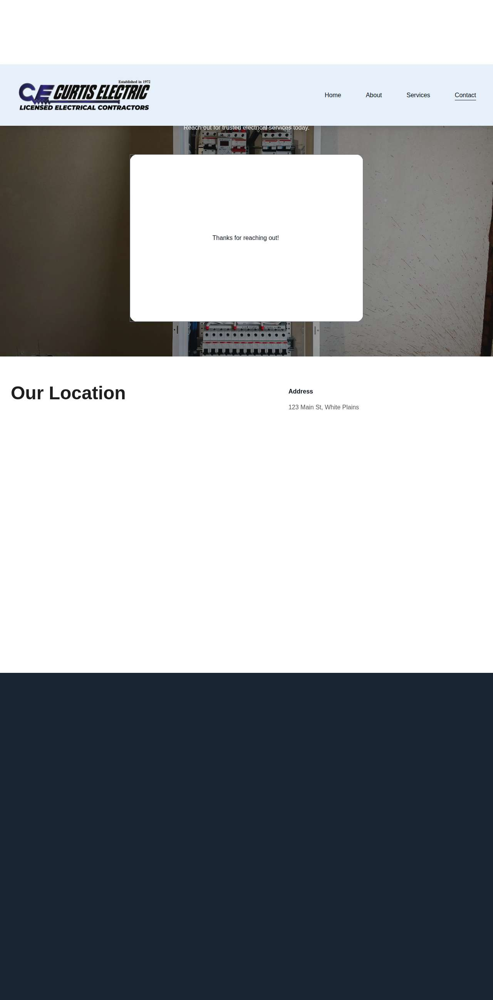

### cochraninc.com — confirmed (LIVE)

| | |
|---|---|
| Attempt ID | `20f205f4-c847-427c-8bf5-074ac688d7f5` |
| Form URL | https://www.cochraninc.com/contact/ |
| Final URL | https://www.cochraninc.com/contact/ |
| Reserved | 2026-11-02 15:51:07 UTC |
| Submit attempted | 2026-11-02 15:51:11 UTC |
| Template | standard v2 |
| Confirmation text | vely, feel free to email us at partnerships@cochraninc.com. Submission successful Thank you for your message. We'll get to work on a response right away. Explore our projects Send a |
| Result / error | — |

Exact message:

~~~text
Subject: Helping customers find your business in AI search (AEO + GEO)

Hi there,

I'm Arun from Devs Arun. More and more customers now ask ChatGPT, Gemini, Perplexity or Google's AI Overviews questions like "who should I hire for this in my area?" before they call anyone. These tools answer from websites they can clearly understand, and they tend to recommend businesses whose pages answer real customer questions.

That is what AEO + GEO (Answer Engine and Generative Engine Optimization) is for. I improve your existing service pages so they clearly answer the questions your customers ask, add structured data that matches the page, and make the call, quote or enquiry step obvious. The benefit: your business gets a better chance of being mentioned or linked in AI answers, and visitors who arrive find it easy to contact you.

The AEO + GEO Starter is a one-time $199 (about ₹16,999, negotiable) for one website: a basic audit, 10 customer questions, improvements to two existing pages, relevant structured data and an action plan, with one revision round.

You can read the full details, send an enquiry or book online here:
https://devsarun.io/aeo-geo/

If this isn't relevant, just reply and I won't contact you again.

Best,
Arun
Devs Arun
itschool408@gmail.com · +91 7654534323
~~~

Submitted field values:

- Full name \[name\]: Arun
- Phone number \[phone\]: +91 7654534323
- Email address \[email\]: itschool408@gmail.com
- Business name \[company\]: Devs Arun
- What can we help you with? \[message\]: Hi there, I'm Arun from Devs Arun. More and more customers now ask ChatGPT, Gemini, Perplexity or Google's AI Overviews 

**Filled form (before submit)** — `run-204b82d6_attempt-20f205f4_filled_2026-11-02T15-51-11-114Z.jpg`

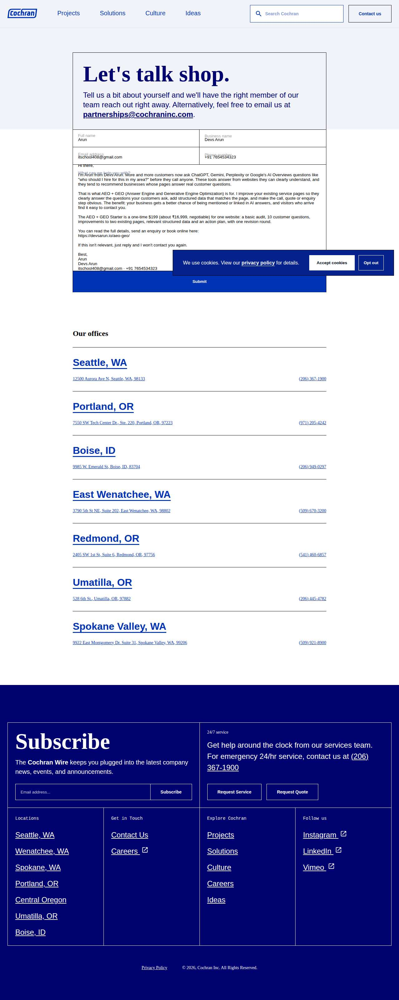

**After submit** — `run-204b82d6_attempt-20f205f4_post_attempt_2026-11-02T15-51-15-489Z.jpg`

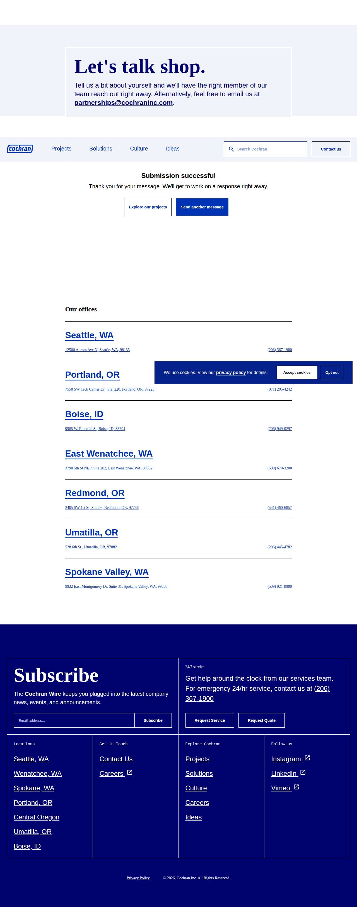

## Events (127)

| Time (UTC) | Event | Website | Details |
|---|---|---|---|
| 15:44:44 | run\_queued | — | live run requested by github:itsDevsArun |
| 15:44:44 | run\_dispatched | — | dispatch disabled (local test mode) |
| 15:44:47 | run\_started | — | Runner claimed live run |
| 15:44:49 | offer\_verified | — | Service page offer facts verified |
| 15:44:49 | website\_selected | clearchoiceplumbingllc.com | Live target clearchoiceplumbingllc.com |
| 15:44:49 | attempt\_reserved | clearchoiceplumbingllc.com | Submission attempt reserved with template standard v2 |
| 15:44:51 | page\_opened | clearchoiceplumbingllc.com | Opened form page |
| 15:44:51 | screenshot\_saved | clearchoiceplumbingllc.com | inspection screenshot saved (145 KB) |
| 15:44:51 | review\_required | clearchoiceplumbingllc.com | failed before submit: locator.fill: Error: Cannot type text into input\[type=number\] |
| 15:44:56 | website\_selected | vonsaselectric.com | Live target vonsaselectric.com |
| 15:44:56 | attempt\_reserved | vonsaselectric.com | Submission attempt reserved with template standard v2 |
| 15:45:01 | page\_opened | vonsaselectric.com | Opened form page |
| 15:45:01 | fields\_filled | vonsaselectric.com | filled |
| 15:45:01 | screenshot\_saved | vonsaselectric.com | filled screenshot saved (51 KB) |
| 15:45:01 | submit\_attempted | vonsaselectric.com | submitting |
| 15:45:29 | screenshot\_saved | vonsaselectric.com | post\_attempt screenshot saved (7 KB) |
| 15:45:29 | review\_required | vonsaselectric.com | unclear: No new success marker observed |
| 15:45:36 | website\_selected | adamshvac.net | Live target adamshvac.net |
| 15:45:36 | attempt\_reserved | adamshvac.net | Submission attempt reserved with template standard v2 |
| 15:45:39 | page\_opened | adamshvac.net | Opened form page |
| 15:45:39 | fields\_filled | adamshvac.net | filled |
| 15:45:39 | screenshot\_saved | adamshvac.net | filled screenshot saved (186 KB) |
| 15:45:39 | submit\_attempted | adamshvac.net | submitting |
| 15:46:06 | screenshot\_saved | adamshvac.net | post\_attempt screenshot saved (204 KB) |
| 15:46:06 | review\_required | adamshvac.net | unclear: No new success marker observed |
| 15:46:13 | website\_selected | totalairep.com | Live target totalairep.com |
| 15:46:13 | attempt\_reserved | totalairep.com | Submission attempt reserved with template standard v2 |
| 15:46:15 | page\_opened | totalairep.com | Opened form page |
| 15:46:16 | fields\_filled | totalairep.com | filled |
| 15:46:16 | screenshot\_saved | totalairep.com | filled screenshot saved (166 KB) |
| 15:46:16 | submit\_attempted | totalairep.com | submitting |
| 15:46:19 | screenshot\_saved | totalairep.com | post\_attempt screenshot saved (117 KB) |
| 15:46:19 | confirmation\_observed | totalairep.com | confirmed — "& HEATING TOTAL COMFORT. TOTAL SAVINGS. TOTAL AIR\! The form has been sent Thank you for your time, feedback and especial" |
| 15:46:26 | website\_selected | ambientairsolutions.com | Live target ambientairsolutions.com |
| 15:46:26 | attempt\_reserved | ambientairsolutions.com | Submission attempt reserved with template standard v2 |
| 15:46:29 | page\_opened | ambientairsolutions.com | Opened form page |
| 15:46:29 | fields\_filled | ambientairsolutions.com | filled |
| 15:46:29 | screenshot\_saved | ambientairsolutions.com | filled screenshot saved (223 KB) |
| 15:46:29 | submit\_attempted | ambientairsolutions.com | submitting |
| 15:46:33 | screenshot\_saved | ambientairsolutions.com | post\_attempt screenshot saved (244 KB) |
| 15:46:33 | error | ambientairsolutions.com | error after submit — "Skip navigation The Following Errors Occurred Please enter your last name Please enter your city Please let us know the " |
| 15:46:40 | website\_selected | earlbryant.com | Live target earlbryant.com |
| 15:46:40 | attempt\_reserved | earlbryant.com | Submission attempt reserved with template standard v2 |
| 15:46:43 | page\_opened | earlbryant.com | Opened form page |
| 15:46:43 | screenshot\_saved | earlbryant.com | filled screenshot saved (144 KB) |
| 15:46:43 | review\_required | earlbryant.com | failed before submit: Form validation would block sending: phone: Please enter between 4 to 17 digits. You can include hyphens (-) or start with a (+), e.g., 555-123-4567 or +(222)987654321. |
| 15:46:48 | website\_selected | hvacconceptswi.com | Live target hvacconceptswi.com |
| 15:46:48 | attempt\_reserved | hvacconceptswi.com | Submission attempt reserved with template standard v2 |
| 15:46:50 | page\_opened | hvacconceptswi.com | Opened form page |
| 15:46:50 | fields\_filled | hvacconceptswi.com | filled |
| 15:46:50 | screenshot\_saved | hvacconceptswi.com | filled screenshot saved (54 KB) |
| 15:46:50 | submit\_attempted | hvacconceptswi.com | submitting |
| 15:47:18 | screenshot\_saved | hvacconceptswi.com | post\_attempt screenshot saved (53 KB) |
| 15:47:18 | review\_required | hvacconceptswi.com | unclear: No new success marker observed |
| 15:47:25 | website\_selected | rangerhvacusa.com | Live target rangerhvacusa.com |
| 15:47:25 | attempt\_reserved | rangerhvacusa.com | Submission attempt reserved with template standard v2 |
| 15:47:29 | page\_opened | rangerhvacusa.com | Opened form page |
| 15:47:29 | fields\_filled | rangerhvacusa.com | filled |
| 15:47:30 | screenshot\_saved | rangerhvacusa.com | filled screenshot saved (140 KB) |
| 15:47:30 | submit\_attempted | rangerhvacusa.com | submitting |
| 15:47:57 | screenshot\_saved | rangerhvacusa.com | post\_attempt screenshot saved (194 KB) |
| 15:47:57 | review\_required | rangerhvacusa.com | unclear: No new success marker observed |
| 15:48:04 | website\_selected | pamlicoair.com | Live target pamlicoair.com |
| 15:48:04 | attempt\_reserved | pamlicoair.com | Submission attempt reserved with template standard v2 |
| 15:48:07 | page\_opened | pamlicoair.com | Opened form page |
| 15:48:07 | fields\_filled | pamlicoair.com | filled |
| 15:48:07 | screenshot\_saved | pamlicoair.com | filled screenshot saved (128 KB) |
| 15:48:07 | submit\_attempted | pamlicoair.com | submitting |
| 15:48:34 | screenshot\_saved | pamlicoair.com | post\_attempt screenshot saved (125 KB) |
| 15:48:34 | review\_required | pamlicoair.com | unclear: No new success marker observed |
| 15:48:41 | website\_selected | rockspringhvacr.com | Live target rockspringhvacr.com |
| 15:48:41 | attempt\_reserved | rockspringhvacr.com | Submission attempt reserved with template standard v2 |
| 15:48:43 | page\_opened | rockspringhvacr.com | Opened form page |
| 15:48:43 | fields\_filled | rockspringhvacr.com | filled |
| 15:48:43 | screenshot\_saved | rockspringhvacr.com | filled screenshot saved (126 KB) |
| 15:48:43 | submit\_attempted | rockspringhvacr.com | submitting |
| 15:48:49 | screenshot\_saved | rockspringhvacr.com | post\_attempt screenshot saved (91 KB) |
| 15:48:49 | confirmation\_observed | rockspringhvacr.com | confirmed — "s Residential Services Ask the Expert Industries Contact Us Thank you for contacting Rock Spring Heating and Cooling. We" |
| 15:48:56 | website\_selected | callfalcone.com | Live target callfalcone.com |
| 15:48:56 | attempt\_reserved | callfalcone.com | Submission attempt reserved with template standard v2 |
| 15:49:00 | page\_opened | callfalcone.com | Opened form page |
| 15:49:00 | fields\_filled | callfalcone.com | filled |
| 15:49:00 | screenshot\_saved | callfalcone.com | filled screenshot saved (137 KB) |
| 15:49:00 | submit\_attempted | callfalcone.com | submitting |
| 15:49:10 | screenshot\_saved | callfalcone.com | post\_attempt screenshot saved (118 KB) |
| 15:49:10 | confirmation\_observed | callfalcone.com | confirmed — "CALL US NOW CONTACT INFORMATION Don’t Hesitate To Say Hello Thank you for your message. We will get in touch with you sh" |
| 15:49:17 | website\_selected | hvacpremium.com | Live target hvacpremium.com |
| 15:49:17 | attempt\_reserved | hvacpremium.com | Submission attempt reserved with template standard v2 |
| 15:49:23 | page\_opened | hvacpremium.com | Opened form page |
| 15:49:23 | fields\_filled | hvacpremium.com | filled |
| 15:49:23 | screenshot\_saved | hvacpremium.com | filled screenshot saved (91 KB) |
| 15:49:23 | submit\_attempted | hvacpremium.com | submitting |
| 15:49:34 | screenshot\_saved | hvacpremium.com | post\_attempt screenshot saved (101 KB) |
| 15:49:34 | confirmation\_observed | hvacpremium.com | confirmed — "help\! Please call, email, or fill out our contact form, and we'll be in touch shortly. MILLIONS OF CUSTOMERS SERVED\! CAL" |
| 15:49:42 | website\_selected | phoenixaircontrol.com | Live target phoenixaircontrol.com |
| 15:49:42 | attempt\_reserved | phoenixaircontrol.com | Submission attempt reserved with template standard v2 |
| 15:49:43 | page\_opened | phoenixaircontrol.com | Opened form page |
| 15:49:43 | fields\_filled | phoenixaircontrol.com | filled |
| 15:49:43 | screenshot\_saved | phoenixaircontrol.com | filled screenshot saved (41 KB) |
| 15:49:43 | submit\_attempted | phoenixaircontrol.com | submitting |
| 15:50:11 | screenshot\_saved | phoenixaircontrol.com | post\_attempt screenshot saved (18 KB) |
| 15:50:11 | review\_required | phoenixaircontrol.com | unclear: No new success marker observed |
| 15:50:18 | website\_selected | future-connections.com | Live target future-connections.com |
| 15:50:18 | attempt\_reserved | future-connections.com | Submission attempt reserved with template standard v2 |
| 15:50:19 | page\_opened | future-connections.com | Opened form page |
| 15:50:19 | fields\_filled | future-connections.com | filled |
| 15:50:19 | screenshot\_saved | future-connections.com | filled screenshot saved (67 KB) |
| 15:50:19 | submit\_attempted | future-connections.com | submitting |
| 15:50:47 | screenshot\_saved | future-connections.com | post\_attempt screenshot saved (69 KB) |
| 15:50:47 | review\_required | future-connections.com | unclear: No new success marker observed |
| 15:50:54 | website\_selected | curtiselectricny.com | Live target curtiselectricny.com |
| 15:50:54 | attempt\_reserved | curtiselectricny.com | Submission attempt reserved with template standard v2 |
| 15:50:56 | page\_opened | curtiselectricny.com | Opened form page |
| 15:50:56 | fields\_filled | curtiselectricny.com | filled |
| 15:50:56 | screenshot\_saved | curtiselectricny.com | filled screenshot saved (83 KB) |
| 15:50:56 | submit\_attempted | curtiselectricny.com | submitting |
| 15:50:59 | screenshot\_saved | curtiselectricny.com | post\_attempt screenshot saved (63 KB) |
| 15:50:59 | confirmation\_observed | curtiselectricny.com | confirmed — "vices today. Your Name Email Address\* Message\* Send Message Thanks for reaching out\! Our Location Serving Westchester Co" |
| 15:51:07 | website\_selected | cochraninc.com | Live target cochraninc.com |
| 15:51:07 | attempt\_reserved | cochraninc.com | Submission attempt reserved with template standard v2 |
| 15:51:10 | page\_opened | cochraninc.com | Opened form page |
| 15:51:11 | fields\_filled | cochraninc.com | filled |
| 15:51:11 | screenshot\_saved | cochraninc.com | filled screenshot saved (230 KB) |
| 15:51:11 | submit\_attempted | cochraninc.com | submitting |
| 15:51:15 | screenshot\_saved | cochraninc.com | post\_attempt screenshot saved (189 KB) |
| 15:51:15 | confirmation\_observed | cochraninc.com | confirmed — "vely, feel free to email us at partnerships@cochraninc.com. Submission successful Thank you for your message. We'll get " |
| 15:51:22 | run\_completed | — | Run completed (queue\_exhausted) |
