# Run 23ceb287 — live — completed

| | |
|---|---|
| Run ID | `23ceb287-1e09-4ff5-bf88-467b81bd6554` |
| Requested by | github:itsDevsArun |
| Started | 2026-11-02 04:27:44 UTC |
| Finished | 2026-11-02 04:30:53 UTC |
| Finish reason | queue\_exhausted |
| GitHub Actions | https://github.com/itsDevsArun/aeo-geo/actions/runs/41379081570 |

CSV for this run: [runs/2026-11-02_live_23ceb287.csv](2026-11-02_live_23ceb287.csv)

## Attempts (11)

### clearchoiceplumbingllc.com — failed\_before\_submit (LIVE)

| | |
|---|---|
| Attempt ID | `03a19a66-8cfa-417f-9de1-2417ba16b0c6` |
| Form URL | https://clearchoiceplumbingllc.com/contact/ |
| Final URL | — |
| Reserved | 2026-11-02 04:27:46 UTC |
| Submit attempted | — |
| Template | standard v2 |
| Confirmation text | none observed |
| Result / error | locator.fill: Error: Cannot type text into input\[type=number\] |

Exact message:

~~~text
Subject: Helping customers find your business in AI search (AEO + GEO)

Hi there,

I'm Arun from Devs Arun. More and more customers now ask ChatGPT, Gemini, Perplexity or Google's AI Overviews questions like "who should I hire for this in my area?" before they call anyone. These tools answer from websites they can clearly understand, and they tend to recommend businesses whose pages answer real customer questions.

That is what AEO + GEO (Answer Engine and Generative Engine Optimization) is for. I improve your existing service pages so they clearly answer the questions your customers ask, add structured data that matches the page, and make the call, quote or enquiry step obvious. The benefit: your business gets a better chance of being mentioned or linked in AI answers, and visitors who arrive find it easy to contact you.

The AEO + GEO Starter is a one-time $199 (about ₹16,999, negotiable) for one website: a basic audit, 10 customer questions, improvements to two existing pages, relevant structured data and an action plan, with one revision round.

You can read the full details, send an enquiry or book online here:
https://devsarun.io/aeo-geo/

If this isn't relevant, just reply and I won't contact you again.

Best,
Arun
Devs Arun
itschool408@gmail.com · +91 7654534323
~~~

Submitted field values:

- \#wpforms-51-field\_1: Arun
- \#wpforms-51-field\_2: itschool408@gmail.com
- \#wpforms-51-field\_3: Hi there, I'm Arun from Devs Arun. More and more customers now ask ChatGPT, Gemini, Perplexity or Google's AI Overviews 
- \#wpforms-51-field\_5: +91 7654534323

**Inspected page** — `run-23ceb287_attempt-03a19a66_inspection_2026-11-02T04-27-47-765Z.jpg`

### intelligentservice.com — unclear (LIVE)

| | |
|---|---|
| Attempt ID | `ddd0568a-ab88-4413-9e08-2e9fd575b110` |
| Form URL | https://intelligentservice.com/contact-us/ |
| Final URL | https://intelligentservice.com/contact-us/ |
| Reserved | 2026-11-02 04:27:52 UTC |
| Submit attempted | 2026-11-02 04:27:55 UTC |
| Template | standard v2 |
| Confirmation text | none observed |
| Result / error | No new success marker observed |

Exact message:

~~~text
Subject: Helping customers find your business in AI search (AEO + GEO)

Hi there,

I'm Arun from Devs Arun. More and more customers now ask ChatGPT, Gemini, Perplexity or Google's AI Overviews questions like "who should I hire for this in my area?" before they call anyone. These tools answer from websites they can clearly understand, and they tend to recommend businesses whose pages answer real customer questions.

That is what AEO + GEO (Answer Engine and Generative Engine Optimization) is for. I improve your existing service pages so they clearly answer the questions your customers ask, add structured data that matches the page, and make the call, quote or enquiry step obvious. The benefit: your business gets a better chance of being mentioned or linked in AI answers, and visitors who arrive find it easy to contact you.

The AEO + GEO Starter is a one-time $199 (about ₹16,999, negotiable) for one website: a basic audit, 10 customer questions, improvements to two existing pages, relevant structured data and an action plan, with one revision round.

You can read the full details, send an enquiry or book online here:
https://devsarun.io/aeo-geo/

If this isn't relevant, just reply and I won't contact you again.

Best,
Arun
Devs Arun
itschool408@gmail.com · +91 7654534323
~~~

Submitted field values:

- Name(Required) \[name\]: Arun
- Email(Required) \[email\]: itschool408@gmail.com
- Phone(Required) \[phone\]: +91 7654534323
- Message(Required) \[message\]: Hi there, I'm Arun from Devs Arun. More and more customers now ask ChatGPT, Gemini, Perplexity or Google's AI Overviews 

**Filled form (before submit)** — `run-23ceb287_attempt-ddd0568a_filled_2026-11-02T04-27-55-785Z.jpg`

**After submit** — `run-23ceb287_attempt-ddd0568a_post_attempt_2026-11-02T04-28-23-143Z.jpg`

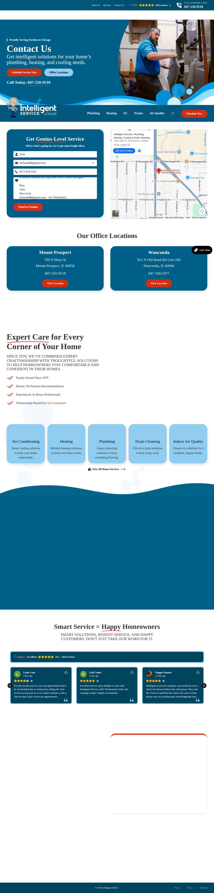

### zicarosplumbing.com — unclear (LIVE)

| | |
|---|---|
| Attempt ID | `aae5a70a-1444-40c1-81b5-65b0c255b329` |
| Form URL | https://www.zicarosplumbing.com/contact |
| Final URL | https://www.zicarosplumbing.com/contact |
| Reserved | 2026-11-02 04:28:30 UTC |
| Submit attempted | 2026-11-02 04:28:32 UTC |
| Template | standard v2 |
| Confirmation text | none observed |
| Result / error | No new success marker observed |

Exact message:

~~~text
Subject: Helping customers find your business in AI search (AEO + GEO)

Hi there,

I'm Arun from Devs Arun. More and more customers now ask ChatGPT, Gemini, Perplexity or Google's AI Overviews questions like "who should I hire for this in my area?" before they call anyone. These tools answer from websites they can clearly understand, and they tend to recommend businesses whose pages answer real customer questions.

That is what AEO + GEO (Answer Engine and Generative Engine Optimization) is for. I improve your existing service pages so they clearly answer the questions your customers ask, add structured data that matches the page, and make the call, quote or enquiry step obvious. The benefit: your business gets a better chance of being mentioned or linked in AI answers, and visitors who arrive find it easy to contact you.

The AEO + GEO Starter is a one-time $199 (about ₹16,999, negotiable) for one website: a basic audit, 10 customer questions, improvements to two existing pages, relevant structured data and an action plan, with one revision round.

You can read the full details, send an enquiry or book online here:
https://devsarun.io/aeo-geo/

If this isn't relevant, just reply and I won't contact you again.

Best,
Arun
Devs Arun
itschool408@gmail.com · +91 7654534323
~~~

Submitted field values:

- email \[email\]: itschool408@gmail.com
- name-\* \[name\]: Arun
- phone \[phone\]: +91 7654534323
- Message \[message\]: Hi there, I'm Arun from Devs Arun. More and more customers now ask ChatGPT, Gemini, Perplexity or Google's AI Overviews 
- subject \[subject\]: Helping customers find your business in AI search (AEO + GEO)

**Filled form (before submit)** — `run-23ceb287_attempt-aae5a70a_filled_2026-11-02T04-28-32-511Z.jpg`

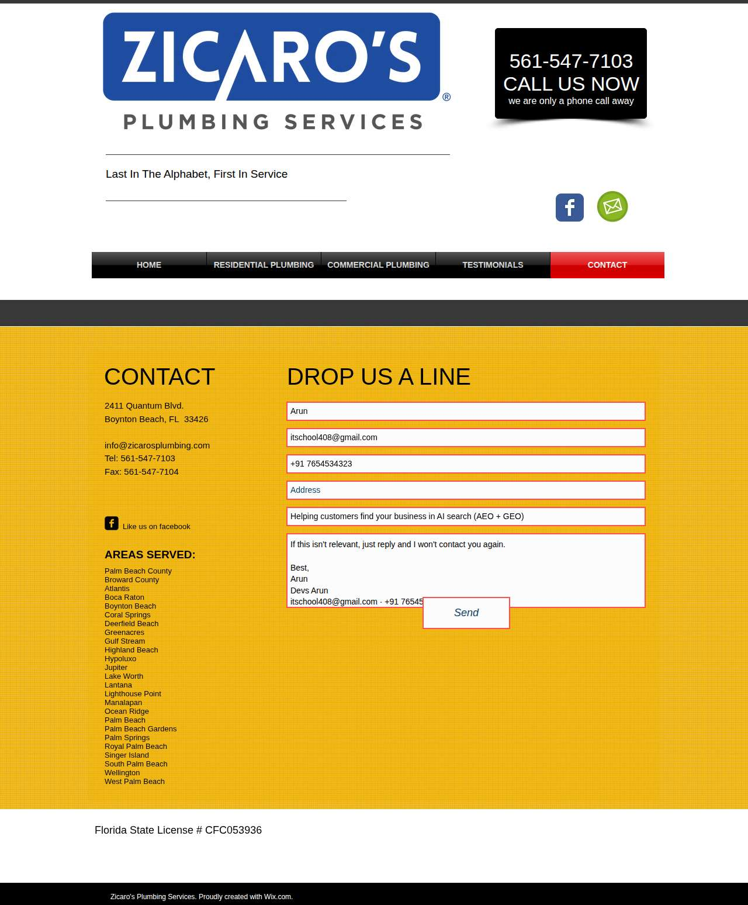

**After submit** — `run-23ceb287_attempt-aae5a70a_post_attempt_2026-11-02T04-28-59-262Z.jpg`

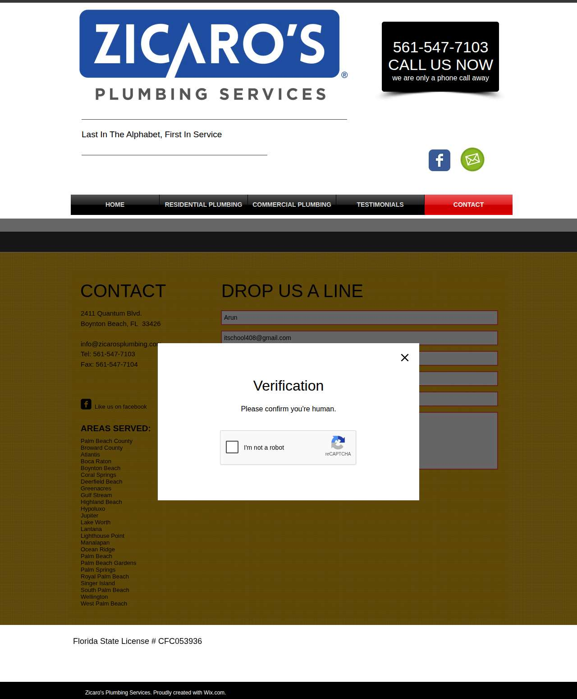

### reece.com — failed\_before\_submit (LIVE)

| | |
|---|---|
| Attempt ID | `7068c1c8-7f6e-4e63-aaba-e77083796ba5` |
| Form URL | https://www.reece.com/contact-reece-usa |
| Final URL | https://www.reece.com/contact-reece-usa |
| Reserved | 2026-11-02 04:29:05 UTC |
| Submit attempted | — |
| Template | standard v2 |
| Confirmation text | none observed |
| Result / error | Field "phoneNumber" did not accept the value |

Exact message:

~~~text
Subject: Helping customers find your business in AI search (AEO + GEO)

Hi there,

I'm Arun from Devs Arun. More and more customers now ask ChatGPT, Gemini, Perplexity or Google's AI Overviews questions like "who should I hire for this in my area?" before they call anyone. These tools answer from websites they can clearly understand, and they tend to recommend businesses whose pages answer real customer questions.

That is what AEO + GEO (Answer Engine and Generative Engine Optimization) is for. I improve your existing service pages so they clearly answer the questions your customers ask, add structured data that matches the page, and make the call, quote or enquiry step obvious. The benefit: your business gets a better chance of being mentioned or linked in AI answers, and visitors who arrive find it easy to contact you.

The AEO + GEO Starter is a one-time $199 (about ₹16,999, negotiable) for one website: a basic audit, 10 customer questions, improvements to two existing pages, relevant structured data and an action plan, with one revision round.

You can read the full details, send an enquiry or book online here:
https://devsarun.io/aeo-geo/

If this isn't relevant, just reply and I won't contact you again.

Best,
Arun
Devs Arun
itschool408@gmail.com · +91 7654534323
~~~

Submitted field values:

- \#email: itschool408@gmail.com
- \#message: Hi there, I'm Arun from Devs Arun. More and more customers now ask ChatGPT, Gemini, Perplexity or Google's AI Overviews 
- \#firstName: Arun
- \#companyName: Devs Arun
- \#phoneNumber: +91 7654534323

**Filled form (before submit)** — `run-23ceb287_attempt-7068c1c8_filled_2026-11-02T04-29-08-304Z.jpg`

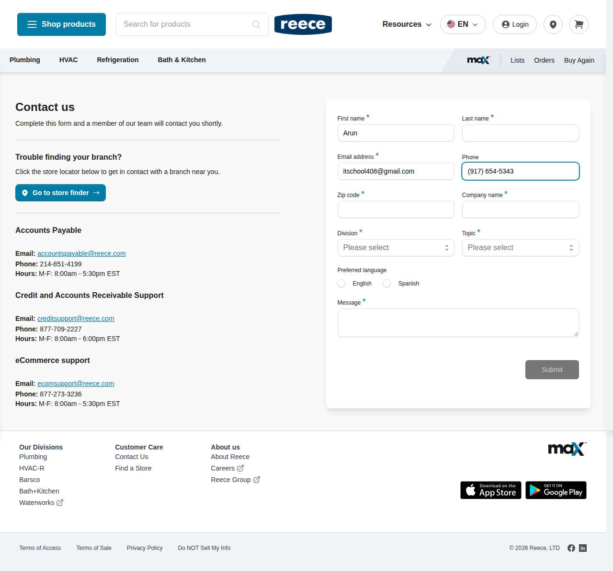

### pinecreekplumbing.com — confirmed (LIVE)

| | |
|---|---|
| Attempt ID | `07efcb95-ade9-4c93-af80-b543a098dc1f` |
| Form URL | https://pinecreekplumbing.com/contact-us/ |
| Final URL | https://pinecreekplumbing.com/contact-thank-you/ |
| Reserved | 2026-11-02 04:29:13 UTC |
| Submit attempted | 2026-11-02 04:29:15 UTC |
| Template | standard v2 |
| Confirmation text | & Sewer Water Heaters Water Treatment Service Area Contact Thank You Call (412) 667-2800 Thanks for reaching out—we’re on it. Your message just landed in our inbox, and |
| Result / error | — |

Exact message:

~~~text
Subject: Helping customers find your business in AI search (AEO + GEO)

Hi there,

I'm Arun from Devs Arun. More and more customers now ask ChatGPT, Gemini, Perplexity or Google's AI Overviews questions like "who should I hire for this in my area?" before they call anyone. These tools answer from websites they can clearly understand, and they tend to recommend businesses whose pages answer real customer questions.

That is what AEO + GEO (Answer Engine and Generative Engine Optimization) is for. I improve your existing service pages so they clearly answer the questions your customers ask, add structured data that matches the page, and make the call, quote or enquiry step obvious. The benefit: your business gets a better chance of being mentioned or linked in AI answers, and visitors who arrive find it easy to contact you.

The AEO + GEO Starter is a one-time $199 (about ₹16,999, negotiable) for one website: a basic audit, 10 customer questions, improvements to two existing pages, relevant structured data and an action plan, with one revision round.

You can read the full details, send an enquiry or book online here:
https://devsarun.io/aeo-geo/

If this isn't relevant, just reply and I won't contact you again.

Best,
Arun
Devs Arun
itschool408@gmail.com · +91 7654534323
~~~

Submitted field values:

- Name\* \[name\]: Arun
- Email\* \[email\]: itschool408@gmail.com
- Phone\* \[phone\]: +91 7654534323
- Message \[message\]: Hi there, I'm Arun from Devs Arun. More and more customers now ask ChatGPT, Gemini, Perplexity or Google's AI Overviews 

**Filled form (before submit)** — `run-23ceb287_attempt-07efcb95_filled_2026-11-02T04-29-15-514Z.jpg`

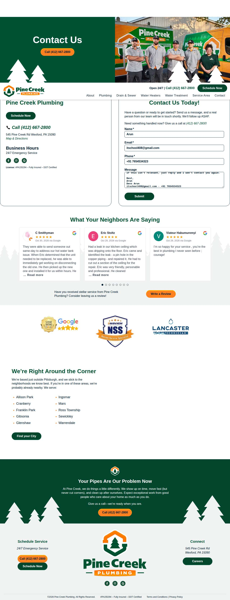

**After submit** — `run-23ceb287_attempt-07efcb95_post_attempt_2026-11-02T04-29-23-372Z.jpg`

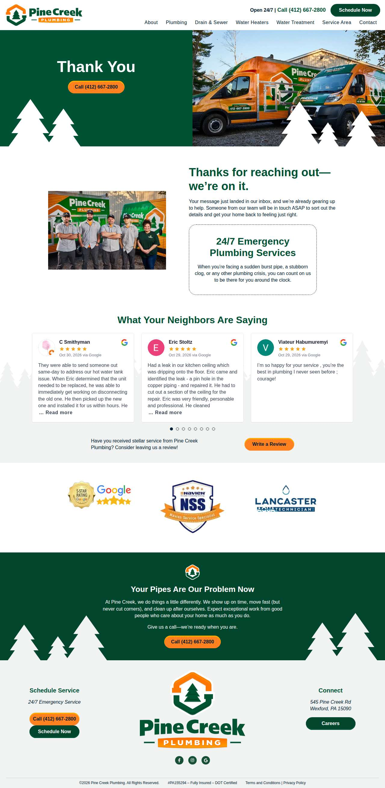

### dunnellsplumbing.com — unclear (LIVE)

| | |
|---|---|
| Attempt ID | `29c30049-02af-4d5f-958f-ffa613299bac` |
| Form URL | https://www.dunnellsplumbing.com/contact |
| Final URL | https://www.dunnellsplumbing.com/contact |
| Reserved | 2026-11-02 04:29:29 UTC |
| Submit attempted | 2026-11-02 04:29:31 UTC |
| Template | standard v2 |
| Confirmation text | none observed |
| Result / error | No new success marker observed |

Exact message:

~~~text
Subject: Helping customers find your business in AI search (AEO + GEO)

Hi there,

I'm Arun from Devs Arun. More and more customers now ask ChatGPT, Gemini, Perplexity or Google's AI Overviews questions like "who should I hire for this in my area?" before they call anyone. These tools answer from websites they can clearly understand, and they tend to recommend businesses whose pages answer real customer questions.

That is what AEO + GEO (Answer Engine and Generative Engine Optimization) is for. I improve your existing service pages so they clearly answer the questions your customers ask, add structured data that matches the page, and make the call, quote or enquiry step obvious. The benefit: your business gets a better chance of being mentioned or linked in AI answers, and visitors who arrive find it easy to contact you.

The AEO + GEO Starter is a one-time $199 (about ₹16,999, negotiable) for one website: a basic audit, 10 customer questions, improvements to two existing pages, relevant structured data and an action plan, with one revision round.

You can read the full details, send an enquiry or book online here:
https://devsarun.io/aeo-geo/

If this isn't relevant, just reply and I won't contact you again.

Best,
Arun
Devs Arun
itschool408@gmail.com · +91 7654534323
~~~

Submitted field values:

- NAME \* \[name\]: Arun
- PHONE \[phone\]: +91 7654534323
- EMAIL \* \[email\]: itschool408@gmail.com
- MESSAGE \* \[message\]: Hi there, I'm Arun from Devs Arun. More and more customers now ask ChatGPT, Gemini, Perplexity or Google's AI Overviews 
- SUBJECT \* \[subject\]: Helping customers find your business in AI search (AEO + GEO)

**Filled form (before submit)** — `run-23ceb287_attempt-29c30049_filled_2026-11-02T04-29-31-822Z.jpg`

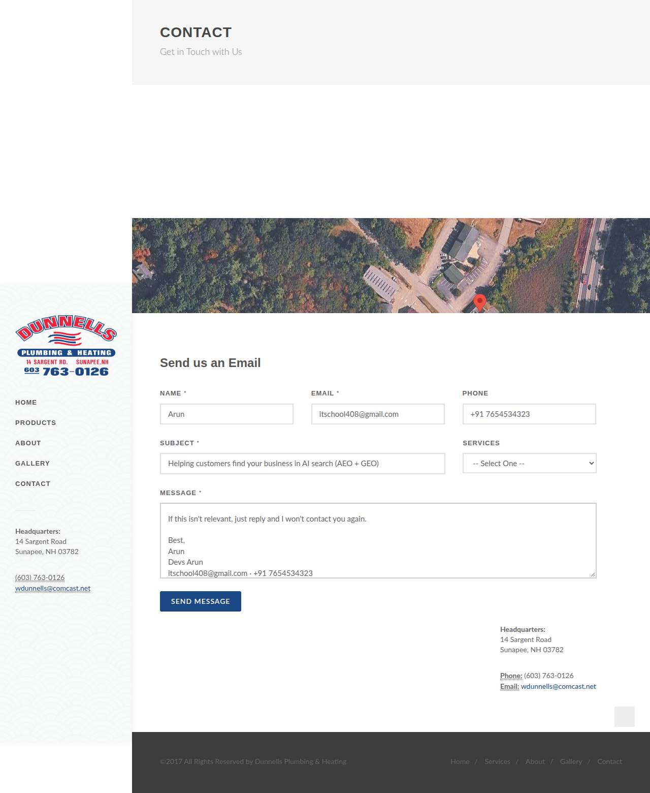

**After submit** — `run-23ceb287_attempt-29c30049_post_attempt_2026-11-02T04-29-58-605Z.jpg`

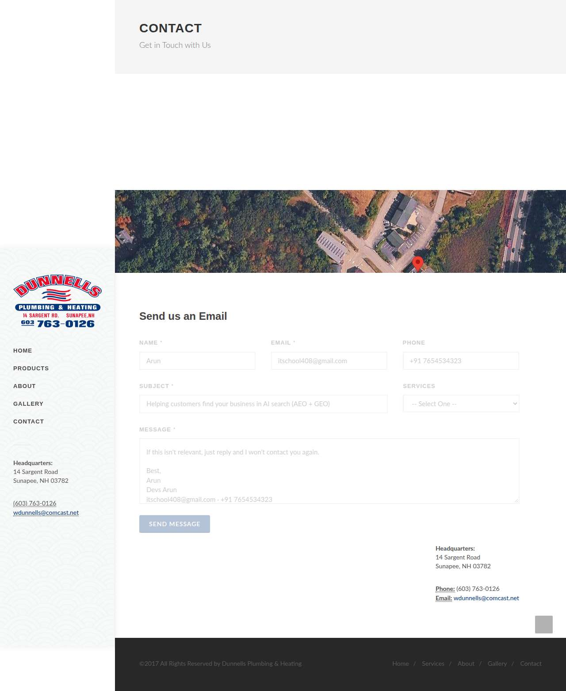

### orlandoroofingco.com — failed\_before\_submit (LIVE)

| | |
|---|---|
| Attempt ID | `bc1c4a50-9f79-4255-8d0d-8ee4ca68da90` |
| Form URL | https://orlandoroofingco.com/ |
| Final URL | https://orlandoroofingco.com/ |
| Reserved | 2026-11-02 04:30:05 UTC |
| Submit attempted | — |
| Template | standard v2 |
| Confirmation text | none observed |
| Result / error | Message field altered the text (length limit?) |

Exact message:

~~~text
Subject: Helping customers find your business in AI search (AEO + GEO)

Hi there,

I'm Arun from Devs Arun. More and more customers now ask ChatGPT, Gemini, Perplexity or Google's AI Overviews questions like "who should I hire for this in my area?" before they call anyone. These tools answer from websites they can clearly understand, and they tend to recommend businesses whose pages answer real customer questions.

That is what AEO + GEO (Answer Engine and Generative Engine Optimization) is for. I improve your existing service pages so they clearly answer the questions your customers ask, add structured data that matches the page, and make the call, quote or enquiry step obvious. The benefit: your business gets a better chance of being mentioned or linked in AI answers, and visitors who arrive find it easy to contact you.

The AEO + GEO Starter is a one-time $199 (about ₹16,999, negotiable) for one website: a basic audit, 10 customer questions, improvements to two existing pages, relevant structured data and an action plan, with one revision round.

You can read the full details, send an enquiry or book online here:
https://devsarun.io/aeo-geo/

If this isn't relevant, just reply and I won't contact you again.

Best,
Arun
Devs Arun
itschool408@gmail.com · +91 7654534323
~~~

Submitted field values:

- \#input\_1\_3: itschool408@gmail.com
- \#input\_1\_5: Hi there, I'm Arun from Devs Arun. More and more customers now ask ChatGPT, Gemini, Perplexity or Google's AI Overviews 
- \#input\_1\_2\_3: Arun

**Filled form (before submit)** — `run-23ceb287_attempt-bc1c4a50_filled_2026-11-02T04-30-06-773Z.jpg`

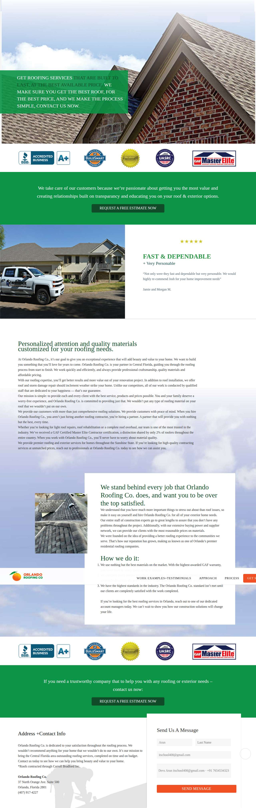

### totalroofingco.com — failed\_before\_submit (LIVE)

| | |
|---|---|
| Attempt ID | `47189465-251f-41c1-a2ea-76944c95e818` |
| Form URL | https://total-roofing.co/contact-us |
| Final URL | https://total-roofing.co/contact-us |
| Reserved | 2026-11-02 04:30:11 UTC |
| Submit attempted | — |
| Template | standard v2 |
| Confirmation text | none observed |
| Result / error | Field "PHONE \*" did not accept the value |

Exact message:

~~~text
Subject: Helping customers find your business in AI search (AEO + GEO)

Hi there,

I'm Arun from Devs Arun. More and more customers now ask ChatGPT, Gemini, Perplexity or Google's AI Overviews questions like "who should I hire for this in my area?" before they call anyone. These tools answer from websites they can clearly understand, and they tend to recommend businesses whose pages answer real customer questions.

That is what AEO + GEO (Answer Engine and Generative Engine Optimization) is for. I improve your existing service pages so they clearly answer the questions your customers ask, add structured data that matches the page, and make the call, quote or enquiry step obvious. The benefit: your business gets a better chance of being mentioned or linked in AI answers, and visitors who arrive find it easy to contact you.

The AEO + GEO Starter is a one-time $199 (about ₹16,999, negotiable) for one website: a basic audit, 10 customer questions, improvements to two existing pages, relevant structured data and an action plan, with one revision round.

You can read the full details, send an enquiry or book online here:
https://devsarun.io/aeo-geo/

If this isn't relevant, just reply and I won't contact you again.

Best,
Arun
Devs Arun
itschool408@gmail.com · +91 7654534323
~~~

Submitted field values:

- \#cf-name: Arun
- \#cf-email: itschool408@gmail.com
- \#cf-phone: +91 7654534323
- \#cf-message: Hi there, I'm Arun from Devs Arun. More and more customers now ask ChatGPT, Gemini, Perplexity or Google's AI Overviews 

**Filled form (before submit)** — `run-23ceb287_attempt-47189465_filled_2026-11-02T04-30-13-884Z.jpg`

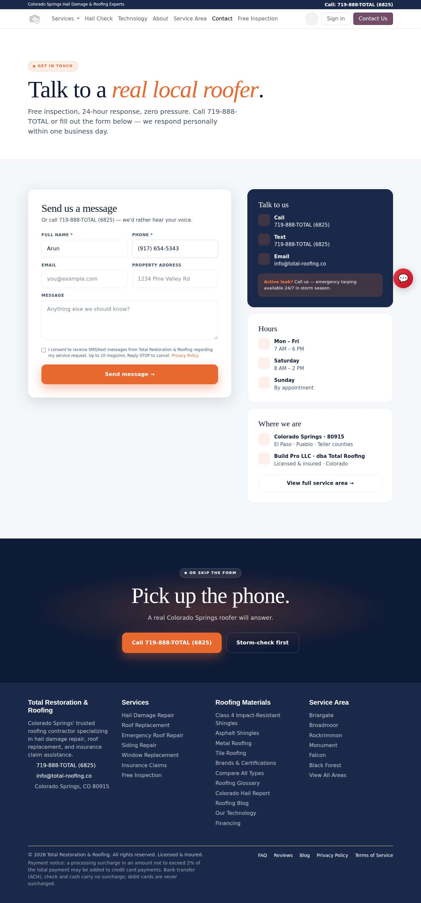

### allstarroofingtexas.com — confirmed (LIVE)

| | |
|---|---|
| Attempt ID | `481a09d5-40a0-4edc-9ca9-c4aab3536c2d` |
| Form URL | https://allstarroofingtexas.com/contact/ |
| Final URL | https://allstarroofingtexas.com/contact/ |
| Reserved | 2026-11-02 04:30:18 UTC |
| Submit attempted | 2026-11-02 04:30:20 UTC |
| Template | standard v2 |
| Confirmation text | keep in touch Your name \* Email address \* Subject Message \* Thank you for your message. It has been sent. × Submit HOME SERVICES GALLERY BULLETIN BOARD CONTACT Proudly Serving Central Te |
| Result / error | — |

Exact message:

~~~text
Subject: Helping customers find your business in AI search (AEO + GEO)

Hi there,

I'm Arun from Devs Arun. More and more customers now ask ChatGPT, Gemini, Perplexity or Google's AI Overviews questions like "who should I hire for this in my area?" before they call anyone. These tools answer from websites they can clearly understand, and they tend to recommend businesses whose pages answer real customer questions.

That is what AEO + GEO (Answer Engine and Generative Engine Optimization) is for. I improve your existing service pages so they clearly answer the questions your customers ask, add structured data that matches the page, and make the call, quote or enquiry step obvious. The benefit: your business gets a better chance of being mentioned or linked in AI answers, and visitors who arrive find it easy to contact you.

The AEO + GEO Starter is a one-time $199 (about ₹16,999, negotiable) for one website: a basic audit, 10 customer questions, improvements to two existing pages, relevant structured data and an action plan, with one revision round.

You can read the full details, send an enquiry or book online here:
https://devsarun.io/aeo-geo/

If this isn't relevant, just reply and I won't contact you again.

Best,
Arun
Devs Arun
itschool408@gmail.com · +91 7654534323
~~~

Submitted field values:

- Subject \[subject\]: Helping customers find your business in AI search (AEO + GEO)
- Your name \* \[name\]: Arun
- Message \* \[message\]: Hi there, I'm Arun from Devs Arun. More and more customers now ask ChatGPT, Gemini, Perplexity or Google's AI Overviews 
- Email address \* \[email\]: itschool408@gmail.com

**Filled form (before submit)** — `run-23ceb287_attempt-481a09d5_filled_2026-11-02T04-30-20-722Z.jpg`

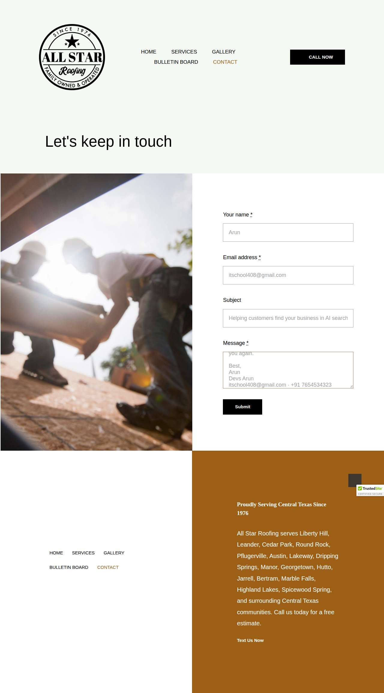

**After submit** — `run-23ceb287_attempt-481a09d5_post_attempt_2026-11-02T04-30-24-512Z.jpg`

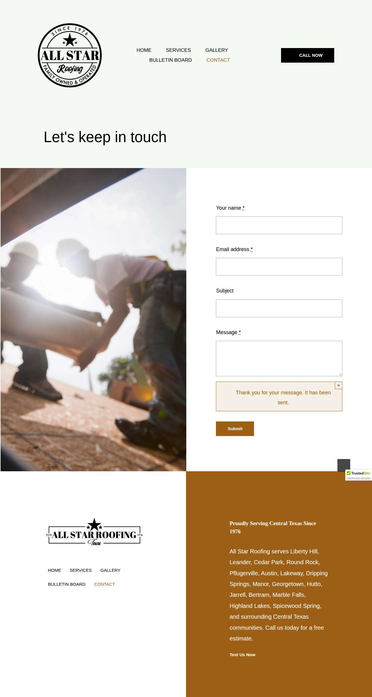

### pearsonroofing.com — failed\_before\_submit (LIVE)

| | |
|---|---|
| Attempt ID | `87121711-e1d6-4fd1-befa-4ef9734c85d2` |
| Form URL | https://www.pearsonroofing.com/ |
| Final URL | https://www.pearsonroofing.com/ |
| Reserved | 2026-11-02 04:30:31 UTC |
| Submit attempted | — |
| Template | standard v2 |
| Confirmation text | none observed |
| Result / error | Message field truncated the text; the required link https://devsarun.io/aeo-geo/ would be lost |

Exact message:

~~~text
Subject: Helping customers find your business in AI search (AEO + GEO)

Hi there,

I'm Arun from Devs Arun. More and more customers now ask ChatGPT, Gemini, Perplexity or Google's AI Overviews questions like "who should I hire for this in my area?" before they call anyone. These tools answer from websites they can clearly understand, and they tend to recommend businesses whose pages answer real customer questions.

That is what AEO + GEO (Answer Engine and Generative Engine Optimization) is for. I improve your existing service pages so they clearly answer the questions your customers ask, add structured data that matches the page, and make the call, quote or enquiry step obvious. The benefit: your business gets a better chance of being mentioned or linked in AI answers, and visitors who arrive find it easy to contact you.

The AEO + GEO Starter is a one-time $199 (about ₹16,999, negotiable) for one website: a basic audit, 10 customer questions, improvements to two existing pages, relevant structured data and an action plan, with one revision round.

You can read the full details, send an enquiry or book online here:
https://devsarun.io/aeo-geo/

If this isn't relevant, just reply and I won't contact you again.

Best,
Arun
Devs Arun
itschool408@gmail.com · +91 7654534323
~~~

Submitted field values:

- \#input\_comp-kuybjgwg: Arun
- \#input\_comp-kuybjgww: +91 7654534323
- \#input\_comp-kuybjgx01: itschool408@gmail.com
- \#textarea\_comp-kuybjgxp: Hi there, I'm Arun from Devs Arun. More and more customers now ask ChatGPT, Gemini, Perplexity or Google's AI Overviews 

**Filled form (before submit)** — `run-23ceb287_attempt-87121711_filled_2026-11-02T04-30-34-173Z.jpg`

### topnotchseamlessgutters.com — confirmed (LIVE)

| | |
|---|---|
| Attempt ID | `a4e43fe9-de8a-4e3b-9043-190e3bf9508f` |
| Form URL | https://topnotchseamlessgutters.com/contact/ |
| Final URL | https://topnotchseamlessgutters.com/contact/ |
| Reserved | 2026-11-02 04:30:39 UTC |
| Submit attempted | 2026-11-02 04:30:41 UTC |
| Template | standard v2 |
| Confirmation text | us a call — we’ll get right back to you. Send us a message Thank you for your message. It has been sent. Full name \* Phone (optional) Email \* How can we help? Contact details PHONE (845 |
| Result / error | — |

Exact message:

~~~text
Subject: Helping customers find your business in AI search (AEO + GEO)

Hi there,

I'm Arun from Devs Arun. More and more customers now ask ChatGPT, Gemini, Perplexity or Google's AI Overviews questions like "who should I hire for this in my area?" before they call anyone. These tools answer from websites they can clearly understand, and they tend to recommend businesses whose pages answer real customer questions.

That is what AEO + GEO (Answer Engine and Generative Engine Optimization) is for. I improve your existing service pages so they clearly answer the questions your customers ask, add structured data that matches the page, and make the call, quote or enquiry step obvious. The benefit: your business gets a better chance of being mentioned or linked in AI answers, and visitors who arrive find it easy to contact you.

The AEO + GEO Starter is a one-time $199 (about ₹16,999, negotiable) for one website: a basic audit, 10 customer questions, improvements to two existing pages, relevant structured data and an action plan, with one revision round.

You can read the full details, send an enquiry or book online here:
https://devsarun.io/aeo-geo/

If this isn't relevant, just reply and I won't contact you again.

Best,
Arun
Devs Arun
itschool408@gmail.com · +91 7654534323
~~~

Submitted field values:

- your-name \[name\]: Arun
- your-email \[email\]: itschool408@gmail.com
- your-phone \[phone\]: +91 7654534323
- your-message \[message\]: Hi there, I'm Arun from Devs Arun. More and more customers now ask ChatGPT, Gemini, Perplexity or Google's AI Overviews 

**Filled form (before submit)** — `run-23ceb287_attempt-a4e43fe9_filled_2026-11-02T04-30-41-501Z.jpg`

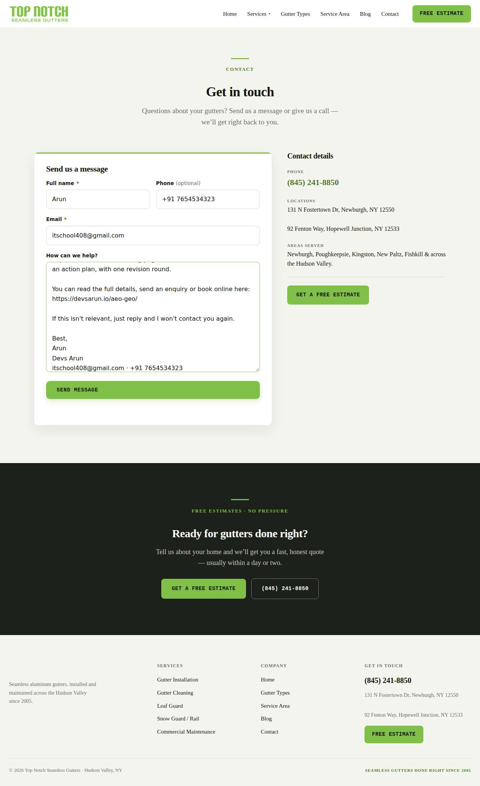

**After submit** — `run-23ceb287_attempt-a4e43fe9_post_attempt_2026-11-02T04-30-46-181Z.jpg`

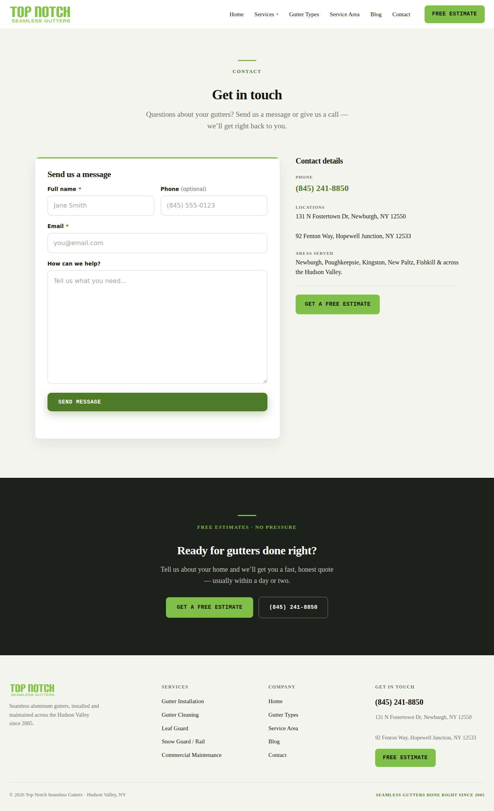

## Events (78)

| Time (UTC) | Event | Website | Details |
|---|---|---|---|
| 04:27:42 | run\_queued | — | live run requested by github:itsDevsArun |
| 04:27:42 | run\_dispatched | — | dispatch disabled (local test mode) |
| 04:27:44 | run\_started | — | Runner claimed live run |
| 04:27:46 | offer\_verified | — | Service page offer facts verified |
| 04:27:46 | website\_selected | clearchoiceplumbingllc.com | Live target clearchoiceplumbingllc.com |
| 04:27:46 | attempt\_reserved | clearchoiceplumbingllc.com | Submission attempt reserved with template standard v2 |
| 04:27:47 | page\_opened | clearchoiceplumbingllc.com | Opened form page |
| 04:27:47 | screenshot\_saved | clearchoiceplumbingllc.com | inspection screenshot saved (145 KB) |
| 04:27:47 | review\_required | clearchoiceplumbingllc.com | failed before submit: locator.fill: Error: Cannot type text into input\[type=number\] |
| 04:27:52 | website\_selected | intelligentservice.com | Live target intelligentservice.com |
| 04:27:52 | attempt\_reserved | intelligentservice.com | Submission attempt reserved with template standard v2 |
| 04:27:55 | page\_opened | intelligentservice.com | Opened form page |
| 04:27:55 | fields\_filled | intelligentservice.com | filled |
| 04:27:55 | screenshot\_saved | intelligentservice.com | filled screenshot saved (326 KB) |
| 04:27:55 | submit\_attempted | intelligentservice.com | submitting |
| 04:28:23 | screenshot\_saved | intelligentservice.com | post\_attempt screenshot saved (324 KB) |
| 04:28:23 | review\_required | intelligentservice.com | unclear: No new success marker observed |
| 04:28:30 | website\_selected | zicarosplumbing.com | Live target zicarosplumbing.com |
| 04:28:30 | attempt\_reserved | zicarosplumbing.com | Submission attempt reserved with template standard v2 |
| 04:28:32 | page\_opened | zicarosplumbing.com | Opened form page |
| 04:28:32 | fields\_filled | zicarosplumbing.com | filled |
| 04:28:32 | screenshot\_saved | zicarosplumbing.com | filled screenshot saved (152 KB) |
| 04:28:32 | submit\_attempted | zicarosplumbing.com | submitting |
| 04:28:59 | screenshot\_saved | zicarosplumbing.com | post\_attempt screenshot saved (98 KB) |
| 04:28:59 | review\_required | zicarosplumbing.com | unclear: No new success marker observed |
| 04:29:05 | website\_selected | reece.com | Live target reece.com |
| 04:29:05 | attempt\_reserved | reece.com | Submission attempt reserved with template standard v2 |
| 04:29:07 | page\_opened | reece.com | Opened form page |
| 04:29:08 | screenshot\_saved | reece.com | filled screenshot saved (82 KB) |
| 04:29:08 | review\_required | reece.com | failed before submit: Field "phoneNumber" did not accept the value |
| 04:29:13 | website\_selected | pinecreekplumbing.com | Live target pinecreekplumbing.com |
| 04:29:13 | attempt\_reserved | pinecreekplumbing.com | Submission attempt reserved with template standard v2 |
| 04:29:15 | page\_opened | pinecreekplumbing.com | Opened form page |
| 04:29:15 | fields\_filled | pinecreekplumbing.com | filled |
| 04:29:15 | screenshot\_saved | pinecreekplumbing.com | filled screenshot saved (288 KB) |
| 04:29:15 | submit\_attempted | pinecreekplumbing.com | submitting |
| 04:29:23 | screenshot\_saved | pinecreekplumbing.com | post\_attempt screenshot saved (260 KB) |
| 04:29:23 | confirmation\_observed | pinecreekplumbing.com | confirmed — "& Sewer Water Heaters Water Treatment Service Area Contact Thank You Call (412) 667-2800 Thanks for reaching out—we’re o" |
| 04:29:29 | website\_selected | dunnellsplumbing.com | Live target dunnellsplumbing.com |
| 04:29:29 | attempt\_reserved | dunnellsplumbing.com | Submission attempt reserved with template standard v2 |
| 04:29:31 | page\_opened | dunnellsplumbing.com | Opened form page |
| 04:29:31 | fields\_filled | dunnellsplumbing.com | filled |
| 04:29:31 | screenshot\_saved | dunnellsplumbing.com | filled screenshot saved (97 KB) |
| 04:29:31 | submit\_attempted | dunnellsplumbing.com | submitting |
| 04:29:58 | screenshot\_saved | dunnellsplumbing.com | post\_attempt screenshot saved (94 KB) |
| 04:29:58 | review\_required | dunnellsplumbing.com | unclear: No new success marker observed |
| 04:30:05 | website\_selected | orlandoroofingco.com | Live target orlandoroofingco.com |
| 04:30:05 | attempt\_reserved | orlandoroofingco.com | Submission attempt reserved with template standard v2 |
| 04:30:06 | page\_opened | orlandoroofingco.com | Opened form page |
| 04:30:06 | screenshot\_saved | orlandoroofingco.com | filled screenshot saved (449 KB) |
| 04:30:06 | review\_required | orlandoroofingco.com | failed before submit: Message field altered the text (length limit?) |
| 04:30:11 | website\_selected | totalroofingco.com | Live target totalroofingco.com |
| 04:30:11 | attempt\_reserved | totalroofingco.com | Submission attempt reserved with template standard v2 |
| 04:30:13 | page\_opened | totalroofingco.com | Opened form page |
| 04:30:13 | screenshot\_saved | totalroofingco.com | filled screenshot saved (170 KB) |
| 04:30:13 | review\_required | totalroofingco.com | failed before submit: Field "PHONE \*" did not accept the value |
| 04:30:18 | website\_selected | allstarroofingtexas.com | Live target allstarroofingtexas.com |
| 04:30:18 | attempt\_reserved | allstarroofingtexas.com | Submission attempt reserved with template standard v2 |
| 04:30:20 | page\_opened | allstarroofingtexas.com | Opened form page |
| 04:30:20 | fields\_filled | allstarroofingtexas.com | filled |
| 04:30:20 | screenshot\_saved | allstarroofingtexas.com | filled screenshot saved (109 KB) |
| 04:30:20 | submit\_attempted | allstarroofingtexas.com | submitting |
| 04:30:24 | screenshot\_saved | allstarroofingtexas.com | post\_attempt screenshot saved (114 KB) |
| 04:30:24 | confirmation\_observed | allstarroofingtexas.com | confirmed — "keep in touch Your name \* Email address \* Subject Message \* Thank you for your message. It has been sent. × Submit HOME " |
| 04:30:31 | website\_selected | pearsonroofing.com | Live target pearsonroofing.com |
| 04:30:31 | attempt\_reserved | pearsonroofing.com | Submission attempt reserved with template standard v2 |
| 04:30:33 | page\_opened | pearsonroofing.com | Opened form page |
| 04:30:34 | screenshot\_saved | pearsonroofing.com | filled screenshot saved (253 KB) |
| 04:30:34 | review\_required | pearsonroofing.com | failed before submit: Message field truncated the text; the required link https://devsarun.io/aeo-geo/ would be lost |
| 04:30:39 | website\_selected | topnotchseamlessgutters.com | Live target topnotchseamlessgutters.com |
| 04:30:39 | attempt\_reserved | topnotchseamlessgutters.com | Submission attempt reserved with template standard v2 |
| 04:30:41 | page\_opened | topnotchseamlessgutters.com | Opened form page |
| 04:30:41 | fields\_filled | topnotchseamlessgutters.com | filled |
| 04:30:41 | screenshot\_saved | topnotchseamlessgutters.com | filled screenshot saved (107 KB) |
| 04:30:41 | submit\_attempted | topnotchseamlessgutters.com | submitting |
| 04:30:46 | screenshot\_saved | topnotchseamlessgutters.com | post\_attempt screenshot saved (92 KB) |
| 04:30:46 | confirmation\_observed | topnotchseamlessgutters.com | confirmed — "us a call — we’ll get right back to you. Send us a message Thank you for your message. It has been sent. Full name \* Pho" |
| 04:30:53 | run\_completed | — | Run completed (queue\_exhausted) |
