# Run 25045dff — live — completed

| | |
|---|---|
| Run ID | `25045dff-e2cd-4478-babc-ebfd3d30b1d7` |
| Requested by | github:itsDevsArun |
| Started | 2026-11-02 03:46:37 UTC |
| Finished | 2026-11-02 03:49:52 UTC |
| Finish reason | queue\_exhausted |
| GitHub Actions | https://github.com/itsDevsArun/aeo-geo/actions/runs/41379081570 |

CSV for this run: [runs/2026-11-02_live_25045dff.csv](2026-11-02_live_25045dff.csv)

## Attempts (11)

### idahosplumber.com — confirmed (LIVE)

| | |
|---|---|
| Attempt ID | `411c0e4f-c23d-41d4-bd15-7283c9c0a2c4` |
| Form URL | https://americanrooterdrain.com/contact/\#form |
| Final URL | https://americanrooterdrain.com/contact/\#form |
| Reserved | 2026-11-02 03:46:39 UTC |
| Submit attempted | 2026-11-02 03:46:40 UTC |
| Template | standard v2 |
| Confirmation text | 5771 EMAIL ARD@idahosplumber.com HOURS Monday – Sunday 24/7 Message received — we'll be in touch shortly\! Need a faster answer? Call us directly at (208) 366-5771. We answer ou |
| Result / error | — |

Exact message:

~~~text
Subject: Helping customers find your business in AI search (AEO + GEO)

Hi there,

I'm Arun from Devs Arun. More and more customers now ask ChatGPT, Gemini, Perplexity or Google's AI Overviews questions like "who should I hire for this in my area?" before they call anyone. These tools answer from websites they can clearly understand, and they tend to recommend businesses whose pages answer real customer questions.

That is what AEO + GEO (Answer Engine and Generative Engine Optimization) is for. I improve your existing service pages so they clearly answer the questions your customers ask, add structured data that matches the page, and make the call, quote or enquiry step obvious. The benefit: your business gets a better chance of being mentioned or linked in AI answers, and visitors who arrive find it easy to contact you.

The AEO + GEO Starter is a one-time $199 (about ₹16,999, negotiable) for one website: a basic audit, 10 customer questions, improvements to two existing pages, relevant structured data and an action plan, with one revision round.

You can read the full details, send an enquiry or book online here:
https://devsarun.io/aeo-geo/

If this isn't relevant, just reply and I won't contact you again.

Best,
Arun
Devs Arun
itschool408@gmail.com · +91 7654534323
~~~

Submitted field values:

- Your name \* \[name\]: Arun
- Email address \[email\]: itschool408@gmail.com
- Phone number \* \[phone\]: +91 7654534323
- Tell us what's going on \[message\]: Hi there, I'm Arun from Devs Arun. More and more customers now ask ChatGPT, Gemini, Perplexity or Google's AI Overviews 

**Filled form (before submit)** — `run-25045dff_attempt-411c0e4f_filled_2026-11-02T03-46-40-928Z.jpg`

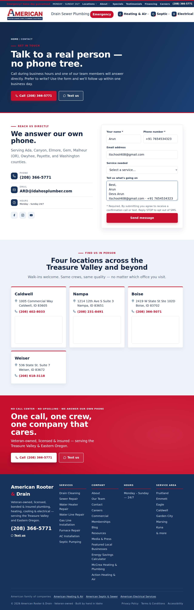

**After submit** — `run-25045dff_attempt-411c0e4f_post_attempt_2026-11-02T03-46-43-633Z.jpg`

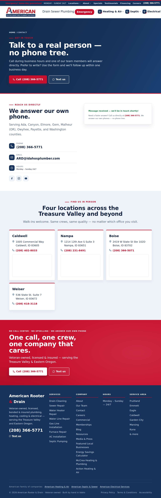

### abetterplumberonline.com — unclear (LIVE)

| | |
|---|---|
| Attempt ID | `f35b481b-feb2-4305-9f5b-f589739fd9ec` |
| Form URL | https://www.abetterplumberonline.com/contact-us |
| Final URL | https://www.abetterplumberonline.com/contact-us |
| Reserved | 2026-11-02 03:46:50 UTC |
| Submit attempted | 2026-11-02 03:46:51 UTC |
| Template | standard v2 |
| Confirmation text | none observed |
| Result / error | No new success marker observed |

Exact message:

~~~text
Subject: Helping customers find your business in AI search (AEO + GEO)

Hi there,

I'm Arun from Devs Arun. More and more customers now ask ChatGPT, Gemini, Perplexity or Google's AI Overviews questions like "who should I hire for this in my area?" before they call anyone. These tools answer from websites they can clearly understand, and they tend to recommend businesses whose pages answer real customer questions.

That is what AEO + GEO (Answer Engine and Generative Engine Optimization) is for. I improve your existing service pages so they clearly answer the questions your customers ask, add structured data that matches the page, and make the call, quote or enquiry step obvious. The benefit: your business gets a better chance of being mentioned or linked in AI answers, and visitors who arrive find it easy to contact you.

The AEO + GEO Starter is a one-time $199 (about ₹16,999, negotiable) for one website: a basic audit, 10 customer questions, improvements to two existing pages, relevant structured data and an action plan, with one revision round.

You can read the full details, send an enquiry or book online here:
https://devsarun.io/aeo-geo/

If this isn't relevant, just reply and I won't contact you again.

Best,
Arun
Devs Arun
itschool408@gmail.com · +91 7654534323
~~~

Submitted field values:

- Name \[name\]: Arun
- Phone \[phone\]: +91 7654534323
- Email: \[email\]: itschool408@gmail.com
- Message \[message\]: Hi there, I'm Arun from Devs Arun. More and more customers now ask ChatGPT, Gemini, Perplexity or Google's AI Overviews 

**Filled form (before submit)** — `run-25045dff_attempt-f35b481b_filled_2026-11-02T03-46-51-829Z.jpg`

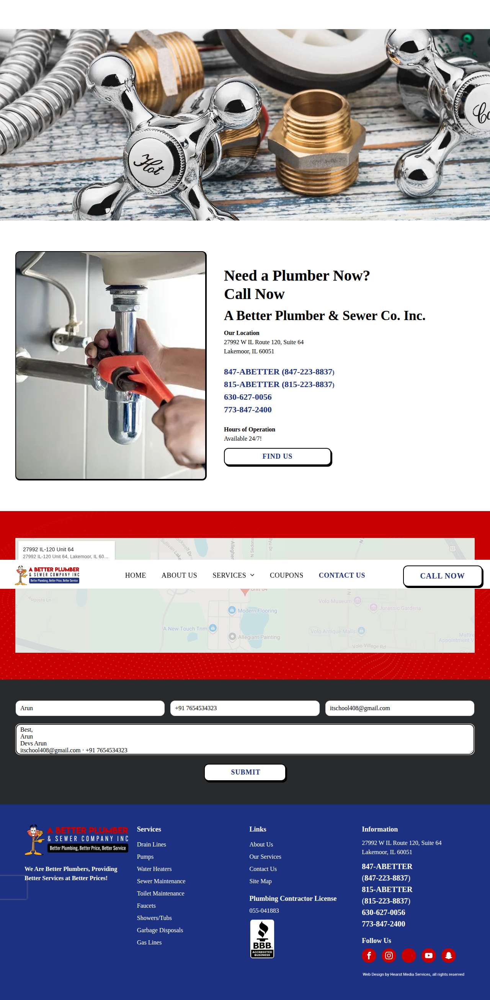

**After submit** — `run-25045dff_attempt-f35b481b_post_attempt_2026-11-02T03-47-18-701Z.jpg`

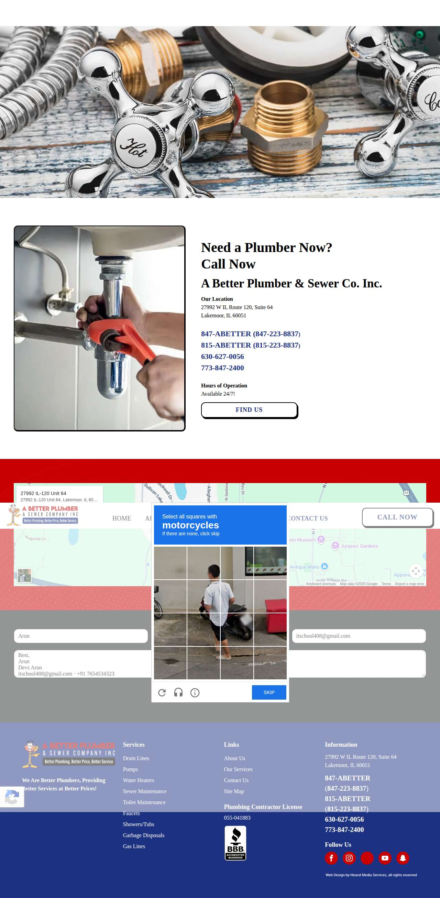

### abcwatermn.com — error\_after\_submit (LIVE)

| | |
|---|---|
| Attempt ID | `6a5a8254-7a1c-40d9-9684-772cbfdb89e8` |
| Form URL | https://www.abcwatermn.com/contact-water-treatment-experts |
| Final URL | https://www.abcwatermn.com/contact-water-treatment-experts |
| Reserved | 2026-11-02 03:47:25 UTC |
| Submit attempted | 2026-11-02 03:47:27 UTC |
| Template | standard v2 |
| Confirmation text | Clean, Soft Water in Southeastern, MN First Name Last Name This field is required Email Phone Zip Code Message Phone: (507) 282-0315 Email: steve@abcwatermn.com Location: 5510 N Bro |
| Result / error | — |

Exact message:

~~~text
Subject: Helping customers find your business in AI search (AEO + GEO)

Hi there,

I'm Arun from Devs Arun. More and more customers now ask ChatGPT, Gemini, Perplexity or Google's AI Overviews questions like "who should I hire for this in my area?" before they call anyone. These tools answer from websites they can clearly understand, and they tend to recommend businesses whose pages answer real customer questions.

That is what AEO + GEO (Answer Engine and Generative Engine Optimization) is for. I improve your existing service pages so they clearly answer the questions your customers ask, add structured data that matches the page, and make the call, quote or enquiry step obvious. The benefit: your business gets a better chance of being mentioned or linked in AI answers, and visitors who arrive find it easy to contact you.

The AEO + GEO Starter is a one-time $199 (about ₹16,999, negotiable) for one website: a basic audit, 10 customer questions, improvements to two existing pages, relevant structured data and an action plan, with one revision round.

You can read the full details, send an enquiry or book online here:
https://devsarun.io/aeo-geo/

If this isn't relevant, just reply and I won't contact you again.

Best,
Arun
Devs Arun
itschool408@gmail.com · +91 7654534323
~~~

Submitted field values:

- Email \[email\]: itschool408@gmail.com
- Phone \[phone\]: +91 7654534323
- Message \[message\]: Hi there, I'm Arun from Devs Arun. More and more customers now ask ChatGPT, Gemini, Perplexity or Google's AI Overviews 
- First Name \[first\_name\]: Arun

**Filled form (before submit)** — `run-25045dff_attempt-6a5a8254_filled_2026-11-02T03-47-27-642Z.jpg`

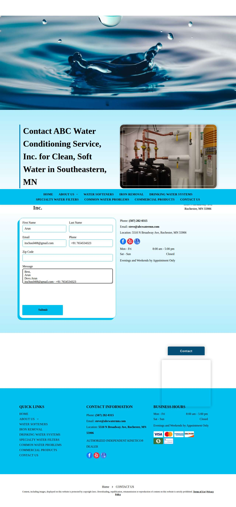

**After submit** — `run-25045dff_attempt-6a5a8254_post_attempt_2026-11-02T03-47-30-796Z.jpg`

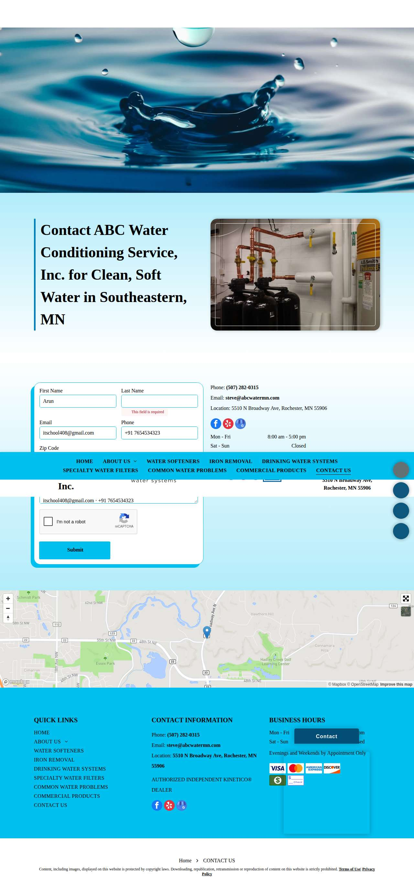

### thyplumber.com — confirmed (LIVE)

| | |
|---|---|
| Attempt ID | `63d21504-0eaf-408b-a8f5-8c16cb0bcf42` |
| Form URL | https://www.thyplumber.com/contact-us/ |
| Final URL | https://www.thyplumber.com/thank-you/ |
| Reserved | 2026-11-02 03:47:38 UTC |
| Submit attempted | 2026-11-02 03:47:39 UTC |
| Template | standard v2 |
| Confirmation text | e At Fair Prices Emergency 24 Hour Plumbing & Sewer Service THANK YOU Thanks for your interest with us. We will get back to you as soon as possible. SERVICE AREAS Berwyn |
| Result / error | — |

Exact message:

~~~text
Subject: Helping customers find your business in AI search (AEO + GEO)

Hi there,

I'm Arun from Devs Arun. More and more customers now ask ChatGPT, Gemini, Perplexity or Google's AI Overviews questions like "who should I hire for this in my area?" before they call anyone. These tools answer from websites they can clearly understand, and they tend to recommend businesses whose pages answer real customer questions.

That is what AEO + GEO (Answer Engine and Generative Engine Optimization) is for. I improve your existing service pages so they clearly answer the questions your customers ask, add structured data that matches the page, and make the call, quote or enquiry step obvious. The benefit: your business gets a better chance of being mentioned or linked in AI answers, and visitors who arrive find it easy to contact you.

The AEO + GEO Starter is a one-time $199 (about ₹16,999, negotiable) for one website: a basic audit, 10 customer questions, improvements to two existing pages, relevant structured data and an action plan, with one revision round.

You can read the full details, send an enquiry or book online here:
https://devsarun.io/aeo-geo/

If this isn't relevant, just reply and I won't contact you again.

Best,
Arun
Devs Arun
itschool408@gmail.com · +91 7654534323
~~~

Submitted field values:

- Name\* \[name\]: Arun
- Phone \[phone\]: +91 7654534323
- Email\* \[email\]: itschool408@gmail.com
- Message \[message\]: Hi there, I'm Arun from Devs Arun. More and more customers now ask ChatGPT, Gemini, Perplexity or Google's AI Overviews 
- Subject \[subject\]: Helping customers find your business in AI search (AEO + GEO)

**Filled form (before submit)** — `run-25045dff_attempt-63d21504_filled_2026-11-02T03-47-39-719Z.jpg`

**After submit** — `run-25045dff_attempt-63d21504_post_attempt_2026-11-02T03-47-42-470Z.jpg`

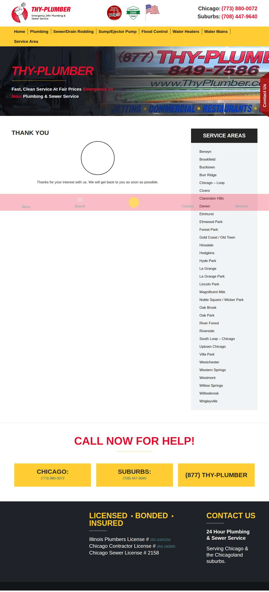

### 411plumber.com — unclear (LIVE)

| | |
|---|---|
| Attempt ID | `cfaf3c42-4a5a-439d-a4ae-e775644032a9` |
| Form URL | https://411plumber.com/contact/ |
| Final URL | https://411plumber.com/contact/ |
| Reserved | 2026-11-02 03:47:48 UTC |
| Submit attempted | 2026-11-02 03:47:50 UTC |
| Template | standard v2 |
| Confirmation text | none observed |
| Result / error | No new success marker observed |

Exact message:

~~~text
Subject: Helping customers find your business in AI search (AEO + GEO)

Hi there,

I'm Arun from Devs Arun. More and more customers now ask ChatGPT, Gemini, Perplexity or Google's AI Overviews questions like "who should I hire for this in my area?" before they call anyone. These tools answer from websites they can clearly understand, and they tend to recommend businesses whose pages answer real customer questions.

That is what AEO + GEO (Answer Engine and Generative Engine Optimization) is for. I improve your existing service pages so they clearly answer the questions your customers ask, add structured data that matches the page, and make the call, quote or enquiry step obvious. The benefit: your business gets a better chance of being mentioned or linked in AI answers, and visitors who arrive find it easy to contact you.

The AEO + GEO Starter is a one-time $199 (about ₹16,999, negotiable) for one website: a basic audit, 10 customer questions, improvements to two existing pages, relevant structured data and an action plan, with one revision round.

You can read the full details, send an enquiry or book online here:
https://devsarun.io/aeo-geo/

If this isn't relevant, just reply and I won't contact you again.

Best,
Arun
Devs Arun
itschool408@gmail.com · +91 7654534323
~~~

Submitted field values:

- Name \[name\]: Arun
- Email \[email\]: itschool408@gmail.com
- Phone \[phone\]: +91 7654534323
- Message \[message\]: Hi there, I'm Arun from Devs Arun. More and more customers now ask ChatGPT, Gemini, Perplexity or Google's AI Overviews 

**Filled form (before submit)** — `run-25045dff_attempt-cfaf3c42_filled_2026-11-02T03-47-50-778Z.jpg`

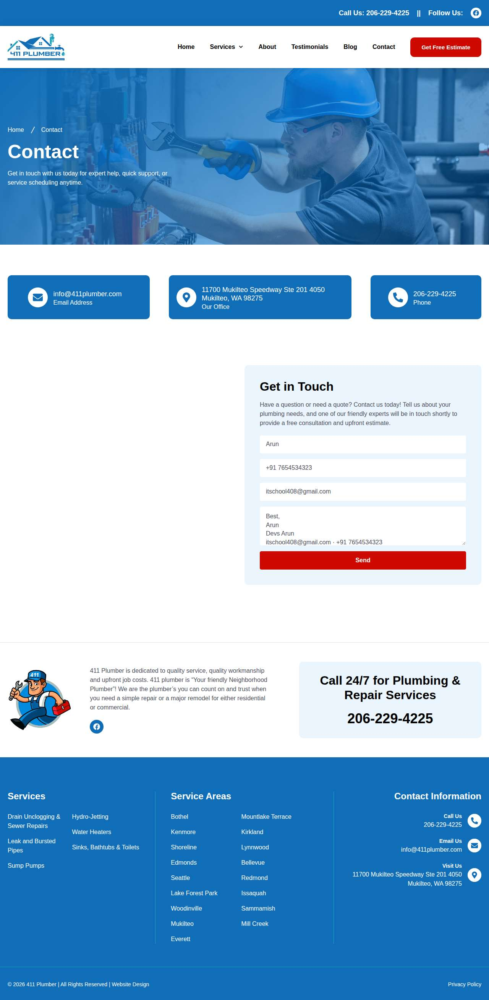

**After submit** — `run-25045dff_attempt-cfaf3c42_post_attempt_2026-11-02T03-48-18-639Z.jpg`

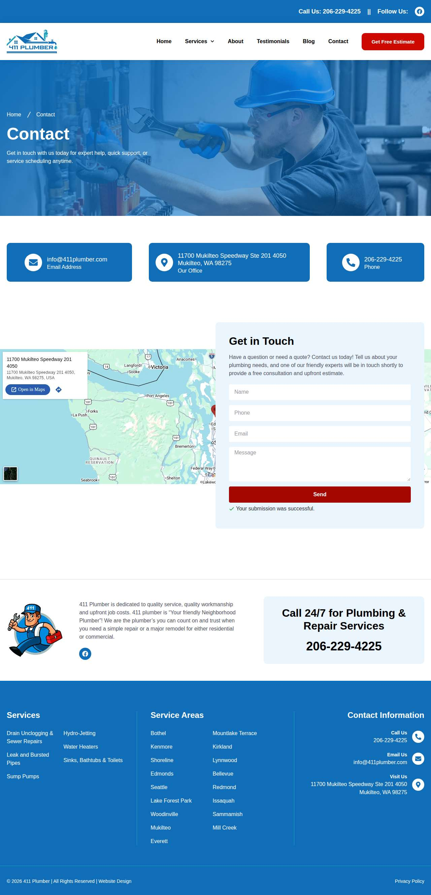

### freedomplumbingmidwest.com — failed\_before\_submit (LIVE)

| | |
|---|---|
| Attempt ID | `3c621bfc-fb96-418c-a8e6-f4de035927ef` |
| Form URL | https://freedomplumbingmidwest.com/contact-us/ |
| Final URL | https://freedomplumbingmidwest.com/contact-us/ |
| Reserved | 2026-11-02 03:48:25 UTC |
| Submit attempted | — |
| Template | standard v2 |
| Confirmation text | none observed |
| Result / error | Message field truncated the text; the required link https://devsarun.io/aeo-geo/ would be lost |

Exact message:

~~~text
Subject: Helping customers find your business in AI search (AEO + GEO)

Hi there,

I'm Arun from Devs Arun. More and more customers now ask ChatGPT, Gemini, Perplexity or Google's AI Overviews questions like "who should I hire for this in my area?" before they call anyone. These tools answer from websites they can clearly understand, and they tend to recommend businesses whose pages answer real customer questions.

That is what AEO + GEO (Answer Engine and Generative Engine Optimization) is for. I improve your existing service pages so they clearly answer the questions your customers ask, add structured data that matches the page, and make the call, quote or enquiry step obvious. The benefit: your business gets a better chance of being mentioned or linked in AI answers, and visitors who arrive find it easy to contact you.

The AEO + GEO Starter is a one-time $199 (about ₹16,999, negotiable) for one website: a basic audit, 10 customer questions, improvements to two existing pages, relevant structured data and an action plan, with one revision round.

You can read the full details, send an enquiry or book online here:
https://devsarun.io/aeo-geo/

If this isn't relevant, just reply and I won't contact you again.

Best,
Arun
Devs Arun
itschool408@gmail.com · +91 7654534323
~~~

Submitted field values:

- \#forminator-field-name-1\_6ae803dbec7f0: Arun
- \#forminator-field-email-1\_6ae803dbec7f0: itschool408@gmail.com
- \#forminator-field-phone-1\_6ae803dbec7f0: +91 7654534323
- \#forminator-field-textarea-1\_6ae803dbec7f0: Hi there, I'm Arun from Devs Arun. More and more customers now ask ChatGPT, Gemini, Perplexity or Google's AI Overviews 

**Filled form (before submit)** — `run-25045dff_attempt-3c621bfc_filled_2026-11-02T03-48-26-901Z.jpg`

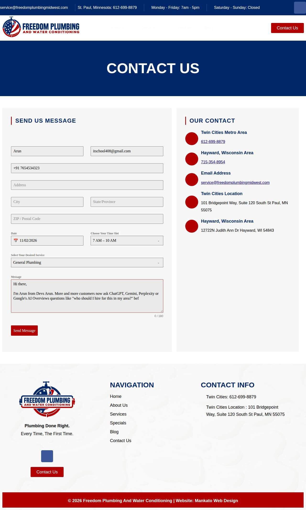

### clearchoiceplumbingllc.com — failed\_before\_submit (LIVE)

| | |
|---|---|
| Attempt ID | `f5876149-1011-43eb-b9cc-4ff959a077a6` |
| Form URL | https://clearchoiceplumbingllc.com/contact/ |
| Final URL | — |
| Reserved | 2026-11-02 03:48:31 UTC |
| Submit attempted | — |
| Template | standard v2 |
| Confirmation text | none observed |
| Result / error | locator.fill: Error: Cannot type text into input\[type=number\] |

Exact message:

~~~text
Subject: Helping customers find your business in AI search (AEO + GEO)

Hi there,

I'm Arun from Devs Arun. More and more customers now ask ChatGPT, Gemini, Perplexity or Google's AI Overviews questions like "who should I hire for this in my area?" before they call anyone. These tools answer from websites they can clearly understand, and they tend to recommend businesses whose pages answer real customer questions.

That is what AEO + GEO (Answer Engine and Generative Engine Optimization) is for. I improve your existing service pages so they clearly answer the questions your customers ask, add structured data that matches the page, and make the call, quote or enquiry step obvious. The benefit: your business gets a better chance of being mentioned or linked in AI answers, and visitors who arrive find it easy to contact you.

The AEO + GEO Starter is a one-time $199 (about ₹16,999, negotiable) for one website: a basic audit, 10 customer questions, improvements to two existing pages, relevant structured data and an action plan, with one revision round.

You can read the full details, send an enquiry or book online here:
https://devsarun.io/aeo-geo/

If this isn't relevant, just reply and I won't contact you again.

Best,
Arun
Devs Arun
itschool408@gmail.com · +91 7654534323
~~~

Submitted field values:

- \#wpforms-51-field\_1: Arun
- \#wpforms-51-field\_2: itschool408@gmail.com
- \#wpforms-51-field\_3: Hi there, I'm Arun from Devs Arun. More and more customers now ask ChatGPT, Gemini, Perplexity or Google's AI Overviews 
- \#wpforms-51-field\_5: +91 7654534323

**Inspected page** — `run-25045dff_attempt-f5876149_inspection_2026-11-02T03-48-33-405Z.jpg`

### waterresourcesnj.com — failed\_before\_submit (LIVE)

| | |
|---|---|
| Attempt ID | `6cfccc73-44d7-4ab6-9ba0-ae572deda72c` |
| Form URL | https://waterresourcesnj.com/contact/ |
| Final URL | https://waterresourcesnj.com/contact/ |
| Reserved | 2026-11-02 03:48:38 UTC |
| Submit attempted | — |
| Template | standard v2 |
| Confirmation text | none observed |
| Result / error | Field "Phone\*" did not accept the value |

Exact message:

~~~text
Subject: Helping customers find your business in AI search (AEO + GEO)

Hi there,

I'm Arun from Devs Arun. More and more customers now ask ChatGPT, Gemini, Perplexity or Google's AI Overviews questions like "who should I hire for this in my area?" before they call anyone. These tools answer from websites they can clearly understand, and they tend to recommend businesses whose pages answer real customer questions.

That is what AEO + GEO (Answer Engine and Generative Engine Optimization) is for. I improve your existing service pages so they clearly answer the questions your customers ask, add structured data that matches the page, and make the call, quote or enquiry step obvious. The benefit: your business gets a better chance of being mentioned or linked in AI answers, and visitors who arrive find it easy to contact you.

The AEO + GEO Starter is a one-time $199 (about ₹16,999, negotiable) for one website: a basic audit, 10 customer questions, improvements to two existing pages, relevant structured data and an action plan, with one revision round.

You can read the full details, send an enquiry or book online here:
https://devsarun.io/aeo-geo/

If this isn't relevant, just reply and I won't contact you again.

Best,
Arun
Devs Arun
itschool408@gmail.com · +91 7654534323
~~~

Submitted field values:

- \#input\_1\_1: Arun
- \#input\_1\_2: itschool408@gmail.com
- \#input\_1\_3: +91 7654534323
- \#input\_1\_4: Hi there, I'm Arun from Devs Arun. More and more customers now ask ChatGPT, Gemini, Perplexity or Google's AI Overviews 

**Filled form (before submit)** — `run-25045dff_attempt-6cfccc73_filled_2026-11-02T03-48-41-431Z.jpg`

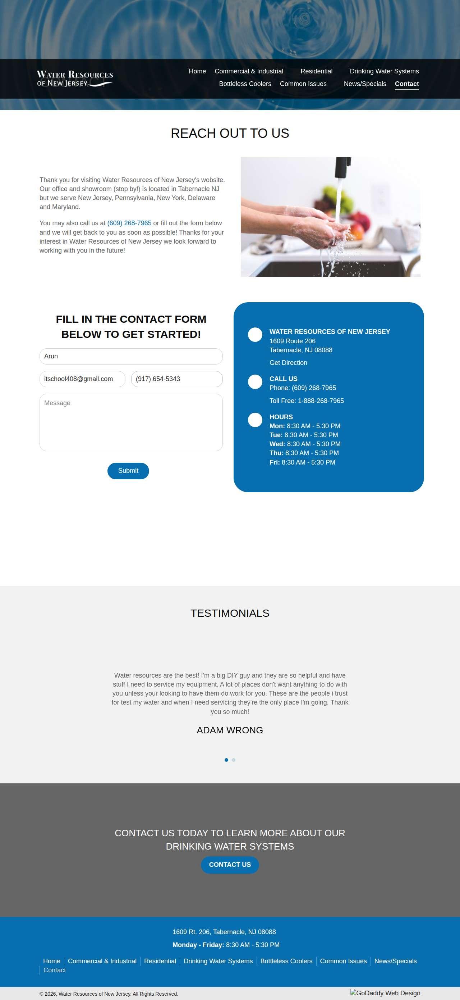

### mjunderground.com — error\_after\_submit (LIVE)

| | |
|---|---|
| Attempt ID | `43df80ba-5072-411d-ab97-29ddb8275f0a` |
| Form URL | https://www.mjunderground.com/reach-out-utility-service |
| Final URL | https://www.mjunderground.com/reach-out-utility-service |
| Reserved | 2026-11-02 03:48:46 UTC |
| Submit attempted | 2026-11-02 03:48:48 UTC |
| Template | standard v2 |
| Confirmation text | hortly, usually within 24 to 48 hours. First Name Last Name This field is required Email Phone Message CONTACT M & J UNDERGROUND INC. IN MONEE, IL Contact M & J Underground of Monee, |
| Result / error | — |

Exact message:

~~~text
Subject: Helping customers find your business in AI search (AEO + GEO)

Hi there,

I'm Arun from Devs Arun. More and more customers now ask ChatGPT, Gemini, Perplexity or Google's AI Overviews questions like "who should I hire for this in my area?" before they call anyone. These tools answer from websites they can clearly understand, and they tend to recommend businesses whose pages answer real customer questions.

That is what AEO + GEO (Answer Engine and Generative Engine Optimization) is for. I improve your existing service pages so they clearly answer the questions your customers ask, add structured data that matches the page, and make the call, quote or enquiry step obvious. The benefit: your business gets a better chance of being mentioned or linked in AI answers, and visitors who arrive find it easy to contact you.

The AEO + GEO Starter is a one-time $199 (about ₹16,999, negotiable) for one website: a basic audit, 10 customer questions, improvements to two existing pages, relevant structured data and an action plan, with one revision round.

You can read the full details, send an enquiry or book online here:
https://devsarun.io/aeo-geo/

If this isn't relevant, just reply and I won't contact you again.

Best,
Arun
Devs Arun
itschool408@gmail.com · +91 7654534323
~~~

Submitted field values:

- Email \[email\]: itschool408@gmail.com
- Phone \[phone\]: +91 7654534323
- Message \[message\]: Hi there, I'm Arun from Devs Arun. More and more customers now ask ChatGPT, Gemini, Perplexity or Google's AI Overviews 
- First Name \[first\_name\]: Arun

**Filled form (before submit)** — `run-25045dff_attempt-43df80ba_filled_2026-11-02T03-48-48-566Z.jpg`

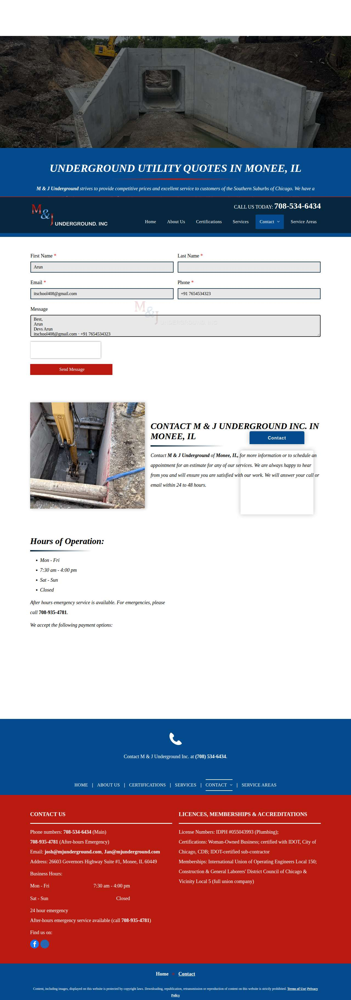

**After submit** — `run-25045dff_attempt-43df80ba_post_attempt_2026-11-02T03-48-51-101Z.jpg`

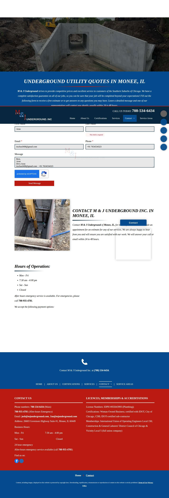

### aloha-plumbinghvac.com — confirmed (LIVE)

| | |
|---|---|
| Attempt ID | `b2fc2244-9dd5-4fee-983e-97528d8996b2` |
| Form URL | https://aloha-plumbinghvac.com/contact |
| Final URL | https://aloha-plumbinghvac.com/thank-you |
| Reserved | 2026-11-02 03:48:57 UTC |
| Submit attempted | 2026-11-02 03:48:59 UTC |
| Template | standard v2 |
| Confirmation text | REQUEST RECEIVED Thank you\! We’ve received your request Our team is reviewing your submission now. If your request is urgent, |
| Result / error | — |

Exact message:

~~~text
Subject: Helping customers find your business in AI search (AEO + GEO)

Hi there,

I'm Arun from Devs Arun. More and more customers now ask ChatGPT, Gemini, Perplexity or Google's AI Overviews questions like "who should I hire for this in my area?" before they call anyone. These tools answer from websites they can clearly understand, and they tend to recommend businesses whose pages answer real customer questions.

That is what AEO + GEO (Answer Engine and Generative Engine Optimization) is for. I improve your existing service pages so they clearly answer the questions your customers ask, add structured data that matches the page, and make the call, quote or enquiry step obvious. The benefit: your business gets a better chance of being mentioned or linked in AI answers, and visitors who arrive find it easy to contact you.

The AEO + GEO Starter is a one-time $199 (about ₹16,999, negotiable) for one website: a basic audit, 10 customer questions, improvements to two existing pages, relevant structured data and an action plan, with one revision round.

You can read the full details, send an enquiry or book online here:
https://devsarun.io/aeo-geo/

If this isn't relevant, just reply and I won't contact you again.

Best,
Arun
Devs Arun
itschool408@gmail.com · +91 7654534323
~~~

Submitted field values:

- Message \[message\]: Hi there, I'm Arun from Devs Arun. More and more customers now ask ChatGPT, Gemini, Perplexity or Google's AI Overviews 
- Phone Number \[phone\]: +91 7654534323
- Email Address \[email\]: itschool408@gmail.com
- Full Name \[first\_name\]: Arun

**Filled form (before submit)** — `run-25045dff_attempt-b2fc2244_filled_2026-11-02T03-48-59-613Z.jpg`

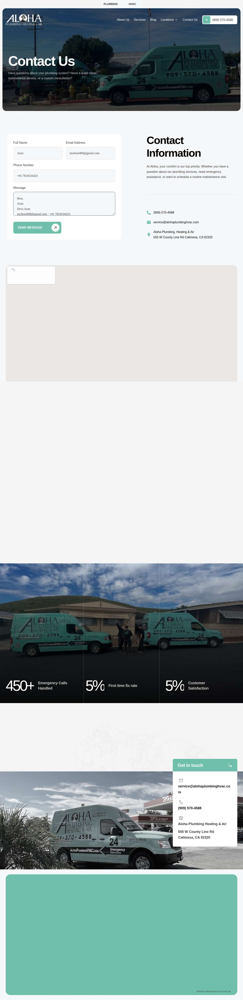

**After submit** — `run-25045dff_attempt-b2fc2244_post_attempt_2026-11-02T03-49-02-287Z.jpg`

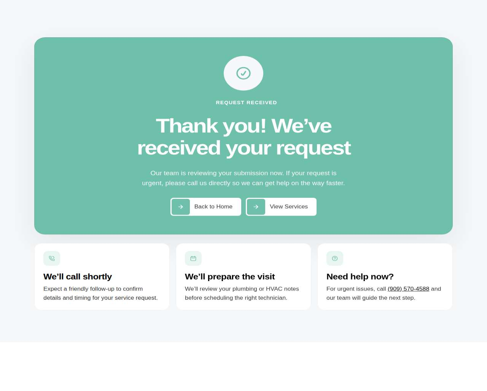

### anywhererooter.com — unclear (LIVE)

| | |
|---|---|
| Attempt ID | `513cd19b-6bb9-4dd5-90ea-ed491a1b550f` |
| Form URL | https://anywhererooter.com/contact-us-plumbing-denver/ |
| Final URL | https://anywhererooter.com/contact-us-plumbing-denver/ |
| Reserved | 2026-11-02 03:49:08 UTC |
| Submit attempted | 2026-11-02 03:49:11 UTC |
| Template | standard v2 |
| Confirmation text | none observed |
| Result / error | No new success marker observed |

Exact message:

~~~text
Subject: Helping customers find your business in AI search (AEO + GEO)

Hi there,

I'm Arun from Devs Arun. More and more customers now ask ChatGPT, Gemini, Perplexity or Google's AI Overviews questions like "who should I hire for this in my area?" before they call anyone. These tools answer from websites they can clearly understand, and they tend to recommend businesses whose pages answer real customer questions.

That is what AEO + GEO (Answer Engine and Generative Engine Optimization) is for. I improve your existing service pages so they clearly answer the questions your customers ask, add structured data that matches the page, and make the call, quote or enquiry step obvious. The benefit: your business gets a better chance of being mentioned or linked in AI answers, and visitors who arrive find it easy to contact you.

The AEO + GEO Starter is a one-time $199 (about ₹16,999, negotiable) for one website: a basic audit, 10 customer questions, improvements to two existing pages, relevant structured data and an action plan, with one revision round.

You can read the full details, send an enquiry or book online here:
https://devsarun.io/aeo-geo/

If this isn't relevant, just reply and I won't contact you again.

Best,
Arun
Devs Arun
itschool408@gmail.com · +91 7654534323
~~~

Submitted field values:

- Name \[name\]: Arun
- Email \[email\]: itschool408@gmail.com
- Message \[message\]: Hi there, I'm Arun from Devs Arun. More and more customers now ask ChatGPT, Gemini, Perplexity or Google's AI Overviews 
- Telephone \[phone\]: +91 7654534323

**Filled form (before submit)** — `run-25045dff_attempt-513cd19b_filled_2026-11-02T03-49-11-016Z.jpg`

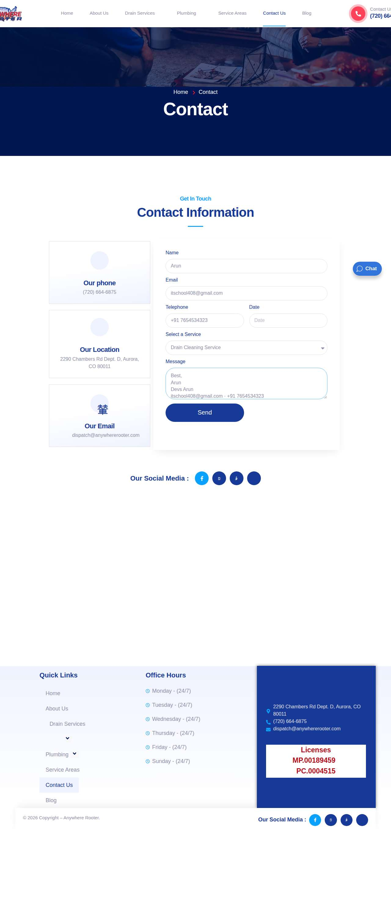

**After submit** — `run-25045dff_attempt-513cd19b_post_attempt_2026-11-02T03-49-45-877Z.jpg`

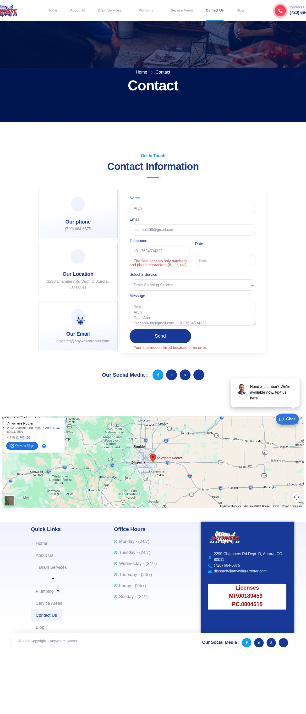

## Events (84)

| Time (UTC) | Event | Website | Details |
|---|---|---|---|
| 03:46:35 | run\_queued | — | live run requested by github:itsDevsArun |
| 03:46:35 | run\_dispatched | — | dispatch disabled (local test mode) |
| 03:46:37 | run\_started | — | Runner claimed live run |
| 03:46:38 | offer\_verified | — | Service page offer facts verified |
| 03:46:39 | website\_selected | idahosplumber.com | Live target idahosplumber.com |
| 03:46:39 | attempt\_reserved | idahosplumber.com | Submission attempt reserved with template standard v2 |
| 03:46:40 | page\_opened | idahosplumber.com | Opened form page |
| 03:46:40 | fields\_filled | idahosplumber.com | filled |
| 03:46:40 | screenshot\_saved | idahosplumber.com | filled screenshot saved (278 KB) |
| 03:46:40 | submit\_attempted | idahosplumber.com | submitting |
| 03:46:43 | screenshot\_saved | idahosplumber.com | post\_attempt screenshot saved (262 KB) |
| 03:46:43 | confirmation\_observed | idahosplumber.com | confirmed — "5771 EMAIL ARD@idahosplumber.com HOURS Monday – Sunday 24/7 Message received — we'll be in touch shortly\! Need a faster " |
| 03:46:50 | website\_selected | abetterplumberonline.com | Live target abetterplumberonline.com |
| 03:46:50 | attempt\_reserved | abetterplumberonline.com | Submission attempt reserved with template standard v2 |
| 03:46:51 | page\_opened | abetterplumberonline.com | Opened form page |
| 03:46:51 | fields\_filled | abetterplumberonline.com | filled |
| 03:46:51 | screenshot\_saved | abetterplumberonline.com | filled screenshot saved (238 KB) |
| 03:46:51 | submit\_attempted | abetterplumberonline.com | submitting |
| 03:47:18 | screenshot\_saved | abetterplumberonline.com | post\_attempt screenshot saved (242 KB) |
| 03:47:18 | review\_required | abetterplumberonline.com | unclear: No new success marker observed |
| 03:47:25 | website\_selected | abcwatermn.com | Live target abcwatermn.com |
| 03:47:25 | attempt\_reserved | abcwatermn.com | Submission attempt reserved with template standard v2 |
| 03:47:27 | page\_opened | abcwatermn.com | Opened form page |
| 03:47:27 | fields\_filled | abcwatermn.com | filled |
| 03:47:27 | screenshot\_saved | abcwatermn.com | filled screenshot saved (196 KB) |
| 03:47:27 | submit\_attempted | abcwatermn.com | submitting |
| 03:47:30 | screenshot\_saved | abcwatermn.com | post\_attempt screenshot saved (220 KB) |
| 03:47:30 | error | abcwatermn.com | error after submit — "Clean, Soft Water in Southeastern, MN First Name Last Name This field is required Email Phone Zip Code Message Phone: (5" |
| 03:47:38 | website\_selected | thyplumber.com | Live target thyplumber.com |
| 03:47:38 | attempt\_reserved | thyplumber.com | Submission attempt reserved with template standard v2 |
| 03:47:39 | page\_opened | thyplumber.com | Opened form page |
| 03:47:39 | fields\_filled | thyplumber.com | filled |
| 03:47:39 | screenshot\_saved | thyplumber.com | filled screenshot saved (201 KB) |
| 03:47:39 | submit\_attempted | thyplumber.com | submitting |
| 03:47:42 | screenshot\_saved | thyplumber.com | post\_attempt screenshot saved (186 KB) |
| 03:47:42 | confirmation\_observed | thyplumber.com | confirmed — "e At Fair Prices Emergency 24 Hour Plumbing & Sewer Service THANK YOU Thanks for your interest with us. We will get back" |
| 03:47:48 | website\_selected | 411plumber.com | Live target 411plumber.com |
| 03:47:48 | attempt\_reserved | 411plumber.com | Submission attempt reserved with template standard v2 |
| 03:47:50 | page\_opened | 411plumber.com | Opened form page |
| 03:47:50 | fields\_filled | 411plumber.com | filled |
| 03:47:50 | screenshot\_saved | 411plumber.com | filled screenshot saved (160 KB) |
| 03:47:50 | submit\_attempted | 411plumber.com | submitting |
| 03:48:18 | screenshot\_saved | 411plumber.com | post\_attempt screenshot saved (190 KB) |
| 03:48:18 | review\_required | 411plumber.com | unclear: No new success marker observed |
| 03:48:25 | website\_selected | freedomplumbingmidwest.com | Live target freedomplumbingmidwest.com |
| 03:48:25 | attempt\_reserved | freedomplumbingmidwest.com | Submission attempt reserved with template standard v2 |
| 03:48:26 | page\_opened | freedomplumbingmidwest.com | Opened form page |
| 03:48:26 | screenshot\_saved | freedomplumbingmidwest.com | filled screenshot saved (139 KB) |
| 03:48:26 | review\_required | freedomplumbingmidwest.com | failed before submit: Message field truncated the text; the required link https://devsarun.io/aeo-geo/ would be lost |
| 03:48:31 | website\_selected | clearchoiceplumbingllc.com | Live target clearchoiceplumbingllc.com |
| 03:48:31 | attempt\_reserved | clearchoiceplumbingllc.com | Submission attempt reserved with template standard v2 |
| 03:48:33 | page\_opened | clearchoiceplumbingllc.com | Opened form page |
| 03:48:33 | screenshot\_saved | clearchoiceplumbingllc.com | inspection screenshot saved (145 KB) |
| 03:48:33 | review\_required | clearchoiceplumbingllc.com | failed before submit: locator.fill: Error: Cannot type text into input\[type=number\] |
| 03:48:38 | website\_selected | waterresourcesnj.com | Live target waterresourcesnj.com |
| 03:48:38 | attempt\_reserved | waterresourcesnj.com | Submission attempt reserved with template standard v2 |
| 03:48:41 | page\_opened | waterresourcesnj.com | Opened form page |
| 03:48:41 | screenshot\_saved | waterresourcesnj.com | filled screenshot saved (172 KB) |
| 03:48:41 | review\_required | waterresourcesnj.com | failed before submit: Field "Phone\*" did not accept the value |
| 03:48:46 | website\_selected | mjunderground.com | Live target mjunderground.com |
| 03:48:46 | attempt\_reserved | mjunderground.com | Submission attempt reserved with template standard v2 |
| 03:48:48 | page\_opened | mjunderground.com | Opened form page |
| 03:48:48 | fields\_filled | mjunderground.com | filled |
| 03:48:48 | screenshot\_saved | mjunderground.com | filled screenshot saved (269 KB) |
| 03:48:48 | submit\_attempted | mjunderground.com | submitting |
| 03:48:51 | screenshot\_saved | mjunderground.com | post\_attempt screenshot saved (290 KB) |
| 03:48:51 | error | mjunderground.com | error after submit — "hortly, usually within 24 to 48 hours. First Name Last Name This field is required Email Phone Message CONTACT M & J UND" |
| 03:48:57 | website\_selected | aloha-plumbinghvac.com | Live target aloha-plumbinghvac.com |
| 03:48:57 | attempt\_reserved | aloha-plumbinghvac.com | Submission attempt reserved with template standard v2 |
| 03:48:59 | page\_opened | aloha-plumbinghvac.com | Opened form page |
| 03:48:59 | fields\_filled | aloha-plumbinghvac.com | filled |
| 03:48:59 | screenshot\_saved | aloha-plumbinghvac.com | filled screenshot saved (268 KB) |
| 03:48:59 | submit\_attempted | aloha-plumbinghvac.com | submitting |
| 03:49:02 | screenshot\_saved | aloha-plumbinghvac.com | post\_attempt screenshot saved (47 KB) |
| 03:49:02 | confirmation\_observed | aloha-plumbinghvac.com | confirmed — "REQUEST RECEIVED Thank you\! We’ve received your request Our team is reviewing your submission now. If your request is ur" |
| 03:49:08 | website\_selected | anywhererooter.com | Live target anywhererooter.com |
| 03:49:08 | attempt\_reserved | anywhererooter.com | Submission attempt reserved with template standard v2 |
| 03:49:10 | page\_opened | anywhererooter.com | Opened form page |
| 03:49:10 | fields\_filled | anywhererooter.com | filled |
| 03:49:11 | screenshot\_saved | anywhererooter.com | filled screenshot saved (115 KB) |
| 03:49:11 | submit\_attempted | anywhererooter.com | submitting |
| 03:49:45 | screenshot\_saved | anywhererooter.com | post\_attempt screenshot saved (181 KB) |
| 03:49:45 | review\_required | anywhererooter.com | unclear: No new success marker observed |
| 03:49:52 | run\_completed | — | Run completed (queue\_exhausted) |
