# Run 2b5f01a9 — live — completed

| | |
|---|---|
| Run ID | `2b5f01a9-f323-47d3-96c3-77ad53bbf7bf` |
| Requested by | github:itsDevsArun |
| Started | 2026-11-02 17:03:25 UTC |
| Finished | 2026-11-02 17:09:15 UTC |
| Finish reason | queue\_exhausted |
| GitHub Actions | https://github.com/itsDevsArun/aeo-geo/actions/runs/41469315389 |

CSV for this run: [runs/2026-11-02_live_2b5f01a9.csv](2026-11-02_live_2b5f01a9.csv)

## Attempts (19)

### clearchoiceplumbingllc.com — failed\_before\_submit (LIVE)

| | |
|---|---|
| Attempt ID | `2965292d-1dd7-4415-a5ca-07e0b32ba473` |
| Form URL | https://clearchoiceplumbingllc.com/contact/ |
| Final URL | — |
| Reserved | 2026-11-02 17:03:26 UTC |
| Submit attempted | — |
| Template | standard v2 |
| Confirmation text | none observed |
| Result / error | locator.fill: Error: Cannot type text into input\[type=number\] |

Exact message:

~~~text
Subject: Helping customers find your business in AI search (AEO + GEO)

Hi there,

I'm Arun from Devs Arun. More and more customers now ask ChatGPT, Gemini, Perplexity or Google's AI Overviews questions like "who should I hire for this in my area?" before they call anyone. These tools answer from websites they can clearly understand, and they tend to recommend businesses whose pages answer real customer questions.

That is what AEO + GEO (Answer Engine and Generative Engine Optimization) is for. I improve your existing service pages so they clearly answer the questions your customers ask, add structured data that matches the page, and make the call, quote or enquiry step obvious. The benefit: your business gets a better chance of being mentioned or linked in AI answers, and visitors who arrive find it easy to contact you.

The AEO + GEO Starter is a one-time $199 (about ₹16,999, negotiable) for one website: a basic audit, 10 customer questions, improvements to two existing pages, relevant structured data and an action plan, with one revision round.

You can read the full details, send an enquiry or book online here:
https://devsarun.io/aeo-geo/

If this isn't relevant, just reply and I won't contact you again.

Best,
Arun
Devs Arun
itschool408@gmail.com · +91 7654534323
~~~

Submitted field values:

- \#wpforms-51-field\_1: Arun
- \#wpforms-51-field\_2: itschool408@gmail.com
- \#wpforms-51-field\_3: Hi there, I'm Arun from Devs Arun. More and more customers now ask ChatGPT, Gemini, Perplexity or Google's AI Overviews 
- \#wpforms-51-field\_5: +91 7654534323

**Inspected page** — `run-2b5f01a9_attempt-2965292d_inspection_2026-11-02T17-03-28-467Z.jpg`

### glescoelectric.com — failed\_before\_submit (LIVE)

| | |
|---|---|
| Attempt ID | `528b6966-64e8-4b14-b79c-83a86635f657` |
| Form URL | https://www.glescoelectric.com/contact |
| Final URL | https://www.glescoelectric.com/contact |
| Reserved | 2026-11-02 17:03:33 UTC |
| Submit attempted | — |
| Template | standard v2 |
| Confirmation text | none observed |
| Result / error | Field "Subject" did not accept the value |

Exact message:

~~~text
Subject: Helping customers find your business in AI search (AEO + GEO)

Hi there,

I'm Arun from Devs Arun. More and more customers now ask ChatGPT, Gemini, Perplexity or Google's AI Overviews questions like "who should I hire for this in my area?" before they call anyone. These tools answer from websites they can clearly understand, and they tend to recommend businesses whose pages answer real customer questions.

That is what AEO + GEO (Answer Engine and Generative Engine Optimization) is for. I improve your existing service pages so they clearly answer the questions your customers ask, add structured data that matches the page, and make the call, quote or enquiry step obvious. The benefit: your business gets a better chance of being mentioned or linked in AI answers, and visitors who arrive find it easy to contact you.

The AEO + GEO Starter is a one-time $199 (about ₹16,999, negotiable) for one website: a basic audit, 10 customer questions, improvements to two existing pages, relevant structured data and an action plan, with one revision round.

You can read the full details, send an enquiry or book online here:
https://devsarun.io/aeo-geo/

If this isn't relevant, just reply and I won't contact you again.

Best,
Arun
Devs Arun
itschool408@gmail.com · +91 7654534323
~~~

Submitted field values:

- \#input\_comp-kq7zyxcj: Arun
- \#input\_comp-kq7zyxcx: Helping customers find your business in AI search (AEO + GEO)
- \#input\_comp-kq7zyxcu1: itschool408@gmail.com
- \#textarea\_comp-kq7zyxd1: Hi there, I'm Arun from Devs Arun. More and more customers now ask ChatGPT, Gemini, Perplexity or Google's AI Overviews 

**Filled form (before submit)** — `run-2b5f01a9_attempt-528b6966_filled_2026-11-02T17-03-35-571Z.jpg`

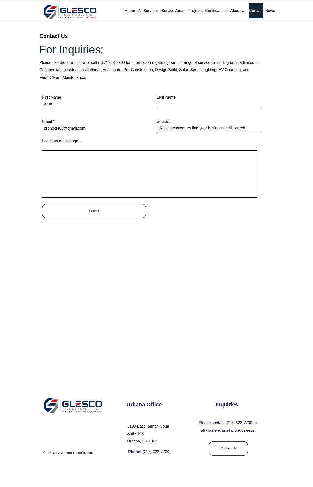

### budgetemllc.com — error\_after\_submit (LIVE)

| | |
|---|---|
| Attempt ID | `c36765d1-d6b9-4340-bbc5-cdeaa3a1ec2e` |
| Form URL | https://www.budgetemllc.com/ |
| Final URL | https://www.budgetemllc.com/ |
| Reserved | 2026-11-02 17:03:40 UTC |
| Submit attempted | 2026-11-02 17:03:43 UTC |
| Template | standard v2 |
| Confirmation text | Validation Error Please check the form and try again. (434) 510-7043 eraines@budgetemllc.com Budget Electrical & Mechanical Electrical Plumbing Commerci |
| Result / error | — |

Exact message:

~~~text
Subject: Helping customers find your business in AI search (AEO + GEO)

Hi there,

I'm Arun from Devs Arun. More and more customers now ask ChatGPT, Gemini, Perplexity or Google's AI Overviews questions like "who should I hire for this in my area?" before they call anyone. These tools answer from websites they can clearly understand, and they tend to recommend businesses whose pages answer real customer questions.

That is what AEO + GEO (Answer Engine and Generative Engine Optimization) is for. I improve your existing service pages so they clearly answer the questions your customers ask, add structured data that matches the page, and make the call, quote or enquiry step obvious. The benefit: your business gets a better chance of being mentioned or linked in AI answers, and visitors who arrive find it easy to contact you.

The AEO + GEO Starter is a one-time $199 (about ₹16,999, negotiable) for one website: a basic audit, 10 customer questions, improvements to two existing pages, relevant structured data and an action plan, with one revision round.

You can read the full details, send an enquiry or book online here:
https://devsarun.io/aeo-geo/

If this isn't relevant, just reply and I won't contact you again.

Best,
Arun
Devs Arun
itschool408@gmail.com · +91 7654534323
~~~

Submitted field values:

- email \[email\]: itschool408@gmail.com
- phone \[phone\]: +91 7654534323
- message \[message\]: Hi there, I'm Arun from Devs Arun. More and more customers now ask ChatGPT, Gemini, Perplexity or Google's AI Overviews 
- firstName \[first\_name\]: Arun

**Filled form (before submit)** — `run-2b5f01a9_attempt-c36765d1_filled_2026-11-02T17-03-43-006Z.jpg`

**After submit** — `run-2b5f01a9_attempt-c36765d1_post_attempt_2026-11-02T17-03-45-789Z.jpg`

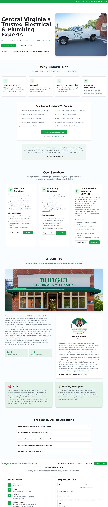

### us.com — failed\_before\_submit (LIVE)

| | |
|---|---|
| Attempt ID | `29905c9e-512a-49b7-a133-75c4822a1640` |
| Form URL | https://oeg.us.com/ |
| Final URL | https://oeg.us.com/ |
| Reserved | 2026-11-02 17:03:53 UTC |
| Submit attempted | — |
| Template | standard v2 |
| Confirmation text | none observed |
| Result / error | Message field altered the text (length limit?) |

Exact message:

~~~text
Subject: Helping customers find your business in AI search (AEO + GEO)

Hi there,

I'm Arun from Devs Arun. More and more customers now ask ChatGPT, Gemini, Perplexity or Google's AI Overviews questions like "who should I hire for this in my area?" before they call anyone. These tools answer from websites they can clearly understand, and they tend to recommend businesses whose pages answer real customer questions.

That is what AEO + GEO (Answer Engine and Generative Engine Optimization) is for. I improve your existing service pages so they clearly answer the questions your customers ask, add structured data that matches the page, and make the call, quote or enquiry step obvious. The benefit: your business gets a better chance of being mentioned or linked in AI answers, and visitors who arrive find it easy to contact you.

The AEO + GEO Starter is a one-time $199 (about ₹16,999, negotiable) for one website: a basic audit, 10 customer questions, improvements to two existing pages, relevant structured data and an action plan, with one revision round.

You can read the full details, send an enquiry or book online here:
https://devsarun.io/aeo-geo/

If this isn't relevant, just reply and I won't contact you again.

Best,
Arun
Devs Arun
itschool408@gmail.com · +91 7654534323
~~~

Submitted field values:

- \#input\_1\_1: Arun
- \#input\_1\_2: itschool408@gmail.com
- \#input\_1\_3: Hi there, I'm Arun from Devs Arun. More and more customers now ask ChatGPT, Gemini, Perplexity or Google's AI Overviews 
- \#input\_1\_4: Helping customers find your business in AI search (AEO + GEO)

**Filled form (before submit)** — `run-2b5f01a9_attempt-29905c9e_filled_2026-11-02T17-03-54-619Z.jpg`

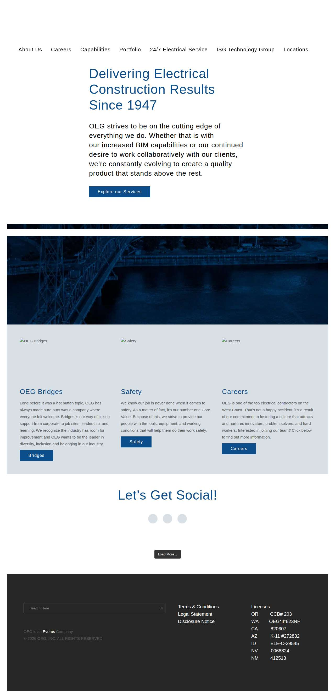

### gowatts.com — confirmed (LIVE)

| | |
|---|---|
| Attempt ID | `d1e69099-75a6-4d25-b3d3-0300ce2028d4` |
| Form URL | https://gowatts.com/contact-us |
| Final URL | https://gowatts.com/contact-us |
| Reserved | 2026-11-02 17:03:59 UTC |
| Submit attempted | 2026-11-02 17:04:00 UTC |
| Template | standard v2 |
| Confirmation text | Y (402) 786-2270 13351 DOVERS STREET WAVERLY, NE 68462 Your message has been sent. Back to form . Footer menu ABOUT SERVICES CONTACT CAREERS (402) 786-2270 13351 DOVERS STREET, WAVE |
| Result / error | — |

Exact message:

~~~text
Subject: Helping customers find your business in AI search (AEO + GEO)

Hi there,

I'm Arun from Devs Arun. More and more customers now ask ChatGPT, Gemini, Perplexity or Google's AI Overviews questions like "who should I hire for this in my area?" before they call anyone. These tools answer from websites they can clearly understand, and they tend to recommend businesses whose pages answer real customer questions.

That is what AEO + GEO (Answer Engine and Generative Engine Optimization) is for. I improve your existing service pages so they clearly answer the questions your customers ask, add structured data that matches the page, and make the call, quote or enquiry step obvious. The benefit: your business gets a better chance of being mentioned or linked in AI answers, and visitors who arrive find it easy to contact you.

The AEO + GEO Starter is a one-time $199 (about ₹16,999, negotiable) for one website: a basic audit, 10 customer questions, improvements to two existing pages, relevant structured data and an action plan, with one revision round.

You can read the full details, send an enquiry or book online here:
https://devsarun.io/aeo-geo/

If this isn't relevant, just reply and I won't contact you again.

Best,
Arun
Devs Arun
itschool408@gmail.com · +91 7654534323
~~~

Submitted field values:

- Phone \[phone\]: +91 7654534323
- Your Name \[name\]: Arun
- Message \[message\]: Hi there, I'm Arun from Devs Arun. More and more customers now ask ChatGPT, Gemini, Perplexity or Google's AI Overviews 
- Your Email \[email\]: itschool408@gmail.com

**Filled form (before submit)** — `run-2b5f01a9_attempt-d1e69099_filled_2026-11-02T17-04-00-738Z.jpg`

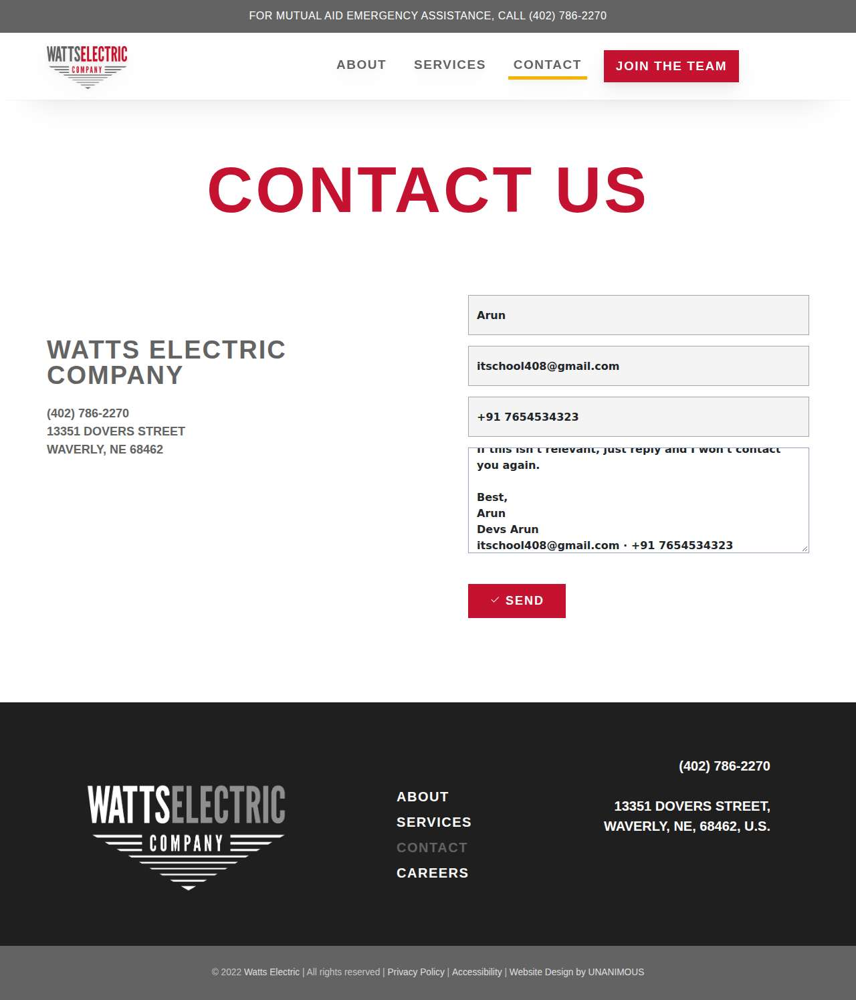

**After submit** — `run-2b5f01a9_attempt-d1e69099_post_attempt_2026-11-02T17-04-07-546Z.jpg`

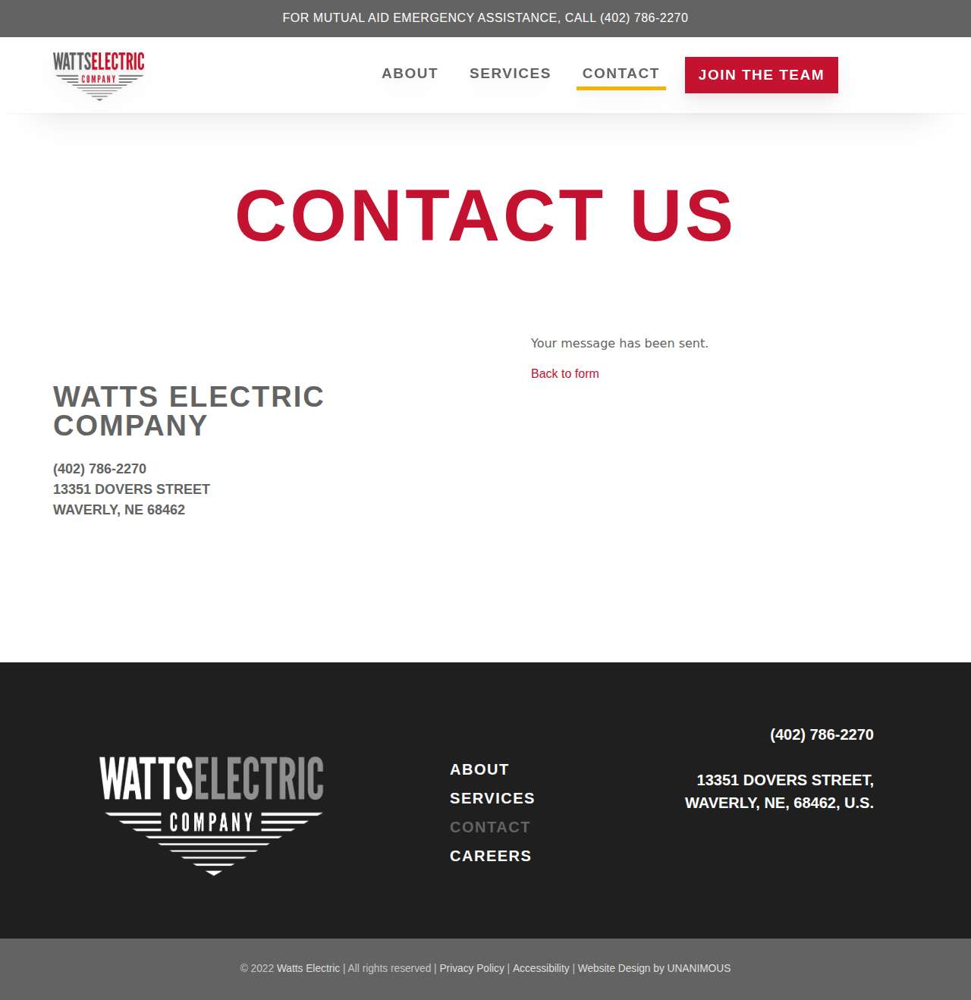

### all-propower.com — confirmed (LIVE)

| | |
|---|---|
| Attempt ID | `7ba05515-fdf8-47c3-a239-68695e14f28a` |
| Form URL | https://all-propower.com/contact/ |
| Final URL | https://all-propower.com/thanks/ |
| Reserved | 2026-11-02 17:04:15 UTC |
| Submit attempted | 2026-11-02 17:04:17 UTC |
| Template | standard v2 |
| Confirmation text | nsed and Insured License: \#EC13014380 HOME SERVICES CONTACT THANKS\! WE GOT YOUR MESSAGE. WE'LL BE IN TOUCH SOON\! OUR OFFICES Mon-Fri: 8:00AM-5:00 PM Sat and Sun: By A |
| Result / error | — |

Exact message:

~~~text
Subject: Helping customers find your business in AI search (AEO + GEO)

Hi there,

I'm Arun from Devs Arun. More and more customers now ask ChatGPT, Gemini, Perplexity or Google's AI Overviews questions like "who should I hire for this in my area?" before they call anyone. These tools answer from websites they can clearly understand, and they tend to recommend businesses whose pages answer real customer questions.

That is what AEO + GEO (Answer Engine and Generative Engine Optimization) is for. I improve your existing service pages so they clearly answer the questions your customers ask, add structured data that matches the page, and make the call, quote or enquiry step obvious. The benefit: your business gets a better chance of being mentioned or linked in AI answers, and visitors who arrive find it easy to contact you.

The AEO + GEO Starter is a one-time $199 (about ₹16,999, negotiable) for one website: a basic audit, 10 customer questions, improvements to two existing pages, relevant structured data and an action plan, with one revision round.

You can read the full details, send an enquiry or book online here:
https://devsarun.io/aeo-geo/

If this isn't relevant, just reply and I won't contact you again.

Best,
Arun
Devs Arun
itschool408@gmail.com · +91 7654534323
~~~

Submitted field values:

- Email \[email\]: itschool408@gmail.com
- Message \[message\]: Hi there, I'm Arun from Devs Arun. More and more customers now ask ChatGPT, Gemini, Perplexity or Google's AI Overviews 
- Name \[first\_name\]: Arun

**Filled form (before submit)** — `run-2b5f01a9_attempt-7ba05515_filled_2026-11-02T17-04-17-023Z.jpg`

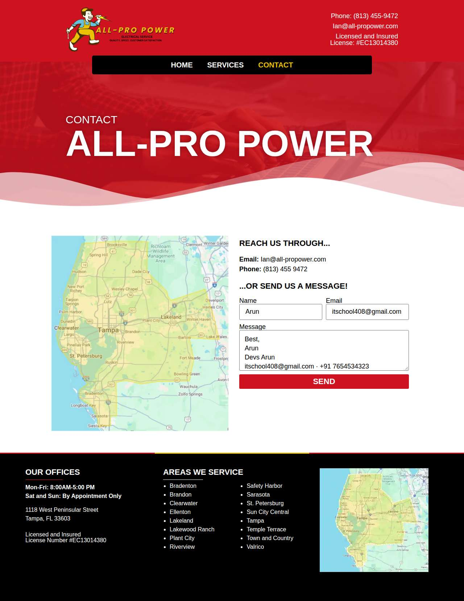

**After submit** — `run-2b5f01a9_attempt-7ba05515_post_attempt_2026-11-02T17-04-21-764Z.jpg`

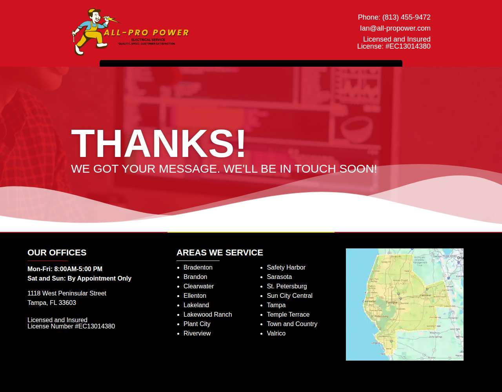

### gm-electric.com — unclear (LIVE)

| | |
|---|---|
| Attempt ID | `3c6cc4ec-f4b0-4f0a-bdaf-500f0d2745c9` |
| Form URL | https://www.gm-electric.com/ |
| Final URL | https://www.gm-electric.com/ |
| Reserved | 2026-11-02 17:04:30 UTC |
| Submit attempted | 2026-11-02 17:04:35 UTC |
| Template | standard v2 |
| Confirmation text | none observed |
| Result / error | No new success marker observed |

Exact message:

~~~text
Subject: Helping customers find your business in AI search (AEO + GEO)

Hi there,

I'm Arun from Devs Arun. More and more customers now ask ChatGPT, Gemini, Perplexity or Google's AI Overviews questions like "who should I hire for this in my area?" before they call anyone. These tools answer from websites they can clearly understand, and they tend to recommend businesses whose pages answer real customer questions.

That is what AEO + GEO (Answer Engine and Generative Engine Optimization) is for. I improve your existing service pages so they clearly answer the questions your customers ask, add structured data that matches the page, and make the call, quote or enquiry step obvious. The benefit: your business gets a better chance of being mentioned or linked in AI answers, and visitors who arrive find it easy to contact you.

The AEO + GEO Starter is a one-time $199 (about ₹16,999, negotiable) for one website: a basic audit, 10 customer questions, improvements to two existing pages, relevant structured data and an action plan, with one revision round.

You can read the full details, send an enquiry or book online here:
https://devsarun.io/aeo-geo/

If this isn't relevant, just reply and I won't contact you again.

Best,
Arun
Devs Arun
itschool408@gmail.com · +91 7654534323
~~~

Submitted field values:

- email \[email\]: itschool408@gmail.com
- name-\* \[name\]: Arun
- Message \[message\]: Hi there, I'm Arun from Devs Arun. More and more customers now ask ChatGPT, Gemini, Perplexity or Google's AI Overviews 
- subject \[subject\]: Helping customers find your business in AI search (AEO + GEO)

**Filled form (before submit)** — `run-2b5f01a9_attempt-3c6cc4ec_filled_2026-11-02T17-04-35-273Z.jpg`

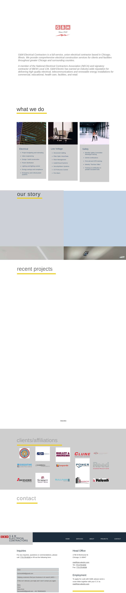

**After submit** — `run-2b5f01a9_attempt-3c6cc4ec_post_attempt_2026-11-02T17-05-02-900Z.jpg`

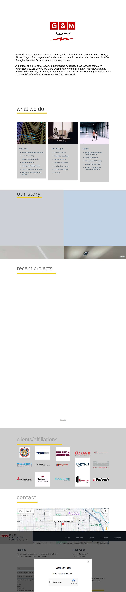

### duggerelectric.com — confirmed (LIVE)

| | |
|---|---|
| Attempt ID | `1cef58a8-0e14-4c71-ade3-addf9ef75a87` |
| Form URL | https://www.duggerelectric.com/contact/ |
| Final URL | https://www.duggerelectric.com/contact/ |
| Reserved | 2026-11-02 17:05:11 UTC |
| Submit attempted | 2026-11-02 17:05:13 UTC |
| Template | standard v2 |
| Confirmation text | idential Services Commercial Services Message\* Send Message Thank you for reaching out\! We'll be in touch with you soon\! Thank you for reaching out\! We'll be in touch with you soon\! Serv |
| Result / error | — |

Exact message:

~~~text
Subject: Helping customers find your business in AI search (AEO + GEO)

Hi there,

I'm Arun from Devs Arun. More and more customers now ask ChatGPT, Gemini, Perplexity or Google's AI Overviews questions like "who should I hire for this in my area?" before they call anyone. These tools answer from websites they can clearly understand, and they tend to recommend businesses whose pages answer real customer questions.

That is what AEO + GEO (Answer Engine and Generative Engine Optimization) is for. I improve your existing service pages so they clearly answer the questions your customers ask, add structured data that matches the page, and make the call, quote or enquiry step obvious. The benefit: your business gets a better chance of being mentioned or linked in AI answers, and visitors who arrive find it easy to contact you.

The AEO + GEO Starter is a one-time $199 (about ₹16,999, negotiable) for one website: a basic audit, 10 customer questions, improvements to two existing pages, relevant structured data and an action plan, with one revision round.

You can read the full details, send an enquiry or book online here:
https://devsarun.io/aeo-geo/

If this isn't relevant, just reply and I won't contact you again.

Best,
Arun
Devs Arun
itschool408@gmail.com · +91 7654534323
~~~

Submitted field values:

- Name \[name\]: Arun
- Email\* \[email\]: itschool408@gmail.com
- Phone\* \[phone\]: +91 7654534323
- Message\* \[message\]: Hi there, I'm Arun from Devs Arun. More and more customers now ask ChatGPT, Gemini, Perplexity or Google's AI Overviews 

**Filled form (before submit)** — `run-2b5f01a9_attempt-1cef58a8_filled_2026-11-02T17-05-13-754Z.jpg`

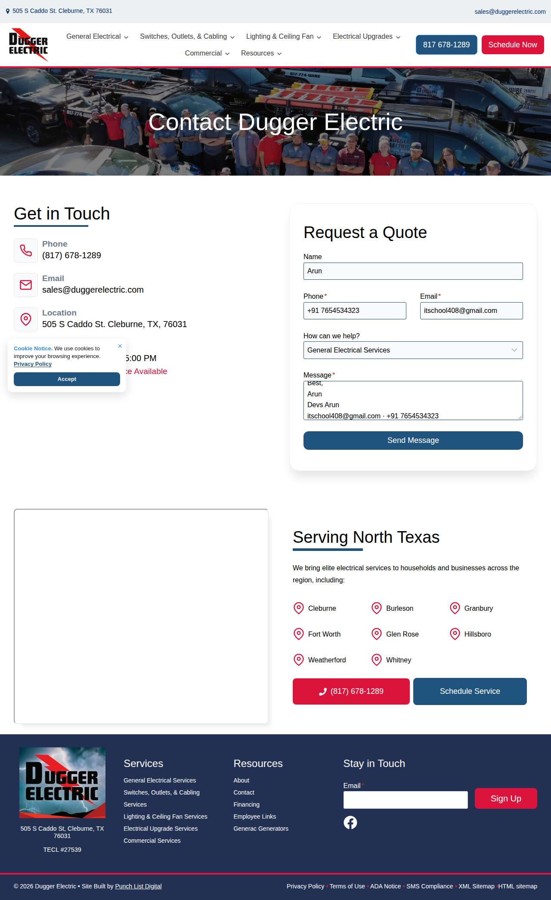

**After submit** — `run-2b5f01a9_attempt-1cef58a8_post_attempt_2026-11-02T17-05-18-191Z.jpg`

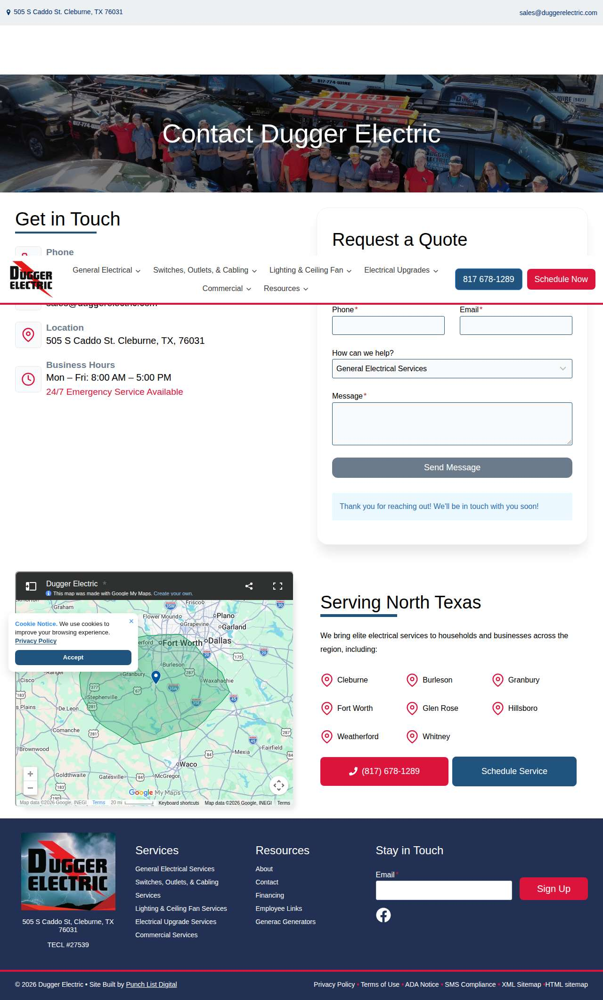

### rcipowerinc.com — confirmed (LIVE)

| | |
|---|---|
| Attempt ID | `ec2631e3-bf17-4806-a0b1-70180b34f9f2` |
| Form URL | https://www.rcipowerinc.com/ |
| Final URL | https://www.rcipowerinc.com/php/contact.php |
| Reserved | 2026-11-02 17:05:25 UTC |
| Submit attempted | 2026-11-02 17:05:27 UTC |
| Template | standard v2 |
| Confirmation text | Thank you. Your message has been successfully sent. You will receive a response as soon as possible. |
| Result / error | — |

Exact message:

~~~text
Subject: Helping customers find your business in AI search (AEO + GEO)

Hi there,

I'm Arun from Devs Arun. More and more customers now ask ChatGPT, Gemini, Perplexity or Google's AI Overviews questions like "who should I hire for this in my area?" before they call anyone. These tools answer from websites they can clearly understand, and they tend to recommend businesses whose pages answer real customer questions.

That is what AEO + GEO (Answer Engine and Generative Engine Optimization) is for. I improve your existing service pages so they clearly answer the questions your customers ask, add structured data that matches the page, and make the call, quote or enquiry step obvious. The benefit: your business gets a better chance of being mentioned or linked in AI answers, and visitors who arrive find it easy to contact you.

The AEO + GEO Starter is a one-time $199 (about ₹16,999, negotiable) for one website: a basic audit, 10 customer questions, improvements to two existing pages, relevant structured data and an action plan, with one revision round.

You can read the full details, send an enquiry or book online here:
https://devsarun.io/aeo-geo/

If this isn't relevant, just reply and I won't contact you again.

Best,
Arun
Devs Arun
itschool408@gmail.com · +91 7654534323
~~~

Submitted field values:

- email \[email\]: itschool408@gmail.com
- phone \[phone\]: +91 7654534323
- comments \[message\]: Hi there, I'm Arun from Devs Arun. More and more customers now ask ChatGPT, Gemini, Perplexity or Google's AI Overviews 

**Filled form (before submit)** — `run-2b5f01a9_attempt-ec2631e3_filled_2026-11-02T17-05-27-177Z.jpg`

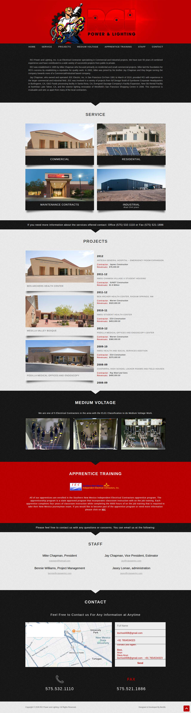

**After submit** — `run-2b5f01a9_attempt-ec2631e3_post_attempt_2026-11-02T17-05-31-047Z.jpg`

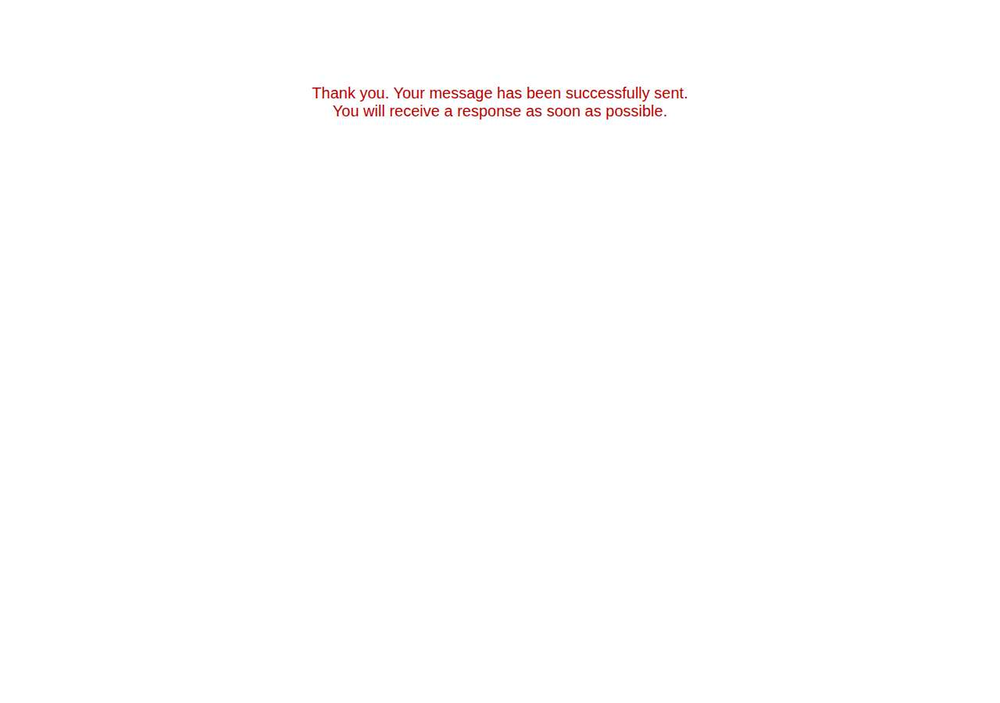

### electricianfortpiercefl.com — unclear (LIVE)

| | |
|---|---|
| Attempt ID | `6fb5688f-a8fa-48e0-ad92-9e419cd773ba` |
| Form URL | https://electricianfortpiercefl.com/contact/ |
| Final URL | chrome-error://chromewebdata/ |
| Reserved | 2026-11-02 17:05:39 UTC |
| Submit attempted | 2026-11-02 17:05:41 UTC |
| Template | standard v2 |
| Confirmation text | none observed |
| Result / error | No new success marker observed |

Exact message:

~~~text
Subject: Helping customers find your business in AI search (AEO + GEO)

Hi there,

I'm Arun from Devs Arun. More and more customers now ask ChatGPT, Gemini, Perplexity or Google's AI Overviews questions like "who should I hire for this in my area?" before they call anyone. These tools answer from websites they can clearly understand, and they tend to recommend businesses whose pages answer real customer questions.

That is what AEO + GEO (Answer Engine and Generative Engine Optimization) is for. I improve your existing service pages so they clearly answer the questions your customers ask, add structured data that matches the page, and make the call, quote or enquiry step obvious. The benefit: your business gets a better chance of being mentioned or linked in AI answers, and visitors who arrive find it easy to contact you.

The AEO + GEO Starter is a one-time $199 (about ₹16,999, negotiable) for one website: a basic audit, 10 customer questions, improvements to two existing pages, relevant structured data and an action plan, with one revision round.

You can read the full details, send an enquiry or book online here:
https://devsarun.io/aeo-geo/

If this isn't relevant, just reply and I won't contact you again.

Best,
Arun
Devs Arun
itschool408@gmail.com · +91 7654534323
~~~

Submitted field values:

- Name \[name\]: Arun
- Email \[email\]: itschool408@gmail.com
- Message \[message\]: Hi there, I'm Arun from Devs Arun. More and more customers now ask ChatGPT, Gemini, Perplexity or Google's AI Overviews 

**Filled form (before submit)** — `run-2b5f01a9_attempt-6fb5688f_filled_2026-11-02T17-05-41-377Z.jpg`

**After submit** — `run-2b5f01a9_attempt-6fb5688f_post_attempt_2026-11-02T17-06-09-096Z.jpg`

### stasneyelectric.com — unclear (LIVE)

| | |
|---|---|
| Attempt ID | `db4288a3-dfc6-4079-9a86-b8d64c153d74` |
| Form URL | https://www.stasneyelectric.com/contact-us/4842370 |
| Final URL | https://www.stasneyelectric.com/contact-us/4842370 |
| Reserved | 2026-11-02 17:06:17 UTC |
| Submit attempted | 2026-11-02 17:06:19 UTC |
| Template | standard v2 |
| Confirmation text | none observed |
| Result / error | No new success marker observed |

Exact message:

~~~text
Subject: Helping customers find your business in AI search (AEO + GEO)

Hi there,

I'm Arun from Devs Arun. More and more customers now ask ChatGPT, Gemini, Perplexity or Google's AI Overviews questions like "who should I hire for this in my area?" before they call anyone. These tools answer from websites they can clearly understand, and they tend to recommend businesses whose pages answer real customer questions.

That is what AEO + GEO (Answer Engine and Generative Engine Optimization) is for. I improve your existing service pages so they clearly answer the questions your customers ask, add structured data that matches the page, and make the call, quote or enquiry step obvious. The benefit: your business gets a better chance of being mentioned or linked in AI answers, and visitors who arrive find it easy to contact you.

The AEO + GEO Starter is a one-time $199 (about ₹16,999, negotiable) for one website: a basic audit, 10 customer questions, improvements to two existing pages, relevant structured data and an action plan, with one revision round.

You can read the full details, send an enquiry or book online here:
https://devsarun.io/aeo-geo/

If this isn't relevant, just reply and I won't contact you again.

Best,
Arun
Devs Arun
itschool408@gmail.com · +91 7654534323
~~~

Submitted field values:

- Name: \[name\]: Arun
- Email: \[email\]: itschool408@gmail.com
- Phone: \[phone\]: +91 7654534323
- Message: \[message\]: Hi there, I'm Arun from Devs Arun. More and more customers now ask ChatGPT, Gemini, Perplexity or Google's AI Overviews 

**Filled form (before submit)** — `run-2b5f01a9_attempt-db4288a3_filled_2026-11-02T17-06-19-327Z.jpg`

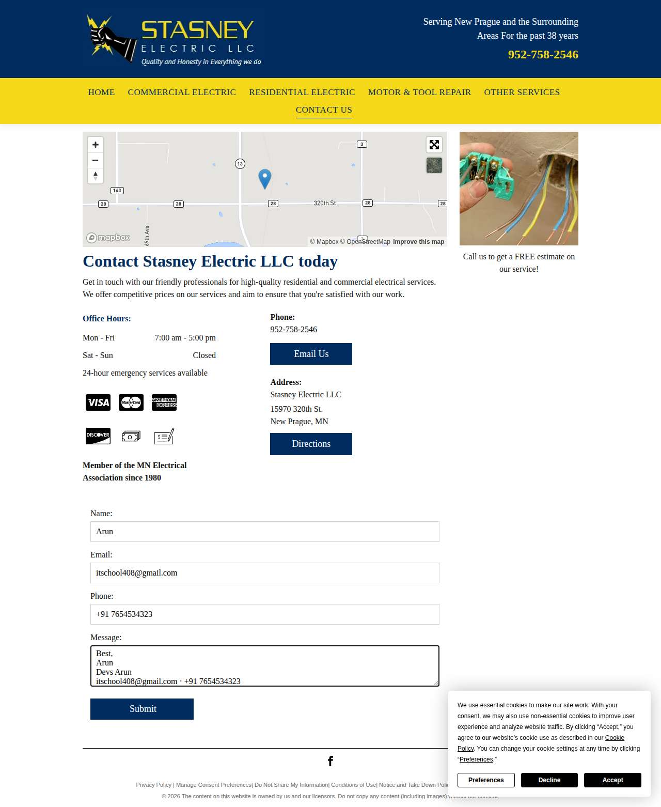

**After submit** — `run-2b5f01a9_attempt-db4288a3_post_attempt_2026-11-02T17-06-49-414Z.jpg`

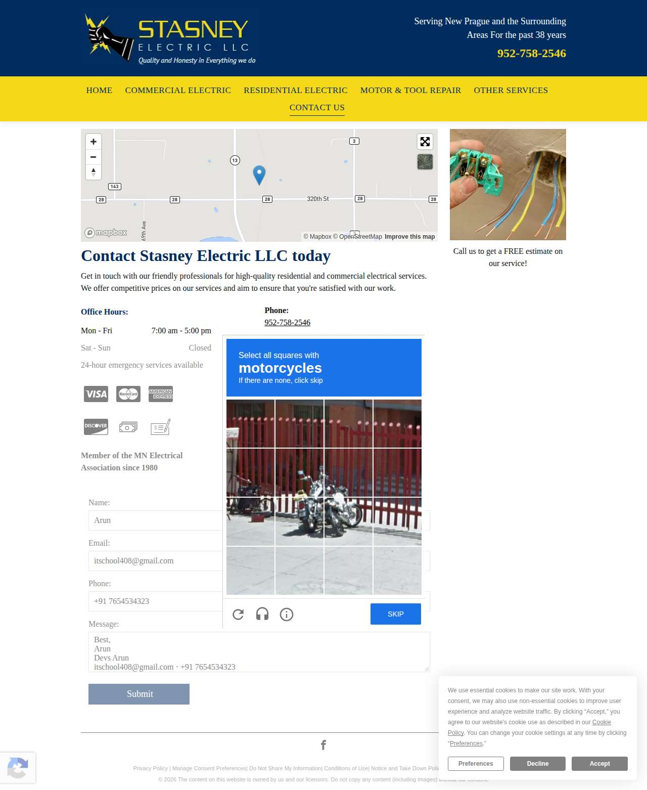

### jimstagnittaelectric.com — unclear (LIVE)

| | |
|---|---|
| Attempt ID | `c5140168-1da3-464b-937d-2559479c1cbc` |
| Form URL | https://www.jimstagnittaelectric.com/ |
| Final URL | https://www.jimstagnittaelectric.com/ |
| Reserved | 2026-11-02 17:06:57 UTC |
| Submit attempted | 2026-11-02 17:06:59 UTC |
| Template | standard v2 |
| Confirmation text | none observed |
| Result / error | No new success marker observed |

Exact message:

~~~text
Subject: Helping customers find your business in AI search (AEO + GEO)

Hi there,

I'm Arun from Devs Arun. More and more customers now ask ChatGPT, Gemini, Perplexity or Google's AI Overviews questions like "who should I hire for this in my area?" before they call anyone. These tools answer from websites they can clearly understand, and they tend to recommend businesses whose pages answer real customer questions.

That is what AEO + GEO (Answer Engine and Generative Engine Optimization) is for. I improve your existing service pages so they clearly answer the questions your customers ask, add structured data that matches the page, and make the call, quote or enquiry step obvious. The benefit: your business gets a better chance of being mentioned or linked in AI answers, and visitors who arrive find it easy to contact you.

The AEO + GEO Starter is a one-time $199 (about ₹16,999, negotiable) for one website: a basic audit, 10 customer questions, improvements to two existing pages, relevant structured data and an action plan, with one revision round.

You can read the full details, send an enquiry or book online here:
https://devsarun.io/aeo-geo/

If this isn't relevant, just reply and I won't contact you again.

Best,
Arun
Devs Arun
itschool408@gmail.com · +91 7654534323
~~~

Submitted field values:

- name \[name\]: Arun
- email \[email\]: itschool408@gmail.com
- Add a message \[message\]: Hi there, I'm Arun from Devs Arun. More and more customers now ask ChatGPT, Gemini, Perplexity or Google's AI Overviews 

**Filled form (before submit)** — `run-2b5f01a9_attempt-c5140168_filled_2026-11-02T17-06-59-164Z.jpg`

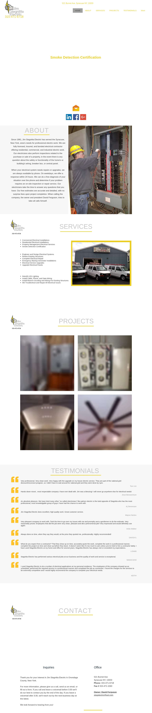

**After submit** — `run-2b5f01a9_attempt-c5140168_post_attempt_2026-11-02T17-07-27-061Z.jpg`

### gnelectricinc.com — confirmed (LIVE)

| | |
|---|---|
| Attempt ID | `ae41d43c-901f-4d33-8619-fa29cbf3b02c` |
| Form URL | https://www.gnelectricinc.com/contact/ |
| Final URL | https://www.gnelectricinc.com/contact/ |
| Reserved | 2026-11-02 17:07:34 UTC |
| Submit attempted | 2026-11-02 17:07:36 UTC |
| Template | standard v2 |
| Confirmation text | sted in collaborating, please provide your information, and we will contact you soon. We look forward to connecting with you. Phone: 410.893.5560 Name Email\* Message\* Email SUBMIT |
| Result / error | — |

Exact message:

~~~text
Subject: Helping customers find your business in AI search (AEO + GEO)

Hi there,

I'm Arun from Devs Arun. More and more customers now ask ChatGPT, Gemini, Perplexity or Google's AI Overviews questions like "who should I hire for this in my area?" before they call anyone. These tools answer from websites they can clearly understand, and they tend to recommend businesses whose pages answer real customer questions.

That is what AEO + GEO (Answer Engine and Generative Engine Optimization) is for. I improve your existing service pages so they clearly answer the questions your customers ask, add structured data that matches the page, and make the call, quote or enquiry step obvious. The benefit: your business gets a better chance of being mentioned or linked in AI answers, and visitors who arrive find it easy to contact you.

The AEO + GEO Starter is a one-time $199 (about ₹16,999, negotiable) for one website: a basic audit, 10 customer questions, improvements to two existing pages, relevant structured data and an action plan, with one revision round.

You can read the full details, send an enquiry or book online here:
https://devsarun.io/aeo-geo/

If this isn't relevant, just reply and I won't contact you again.

Best,
Arun
Devs Arun
itschool408@gmail.com · +91 7654534323
~~~

Submitted field values:

- Name \[name\]: Arun
- Email\* \[email\]: itschool408@gmail.com
- Message\* \[message\]: Hi there, I'm Arun from Devs Arun. More and more customers now ask ChatGPT, Gemini, Perplexity or Google's AI Overviews 

**Filled form (before submit)** — `run-2b5f01a9_attempt-ae41d43c_filled_2026-11-02T17-07-36-642Z.jpg`

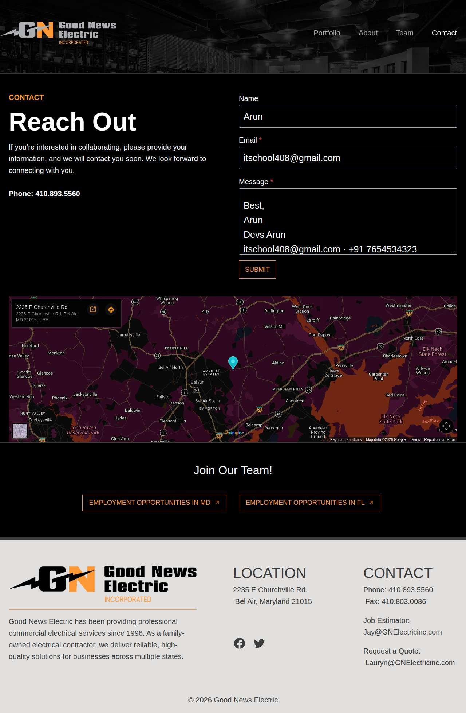

**After submit** — `run-2b5f01a9_attempt-ae41d43c_post_attempt_2026-11-02T17-07-41-742Z.jpg`

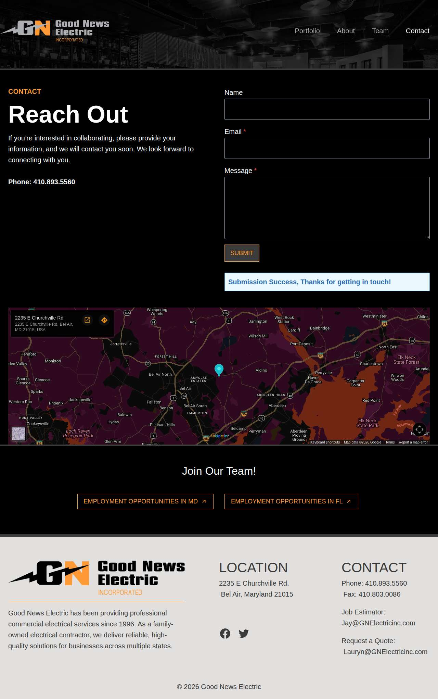

### humphreyelectricoh.com — confirmed (LIVE)

| | |
|---|---|
| Attempt ID | `2d0e5faf-bdb0-4496-bf85-a0504faea8bb` |
| Form URL | https://humphreyelectricoh.com/contact/ |
| Final URL | https://humphreyelectricoh.com/contact/ |
| Reserved | 2026-11-02 17:07:49 UTC |
| Submit attempted | 2026-11-02 17:07:50 UTC |
| Template | standard v2 |
| Confirmation text | Thank you\! Your form submission has been received. Back to our site |
| Result / error | — |

Exact message:

~~~text
Subject: Helping customers find your business in AI search (AEO + GEO)

Hi there,

I'm Arun from Devs Arun. More and more customers now ask ChatGPT, Gemini, Perplexity or Google's AI Overviews questions like "who should I hire for this in my area?" before they call anyone. These tools answer from websites they can clearly understand, and they tend to recommend businesses whose pages answer real customer questions.

That is what AEO + GEO (Answer Engine and Generative Engine Optimization) is for. I improve your existing service pages so they clearly answer the questions your customers ask, add structured data that matches the page, and make the call, quote or enquiry step obvious. The benefit: your business gets a better chance of being mentioned or linked in AI answers, and visitors who arrive find it easy to contact you.

The AEO + GEO Starter is a one-time $199 (about ₹16,999, negotiable) for one website: a basic audit, 10 customer questions, improvements to two existing pages, relevant structured data and an action plan, with one revision round.

You can read the full details, send an enquiry or book online here:
https://devsarun.io/aeo-geo/

If this isn't relevant, just reply and I won't contact you again.

Best,
Arun
Devs Arun
itschool408@gmail.com · +91 7654534323
~~~

Submitted field values:

- Name \[name\]: Arun
- Email \[email\]: itschool408@gmail.com
- Phone \[phone\]: +91 7654534323
- Message \[message\]: Hi there, I'm Arun from Devs Arun. More and more customers now ask ChatGPT, Gemini, Perplexity or Google's AI Overviews 

**Filled form (before submit)** — `run-2b5f01a9_attempt-2d0e5faf_filled_2026-11-02T17-07-50-950Z.jpg`

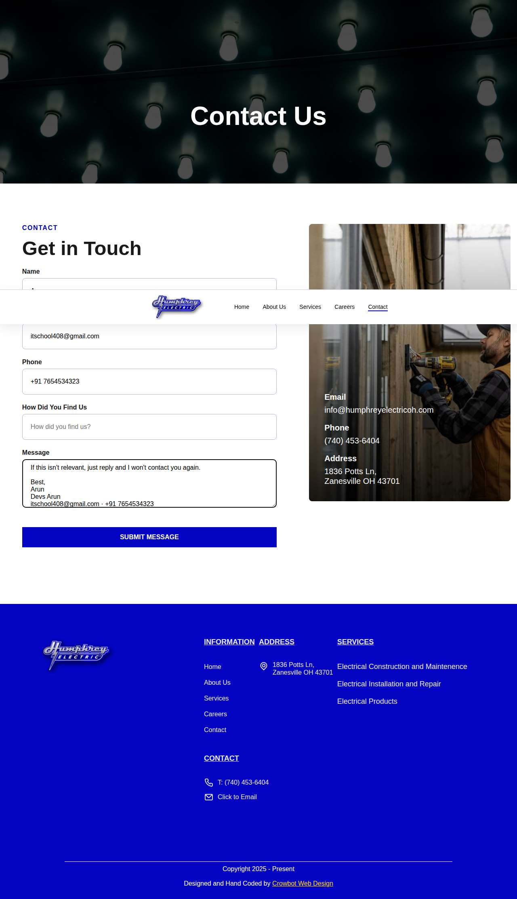

**After submit** — `run-2b5f01a9_attempt-2d0e5faf_post_attempt_2026-11-02T17-07-54-009Z.jpg`

### atlas-pellizzari.com — failed\_before\_submit (LIVE)

| | |
|---|---|
| Attempt ID | `5710b0dc-ad29-493e-b956-84cd5a2cf3b8` |
| Form URL | https://www.atlas-pellizzari.com/contact/ |
| Final URL | https://www.atlas-pellizzari.com/contact/ |
| Reserved | 2026-11-02 17:08:01 UTC |
| Submit attempted | — |
| Template | standard v2 |
| Confirmation text | none observed |
| Result / error | Field "Phone Number\*" did not accept the value |

Exact message:

~~~text
Subject: Helping customers find your business in AI search (AEO + GEO)

Hi there,

I'm Arun from Devs Arun. More and more customers now ask ChatGPT, Gemini, Perplexity or Google's AI Overviews questions like "who should I hire for this in my area?" before they call anyone. These tools answer from websites they can clearly understand, and they tend to recommend businesses whose pages answer real customer questions.

That is what AEO + GEO (Answer Engine and Generative Engine Optimization) is for. I improve your existing service pages so they clearly answer the questions your customers ask, add structured data that matches the page, and make the call, quote or enquiry step obvious. The benefit: your business gets a better chance of being mentioned or linked in AI answers, and visitors who arrive find it easy to contact you.

The AEO + GEO Starter is a one-time $199 (about ₹16,999, negotiable) for one website: a basic audit, 10 customer questions, improvements to two existing pages, relevant structured data and an action plan, with one revision round.

You can read the full details, send an enquiry or book online here:
https://devsarun.io/aeo-geo/

If this isn't relevant, just reply and I won't contact you again.

Best,
Arun
Devs Arun
itschool408@gmail.com · +91 7654534323
~~~

Submitted field values:

- \#input\_1\_2: Arun
- \#input\_1\_3: Devs Arun
- \#input\_1\_4: itschool408@gmail.com
- \#input\_1\_5: +91 7654534323
- \#input\_1\_6: Helping customers find your business in AI search (AEO + GEO)
- \#input\_1\_10: Hi there, I'm Arun from Devs Arun. More and more customers now ask ChatGPT, Gemini, Perplexity or Google's AI Overviews 

**Filled form (before submit)** — `run-2b5f01a9_attempt-5710b0dc_filled_2026-11-02T17-08-03-859Z.jpg`

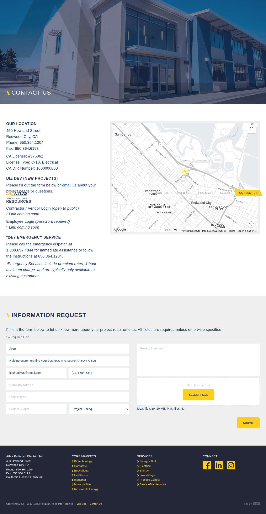

### arizonaelectricians.pro — failed\_before\_submit (LIVE)

| | |
|---|---|
| Attempt ID | `747907c2-cf2a-4461-a7cf-3787ca1f4774` |
| Form URL | https://arizonaelectricians.pro/contact-info.htm |
| Final URL | https://arizonaelectricians.pro/contact-info.htm |
| Reserved | 2026-11-02 17:08:08 UTC |
| Submit attempted | — |
| Template | standard v2 |
| Confirmation text | none observed |
| Result / error | Field "phone" did not accept the value |

Exact message:

~~~text
Subject: Helping customers find your business in AI search (AEO + GEO)

Hi there,

I'm Arun from Devs Arun. More and more customers now ask ChatGPT, Gemini, Perplexity or Google's AI Overviews questions like "who should I hire for this in my area?" before they call anyone. These tools answer from websites they can clearly understand, and they tend to recommend businesses whose pages answer real customer questions.

That is what AEO + GEO (Answer Engine and Generative Engine Optimization) is for. I improve your existing service pages so they clearly answer the questions your customers ask, add structured data that matches the page, and make the call, quote or enquiry step obvious. The benefit: your business gets a better chance of being mentioned or linked in AI answers, and visitors who arrive find it easy to contact you.

The AEO + GEO Starter is a one-time $199 (about ₹16,999, negotiable) for one website: a basic audit, 10 customer questions, improvements to two existing pages, relevant structured data and an action plan, with one revision round.

You can read the full details, send an enquiry or book online here:
https://devsarun.io/aeo-geo/

If this isn't relevant, just reply and I won't contact you again.

Best,
Arun
Devs Arun
itschool408@gmail.com · +91 7654534323
~~~

Submitted field values:

- input\[name="name"\]: Arun
- input\[name="email"\]: itschool408@gmail.com
- input\[name="phone"\]: +91 7654534323
- textarea\[name="message"\]: Hi there, I'm Arun from Devs Arun. More and more customers now ask ChatGPT, Gemini, Perplexity or Google's AI Overviews 

**Filled form (before submit)** — `run-2b5f01a9_attempt-747907c2_filled_2026-11-02T17-08-10-529Z.jpg`

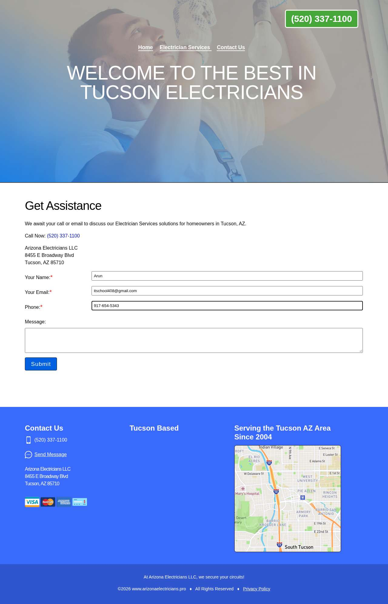

### wbelectric-tn.com — failed\_before\_submit (LIVE)

| | |
|---|---|
| Attempt ID | `d01027dd-3c7d-4405-9d9c-c5ad46abfa7c` |
| Form URL | https://wbelectric-tn.com/contact/ |
| Final URL | https://wbelectric-tn.com/contact/ |
| Reserved | 2026-11-02 17:08:15 UTC |
| Submit attempted | — |
| Template | standard v2 |
| Confirmation text | none observed |
| Result / error | Field "Phone" did not accept the value |

Exact message:

~~~text
Subject: Helping customers find your business in AI search (AEO + GEO)

Hi there,

I'm Arun from Devs Arun. More and more customers now ask ChatGPT, Gemini, Perplexity or Google's AI Overviews questions like "who should I hire for this in my area?" before they call anyone. These tools answer from websites they can clearly understand, and they tend to recommend businesses whose pages answer real customer questions.

That is what AEO + GEO (Answer Engine and Generative Engine Optimization) is for. I improve your existing service pages so they clearly answer the questions your customers ask, add structured data that matches the page, and make the call, quote or enquiry step obvious. The benefit: your business gets a better chance of being mentioned or linked in AI answers, and visitors who arrive find it easy to contact you.

The AEO + GEO Starter is a one-time $199 (about ₹16,999, negotiable) for one website: a basic audit, 10 customer questions, improvements to two existing pages, relevant structured data and an action plan, with one revision round.

You can read the full details, send an enquiry or book online here:
https://devsarun.io/aeo-geo/

If this isn't relevant, just reply and I won't contact you again.

Best,
Arun
Devs Arun
itschool408@gmail.com · +91 7654534323
~~~

Submitted field values:

- \#input\_2\_3: itschool408@gmail.com
- \#input\_2\_4: +91 7654534323
- \#input\_2\_18: Hi there, I'm Arun from Devs Arun. More and more customers now ask ChatGPT, Gemini, Perplexity or Google's AI Overviews 
- \#input\_2\_1\_3: Arun

**Filled form (before submit)** — `run-2b5f01a9_attempt-d01027dd_filled_2026-11-02T17-08-17-174Z.jpg`

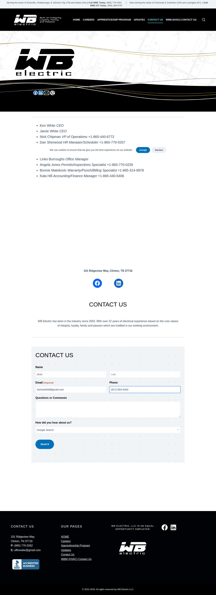

### gatewoodelectricmotors.com — unclear (LIVE)

| | |
|---|---|
| Attempt ID | `2f2880e8-1f7c-4d4c-99c9-50a0372b4e90` |
| Form URL | https://www.gatewoodelectricmotors.com/contact.html |
| Final URL | https://www.gatewoodelectricmotors.com/contact.html |
| Reserved | 2026-11-02 17:08:22 UTC |
| Submit attempted | 2026-11-02 17:08:24 UTC |
| Template | standard v2 |
| Confirmation text | none observed |
| Result / error | No new success marker observed |

Exact message:

~~~text
Subject: Helping customers find your business in AI search (AEO + GEO)

Hi there,

I'm Arun from Devs Arun. More and more customers now ask ChatGPT, Gemini, Perplexity or Google's AI Overviews questions like "who should I hire for this in my area?" before they call anyone. These tools answer from websites they can clearly understand, and they tend to recommend businesses whose pages answer real customer questions.

That is what AEO + GEO (Answer Engine and Generative Engine Optimization) is for. I improve your existing service pages so they clearly answer the questions your customers ask, add structured data that matches the page, and make the call, quote or enquiry step obvious. The benefit: your business gets a better chance of being mentioned or linked in AI answers, and visitors who arrive find it easy to contact you.

The AEO + GEO Starter is a one-time $199 (about ₹16,999, negotiable) for one website: a basic audit, 10 customer questions, improvements to two existing pages, relevant structured data and an action plan, with one revision round.

You can read the full details, send an enquiry or book online here:
https://devsarun.io/aeo-geo/

If this isn't relevant, just reply and I won't contact you again.

Best,
Arun
Devs Arun
itschool408@gmail.com · +91 7654534323
~~~

Submitted field values:

- 1 \[name\]: Arun
- 2 \[email\]: itschool408@gmail.com
- 3 \[message\]: Hi there, I'm Arun from Devs Arun. More and more customers now ask ChatGPT, Gemini, Perplexity or Google's AI Overviews 

**Filled form (before submit)** — `run-2b5f01a9_attempt-2f2880e8_filled_2026-11-02T17-08-24-713Z.jpg`

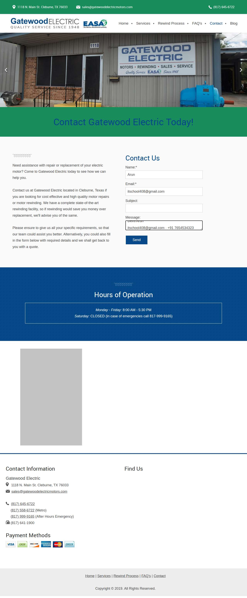

**After submit** — `run-2b5f01a9_attempt-2f2880e8_post_attempt_2026-11-02T17-08-52-433Z.jpg`

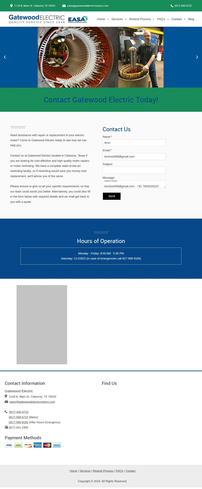

### ableelectric.biz — error\_after\_submit (LIVE)

| | |
|---|---|
| Attempt ID | `82dd9f80-0eb3-4980-b1a4-ee52ea026b22` |
| Form URL | https://www.ableelectric.biz/contact-us |
| Final URL | https://www.ableelectric.biz/contact-us |
| Reserved | 2026-11-02 17:09:00 UTC |
| Submit attempted | 2026-11-02 17:09:04 UTC |
| Template | standard v2 |
| Confirmation text | e. Name: Phone: Email: Subject: Message: Oops, there was an error sending your message. Please try again later Schedule Your Electrical Service with Able Electrical Today © |
| Result / error | — |

Exact message:

~~~text
Subject: Helping customers find your business in AI search (AEO + GEO)

Hi there,

I'm Arun from Devs Arun. More and more customers now ask ChatGPT, Gemini, Perplexity or Google's AI Overviews questions like "who should I hire for this in my area?" before they call anyone. These tools answer from websites they can clearly understand, and they tend to recommend businesses whose pages answer real customer questions.

That is what AEO + GEO (Answer Engine and Generative Engine Optimization) is for. I improve your existing service pages so they clearly answer the questions your customers ask, add structured data that matches the page, and make the call, quote or enquiry step obvious. The benefit: your business gets a better chance of being mentioned or linked in AI answers, and visitors who arrive find it easy to contact you.

The AEO + GEO Starter is a one-time $199 (about ₹16,999, negotiable) for one website: a basic audit, 10 customer questions, improvements to two existing pages, relevant structured data and an action plan, with one revision round.

You can read the full details, send an enquiry or book online here:
https://devsarun.io/aeo-geo/

If this isn't relevant, just reply and I won't contact you again.

Best,
Arun
Devs Arun
itschool408@gmail.com · +91 7654534323
~~~

Submitted field values:

- Name: \[name\]: Arun
- Email: \[email\]: itschool408@gmail.com
- Phone: \[phone\]: +91 7654534323
- Message: \[message\]: Hi there, I'm Arun from Devs Arun. More and more customers now ask ChatGPT, Gemini, Perplexity or Google's AI Overviews 
- Subject: \[subject\]: Helping customers find your business in AI search (AEO + GEO)

**Filled form (before submit)** — `run-2b5f01a9_attempt-82dd9f80_filled_2026-11-02T17-09-04-609Z.jpg`

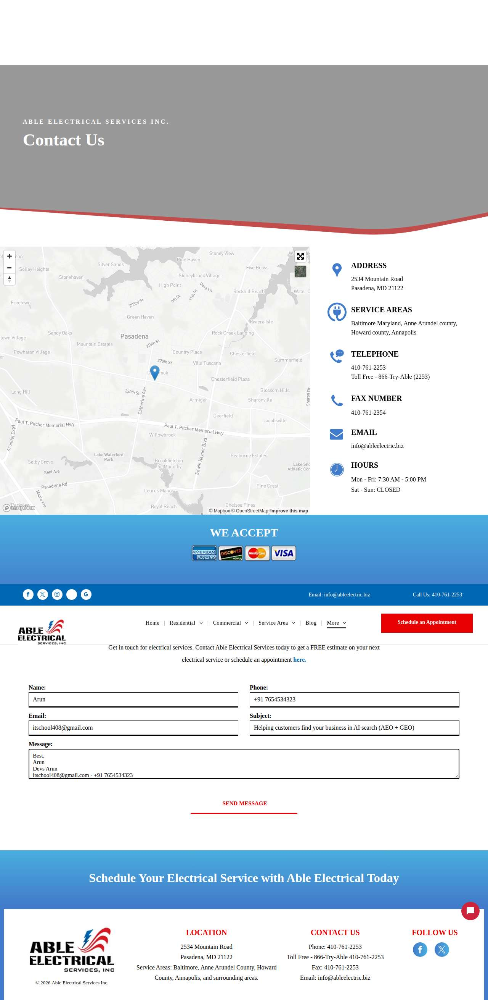

**After submit** — `run-2b5f01a9_attempt-82dd9f80_post_attempt_2026-11-02T17-09-08-375Z.jpg`

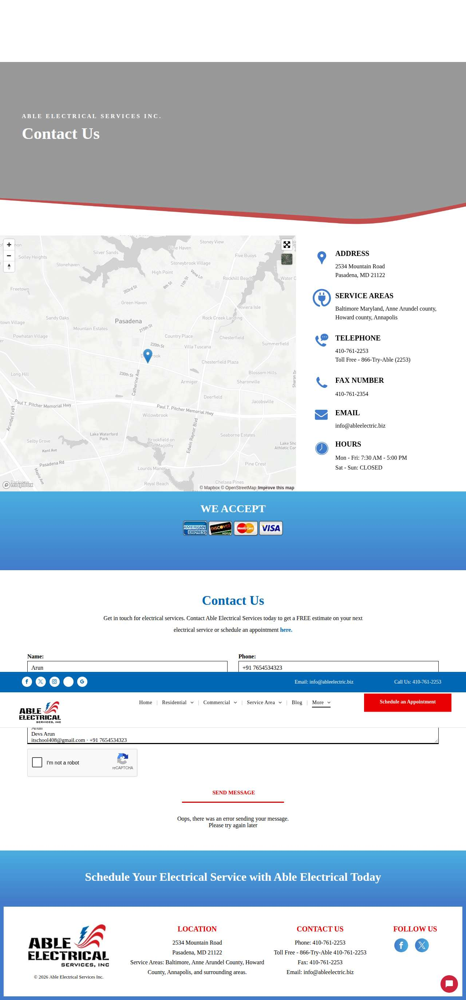

## Events (139)

| Time (UTC) | Event | Website | Details |
|---|---|---|---|
| 17:03:22 | run\_queued | — | live run requested by github:itsDevsArun |
| 17:03:22 | run\_dispatched | — | dispatch disabled (local test mode) |
| 17:03:25 | run\_started | — | Runner claimed live run |
| 17:03:26 | offer\_verified | — | Service page offer facts verified |
| 17:03:26 | website\_selected | clearchoiceplumbingllc.com | Live target clearchoiceplumbingllc.com |
| 17:03:26 | attempt\_reserved | clearchoiceplumbingllc.com | Submission attempt reserved with template standard v2 |
| 17:03:28 | page\_opened | clearchoiceplumbingllc.com | Opened form page |
| 17:03:28 | screenshot\_saved | clearchoiceplumbingllc.com | inspection screenshot saved (145 KB) |
| 17:03:28 | review\_required | clearchoiceplumbingllc.com | failed before submit: locator.fill: Error: Cannot type text into input\[type=number\] |
| 17:03:33 | website\_selected | glescoelectric.com | Live target glescoelectric.com |
| 17:03:33 | attempt\_reserved | glescoelectric.com | Submission attempt reserved with template standard v2 |
| 17:03:35 | page\_opened | glescoelectric.com | Opened form page |
| 17:03:35 | screenshot\_saved | glescoelectric.com | filled screenshot saved (79 KB) |
| 17:03:35 | review\_required | glescoelectric.com | failed before submit: Field "Subject" did not accept the value |
| 17:03:40 | website\_selected | budgetemllc.com | Live target budgetemllc.com |
| 17:03:40 | attempt\_reserved | budgetemllc.com | Submission attempt reserved with template standard v2 |
| 17:03:42 | page\_opened | budgetemllc.com | Opened form page |
| 17:03:42 | fields\_filled | budgetemllc.com | filled |
| 17:03:43 | screenshot\_saved | budgetemllc.com | filled screenshot saved (521 KB) |
| 17:03:43 | submit\_attempted | budgetemllc.com | submitting |
| 17:03:45 | screenshot\_saved | budgetemllc.com | post\_attempt screenshot saved (519 KB) |
| 17:03:45 | error | budgetemllc.com | error after submit — "Validation Error Please check the form and try again. (434) 510-7043 eraines@budgetemllc.com Budget Electrical & Mechani" |
| 17:03:53 | website\_selected | us.com | Live target us.com |
| 17:03:53 | attempt\_reserved | us.com | Submission attempt reserved with template standard v2 |
| 17:03:54 | page\_opened | us.com | Opened form page |
| 17:03:54 | screenshot\_saved | us.com | filled screenshot saved (163 KB) |
| 17:03:54 | review\_required | us.com | failed before submit: Message field altered the text (length limit?) |
| 17:03:59 | website\_selected | gowatts.com | Live target gowatts.com |
| 17:03:59 | attempt\_reserved | gowatts.com | Submission attempt reserved with template standard v2 |
| 17:04:00 | page\_opened | gowatts.com | Opened form page |
| 17:04:00 | fields\_filled | gowatts.com | filled |
| 17:04:00 | screenshot\_saved | gowatts.com | filled screenshot saved (78 KB) |
| 17:04:00 | submit\_attempted | gowatts.com | submitting |
| 17:04:07 | screenshot\_saved | gowatts.com | post\_attempt screenshot saved (63 KB) |
| 17:04:07 | confirmation\_observed | gowatts.com | confirmed — "Y (402) 786-2270 13351 DOVERS STREET WAVERLY, NE 68462 Your message has been sent. Back to form . Footer menu ABOUT SERV" |
| 17:04:15 | website\_selected | all-propower.com | Live target all-propower.com |
| 17:04:15 | attempt\_reserved | all-propower.com | Submission attempt reserved with template standard v2 |
| 17:04:16 | page\_opened | all-propower.com | Opened form page |
| 17:04:16 | fields\_filled | all-propower.com | filled |
| 17:04:17 | screenshot\_saved | all-propower.com | filled screenshot saved (135 KB) |
| 17:04:17 | submit\_attempted | all-propower.com | submitting |
| 17:04:21 | screenshot\_saved | all-propower.com | post\_attempt screenshot saved (84 KB) |
| 17:04:21 | confirmation\_observed | all-propower.com | confirmed — "nsed and Insured License: \#EC13014380 HOME SERVICES CONTACT THANKS\! WE GOT YOUR MESSAGE. WE'LL BE IN TOUCH SOON\! OUR OFF" |
| 17:04:30 | website\_selected | gm-electric.com | Live target gm-electric.com |
| 17:04:30 | attempt\_reserved | gm-electric.com | Submission attempt reserved with template standard v2 |
| 17:04:34 | page\_opened | gm-electric.com | Opened form page |
| 17:04:35 | fields\_filled | gm-electric.com | filled |
| 17:04:35 | screenshot\_saved | gm-electric.com | filled screenshot saved (246 KB) |
| 17:04:35 | submit\_attempted | gm-electric.com | submitting |
| 17:05:02 | screenshot\_saved | gm-electric.com | post\_attempt screenshot saved (284 KB) |
| 17:05:02 | review\_required | gm-electric.com | unclear: No new success marker observed |
| 17:05:11 | website\_selected | duggerelectric.com | Live target duggerelectric.com |
| 17:05:11 | attempt\_reserved | duggerelectric.com | Submission attempt reserved with template standard v2 |
| 17:05:13 | page\_opened | duggerelectric.com | Opened form page |
| 17:05:13 | fields\_filled | duggerelectric.com | filled |
| 17:05:13 | screenshot\_saved | duggerelectric.com | filled screenshot saved (171 KB) |
| 17:05:13 | submit\_attempted | duggerelectric.com | submitting |
| 17:05:18 | screenshot\_saved | duggerelectric.com | post\_attempt screenshot saved (209 KB) |
| 17:05:18 | confirmation\_observed | duggerelectric.com | confirmed — "idential Services Commercial Services Message\* Send Message Thank you for reaching out\! We'll be in touch with you soon\!" |
| 17:05:25 | website\_selected | rcipowerinc.com | Live target rcipowerinc.com |
| 17:05:25 | attempt\_reserved | rcipowerinc.com | Submission attempt reserved with template standard v2 |
| 17:05:26 | page\_opened | rcipowerinc.com | Opened form page |
| 17:05:26 | fields\_filled | rcipowerinc.com | filled |
| 17:05:27 | screenshot\_saved | rcipowerinc.com | filled screenshot saved (655 KB) |
| 17:05:27 | submit\_attempted | rcipowerinc.com | submitting |
| 17:05:31 | screenshot\_saved | rcipowerinc.com | post\_attempt screenshot saved (15 KB) |
| 17:05:31 | confirmation\_observed | rcipowerinc.com | confirmed — "Thank you. Your message has been successfully sent. You will receive a response as soon as possible." |
| 17:05:39 | website\_selected | electricianfortpiercefl.com | Live target electricianfortpiercefl.com |
| 17:05:39 | attempt\_reserved | electricianfortpiercefl.com | Submission attempt reserved with template standard v2 |
| 17:05:41 | page\_opened | electricianfortpiercefl.com | Opened form page |
| 17:05:41 | fields\_filled | electricianfortpiercefl.com | filled |
| 17:05:41 | screenshot\_saved | electricianfortpiercefl.com | filled screenshot saved (260 KB) |
| 17:05:41 | submit\_attempted | electricianfortpiercefl.com | submitting |
| 17:06:09 | screenshot\_saved | electricianfortpiercefl.com | post\_attempt screenshot saved (7 KB) |
| 17:06:09 | review\_required | electricianfortpiercefl.com | unclear: No new success marker observed |
| 17:06:17 | website\_selected | stasneyelectric.com | Live target stasneyelectric.com |
| 17:06:17 | attempt\_reserved | stasneyelectric.com | Submission attempt reserved with template standard v2 |
| 17:06:19 | page\_opened | stasneyelectric.com | Opened form page |
| 17:06:19 | fields\_filled | stasneyelectric.com | filled |
| 17:06:19 | screenshot\_saved | stasneyelectric.com | filled screenshot saved (120 KB) |
| 17:06:19 | submit\_attempted | stasneyelectric.com | submitting |
| 17:06:49 | screenshot\_saved | stasneyelectric.com | post\_attempt screenshot saved (125 KB) |
| 17:06:49 | review\_required | stasneyelectric.com | unclear: No new success marker observed |
| 17:06:57 | website\_selected | jimstagnittaelectric.com | Live target jimstagnittaelectric.com |
| 17:06:57 | attempt\_reserved | jimstagnittaelectric.com | Submission attempt reserved with template standard v2 |
| 17:06:58 | page\_opened | jimstagnittaelectric.com | Opened form page |
| 17:06:58 | fields\_filled | jimstagnittaelectric.com | filled |
| 17:06:59 | screenshot\_saved | jimstagnittaelectric.com | filled screenshot saved (383 KB) |
| 17:06:59 | submit\_attempted | jimstagnittaelectric.com | submitting |
| 17:07:27 | screenshot\_saved | jimstagnittaelectric.com | post\_attempt screenshot saved (384 KB) |
| 17:07:27 | review\_required | jimstagnittaelectric.com | unclear: No new success marker observed |
| 17:07:34 | website\_selected | gnelectricinc.com | Live target gnelectricinc.com |
| 17:07:34 | attempt\_reserved | gnelectricinc.com | Submission attempt reserved with template standard v2 |
| 17:07:36 | page\_opened | gnelectricinc.com | Opened form page |
| 17:07:36 | fields\_filled | gnelectricinc.com | filled |
| 17:07:36 | screenshot\_saved | gnelectricinc.com | filled screenshot saved (172 KB) |
| 17:07:36 | submit\_attempted | gnelectricinc.com | submitting |
| 17:07:41 | screenshot\_saved | gnelectricinc.com | post\_attempt screenshot saved (171 KB) |
| 17:07:41 | confirmation\_observed | gnelectricinc.com | confirmed — "sted in collaborating, please provide your information, and we will contact you soon. We look forward to connecting with" |
| 17:07:49 | website\_selected | humphreyelectricoh.com | Live target humphreyelectricoh.com |
| 17:07:49 | attempt\_reserved | humphreyelectricoh.com | Submission attempt reserved with template standard v2 |
| 17:07:50 | page\_opened | humphreyelectricoh.com | Opened form page |
| 17:07:50 | fields\_filled | humphreyelectricoh.com | filled |
| 17:07:50 | screenshot\_saved | humphreyelectricoh.com | filled screenshot saved (123 KB) |
| 17:07:50 | submit\_attempted | humphreyelectricoh.com | submitting |
| 17:07:54 | screenshot\_saved | humphreyelectricoh.com | post\_attempt screenshot saved (13 KB) |
| 17:07:54 | confirmation\_observed | humphreyelectricoh.com | confirmed — "Thank you\! Your form submission has been received. Back to our site" |
| 17:08:01 | website\_selected | atlas-pellizzari.com | Live target atlas-pellizzari.com |
| 17:08:01 | attempt\_reserved | atlas-pellizzari.com | Submission attempt reserved with template standard v2 |
| 17:08:03 | page\_opened | atlas-pellizzari.com | Opened form page |
| 17:08:03 | screenshot\_saved | atlas-pellizzari.com | filled screenshot saved (191 KB) |
| 17:08:03 | review\_required | atlas-pellizzari.com | failed before submit: Field "Phone Number\*" did not accept the value |
| 17:08:08 | website\_selected | arizonaelectricians.pro | Live target arizonaelectricians.pro |
| 17:08:08 | attempt\_reserved | arizonaelectricians.pro | Submission attempt reserved with template standard v2 |
| 17:08:10 | page\_opened | arizonaelectricians.pro | Opened form page |
| 17:08:10 | screenshot\_saved | arizonaelectricians.pro | filled screenshot saved (117 KB) |
| 17:08:10 | review\_required | arizonaelectricians.pro | failed before submit: Field "phone" did not accept the value |
| 17:08:15 | website\_selected | wbelectric-tn.com | Live target wbelectric-tn.com |
| 17:08:15 | attempt\_reserved | wbelectric-tn.com | Submission attempt reserved with template standard v2 |
| 17:08:16 | page\_opened | wbelectric-tn.com | Opened form page |
| 17:08:17 | screenshot\_saved | wbelectric-tn.com | filled screenshot saved (173 KB) |
| 17:08:17 | review\_required | wbelectric-tn.com | failed before submit: Field "Phone" did not accept the value |
| 17:08:22 | website\_selected | gatewoodelectricmotors.com | Live target gatewoodelectricmotors.com |
| 17:08:22 | attempt\_reserved | gatewoodelectricmotors.com | Submission attempt reserved with template standard v2 |
| 17:08:24 | page\_opened | gatewoodelectricmotors.com | Opened form page |
| 17:08:24 | fields\_filled | gatewoodelectricmotors.com | filled |
| 17:08:24 | screenshot\_saved | gatewoodelectricmotors.com | filled screenshot saved (188 KB) |
| 17:08:24 | submit\_attempted | gatewoodelectricmotors.com | submitting |
| 17:08:52 | screenshot\_saved | gatewoodelectricmotors.com | post\_attempt screenshot saved (198 KB) |
| 17:08:52 | review\_required | gatewoodelectricmotors.com | unclear: No new success marker observed |
| 17:09:00 | website\_selected | ableelectric.biz | Live target ableelectric.biz |
| 17:09:00 | attempt\_reserved | ableelectric.biz | Submission attempt reserved with template standard v2 |
| 17:09:04 | page\_opened | ableelectric.biz | Opened form page |
| 17:09:04 | fields\_filled | ableelectric.biz | filled |
| 17:09:04 | screenshot\_saved | ableelectric.biz | filled screenshot saved (168 KB) |
| 17:09:04 | submit\_attempted | ableelectric.biz | submitting |
| 17:09:08 | screenshot\_saved | ableelectric.biz | post\_attempt screenshot saved (168 KB) |
| 17:09:08 | error | ableelectric.biz | error after submit — "e. Name: Phone: Email: Subject: Message: Oops, there was an error sending your message. Please try again later Schedule " |
| 17:09:15 | run\_completed | — | Run completed (queue\_exhausted) |
