# Run 38823bf0 — live — completed

| | |
|---|---|
| Run ID | `38823bf0-114a-4c49-88d8-ee4fc6e2c554` |
| Requested by | github:itsDevsArun |
| Started | 2026-11-02 05:06:26 UTC |
| Finished | 2026-11-02 05:12:21 UTC |
| Finish reason | queue\_exhausted |
| GitHub Actions | https://github.com/itsDevsArun/aeo-geo/actions/runs/41379081570 |

CSV for this run: [runs/2026-11-02_live_38823bf0.csv](2026-11-02_live_38823bf0.csv)

## Attempts (14)

### clearchoiceplumbingllc.com — failed\_before\_submit (LIVE)

| | |
|---|---|
| Attempt ID | `d15b5af1-0d75-42bc-9b27-458d5eb10707` |
| Form URL | https://clearchoiceplumbingllc.com/contact/ |
| Final URL | — |
| Reserved | 2026-11-02 05:06:27 UTC |
| Submit attempted | — |
| Template | standard v2 |
| Confirmation text | none observed |
| Result / error | locator.fill: Error: Cannot type text into input\[type=number\] |

Exact message:

~~~text
Subject: Helping customers find your business in AI search (AEO + GEO)

Hi there,

I'm Arun from Devs Arun. More and more customers now ask ChatGPT, Gemini, Perplexity or Google's AI Overviews questions like "who should I hire for this in my area?" before they call anyone. These tools answer from websites they can clearly understand, and they tend to recommend businesses whose pages answer real customer questions.

That is what AEO + GEO (Answer Engine and Generative Engine Optimization) is for. I improve your existing service pages so they clearly answer the questions your customers ask, add structured data that matches the page, and make the call, quote or enquiry step obvious. The benefit: your business gets a better chance of being mentioned or linked in AI answers, and visitors who arrive find it easy to contact you.

The AEO + GEO Starter is a one-time $199 (about ₹16,999, negotiable) for one website: a basic audit, 10 customer questions, improvements to two existing pages, relevant structured data and an action plan, with one revision round.

You can read the full details, send an enquiry or book online here:
https://devsarun.io/aeo-geo/

If this isn't relevant, just reply and I won't contact you again.

Best,
Arun
Devs Arun
itschool408@gmail.com · +91 7654534323
~~~

Submitted field values:

- \#wpforms-51-field\_1: Arun
- \#wpforms-51-field\_2: itschool408@gmail.com
- \#wpforms-51-field\_3: Hi there, I'm Arun from Devs Arun. More and more customers now ask ChatGPT, Gemini, Perplexity or Google's AI Overviews 
- \#wpforms-51-field\_5: +91 7654534323

**Inspected page** — `run-38823bf0_attempt-d15b5af1_inspection_2026-11-02T05-06-28-804Z.jpg`

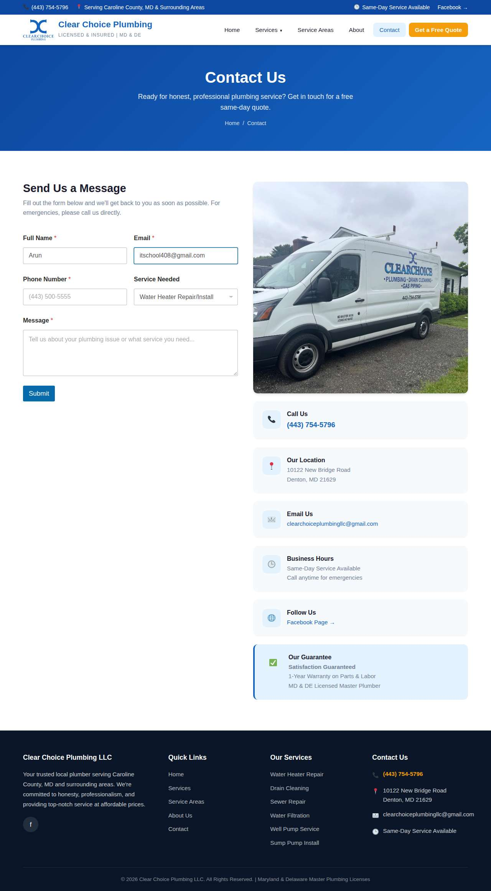

### volkosupply.com — unclear (LIVE)

| | |
|---|---|
| Attempt ID | `c1497693-278f-43b2-ac2a-30760320c1d9` |
| Form URL | http://volkosupply.com/contactus.cfm |
| Final URL | http://volkosupply.com/sendmail.cfm |
| Reserved | 2026-11-02 05:06:33 UTC |
| Submit attempted | 2026-11-02 05:06:49 UTC |
| Template | standard v2 |
| Confirmation text | none observed |
| Result / error | No new success marker observed |

Exact message:

~~~text
Subject: Helping customers find your business in AI search (AEO + GEO)

Hi there,

I'm Arun from Devs Arun. More and more customers now ask ChatGPT, Gemini, Perplexity or Google's AI Overviews questions like "who should I hire for this in my area?" before they call anyone. These tools answer from websites they can clearly understand, and they tend to recommend businesses whose pages answer real customer questions.

That is what AEO + GEO (Answer Engine and Generative Engine Optimization) is for. I improve your existing service pages so they clearly answer the questions your customers ask, add structured data that matches the page, and make the call, quote or enquiry step obvious. The benefit: your business gets a better chance of being mentioned or linked in AI answers, and visitors who arrive find it easy to contact you.

The AEO + GEO Starter is a one-time $199 (about ₹16,999, negotiable) for one website: a basic audit, 10 customer questions, improvements to two existing pages, relevant structured data and an action plan, with one revision round.

You can read the full details, send an enquiry or book online here:
https://devsarun.io/aeo-geo/

If this isn't relevant, just reply and I won't contact you again.

Best,
Arun
Devs Arun
itschool408@gmail.com · +91 7654534323
~~~

Submitted field values:

- Name \[name\]: Arun
- Phone \[phone\]: +91 7654534323
- email \[email\]: itschool408@gmail.com
- note \[message\]: Hi there, I'm Arun from Devs Arun. More and more customers now ask ChatGPT, Gemini, Perplexity or Google's AI Overviews 

**Filled form (before submit)** — `run-38823bf0_attempt-c1497693_filled_2026-11-02T05-06-49-248Z.jpg`

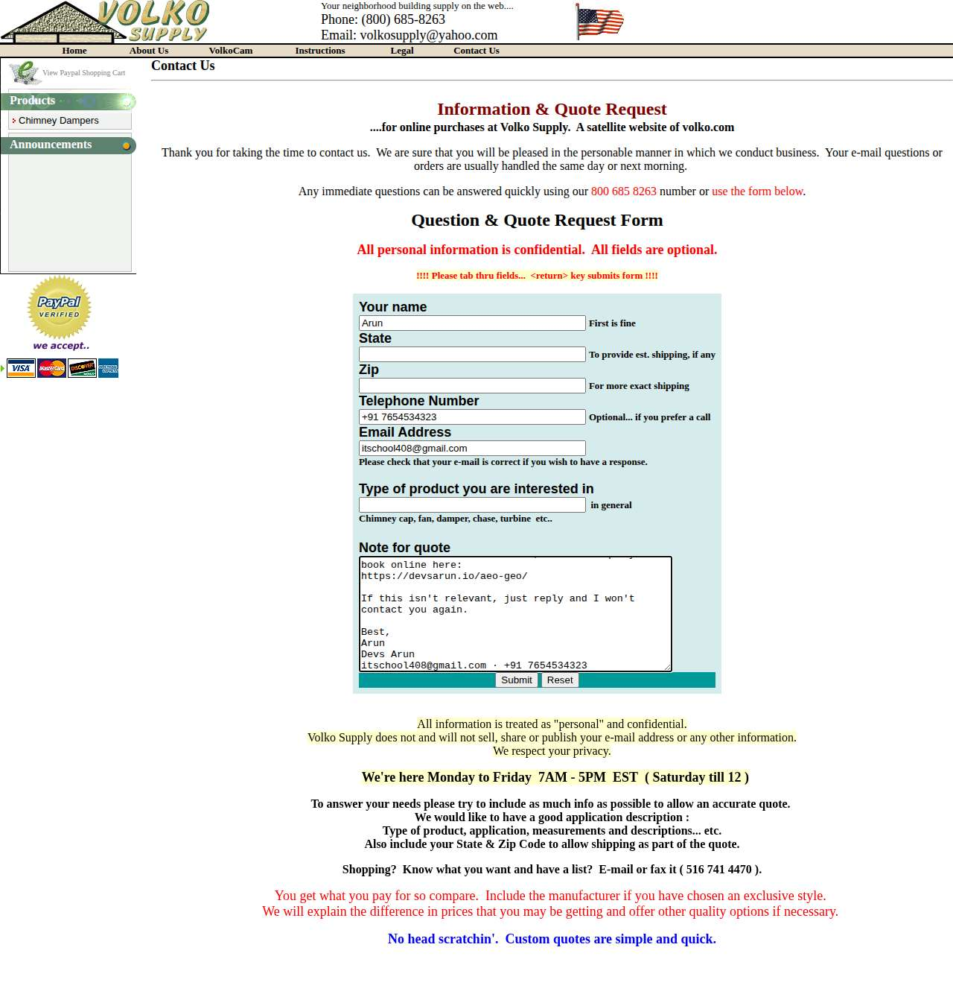

**After submit** — `run-38823bf0_attempt-c1497693_post_attempt_2026-11-02T05-07-16-868Z.jpg`

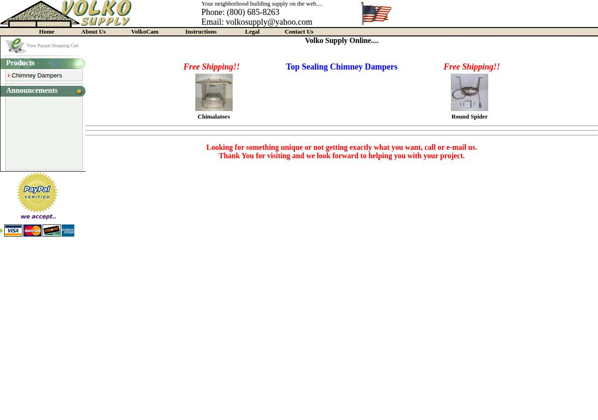

### arizonanativeroofing.com — error\_after\_submit (LIVE)

| | |
|---|---|
| Attempt ID | `2568f10e-9dd4-4e77-bb3d-05e1a8d2fd71` |
| Form URL | https://arizonanativeroofing.com/contact-us/ |
| Final URL | https://arizonanativeroofing.com/contact-us/ |
| Reserved | 2026-11-02 05:07:23 UTC |
| Submit attempted | 2026-11-02 05:07:25 UTC |
| Template | standard v2 |
| Confirmation text | rs occurred. Please confirm the fields and submit it again. Please fill the required field. Please fill the required field. Please fill the required field. Contact Us Name |
| Result / error | — |

Exact message:

~~~text
Subject: Helping customers find your business in AI search (AEO + GEO)

Hi there,

I'm Arun from Devs Arun. More and more customers now ask ChatGPT, Gemini, Perplexity or Google's AI Overviews questions like "who should I hire for this in my area?" before they call anyone. These tools answer from websites they can clearly understand, and they tend to recommend businesses whose pages answer real customer questions.

That is what AEO + GEO (Answer Engine and Generative Engine Optimization) is for. I improve your existing service pages so they clearly answer the questions your customers ask, add structured data that matches the page, and make the call, quote or enquiry step obvious. The benefit: your business gets a better chance of being mentioned or linked in AI answers, and visitors who arrive find it easy to contact you.

The AEO + GEO Starter is a one-time $199 (about ₹16,999, negotiable) for one website: a basic audit, 10 customer questions, improvements to two existing pages, relevant structured data and an action plan, with one revision round.

You can read the full details, send an enquiry or book online here:
https://devsarun.io/aeo-geo/

If this isn't relevant, just reply and I won't contact you again.

Best,
Arun
Devs Arun
itschool408@gmail.com · +91 7654534323
~~~

Submitted field values:

- Name\* \[name\]: Arun
- Phone \[phone\]: +91 7654534323
- Email\* \[email\]: itschool408@gmail.com
- How Can We Help?\* \[message\]: Hi there, I'm Arun from Devs Arun. More and more customers now ask ChatGPT, Gemini, Perplexity or Google's AI Overviews 

**Filled form (before submit)** — `run-38823bf0_attempt-2568f10e_filled_2026-11-02T05-07-25-213Z.jpg`

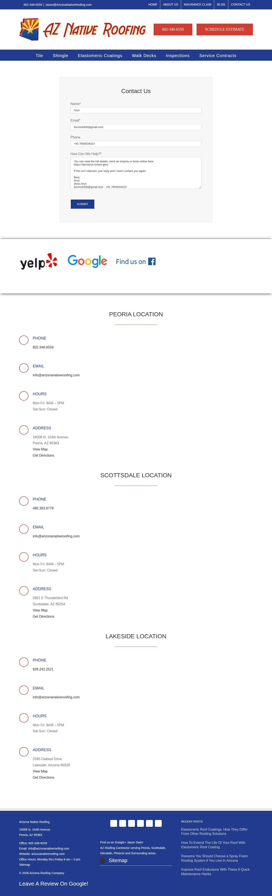

**After submit** — `run-38823bf0_attempt-2568f10e_post_attempt_2026-11-02T05-07-28-068Z.jpg`

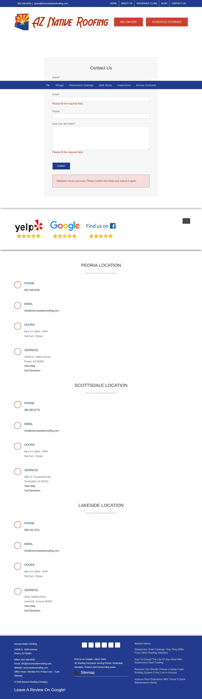

### deeganbrothersroofing.com — confirmed (LIVE)

| | |
|---|---|
| Attempt ID | `8625a43d-39fa-4cdd-9680-cf863c69dbae` |
| Form URL | https://www.deeganbrothersroofing.com/contact-us |
| Final URL | https://www.deeganbrothersroofing.com/contact-us |
| Reserved | 2026-11-02 05:07:34 UTC |
| Submit attempted | 2026-11-02 05:07:37 UTC |
| Template | standard v2 |
| Confirmation text | psburg, NJ Seaside Heights, NJ Scotch Plains, NJ Contact Us Thank you for contacting us. We will get back to you as soon as possible 908-479-4344 Our Facebook Feed Find Us Get Directio |
| Result / error | — |

Exact message:

~~~text
Subject: Helping customers find your business in AI search (AEO + GEO)

Hi there,

I'm Arun from Devs Arun. More and more customers now ask ChatGPT, Gemini, Perplexity or Google's AI Overviews questions like "who should I hire for this in my area?" before they call anyone. These tools answer from websites they can clearly understand, and they tend to recommend businesses whose pages answer real customer questions.

That is what AEO + GEO (Answer Engine and Generative Engine Optimization) is for. I improve your existing service pages so they clearly answer the questions your customers ask, add structured data that matches the page, and make the call, quote or enquiry step obvious. The benefit: your business gets a better chance of being mentioned or linked in AI answers, and visitors who arrive find it easy to contact you.

The AEO + GEO Starter is a one-time $199 (about ₹16,999, negotiable) for one website: a basic audit, 10 customer questions, improvements to two existing pages, relevant structured data and an action plan, with one revision round.

You can read the full details, send an enquiry or book online here:
https://devsarun.io/aeo-geo/

If this isn't relevant, just reply and I won't contact you again.

Best,
Arun
Devs Arun
itschool408@gmail.com · +91 7654534323
~~~

Submitted field values:

- Name \[name\]: Arun
- Email \[email\]: itschool408@gmail.com
- Phone \[phone\]: +91 7654534323
- Message \[message\]: Hi there, I'm Arun from Devs Arun. More and more customers now ask ChatGPT, Gemini, Perplexity or Google's AI Overviews 

**Filled form (before submit)** — `run-38823bf0_attempt-8625a43d_filled_2026-11-02T05-07-37-265Z.jpg`

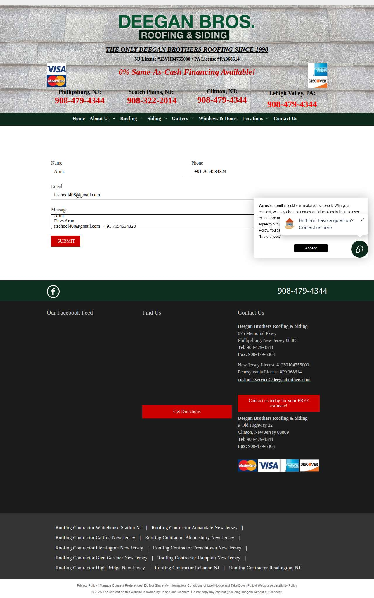

**After submit** — `run-38823bf0_attempt-8625a43d_post_attempt_2026-11-02T05-07-40-122Z.jpg`

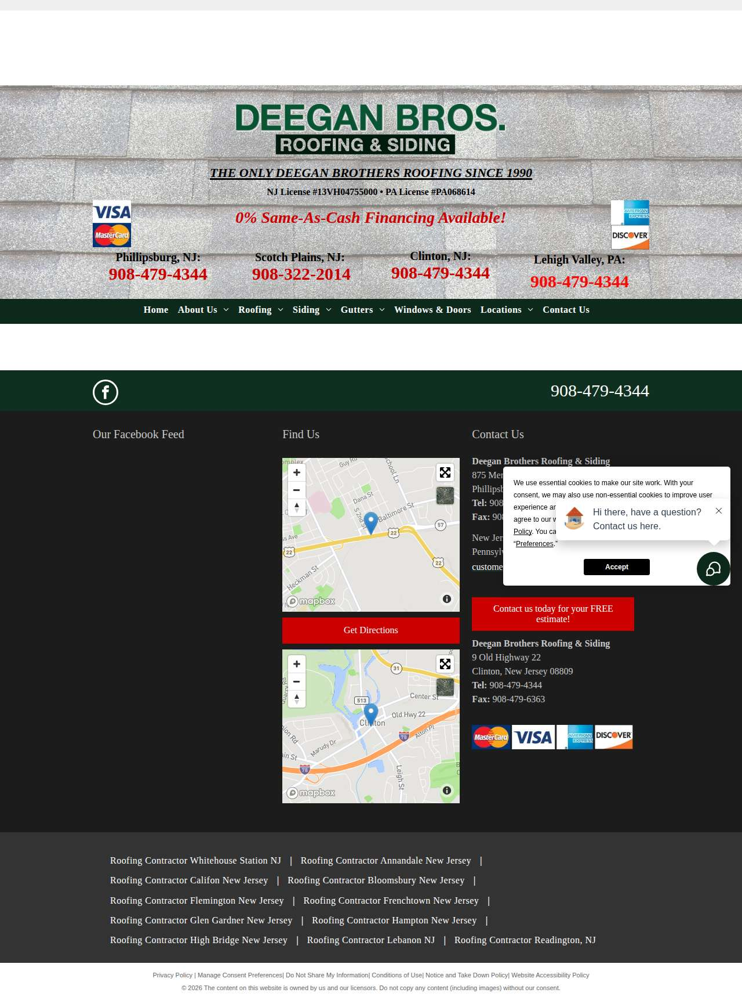

### sharkeyroofing.com — confirmed (LIVE)

| | |
|---|---|
| Attempt ID | `04ae6c71-7b6f-41d5-9469-dbfb06d6920c` |
| Form URL | https://www.sharkeyroofing.com/contact-us/ |
| Final URL | https://www.sharkeyroofing.com/contact-us/ |
| Reserved | 2026-11-02 05:07:46 UTC |
| Submit attempted | 2026-11-02 05:07:48 UTC |
| Template | standard v2 |
| Confirmation text | 82nd St \#7 Lubbock, TX 79424 ph: 806-855-2080 Send Message: Thank you for visiting us at Sharkey Roofing. Send us a message about your next roofing project: Form has bee |
| Result / error | — |

Exact message:

~~~text
Subject: Helping customers find your business in AI search (AEO + GEO)

Hi there,

I'm Arun from Devs Arun. More and more customers now ask ChatGPT, Gemini, Perplexity or Google's AI Overviews questions like "who should I hire for this in my area?" before they call anyone. These tools answer from websites they can clearly understand, and they tend to recommend businesses whose pages answer real customer questions.

That is what AEO + GEO (Answer Engine and Generative Engine Optimization) is for. I improve your existing service pages so they clearly answer the questions your customers ask, add structured data that matches the page, and make the call, quote or enquiry step obvious. The benefit: your business gets a better chance of being mentioned or linked in AI answers, and visitors who arrive find it easy to contact you.

The AEO + GEO Starter is a one-time $199 (about ₹16,999, negotiable) for one website: a basic audit, 10 customer questions, improvements to two existing pages, relevant structured data and an action plan, with one revision round.

You can read the full details, send an enquiry or book online here:
https://devsarun.io/aeo-geo/

If this isn't relevant, just reply and I won't contact you again.

Best,
Arun
Devs Arun
itschool408@gmail.com · +91 7654534323
~~~

Submitted field values:

- Message \[message\]: Hi there, I'm Arun from Devs Arun. More and more customers now ask ChatGPT, Gemini, Perplexity or Google's AI Overviews 
- Your Name \* \[name\]: Arun
- Phone No. \* \[phone\]: +91 7654534323
- Email Address \* \[email\]: itschool408@gmail.com

**Filled form (before submit)** — `run-38823bf0_attempt-04ae6c71_filled_2026-11-02T05-07-48-944Z.jpg`

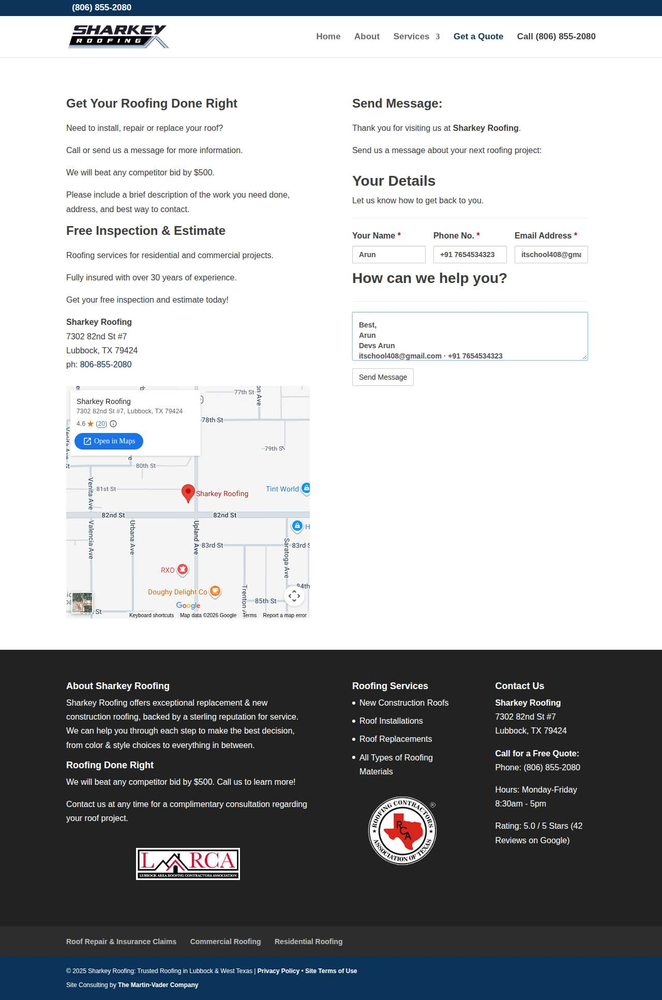

**After submit** — `run-38823bf0_attempt-04ae6c71_post_attempt_2026-11-02T05-07-52-707Z.jpg`

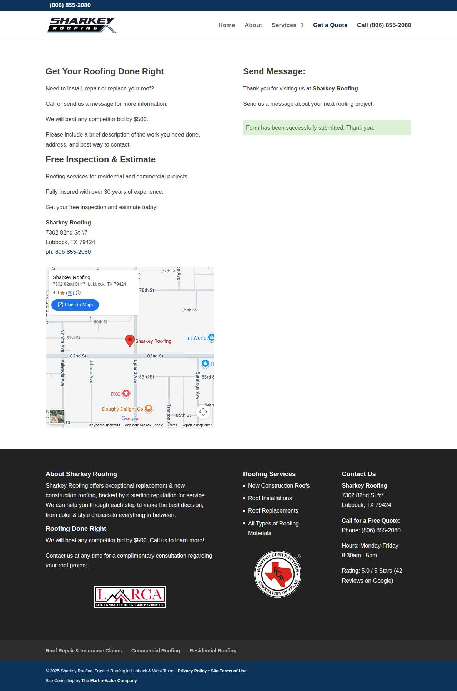

### roofingbyelite.com — unclear (LIVE)

| | |
|---|---|
| Attempt ID | `c46630c2-6840-4539-8c1c-82975d5f99fa` |
| Form URL | https://roofingbyelite.com/contact-us/ |
| Final URL | https://roofingbyelite.com/contact-us/ |
| Reserved | 2026-11-02 05:07:59 UTC |
| Submit attempted | 2026-11-02 05:08:01 UTC |
| Template | standard v2 |
| Confirmation text | none observed |
| Result / error | No new success marker observed |

Exact message:

~~~text
Subject: Helping customers find your business in AI search (AEO + GEO)

Hi there,

I'm Arun from Devs Arun. More and more customers now ask ChatGPT, Gemini, Perplexity or Google's AI Overviews questions like "who should I hire for this in my area?" before they call anyone. These tools answer from websites they can clearly understand, and they tend to recommend businesses whose pages answer real customer questions.

That is what AEO + GEO (Answer Engine and Generative Engine Optimization) is for. I improve your existing service pages so they clearly answer the questions your customers ask, add structured data that matches the page, and make the call, quote or enquiry step obvious. The benefit: your business gets a better chance of being mentioned or linked in AI answers, and visitors who arrive find it easy to contact you.

The AEO + GEO Starter is a one-time $199 (about ₹16,999, negotiable) for one website: a basic audit, 10 customer questions, improvements to two existing pages, relevant structured data and an action plan, with one revision round.

You can read the full details, send an enquiry or book online here:
https://devsarun.io/aeo-geo/

If this isn't relevant, just reply and I won't contact you again.

Best,
Arun
Devs Arun
itschool408@gmail.com · +91 7654534323
~~~

Submitted field values:

- Subject \[subject\]: Helping customers find your business in AI search (AEO + GEO)
- Email Address \[email\]: itschool408@gmail.com
- First Name \[first\_name\]: Arun
- Write a Message \[message\]: Hi there, I'm Arun from Devs Arun. More and more customers now ask ChatGPT, Gemini, Perplexity or Google's AI Overviews 

**Filled form (before submit)** — `run-38823bf0_attempt-c46630c2_filled_2026-11-02T05-08-01-230Z.jpg`

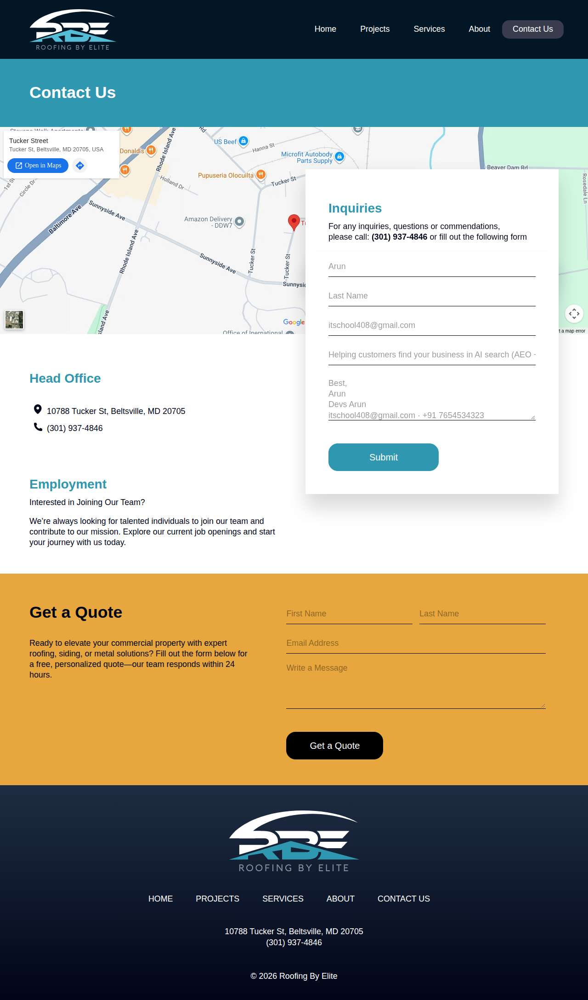

**After submit** — `run-38823bf0_attempt-c46630c2_post_attempt_2026-11-02T05-08-27-994Z.jpg`

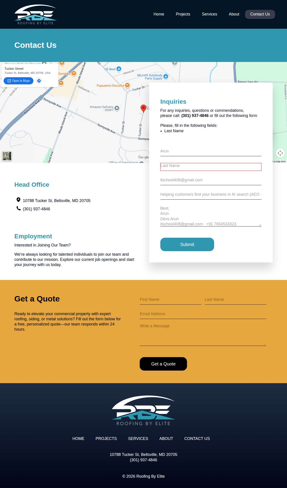

### capitalrealestateconstruction.com — confirmed (LIVE)

| | |
|---|---|
| Attempt ID | `d20c8543-244b-4c94-a1d7-e6ebd66ed1fc` |
| Form URL | https://capitalrealestateconstruction.com/capital-real-estate-construction/ |
| Final URL | https://capitalrealestateconstruction.com/capital-real-estate-construction/ |
| Reserved | 2026-11-02 05:08:34 UTC |
| Submit attempted | 2026-11-02 05:08:37 UTC |
| Template | standard v2 |
| Confirmation text | .com Use the form to schedule your free consultation today\! Thanks for contacting us. We typically respond within 24-48 hours. About Us Capital Real Estate Construction is an employ |
| Result / error | — |

Exact message:

~~~text
Subject: Helping customers find your business in AI search (AEO + GEO)

Hi there,

I'm Arun from Devs Arun. More and more customers now ask ChatGPT, Gemini, Perplexity or Google's AI Overviews questions like "who should I hire for this in my area?" before they call anyone. These tools answer from websites they can clearly understand, and they tend to recommend businesses whose pages answer real customer questions.

That is what AEO + GEO (Answer Engine and Generative Engine Optimization) is for. I improve your existing service pages so they clearly answer the questions your customers ask, add structured data that matches the page, and make the call, quote or enquiry step obvious. The benefit: your business gets a better chance of being mentioned or linked in AI answers, and visitors who arrive find it easy to contact you.

The AEO + GEO Starter is a one-time $199 (about ₹16,999, negotiable) for one website: a basic audit, 10 customer questions, improvements to two existing pages, relevant structured data and an action plan, with one revision round.

You can read the full details, send an enquiry or book online here:
https://devsarun.io/aeo-geo/

If this isn't relevant, just reply and I won't contact you again.

Best,
Arun
Devs Arun
itschool408@gmail.com · +91 7654534323
~~~

Submitted field values:

- Name \* \[name\]: Arun
- Phone \[phone\]: +91 7654534323
- Email \* \[email\]: itschool408@gmail.com
- Message \[message\]: Hi there, I'm Arun from Devs Arun. More and more customers now ask ChatGPT, Gemini, Perplexity or Google's AI Overviews 

**Filled form (before submit)** — `run-38823bf0_attempt-d20c8543_filled_2026-11-02T05-08-37-613Z.jpg`

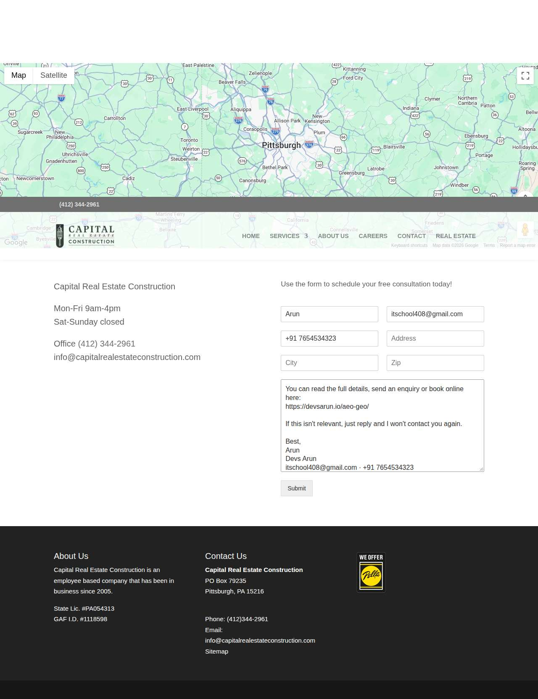

**After submit** — `run-38823bf0_attempt-d20c8543_post_attempt_2026-11-02T05-08-40-498Z.jpg`

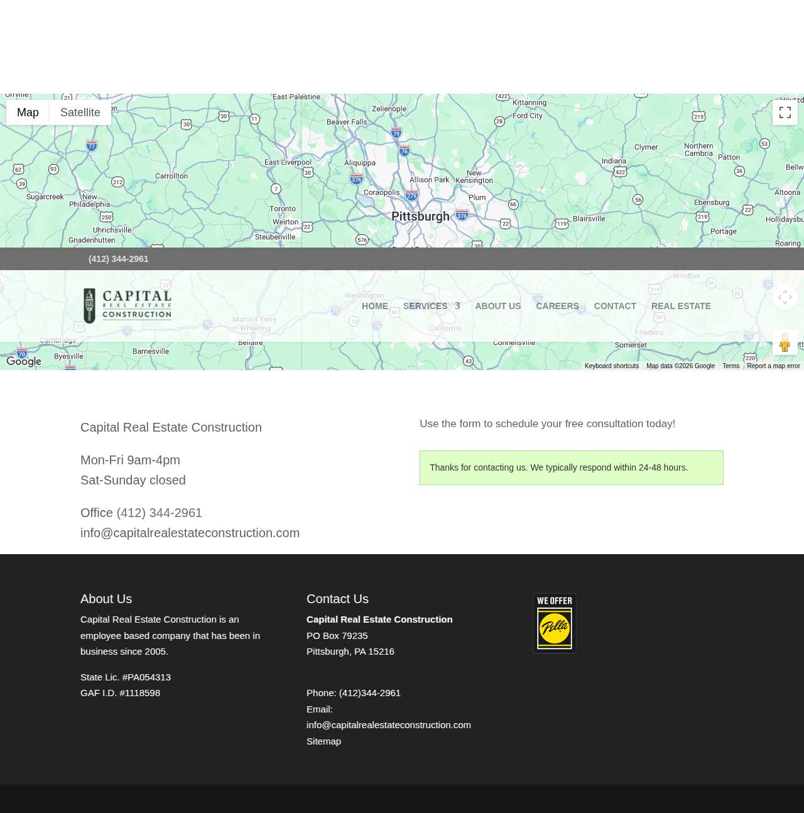

### roofingappletonwisconsin.com — error\_after\_submit (LIVE)

| | |
|---|---|
| Attempt ID | `88e543fe-4fa1-4cda-94c0-bb9b0e6ca481` |
| Form URL | https://roofingappletonwisconsin.com/contact/ |
| Final URL | https://roofingappletonwisconsin.com/contact/ |
| Reserved | 2026-11-02 05:08:47 UTC |
| Submit attempted | 2026-11-02 05:08:49 UTC |
| Template | standard v2 |
| Confirmation text | ers and Gutter Protection Siding YOUR MESSAGE FREE QUOTE An error occurred. SEE WHAT OUR CUSTOMERS HAVE TO SAY These guys did great work\!\! The work was done in a timely manne |
| Result / error | — |

Exact message:

~~~text
Subject: Helping customers find your business in AI search (AEO + GEO)

Hi there,

I'm Arun from Devs Arun. More and more customers now ask ChatGPT, Gemini, Perplexity or Google's AI Overviews questions like "who should I hire for this in my area?" before they call anyone. These tools answer from websites they can clearly understand, and they tend to recommend businesses whose pages answer real customer questions.

That is what AEO + GEO (Answer Engine and Generative Engine Optimization) is for. I improve your existing service pages so they clearly answer the questions your customers ask, add structured data that matches the page, and make the call, quote or enquiry step obvious. The benefit: your business gets a better chance of being mentioned or linked in AI answers, and visitors who arrive find it easy to contact you.

The AEO + GEO Starter is a one-time $199 (about ₹16,999, negotiable) for one website: a basic audit, 10 customer questions, improvements to two existing pages, relevant structured data and an action plan, with one revision round.

You can read the full details, send an enquiry or book online here:
https://devsarun.io/aeo-geo/

If this isn't relevant, just reply and I won't contact you again.

Best,
Arun
Devs Arun
itschool408@gmail.com · +91 7654534323
~~~

Submitted field values:

- NAME \[name\]: Arun
- EMAIL \[email\]: itschool408@gmail.com
- PHONE \[phone\]: +91 7654534323
- ZIP CODE \[phone\]: +91 7654534323
- YOUR MESSAGE \[message\]: Hi there, I'm Arun from Devs Arun. More and more customers now ask ChatGPT, Gemini, Perplexity or Google's AI Overviews 

**Filled form (before submit)** — `run-38823bf0_attempt-88e543fe_filled_2026-11-02T05-08-49-731Z.jpg`

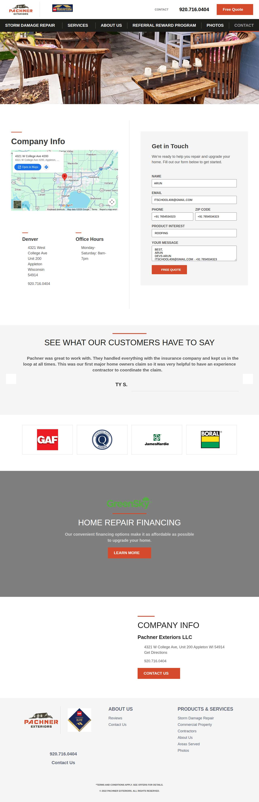

**After submit** — `run-38823bf0_attempt-88e543fe_post_attempt_2026-11-02T05-08-53-563Z.jpg`

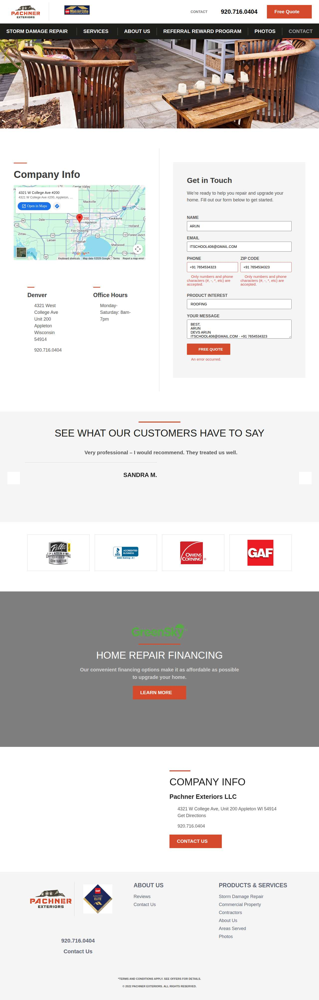

### legacyroofingutah.com — unclear (LIVE)

| | |
|---|---|
| Attempt ID | `3949f2c8-a47c-4886-bf34-6b370bedc543` |
| Form URL | https://www.legacyroofingutah.com/contact |
| Final URL | https://www.legacyroofingutah.com/contact |
| Reserved | 2026-11-02 05:09:00 UTC |
| Submit attempted | 2026-11-02 05:09:04 UTC |
| Template | standard v2 |
| Confirmation text | none observed |
| Result / error | No new success marker observed |

Exact message:

~~~text
Subject: Helping customers find your business in AI search (AEO + GEO)

Hi there,

I'm Arun from Devs Arun. More and more customers now ask ChatGPT, Gemini, Perplexity or Google's AI Overviews questions like "who should I hire for this in my area?" before they call anyone. These tools answer from websites they can clearly understand, and they tend to recommend businesses whose pages answer real customer questions.

That is what AEO + GEO (Answer Engine and Generative Engine Optimization) is for. I improve your existing service pages so they clearly answer the questions your customers ask, add structured data that matches the page, and make the call, quote or enquiry step obvious. The benefit: your business gets a better chance of being mentioned or linked in AI answers, and visitors who arrive find it easy to contact you.

The AEO + GEO Starter is a one-time $199 (about ₹16,999, negotiable) for one website: a basic audit, 10 customer questions, improvements to two existing pages, relevant structured data and an action plan, with one revision round.

You can read the full details, send an enquiry or book online here:
https://devsarun.io/aeo-geo/

If this isn't relevant, just reply and I won't contact you again.

Best,
Arun
Devs Arun
itschool408@gmail.com · +91 7654534323
~~~

Submitted field values:

- Email \[email\]: itschool408@gmail.com
- Phone \[phone\]: +91 7654534323
- Full name \[name\]: Arun
- How can we help? (optional) \[message\]: Hi there, I'm Arun from Devs Arun. More and more customers now ask ChatGPT, Gemini, Perplexity or Google's AI Overviews 

**Filled form (before submit)** — `run-38823bf0_attempt-3949f2c8_filled_2026-11-02T05-09-04-725Z.jpg`

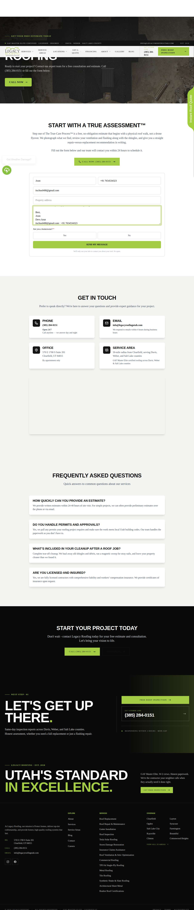

**After submit** — `run-38823bf0_attempt-3949f2c8_post_attempt_2026-11-02T05-09-31-815Z.jpg`

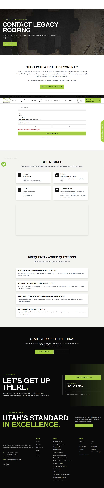

### phoenixroofing.com — unclear (LIVE)

| | |
|---|---|
| Attempt ID | `5392b552-f23b-41e0-8eed-1e09be0ab31f` |
| Form URL | https://phoenixroofing.com/contact-phoenix-roofing/ |
| Final URL | https://phoenixroofing.com/contact-phoenix-roofing/ |
| Reserved | 2026-11-02 05:09:38 UTC |
| Submit attempted | 2026-11-02 05:09:41 UTC |
| Template | standard v2 |
| Confirmation text | none observed |
| Result / error | No new success marker observed |

Exact message:

~~~text
Subject: Helping customers find your business in AI search (AEO + GEO)

Hi there,

I'm Arun from Devs Arun. More and more customers now ask ChatGPT, Gemini, Perplexity or Google's AI Overviews questions like "who should I hire for this in my area?" before they call anyone. These tools answer from websites they can clearly understand, and they tend to recommend businesses whose pages answer real customer questions.

That is what AEO + GEO (Answer Engine and Generative Engine Optimization) is for. I improve your existing service pages so they clearly answer the questions your customers ask, add structured data that matches the page, and make the call, quote or enquiry step obvious. The benefit: your business gets a better chance of being mentioned or linked in AI answers, and visitors who arrive find it easy to contact you.

The AEO + GEO Starter is a one-time $199 (about ₹16,999, negotiable) for one website: a basic audit, 10 customer questions, improvements to two existing pages, relevant structured data and an action plan, with one revision round.

You can read the full details, send an enquiry or book online here:
https://devsarun.io/aeo-geo/

If this isn't relevant, just reply and I won't contact you again.

Best,
Arun
Devs Arun
itschool408@gmail.com · +91 7654534323
~~~

Submitted field values:

- Name \[name\]: Arun
- Phone \[phone\]: +91 7654534323
- message \[message\]: Hi there, I'm Arun from Devs Arun. More and more customers now ask ChatGPT, Gemini, Perplexity or Google's AI Overviews 
- Email Address \[email\]: itschool408@gmail.com

**Filled form (before submit)** — `run-38823bf0_attempt-5392b552_filled_2026-11-02T05-09-41-212Z.jpg`

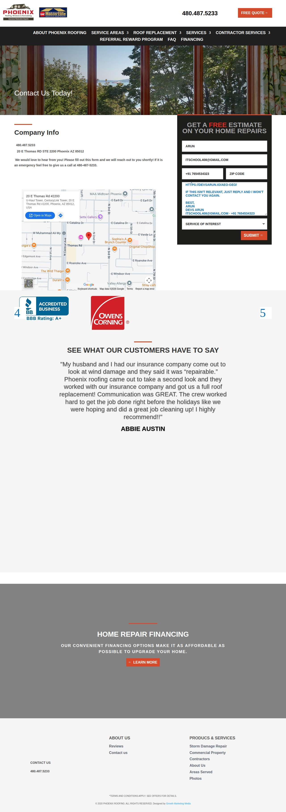

**After submit** — `run-38823bf0_attempt-5392b552_post_attempt_2026-11-02T05-10-10-184Z.jpg`

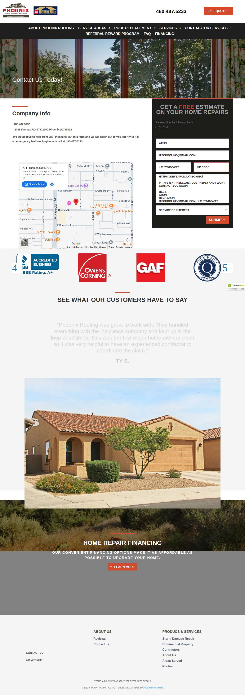

### rhinoroofer.com — confirmed (LIVE)

| | |
|---|---|
| Attempt ID | `00ad1e20-8ca8-41f5-a806-dbe64c8cd19b` |
| Form URL | https://rhinoroofer.com/contact/ |
| Final URL | https://rhinoroofer.com/thank-you/ |
| Reserved | 2026-11-02 05:10:16 UTC |
| Submit attempted | 2026-11-02 05:10:19 UTC |
| Template | standard v2 |
| Confirmation text | SERVICE AREAS OUR WORK CONTACT BOOK MY FREE ROOF ASSESSMENT THANK YOU Licensed & Insured • \#BC757294 SERVICES Residential Roofing Commercial Roofing Gutter Installation |
| Result / error | — |

Exact message:

~~~text
Subject: Helping customers find your business in AI search (AEO + GEO)

Hi there,

I'm Arun from Devs Arun. More and more customers now ask ChatGPT, Gemini, Perplexity or Google's AI Overviews questions like "who should I hire for this in my area?" before they call anyone. These tools answer from websites they can clearly understand, and they tend to recommend businesses whose pages answer real customer questions.

That is what AEO + GEO (Answer Engine and Generative Engine Optimization) is for. I improve your existing service pages so they clearly answer the questions your customers ask, add structured data that matches the page, and make the call, quote or enquiry step obvious. The benefit: your business gets a better chance of being mentioned or linked in AI answers, and visitors who arrive find it easy to contact you.

The AEO + GEO Starter is a one-time $199 (about ₹16,999, negotiable) for one website: a basic audit, 10 customer questions, improvements to two existing pages, relevant structured data and an action plan, with one revision round.

You can read the full details, send an enquiry or book online here:
https://devsarun.io/aeo-geo/

If this isn't relevant, just reply and I won't contact you again.

Best,
Arun
Devs Arun
itschool408@gmail.com · +91 7654534323
~~~

Submitted field values:

- name-1 \[name\]: Arun
- email-1 \[email\]: itschool408@gmail.com
- phone-1 \[phone\]: +91 7654534323
- textarea-1 \[message\]: Hi there, I'm Arun from Devs Arun. More and more customers now ask ChatGPT, Gemini, Perplexity or Google's AI Overviews 

**Filled form (before submit)** — `run-38823bf0_attempt-00ad1e20_filled_2026-11-02T05-10-19-246Z.jpg`

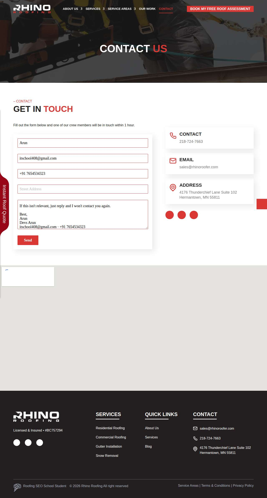

**After submit** — `run-38823bf0_attempt-00ad1e20_post_attempt_2026-11-02T05-10-23-095Z.jpg`

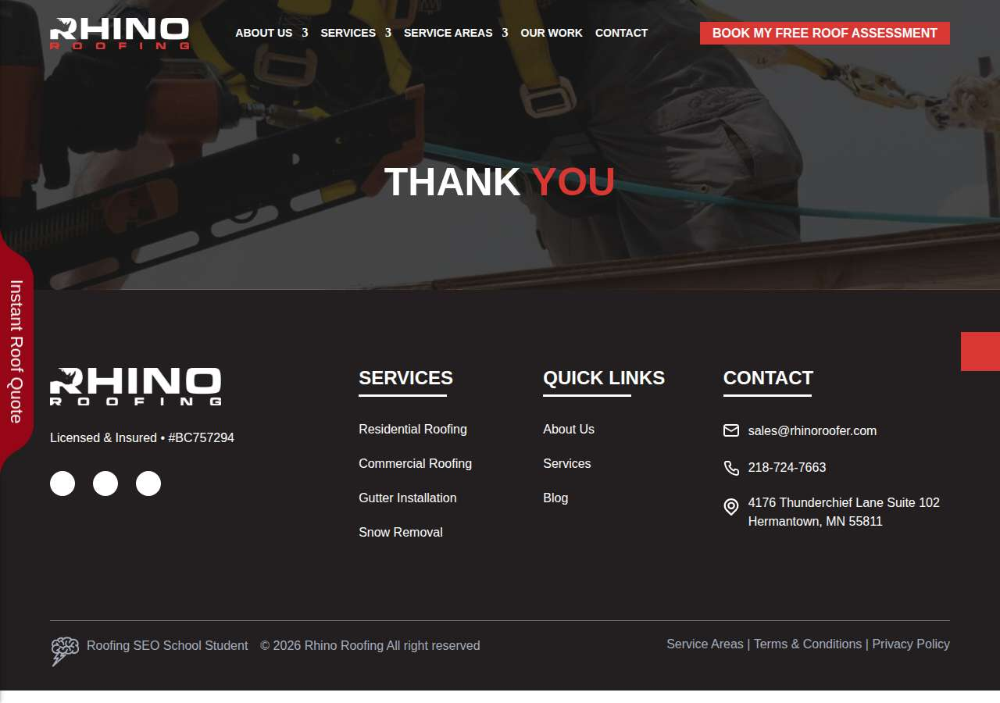

### affordableroofmd.com — unclear (LIVE)

| | |
|---|---|
| Attempt ID | `62d8c824-3ad0-4d0d-8f27-7e8e347952d0` |
| Form URL | https://www.affordableroofmd.com/contact |
| Final URL | https://www.affordableroofmd.com/contact |
| Reserved | 2026-11-02 05:10:29 UTC |
| Submit attempted | 2026-11-02 05:10:33 UTC |
| Template | short v2 |
| Confirmation text | none observed |
| Result / error | No new success marker observed |

Exact message:

~~~text
Subject: Helping customers find your business in AI search (AEO + GEO)

Hi there,

I'm Arun from Devs Arun. Customers increasingly ask ChatGPT, Gemini and Google's AI Overviews who to hire before they call anyone. AEO + GEO makes your existing service pages clear answers these tools can understand and cite, with an easy way to call or enquire, so your business has a better chance of being recommended.

The AEO + GEO Starter is a one-time $199 (about ₹16,999, negotiable) for one website.

Full details, enquiries and online booking:
https://devsarun.io/aeo-geo/

If this isn't relevant, just reply and I won't contact you again.

Best,
Arun, Devs Arun
itschool408@gmail.com
~~~

Submitted field values:

- Name \* \[name\]: Arun
- Email \* \[email\]: itschool408@gmail.com
- Phone \* \[phone\]: +91 7654534323
- Message \[message\]: Hi there, I'm Arun from Devs Arun. Customers increasingly ask ChatGPT, Gemini and Google's AI Overviews who to hire befo

**Filled form (before submit)** — `run-38823bf0_attempt-62d8c824_filled_2026-11-02T05-10-33-155Z.jpg`

**After submit** — `run-38823bf0_attempt-62d8c824_post_attempt_2026-11-02T05-10-59-898Z.jpg`

### loganroof.com — unclear (LIVE)

| | |
|---|---|
| Attempt ID | `86665cb3-f4d0-4e7a-befa-d397e09311f9` |
| Form URL | https://loganroof.com/contact-us/ |
| Final URL | https://loganroof.com/contact-us/ |
| Reserved | 2026-11-02 05:11:06 UTC |
| Submit attempted | 2026-11-02 05:11:08 UTC |
| Template | standard v2 |
| Confirmation text | none observed |
| Result / error | No new success marker observed |

Exact message:

~~~text
Subject: Helping customers find your business in AI search (AEO + GEO)

Hi there,

I'm Arun from Devs Arun. More and more customers now ask ChatGPT, Gemini, Perplexity or Google's AI Overviews questions like "who should I hire for this in my area?" before they call anyone. These tools answer from websites they can clearly understand, and they tend to recommend businesses whose pages answer real customer questions.

That is what AEO + GEO (Answer Engine and Generative Engine Optimization) is for. I improve your existing service pages so they clearly answer the questions your customers ask, add structured data that matches the page, and make the call, quote or enquiry step obvious. The benefit: your business gets a better chance of being mentioned or linked in AI answers, and visitors who arrive find it easy to contact you.

The AEO + GEO Starter is a one-time $199 (about ₹16,999, negotiable) for one website: a basic audit, 10 customer questions, improvements to two existing pages, relevant structured data and an action plan, with one revision round.

You can read the full details, send an enquiry or book online here:
https://devsarun.io/aeo-geo/

If this isn't relevant, just reply and I won't contact you again.

Best,
Arun
Devs Arun
itschool408@gmail.com · +91 7654534323
~~~

Submitted field values:

- Email \[email\]: itschool408@gmail.com
- Full Name \[name\]: Arun
- Message \[message\]: Hi there, I'm Arun from Devs Arun. More and more customers now ask ChatGPT, Gemini, Perplexity or Google's AI Overviews 
- Phone Number \[phone\]: +91 7654534323

**Filled form (before submit)** — `run-38823bf0_attempt-86665cb3_filled_2026-11-02T05-11-08-657Z.jpg`

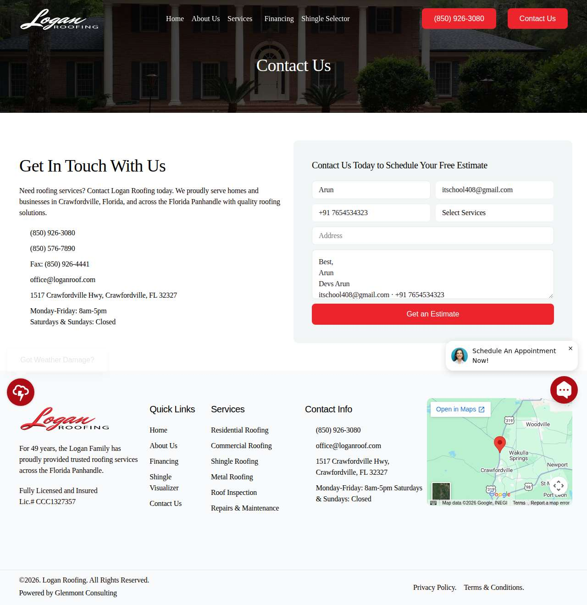

**After submit** — `run-38823bf0_attempt-86665cb3_post_attempt_2026-11-02T05-11-35-422Z.jpg`

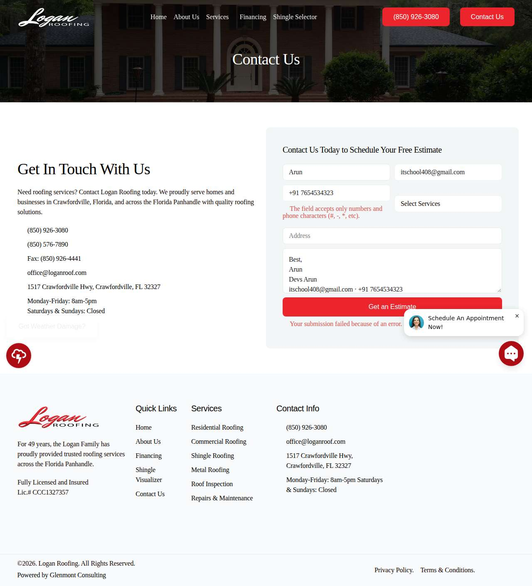

### beckerschimneyandroofing.com — unclear (LIVE)

| | |
|---|---|
| Attempt ID | `ebe8697a-4bcf-418c-8ee4-cad7fd8114ca` |
| Form URL | https://www.beckerschimneyandroofing.com/contact/ |
| Final URL | https://www.beckerschimneyandroofing.com/contact/ |
| Reserved | 2026-11-02 05:11:42 UTC |
| Submit attempted | 2026-11-02 05:11:43 UTC |
| Template | standard v2 |
| Confirmation text | none observed |
| Result / error | No new success marker observed |

Exact message:

~~~text
Subject: Helping customers find your business in AI search (AEO + GEO)

Hi there,

I'm Arun from Devs Arun. More and more customers now ask ChatGPT, Gemini, Perplexity or Google's AI Overviews questions like "who should I hire for this in my area?" before they call anyone. These tools answer from websites they can clearly understand, and they tend to recommend businesses whose pages answer real customer questions.

That is what AEO + GEO (Answer Engine and Generative Engine Optimization) is for. I improve your existing service pages so they clearly answer the questions your customers ask, add structured data that matches the page, and make the call, quote or enquiry step obvious. The benefit: your business gets a better chance of being mentioned or linked in AI answers, and visitors who arrive find it easy to contact you.

The AEO + GEO Starter is a one-time $199 (about ₹16,999, negotiable) for one website: a basic audit, 10 customer questions, improvements to two existing pages, relevant structured data and an action plan, with one revision round.

You can read the full details, send an enquiry or book online here:
https://devsarun.io/aeo-geo/

If this isn't relevant, just reply and I won't contact you again.

Best,
Arun
Devs Arun
itschool408@gmail.com · +91 7654534323
~~~

Submitted field values:

- input\_1 \[phone\]: +91 7654534323
- input\_4 \[email\]: itschool408@gmail.com
- input\_6 \[message\]: Hi there, I'm Arun from Devs Arun. More and more customers now ask ChatGPT, Gemini, Perplexity or Google's AI Overviews 
- First Name(Required) \[first\_name\]: Arun

**Filled form (before submit)** — `run-38823bf0_attempt-ebe8697a_filled_2026-11-02T05-11-43-834Z.jpg`

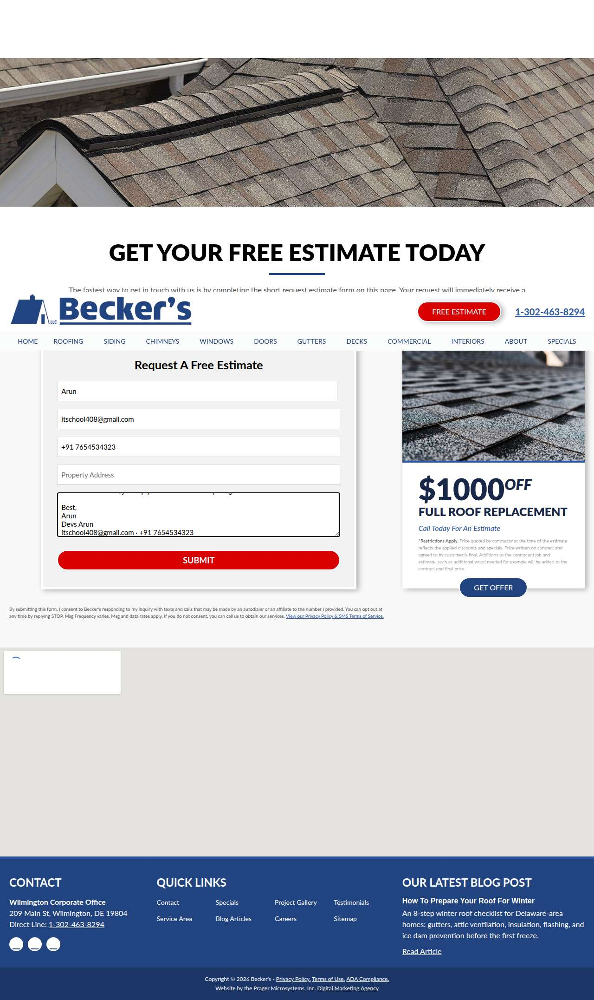

**After submit** — `run-38823bf0_attempt-ebe8697a_post_attempt_2026-11-02T05-12-14-546Z.jpg`

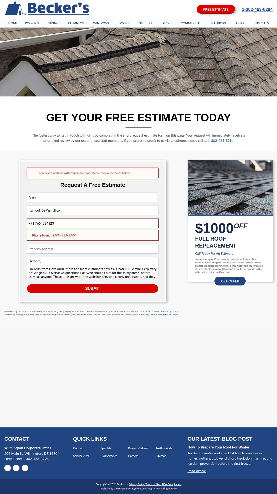

## Events (114)

| Time (UTC) | Event | Website | Details |
|---|---|---|---|
| 05:06:24 | run\_queued | — | live run requested by github:itsDevsArun |
| 05:06:24 | run\_dispatched | — | dispatch disabled (local test mode) |
| 05:06:26 | run\_started | — | Runner claimed live run |
| 05:06:27 | offer\_verified | — | Service page offer facts verified |
| 05:06:27 | website\_selected | clearchoiceplumbingllc.com | Live target clearchoiceplumbingllc.com |
| 05:06:27 | attempt\_reserved | clearchoiceplumbingllc.com | Submission attempt reserved with template standard v2 |
| 05:06:28 | page\_opened | clearchoiceplumbingllc.com | Opened form page |
| 05:06:28 | screenshot\_saved | clearchoiceplumbingllc.com | inspection screenshot saved (145 KB) |
| 05:06:28 | review\_required | clearchoiceplumbingllc.com | failed before submit: locator.fill: Error: Cannot type text into input\[type=number\] |
| 05:06:33 | website\_selected | volkosupply.com | Live target volkosupply.com |
| 05:06:33 | attempt\_reserved | volkosupply.com | Submission attempt reserved with template standard v2 |
| 05:06:49 | page\_opened | volkosupply.com | Opened form page |
| 05:06:49 | fields\_filled | volkosupply.com | filled |
| 05:06:49 | screenshot\_saved | volkosupply.com | filled screenshot saved (144 KB) |
| 05:06:49 | submit\_attempted | volkosupply.com | submitting |
| 05:07:16 | screenshot\_saved | volkosupply.com | post\_attempt screenshot saved (54 KB) |
| 05:07:16 | review\_required | volkosupply.com | unclear: No new success marker observed |
| 05:07:23 | website\_selected | arizonanativeroofing.com | Live target arizonanativeroofing.com |
| 05:07:23 | attempt\_reserved | arizonanativeroofing.com | Submission attempt reserved with template standard v2 |
| 05:07:24 | page\_opened | arizonanativeroofing.com | Opened form page |
| 05:07:24 | fields\_filled | arizonanativeroofing.com | filled |
| 05:07:25 | screenshot\_saved | arizonanativeroofing.com | filled screenshot saved (173 KB) |
| 05:07:25 | submit\_attempted | arizonanativeroofing.com | submitting |
| 05:07:28 | screenshot\_saved | arizonanativeroofing.com | post\_attempt screenshot saved (176 KB) |
| 05:07:28 | error | arizonanativeroofing.com | error after submit — "rs occurred. Please confirm the fields and submit it again. Please fill the required field. Please fill the required fie" |
| 05:07:34 | website\_selected | deeganbrothersroofing.com | Live target deeganbrothersroofing.com |
| 05:07:34 | attempt\_reserved | deeganbrothersroofing.com | Submission attempt reserved with template standard v2 |
| 05:07:36 | page\_opened | deeganbrothersroofing.com | Opened form page |
| 05:07:37 | fields\_filled | deeganbrothersroofing.com | filled |
| 05:07:37 | screenshot\_saved | deeganbrothersroofing.com | filled screenshot saved (211 KB) |
| 05:07:37 | submit\_attempted | deeganbrothersroofing.com | submitting |
| 05:07:40 | screenshot\_saved | deeganbrothersroofing.com | post\_attempt screenshot saved (213 KB) |
| 05:07:40 | confirmation\_observed | deeganbrothersroofing.com | confirmed — "psburg, NJ Seaside Heights, NJ Scotch Plains, NJ Contact Us Thank you for contacting us. We will get back to you as soon" |
| 05:07:46 | website\_selected | sharkeyroofing.com | Live target sharkeyroofing.com |
| 05:07:46 | attempt\_reserved | sharkeyroofing.com | Submission attempt reserved with template standard v2 |
| 05:07:48 | page\_opened | sharkeyroofing.com | Opened form page |
| 05:07:48 | fields\_filled | sharkeyroofing.com | filled |
| 05:07:48 | screenshot\_saved | sharkeyroofing.com | filled screenshot saved (148 KB) |
| 05:07:48 | submit\_attempted | sharkeyroofing.com | submitting |
| 05:07:52 | screenshot\_saved | sharkeyroofing.com | post\_attempt screenshot saved (136 KB) |
| 05:07:52 | confirmation\_observed | sharkeyroofing.com | confirmed — "82nd St \#7 Lubbock, TX 79424 ph: 806-855-2080 Send Message: Thank you for visiting us at Sharkey Roofing. Send us a mess" |
| 05:07:59 | website\_selected | roofingbyelite.com | Live target roofingbyelite.com |
| 05:07:59 | attempt\_reserved | roofingbyelite.com | Submission attempt reserved with template standard v2 |
| 05:08:00 | page\_opened | roofingbyelite.com | Opened form page |
| 05:08:01 | fields\_filled | roofingbyelite.com | filled |
| 05:08:01 | screenshot\_saved | roofingbyelite.com | filled screenshot saved (130 KB) |
| 05:08:01 | submit\_attempted | roofingbyelite.com | submitting |
| 05:08:27 | screenshot\_saved | roofingbyelite.com | post\_attempt screenshot saved (133 KB) |
| 05:08:27 | review\_required | roofingbyelite.com | unclear: No new success marker observed |
| 05:08:34 | website\_selected | capitalrealestateconstruction.com | Live target capitalrealestateconstruction.com |
| 05:08:34 | attempt\_reserved | capitalrealestateconstruction.com | Submission attempt reserved with template standard v2 |
| 05:08:37 | page\_opened | capitalrealestateconstruction.com | Opened form page |
| 05:08:37 | fields\_filled | capitalrealestateconstruction.com | filled |
| 05:08:37 | screenshot\_saved | capitalrealestateconstruction.com | filled screenshot saved (131 KB) |
| 05:08:37 | submit\_attempted | capitalrealestateconstruction.com | submitting |
| 05:08:40 | screenshot\_saved | capitalrealestateconstruction.com | post\_attempt screenshot saved (112 KB) |
| 05:08:40 | confirmation\_observed | capitalrealestateconstruction.com | confirmed — ".com Use the form to schedule your free consultation today\! Thanks for contacting us. We typically respond within 24-48 " |
| 05:08:47 | website\_selected | roofingappletonwisconsin.com | Live target roofingappletonwisconsin.com |
| 05:08:47 | attempt\_reserved | roofingappletonwisconsin.com | Submission attempt reserved with template standard v2 |
| 05:08:49 | page\_opened | roofingappletonwisconsin.com | Opened form page |
| 05:08:49 | fields\_filled | roofingappletonwisconsin.com | filled |
| 05:08:49 | screenshot\_saved | roofingappletonwisconsin.com | filled screenshot saved (269 KB) |
| 05:08:49 | submit\_attempted | roofingappletonwisconsin.com | submitting |
| 05:08:53 | screenshot\_saved | roofingappletonwisconsin.com | post\_attempt screenshot saved (265 KB) |
| 05:08:53 | error | roofingappletonwisconsin.com | error after submit — "ers and Gutter Protection Siding YOUR MESSAGE FREE QUOTE An error occurred. SEE WHAT OUR CUSTOMERS HAVE TO SAY These guy" |
| 05:09:00 | website\_selected | legacyroofingutah.com | Live target legacyroofingutah.com |
| 05:09:00 | attempt\_reserved | legacyroofingutah.com | Submission attempt reserved with template standard v2 |
| 05:09:04 | page\_opened | legacyroofingutah.com | Opened form page |
| 05:09:04 | fields\_filled | legacyroofingutah.com | filled |
| 05:09:04 | screenshot\_saved | legacyroofingutah.com | filled screenshot saved (330 KB) |
| 05:09:04 | submit\_attempted | legacyroofingutah.com | submitting |
| 05:09:31 | screenshot\_saved | legacyroofingutah.com | post\_attempt screenshot saved (339 KB) |
| 05:09:31 | review\_required | legacyroofingutah.com | unclear: No new success marker observed |
| 05:09:38 | website\_selected | phoenixroofing.com | Live target phoenixroofing.com |
| 05:09:38 | attempt\_reserved | phoenixroofing.com | Submission attempt reserved with template standard v2 |
| 05:09:40 | page\_opened | phoenixroofing.com | Opened form page |
| 05:09:40 | fields\_filled | phoenixroofing.com | filled |
| 05:09:41 | screenshot\_saved | phoenixroofing.com | filled screenshot saved (274 KB) |
| 05:09:41 | submit\_attempted | phoenixroofing.com | submitting |
| 05:10:10 | screenshot\_saved | phoenixroofing.com | post\_attempt screenshot saved (364 KB) |
| 05:10:10 | review\_required | phoenixroofing.com | unclear: No new success marker observed |
| 05:10:16 | website\_selected | rhinoroofer.com | Live target rhinoroofer.com |
| 05:10:16 | attempt\_reserved | rhinoroofer.com | Submission attempt reserved with template standard v2 |
| 05:10:18 | page\_opened | rhinoroofer.com | Opened form page |
| 05:10:19 | fields\_filled | rhinoroofer.com | filled |
| 05:10:19 | screenshot\_saved | rhinoroofer.com | filled screenshot saved (121 KB) |
| 05:10:19 | submit\_attempted | rhinoroofer.com | submitting |
| 05:10:23 | screenshot\_saved | rhinoroofer.com | post\_attempt screenshot saved (62 KB) |
| 05:10:23 | confirmation\_observed | rhinoroofer.com | confirmed — "SERVICE AREAS OUR WORK CONTACT BOOK MY FREE ROOF ASSESSMENT THANK YOU Licensed & Insured • \#BC757294 SERVICES Residentia" |
| 05:10:29 | website\_selected | affordableroofmd.com | Live target affordableroofmd.com |
| 05:10:29 | attempt\_reserved | affordableroofmd.com | Submission attempt reserved with template short v2 |
| 05:10:32 | page\_opened | affordableroofmd.com | Opened form page |
| 05:10:33 | fields\_filled | affordableroofmd.com | filled |
| 05:10:33 | screenshot\_saved | affordableroofmd.com | filled screenshot saved (179 KB) |
| 05:10:33 | submit\_attempted | affordableroofmd.com | submitting |
| 05:10:59 | screenshot\_saved | affordableroofmd.com | post\_attempt screenshot saved (178 KB) |
| 05:10:59 | review\_required | affordableroofmd.com | unclear: No new success marker observed |
| 05:11:06 | website\_selected | loganroof.com | Live target loganroof.com |
| 05:11:06 | attempt\_reserved | loganroof.com | Submission attempt reserved with template standard v2 |
| 05:11:08 | page\_opened | loganroof.com | Opened form page |
| 05:11:08 | fields\_filled | loganroof.com | filled |
| 05:11:08 | screenshot\_saved | loganroof.com | filled screenshot saved (122 KB) |
| 05:11:08 | submit\_attempted | loganroof.com | submitting |
| 05:11:35 | screenshot\_saved | loganroof.com | post\_attempt screenshot saved (117 KB) |
| 05:11:35 | review\_required | loganroof.com | unclear: No new success marker observed |
| 05:11:42 | website\_selected | beckerschimneyandroofing.com | Live target beckerschimneyandroofing.com |
| 05:11:42 | attempt\_reserved | beckerschimneyandroofing.com | Submission attempt reserved with template standard v2 |
| 05:11:43 | page\_opened | beckerschimneyandroofing.com | Opened form page |
| 05:11:43 | fields\_filled | beckerschimneyandroofing.com | filled |
| 05:11:43 | screenshot\_saved | beckerschimneyandroofing.com | filled screenshot saved (231 KB) |
| 05:11:43 | submit\_attempted | beckerschimneyandroofing.com | submitting |
| 05:12:14 | screenshot\_saved | beckerschimneyandroofing.com | post\_attempt screenshot saved (250 KB) |
| 05:12:14 | review\_required | beckerschimneyandroofing.com | unclear: No new success marker observed |
| 05:12:21 | run\_completed | — | Run completed (queue\_exhausted) |
