# Run 56769afe — live — completed

| | |
|---|---|
| Run ID | `56769afe-ae21-41e3-9178-651755469ac7` |
| Requested by | github:itsDevsArun |
| Started | 2026-11-02 06:18:06 UTC |
| Finished | 2026-11-02 06:24:20 UTC |
| Finish reason | queue\_exhausted |
| GitHub Actions | https://github.com/itsDevsArun/aeo-geo/actions/runs/41379081570 |

CSV for this run: [runs/2026-11-02_live_56769afe.csv](2026-11-02_live_56769afe.csv)

## Attempts (21)

### clearchoiceplumbingllc.com — failed\_before\_submit (LIVE)

| | |
|---|---|
| Attempt ID | `9cf01070-c87a-48d6-955f-81cb6d527794` |
| Form URL | https://clearchoiceplumbingllc.com/contact/ |
| Final URL | — |
| Reserved | 2026-11-02 06:18:07 UTC |
| Submit attempted | — |
| Template | standard v2 |
| Confirmation text | none observed |
| Result / error | locator.fill: Error: Cannot type text into input\[type=number\] |

Exact message:

~~~text
Subject: Helping customers find your business in AI search (AEO + GEO)

Hi there,

I'm Arun from Devs Arun. More and more customers now ask ChatGPT, Gemini, Perplexity or Google's AI Overviews questions like "who should I hire for this in my area?" before they call anyone. These tools answer from websites they can clearly understand, and they tend to recommend businesses whose pages answer real customer questions.

That is what AEO + GEO (Answer Engine and Generative Engine Optimization) is for. I improve your existing service pages so they clearly answer the questions your customers ask, add structured data that matches the page, and make the call, quote or enquiry step obvious. The benefit: your business gets a better chance of being mentioned or linked in AI answers, and visitors who arrive find it easy to contact you.

The AEO + GEO Starter is a one-time $199 (about ₹16,999, negotiable) for one website: a basic audit, 10 customer questions, improvements to two existing pages, relevant structured data and an action plan, with one revision round.

You can read the full details, send an enquiry or book online here:
https://devsarun.io/aeo-geo/

If this isn't relevant, just reply and I won't contact you again.

Best,
Arun
Devs Arun
itschool408@gmail.com · +91 7654534323
~~~

Submitted field values:

- \#wpforms-51-field\_1: Arun
- \#wpforms-51-field\_2: itschool408@gmail.com
- \#wpforms-51-field\_3: Hi there, I'm Arun from Devs Arun. More and more customers now ask ChatGPT, Gemini, Perplexity or Google's AI Overviews 
- \#wpforms-51-field\_5: +91 7654534323

**Inspected page** — `run-56769afe_attempt-9cf01070_inspection_2026-11-02T06-18-09-483Z.jpg`

### ameengeneralcontracting.com — failed\_before\_submit (LIVE)

| | |
|---|---|
| Attempt ID | `7153d4ce-071e-4180-b473-1d8d72103bd6` |
| Form URL | https://ameengeneralcontracting.com/contact-ameen-general-contracting/ |
| Final URL | https://ameengeneralcontracting.com/contact-ameen-general-contracting/ |
| Reserved | 2026-11-02 06:18:14 UTC |
| Submit attempted | — |
| Template | standard v2 |
| Confirmation text | none observed |
| Result / error | Mapped field "Message am Phone" is not visible |

Exact message:

~~~text
Subject: Helping customers find your business in AI search (AEO + GEO)

Hi there,

I'm Arun from Devs Arun. More and more customers now ask ChatGPT, Gemini, Perplexity or Google's AI Overviews questions like "who should I hire for this in my area?" before they call anyone. These tools answer from websites they can clearly understand, and they tend to recommend businesses whose pages answer real customer questions.

That is what AEO + GEO (Answer Engine and Generative Engine Optimization) is for. I improve your existing service pages so they clearly answer the questions your customers ask, add structured data that matches the page, and make the call, quote or enquiry step obvious. The benefit: your business gets a better chance of being mentioned or linked in AI answers, and visitors who arrive find it easy to contact you.

The AEO + GEO Starter is a one-time $199 (about ₹16,999, negotiable) for one website: a basic audit, 10 customer questions, improvements to two existing pages, relevant structured data and an action plan, with one revision round.

You can read the full details, send an enquiry or book online here:
https://devsarun.io/aeo-geo/

If this isn't relevant, just reply and I won't contact you again.

Best,
Arun
Devs Arun
itschool408@gmail.com · +91 7654534323
~~~

Submitted field values:

- \#wpforms-1233-field\_1: Arun
- \#wpforms-1233-field\_2: itschool408@gmail.com
- \#wpforms-1233-field\_3: Hi there, I'm Arun from Devs Arun. More and more customers now ask ChatGPT, Gemini, Perplexity or Google's AI Overviews 
- \#wpforms-1233-field\_4: +91 7654534323
- \#wpforms-1233-field\_5: Other
- \#wpforms-1233-field\_6: +91 7654534323

**Inspected page** — `run-56769afe_attempt-7153d4ce_inspection_2026-11-02T06-18-19-925Z.jpg`

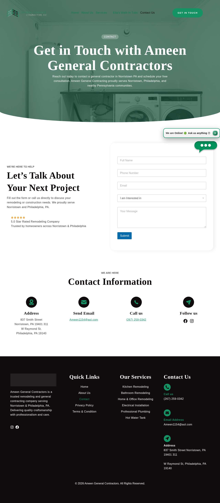

### saddlebackplumbing.com — error\_after\_submit (LIVE)

| | |
|---|---|
| Attempt ID | `5e3b3082-00f2-4f53-ab0f-334f0cf95a47` |
| Form URL | https://www.saddlebackplumbing.com/contact/message |
| Final URL | https://www.saddlebackplumbing.com/contact/message\#error-container |
| Reserved | 2026-11-02 06:18:24 UTC |
| Submit attempted | 2026-11-02 06:18:27 UTC |
| Template | standard v2 |
| Confirmation text | s to Susan G. Komen Read More The Following Errors Occurred Please enter your city Please enter a response for How Did You Hear About Us? 949-829-1980 🍊 Serving Orange Cou |
| Result / error | — |

Exact message:

~~~text
Subject: Helping customers find your business in AI search (AEO + GEO)

Hi there,

I'm Arun from Devs Arun. More and more customers now ask ChatGPT, Gemini, Perplexity or Google's AI Overviews questions like "who should I hire for this in my area?" before they call anyone. These tools answer from websites they can clearly understand, and they tend to recommend businesses whose pages answer real customer questions.

That is what AEO + GEO (Answer Engine and Generative Engine Optimization) is for. I improve your existing service pages so they clearly answer the questions your customers ask, add structured data that matches the page, and make the call, quote or enquiry step obvious. The benefit: your business gets a better chance of being mentioned or linked in AI answers, and visitors who arrive find it easy to contact you.

The AEO + GEO Starter is a one-time $199 (about ₹16,999, negotiable) for one website: a basic audit, 10 customer questions, improvements to two existing pages, relevant structured data and an action plan, with one revision round.

You can read the full details, send an enquiry or book online here:
https://devsarun.io/aeo-geo/

If this isn't relevant, just reply and I won't contact you again.

Best,
Arun
Devs Arun
itschool408@gmail.com · +91 7654534323
~~~

Submitted field values:

- Name \* \[name\]: Arun
- Email \* \[email\]: itschool408@gmail.com
- Comments \* \[message\]: Hi there, I'm Arun from Devs Arun. More and more customers now ask ChatGPT, Gemini, Perplexity or Google's AI Overviews 
- Phone Number \* \[phone\]: +91 7654534323

**Filled form (before submit)** — `run-56769afe_attempt-5e3b3082_filled_2026-11-02T06-18-27-909Z.jpg`

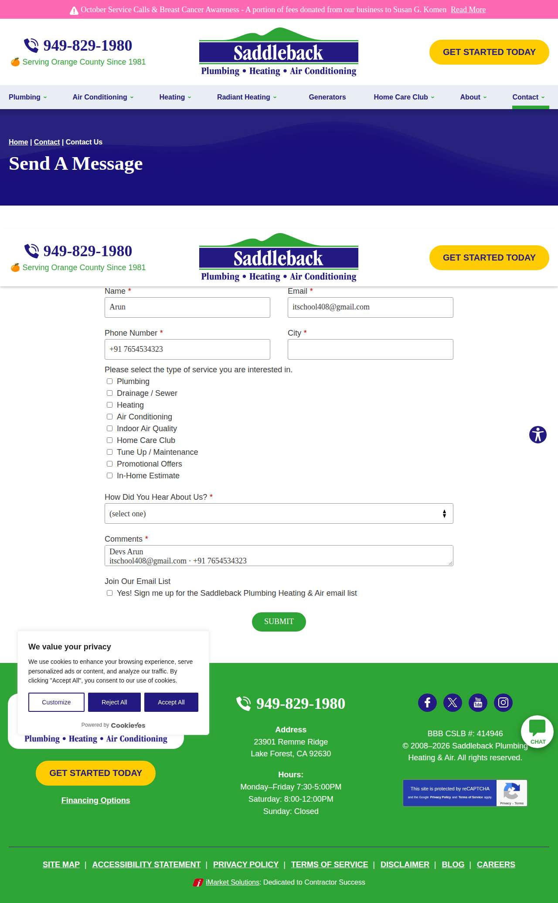

**After submit** — `run-56769afe_attempt-5e3b3082_post_attempt_2026-11-02T06-18-31-067Z.jpg`

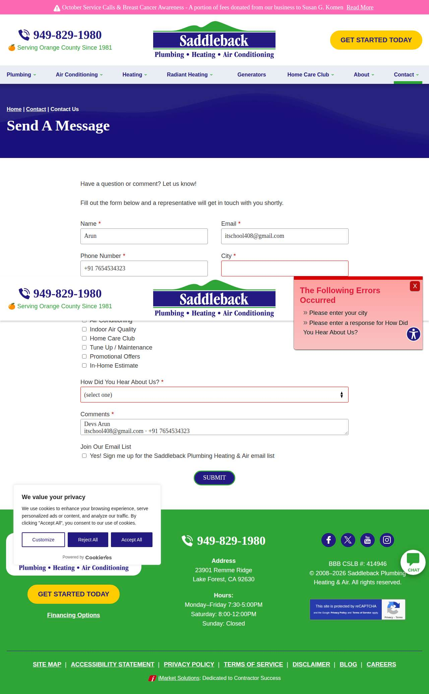

### nationalheatandair.com — confirmed (LIVE)

| | |
|---|---|
| Attempt ID | `60583857-615c-4201-bcea-d6444d84adaa` |
| Form URL | https://www.nationalheatandair.com/contact/ |
| Final URL | https://www.nationalheatandair.com/contact/ |
| Reserved | 2026-11-02 06:18:37 UTC |
| Submit attempted | 2026-11-02 06:18:41 UTC |
| Template | standard v2 |
| Confirmation text | nquiries and Free Estimates in Southern Oregon 541-535-4687 Thank you for your message. It has been sent. -- How can we help you? -- General Inquiry Repair Request Free Estimate Request |
| Result / error | — |

Exact message:

~~~text
Subject: Helping customers find your business in AI search (AEO + GEO)

Hi there,

I'm Arun from Devs Arun. More and more customers now ask ChatGPT, Gemini, Perplexity or Google's AI Overviews questions like "who should I hire for this in my area?" before they call anyone. These tools answer from websites they can clearly understand, and they tend to recommend businesses whose pages answer real customer questions.

That is what AEO + GEO (Answer Engine and Generative Engine Optimization) is for. I improve your existing service pages so they clearly answer the questions your customers ask, add structured data that matches the page, and make the call, quote or enquiry step obvious. The benefit: your business gets a better chance of being mentioned or linked in AI answers, and visitors who arrive find it easy to contact you.

The AEO + GEO Starter is a one-time $199 (about ₹16,999, negotiable) for one website: a basic audit, 10 customer questions, improvements to two existing pages, relevant structured data and an action plan, with one revision round.

You can read the full details, send an enquiry or book online here:
https://devsarun.io/aeo-geo/

If this isn't relevant, just reply and I won't contact you again.

Best,
Arun
Devs Arun
itschool408@gmail.com · +91 7654534323
~~~

Submitted field values:

- how \[fixed\]: General Inquiry
- email \[email\]: itschool408@gmail.com
- phone \[phone\]: +91 7654534323
- message \[message\]: Hi there, I'm Arun from Devs Arun. More and more customers now ask ChatGPT, Gemini, Perplexity or Google's AI Overviews 
- fname \[first\_name\]: Arun

**Filled form (before submit)** — `run-56769afe_attempt-60583857_filled_2026-11-02T06-18-41-753Z.jpg`

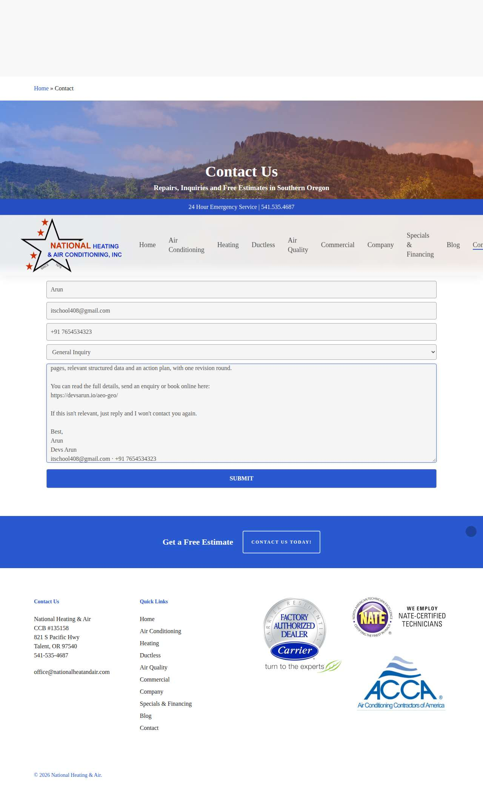

**After submit** — `run-56769afe_attempt-60583857_post_attempt_2026-11-02T06-18-45-000Z.jpg`

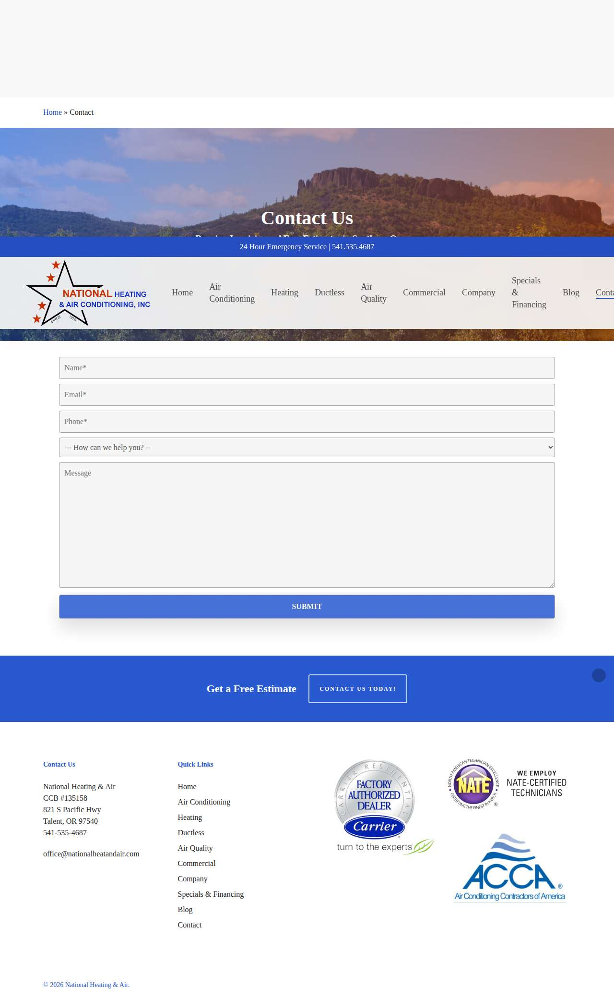

### lovottiair.com — confirmed (LIVE)

| | |
|---|---|
| Attempt ID | `d1aa730e-ed84-4f1c-8dbb-d2271984a085` |
| Form URL | https://lovottiinc.com/contact-us/ |
| Final URL | https://lovottiinc.com/contact-us/ |
| Reserved | 2026-11-02 06:18:51 UTC |
| Submit attempted | 2026-11-02 06:18:53 UTC |
| Template | standard v2 |
| Confirmation text | cing Contact Us facebook instagram LIC \# 865459 Let’s Talk\! Form submitted successfully. A confirmation email was sent to itschool408@gmail.com. Location 3717 West Ln Stockto |
| Result / error | — |

Exact message:

~~~text
Subject: Helping customers find your business in AI search (AEO + GEO)

Hi there,

I'm Arun from Devs Arun. More and more customers now ask ChatGPT, Gemini, Perplexity or Google's AI Overviews questions like "who should I hire for this in my area?" before they call anyone. These tools answer from websites they can clearly understand, and they tend to recommend businesses whose pages answer real customer questions.

That is what AEO + GEO (Answer Engine and Generative Engine Optimization) is for. I improve your existing service pages so they clearly answer the questions your customers ask, add structured data that matches the page, and make the call, quote or enquiry step obvious. The benefit: your business gets a better chance of being mentioned or linked in AI answers, and visitors who arrive find it easy to contact you.

The AEO + GEO Starter is a one-time $199 (about ₹16,999, negotiable) for one website: a basic audit, 10 customer questions, improvements to two existing pages, relevant structured data and an action plan, with one revision round.

You can read the full details, send an enquiry or book online here:
https://devsarun.io/aeo-geo/

If this isn't relevant, just reply and I won't contact you again.

Best,
Arun
Devs Arun
itschool408@gmail.com · +91 7654534323
~~~

Submitted field values:

- Name \* \[name\]: Arun
- Email \* \[email\]: itschool408@gmail.com
- Phone \* \[phone\]: +91 7654534323
- Company Name \[company\]: Devs Arun
- How can we help? \* \[message\]: Hi there, I'm Arun from Devs Arun. More and more customers now ask ChatGPT, Gemini, Perplexity or Google's AI Overviews 
- How would you like to be contacted? \* \[fixed\]: Email

**Filled form (before submit)** — `run-56769afe_attempt-d1aa730e_filled_2026-11-02T06-18-53-966Z.jpg`

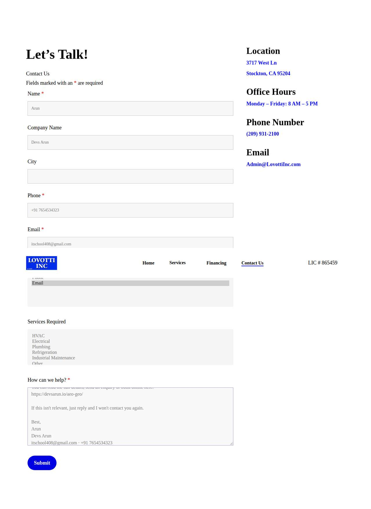

**After submit** — `run-56769afe_attempt-d1aa730e_post_attempt_2026-11-02T06-18-57-846Z.jpg`

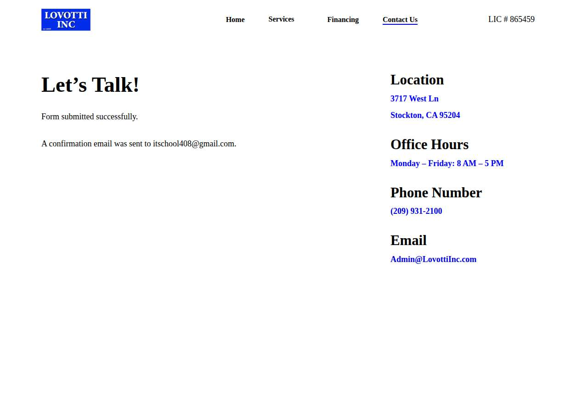

### cleanairactheatingandac.com — unclear (LIVE)

| | |
|---|---|
| Attempt ID | `3c9821c8-19e0-4763-b89e-c396015d14ce` |
| Form URL | https://www.cleanairactheatingandac.com/contact-us |
| Final URL | https://www.cleanairactheatingandac.com/contact-us |
| Reserved | 2026-11-02 06:19:04 UTC |
| Submit attempted | 2026-11-02 06:19:07 UTC |
| Template | standard v2 |
| Confirmation text | none observed |
| Result / error | No new success marker observed |

Exact message:

~~~text
Subject: Helping customers find your business in AI search (AEO + GEO)

Hi there,

I'm Arun from Devs Arun. More and more customers now ask ChatGPT, Gemini, Perplexity or Google's AI Overviews questions like "who should I hire for this in my area?" before they call anyone. These tools answer from websites they can clearly understand, and they tend to recommend businesses whose pages answer real customer questions.

That is what AEO + GEO (Answer Engine and Generative Engine Optimization) is for. I improve your existing service pages so they clearly answer the questions your customers ask, add structured data that matches the page, and make the call, quote or enquiry step obvious. The benefit: your business gets a better chance of being mentioned or linked in AI answers, and visitors who arrive find it easy to contact you.

The AEO + GEO Starter is a one-time $199 (about ₹16,999, negotiable) for one website: a basic audit, 10 customer questions, improvements to two existing pages, relevant structured data and an action plan, with one revision round.

You can read the full details, send an enquiry or book online here:
https://devsarun.io/aeo-geo/

If this isn't relevant, just reply and I won't contact you again.

Best,
Arun
Devs Arun
itschool408@gmail.com · +91 7654534323
~~~

Submitted field values:

- Phone \[phone\]: +91 7654534323
- Email\* \[email\]: itschool408@gmail.com
- First Name\* \[first\_name\]: Arun
- How can we help?\* \[message\]: Hi there, I'm Arun from Devs Arun. More and more customers now ask ChatGPT, Gemini, Perplexity or Google's AI Overviews 

**Filled form (before submit)** — `run-56769afe_attempt-3c9821c8_filled_2026-11-02T06-19-07-591Z.jpg`

**After submit** — `run-56769afe_attempt-3c9821c8_post_attempt_2026-11-02T06-19-35-093Z.jpg`

### airclassic.org — confirmed (LIVE)

| | |
|---|---|
| Attempt ID | `3d12466e-f482-48dd-b74d-bf4114f43783` |
| Form URL | https://www.airclassic.org/contact/send-message/ |
| Final URL | https://www.airclassic.org/contact/send-message/ |
| Reserved | 2026-11-02 06:19:42 UTC |
| Submit attempted | 2026-11-02 06:19:43 UTC |
| Template | standard v2 |
| Confirmation text | reply during business hours: Mon–Fri 8am–6pm, Sat 9am–2pm. Thank you. We received your request and will call you shortly. For urgent service call 800-759-8210. Need hel |
| Result / error | — |

Exact message:

~~~text
Subject: Helping customers find your business in AI search (AEO + GEO)

Hi there,

I'm Arun from Devs Arun. More and more customers now ask ChatGPT, Gemini, Perplexity or Google's AI Overviews questions like "who should I hire for this in my area?" before they call anyone. These tools answer from websites they can clearly understand, and they tend to recommend businesses whose pages answer real customer questions.

That is what AEO + GEO (Answer Engine and Generative Engine Optimization) is for. I improve your existing service pages so they clearly answer the questions your customers ask, add structured data that matches the page, and make the call, quote or enquiry step obvious. The benefit: your business gets a better chance of being mentioned or linked in AI answers, and visitors who arrive find it easy to contact you.

The AEO + GEO Starter is a one-time $199 (about ₹16,999, negotiable) for one website: a basic audit, 10 customer questions, improvements to two existing pages, relevant structured data and an action plan, with one revision round.

You can read the full details, send an enquiry or book online here:
https://devsarun.io/aeo-geo/

If this isn't relevant, just reply and I won't contact you again.

Best,
Arun
Devs Arun
itschool408@gmail.com · +91 7654534323
~~~

Submitted field values:

- Email \[email\]: itschool408@gmail.com
- Phone \[phone\]: +91 7654534323
- Full name \[name\]: Arun
- Message \[message\]: Hi there, I'm Arun from Devs Arun. More and more customers now ask ChatGPT, Gemini, Perplexity or Google's AI Overviews 

**Filled form (before submit)** — `run-56769afe_attempt-3d12466e_filled_2026-11-02T06-19-43-311Z.jpg`

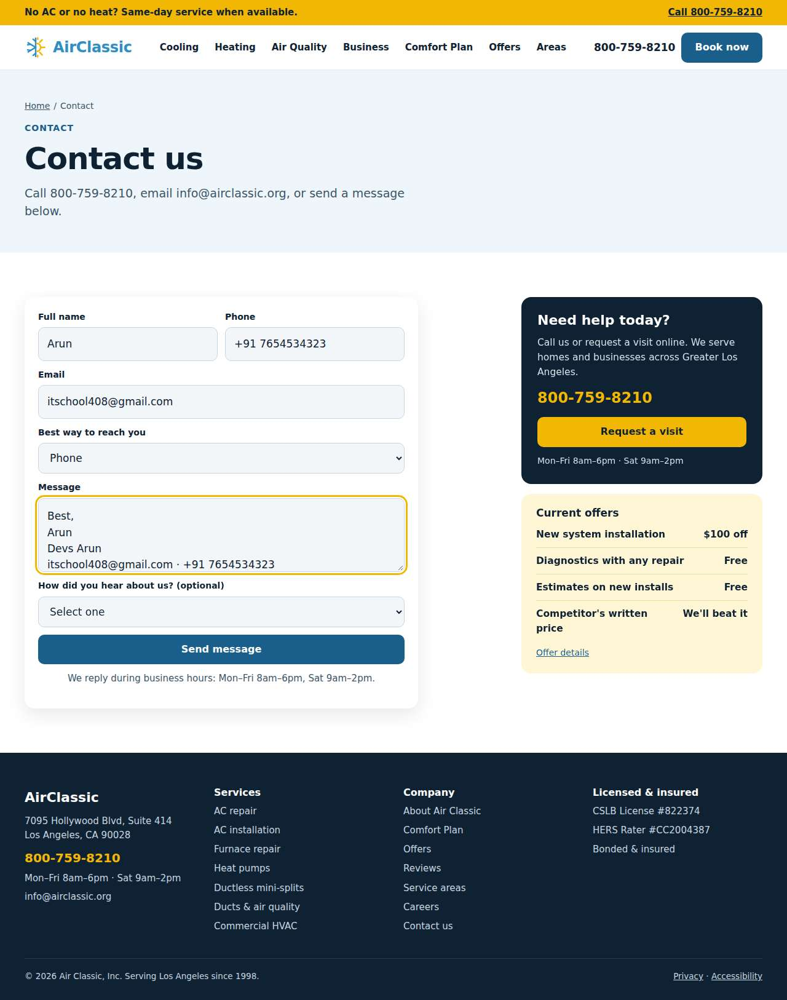

**After submit** — `run-56769afe_attempt-3d12466e_post_attempt_2026-11-02T06-19-46-296Z.jpg`

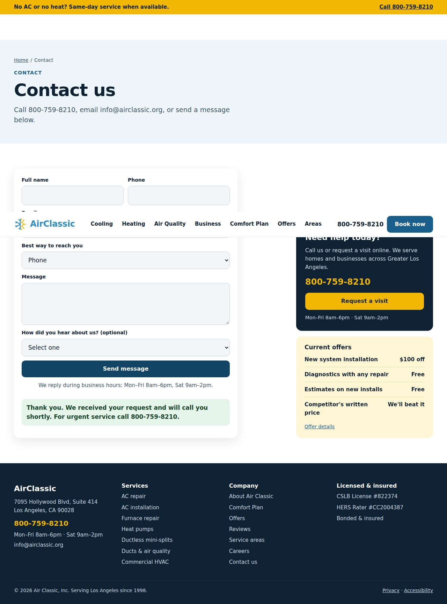

### mrcomfortmd.com — unclear (LIVE)

| | |
|---|---|
| Attempt ID | `55c963f1-ef98-410b-84d4-1723a08df96c` |
| Form URL | https://www.mrcomfortmd.com/Contact |
| Final URL | https://www.mrcomfortmd.com/Contact |
| Reserved | 2026-11-02 06:19:53 UTC |
| Submit attempted | 2026-11-02 06:19:54 UTC |
| Template | standard v2 |
| Confirmation text | none observed |
| Result / error | No new success marker observed |

Exact message:

~~~text
Subject: Helping customers find your business in AI search (AEO + GEO)

Hi there,

I'm Arun from Devs Arun. More and more customers now ask ChatGPT, Gemini, Perplexity or Google's AI Overviews questions like "who should I hire for this in my area?" before they call anyone. These tools answer from websites they can clearly understand, and they tend to recommend businesses whose pages answer real customer questions.

That is what AEO + GEO (Answer Engine and Generative Engine Optimization) is for. I improve your existing service pages so they clearly answer the questions your customers ask, add structured data that matches the page, and make the call, quote or enquiry step obvious. The benefit: your business gets a better chance of being mentioned or linked in AI answers, and visitors who arrive find it easy to contact you.

The AEO + GEO Starter is a one-time $199 (about ₹16,999, negotiable) for one website: a basic audit, 10 customer questions, improvements to two existing pages, relevant structured data and an action plan, with one revision round.

You can read the full details, send an enquiry or book online here:
https://devsarun.io/aeo-geo/

If this isn't relevant, just reply and I won't contact you again.

Best,
Arun
Devs Arun
itschool408@gmail.com · +91 7654534323
~~~

Submitted field values:

- Name \[name\]: Arun
- Email \[email\]: itschool408@gmail.com
- Phone \[phone\]: +91 7654534323
- Message \[message\]: Hi there, I'm Arun from Devs Arun. More and more customers now ask ChatGPT, Gemini, Perplexity or Google's AI Overviews 

**Filled form (before submit)** — `run-56769afe_attempt-55c963f1_filled_2026-11-02T06-19-54-956Z.jpg`

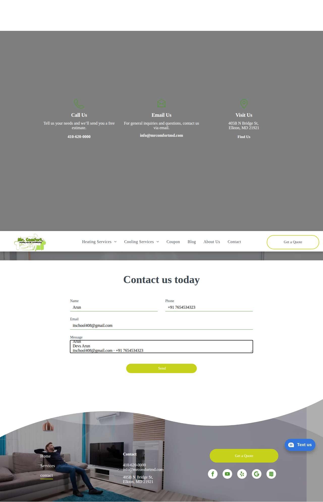

**After submit** — `run-56769afe_attempt-55c963f1_post_attempt_2026-11-02T06-20-22-122Z.jpg`

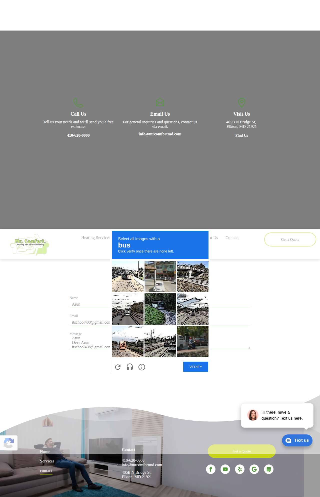

### familyheatandair.com — confirmed (LIVE)

| | |
|---|---|
| Attempt ID | `f1aac482-8152-48c7-b84a-6b1def17db99` |
| Form URL | https://familyheatandair.com/contact-us/ |
| Final URL | https://familyheatandair.com/contact-us/ |
| Reserved | 2026-11-02 06:20:29 UTC |
| Submit attempted | 2026-11-02 06:20:33 UTC |
| Template | standard v2 |
| Confirmation text | atandair.com Mon - Fri: 8:00 AM - 5:00 PM Sat & Sun: Closed Thanks for contacting us\! We will get in touch with you shortly. Home About Us Heating AC Repair Maintenance Reviews Cont |
| Result / error | — |

Exact message:

~~~text
Subject: Helping customers find your business in AI search (AEO + GEO)

Hi there,

I'm Arun from Devs Arun. More and more customers now ask ChatGPT, Gemini, Perplexity or Google's AI Overviews questions like "who should I hire for this in my area?" before they call anyone. These tools answer from websites they can clearly understand, and they tend to recommend businesses whose pages answer real customer questions.

That is what AEO + GEO (Answer Engine and Generative Engine Optimization) is for. I improve your existing service pages so they clearly answer the questions your customers ask, add structured data that matches the page, and make the call, quote or enquiry step obvious. The benefit: your business gets a better chance of being mentioned or linked in AI answers, and visitors who arrive find it easy to contact you.

The AEO + GEO Starter is a one-time $199 (about ₹16,999, negotiable) for one website: a basic audit, 10 customer questions, improvements to two existing pages, relevant structured data and an action plan, with one revision round.

You can read the full details, send an enquiry or book online here:
https://devsarun.io/aeo-geo/

If this isn't relevant, just reply and I won't contact you again.

Best,
Arun
Devs Arun
itschool408@gmail.com · +91 7654534323
~~~

Submitted field values:

- Name(Required) \[name\]: Arun
- Email(Required) \[email\]: itschool408@gmail.com
- Message(Required) \[message\]: Hi there, I'm Arun from Devs Arun. More and more customers now ask ChatGPT, Gemini, Perplexity or Google's AI Overviews 

**Filled form (before submit)** — `run-56769afe_attempt-f1aac482_filled_2026-11-02T06-20-33-648Z.jpg`

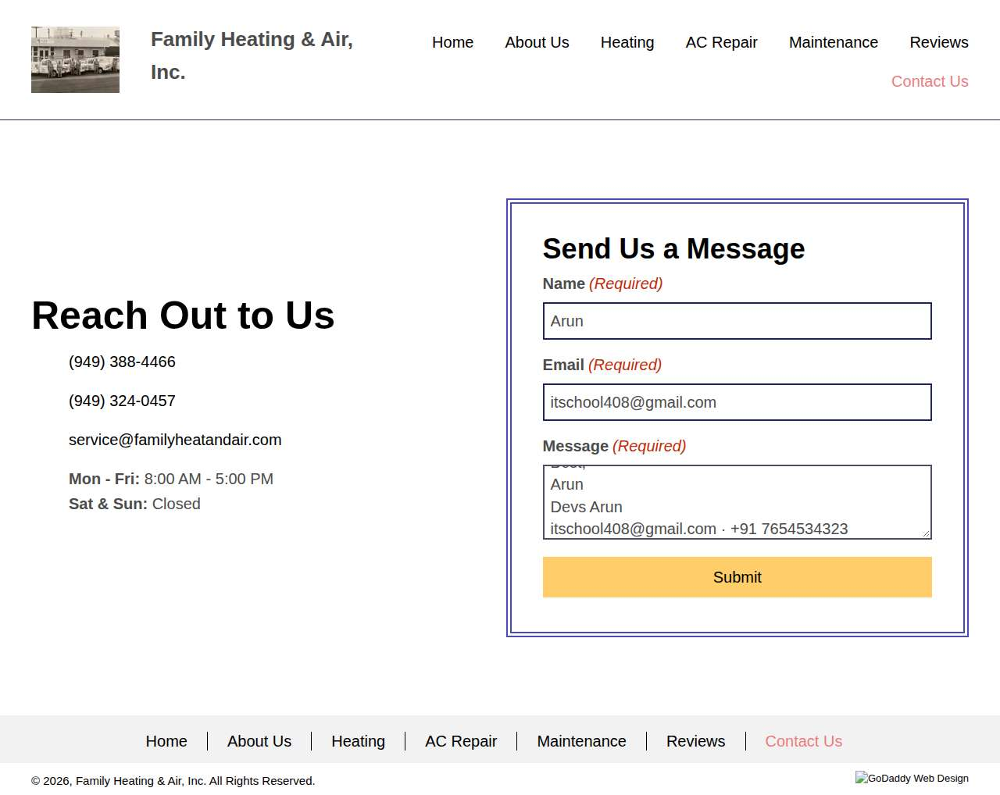

**After submit** — `run-56769afe_attempt-f1aac482_post_attempt_2026-11-02T06-20-43-543Z.jpg`

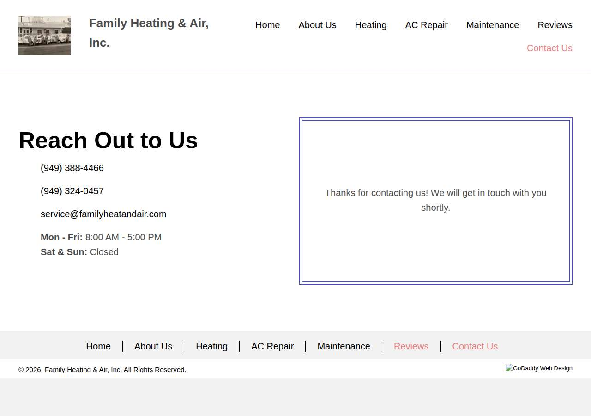

### boehmerheating.com — error\_after\_submit (LIVE)

| | |
|---|---|
| Attempt ID | `577efcba-aef6-4489-9086-290226faf00f` |
| Form URL | https://www.boehmerheating.com/contact |
| Final URL | https://www.boehmerheating.com/contact\#error-container |
| Reserved | 2026-11-02 06:20:50 UTC |
| Submit attempted | 2026-11-02 06:20:52 UTC |
| Template | standard v2 |
| Confirmation text | gs and apply today\! Read More The Following Errors Occurred Please enter your last name Please enter your city Please let us know the best way to contact you Please enter a |
| Result / error | — |

Exact message:

~~~text
Subject: Helping customers find your business in AI search (AEO + GEO)

Hi there,

I'm Arun from Devs Arun. More and more customers now ask ChatGPT, Gemini, Perplexity or Google's AI Overviews questions like "who should I hire for this in my area?" before they call anyone. These tools answer from websites they can clearly understand, and they tend to recommend businesses whose pages answer real customer questions.

That is what AEO + GEO (Answer Engine and Generative Engine Optimization) is for. I improve your existing service pages so they clearly answer the questions your customers ask, add structured data that matches the page, and make the call, quote or enquiry step obvious. The benefit: your business gets a better chance of being mentioned or linked in AI answers, and visitors who arrive find it easy to contact you.

The AEO + GEO Starter is a one-time $199 (about ₹16,999, negotiable) for one website: a basic audit, 10 customer questions, improvements to two existing pages, relevant structured data and an action plan, with one revision round.

You can read the full details, send an enquiry or book online here:
https://devsarun.io/aeo-geo/

If this isn't relevant, just reply and I won't contact you again.

Best,
Arun
Devs Arun
itschool408@gmail.com · +91 7654534323
~~~

Submitted field values:

- Email Address \* \[email\]: itschool408@gmail.com
- Mobile Number \* \[phone\]: +91 7654534323
- First Name \* \[first\_name\]: Arun
- How Can We Help? \* \[message\]: Hi there, I'm Arun from Devs Arun. More and more customers now ask ChatGPT, Gemini, Perplexity or Google's AI Overviews 

**Filled form (before submit)** — `run-56769afe_attempt-577efcba_filled_2026-11-02T06-20-52-694Z.jpg`

**After submit** — `run-56769afe_attempt-577efcba_post_attempt_2026-11-02T06-20-55-773Z.jpg`

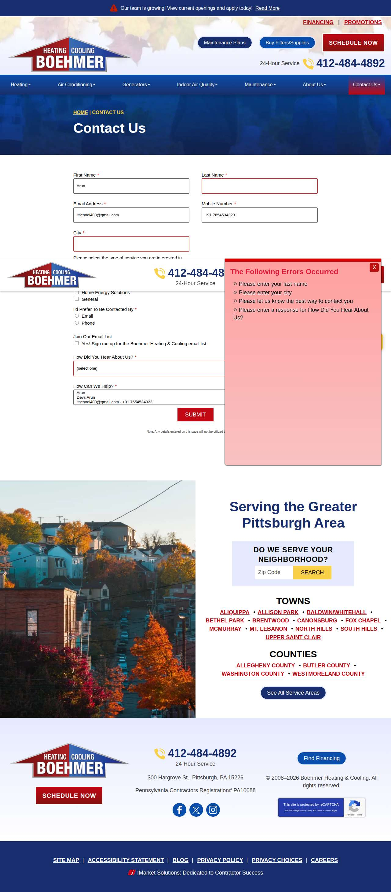

### northwindhvacaz.com — confirmed (LIVE)

| | |
|---|---|
| Attempt ID | `aaaf411d-173b-4c8b-bf68-7c97baa20af3` |
| Form URL | https://www.northwindhvacaz.com/contact-us |
| Final URL | https://www.northwindhvacaz.com/contact-us |
| Reserved | 2026-11-02 06:21:02 UTC |
| Submit attempted | 2026-11-02 06:21:04 UTC |
| Template | standard v2 |
| Confirmation text | indhvac@gmail.com FACEBOOK facebook.com/northwindmechanical Message Sent\! Thank you for reaching out. We'll be in touch shortly. Family-owned commercial HVAC since 2009. QU |
| Result / error | — |

Exact message:

~~~text
Subject: Helping customers find your business in AI search (AEO + GEO)

Hi there,

I'm Arun from Devs Arun. More and more customers now ask ChatGPT, Gemini, Perplexity or Google's AI Overviews questions like "who should I hire for this in my area?" before they call anyone. These tools answer from websites they can clearly understand, and they tend to recommend businesses whose pages answer real customer questions.

That is what AEO + GEO (Answer Engine and Generative Engine Optimization) is for. I improve your existing service pages so they clearly answer the questions your customers ask, add structured data that matches the page, and make the call, quote or enquiry step obvious. The benefit: your business gets a better chance of being mentioned or linked in AI answers, and visitors who arrive find it easy to contact you.

The AEO + GEO Starter is a one-time $199 (about ₹16,999, negotiable) for one website: a basic audit, 10 customer questions, improvements to two existing pages, relevant structured data and an action plan, with one revision round.

You can read the full details, send an enquiry or book online here:
https://devsarun.io/aeo-geo/

If this isn't relevant, just reply and I won't contact you again.

Best,
Arun
Devs Arun
itschool408@gmail.com · +91 7654534323
~~~

Submitted field values:

- EMAIL \[email\]: itschool408@gmail.com
- FULL NAME \[name\]: Arun
- MESSAGE \[message\]: Hi there, I'm Arun from Devs Arun. More and more customers now ask ChatGPT, Gemini, Perplexity or Google's AI Overviews 
- PHONE (OPTIONAL) \[phone\]: +91 7654534323

**Filled form (before submit)** — `run-56769afe_attempt-aaaf411d_filled_2026-11-02T06-21-04-359Z.jpg`

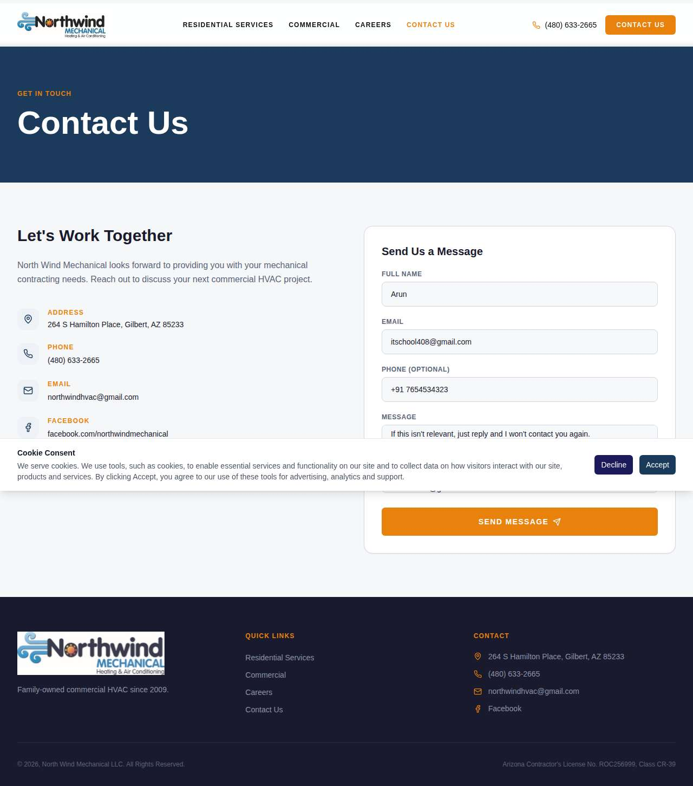

**After submit** — `run-56769afe_attempt-aaaf411d_post_attempt_2026-11-02T06-21-06-329Z.jpg`

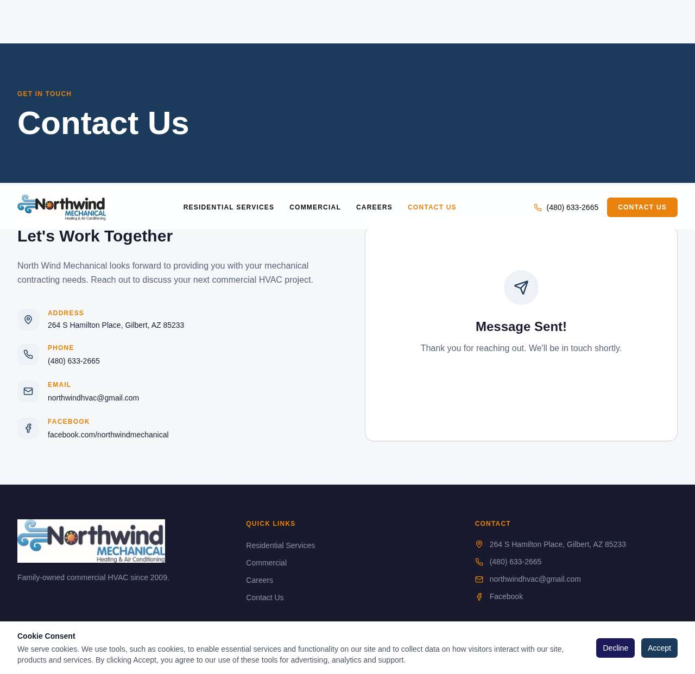

### coastproducts.com — confirmed (LIVE)

| | |
|---|---|
| Attempt ID | `a4a590f7-0946-4502-806e-8dcdd20103b3` |
| Form URL | http://coastproducts.com/contact/ |
| Final URL | http://coastproducts.com/contact/ |
| Reserved | 2026-11-02 06:21:13 UTC |
| Submit attempted | 2026-11-02 06:21:15 UTC |
| Template | standard v2 |
| Confirmation text | 26 Fax: 206-285-5123 Email frontdesk@coastproducts.com Your message was sent successfully. Thank you. Contact Form Have a question or comment or us? We would love to hear from |
| Result / error | — |

Exact message:

~~~text
Subject: Helping customers find your business in AI search (AEO + GEO)

Hi there,

I'm Arun from Devs Arun. More and more customers now ask ChatGPT, Gemini, Perplexity or Google's AI Overviews questions like "who should I hire for this in my area?" before they call anyone. These tools answer from websites they can clearly understand, and they tend to recommend businesses whose pages answer real customer questions.

That is what AEO + GEO (Answer Engine and Generative Engine Optimization) is for. I improve your existing service pages so they clearly answer the questions your customers ask, add structured data that matches the page, and make the call, quote or enquiry step obvious. The benefit: your business gets a better chance of being mentioned or linked in AI answers, and visitors who arrive find it easy to contact you.

The AEO + GEO Starter is a one-time $199 (about ₹16,999, negotiable) for one website: a basic audit, 10 customer questions, improvements to two existing pages, relevant structured data and an action plan, with one revision round.

You can read the full details, send an enquiry or book online here:
https://devsarun.io/aeo-geo/

If this isn't relevant, just reply and I won't contact you again.

Best,
Arun
Devs Arun
itschool408@gmail.com · +91 7654534323
~~~

Submitted field values:

- your-name \[name\]: Arun
- your-tel \[phone\]: +91 7654534323
- your-email \[email\]: itschool408@gmail.com
- your-company \[company\]: Devs Arun
- your-message \[message\]: Hi there, I'm Arun from Devs Arun. More and more customers now ask ChatGPT, Gemini, Perplexity or Google's AI Overviews 
- your-subject \[subject\]: Helping customers find your business in AI search (AEO + GEO)

**Filled form (before submit)** — `run-56769afe_attempt-a4a590f7_filled_2026-11-02T06-21-15-038Z.jpg`

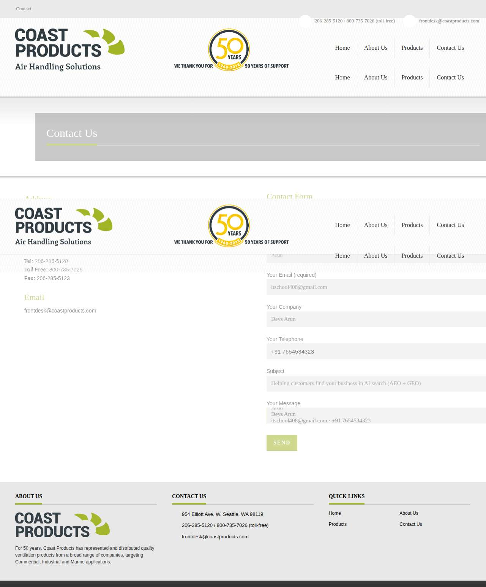

**After submit** — `run-56769afe_attempt-a4a590f7_post_attempt_2026-11-02T06-21-18-913Z.jpg`

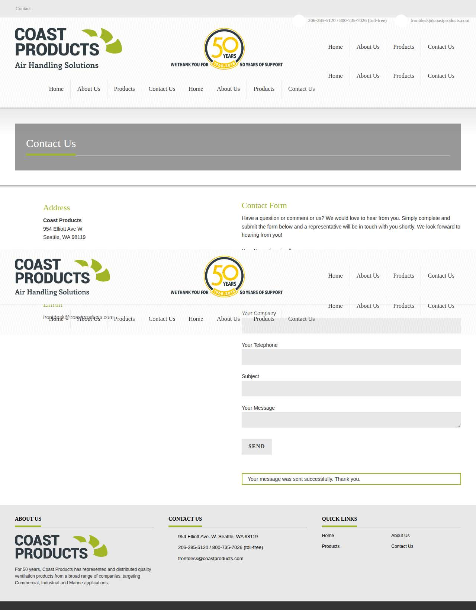

### perfectefficiency.com — unclear (LIVE)

| | |
|---|---|
| Attempt ID | `aa68b2f7-cdf6-4736-9380-a62762a5c383` |
| Form URL | https://www.perfectefficiency.com/ |
| Final URL | https://www.perfectefficiency.com/ |
| Reserved | 2026-11-02 06:21:25 UTC |
| Submit attempted | 2026-11-02 06:21:29 UTC |
| Template | standard v2 |
| Confirmation text | none observed |
| Result / error | No new success marker observed |

Exact message:

~~~text
Subject: Helping customers find your business in AI search (AEO + GEO)

Hi there,

I'm Arun from Devs Arun. More and more customers now ask ChatGPT, Gemini, Perplexity or Google's AI Overviews questions like "who should I hire for this in my area?" before they call anyone. These tools answer from websites they can clearly understand, and they tend to recommend businesses whose pages answer real customer questions.

That is what AEO + GEO (Answer Engine and Generative Engine Optimization) is for. I improve your existing service pages so they clearly answer the questions your customers ask, add structured data that matches the page, and make the call, quote or enquiry step obvious. The benefit: your business gets a better chance of being mentioned or linked in AI answers, and visitors who arrive find it easy to contact you.

The AEO + GEO Starter is a one-time $199 (about ₹16,999, negotiable) for one website: a basic audit, 10 customer questions, improvements to two existing pages, relevant structured data and an action plan, with one revision round.

You can read the full details, send an enquiry or book online here:
https://devsarun.io/aeo-geo/

If this isn't relevant, just reply and I won't contact you again.

Best,
Arun
Devs Arun
itschool408@gmail.com · +91 7654534323
~~~

Submitted field values:

- Email \[email\]: itschool408@gmail.com
- Message \[message\]: Hi there, I'm Arun from Devs Arun. More and more customers now ask ChatGPT, Gemini, Perplexity or Google's AI Overviews 
- Subject \[subject\]: Helping customers find your business in AI search (AEO + GEO)
- First Name \[first\_name\]: Arun

**Filled form (before submit)** — `run-56769afe_attempt-aa68b2f7_filled_2026-11-02T06-21-29-138Z.jpg`

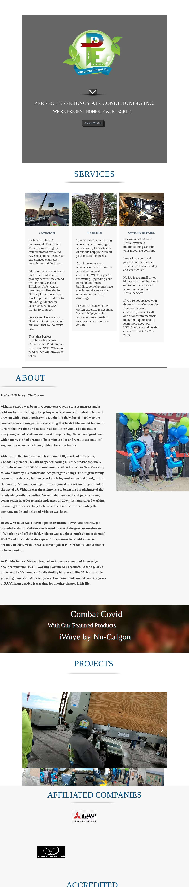

**After submit** — `run-56769afe_attempt-aa68b2f7_post_attempt_2026-11-02T06-21-56-418Z.jpg`

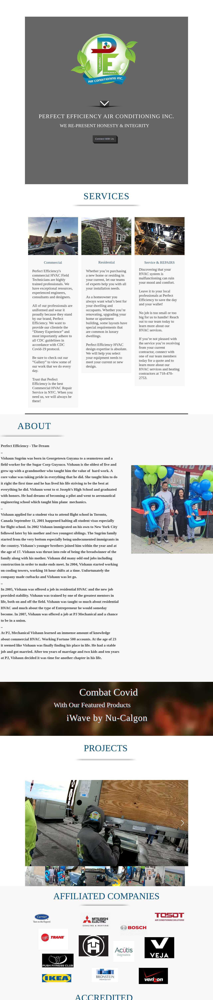

### oasiscooling.com — unclear (LIVE)

| | |
|---|---|
| Attempt ID | `b6528b28-6c23-40a6-a391-de80ccdcac5d` |
| Form URL | https://www.oasiscooling.com/contact/ |
| Final URL | https://www.oasiscooling.com/contact/ |
| Reserved | 2026-11-02 06:22:03 UTC |
| Submit attempted | 2026-11-02 06:22:04 UTC |
| Template | standard v2 |
| Confirmation text | none observed |
| Result / error | No new success marker observed |

Exact message:

~~~text
Subject: Helping customers find your business in AI search (AEO + GEO)

Hi there,

I'm Arun from Devs Arun. More and more customers now ask ChatGPT, Gemini, Perplexity or Google's AI Overviews questions like "who should I hire for this in my area?" before they call anyone. These tools answer from websites they can clearly understand, and they tend to recommend businesses whose pages answer real customer questions.

That is what AEO + GEO (Answer Engine and Generative Engine Optimization) is for. I improve your existing service pages so they clearly answer the questions your customers ask, add structured data that matches the page, and make the call, quote or enquiry step obvious. The benefit: your business gets a better chance of being mentioned or linked in AI answers, and visitors who arrive find it easy to contact you.

The AEO + GEO Starter is a one-time $199 (about ₹16,999, negotiable) for one website: a basic audit, 10 customer questions, improvements to two existing pages, relevant structured data and an action plan, with one revision round.

You can read the full details, send an enquiry or book online here:
https://devsarun.io/aeo-geo/

If this isn't relevant, just reply and I won't contact you again.

Best,
Arun
Devs Arun
itschool408@gmail.com · +91 7654534323
~~~

Submitted field values:

- City \* \[city\]: Bangalore
- Name \* \[name\]: Arun
- Email \* \[email\]: itschool408@gmail.com
- Phone \* \[phone\]: +91 7654534323
- Comments \* \[message\]: Hi there, I'm Arun from Devs Arun. More and more customers now ask ChatGPT, Gemini, Perplexity or Google's AI Overviews 
- How Did You Hear About Us? \* \[fixed\]: Website

**Filled form (before submit)** — `run-56769afe_attempt-b6528b28_filled_2026-11-02T06-22-04-965Z.jpg`

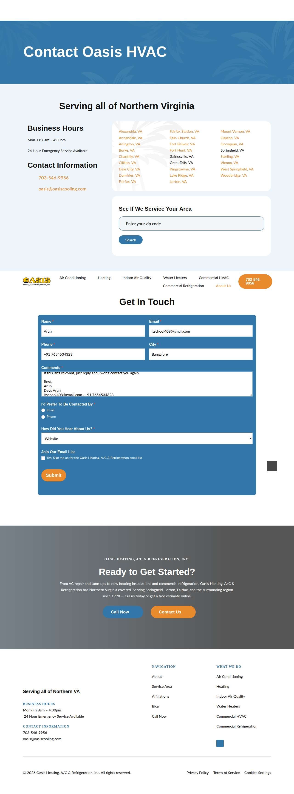

**After submit** — `run-56769afe_attempt-b6528b28_post_attempt_2026-11-02T06-22-33-715Z.jpg`

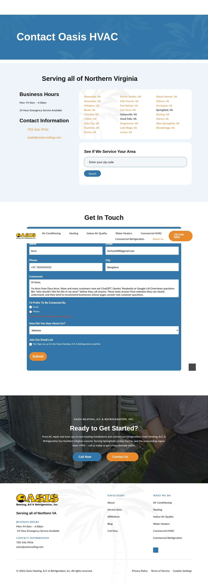

### russellsac.com — failed\_before\_submit (LIVE)

| | |
|---|---|
| Attempt ID | `390b9a93-5e4d-404c-8c28-60d7fbcf51d9` |
| Form URL | https://www.russellsac.com/contact-us/ |
| Final URL | https://www.russellsac.com/contact-us/ |
| Reserved | 2026-11-02 06:22:40 UTC |
| Submit attempted | — |
| Template | standard v2 |
| Confirmation text | none observed |
| Result / error | Field "Phone\*" did not accept the value |

Exact message:

~~~text
Subject: Helping customers find your business in AI search (AEO + GEO)

Hi there,

I'm Arun from Devs Arun. More and more customers now ask ChatGPT, Gemini, Perplexity or Google's AI Overviews questions like "who should I hire for this in my area?" before they call anyone. These tools answer from websites they can clearly understand, and they tend to recommend businesses whose pages answer real customer questions.

That is what AEO + GEO (Answer Engine and Generative Engine Optimization) is for. I improve your existing service pages so they clearly answer the questions your customers ask, add structured data that matches the page, and make the call, quote or enquiry step obvious. The benefit: your business gets a better chance of being mentioned or linked in AI answers, and visitors who arrive find it easy to contact you.

The AEO + GEO Starter is a one-time $199 (about ₹16,999, negotiable) for one website: a basic audit, 10 customer questions, improvements to two existing pages, relevant structured data and an action plan, with one revision round.

You can read the full details, send an enquiry or book online here:
https://devsarun.io/aeo-geo/

If this isn't relevant, just reply and I won't contact you again.

Best,
Arun
Devs Arun
itschool408@gmail.com · +91 7654534323
~~~

Submitted field values:

- \#input\_1\_1: Arun
- \#input\_1\_2: itschool408@gmail.com
- \#input\_1\_3: +91 7654534323
- \#input\_1\_5: Hi there, I'm Arun from Devs Arun. More and more customers now ask ChatGPT, Gemini, Perplexity or Google's AI Overviews 

**Filled form (before submit)** — `run-56769afe_attempt-390b9a93_filled_2026-11-02T06-22-42-475Z.jpg`

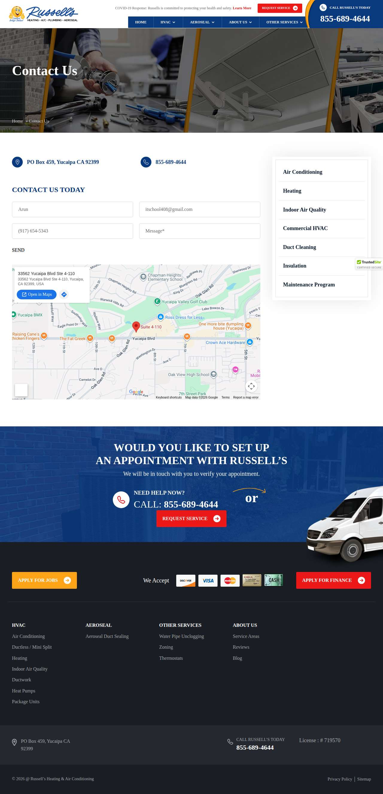

### gnlhvac.com — unclear (LIVE)

| | |
|---|---|
| Attempt ID | `268dde75-965c-4386-b8a8-331a6788e18d` |
| Form URL | https://www.gnlhvac.com/contact |
| Final URL | https://www.gnlhvac.com/contact |
| Reserved | 2026-11-02 06:22:47 UTC |
| Submit attempted | 2026-11-02 06:22:50 UTC |
| Template | standard v2 |
| Confirmation text | none observed |
| Result / error | No new success marker observed |

Exact message:

~~~text
Subject: Helping customers find your business in AI search (AEO + GEO)

Hi there,

I'm Arun from Devs Arun. More and more customers now ask ChatGPT, Gemini, Perplexity or Google's AI Overviews questions like "who should I hire for this in my area?" before they call anyone. These tools answer from websites they can clearly understand, and they tend to recommend businesses whose pages answer real customer questions.

That is what AEO + GEO (Answer Engine and Generative Engine Optimization) is for. I improve your existing service pages so they clearly answer the questions your customers ask, add structured data that matches the page, and make the call, quote or enquiry step obvious. The benefit: your business gets a better chance of being mentioned or linked in AI answers, and visitors who arrive find it easy to contact you.

The AEO + GEO Starter is a one-time $199 (about ₹16,999, negotiable) for one website: a basic audit, 10 customer questions, improvements to two existing pages, relevant structured data and an action plan, with one revision round.

You can read the full details, send an enquiry or book online here:
https://devsarun.io/aeo-geo/

If this isn't relevant, just reply and I won't contact you again.

Best,
Arun
Devs Arun
itschool408@gmail.com · +91 7654534323
~~~

Submitted field values:

- email \[email\]: itschool408@gmail.com
- name-\* \[name\]: Arun
- Message \[message\]: Hi there, I'm Arun from Devs Arun. More and more customers now ask ChatGPT, Gemini, Perplexity or Google's AI Overviews 
- subject \[subject\]: Helping customers find your business in AI search (AEO + GEO)

**Filled form (before submit)** — `run-56769afe_attempt-268dde75_filled_2026-11-02T06-22-50-397Z.jpg`

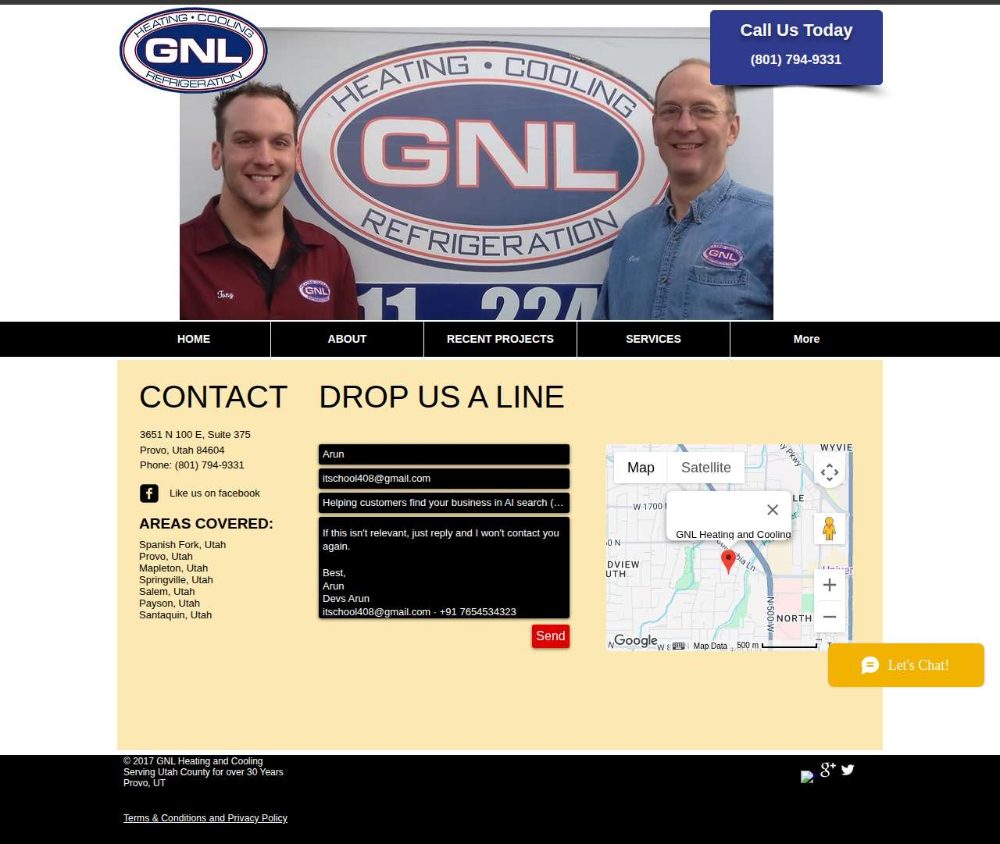

**After submit** — `run-56769afe_attempt-268dde75_post_attempt_2026-11-02T06-23-17-428Z.jpg`

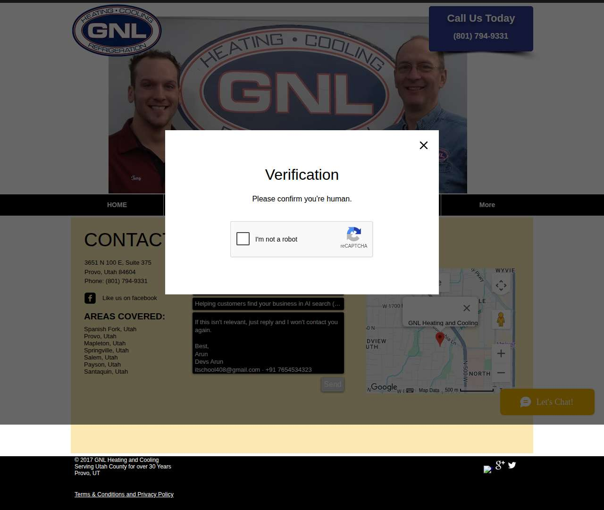

### airproheating.com — failed\_before\_submit (LIVE)

| | |
|---|---|
| Attempt ID | `30aad754-d3dd-4a91-b2a8-73f8873e126c` |
| Form URL | https://airproheating.com/contact-us/ |
| Final URL | https://airproheating.com/contact-us/ |
| Reserved | 2026-11-02 06:23:24 UTC |
| Submit attempted | — |
| Template | standard v2 |
| Confirmation text | none observed |
| Result / error | Field "Phone" did not accept the value |

Exact message:

~~~text
Subject: Helping customers find your business in AI search (AEO + GEO)

Hi there,

I'm Arun from Devs Arun. More and more customers now ask ChatGPT, Gemini, Perplexity or Google's AI Overviews questions like "who should I hire for this in my area?" before they call anyone. These tools answer from websites they can clearly understand, and they tend to recommend businesses whose pages answer real customer questions.

That is what AEO + GEO (Answer Engine and Generative Engine Optimization) is for. I improve your existing service pages so they clearly answer the questions your customers ask, add structured data that matches the page, and make the call, quote or enquiry step obvious. The benefit: your business gets a better chance of being mentioned or linked in AI answers, and visitors who arrive find it easy to contact you.

The AEO + GEO Starter is a one-time $199 (about ₹16,999, negotiable) for one website: a basic audit, 10 customer questions, improvements to two existing pages, relevant structured data and an action plan, with one revision round.

You can read the full details, send an enquiry or book online here:
https://devsarun.io/aeo-geo/

If this isn't relevant, just reply and I won't contact you again.

Best,
Arun
Devs Arun
itschool408@gmail.com · +91 7654534323
~~~

Submitted field values:

- \#input\_1\_2: Other
- \#input\_1\_3: +91 7654534323
- \#input\_1\_4: itschool408@gmail.com
- \#input\_1\_5: Hi there, I'm Arun from Devs Arun. More and more customers now ask ChatGPT, Gemini, Perplexity or Google's AI Overviews 
- \#input\_1\_6: Arun

**Filled form (before submit)** — `run-56769afe_attempt-30aad754_filled_2026-11-02T06-23-26-184Z.jpg`

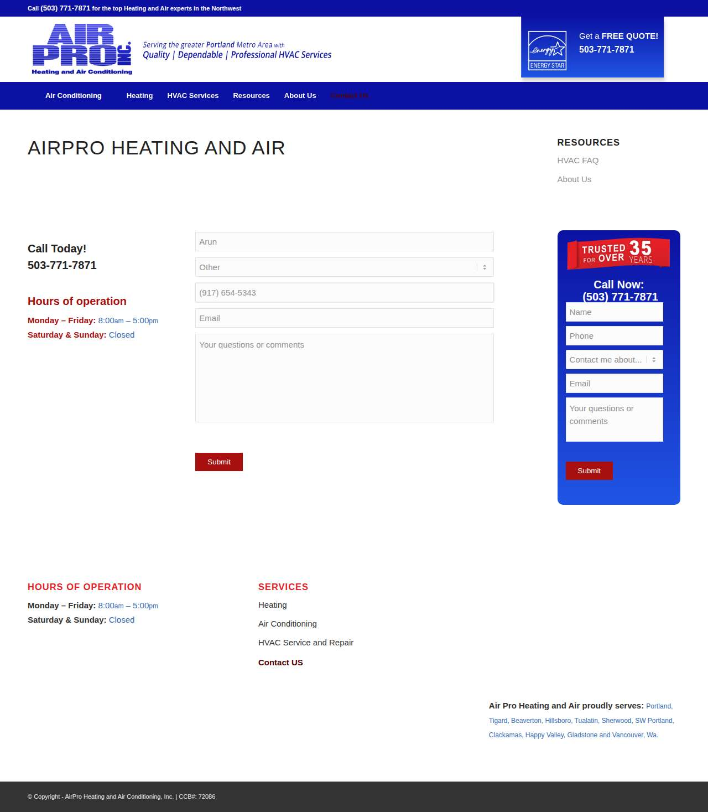

### polarbearairconditioning.com — error\_after\_submit (LIVE)

| | |
|---|---|
| Attempt ID | `07c274f4-06c5-4bfa-abe3-c9bda6a25cbe` |
| Form URL | https://www.polarbearairconditioning.com/contact |
| Final URL | https://www.polarbearairconditioning.com/contact\#error-container |
| Reserved | 2026-11-02 06:23:31 UTC |
| Submit attempted | 2026-11-02 06:23:32 UTC |
| Template | standard v2 |
| Confirmation text | Skip navigation The Following Errors Occurred Please enter your last name Please enter your city Please let us know the best way to contact you Please enter a |
| Result / error | — |

Exact message:

~~~text
Subject: Helping customers find your business in AI search (AEO + GEO)

Hi there,

I'm Arun from Devs Arun. More and more customers now ask ChatGPT, Gemini, Perplexity or Google's AI Overviews questions like "who should I hire for this in my area?" before they call anyone. These tools answer from websites they can clearly understand, and they tend to recommend businesses whose pages answer real customer questions.

That is what AEO + GEO (Answer Engine and Generative Engine Optimization) is for. I improve your existing service pages so they clearly answer the questions your customers ask, add structured data that matches the page, and make the call, quote or enquiry step obvious. The benefit: your business gets a better chance of being mentioned or linked in AI answers, and visitors who arrive find it easy to contact you.

The AEO + GEO Starter is a one-time $199 (about ₹16,999, negotiable) for one website: a basic audit, 10 customer questions, improvements to two existing pages, relevant structured data and an action plan, with one revision round.

You can read the full details, send an enquiry or book online here:
https://devsarun.io/aeo-geo/

If this isn't relevant, just reply and I won't contact you again.

Best,
Arun
Devs Arun
itschool408@gmail.com · +91 7654534323
~~~

Submitted field values:

- Comments \* \[message\]: Hi there, I'm Arun from Devs Arun. More and more customers now ask ChatGPT, Gemini, Perplexity or Google's AI Overviews 
- Phone Number \* \[phone\]: +91 7654534323
- Email Address \* \[email\]: itschool408@gmail.com
- First Name \* \[first\_name\]: Arun

**Filled form (before submit)** — `run-56769afe_attempt-07c274f4_filled_2026-11-02T06-23-32-871Z.jpg`

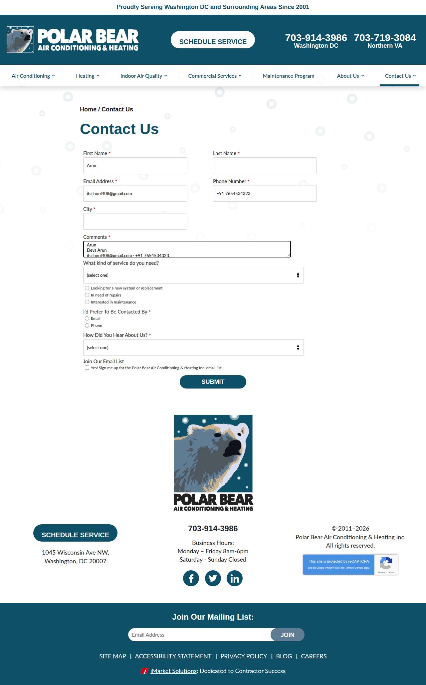

**After submit** — `run-56769afe_attempt-07c274f4_post_attempt_2026-11-02T06-23-36-428Z.jpg`

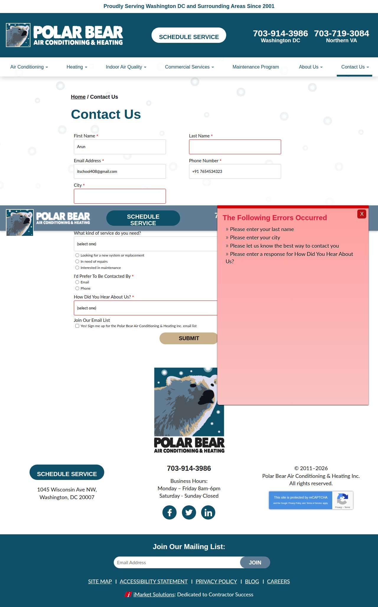

### command-air.com — error\_after\_submit (LIVE)

| | |
|---|---|
| Attempt ID | `bcc9a79b-d659-47ab-b114-b63bd77a2c2b` |
| Form URL | https://www.commandcomfort.com/contact/send-a-message |
| Final URL | https://www.commandcomfort.com/contact/send-a-message\#error-container |
| Reserved | 2026-11-02 06:23:43 UTC |
| Submit attempted | 2026-11-02 06:23:45 UTC |
| Template | standard v2 |
| Confirmation text | ll Powered by Skip navigation The Following Errors Occurred Please enter your last name 657-666-5958 BOOK ONLINE FREE 2nd Opinion FREE 2nd Opinion FREE 2nd Opinion FREE 2nd |
| Result / error | — |

Exact message:

~~~text
Subject: Helping customers find your business in AI search (AEO + GEO)

Hi there,

I'm Arun from Devs Arun. More and more customers now ask ChatGPT, Gemini, Perplexity or Google's AI Overviews questions like "who should I hire for this in my area?" before they call anyone. These tools answer from websites they can clearly understand, and they tend to recommend businesses whose pages answer real customer questions.

That is what AEO + GEO (Answer Engine and Generative Engine Optimization) is for. I improve your existing service pages so they clearly answer the questions your customers ask, add structured data that matches the page, and make the call, quote or enquiry step obvious. The benefit: your business gets a better chance of being mentioned or linked in AI answers, and visitors who arrive find it easy to contact you.

The AEO + GEO Starter is a one-time $199 (about ₹16,999, negotiable) for one website: a basic audit, 10 customer questions, improvements to two existing pages, relevant structured data and an action plan, with one revision round.

You can read the full details, send an enquiry or book online here:
https://devsarun.io/aeo-geo/

If this isn't relevant, just reply and I won't contact you again.

Best,
Arun
Devs Arun
itschool408@gmail.com · +91 7654534323
~~~

Submitted field values:

- Email \* \[email\]: itschool408@gmail.com
- Message \[message\]: Hi there, I'm Arun from Devs Arun. More and more customers now ask ChatGPT, Gemini, Perplexity or Google's AI Overviews 
- Phone Number \* \[phone\]: +91 7654534323
- First Name \* \[first\_name\]: Arun

**Filled form (before submit)** — `run-56769afe_attempt-bcc9a79b_filled_2026-11-02T06-23-45-099Z.jpg`

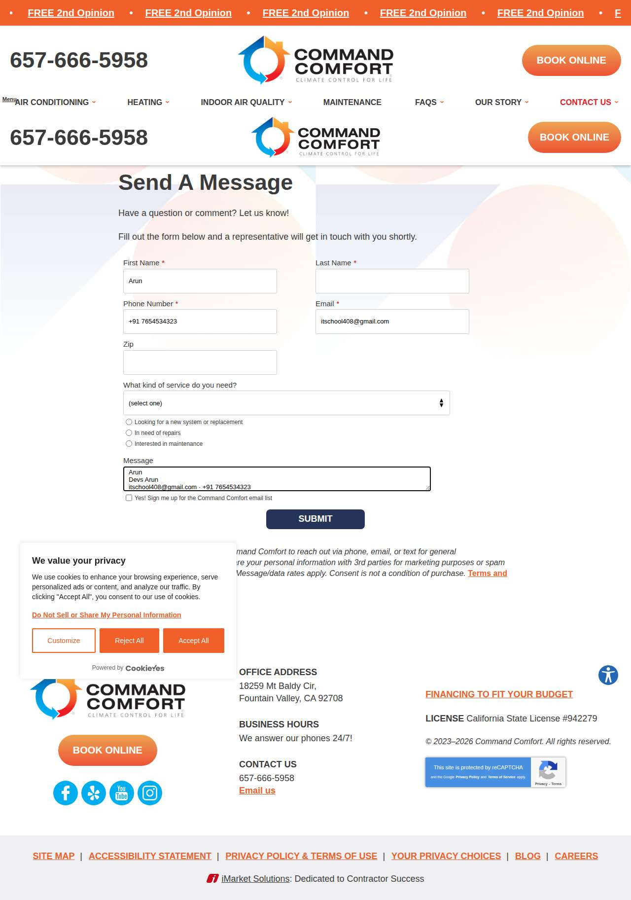

**After submit** — `run-56769afe_attempt-bcc9a79b_post_attempt_2026-11-02T06-23-48-104Z.jpg`

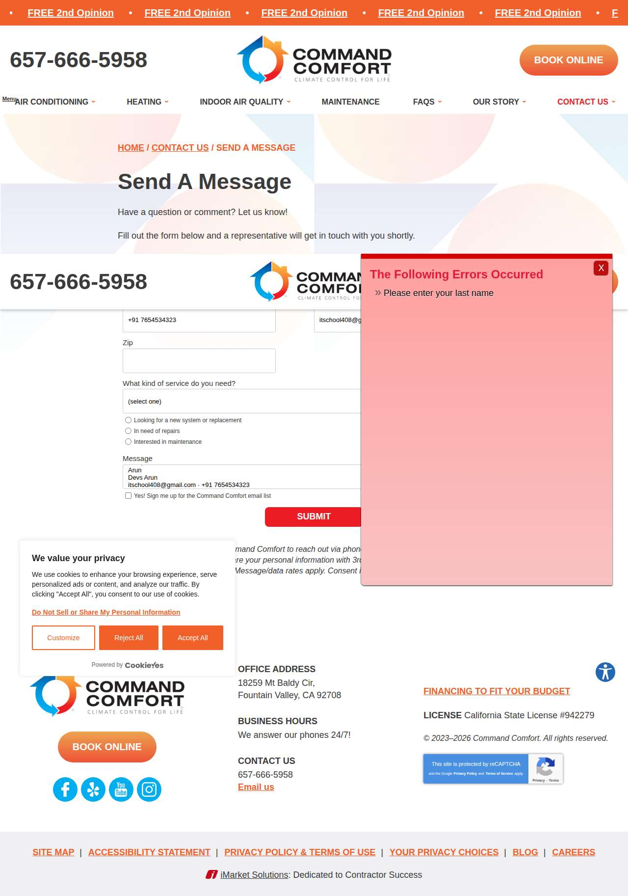

### fulmerheatcool.com — error\_after\_submit (LIVE)

| | |
|---|---|
| Attempt ID | `6551ed3a-830a-4315-912c-27aa17c52a1b` |
| Form URL | https://www.fulmerheatcool.com/contact/send-message |
| Final URL | https://www.fulmerheatcool.com/contact/send-message\#error-container |
| Reserved | 2026-11-02 06:23:54 UTC |
| Submit attempted | 2026-11-02 06:23:56 UTC |
| Template | standard v2 |
| Confirmation text | Our Current Offers\! Read More The Following Errors Occurred Please enter your last name Please enter your city Please let us know the best way to contact you Please enter a |
| Result / error | — |

Exact message:

~~~text
Subject: Helping customers find your business in AI search (AEO + GEO)

Hi there,

I'm Arun from Devs Arun. More and more customers now ask ChatGPT, Gemini, Perplexity or Google's AI Overviews questions like "who should I hire for this in my area?" before they call anyone. These tools answer from websites they can clearly understand, and they tend to recommend businesses whose pages answer real customer questions.

That is what AEO + GEO (Answer Engine and Generative Engine Optimization) is for. I improve your existing service pages so they clearly answer the questions your customers ask, add structured data that matches the page, and make the call, quote or enquiry step obvious. The benefit: your business gets a better chance of being mentioned or linked in AI answers, and visitors who arrive find it easy to contact you.

The AEO + GEO Starter is a one-time $199 (about ₹16,999, negotiable) for one website: a basic audit, 10 customer questions, improvements to two existing pages, relevant structured data and an action plan, with one revision round.

You can read the full details, send an enquiry or book online here:
https://devsarun.io/aeo-geo/

If this isn't relevant, just reply and I won't contact you again.

Best,
Arun
Devs Arun
itschool408@gmail.com · +91 7654534323
~~~

Submitted field values:

- Email \* \[email\]: itschool408@gmail.com
- Comments \* \[message\]: Hi there, I'm Arun from Devs Arun. More and more customers now ask ChatGPT, Gemini, Perplexity or Google's AI Overviews 
- Phone Number \* \[phone\]: +91 7654534323
- First Name \* \[first\_name\]: Arun

**Filled form (before submit)** — `run-56769afe_attempt-6551ed3a_filled_2026-11-02T06-23-56-654Z.jpg`

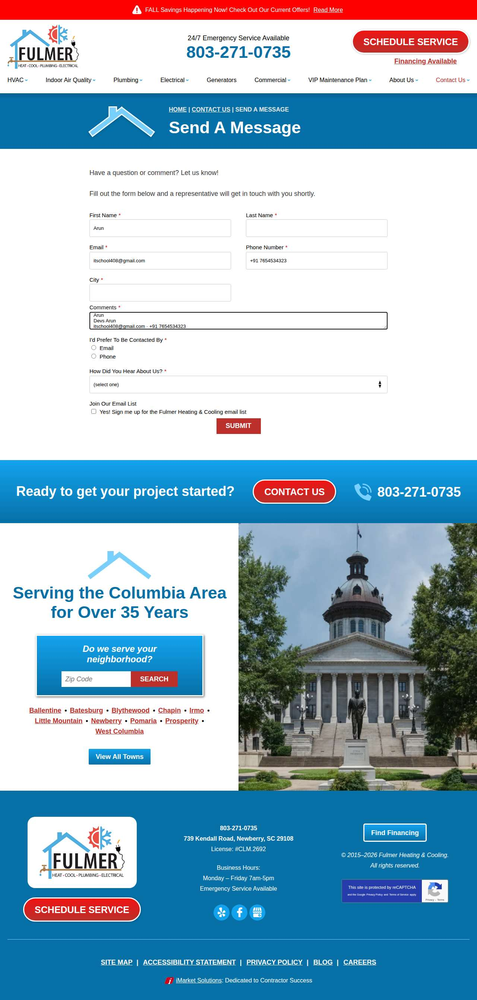

**After submit** — `run-56769afe_attempt-6551ed3a_post_attempt_2026-11-02T06-24-00-097Z.jpg`

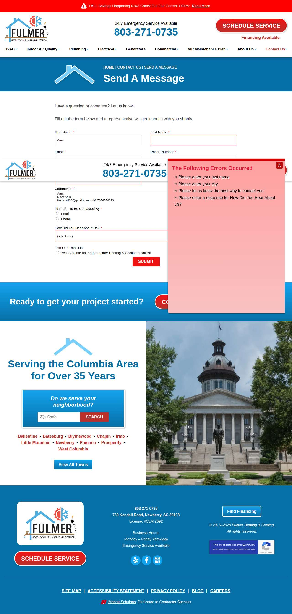

### comfortflow.com — error\_after\_submit (LIVE)

| | |
|---|---|
| Attempt ID | `fc9a69bd-d7b1-43ef-99e9-2f0f65519c6b` |
| Form URL | https://www.comfortflow.com/contact/send-a-message |
| Final URL | https://www.comfortflow.com/contact/send-a-message\#error-container |
| Reserved | 2026-11-02 06:24:07 UTC |
| Submit attempted | 2026-11-02 06:24:09 UTC |
| Template | standard v2 |
| Confirmation text | Skip navigation The Following Errors Occurred Please enter your last name Please enter your city Please let us know the best way to contact you Please enter a |
| Result / error | — |

Exact message:

~~~text
Subject: Helping customers find your business in AI search (AEO + GEO)

Hi there,

I'm Arun from Devs Arun. More and more customers now ask ChatGPT, Gemini, Perplexity or Google's AI Overviews questions like "who should I hire for this in my area?" before they call anyone. These tools answer from websites they can clearly understand, and they tend to recommend businesses whose pages answer real customer questions.

That is what AEO + GEO (Answer Engine and Generative Engine Optimization) is for. I improve your existing service pages so they clearly answer the questions your customers ask, add structured data that matches the page, and make the call, quote or enquiry step obvious. The benefit: your business gets a better chance of being mentioned or linked in AI answers, and visitors who arrive find it easy to contact you.

The AEO + GEO Starter is a one-time $199 (about ₹16,999, negotiable) for one website: a basic audit, 10 customer questions, improvements to two existing pages, relevant structured data and an action plan, with one revision round.

You can read the full details, send an enquiry or book online here:
https://devsarun.io/aeo-geo/

If this isn't relevant, just reply and I won't contact you again.

Best,
Arun
Devs Arun
itschool408@gmail.com · +91 7654534323
~~~

Submitted field values:

- Email \* \[email\]: itschool408@gmail.com
- Comments \* \[message\]: Hi there, I'm Arun from Devs Arun. More and more customers now ask ChatGPT, Gemini, Perplexity or Google's AI Overviews 
- Phone Number \* \[phone\]: +91 7654534323
- First Name \* \[first\_name\]: Arun

**Filled form (before submit)** — `run-56769afe_attempt-fc9a69bd_filled_2026-11-02T06-24-09-952Z.jpg`

**After submit** — `run-56769afe_attempt-fc9a69bd_post_attempt_2026-11-02T06-24-13-490Z.jpg`

## Events (161)

| Time (UTC) | Event | Website | Details |
|---|---|---|---|
| 06:18:04 | run\_queued | — | live run requested by github:itsDevsArun |
| 06:18:04 | run\_dispatched | — | dispatch disabled (local test mode) |
| 06:18:06 | run\_started | — | Runner claimed live run |
| 06:18:07 | offer\_verified | — | Service page offer facts verified |
| 06:18:07 | website\_selected | clearchoiceplumbingllc.com | Live target clearchoiceplumbingllc.com |
| 06:18:07 | attempt\_reserved | clearchoiceplumbingllc.com | Submission attempt reserved with template standard v2 |
| 06:18:09 | page\_opened | clearchoiceplumbingllc.com | Opened form page |
| 06:18:09 | screenshot\_saved | clearchoiceplumbingllc.com | inspection screenshot saved (145 KB) |
| 06:18:09 | review\_required | clearchoiceplumbingllc.com | failed before submit: locator.fill: Error: Cannot type text into input\[type=number\] |
| 06:18:14 | website\_selected | ameengeneralcontracting.com | Live target ameengeneralcontracting.com |
| 06:18:14 | attempt\_reserved | ameengeneralcontracting.com | Submission attempt reserved with template standard v2 |
| 06:18:19 | page\_opened | ameengeneralcontracting.com | Opened form page |
| 06:18:19 | screenshot\_saved | ameengeneralcontracting.com | inspection screenshot saved (162 KB) |
| 06:18:19 | review\_required | ameengeneralcontracting.com | failed before submit: Mapped field "Message am Phone" is not visible |
| 06:18:24 | website\_selected | saddlebackplumbing.com | Live target saddlebackplumbing.com |
| 06:18:24 | attempt\_reserved | saddlebackplumbing.com | Submission attempt reserved with template standard v2 |
| 06:18:27 | page\_opened | saddlebackplumbing.com | Opened form page |
| 06:18:27 | fields\_filled | saddlebackplumbing.com | filled |
| 06:18:27 | screenshot\_saved | saddlebackplumbing.com | filled screenshot saved (165 KB) |
| 06:18:27 | submit\_attempted | saddlebackplumbing.com | submitting |
| 06:18:31 | screenshot\_saved | saddlebackplumbing.com | post\_attempt screenshot saved (175 KB) |
| 06:18:31 | error | saddlebackplumbing.com | error after submit — "s to Susan G. Komen Read More The Following Errors Occurred Please enter your city Please enter a response for How Did Y" |
| 06:18:37 | website\_selected | nationalheatandair.com | Live target nationalheatandair.com |
| 06:18:37 | attempt\_reserved | nationalheatandair.com | Submission attempt reserved with template standard v2 |
| 06:18:41 | page\_opened | nationalheatandair.com | Opened form page |
| 06:18:41 | fields\_filled | nationalheatandair.com | filled |
| 06:18:41 | screenshot\_saved | nationalheatandair.com | filled screenshot saved (125 KB) |
| 06:18:41 | submit\_attempted | nationalheatandair.com | submitting |
| 06:18:45 | screenshot\_saved | nationalheatandair.com | post\_attempt screenshot saved (113 KB) |
| 06:18:45 | confirmation\_observed | nationalheatandair.com | confirmed — "nquiries and Free Estimates in Southern Oregon 541-535-4687 Thank you for your message. It has been sent. -- How can we " |
| 06:18:51 | website\_selected | lovottiair.com | Live target lovottiair.com |
| 06:18:51 | attempt\_reserved | lovottiair.com | Submission attempt reserved with template standard v2 |
| 06:18:53 | page\_opened | lovottiair.com | Opened form page |
| 06:18:53 | fields\_filled | lovottiair.com | filled |
| 06:18:53 | screenshot\_saved | lovottiair.com | filled screenshot saved (64 KB) |
| 06:18:53 | submit\_attempted | lovottiair.com | submitting |
| 06:18:57 | screenshot\_saved | lovottiair.com | post\_attempt screenshot saved (33 KB) |
| 06:18:57 | confirmation\_observed | lovottiair.com | confirmed — "cing Contact Us facebook instagram LIC \# 865459 Let’s Talk\! Form submitted successfully. A confirmation email was sent t" |
| 06:19:04 | website\_selected | cleanairactheatingandac.com | Live target cleanairactheatingandac.com |
| 06:19:04 | attempt\_reserved | cleanairactheatingandac.com | Submission attempt reserved with template standard v2 |
| 06:19:06 | page\_opened | cleanairactheatingandac.com | Opened form page |
| 06:19:07 | fields\_filled | cleanairactheatingandac.com | filled |
| 06:19:07 | screenshot\_saved | cleanairactheatingandac.com | filled screenshot saved (525 KB) |
| 06:19:07 | submit\_attempted | cleanairactheatingandac.com | submitting |
| 06:19:35 | screenshot\_saved | cleanairactheatingandac.com | post\_attempt screenshot saved (528 KB) |
| 06:19:35 | review\_required | cleanairactheatingandac.com | unclear: No new success marker observed |
| 06:19:42 | website\_selected | airclassic.org | Live target airclassic.org |
| 06:19:42 | attempt\_reserved | airclassic.org | Submission attempt reserved with template standard v2 |
| 06:19:43 | page\_opened | airclassic.org | Opened form page |
| 06:19:43 | fields\_filled | airclassic.org | filled |
| 06:19:43 | screenshot\_saved | airclassic.org | filled screenshot saved (116 KB) |
| 06:19:43 | submit\_attempted | airclassic.org | submitting |
| 06:19:46 | screenshot\_saved | airclassic.org | post\_attempt screenshot saved (117 KB) |
| 06:19:46 | confirmation\_observed | airclassic.org | confirmed — "reply during business hours: Mon–Fri 8am–6pm, Sat 9am–2pm. Thank you. We received your request and will call you shortly" |
| 06:19:53 | website\_selected | mrcomfortmd.com | Live target mrcomfortmd.com |
| 06:19:53 | attempt\_reserved | mrcomfortmd.com | Submission attempt reserved with template standard v2 |
| 06:19:54 | page\_opened | mrcomfortmd.com | Opened form page |
| 06:19:54 | fields\_filled | mrcomfortmd.com | filled |
| 06:19:54 | screenshot\_saved | mrcomfortmd.com | filled screenshot saved (79 KB) |
| 06:19:54 | submit\_attempted | mrcomfortmd.com | submitting |
| 06:20:22 | screenshot\_saved | mrcomfortmd.com | post\_attempt screenshot saved (112 KB) |
| 06:20:22 | review\_required | mrcomfortmd.com | unclear: No new success marker observed |
| 06:20:29 | website\_selected | familyheatandair.com | Live target familyheatandair.com |
| 06:20:29 | attempt\_reserved | familyheatandair.com | Submission attempt reserved with template standard v2 |
| 06:20:33 | page\_opened | familyheatandair.com | Opened form page |
| 06:20:33 | fields\_filled | familyheatandair.com | filled |
| 06:20:33 | screenshot\_saved | familyheatandair.com | filled screenshot saved (67 KB) |
| 06:20:33 | submit\_attempted | familyheatandair.com | submitting |
| 06:20:43 | screenshot\_saved | familyheatandair.com | post\_attempt screenshot saved (49 KB) |
| 06:20:43 | confirmation\_observed | familyheatandair.com | confirmed — "atandair.com Mon - Fri: 8:00 AM - 5:00 PM Sat & Sun: Closed Thanks for contacting us\! We will get in touch with you shor" |
| 06:20:50 | website\_selected | boehmerheating.com | Live target boehmerheating.com |
| 06:20:50 | attempt\_reserved | boehmerheating.com | Submission attempt reserved with template standard v2 |
| 06:20:52 | page\_opened | boehmerheating.com | Opened form page |
| 06:20:52 | fields\_filled | boehmerheating.com | filled |
| 06:20:52 | screenshot\_saved | boehmerheating.com | filled screenshot saved (250 KB) |
| 06:20:52 | submit\_attempted | boehmerheating.com | submitting |
| 06:20:55 | screenshot\_saved | boehmerheating.com | post\_attempt screenshot saved (260 KB) |
| 06:20:55 | error | boehmerheating.com | error after submit — "gs and apply today\! Read More The Following Errors Occurred Please enter your last name Please enter your city Please le" |
| 06:21:02 | website\_selected | northwindhvacaz.com | Live target northwindhvacaz.com |
| 06:21:02 | attempt\_reserved | northwindhvacaz.com | Submission attempt reserved with template standard v2 |
| 06:21:04 | page\_opened | northwindhvacaz.com | Opened form page |
| 06:21:04 | fields\_filled | northwindhvacaz.com | filled |
| 06:21:04 | screenshot\_saved | northwindhvacaz.com | filled screenshot saved (91 KB) |
| 06:21:04 | submit\_attempted | northwindhvacaz.com | submitting |
| 06:21:06 | screenshot\_saved | northwindhvacaz.com | post\_attempt screenshot saved (74 KB) |
| 06:21:06 | confirmation\_observed | northwindhvacaz.com | confirmed — "indhvac@gmail.com FACEBOOK facebook.com/northwindmechanical Message Sent\! Thank you for reaching out. We'll be in touch " |
| 06:21:13 | website\_selected | coastproducts.com | Live target coastproducts.com |
| 06:21:13 | attempt\_reserved | coastproducts.com | Submission attempt reserved with template standard v2 |
| 06:21:14 | page\_opened | coastproducts.com | Opened form page |
| 06:21:14 | fields\_filled | coastproducts.com | filled |
| 06:21:15 | screenshot\_saved | coastproducts.com | filled screenshot saved (96 KB) |
| 06:21:15 | submit\_attempted | coastproducts.com | submitting |
| 06:21:18 | screenshot\_saved | coastproducts.com | post\_attempt screenshot saved (118 KB) |
| 06:21:18 | confirmation\_observed | coastproducts.com | confirmed — "26 Fax: 206-285-5123 Email frontdesk@coastproducts.com Your message was sent successfully. Thank you. Contact Form Have " |
| 06:21:25 | website\_selected | perfectefficiency.com | Live target perfectefficiency.com |
| 06:21:25 | attempt\_reserved | perfectefficiency.com | Submission attempt reserved with template standard v2 |
| 06:21:28 | page\_opened | perfectefficiency.com | Opened form page |
| 06:21:28 | fields\_filled | perfectefficiency.com | filled |
| 06:21:29 | screenshot\_saved | perfectefficiency.com | filled screenshot saved (546 KB) |
| 06:21:29 | submit\_attempted | perfectefficiency.com | submitting |
| 06:21:56 | screenshot\_saved | perfectefficiency.com | post\_attempt screenshot saved (569 KB) |
| 06:21:56 | review\_required | perfectefficiency.com | unclear: No new success marker observed |
| 06:22:03 | website\_selected | oasiscooling.com | Live target oasiscooling.com |
| 06:22:03 | attempt\_reserved | oasiscooling.com | Submission attempt reserved with template standard v2 |
| 06:22:04 | page\_opened | oasiscooling.com | Opened form page |
| 06:22:04 | fields\_filled | oasiscooling.com | filled |
| 06:22:04 | screenshot\_saved | oasiscooling.com | filled screenshot saved (179 KB) |
| 06:22:04 | submit\_attempted | oasiscooling.com | submitting |
| 06:22:33 | screenshot\_saved | oasiscooling.com | post\_attempt screenshot saved (244 KB) |
| 06:22:33 | review\_required | oasiscooling.com | unclear: No new success marker observed |
| 06:22:40 | website\_selected | russellsac.com | Live target russellsac.com |
| 06:22:40 | attempt\_reserved | russellsac.com | Submission attempt reserved with template standard v2 |
| 06:22:42 | page\_opened | russellsac.com | Opened form page |
| 06:22:42 | screenshot\_saved | russellsac.com | filled screenshot saved (212 KB) |
| 06:22:42 | review\_required | russellsac.com | failed before submit: Field "Phone\*" did not accept the value |
| 06:22:47 | website\_selected | gnlhvac.com | Live target gnlhvac.com |
| 06:22:47 | attempt\_reserved | gnlhvac.com | Submission attempt reserved with template standard v2 |
| 06:22:50 | page\_opened | gnlhvac.com | Opened form page |
| 06:22:50 | fields\_filled | gnlhvac.com | filled |
| 06:22:50 | screenshot\_saved | gnlhvac.com | filled screenshot saved (106 KB) |
| 06:22:50 | submit\_attempted | gnlhvac.com | submitting |
| 06:23:17 | screenshot\_saved | gnlhvac.com | post\_attempt screenshot saved (65 KB) |
| 06:23:17 | review\_required | gnlhvac.com | unclear: No new success marker observed |
| 06:23:24 | website\_selected | airproheating.com | Live target airproheating.com |
| 06:23:24 | attempt\_reserved | airproheating.com | Submission attempt reserved with template standard v2 |
| 06:23:25 | page\_opened | airproheating.com | Opened form page |
| 06:23:26 | screenshot\_saved | airproheating.com | filled screenshot saved (86 KB) |
| 06:23:26 | review\_required | airproheating.com | failed before submit: Field "Phone" did not accept the value |
| 06:23:31 | website\_selected | polarbearairconditioning.com | Live target polarbearairconditioning.com |
| 06:23:31 | attempt\_reserved | polarbearairconditioning.com | Submission attempt reserved with template standard v2 |
| 06:23:32 | page\_opened | polarbearairconditioning.com | Opened form page |
| 06:23:32 | fields\_filled | polarbearairconditioning.com | filled |
| 06:23:32 | screenshot\_saved | polarbearairconditioning.com | filled screenshot saved (129 KB) |
| 06:23:32 | submit\_attempted | polarbearairconditioning.com | submitting |
| 06:23:36 | screenshot\_saved | polarbearairconditioning.com | post\_attempt screenshot saved (147 KB) |
| 06:23:36 | error | polarbearairconditioning.com | error after submit — "Skip navigation The Following Errors Occurred Please enter your last name Please enter your city Please let us know the " |
| 06:23:43 | website\_selected | command-air.com | Live target command-air.com |
| 06:23:43 | attempt\_reserved | command-air.com | Submission attempt reserved with template standard v2 |
| 06:23:44 | page\_opened | command-air.com | Opened form page |
| 06:23:44 | fields\_filled | command-air.com | filled |
| 06:23:45 | screenshot\_saved | command-air.com | filled screenshot saved (150 KB) |
| 06:23:45 | submit\_attempted | command-air.com | submitting |
| 06:23:48 | screenshot\_saved | command-air.com | post\_attempt screenshot saved (147 KB) |
| 06:23:48 | error | command-air.com | error after submit — "ll Powered by Skip navigation The Following Errors Occurred Please enter your last name 657-666-5958 BOOK ONLINE FREE 2n" |
| 06:23:54 | website\_selected | fulmerheatcool.com | Live target fulmerheatcool.com |
| 06:23:54 | attempt\_reserved | fulmerheatcool.com | Submission attempt reserved with template standard v2 |
| 06:23:56 | page\_opened | fulmerheatcool.com | Opened form page |
| 06:23:56 | fields\_filled | fulmerheatcool.com | filled |
| 06:23:56 | screenshot\_saved | fulmerheatcool.com | filled screenshot saved (237 KB) |
| 06:23:56 | submit\_attempted | fulmerheatcool.com | submitting |
| 06:24:00 | screenshot\_saved | fulmerheatcool.com | post\_attempt screenshot saved (252 KB) |
| 06:24:00 | error | fulmerheatcool.com | error after submit — "Our Current Offers\! Read More The Following Errors Occurred Please enter your last name Please enter your city Please le" |
| 06:24:07 | website\_selected | comfortflow.com | Live target comfortflow.com |
| 06:24:07 | attempt\_reserved | comfortflow.com | Submission attempt reserved with template standard v2 |
| 06:24:09 | page\_opened | comfortflow.com | Opened form page |
| 06:24:09 | fields\_filled | comfortflow.com | filled |
| 06:24:09 | screenshot\_saved | comfortflow.com | filled screenshot saved (368 KB) |
| 06:24:09 | submit\_attempted | comfortflow.com | submitting |
| 06:24:13 | screenshot\_saved | comfortflow.com | post\_attempt screenshot saved (377 KB) |
| 06:24:13 | error | comfortflow.com | error after submit — "Skip navigation The Following Errors Occurred Please enter your last name Please enter your city Please let us know the " |
| 06:24:20 | run\_completed | — | Run completed (queue\_exhausted) |
