# Run 624056df — live — completed

| | |
|---|---|
| Run ID | `624056df-f02c-4b20-bcd3-76f9e8245ac7` |
| Requested by | github:itsDevsArun |
| Started | 2026-11-02 19:28:21 UTC |
| Finished | 2026-11-02 19:32:12 UTC |
| Finish reason | limit\_reached |
| GitHub Actions | https://github.com/itsDevsArun/aeo-geo/actions/runs/41469315389 |

CSV for this run: [runs/2026-11-02_live_624056df.csv](2026-11-02_live_624056df.csv)

## Attempts (8)

### clearchoiceplumbingllc.com — failed\_before\_submit (LIVE)

| | |
|---|---|
| Attempt ID | `eb8e6947-db04-48be-a94b-97221d35843f` |
| Form URL | https://clearchoiceplumbingllc.com/contact/ |
| Final URL | — |
| Reserved | 2026-11-02 19:28:23 UTC |
| Submit attempted | — |
| Template | standard v2 |
| Confirmation text | none observed |
| Result / error | locator.fill: Error: Cannot type text into input\[type=number\] |

Exact message:

~~~text
Subject: Helping customers find your business in AI search (AEO + GEO)

Hi there,

I'm Arun from Devs Arun. More and more customers now ask ChatGPT, Gemini, Perplexity or Google's AI Overviews questions like "who should I hire for this in my area?" before they call anyone. These tools answer from websites they can clearly understand, and they tend to recommend businesses whose pages answer real customer questions.

That is what AEO + GEO (Answer Engine and Generative Engine Optimization) is for. I improve your existing service pages so they clearly answer the questions your customers ask, add structured data that matches the page, and make the call, quote or enquiry step obvious. The benefit: your business gets a better chance of being mentioned or linked in AI answers, and visitors who arrive find it easy to contact you.

The AEO + GEO Starter is a one-time $199 (about ₹16,999, negotiable) for one website: a basic audit, 10 customer questions, improvements to two existing pages, relevant structured data and an action plan, with one revision round.

You can read the full details, send an enquiry or book online here:
https://devsarun.io/aeo-geo/

If this isn't relevant, just reply and I won't contact you again.

Best,
Arun
Devs Arun
itschool408@gmail.com · +91 7654534323
~~~

Submitted field values:

- \#wpforms-51-field\_1: Arun
- \#wpforms-51-field\_2: itschool408@gmail.com
- \#wpforms-51-field\_3: Hi there, I'm Arun from Devs Arun. More and more customers now ask ChatGPT, Gemini, Perplexity or Google's AI Overviews 
- \#wpforms-51-field\_5: +91 7654534323

**Inspected page** — `run-624056df_attempt-eb8e6947_inspection_2026-11-02T19-28-24-795Z.jpg`

### bwnwincpainting.com — failed\_before\_submit (LIVE)

| | |
|---|---|
| Attempt ID | `2082a81d-138d-4bff-b9ba-bef8823c1a71` |
| Form URL | https://www.bwnwincpainting.com/contact/ |
| Final URL | — |
| Reserved | 2026-11-02 19:28:29 UTC |
| Submit attempted | — |
| Template | standard v2 |
| Confirmation text | none observed |
| Result / error | locator.fill: Error: Cannot type text into input\[type=number\] |

Exact message:

~~~text
Subject: Helping customers find your business in AI search (AEO + GEO)

Hi there,

I'm Arun from Devs Arun. More and more customers now ask ChatGPT, Gemini, Perplexity or Google's AI Overviews questions like "who should I hire for this in my area?" before they call anyone. These tools answer from websites they can clearly understand, and they tend to recommend businesses whose pages answer real customer questions.

That is what AEO + GEO (Answer Engine and Generative Engine Optimization) is for. I improve your existing service pages so they clearly answer the questions your customers ask, add structured data that matches the page, and make the call, quote or enquiry step obvious. The benefit: your business gets a better chance of being mentioned or linked in AI answers, and visitors who arrive find it easy to contact you.

The AEO + GEO Starter is a one-time $199 (about ₹16,999, negotiable) for one website: a basic audit, 10 customer questions, improvements to two existing pages, relevant structured data and an action plan, with one revision round.

You can read the full details, send an enquiry or book online here:
https://devsarun.io/aeo-geo/

If this isn't relevant, just reply and I won't contact you again.

Best,
Arun
Devs Arun
itschool408@gmail.com · +91 7654534323
~~~

Submitted field values:

- \#name-1151: Arun
- \#email-1151: itschool408@gmail.com
- \#phone-1151: +91 7654534323
- \#message-1151: Hi there, I'm Arun from Devs Arun. More and more customers now ask ChatGPT, Gemini, Perplexity or Google's AI Overviews 

**Inspected page** — `run-624056df_attempt-2082a81d_inspection_2026-11-02T19-28-31-491Z.jpg`

### inlawsconstruction.com — unclear (LIVE)

| | |
|---|---|
| Attempt ID | `c26378f8-a92a-497f-b5d5-0ae0971bb13b` |
| Form URL | http://inlawsconstruction.com/contact.html |
| Final URL | chrome-error://chromewebdata/ |
| Reserved | 2026-11-02 19:28:36 UTC |
| Submit attempted | 2026-11-02 19:28:41 UTC |
| Template | standard v2 |
| Confirmation text | none observed |
| Result / error | No new success marker observed |

Exact message:

~~~text
Subject: Helping customers find your business in AI search (AEO + GEO)

Hi there,

I'm Arun from Devs Arun. More and more customers now ask ChatGPT, Gemini, Perplexity or Google's AI Overviews questions like "who should I hire for this in my area?" before they call anyone. These tools answer from websites they can clearly understand, and they tend to recommend businesses whose pages answer real customer questions.

That is what AEO + GEO (Answer Engine and Generative Engine Optimization) is for. I improve your existing service pages so they clearly answer the questions your customers ask, add structured data that matches the page, and make the call, quote or enquiry step obvious. The benefit: your business gets a better chance of being mentioned or linked in AI answers, and visitors who arrive find it easy to contact you.

The AEO + GEO Starter is a one-time $199 (about ₹16,999, negotiable) for one website: a basic audit, 10 customer questions, improvements to two existing pages, relevant structured data and an action plan, with one revision round.

You can read the full details, send an enquiry or book online here:
https://devsarun.io/aeo-geo/

If this isn't relevant, just reply and I won't contact you again.

Best,
Arun
Devs Arun
itschool408@gmail.com · +91 7654534323
~~~

Submitted field values:

- name \[name\]: Arun
- email \[email\]: itschool408@gmail.com
- message \[message\]: Hi there, I'm Arun from Devs Arun. More and more customers now ask ChatGPT, Gemini, Perplexity or Google's AI Overviews 
- subject \[subject\]: Helping customers find your business in AI search (AEO + GEO)

**Filled form (before submit)** — `run-624056df_attempt-c26378f8_filled_2026-11-02T19-28-41-296Z.jpg`

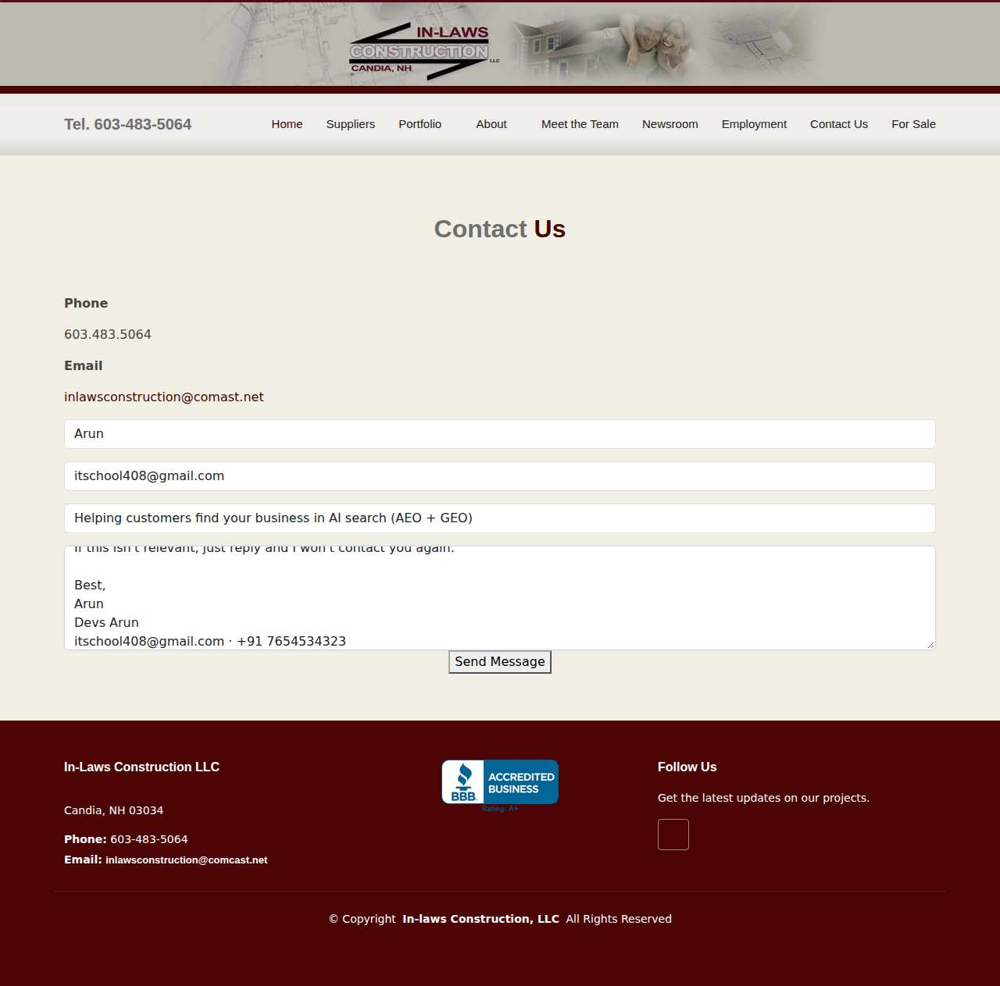

**After submit** — `run-624056df_attempt-c26378f8_post_attempt_2026-11-02T19-29-09-970Z.jpg`

### schuttewoodworking.net — confirmed (LIVE)

| | |
|---|---|
| Attempt ID | `d16c713d-4288-48a0-87ce-48c767973a3a` |
| Form URL | https://www.schuttewoodworking.net/contact |
| Final URL | https://www.schuttewoodworking.net/contact |
| Reserved | 2026-11-02 19:29:17 UTC |
| Submit attempted | 2026-11-02 19:29:19 UTC |
| Template | standard v2 |
| Confirmation text | n this page and briefly explain the nature of your project. Thank you for your inquiry\! One of our qualified staff members will be in touch shortly. You may also feel free to call direct |
| Result / error | — |

Exact message:

~~~text
Subject: Helping customers find your business in AI search (AEO + GEO)

Hi there,

I'm Arun from Devs Arun. More and more customers now ask ChatGPT, Gemini, Perplexity or Google's AI Overviews questions like "who should I hire for this in my area?" before they call anyone. These tools answer from websites they can clearly understand, and they tend to recommend businesses whose pages answer real customer questions.

That is what AEO + GEO (Answer Engine and Generative Engine Optimization) is for. I improve your existing service pages so they clearly answer the questions your customers ask, add structured data that matches the page, and make the call, quote or enquiry step obvious. The benefit: your business gets a better chance of being mentioned or linked in AI answers, and visitors who arrive find it easy to contact you.

The AEO + GEO Starter is a one-time $199 (about ₹16,999, negotiable) for one website: a basic audit, 10 customer questions, improvements to two existing pages, relevant structured data and an action plan, with one revision round.

You can read the full details, send an enquiry or book online here:
https://devsarun.io/aeo-geo/

If this isn't relevant, just reply and I won't contact you again.

Best,
Arun
Devs Arun
itschool408@gmail.com · +91 7654534323
~~~

Submitted field values:

- Name (required) \[name\]: Arun
- Message (required) \[message\]: Hi there, I'm Arun from Devs Arun. More and more customers now ask ChatGPT, Gemini, Perplexity or Google's AI Overviews 
- Phone or Email (required) \[email\]: itschool408@gmail.com

**Filled form (before submit)** — `run-624056df_attempt-d16c713d_filled_2026-11-02T19-29-19-360Z.jpg`

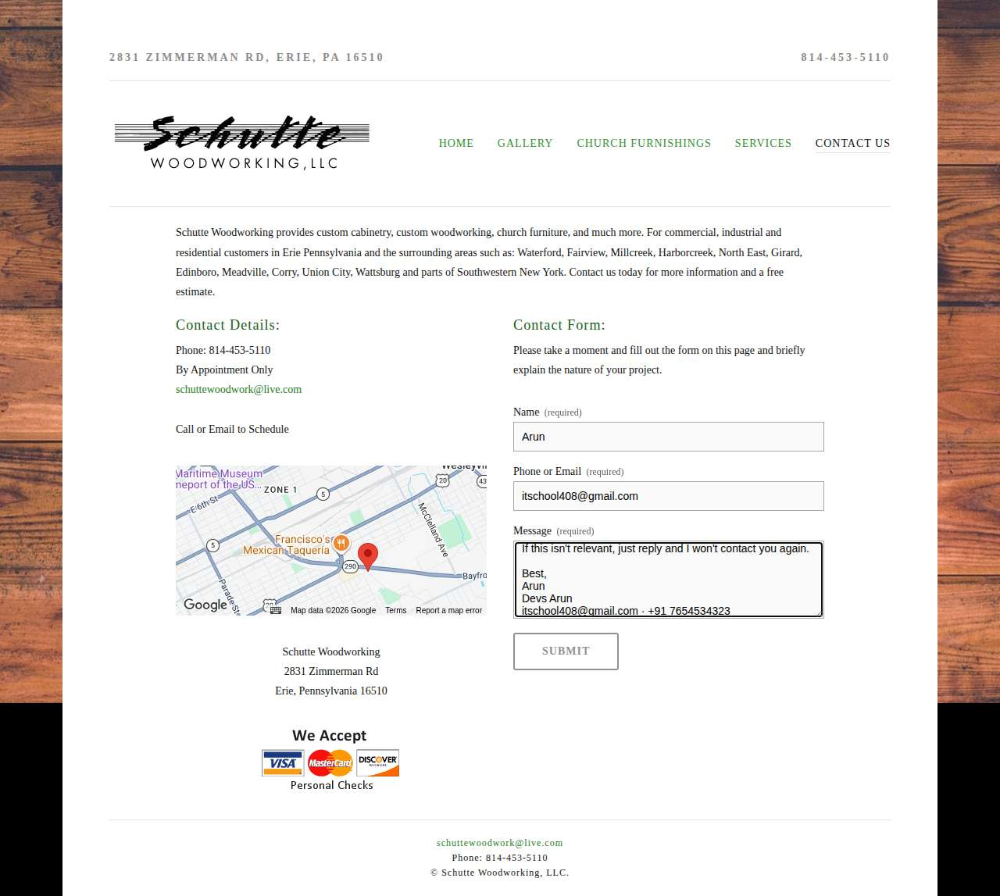

**After submit** — `run-624056df_attempt-d16c713d_post_attempt_2026-11-02T19-29-23-927Z.jpg`

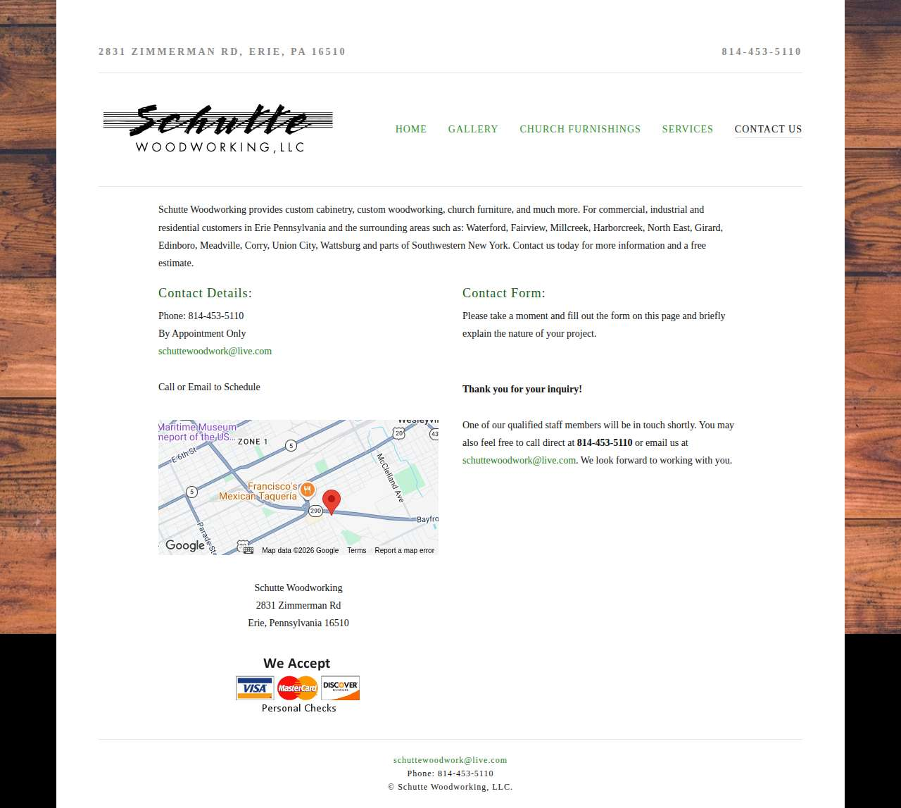

### mikutowskiwoodworking.com — unclear (LIVE)

| | |
|---|---|
| Attempt ID | `4722063a-ff56-49f0-a686-7d94851b7e52` |
| Form URL | https://mikutowskiwoodworking.com/pages/contact-us |
| Final URL | https://mikutowskiwoodworking.com/pages/contact-us |
| Reserved | 2026-11-02 19:29:31 UTC |
| Submit attempted | 2026-11-02 19:29:36 UTC |
| Template | standard v2 |
| Confirmation text | none observed |
| Result / error | No new success marker observed |

Exact message:

~~~text
Subject: Helping customers find your business in AI search (AEO + GEO)

Hi there,

I'm Arun from Devs Arun. More and more customers now ask ChatGPT, Gemini, Perplexity or Google's AI Overviews questions like "who should I hire for this in my area?" before they call anyone. These tools answer from websites they can clearly understand, and they tend to recommend businesses whose pages answer real customer questions.

That is what AEO + GEO (Answer Engine and Generative Engine Optimization) is for. I improve your existing service pages so they clearly answer the questions your customers ask, add structured data that matches the page, and make the call, quote or enquiry step obvious. The benefit: your business gets a better chance of being mentioned or linked in AI answers, and visitors who arrive find it easy to contact you.

The AEO + GEO Starter is a one-time $199 (about ₹16,999, negotiable) for one website: a basic audit, 10 customer questions, improvements to two existing pages, relevant structured data and an action plan, with one revision round.

You can read the full details, send an enquiry or book online here:
https://devsarun.io/aeo-geo/

If this isn't relevant, just reply and I won't contact you again.

Best,
Arun
Devs Arun
itschool408@gmail.com · +91 7654534323
~~~

Submitted field values:

- contact\[name\] \[name\]: Arun
- contact\[email\] \[email\]: itschool408@gmail.com
- contact\[body\] \[message\]: Hi there, I'm Arun from Devs Arun. More and more customers now ask ChatGPT, Gemini, Perplexity or Google's AI Overviews 

**Filled form (before submit)** — `run-624056df_attempt-4722063a_filled_2026-11-02T19-29-36-050Z.jpg`

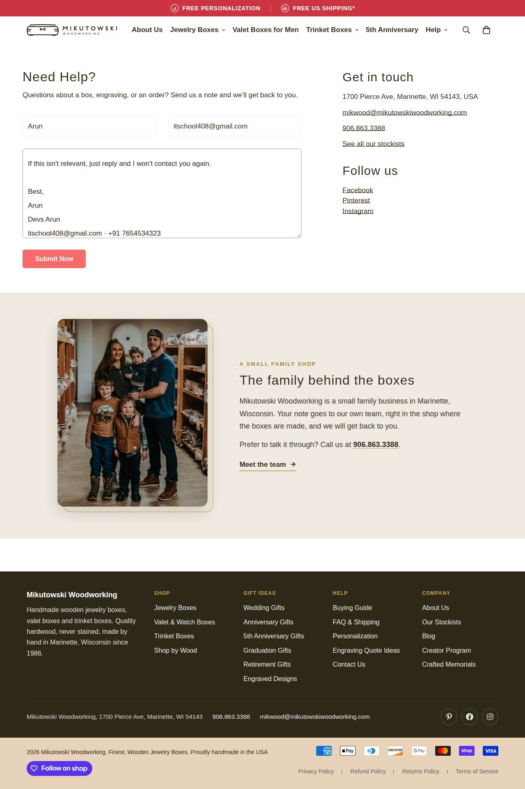

**After submit** — `run-624056df_attempt-4722063a_post_attempt_2026-11-02T19-30-11-947Z.jpg`

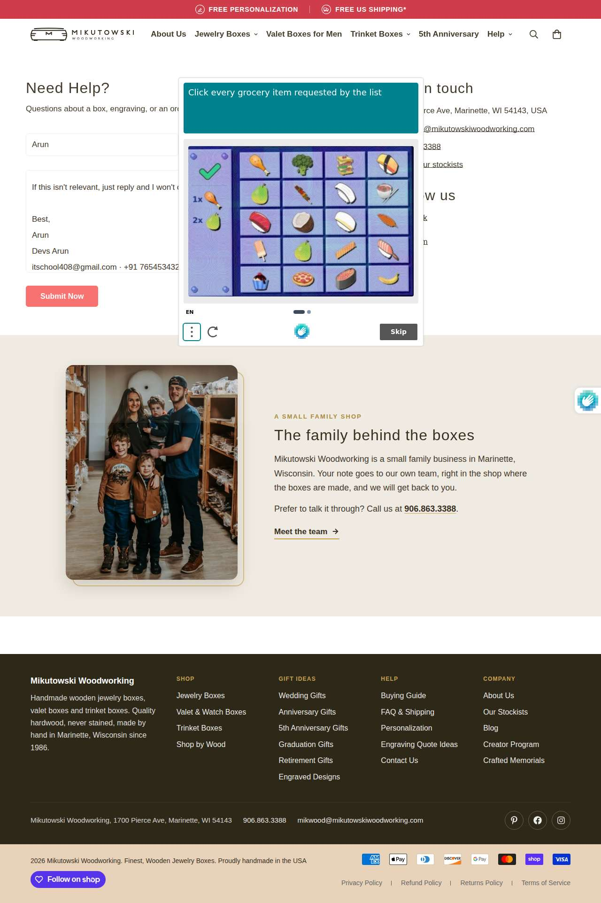

### customdesignwoodproducts.com — unclear (LIVE)

| | |
|---|---|
| Attempt ID | `ec99053b-0ba3-4aeb-854f-be8be9e3f1f1` |
| Form URL | https://www.customdesignwoodproducts.com/contact |
| Final URL | https://www.customdesignwoodproducts.com/contact |
| Reserved | 2026-11-02 19:30:19 UTC |
| Submit attempted | 2026-11-02 19:30:21 UTC |
| Template | standard v2 |
| Confirmation text | none observed |
| Result / error | No new success marker observed |

Exact message:

~~~text
Subject: Helping customers find your business in AI search (AEO + GEO)

Hi there,

I'm Arun from Devs Arun. More and more customers now ask ChatGPT, Gemini, Perplexity or Google's AI Overviews questions like "who should I hire for this in my area?" before they call anyone. These tools answer from websites they can clearly understand, and they tend to recommend businesses whose pages answer real customer questions.

That is what AEO + GEO (Answer Engine and Generative Engine Optimization) is for. I improve your existing service pages so they clearly answer the questions your customers ask, add structured data that matches the page, and make the call, quote or enquiry step obvious. The benefit: your business gets a better chance of being mentioned or linked in AI answers, and visitors who arrive find it easy to contact you.

The AEO + GEO Starter is a one-time $199 (about ₹16,999, negotiable) for one website: a basic audit, 10 customer questions, improvements to two existing pages, relevant structured data and an action plan, with one revision round.

You can read the full details, send an enquiry or book online here:
https://devsarun.io/aeo-geo/

If this isn't relevant, just reply and I won't contact you again.

Best,
Arun
Devs Arun
itschool408@gmail.com · +91 7654534323
~~~

Submitted field values:

- email \[email\]: itschool408@gmail.com
- name-\* \[name\]: Arun
- Message \[message\]: Hi there, I'm Arun from Devs Arun. More and more customers now ask ChatGPT, Gemini, Perplexity or Google's AI Overviews 
- subject \[subject\]: Helping customers find your business in AI search (AEO + GEO)

**Filled form (before submit)** — `run-624056df_attempt-ec99053b_filled_2026-11-02T19-30-21-919Z.jpg`

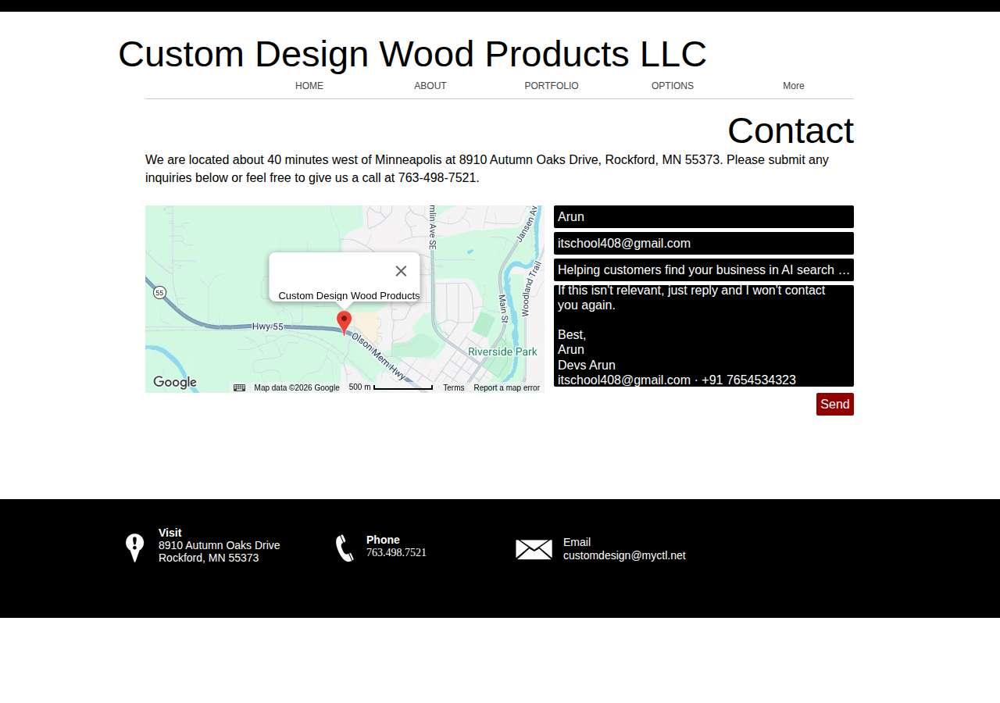

**After submit** — `run-624056df_attempt-ec99053b_post_attempt_2026-11-02T19-30-49-537Z.jpg`

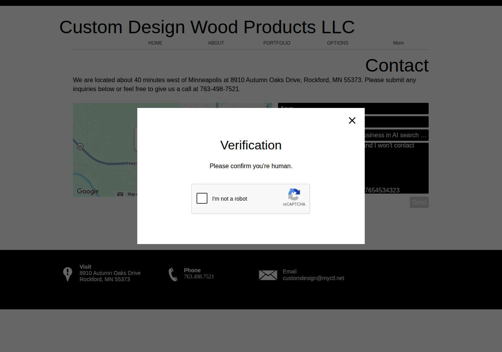

### buffalohardwood.com — unclear (LIVE)

| | |
|---|---|
| Attempt ID | `6cc11be5-f172-471d-901e-7633ca26b6e3` |
| Form URL | https://www.mpcaroll.com/contact |
| Final URL | https://www.mpcaroll.com/contact |
| Reserved | 2026-11-02 19:30:57 UTC |
| Submit attempted | 2026-11-02 19:30:59 UTC |
| Template | standard v2 |
| Confirmation text | none observed |
| Result / error | No new success marker observed |

Exact message:

~~~text
Subject: Helping customers find your business in AI search (AEO + GEO)

Hi there,

I'm Arun from Devs Arun. More and more customers now ask ChatGPT, Gemini, Perplexity or Google's AI Overviews questions like "who should I hire for this in my area?" before they call anyone. These tools answer from websites they can clearly understand, and they tend to recommend businesses whose pages answer real customer questions.

That is what AEO + GEO (Answer Engine and Generative Engine Optimization) is for. I improve your existing service pages so they clearly answer the questions your customers ask, add structured data that matches the page, and make the call, quote or enquiry step obvious. The benefit: your business gets a better chance of being mentioned or linked in AI answers, and visitors who arrive find it easy to contact you.

The AEO + GEO Starter is a one-time $199 (about ₹16,999, negotiable) for one website: a basic audit, 10 customer questions, improvements to two existing pages, relevant structured data and an action plan, with one revision round.

You can read the full details, send an enquiry or book online here:
https://devsarun.io/aeo-geo/

If this isn't relevant, just reply and I won't contact you again.

Best,
Arun
Devs Arun
itschool408@gmail.com · +91 7654534323
~~~

Submitted field values:

- Name \[name\]: Arun
- Email \[email\]: itschool408@gmail.com
- Phone \[phone\]: +91 7654534323
- Message \[message\]: Hi there, I'm Arun from Devs Arun. More and more customers now ask ChatGPT, Gemini, Perplexity or Google's AI Overviews 
- Subject \[subject\]: Helping customers find your business in AI search (AEO + GEO)

**Filled form (before submit)** — `run-624056df_attempt-6cc11be5_filled_2026-11-02T19-30-59-310Z.jpg`

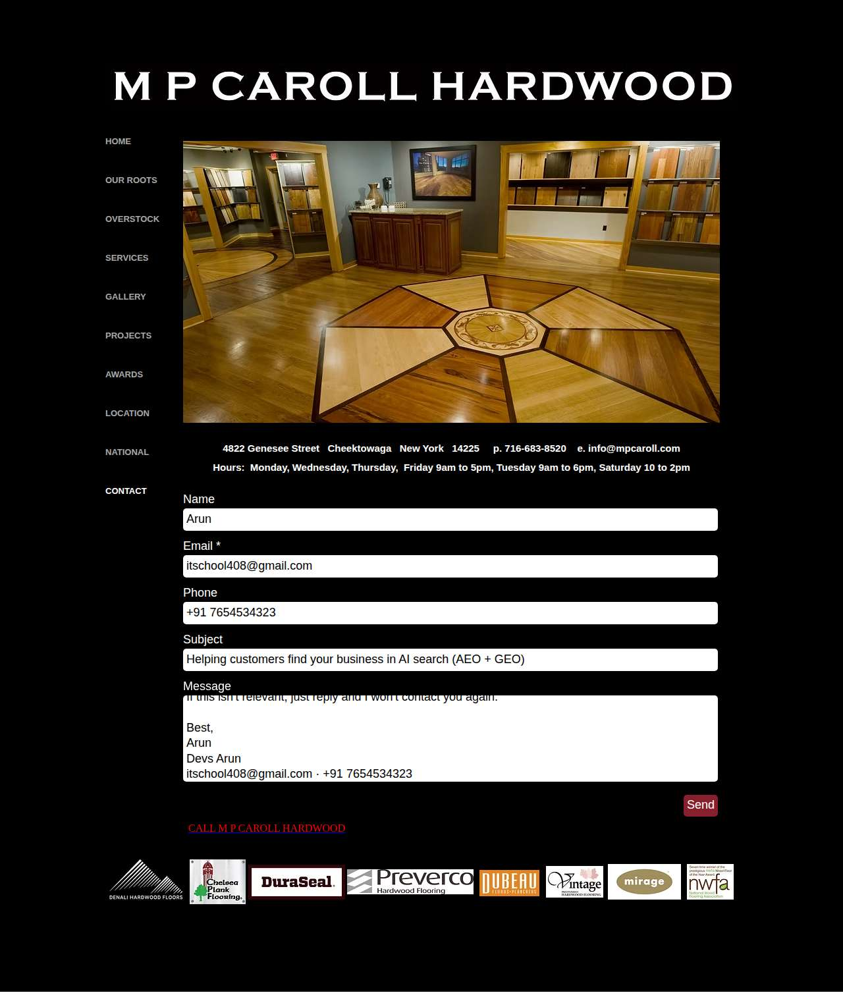

**After submit** — `run-624056df_attempt-6cc11be5_post_attempt_2026-11-02T19-31-27-298Z.jpg`

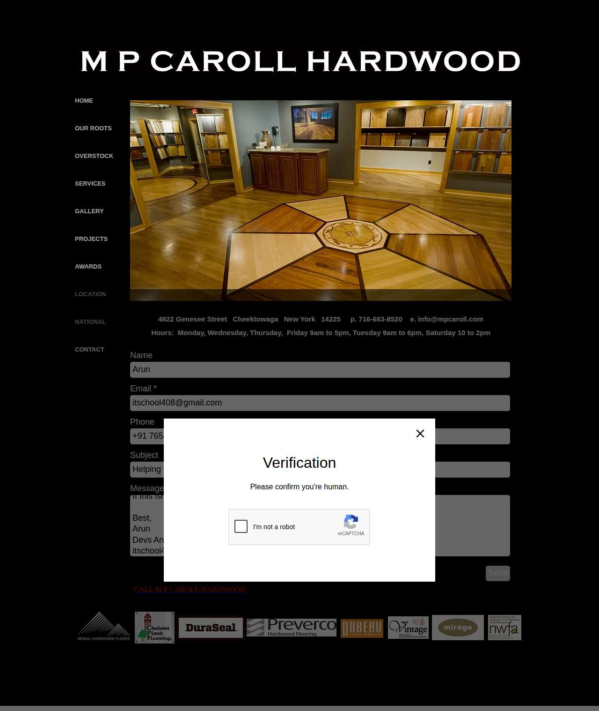

### kappcompanies.com — unclear (LIVE)

| | |
|---|---|
| Attempt ID | `6c2621bf-32ef-44e4-918d-b4eb01a3171f` |
| Form URL | https://www.kappcompanies.com/contact-us |
| Final URL | https://www.kappcompanies.com/contact-us |
| Reserved | 2026-11-02 19:31:34 UTC |
| Submit attempted | 2026-11-02 19:31:37 UTC |
| Template | standard v2 |
| Confirmation text | none observed |
| Result / error | No new success marker observed |

Exact message:

~~~text
Subject: Helping customers find your business in AI search (AEO + GEO)

Hi there,

I'm Arun from Devs Arun. More and more customers now ask ChatGPT, Gemini, Perplexity or Google's AI Overviews questions like "who should I hire for this in my area?" before they call anyone. These tools answer from websites they can clearly understand, and they tend to recommend businesses whose pages answer real customer questions.

That is what AEO + GEO (Answer Engine and Generative Engine Optimization) is for. I improve your existing service pages so they clearly answer the questions your customers ask, add structured data that matches the page, and make the call, quote or enquiry step obvious. The benefit: your business gets a better chance of being mentioned or linked in AI answers, and visitors who arrive find it easy to contact you.

The AEO + GEO Starter is a one-time $199 (about ₹16,999, negotiable) for one website: a basic audit, 10 customer questions, improvements to two existing pages, relevant structured data and an action plan, with one revision round.

You can read the full details, send an enquiry or book online here:
https://devsarun.io/aeo-geo/

If this isn't relevant, just reply and I won't contact you again.

Best,
Arun
Devs Arun
itschool408@gmail.com · +91 7654534323
~~~

Submitted field values:

- Email \[email\]: itschool408@gmail.com
- Message \[message\]: Hi there, I'm Arun from Devs Arun. More and more customers now ask ChatGPT, Gemini, Perplexity or Google's AI Overviews 
- First Name \[first\_name\]: Arun

**Filled form (before submit)** — `run-624056df_attempt-6c2621bf_filled_2026-11-02T19-31-37-177Z.jpg`

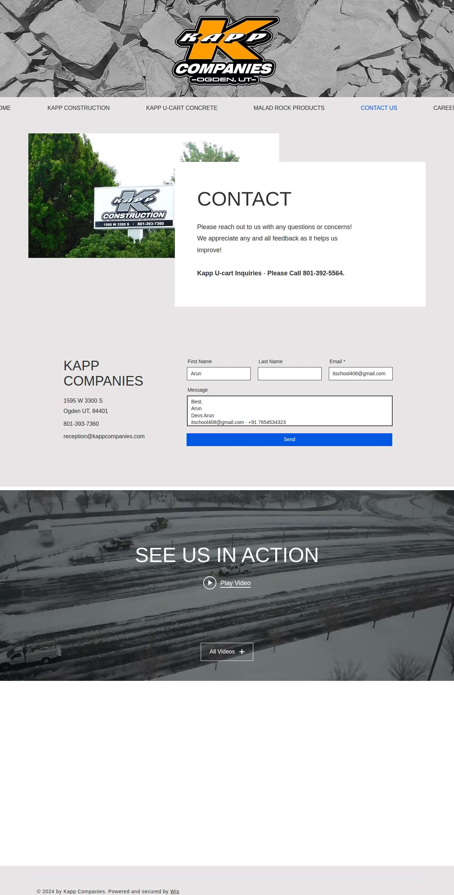

**After submit** — `run-624056df_attempt-6c2621bf_post_attempt_2026-11-02T19-32-04-946Z.jpg`

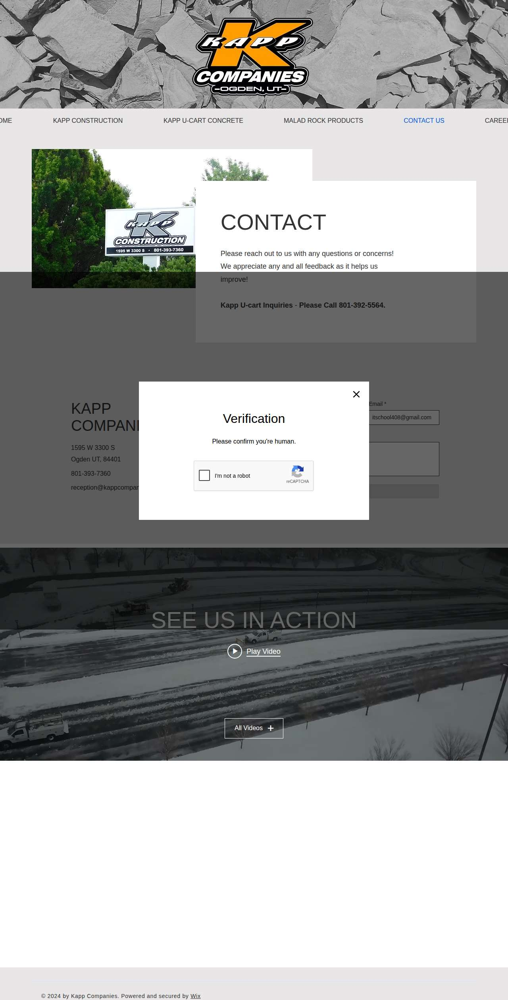

## Events (63)

| Time (UTC) | Event | Website | Details |
|---|---|---|---|
| 19:28:19 | run\_queued | — | live run requested by github:itsDevsArun |
| 19:28:19 | run\_dispatched | — | dispatch disabled (local test mode) |
| 19:28:21 | run\_started | — | Runner claimed live run |
| 19:28:23 | offer\_verified | — | Service page offer facts verified |
| 19:28:23 | website\_selected | clearchoiceplumbingllc.com | Live target clearchoiceplumbingllc.com |
| 19:28:23 | attempt\_reserved | clearchoiceplumbingllc.com | Submission attempt reserved with template standard v2 |
| 19:28:24 | page\_opened | clearchoiceplumbingllc.com | Opened form page |
| 19:28:24 | screenshot\_saved | clearchoiceplumbingllc.com | inspection screenshot saved (145 KB) |
| 19:28:24 | review\_required | clearchoiceplumbingllc.com | failed before submit: locator.fill: Error: Cannot type text into input\[type=number\] |
| 19:28:29 | website\_selected | bwnwincpainting.com | Live target bwnwincpainting.com |
| 19:28:29 | attempt\_reserved | bwnwincpainting.com | Submission attempt reserved with template standard v2 |
| 19:28:31 | page\_opened | bwnwincpainting.com | Opened form page |
| 19:28:31 | screenshot\_saved | bwnwincpainting.com | inspection screenshot saved (118 KB) |
| 19:28:31 | review\_required | bwnwincpainting.com | failed before submit: locator.fill: Error: Cannot type text into input\[type=number\] |
| 19:28:36 | website\_selected | inlawsconstruction.com | Live target inlawsconstruction.com |
| 19:28:36 | attempt\_reserved | inlawsconstruction.com | Submission attempt reserved with template standard v2 |
| 19:28:41 | page\_opened | inlawsconstruction.com | Opened form page |
| 19:28:41 | fields\_filled | inlawsconstruction.com | filled |
| 19:28:41 | screenshot\_saved | inlawsconstruction.com | filled screenshot saved (69 KB) |
| 19:28:41 | submit\_attempted | inlawsconstruction.com | submitting |
| 19:29:09 | screenshot\_saved | inlawsconstruction.com | post\_attempt screenshot saved (7 KB) |
| 19:29:09 | review\_required | inlawsconstruction.com | unclear: No new success marker observed |
| 19:29:17 | website\_selected | schuttewoodworking.net | Live target schuttewoodworking.net |
| 19:29:17 | attempt\_reserved | schuttewoodworking.net | Submission attempt reserved with template standard v2 |
| 19:29:19 | page\_opened | schuttewoodworking.net | Opened form page |
| 19:29:19 | fields\_filled | schuttewoodworking.net | filled |
| 19:29:19 | screenshot\_saved | schuttewoodworking.net | filled screenshot saved (99 KB) |
| 19:29:19 | submit\_attempted | schuttewoodworking.net | submitting |
| 19:29:23 | screenshot\_saved | schuttewoodworking.net | post\_attempt screenshot saved (94 KB) |
| 19:29:23 | confirmation\_observed | schuttewoodworking.net | confirmed — "n this page and briefly explain the nature of your project. Thank you for your inquiry\! One of our qualified staff membe" |
| 19:29:31 | website\_selected | mikutowskiwoodworking.com | Live target mikutowskiwoodworking.com |
| 19:29:31 | attempt\_reserved | mikutowskiwoodworking.com | Submission attempt reserved with template standard v2 |
| 19:29:35 | page\_opened | mikutowskiwoodworking.com | Opened form page |
| 19:29:35 | fields\_filled | mikutowskiwoodworking.com | filled |
| 19:29:36 | screenshot\_saved | mikutowskiwoodworking.com | filled screenshot saved (142 KB) |
| 19:29:36 | submit\_attempted | mikutowskiwoodworking.com | submitting |
| 19:30:11 | screenshot\_saved | mikutowskiwoodworking.com | post\_attempt screenshot saved (162 KB) |
| 19:30:11 | review\_required | mikutowskiwoodworking.com | unclear: No new success marker observed |
| 19:30:19 | website\_selected | customdesignwoodproducts.com | Live target customdesignwoodproducts.com |
| 19:30:19 | attempt\_reserved | customdesignwoodproducts.com | Submission attempt reserved with template standard v2 |
| 19:30:21 | page\_opened | customdesignwoodproducts.com | Opened form page |
| 19:30:21 | fields\_filled | customdesignwoodproducts.com | filled |
| 19:30:21 | screenshot\_saved | customdesignwoodproducts.com | filled screenshot saved (70 KB) |
| 19:30:21 | submit\_attempted | customdesignwoodproducts.com | submitting |
| 19:30:49 | screenshot\_saved | customdesignwoodproducts.com | post\_attempt screenshot saved (42 KB) |
| 19:30:49 | review\_required | customdesignwoodproducts.com | unclear: No new success marker observed |
| 19:30:57 | website\_selected | buffalohardwood.com | Live target buffalohardwood.com |
| 19:30:57 | attempt\_reserved | buffalohardwood.com | Submission attempt reserved with template standard v2 |
| 19:30:59 | page\_opened | buffalohardwood.com | Opened form page |
| 19:30:59 | fields\_filled | buffalohardwood.com | filled |
| 19:30:59 | screenshot\_saved | buffalohardwood.com | filled screenshot saved (126 KB) |
| 19:30:59 | submit\_attempted | buffalohardwood.com | submitting |
| 19:31:27 | screenshot\_saved | buffalohardwood.com | post\_attempt screenshot saved (107 KB) |
| 19:31:27 | review\_required | buffalohardwood.com | unclear: No new success marker observed |
| 19:31:34 | website\_selected | kappcompanies.com | Live target kappcompanies.com |
| 19:31:34 | attempt\_reserved | kappcompanies.com | Submission attempt reserved with template standard v2 |
| 19:31:36 | page\_opened | kappcompanies.com | Opened form page |
| 19:31:37 | fields\_filled | kappcompanies.com | filled |
| 19:31:37 | screenshot\_saved | kappcompanies.com | filled screenshot saved (198 KB) |
| 19:31:37 | submit\_attempted | kappcompanies.com | submitting |
| 19:32:04 | screenshot\_saved | kappcompanies.com | post\_attempt screenshot saved (181 KB) |
| 19:32:04 | review\_required | kappcompanies.com | unclear: No new success marker observed |
| 19:32:12 | run\_completed | — | Run completed (limit\_reached) |
