# Run 6664dbaf — live — completed

| | |
|---|---|
| Run ID | `6664dbaf-7664-4f3c-b90f-45c62e351e1a` |
| Requested by | github:itsDevsArun |
| Started | 2026-11-02 18:10:23 UTC |
| Finished | 2026-11-02 18:14:07 UTC |
| Finish reason | queue\_exhausted |
| GitHub Actions | https://github.com/itsDevsArun/aeo-geo/actions/runs/41469315389 |

CSV for this run: [runs/2026-11-02_live_6664dbaf.csv](2026-11-02_live_6664dbaf.csv)

## Attempts (9)

### clearchoiceplumbingllc.com — failed\_before\_submit (LIVE)

| | |
|---|---|
| Attempt ID | `dc9a0636-6169-43b5-9185-89183b68510d` |
| Form URL | https://clearchoiceplumbingllc.com/contact/ |
| Final URL | — |
| Reserved | 2026-11-02 18:10:24 UTC |
| Submit attempted | — |
| Template | standard v2 |
| Confirmation text | none observed |
| Result / error | locator.fill: Error: Cannot type text into input\[type=number\] |

Exact message:

~~~text
Subject: Helping customers find your business in AI search (AEO + GEO)

Hi there,

I'm Arun from Devs Arun. More and more customers now ask ChatGPT, Gemini, Perplexity or Google's AI Overviews questions like "who should I hire for this in my area?" before they call anyone. These tools answer from websites they can clearly understand, and they tend to recommend businesses whose pages answer real customer questions.

That is what AEO + GEO (Answer Engine and Generative Engine Optimization) is for. I improve your existing service pages so they clearly answer the questions your customers ask, add structured data that matches the page, and make the call, quote or enquiry step obvious. The benefit: your business gets a better chance of being mentioned or linked in AI answers, and visitors who arrive find it easy to contact you.

The AEO + GEO Starter is a one-time $199 (about ₹16,999, negotiable) for one website: a basic audit, 10 customer questions, improvements to two existing pages, relevant structured data and an action plan, with one revision round.

You can read the full details, send an enquiry or book online here:
https://devsarun.io/aeo-geo/

If this isn't relevant, just reply and I won't contact you again.

Best,
Arun
Devs Arun
itschool408@gmail.com · +91 7654534323
~~~

Submitted field values:

- \#wpforms-51-field\_1: Arun
- \#wpforms-51-field\_2: itschool408@gmail.com
- \#wpforms-51-field\_3: Hi there, I'm Arun from Devs Arun. More and more customers now ask ChatGPT, Gemini, Perplexity or Google's AI Overviews 
- \#wpforms-51-field\_5: +91 7654534323

**Inspected page** — `run-6664dbaf_attempt-dc9a0636_inspection_2026-11-02T18-10-26-451Z.jpg`

### scacommercialcleaning.com — unclear (LIVE)

| | |
|---|---|
| Attempt ID | `2c214652-9a8d-4898-a8a9-9324928fe137` |
| Form URL | https://scacommercialcleaning.com/ |
| Final URL | https://scacommercialcleaning.com/? |
| Reserved | 2026-11-02 18:10:31 UTC |
| Submit attempted | 2026-11-02 18:10:33 UTC |
| Template | standard v2 |
| Confirmation text | none observed |
| Result / error | No new success marker observed |

Exact message:

~~~text
Subject: Helping customers find your business in AI search (AEO + GEO)

Hi there,

I'm Arun from Devs Arun. More and more customers now ask ChatGPT, Gemini, Perplexity or Google's AI Overviews questions like "who should I hire for this in my area?" before they call anyone. These tools answer from websites they can clearly understand, and they tend to recommend businesses whose pages answer real customer questions.

That is what AEO + GEO (Answer Engine and Generative Engine Optimization) is for. I improve your existing service pages so they clearly answer the questions your customers ask, add structured data that matches the page, and make the call, quote or enquiry step obvious. The benefit: your business gets a better chance of being mentioned or linked in AI answers, and visitors who arrive find it easy to contact you.

The AEO + GEO Starter is a one-time $199 (about ₹16,999, negotiable) for one website: a basic audit, 10 customer questions, improvements to two existing pages, relevant structured data and an action plan, with one revision round.

You can read the full details, send an enquiry or book online here:
https://devsarun.io/aeo-geo/

If this isn't relevant, just reply and I won't contact you again.

Best,
Arun
Devs Arun
itschool408@gmail.com · +91 7654534323
~~~

Submitted field values:

- Your Name \[name\]: Arun
- Subject \[subject\]: Helping customers find your business in AI search (AEO + GEO)
- Phone Number \[phone\]: +91 7654534323
- Email Address \[email\]: itschool408@gmail.com
- Your Message \[message\]: Hi there, I'm Arun from Devs Arun. More and more customers now ask ChatGPT, Gemini, Perplexity or Google's AI Overviews 

**Filled form (before submit)** — `run-6664dbaf_attempt-2c214652_filled_2026-11-02T18-10-33-465Z.jpg`

**After submit** — `run-6664dbaf_attempt-2c214652_post_attempt_2026-11-02T18-11-02-294Z.jpg`

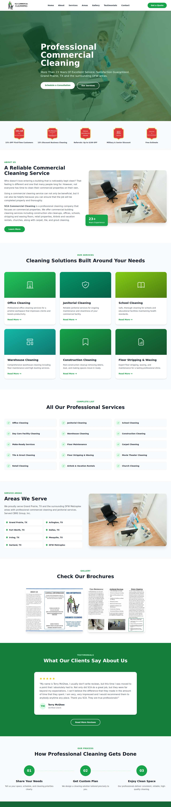

### ecmaintenancee.com — unclear (LIVE)

| | |
|---|---|
| Attempt ID | `34754661-2241-4d27-85f8-ccc8e4915a4b` |
| Form URL | https://www.ecmaintenancee.com/contact.php |
| Final URL | https://www.ecmaintenancee.com/formtoemailpro.php |
| Reserved | 2026-11-02 18:11:11 UTC |
| Submit attempted | 2026-11-02 18:11:13 UTC |
| Template | standard v2 |
| Confirmation text | none observed |
| Result / error | No new success marker observed |

Exact message:

~~~text
Subject: Helping customers find your business in AI search (AEO + GEO)

Hi there,

I'm Arun from Devs Arun. More and more customers now ask ChatGPT, Gemini, Perplexity or Google's AI Overviews questions like "who should I hire for this in my area?" before they call anyone. These tools answer from websites they can clearly understand, and they tend to recommend businesses whose pages answer real customer questions.

That is what AEO + GEO (Answer Engine and Generative Engine Optimization) is for. I improve your existing service pages so they clearly answer the questions your customers ask, add structured data that matches the page, and make the call, quote or enquiry step obvious. The benefit: your business gets a better chance of being mentioned or linked in AI answers, and visitors who arrive find it easy to contact you.

The AEO + GEO Starter is a one-time $199 (about ₹16,999, negotiable) for one website: a basic audit, 10 customer questions, improvements to two existing pages, relevant structured data and an action plan, with one revision round.

You can read the full details, send an enquiry or book online here:
https://devsarun.io/aeo-geo/

If this isn't relevant, just reply and I won't contact you again.

Best,
Arun
Devs Arun
itschool408@gmail.com · +91 7654534323
~~~

Submitted field values:

- Name:\* \[name\]: Arun
- Phone: \[phone\]: +91 7654534323
- Message: \[message\]: Hi there, I'm Arun from Devs Arun. More and more customers now ask ChatGPT, Gemini, Perplexity or Google's AI Overviews 
- Email Address:\* \[email\]: itschool408@gmail.com

**Filled form (before submit)** — `run-6664dbaf_attempt-34754661_filled_2026-11-02T18-11-13-071Z.jpg`

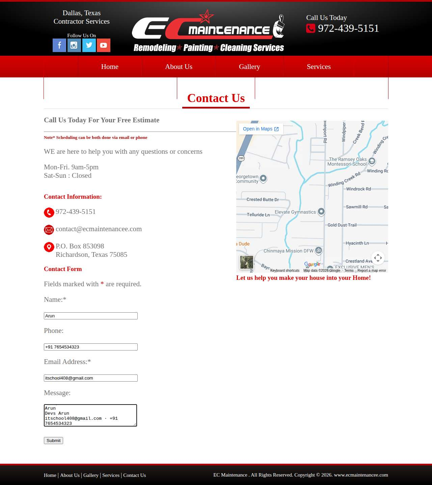

**After submit** — `run-6664dbaf_attempt-34754661_post_attempt_2026-11-02T18-11-41-040Z.jpg`

### meticulouspainting.net — error\_after\_submit (LIVE)

| | |
|---|---|
| Attempt ID | `1cfcf8ec-eeb5-437a-a87b-76ff4b73a7fd` |
| Form URL | https://meticulouspainting.net/contact/ |
| Final URL | https://meticulouspainting.net/contact/ |
| Reserved | 2026-11-02 18:11:48 UTC |
| Submit attempted | 2026-11-02 18:11:51 UTC |
| Template | standard v2 |
| Confirmation text | characters (\#, -, \*, etc). Subject Message SEND MESSAGE An error occurred. Please try again. Alternative: Meticulous Painting is a family-owned business, we know customer se |
| Result / error | — |

Exact message:

~~~text
Subject: Helping customers find your business in AI search (AEO + GEO)

Hi there,

I'm Arun from Devs Arun. More and more customers now ask ChatGPT, Gemini, Perplexity or Google's AI Overviews questions like "who should I hire for this in my area?" before they call anyone. These tools answer from websites they can clearly understand, and they tend to recommend businesses whose pages answer real customer questions.

That is what AEO + GEO (Answer Engine and Generative Engine Optimization) is for. I improve your existing service pages so they clearly answer the questions your customers ask, add structured data that matches the page, and make the call, quote or enquiry step obvious. The benefit: your business gets a better chance of being mentioned or linked in AI answers, and visitors who arrive find it easy to contact you.

The AEO + GEO Starter is a one-time $199 (about ₹16,999, negotiable) for one website: a basic audit, 10 customer questions, improvements to two existing pages, relevant structured data and an action plan, with one revision round.

You can read the full details, send an enquiry or book online here:
https://devsarun.io/aeo-geo/

If this isn't relevant, just reply and I won't contact you again.

Best,
Arun
Devs Arun
itschool408@gmail.com · +91 7654534323
~~~

Submitted field values:

- Name \[name\]: Arun
- Email \[email\]: itschool408@gmail.com
- Phone \[phone\]: +91 7654534323
- Message \[message\]: Hi there, I'm Arun from Devs Arun. More and more customers now ask ChatGPT, Gemini, Perplexity or Google's AI Overviews 
- Subject \[subject\]: Helping customers find your business in AI search (AEO + GEO)

**Filled form (before submit)** — `run-6664dbaf_attempt-1cfcf8ec_filled_2026-11-02T18-11-51-096Z.jpg`

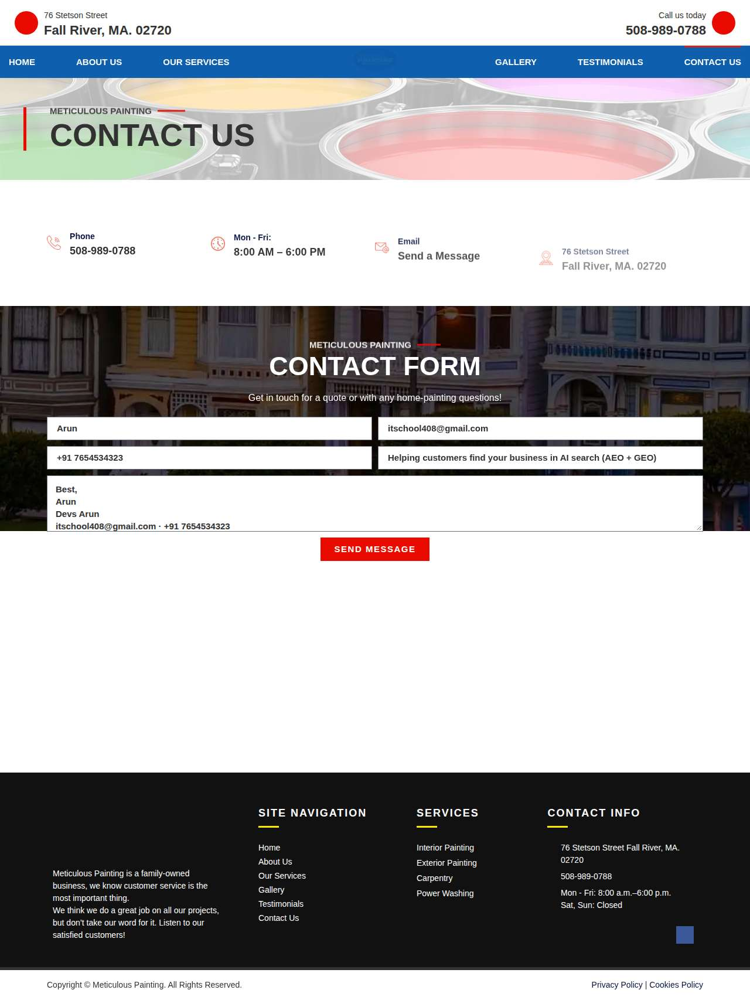

**After submit** — `run-6664dbaf_attempt-1cfcf8ec_post_attempt_2026-11-02T18-11-57-692Z.jpg`

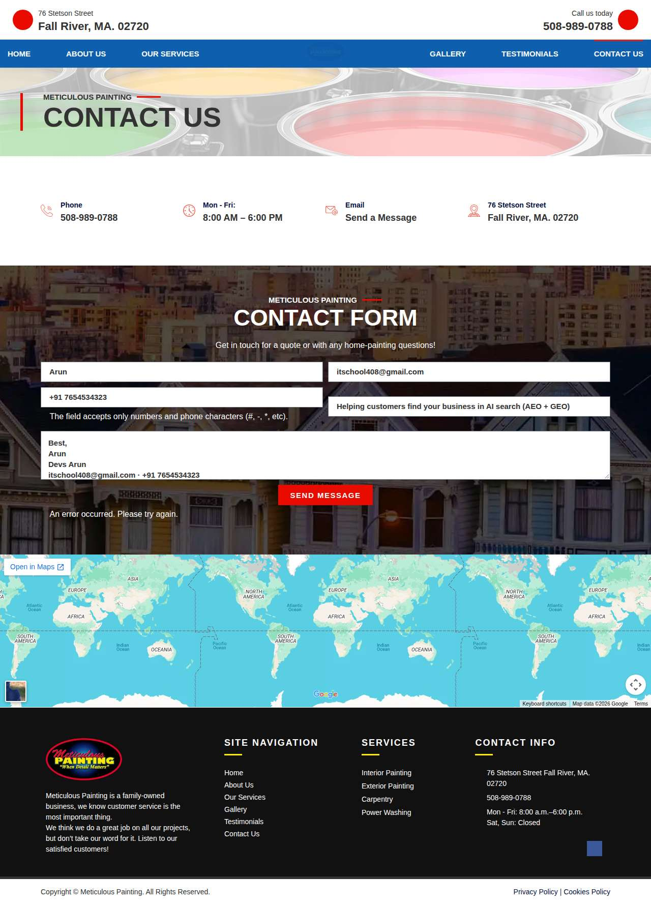

### rjspainting.com — error\_after\_submit (LIVE)

| | |
|---|---|
| Attempt ID | `59d2c121-2cb2-494a-95a5-aa4557438c3e` |
| Form URL | https://www.rjspainting.com/contact |
| Final URL | https://www.rjspainting.com/contact |
| Reserved | 2026-11-02 18:12:06 UTC |
| Submit attempted | 2026-11-02 18:12:08 UTC |
| Template | standard v2 |
| Confirmation text | CONTACT US Name: Email: Phone: Message: Oops, there was an error sending your message. Please try again later. Copyright © 2026 RJ's Painting \| All Rights Reserved 2690 N T |
| Result / error | — |

Exact message:

~~~text
Subject: Helping customers find your business in AI search (AEO + GEO)

Hi there,

I'm Arun from Devs Arun. More and more customers now ask ChatGPT, Gemini, Perplexity or Google's AI Overviews questions like "who should I hire for this in my area?" before they call anyone. These tools answer from websites they can clearly understand, and they tend to recommend businesses whose pages answer real customer questions.

That is what AEO + GEO (Answer Engine and Generative Engine Optimization) is for. I improve your existing service pages so they clearly answer the questions your customers ask, add structured data that matches the page, and make the call, quote or enquiry step obvious. The benefit: your business gets a better chance of being mentioned or linked in AI answers, and visitors who arrive find it easy to contact you.

The AEO + GEO Starter is a one-time $199 (about ₹16,999, negotiable) for one website: a basic audit, 10 customer questions, improvements to two existing pages, relevant structured data and an action plan, with one revision round.

You can read the full details, send an enquiry or book online here:
https://devsarun.io/aeo-geo/

If this isn't relevant, just reply and I won't contact you again.

Best,
Arun
Devs Arun
itschool408@gmail.com · +91 7654534323
~~~

Submitted field values:

- Name: \[name\]: Arun
- Email: \[email\]: itschool408@gmail.com
- Phone: \[phone\]: +91 7654534323
- Message: \[message\]: Hi there, I'm Arun from Devs Arun. More and more customers now ask ChatGPT, Gemini, Perplexity or Google's AI Overviews 

**Filled form (before submit)** — `run-6664dbaf_attempt-59d2c121_filled_2026-11-02T18-12-08-300Z.jpg`

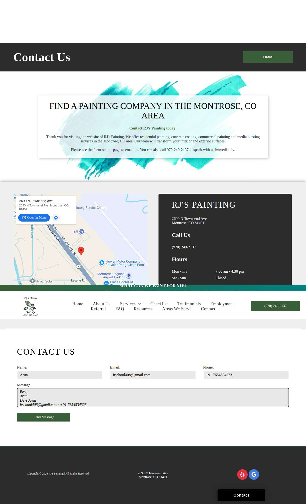

**After submit** — `run-6664dbaf_attempt-59d2c121_post_attempt_2026-11-02T18-12-20-065Z.jpg`

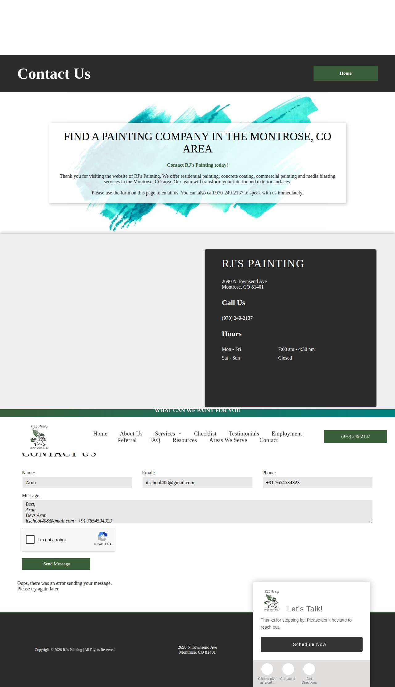

### bwnwincpainting.com — failed\_before\_submit (LIVE)

| | |
|---|---|
| Attempt ID | `2f55127e-b20d-46cd-af59-5fd2afd8965b` |
| Form URL | https://www.bwnwincpainting.com/contact/ |
| Final URL | — |
| Reserved | 2026-11-02 18:12:27 UTC |
| Submit attempted | — |
| Template | standard v2 |
| Confirmation text | none observed |
| Result / error | locator.fill: Error: Cannot type text into input\[type=number\] |

Exact message:

~~~text
Subject: Helping customers find your business in AI search (AEO + GEO)

Hi there,

I'm Arun from Devs Arun. More and more customers now ask ChatGPT, Gemini, Perplexity or Google's AI Overviews questions like "who should I hire for this in my area?" before they call anyone. These tools answer from websites they can clearly understand, and they tend to recommend businesses whose pages answer real customer questions.

That is what AEO + GEO (Answer Engine and Generative Engine Optimization) is for. I improve your existing service pages so they clearly answer the questions your customers ask, add structured data that matches the page, and make the call, quote or enquiry step obvious. The benefit: your business gets a better chance of being mentioned or linked in AI answers, and visitors who arrive find it easy to contact you.

The AEO + GEO Starter is a one-time $199 (about ₹16,999, negotiable) for one website: a basic audit, 10 customer questions, improvements to two existing pages, relevant structured data and an action plan, with one revision round.

You can read the full details, send an enquiry or book online here:
https://devsarun.io/aeo-geo/

If this isn't relevant, just reply and I won't contact you again.

Best,
Arun
Devs Arun
itschool408@gmail.com · +91 7654534323
~~~

Submitted field values:

- \#name-1151: Arun
- \#email-1151: itschool408@gmail.com
- \#phone-1151: +91 7654534323
- \#message-1151: Hi there, I'm Arun from Devs Arun. More and more customers now ask ChatGPT, Gemini, Perplexity or Google's AI Overviews 

**Inspected page** — `run-6664dbaf_attempt-2f55127e_inspection_2026-11-02T18-12-29-077Z.jpg`

### finishingtouchplus.com — unclear (LIVE)

| | |
|---|---|
| Attempt ID | `02fe66c0-8f91-46db-9aeb-ae453f1ce490` |
| Form URL | https://finishingtouchplus.com/ |
| Final URL | https://finishingtouchplus.com/\#contact-us |
| Reserved | 2026-11-02 18:12:34 UTC |
| Submit attempted | 2026-11-02 18:12:36 UTC |
| Template | standard v2 |
| Confirmation text | none observed |
| Result / error | No new success marker observed |

Exact message:

~~~text
Subject: Helping customers find your business in AI search (AEO + GEO)

Hi there,

I'm Arun from Devs Arun. More and more customers now ask ChatGPT, Gemini, Perplexity or Google's AI Overviews questions like "who should I hire for this in my area?" before they call anyone. These tools answer from websites they can clearly understand, and they tend to recommend businesses whose pages answer real customer questions.

That is what AEO + GEO (Answer Engine and Generative Engine Optimization) is for. I improve your existing service pages so they clearly answer the questions your customers ask, add structured data that matches the page, and make the call, quote or enquiry step obvious. The benefit: your business gets a better chance of being mentioned or linked in AI answers, and visitors who arrive find it easy to contact you.

The AEO + GEO Starter is a one-time $199 (about ₹16,999, negotiable) for one website: a basic audit, 10 customer questions, improvements to two existing pages, relevant structured data and an action plan, with one revision round.

You can read the full details, send an enquiry or book online here:
https://devsarun.io/aeo-geo/

If this isn't relevant, just reply and I won't contact you again.

Best,
Arun
Devs Arun
itschool408@gmail.com · +91 7654534323
~~~

Submitted field values:

- Your name \[name\]: Arun
- Subject \[subject\]: Helping customers find your business in AI search (AEO + GEO)
- Your email \[email\]: itschool408@gmail.com
- Your message (optional) \[message\]: Hi there, I'm Arun from Devs Arun. More and more customers now ask ChatGPT, Gemini, Perplexity or Google's AI Overviews 

**Filled form (before submit)** — `run-6664dbaf_attempt-02fe66c0_filled_2026-11-02T18-12-36-113Z.jpg`

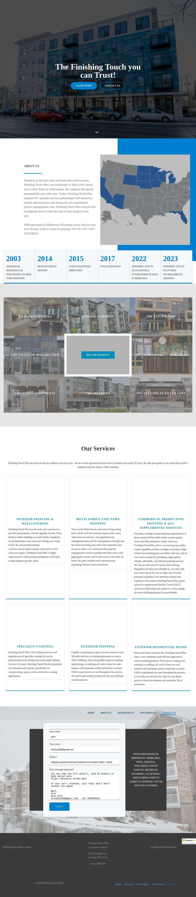

**After submit** — `run-6664dbaf_attempt-02fe66c0_post_attempt_2026-11-02T18-13-07-818Z.jpg`

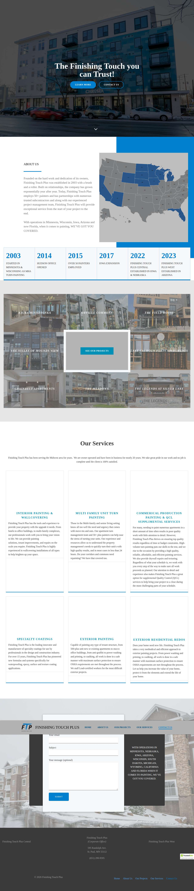

### carriganpainting.com — confirmed (LIVE)

| | |
|---|---|
| Attempt ID | `bf473e93-c00c-4e8d-9bc0-7f7ed752b29f` |
| Form URL | https://www.carriganpainting.com/contact-us |
| Final URL | https://www.carriganpainting.com/contact-us |
| Reserved | 2026-11-02 18:13:15 UTC |
| Submit attempted | 2026-11-02 18:13:17 UTC |
| Template | standard v2 |
| Confirmation text | or scheduling purposes. How may we help you? Website Submit Thank you. Your message has been sent. 716-697-3560 Office: 12303 Rapids Rd. Akron, NY 14001 United States Ea |
| Result / error | — |

Exact message:

~~~text
Subject: Helping customers find your business in AI search (AEO + GEO)

Hi there,

I'm Arun from Devs Arun. More and more customers now ask ChatGPT, Gemini, Perplexity or Google's AI Overviews questions like "who should I hire for this in my area?" before they call anyone. These tools answer from websites they can clearly understand, and they tend to recommend businesses whose pages answer real customer questions.

That is what AEO + GEO (Answer Engine and Generative Engine Optimization) is for. I improve your existing service pages so they clearly answer the questions your customers ask, add structured data that matches the page, and make the call, quote or enquiry step obvious. The benefit: your business gets a better chance of being mentioned or linked in AI answers, and visitors who arrive find it easy to contact you.

The AEO + GEO Starter is a one-time $199 (about ₹16,999, negotiable) for one website: a basic audit, 10 customer questions, improvements to two existing pages, relevant structured data and an action plan, with one revision round.

You can read the full details, send an enquiry or book online here:
https://devsarun.io/aeo-geo/

If this isn't relevant, just reply and I won't contact you again.

Best,
Arun
Devs Arun
itschool408@gmail.com · +91 7654534323
~~~

Submitted field values:

- Name \* \[name\]: Arun
- Town \* \[city\]: Bangalore
- Email \* \[email\]: itschool408@gmail.com
- Phone \* \[phone\]: +91 7654534323
- How may we help you? \[message\]: Hi there, I'm Arun from Devs Arun. More and more customers now ask ChatGPT, Gemini, Perplexity or Google's AI Overviews 

**Filled form (before submit)** — `run-6664dbaf_attempt-bf473e93_filled_2026-11-02T18-13-17-601Z.jpg`

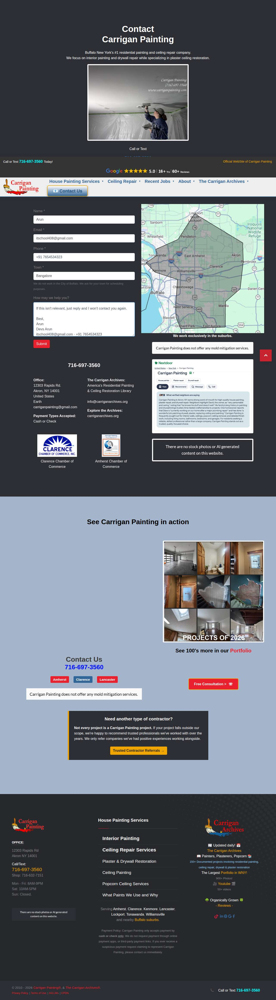

**After submit** — `run-6664dbaf_attempt-bf473e93_post_attempt_2026-11-02T18-13-22-297Z.jpg`

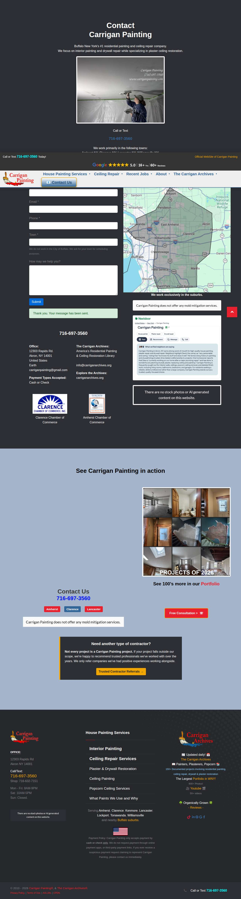

### rochonfineart.com — unclear (LIVE)

| | |
|---|---|
| Attempt ID | `7432f4e3-34dd-4c2e-a0e3-12467ef157e9` |
| Form URL | https://www.rochonfineart.com/contact |
| Final URL | https://www.rochonfineart.com/contact |
| Reserved | 2026-11-02 18:13:29 UTC |
| Submit attempted | 2026-11-02 18:13:32 UTC |
| Template | standard v2 |
| Confirmation text | none observed |
| Result / error | No new success marker observed |

Exact message:

~~~text
Subject: Helping customers find your business in AI search (AEO + GEO)

Hi there,

I'm Arun from Devs Arun. More and more customers now ask ChatGPT, Gemini, Perplexity or Google's AI Overviews questions like "who should I hire for this in my area?" before they call anyone. These tools answer from websites they can clearly understand, and they tend to recommend businesses whose pages answer real customer questions.

That is what AEO + GEO (Answer Engine and Generative Engine Optimization) is for. I improve your existing service pages so they clearly answer the questions your customers ask, add structured data that matches the page, and make the call, quote or enquiry step obvious. The benefit: your business gets a better chance of being mentioned or linked in AI answers, and visitors who arrive find it easy to contact you.

The AEO + GEO Starter is a one-time $199 (about ₹16,999, negotiable) for one website: a basic audit, 10 customer questions, improvements to two existing pages, relevant structured data and an action plan, with one revision round.

You can read the full details, send an enquiry or book online here:
https://devsarun.io/aeo-geo/

If this isn't relevant, just reply and I won't contact you again.

Best,
Arun
Devs Arun
itschool408@gmail.com · +91 7654534323
~~~

Submitted field values:

- Email \[email\]: itschool408@gmail.com
- First Name \[first\_name\]: Arun
- Write a message \[message\]: Hi there, I'm Arun from Devs Arun. More and more customers now ask ChatGPT, Gemini, Perplexity or Google's AI Overviews 

**Filled form (before submit)** — `run-6664dbaf_attempt-7432f4e3_filled_2026-11-02T18-13-32-782Z.jpg`

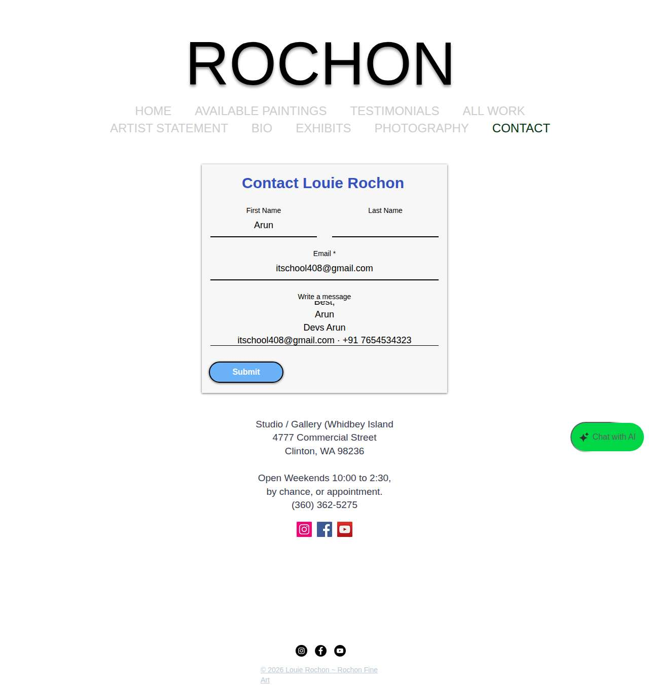

**After submit** — `run-6664dbaf_attempt-7432f4e3_post_attempt_2026-11-02T18-14-00-289Z.jpg`

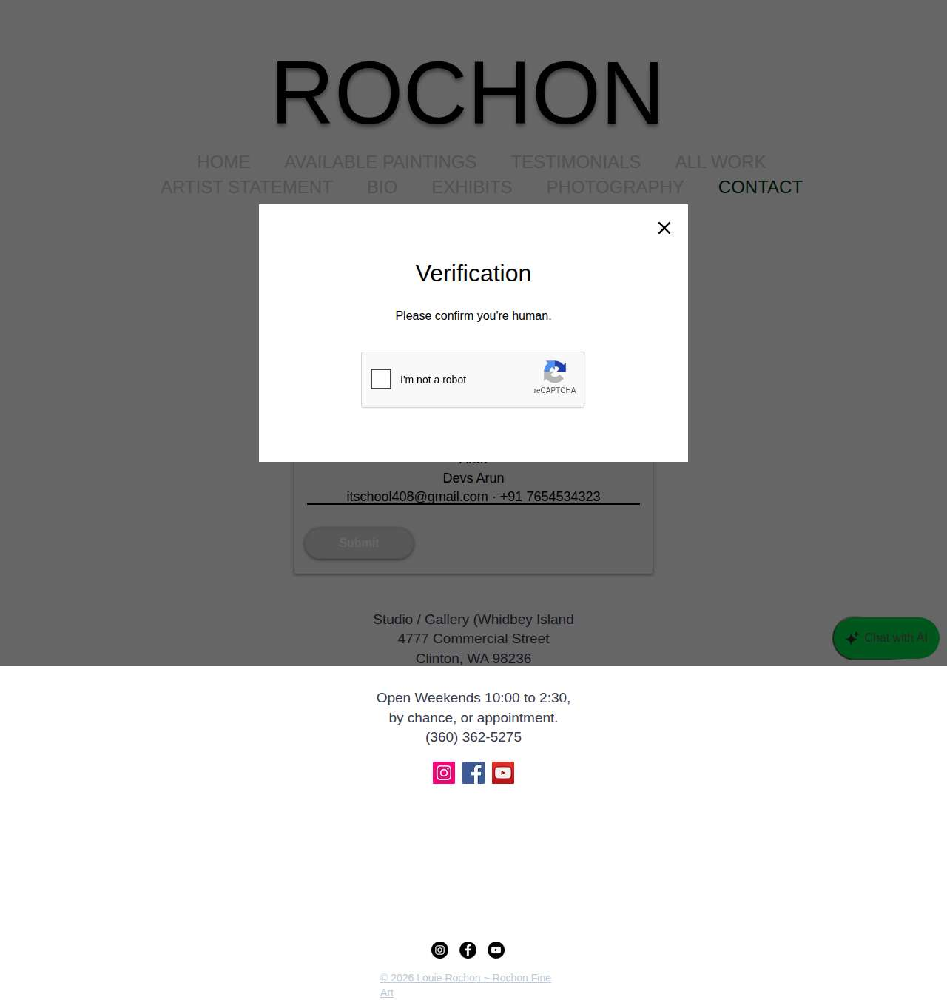

## Events (71)

| Time (UTC) | Event | Website | Details |
|---|---|---|---|
| 18:10:20 | run\_queued | — | live run requested by github:itsDevsArun |
| 18:10:20 | run\_dispatched | — | dispatch disabled (local test mode) |
| 18:10:23 | run\_started | — | Runner claimed live run |
| 18:10:24 | offer\_verified | — | Service page offer facts verified |
| 18:10:24 | website\_selected | clearchoiceplumbingllc.com | Live target clearchoiceplumbingllc.com |
| 18:10:24 | attempt\_reserved | clearchoiceplumbingllc.com | Submission attempt reserved with template standard v2 |
| 18:10:26 | page\_opened | clearchoiceplumbingllc.com | Opened form page |
| 18:10:26 | screenshot\_saved | clearchoiceplumbingllc.com | inspection screenshot saved (145 KB) |
| 18:10:26 | review\_required | clearchoiceplumbingllc.com | failed before submit: locator.fill: Error: Cannot type text into input\[type=number\] |
| 18:10:31 | website\_selected | scacommercialcleaning.com | Live target scacommercialcleaning.com |
| 18:10:31 | attempt\_reserved | scacommercialcleaning.com | Submission attempt reserved with template standard v2 |
| 18:10:33 | page\_opened | scacommercialcleaning.com | Opened form page |
| 18:10:33 | fields\_filled | scacommercialcleaning.com | filled |
| 18:10:33 | screenshot\_saved | scacommercialcleaning.com | filled screenshot saved (401 KB) |
| 18:10:33 | submit\_attempted | scacommercialcleaning.com | submitting |
| 18:11:02 | screenshot\_saved | scacommercialcleaning.com | post\_attempt screenshot saved (398 KB) |
| 18:11:02 | review\_required | scacommercialcleaning.com | unclear: No new success marker observed |
| 18:11:11 | website\_selected | ecmaintenancee.com | Live target ecmaintenancee.com |
| 18:11:11 | attempt\_reserved | ecmaintenancee.com | Submission attempt reserved with template standard v2 |
| 18:11:12 | page\_opened | ecmaintenancee.com | Opened form page |
| 18:11:13 | fields\_filled | ecmaintenancee.com | filled |
| 18:11:13 | screenshot\_saved | ecmaintenancee.com | filled screenshot saved (108 KB) |
| 18:11:13 | submit\_attempted | ecmaintenancee.com | submitting |
| 18:11:41 | screenshot\_saved | ecmaintenancee.com | post\_attempt screenshot saved (11 KB) |
| 18:11:41 | review\_required | ecmaintenancee.com | unclear: No new success marker observed |
| 18:11:48 | website\_selected | meticulouspainting.net | Live target meticulouspainting.net |
| 18:11:48 | attempt\_reserved | meticulouspainting.net | Submission attempt reserved with template standard v2 |
| 18:11:50 | page\_opened | meticulouspainting.net | Opened form page |
| 18:11:50 | fields\_filled | meticulouspainting.net | filled |
| 18:11:51 | screenshot\_saved | meticulouspainting.net | filled screenshot saved (125 KB) |
| 18:11:51 | submit\_attempted | meticulouspainting.net | submitting |
| 18:11:57 | screenshot\_saved | meticulouspainting.net | post\_attempt screenshot saved (181 KB) |
| 18:11:57 | error | meticulouspainting.net | error after submit — "characters (\#, -, \*, etc). Subject Message SEND MESSAGE An error occurred. Please try again. Alternative: Meticulous Pai" |
| 18:12:06 | website\_selected | rjspainting.com | Live target rjspainting.com |
| 18:12:06 | attempt\_reserved | rjspainting.com | Submission attempt reserved with template standard v2 |
| 18:12:08 | page\_opened | rjspainting.com | Opened form page |
| 18:12:08 | fields\_filled | rjspainting.com | filled |
| 18:12:08 | screenshot\_saved | rjspainting.com | filled screenshot saved (127 KB) |
| 18:12:08 | submit\_attempted | rjspainting.com | submitting |
| 18:12:20 | screenshot\_saved | rjspainting.com | post\_attempt screenshot saved (115 KB) |
| 18:12:20 | error | rjspainting.com | error after submit — "CONTACT US Name: Email: Phone: Message: Oops, there was an error sending your message. Please try again later. Copyright" |
| 18:12:27 | website\_selected | bwnwincpainting.com | Live target bwnwincpainting.com |
| 18:12:27 | attempt\_reserved | bwnwincpainting.com | Submission attempt reserved with template standard v2 |
| 18:12:28 | page\_opened | bwnwincpainting.com | Opened form page |
| 18:12:29 | screenshot\_saved | bwnwincpainting.com | inspection screenshot saved (118 KB) |
| 18:12:29 | review\_required | bwnwincpainting.com | failed before submit: locator.fill: Error: Cannot type text into input\[type=number\] |
| 18:12:34 | website\_selected | finishingtouchplus.com | Live target finishingtouchplus.com |
| 18:12:34 | attempt\_reserved | finishingtouchplus.com | Submission attempt reserved with template standard v2 |
| 18:12:35 | page\_opened | finishingtouchplus.com | Opened form page |
| 18:12:35 | fields\_filled | finishingtouchplus.com | filled |
| 18:12:36 | screenshot\_saved | finishingtouchplus.com | filled screenshot saved (510 KB) |
| 18:12:36 | submit\_attempted | finishingtouchplus.com | submitting |
| 18:13:07 | screenshot\_saved | finishingtouchplus.com | post\_attempt screenshot saved (494 KB) |
| 18:13:07 | review\_required | finishingtouchplus.com | unclear: No new success marker observed |
| 18:13:15 | website\_selected | carriganpainting.com | Live target carriganpainting.com |
| 18:13:15 | attempt\_reserved | carriganpainting.com | Submission attempt reserved with template standard v2 |
| 18:13:17 | page\_opened | carriganpainting.com | Opened form page |
| 18:13:17 | fields\_filled | carriganpainting.com | filled |
| 18:13:17 | screenshot\_saved | carriganpainting.com | filled screenshot saved (332 KB) |
| 18:13:17 | submit\_attempted | carriganpainting.com | submitting |
| 18:13:22 | screenshot\_saved | carriganpainting.com | post\_attempt screenshot saved (328 KB) |
| 18:13:22 | confirmation\_observed | carriganpainting.com | confirmed — "or scheduling purposes. How may we help you? Website Submit Thank you. Your message has been sent. 716-697-3560 Office: " |
| 18:13:29 | website\_selected | rochonfineart.com | Live target rochonfineart.com |
| 18:13:29 | attempt\_reserved | rochonfineart.com | Submission attempt reserved with template standard v2 |
| 18:13:32 | page\_opened | rochonfineart.com | Opened form page |
| 18:13:32 | fields\_filled | rochonfineart.com | filled |
| 18:13:32 | screenshot\_saved | rochonfineart.com | filled screenshot saved (55 KB) |
| 18:13:32 | submit\_attempted | rochonfineart.com | submitting |
| 18:14:00 | screenshot\_saved | rochonfineart.com | post\_attempt screenshot saved (42 KB) |
| 18:14:00 | review\_required | rochonfineart.com | unclear: No new success marker observed |
| 18:14:07 | run\_completed | — | Run completed (queue\_exhausted) |
