# Run c528f0c9 — live — completed

| | |
|---|---|
| Run ID | `c528f0c9-b48a-402f-a131-fe21ad13993f` |
| Requested by | github:itsDevsArun |
| Started | 2026-11-02 07:00:19 UTC |
| Finished | 2026-11-02 07:03:49 UTC |
| Finish reason | limit\_reached |
| GitHub Actions | https://github.com/itsDevsArun/aeo-geo/actions/runs/41379081570 |

CSV for this run: [runs/2026-11-02_live_c528f0c9.csv](2026-11-02_live_c528f0c9.csv)

## Attempts (9)

### clearchoiceplumbingllc.com — failed\_before\_submit (LIVE)

| | |
|---|---|
| Attempt ID | `2ae05292-2a74-4e6a-8a88-98a96f148d30` |
| Form URL | https://clearchoiceplumbingllc.com/contact/ |
| Final URL | — |
| Reserved | 2026-11-02 07:00:20 UTC |
| Submit attempted | — |
| Template | standard v2 |
| Confirmation text | none observed |
| Result / error | locator.fill: Error: Cannot type text into input\[type=number\] |

Exact message:

~~~text
Subject: Helping customers find your business in AI search (AEO + GEO)

Hi there,

I'm Arun from Devs Arun. More and more customers now ask ChatGPT, Gemini, Perplexity or Google's AI Overviews questions like "who should I hire for this in my area?" before they call anyone. These tools answer from websites they can clearly understand, and they tend to recommend businesses whose pages answer real customer questions.

That is what AEO + GEO (Answer Engine and Generative Engine Optimization) is for. I improve your existing service pages so they clearly answer the questions your customers ask, add structured data that matches the page, and make the call, quote or enquiry step obvious. The benefit: your business gets a better chance of being mentioned or linked in AI answers, and visitors who arrive find it easy to contact you.

The AEO + GEO Starter is a one-time $199 (about ₹16,999, negotiable) for one website: a basic audit, 10 customer questions, improvements to two existing pages, relevant structured data and an action plan, with one revision round.

You can read the full details, send an enquiry or book online here:
https://devsarun.io/aeo-geo/

If this isn't relevant, just reply and I won't contact you again.

Best,
Arun
Devs Arun
itschool408@gmail.com · +91 7654534323
~~~

Submitted field values:

- \#wpforms-51-field\_1: Arun
- \#wpforms-51-field\_2: itschool408@gmail.com
- \#wpforms-51-field\_3: Hi there, I'm Arun from Devs Arun. More and more customers now ask ChatGPT, Gemini, Perplexity or Google's AI Overviews 
- \#wpforms-51-field\_5: +91 7654534323

**Inspected page** — `run-c528f0c9_attempt-2ae05292_inspection_2026-11-02T07-00-22-698Z.jpg`

### solutionsmechanical.co — confirmed (LIVE)

| | |
|---|---|
| Attempt ID | `52552d28-2b17-41df-a2cf-c28db375c2dc` |
| Form URL | https://solutionsmechanical.co/contact/ |
| Final URL | https://solutionsmechanical.co/contact/ |
| Reserved | 2026-11-02 07:00:27 UTC |
| Submit attempted | 2026-11-02 07:00:29 UTC |
| Template | standard v2 |
| Confirmation text | – Sunday : Closed Call our office for 24 hour service Your message was sent: Name: Arun Email: itschool408@gmail.com Message: Hi there, I\\’m Arun from Devs Arun. More and more |
| Result / error | — |

Exact message:

~~~text
Subject: Helping customers find your business in AI search (AEO + GEO)

Hi there,

I'm Arun from Devs Arun. More and more customers now ask ChatGPT, Gemini, Perplexity or Google's AI Overviews questions like "who should I hire for this in my area?" before they call anyone. These tools answer from websites they can clearly understand, and they tend to recommend businesses whose pages answer real customer questions.

That is what AEO + GEO (Answer Engine and Generative Engine Optimization) is for. I improve your existing service pages so they clearly answer the questions your customers ask, add structured data that matches the page, and make the call, quote or enquiry step obvious. The benefit: your business gets a better chance of being mentioned or linked in AI answers, and visitors who arrive find it easy to contact you.

The AEO + GEO Starter is a one-time $199 (about ₹16,999, negotiable) for one website: a basic audit, 10 customer questions, improvements to two existing pages, relevant structured data and an action plan, with one revision round.

You can read the full details, send an enquiry or book online here:
https://devsarun.io/aeo-geo/

If this isn't relevant, just reply and I won't contact you again.

Best,
Arun
Devs Arun
itschool408@gmail.com · +91 7654534323
~~~

Submitted field values:

- Email \[email\]: itschool408@gmail.com
- Message \[message\]: Hi there, I'm Arun from Devs Arun. More and more customers now ask ChatGPT, Gemini, Perplexity or Google's AI Overviews 
- field-name\[value\] \[name\]: Arun

**Filled form (before submit)** — `run-c528f0c9_attempt-52552d28_filled_2026-11-02T07-00-29-228Z.jpg`

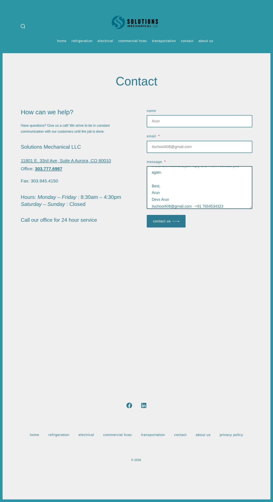

**After submit** — `run-c528f0c9_attempt-52552d28_post_attempt_2026-11-02T07-00-34-033Z.jpg`

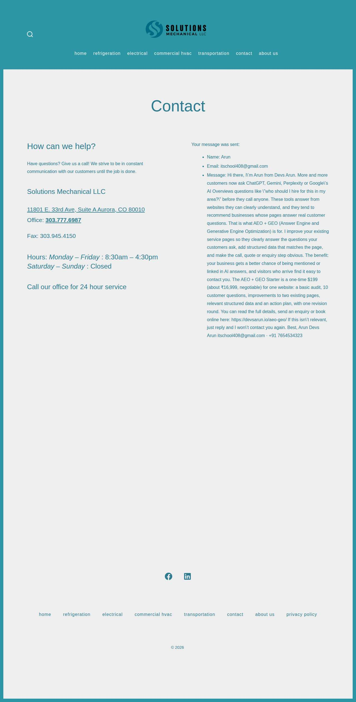

### hasservs.com — error\_after\_submit (LIVE)

| | |
|---|---|
| Attempt ID | `888f41c3-6622-4e1b-b92e-d16362e955e2` |
| Form URL | https://www.hasservs.com/contact-us |
| Final URL | https://www.hasservs.com/contact-us |
| Reserved | 2026-11-02 07:00:40 UTC |
| Submit attempted | 2026-11-02 07:00:42 UTC |
| Template | standard v2 |
| Confirmation text | me: Email: Phone: Message / Suggestions: Oops, there was an error sending your message. Please try again later. Visit Us Today\! Will County and Surrounding Areas Mon - Fri: |
| Result / error | — |

Exact message:

~~~text
Subject: Helping customers find your business in AI search (AEO + GEO)

Hi there,

I'm Arun from Devs Arun. More and more customers now ask ChatGPT, Gemini, Perplexity or Google's AI Overviews questions like "who should I hire for this in my area?" before they call anyone. These tools answer from websites they can clearly understand, and they tend to recommend businesses whose pages answer real customer questions.

That is what AEO + GEO (Answer Engine and Generative Engine Optimization) is for. I improve your existing service pages so they clearly answer the questions your customers ask, add structured data that matches the page, and make the call, quote or enquiry step obvious. The benefit: your business gets a better chance of being mentioned or linked in AI answers, and visitors who arrive find it easy to contact you.

The AEO + GEO Starter is a one-time $199 (about ₹16,999, negotiable) for one website: a basic audit, 10 customer questions, improvements to two existing pages, relevant structured data and an action plan, with one revision round.

You can read the full details, send an enquiry or book online here:
https://devsarun.io/aeo-geo/

If this isn't relevant, just reply and I won't contact you again.

Best,
Arun
Devs Arun
itschool408@gmail.com · +91 7654534323
~~~

Submitted field values:

- Name: \[name\]: Arun
- Email: \[email\]: itschool408@gmail.com
- Phone: \[phone\]: +91 7654534323
- Message / Suggestions: \[message\]: Hi there, I'm Arun from Devs Arun. More and more customers now ask ChatGPT, Gemini, Perplexity or Google's AI Overviews 

**Filled form (before submit)** — `run-c528f0c9_attempt-888f41c3_filled_2026-11-02T07-00-42-183Z.jpg`

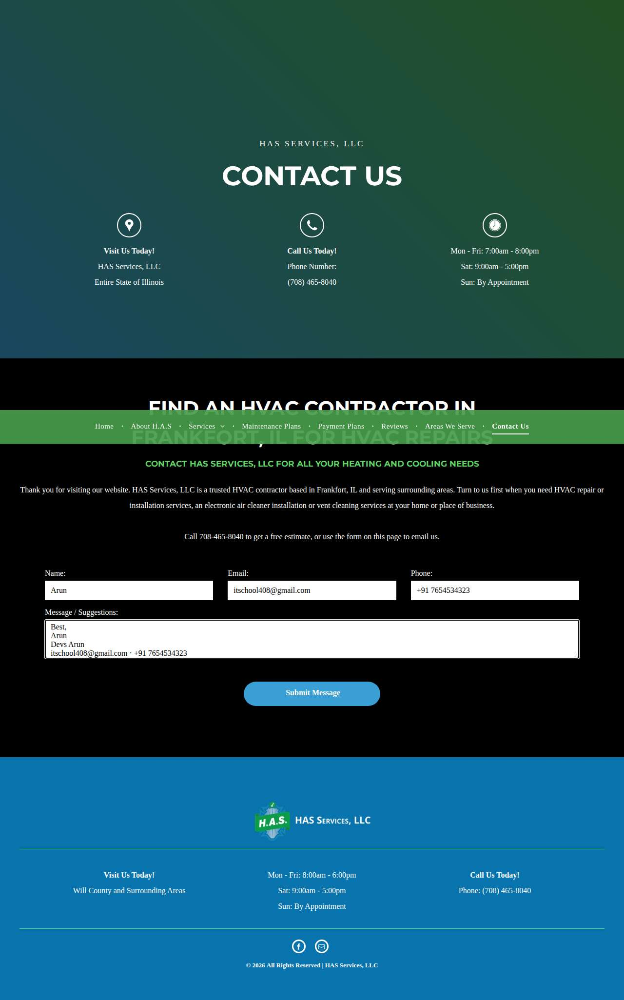

**After submit** — `run-c528f0c9_attempt-888f41c3_post_attempt_2026-11-02T07-00-45-388Z.jpg`

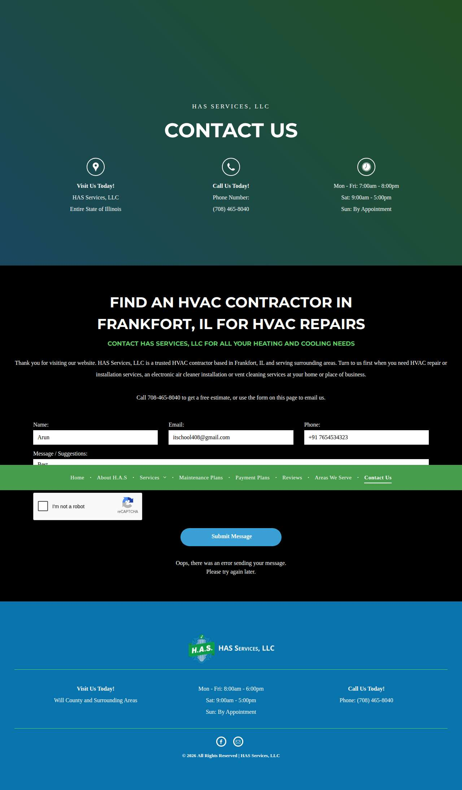

### clarkmechanicalinc.com — unclear (LIVE)

| | |
|---|---|
| Attempt ID | `b2ff81b8-1a37-452a-90c1-56a4f9519646` |
| Form URL | https://www.clarkmechanicalinc.com/contact |
| Final URL | https://www.clarkmechanicalinc.com/contact |
| Reserved | 2026-11-02 07:00:52 UTC |
| Submit attempted | 2026-11-02 07:00:55 UTC |
| Template | standard v2 |
| Confirmation text | none observed |
| Result / error | No new success marker observed |

Exact message:

~~~text
Subject: Helping customers find your business in AI search (AEO + GEO)

Hi there,

I'm Arun from Devs Arun. More and more customers now ask ChatGPT, Gemini, Perplexity or Google's AI Overviews questions like "who should I hire for this in my area?" before they call anyone. These tools answer from websites they can clearly understand, and they tend to recommend businesses whose pages answer real customer questions.

That is what AEO + GEO (Answer Engine and Generative Engine Optimization) is for. I improve your existing service pages so they clearly answer the questions your customers ask, add structured data that matches the page, and make the call, quote or enquiry step obvious. The benefit: your business gets a better chance of being mentioned or linked in AI answers, and visitors who arrive find it easy to contact you.

The AEO + GEO Starter is a one-time $199 (about ₹16,999, negotiable) for one website: a basic audit, 10 customer questions, improvements to two existing pages, relevant structured data and an action plan, with one revision round.

You can read the full details, send an enquiry or book online here:
https://devsarun.io/aeo-geo/

If this isn't relevant, just reply and I won't contact you again.

Best,
Arun
Devs Arun
itschool408@gmail.com · +91 7654534323
~~~

Submitted field values:

- Name \[name\]: Arun
- Email \[email\]: itschool408@gmail.com
- Phone \[phone\]: +91 7654534323
- Message \[message\]: Hi there, I'm Arun from Devs Arun. More and more customers now ask ChatGPT, Gemini, Perplexity or Google's AI Overviews 

**Filled form (before submit)** — `run-c528f0c9_attempt-b2ff81b8_filled_2026-11-02T07-00-55-796Z.jpg`

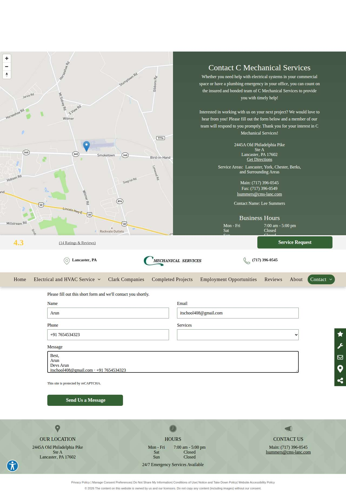

**After submit** — `run-c528f0c9_attempt-b2ff81b8_post_attempt_2026-11-02T07-01-24-502Z.jpg`

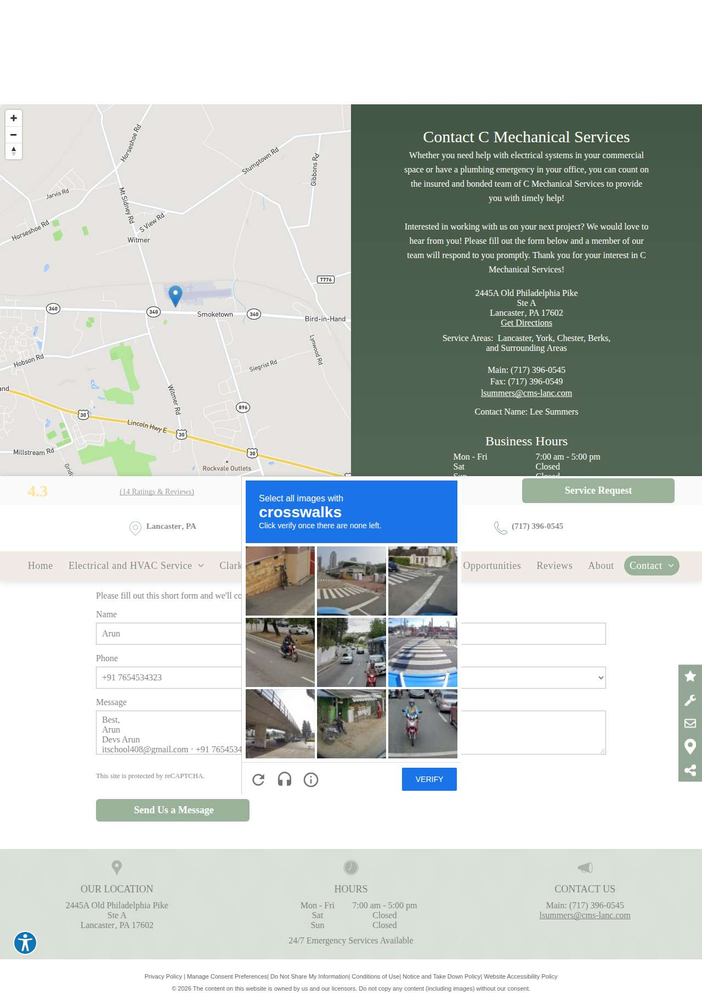

### alliant-systems.com — unclear (LIVE)

| | |
|---|---|
| Attempt ID | `df109175-e3f5-4518-b24f-9e83f9bfb645` |
| Form URL | https://www.alliant-systems.com/contact |
| Final URL | https://www.alliant-systems.com/contact |
| Reserved | 2026-11-02 07:01:31 UTC |
| Submit attempted | 2026-11-02 07:01:34 UTC |
| Template | standard v2 |
| Confirmation text | none observed |
| Result / error | No new success marker observed |

Exact message:

~~~text
Subject: Helping customers find your business in AI search (AEO + GEO)

Hi there,

I'm Arun from Devs Arun. More and more customers now ask ChatGPT, Gemini, Perplexity or Google's AI Overviews questions like "who should I hire for this in my area?" before they call anyone. These tools answer from websites they can clearly understand, and they tend to recommend businesses whose pages answer real customer questions.

That is what AEO + GEO (Answer Engine and Generative Engine Optimization) is for. I improve your existing service pages so they clearly answer the questions your customers ask, add structured data that matches the page, and make the call, quote or enquiry step obvious. The benefit: your business gets a better chance of being mentioned or linked in AI answers, and visitors who arrive find it easy to contact you.

The AEO + GEO Starter is a one-time $199 (about ₹16,999, negotiable) for one website: a basic audit, 10 customer questions, improvements to two existing pages, relevant structured data and an action plan, with one revision round.

You can read the full details, send an enquiry or book online here:
https://devsarun.io/aeo-geo/

If this isn't relevant, just reply and I won't contact you again.

Best,
Arun
Devs Arun
itschool408@gmail.com · +91 7654534323
~~~

Submitted field values:

- Email \[email\]: itschool408@gmail.com
- Message \[message\]: Hi there, I'm Arun from Devs Arun. More and more customers now ask ChatGPT, Gemini, Perplexity or Google's AI Overviews 
- First Name \[first\_name\]: Arun

**Filled form (before submit)** — `run-c528f0c9_attempt-df109175_filled_2026-11-02T07-01-34-272Z.jpg`

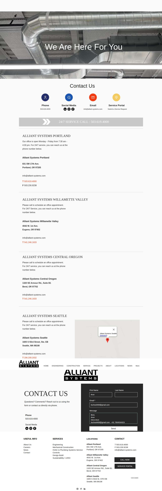

**After submit** — `run-c528f0c9_attempt-df109175_post_attempt_2026-11-02T07-02-01-388Z.jpg`

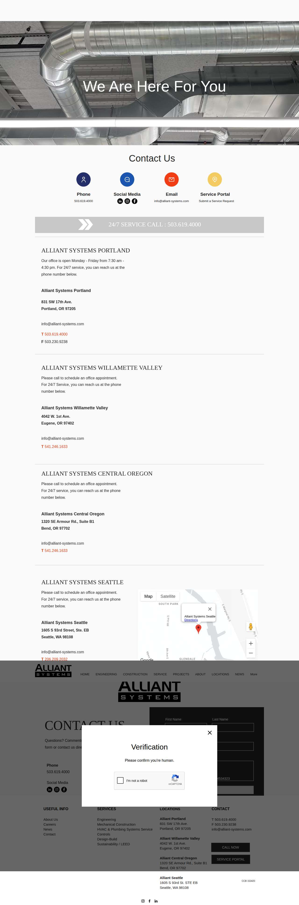

### completeairandheat.com — error\_after\_submit (LIVE)

| | |
|---|---|
| Attempt ID | `e7f900ab-4ef5-4296-b957-b9a23cbc9376` |
| Form URL | https://www.completeairandheat.com/contact/schedule-service |
| Final URL | https://www.completeairandheat.com/contact/schedule-service\#error-container |
| Reserved | 2026-11-02 07:02:08 UTC |
| Submit attempted | 2026-11-02 07:02:10 UTC |
| Template | standard v2 |
| Confirmation text | Skip navigation The Following Errors Occurred Please enter your last name Please enter your street address Please enter your city Please enter your zip code P |
| Result / error | — |

Exact message:

~~~text
Subject: Helping customers find your business in AI search (AEO + GEO)

Hi there,

I'm Arun from Devs Arun. More and more customers now ask ChatGPT, Gemini, Perplexity or Google's AI Overviews questions like "who should I hire for this in my area?" before they call anyone. These tools answer from websites they can clearly understand, and they tend to recommend businesses whose pages answer real customer questions.

That is what AEO + GEO (Answer Engine and Generative Engine Optimization) is for. I improve your existing service pages so they clearly answer the questions your customers ask, add structured data that matches the page, and make the call, quote or enquiry step obvious. The benefit: your business gets a better chance of being mentioned or linked in AI answers, and visitors who arrive find it easy to contact you.

The AEO + GEO Starter is a one-time $199 (about ₹16,999, negotiable) for one website: a basic audit, 10 customer questions, improvements to two existing pages, relevant structured data and an action plan, with one revision round.

You can read the full details, send an enquiry or book online here:
https://devsarun.io/aeo-geo/

If this isn't relevant, just reply and I won't contact you again.

Best,
Arun
Devs Arun
itschool408@gmail.com · +91 7654534323
~~~

Submitted field values:

- Email \* \[email\]: itschool408@gmail.com
- Comments \* \[message\]: Hi there, I'm Arun from Devs Arun. More and more customers now ask ChatGPT, Gemini, Perplexity or Google's AI Overviews 
- Phone Number \* \[phone\]: +91 7654534323
- First Name \* \[first\_name\]: Arun

**Filled form (before submit)** — `run-c528f0c9_attempt-e7f900ab_filled_2026-11-02T07-02-10-251Z.jpg`

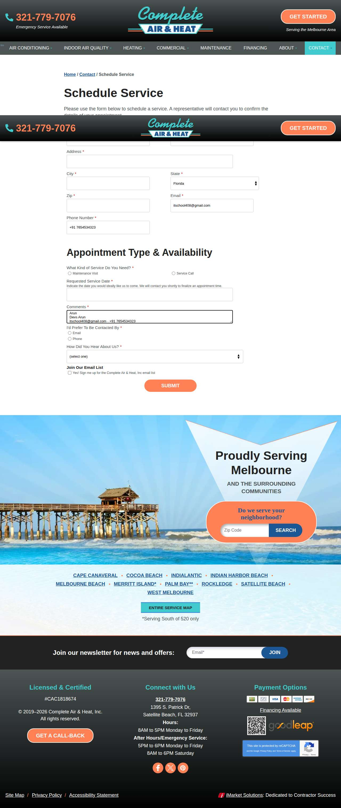

**After submit** — `run-c528f0c9_attempt-e7f900ab_post_attempt_2026-11-02T07-02-13-656Z.jpg`

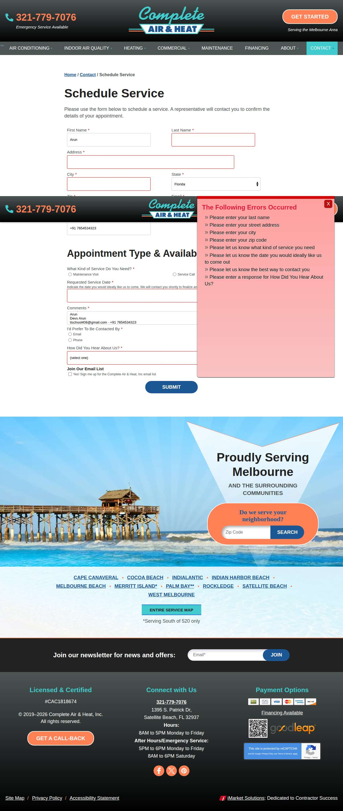

### apexmech.net — confirmed (LIVE)

| | |
|---|---|
| Attempt ID | `0be1c3de-4b72-4ddf-948b-816e060de130` |
| Form URL | http://www.apexmech.net/contact.php |
| Final URL | http://www.apexmech.net/contact.php?sent=1 |
| Reserved | 2026-11-02 07:02:20 UTC |
| Submit attempted | 2026-11-02 07:02:22 UTC |
| Template | standard v2 |
| Confirmation text | us a call at (408) 573-8260 or fill out the form below and we will get back to you as soon as possible. We look forward to hearing from you\! Your information has been sent\! We |
| Result / error | — |

Exact message:

~~~text
Subject: Helping customers find your business in AI search (AEO + GEO)

Hi there,

I'm Arun from Devs Arun. More and more customers now ask ChatGPT, Gemini, Perplexity or Google's AI Overviews questions like "who should I hire for this in my area?" before they call anyone. These tools answer from websites they can clearly understand, and they tend to recommend businesses whose pages answer real customer questions.

That is what AEO + GEO (Answer Engine and Generative Engine Optimization) is for. I improve your existing service pages so they clearly answer the questions your customers ask, add structured data that matches the page, and make the call, quote or enquiry step obvious. The benefit: your business gets a better chance of being mentioned or linked in AI answers, and visitors who arrive find it easy to contact you.

The AEO + GEO Starter is a one-time $199 (about ₹16,999, negotiable) for one website: a basic audit, 10 customer questions, improvements to two existing pages, relevant structured data and an action plan, with one revision round.

You can read the full details, send an enquiry or book online here:
https://devsarun.io/aeo-geo/

If this isn't relevant, just reply and I won't contact you again.

Best,
Arun
Devs Arun
itschool408@gmail.com · +91 7654534323
~~~

Submitted field values:

- Name: \[name\]: Arun
- Email: \[email\]: itschool408@gmail.com
- Comments: \[message\]: Hi there, I'm Arun from Devs Arun. More and more customers now ask ChatGPT, Gemini, Perplexity or Google's AI Overviews 

**Filled form (before submit)** — `run-c528f0c9_attempt-0be1c3de_filled_2026-11-02T07-02-22-860Z.jpg`

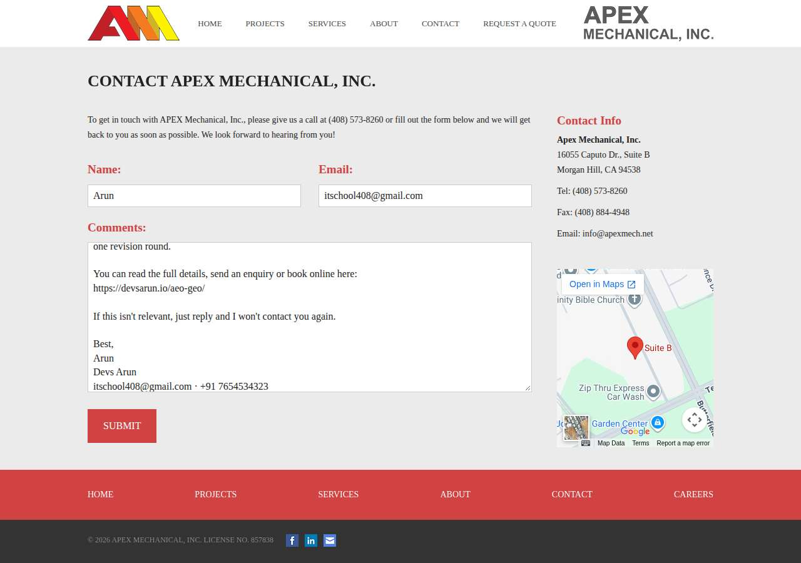

**After submit** — `run-c528f0c9_attempt-0be1c3de_post_attempt_2026-11-02T07-02-27-302Z.jpg`

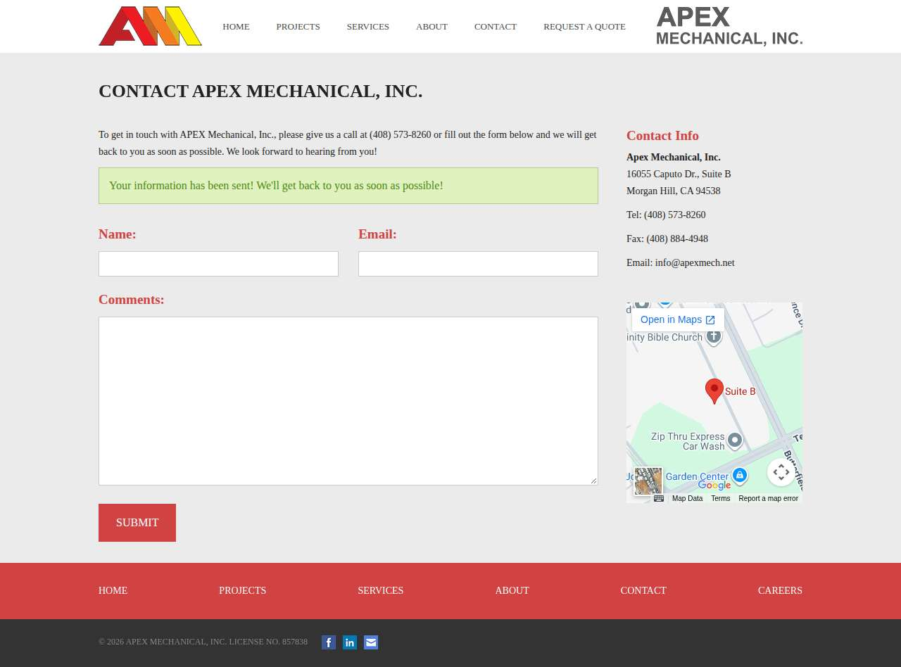

### jmsmithhvac.com — unclear (LIVE)

| | |
|---|---|
| Attempt ID | `e258008c-23a8-4912-a257-582fbcdba056` |
| Form URL | https://jmsmithhvac.com/contact/ |
| Final URL | https://jmsmithhvac.com/contact/ |
| Reserved | 2026-11-02 07:02:34 UTC |
| Submit attempted | 2026-11-02 07:02:35 UTC |
| Template | standard v2 |
| Confirmation text | none observed |
| Result / error | No new success marker observed |

Exact message:

~~~text
Subject: Helping customers find your business in AI search (AEO + GEO)

Hi there,

I'm Arun from Devs Arun. More and more customers now ask ChatGPT, Gemini, Perplexity or Google's AI Overviews questions like "who should I hire for this in my area?" before they call anyone. These tools answer from websites they can clearly understand, and they tend to recommend businesses whose pages answer real customer questions.

That is what AEO + GEO (Answer Engine and Generative Engine Optimization) is for. I improve your existing service pages so they clearly answer the questions your customers ask, add structured data that matches the page, and make the call, quote or enquiry step obvious. The benefit: your business gets a better chance of being mentioned or linked in AI answers, and visitors who arrive find it easy to contact you.

The AEO + GEO Starter is a one-time $199 (about ₹16,999, negotiable) for one website: a basic audit, 10 customer questions, improvements to two existing pages, relevant structured data and an action plan, with one revision round.

You can read the full details, send an enquiry or book online here:
https://devsarun.io/aeo-geo/

If this isn't relevant, just reply and I won't contact you again.

Best,
Arun
Devs Arun
itschool408@gmail.com · +91 7654534323
~~~

Submitted field values:

- Name \[name\]: Arun
- Email \[email\]: itschool408@gmail.com
- Phone \[phone\]: +91 7654534323
- Message \[message\]: Hi there, I'm Arun from Devs Arun. More and more customers now ask ChatGPT, Gemini, Perplexity or Google's AI Overviews 

**Filled form (before submit)** — `run-c528f0c9_attempt-e258008c_filled_2026-11-02T07-02-35-793Z.jpg`

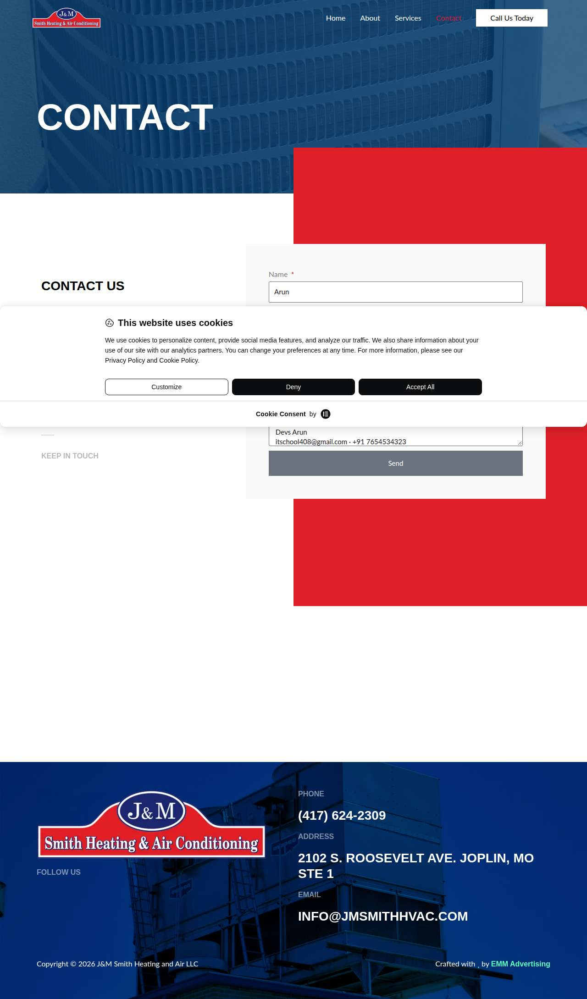

**After submit** — `run-c528f0c9_attempt-e258008c_post_attempt_2026-11-02T07-03-04-998Z.jpg`

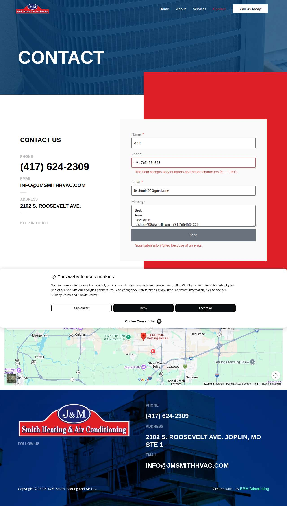

### alisonmechanical.com — unclear (LIVE)

| | |
|---|---|
| Attempt ID | `5dc8004a-82e5-40ad-91d1-173cb3bacad2` |
| Form URL | https://alisonmechanical.com/contact-us/ |
| Final URL | https://alisonmechanical.com/contact-us/?status=nonce\_failed |
| Reserved | 2026-11-02 07:03:11 UTC |
| Submit attempted | 2026-11-02 07:03:13 UTC |
| Template | standard v2 |
| Confirmation text | none observed |
| Result / error | No new success marker observed |

Exact message:

~~~text
Subject: Helping customers find your business in AI search (AEO + GEO)

Hi there,

I'm Arun from Devs Arun. More and more customers now ask ChatGPT, Gemini, Perplexity or Google's AI Overviews questions like "who should I hire for this in my area?" before they call anyone. These tools answer from websites they can clearly understand, and they tend to recommend businesses whose pages answer real customer questions.

That is what AEO + GEO (Answer Engine and Generative Engine Optimization) is for. I improve your existing service pages so they clearly answer the questions your customers ask, add structured data that matches the page, and make the call, quote or enquiry step obvious. The benefit: your business gets a better chance of being mentioned or linked in AI answers, and visitors who arrive find it easy to contact you.

The AEO + GEO Starter is a one-time $199 (about ₹16,999, negotiable) for one website: a basic audit, 10 customer questions, improvements to two existing pages, relevant structured data and an action plan, with one revision round.

You can read the full details, send an enquiry or book online here:
https://devsarun.io/aeo-geo/

If this isn't relevant, just reply and I won't contact you again.

Best,
Arun
Devs Arun
itschool408@gmail.com · +91 7654534323
~~~

Submitted field values:

- name \[name\]: Arun
- email \[email\]: itschool408@gmail.com
- phone \[phone\]: +91 7654534323
- message \[message\]: Hi there, I'm Arun from Devs Arun. More and more customers now ask ChatGPT, Gemini, Perplexity or Google's AI Overviews 

**Filled form (before submit)** — `run-c528f0c9_attempt-5dc8004a_filled_2026-11-02T07-03-13-528Z.jpg`

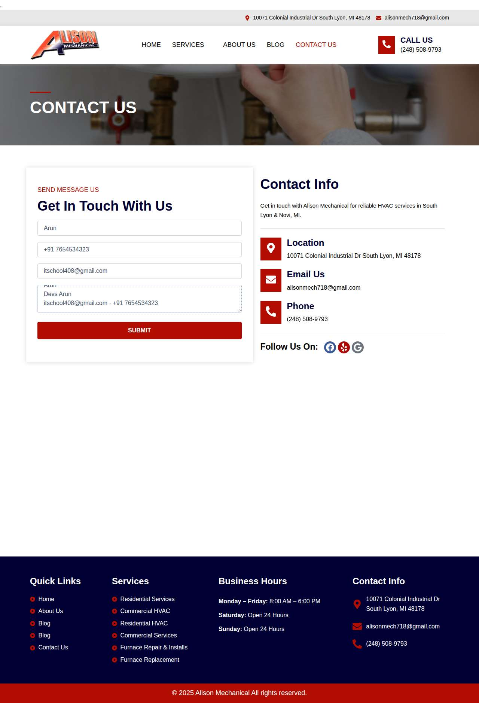

**After submit** — `run-c528f0c9_attempt-5dc8004a_post_attempt_2026-11-02T07-03-42-115Z.jpg`

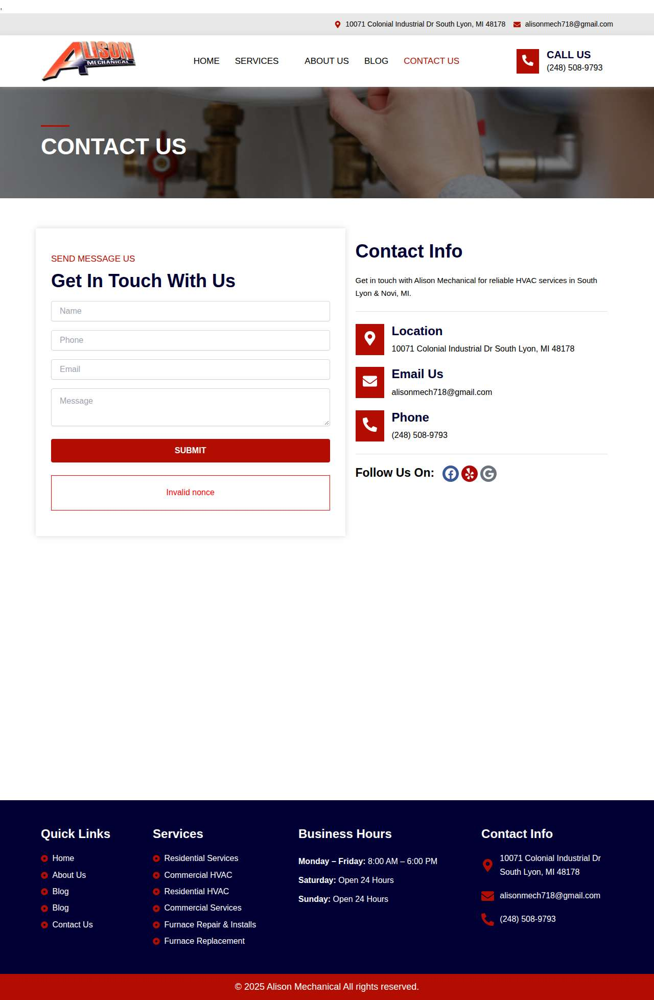

## Events (74)

| Time (UTC) | Event | Website | Details |
|---|---|---|---|
| 07:00:17 | run\_queued | — | live run requested by github:itsDevsArun |
| 07:00:17 | run\_dispatched | — | dispatch disabled (local test mode) |
| 07:00:19 | run\_started | — | Runner claimed live run |
| 07:00:20 | offer\_verified | — | Service page offer facts verified |
| 07:00:20 | website\_selected | clearchoiceplumbingllc.com | Live target clearchoiceplumbingllc.com |
| 07:00:20 | attempt\_reserved | clearchoiceplumbingllc.com | Submission attempt reserved with template standard v2 |
| 07:00:22 | page\_opened | clearchoiceplumbingllc.com | Opened form page |
| 07:00:22 | screenshot\_saved | clearchoiceplumbingllc.com | inspection screenshot saved (145 KB) |
| 07:00:22 | review\_required | clearchoiceplumbingllc.com | failed before submit: locator.fill: Error: Cannot type text into input\[type=number\] |
| 07:00:27 | website\_selected | solutionsmechanical.co | Live target solutionsmechanical.co |
| 07:00:27 | attempt\_reserved | solutionsmechanical.co | Submission attempt reserved with template standard v2 |
| 07:00:28 | page\_opened | solutionsmechanical.co | Opened form page |
| 07:00:29 | fields\_filled | solutionsmechanical.co | filled |
| 07:00:29 | screenshot\_saved | solutionsmechanical.co | filled screenshot saved (78 KB) |
| 07:00:29 | submit\_attempted | solutionsmechanical.co | submitting |
| 07:00:34 | screenshot\_saved | solutionsmechanical.co | post\_attempt screenshot saved (121 KB) |
| 07:00:34 | confirmation\_observed | solutionsmechanical.co | confirmed — "– Sunday : Closed Call our office for 24 hour service Your message was sent: Name: Arun Email: itschool408@gmail.com Mes" |
| 07:00:40 | website\_selected | hasservs.com | Live target hasservs.com |
| 07:00:40 | attempt\_reserved | hasservs.com | Submission attempt reserved with template standard v2 |
| 07:00:41 | page\_opened | hasservs.com | Opened form page |
| 07:00:41 | fields\_filled | hasservs.com | filled |
| 07:00:42 | screenshot\_saved | hasservs.com | filled screenshot saved (102 KB) |
| 07:00:42 | submit\_attempted | hasservs.com | submitting |
| 07:00:45 | screenshot\_saved | hasservs.com | post\_attempt screenshot saved (111 KB) |
| 07:00:45 | error | hasservs.com | error after submit — "me: Email: Phone: Message / Suggestions: Oops, there was an error sending your message. Please try again later. Visit Us" |
| 07:00:52 | website\_selected | clarkmechanicalinc.com | Live target clarkmechanicalinc.com |
| 07:00:52 | attempt\_reserved | clarkmechanicalinc.com | Submission attempt reserved with template standard v2 |
| 07:00:54 | page\_opened | clarkmechanicalinc.com | Opened form page |
| 07:00:55 | fields\_filled | clarkmechanicalinc.com | filled |
| 07:00:55 | screenshot\_saved | clarkmechanicalinc.com | filled screenshot saved (130 KB) |
| 07:00:55 | submit\_attempted | clarkmechanicalinc.com | submitting |
| 07:01:24 | screenshot\_saved | clarkmechanicalinc.com | post\_attempt screenshot saved (135 KB) |
| 07:01:24 | review\_required | clarkmechanicalinc.com | unclear: No new success marker observed |
| 07:01:31 | website\_selected | alliant-systems.com | Live target alliant-systems.com |
| 07:01:31 | attempt\_reserved | alliant-systems.com | Submission attempt reserved with template standard v2 |
| 07:01:33 | page\_opened | alliant-systems.com | Opened form page |
| 07:01:34 | fields\_filled | alliant-systems.com | filled |
| 07:01:34 | screenshot\_saved | alliant-systems.com | filled screenshot saved (243 KB) |
| 07:01:34 | submit\_attempted | alliant-systems.com | submitting |
| 07:02:01 | screenshot\_saved | alliant-systems.com | post\_attempt screenshot saved (231 KB) |
| 07:02:01 | review\_required | alliant-systems.com | unclear: No new success marker observed |
| 07:02:08 | website\_selected | completeairandheat.com | Live target completeairandheat.com |
| 07:02:08 | attempt\_reserved | completeairandheat.com | Submission attempt reserved with template standard v2 |
| 07:02:09 | page\_opened | completeairandheat.com | Opened form page |
| 07:02:10 | fields\_filled | completeairandheat.com | filled |
| 07:02:10 | screenshot\_saved | completeairandheat.com | filled screenshot saved (236 KB) |
| 07:02:10 | submit\_attempted | completeairandheat.com | submitting |
| 07:02:13 | screenshot\_saved | completeairandheat.com | post\_attempt screenshot saved (261 KB) |
| 07:02:13 | error | completeairandheat.com | error after submit — "Skip navigation The Following Errors Occurred Please enter your last name Please enter your street address Please enter " |
| 07:02:20 | website\_selected | apexmech.net | Live target apexmech.net |
| 07:02:20 | attempt\_reserved | apexmech.net | Submission attempt reserved with template standard v2 |
| 07:02:22 | page\_opened | apexmech.net | Opened form page |
| 07:02:22 | fields\_filled | apexmech.net | filled |
| 07:02:22 | screenshot\_saved | apexmech.net | filled screenshot saved (65 KB) |
| 07:02:22 | submit\_attempted | apexmech.net | submitting |
| 07:02:27 | screenshot\_saved | apexmech.net | post\_attempt screenshot saved (55 KB) |
| 07:02:27 | confirmation\_observed | apexmech.net | confirmed — "us a call at (408) 573-8260 or fill out the form below and we will get back to you as soon as possible. We look forward " |
| 07:02:34 | website\_selected | jmsmithhvac.com | Live target jmsmithhvac.com |
| 07:02:34 | attempt\_reserved | jmsmithhvac.com | Submission attempt reserved with template standard v2 |
| 07:02:35 | page\_opened | jmsmithhvac.com | Opened form page |
| 07:02:35 | fields\_filled | jmsmithhvac.com | filled |
| 07:02:35 | screenshot\_saved | jmsmithhvac.com | filled screenshot saved (125 KB) |
| 07:02:35 | submit\_attempted | jmsmithhvac.com | submitting |
| 07:03:05 | screenshot\_saved | jmsmithhvac.com | post\_attempt screenshot saved (182 KB) |
| 07:03:05 | review\_required | jmsmithhvac.com | unclear: No new success marker observed |
| 07:03:11 | website\_selected | alisonmechanical.com | Live target alisonmechanical.com |
| 07:03:11 | attempt\_reserved | alisonmechanical.com | Submission attempt reserved with template standard v2 |
| 07:03:13 | page\_opened | alisonmechanical.com | Opened form page |
| 07:03:13 | fields\_filled | alisonmechanical.com | filled |
| 07:03:13 | screenshot\_saved | alisonmechanical.com | filled screenshot saved (111 KB) |
| 07:03:13 | submit\_attempted | alisonmechanical.com | submitting |
| 07:03:42 | screenshot\_saved | alisonmechanical.com | post\_attempt screenshot saved (112 KB) |
| 07:03:42 | review\_required | alisonmechanical.com | unclear: No new success marker observed |
| 07:03:49 | run\_completed | — | Run completed (limit\_reached) |
