# Run ce59732f — live — completed

| | |
|---|---|
| Run ID | `ce59732f-9d3c-4d32-94e5-a0e492261b4a` |
| Requested by | github:itsDevsArun |
| Started | 2026-11-02 03:11:18 UTC |
| Finished | 2026-11-02 03:18:26 UTC |
| Finish reason | queue\_exhausted |
| GitHub Actions | https://github.com/itsDevsArun/aeo-geo/actions/runs/41379081570 |

CSV for this run: [runs/2026-11-02_live_ce59732f.csv](2026-11-02_live_ce59732f.csv)

## Attempts (17)

### tureksplumbing.com — error\_after\_submit (LIVE)

| | |
|---|---|
| Attempt ID | `a7c40644-6885-41e4-bb38-12177de5eb9f` |
| Form URL | https://www.tureksplumbing.com/contact/send-message |
| Final URL | https://www.tureksplumbing.com/contact/send-message\#error-container |
| Reserved | 2026-11-02 03:11:19 UTC |
| Submit attempted | 2026-11-02 03:11:22 UTC |
| Template | standard v2 |
| Confirmation text | JOURNEYMAN PLUMBERS Read More The Following Errors Occurred Please enter your last name Please enter your zip code Please let us know the best way to contact you 920-570-78 |
| Result / error | — |

Exact message:

~~~text
Subject: Helping customers find your business in AI search (AEO + GEO)

Hi there,

I'm Arun from Devs Arun. More and more customers now ask ChatGPT, Gemini, Perplexity or Google's AI Overviews questions like "who should I hire for this in my area?" before they call anyone. These tools answer from websites they can clearly understand, and they tend to recommend businesses whose pages answer real customer questions.

That is what AEO + GEO (Answer Engine and Generative Engine Optimization) is for. I improve your existing service pages so they clearly answer the questions your customers ask, add structured data that matches the page, and make the call, quote or enquiry step obvious. The benefit: your business gets a better chance of being mentioned or linked in AI answers, and visitors who arrive find it easy to contact you.

The AEO + GEO Starter is a one-time $199 (about ₹16,999, negotiable) for one website: a basic audit, 10 customer questions, improvements to two existing pages, relevant structured data and an action plan, with one revision round.

You can read the full details, send an enquiry or book online here:
https://devsarun.io/aeo-geo/

If this isn't relevant, just reply and I won't contact you again.

Best,
Arun
Devs Arun
itschool408@gmail.com · +91 7654534323
~~~

Submitted field values:

- Email \* \[email\]: itschool408@gmail.com
- Phone Number \* \[phone\]: +91 7654534323
- First Name \* \[first\_name\]: Arun
- Any other details you would like to share \[message\]: Hi there, I'm Arun from Devs Arun. More and more customers now ask ChatGPT, Gemini, Perplexity or Google's AI Overviews 

**Filled form (before submit)** — `run-ce59732f_attempt-a7c40644_filled_2026-11-02T03-11-22-552Z.jpg`

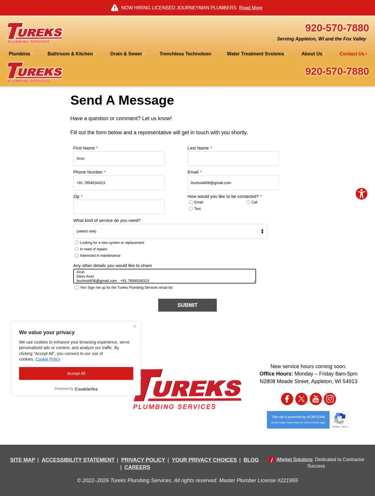

**After submit** — `run-ce59732f_attempt-a7c40644_post_attempt_2026-11-02T03-11-25-268Z.jpg`

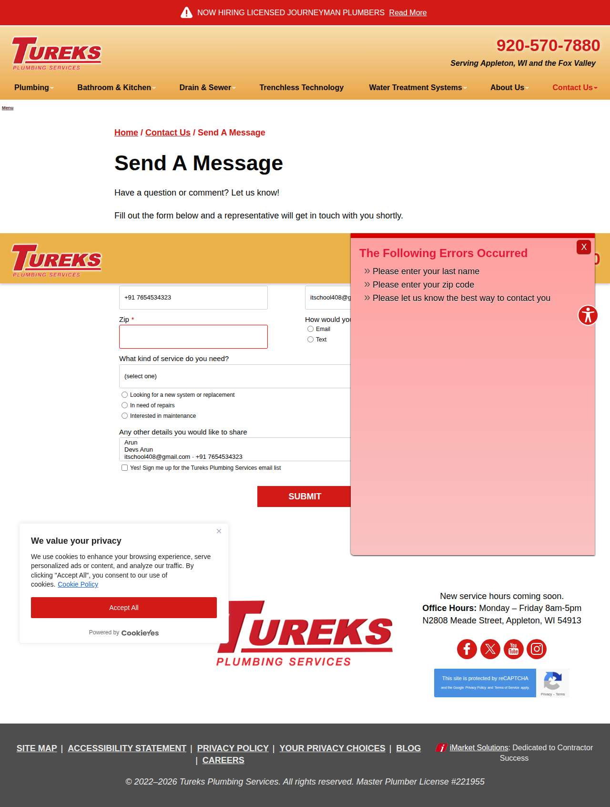

### roddingrooter.com — unclear (LIVE)

| | |
|---|---|
| Attempt ID | `a89dfff7-8fab-4ab1-9851-cab6f33b8fcf` |
| Form URL | https://roddingrooter.com/contact/ |
| Final URL | https://roddingrooter.com/contact/ |
| Reserved | 2026-11-02 03:11:31 UTC |
| Submit attempted | 2026-11-02 03:11:34 UTC |
| Template | standard v2 |
| Confirmation text | none observed |
| Result / error | No new success marker observed |

Exact message:

~~~text
Subject: Helping customers find your business in AI search (AEO + GEO)

Hi there,

I'm Arun from Devs Arun. More and more customers now ask ChatGPT, Gemini, Perplexity or Google's AI Overviews questions like "who should I hire for this in my area?" before they call anyone. These tools answer from websites they can clearly understand, and they tend to recommend businesses whose pages answer real customer questions.

That is what AEO + GEO (Answer Engine and Generative Engine Optimization) is for. I improve your existing service pages so they clearly answer the questions your customers ask, add structured data that matches the page, and make the call, quote or enquiry step obvious. The benefit: your business gets a better chance of being mentioned or linked in AI answers, and visitors who arrive find it easy to contact you.

The AEO + GEO Starter is a one-time $199 (about ₹16,999, negotiable) for one website: a basic audit, 10 customer questions, improvements to two existing pages, relevant structured data and an action plan, with one revision round.

You can read the full details, send an enquiry or book online here:
https://devsarun.io/aeo-geo/

If this isn't relevant, just reply and I won't contact you again.

Best,
Arun
Devs Arun
itschool408@gmail.com · +91 7654534323
~~~

Submitted field values:

- mf-email \[email\]: itschool408@gmail.com
- mf-telephone \[phone\]: +91 7654534323
- mf-text \[first\_name\]: Arun
- mf-textarea \[message\]: Hi there, I'm Arun from Devs Arun. More and more customers now ask ChatGPT, Gemini, Perplexity or Google's AI Overviews 

**Filled form (before submit)** — `run-ce59732f_attempt-a89dfff7_filled_2026-11-02T03-11-34-273Z.jpg`

**After submit** — `run-ce59732f_attempt-a89dfff7_post_attempt_2026-11-02T03-12-00-986Z.jpg`

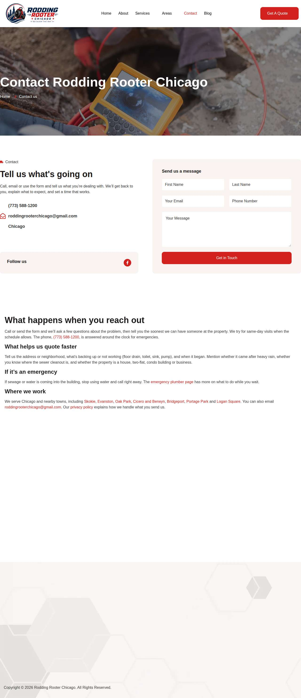

### performanceplumbinginc.com — unclear (LIVE)

| | |
|---|---|
| Attempt ID | `c2a9ca09-45c1-47b1-bae1-5f323071916f` |
| Form URL | https://www.performanceplumbinginc.com/contact/schedule-service |
| Final URL | https://www.performanceplumbinginc.com/contact/schedule-service\#error-container |
| Reserved | 2026-11-02 03:12:07 UTC |
| Submit attempted | 2026-11-02 03:12:09 UTC |
| Template | standard v2 |
| Confirmation text | none observed |
| Result / error | No new success marker observed |

Exact message:

~~~text
Subject: Helping customers find your business in AI search (AEO + GEO)

Hi there,

I'm Arun from Devs Arun. More and more customers now ask ChatGPT, Gemini, Perplexity or Google's AI Overviews questions like "who should I hire for this in my area?" before they call anyone. These tools answer from websites they can clearly understand, and they tend to recommend businesses whose pages answer real customer questions.

That is what AEO + GEO (Answer Engine and Generative Engine Optimization) is for. I improve your existing service pages so they clearly answer the questions your customers ask, add structured data that matches the page, and make the call, quote or enquiry step obvious. The benefit: your business gets a better chance of being mentioned or linked in AI answers, and visitors who arrive find it easy to contact you.

The AEO + GEO Starter is a one-time $199 (about ₹16,999, negotiable) for one website: a basic audit, 10 customer questions, improvements to two existing pages, relevant structured data and an action plan, with one revision round.

You can read the full details, send an enquiry or book online here:
https://devsarun.io/aeo-geo/

If this isn't relevant, just reply and I won't contact you again.

Best,
Arun
Devs Arun
itschool408@gmail.com · +91 7654534323
~~~

Submitted field values:

- Email \* \[email\]: itschool408@gmail.com
- Comments \* \[message\]: Hi there, I'm Arun from Devs Arun. More and more customers now ask ChatGPT, Gemini, Perplexity or Google's AI Overviews 
- Phone Number \* \[phone\]: +91 7654534323
- First Name \* \[first\_name\]: Arun

**Filled form (before submit)** — `run-ce59732f_attempt-c2a9ca09_filled_2026-11-02T03-12-09-405Z.jpg`

**After submit** — `run-ce59732f_attempt-c2a9ca09_post_attempt_2026-11-02T03-12-36-261Z.jpg`

### integrityrepipe.com — error\_after\_submit (LIVE)

| | |
|---|---|
| Attempt ID | `0962de63-42d3-40be-922e-b8a89bc50f76` |
| Form URL | https://www.integrityrepipe.com/ |
| Final URL | https://www.integrityrepipe.com/ |
| Reserved | 2026-11-02 03:12:42 UTC |
| Submit attempted | 2026-11-02 03:12:44 UTC |
| Template | standard v2 |
| Confirmation text | ndustry. One or more fields have an error. Please check and try again. The field is required. The field is required. The field is required. The field is required. The fi |
| Result / error | — |

Exact message:

~~~text
Subject: Helping customers find your business in AI search (AEO + GEO)

Hi there,

I'm Arun from Devs Arun. More and more customers now ask ChatGPT, Gemini, Perplexity or Google's AI Overviews questions like "who should I hire for this in my area?" before they call anyone. These tools answer from websites they can clearly understand, and they tend to recommend businesses whose pages answer real customer questions.

That is what AEO + GEO (Answer Engine and Generative Engine Optimization) is for. I improve your existing service pages so they clearly answer the questions your customers ask, add structured data that matches the page, and make the call, quote or enquiry step obvious. The benefit: your business gets a better chance of being mentioned or linked in AI answers, and visitors who arrive find it easy to contact you.

The AEO + GEO Starter is a one-time $199 (about ₹16,999, negotiable) for one website: a basic audit, 10 customer questions, improvements to two existing pages, relevant structured data and an action plan, with one revision round.

You can read the full details, send an enquiry or book online here:
https://devsarun.io/aeo-geo/

If this isn't relevant, just reply and I won't contact you again.

Best,
Arun
Devs Arun
itschool408@gmail.com · +91 7654534323
~~~

Submitted field values:

- email \[email\]: itschool408@gmail.com
- message \[message\]: Hi there, I'm Arun from Devs Arun. More and more customers now ask ChatGPT, Gemini, Perplexity or Google's AI Overviews 
- subject \[subject\]: Helping customers find your business in AI search (AEO + GEO)
- phone-number \[phone\]: +91 7654534323
- first-name \[first\_name\]: Arun

**Filled form (before submit)** — `run-ce59732f_attempt-0962de63_filled_2026-11-02T03-12-44-471Z.jpg`

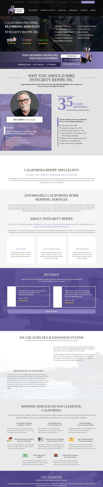

**After submit** — `run-ce59732f_attempt-0962de63_post_attempt_2026-11-02T03-12-47-290Z.jpg`

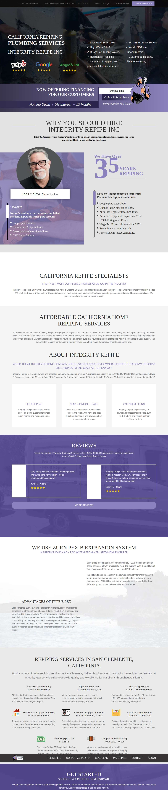

### helpfulplumbing.com — unclear (LIVE)

| | |
|---|---|
| Attempt ID | `1f9d06dd-7247-4094-a7d8-54045f906f3b` |
| Form URL | https://www.metrowebsites.com/contact |
| Final URL | https://www.metrowebsites.com/contact? |
| Reserved | 2026-11-02 03:12:53 UTC |
| Submit attempted | 2026-11-02 03:12:55 UTC |
| Template | standard v2 |
| Confirmation text | none observed |
| Result / error | No new success marker observed |

Exact message:

~~~text
Subject: Helping customers find your business in AI search (AEO + GEO)

Hi there,

I'm Arun from Devs Arun. More and more customers now ask ChatGPT, Gemini, Perplexity or Google's AI Overviews questions like "who should I hire for this in my area?" before they call anyone. These tools answer from websites they can clearly understand, and they tend to recommend businesses whose pages answer real customer questions.

That is what AEO + GEO (Answer Engine and Generative Engine Optimization) is for. I improve your existing service pages so they clearly answer the questions your customers ask, add structured data that matches the page, and make the call, quote or enquiry step obvious. The benefit: your business gets a better chance of being mentioned or linked in AI answers, and visitors who arrive find it easy to contact you.

The AEO + GEO Starter is a one-time $199 (about ₹16,999, negotiable) for one website: a basic audit, 10 customer questions, improvements to two existing pages, relevant structured data and an action plan, with one revision round.

You can read the full details, send an enquiry or book online here:
https://devsarun.io/aeo-geo/

If this isn't relevant, just reply and I won't contact you again.

Best,
Arun
Devs Arun
itschool408@gmail.com · +91 7654534323
~~~

Submitted field values:

- Full Name \* \[name\]: Arun
- Phone Number \[phone\]: +91 7654534323
- Email Address \* \[email\]: itschool408@gmail.com
- Tell Us About Your Project \* \[message\]: Hi there, I'm Arun from Devs Arun. More and more customers now ask ChatGPT, Gemini, Perplexity or Google's AI Overviews 

**Filled form (before submit)** — `run-ce59732f_attempt-1f9d06dd_filled_2026-11-02T03-12-55-930Z.jpg`

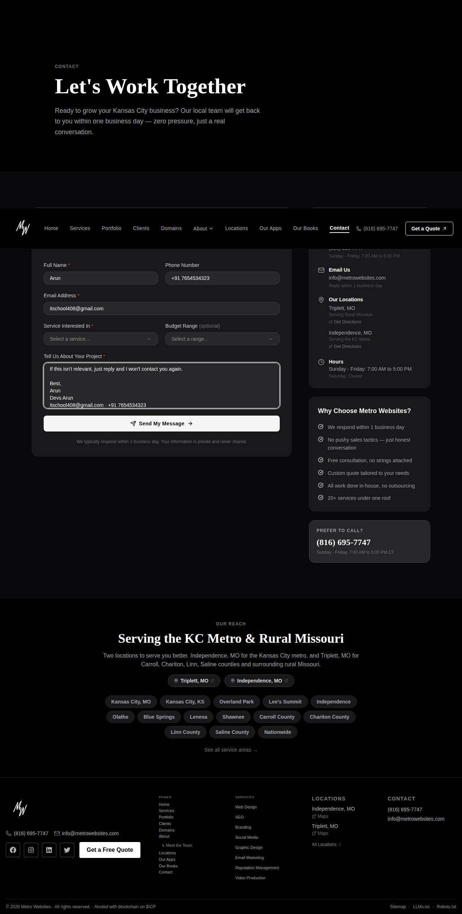

**After submit** — `run-ce59732f_attempt-1f9d06dd_post_attempt_2026-11-02T03-13-23-794Z.jpg`

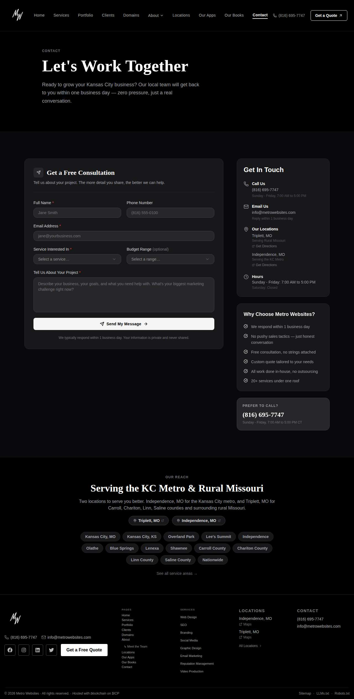

### lineyourpipes.com — unclear (LIVE)

| | |
|---|---|
| Attempt ID | `b75071e0-5601-4006-a520-ce153c8b5a55` |
| Form URL | https://www.lineyourpipes.com/contact |
| Final URL | https://www.lineyourpipes.com/contact |
| Reserved | 2026-11-02 03:13:30 UTC |
| Submit attempted | 2026-11-02 03:13:34 UTC |
| Template | standard v2 |
| Confirmation text | none observed |
| Result / error | No new success marker observed |

Exact message:

~~~text
Subject: Helping customers find your business in AI search (AEO + GEO)

Hi there,

I'm Arun from Devs Arun. More and more customers now ask ChatGPT, Gemini, Perplexity or Google's AI Overviews questions like "who should I hire for this in my area?" before they call anyone. These tools answer from websites they can clearly understand, and they tend to recommend businesses whose pages answer real customer questions.

That is what AEO + GEO (Answer Engine and Generative Engine Optimization) is for. I improve your existing service pages so they clearly answer the questions your customers ask, add structured data that matches the page, and make the call, quote or enquiry step obvious. The benefit: your business gets a better chance of being mentioned or linked in AI answers, and visitors who arrive find it easy to contact you.

The AEO + GEO Starter is a one-time $199 (about ₹16,999, negotiable) for one website: a basic audit, 10 customer questions, improvements to two existing pages, relevant structured data and an action plan, with one revision round.

You can read the full details, send an enquiry or book online here:
https://devsarun.io/aeo-geo/

If this isn't relevant, just reply and I won't contact you again.

Best,
Arun
Devs Arun
itschool408@gmail.com · +91 7654534323
~~~

Submitted field values:

- email \[email\]: itschool408@gmail.com
- name-\* \[name\]: Arun
- phone \[phone\]: +91 7654534323
- Message \[message\]: Hi there, I'm Arun from Devs Arun. More and more customers now ask ChatGPT, Gemini, Perplexity or Google's AI Overviews 
- subject \[subject\]: Helping customers find your business in AI search (AEO + GEO)

**Filled form (before submit)** — `run-ce59732f_attempt-b75071e0_filled_2026-11-02T03-13-34-978Z.jpg`

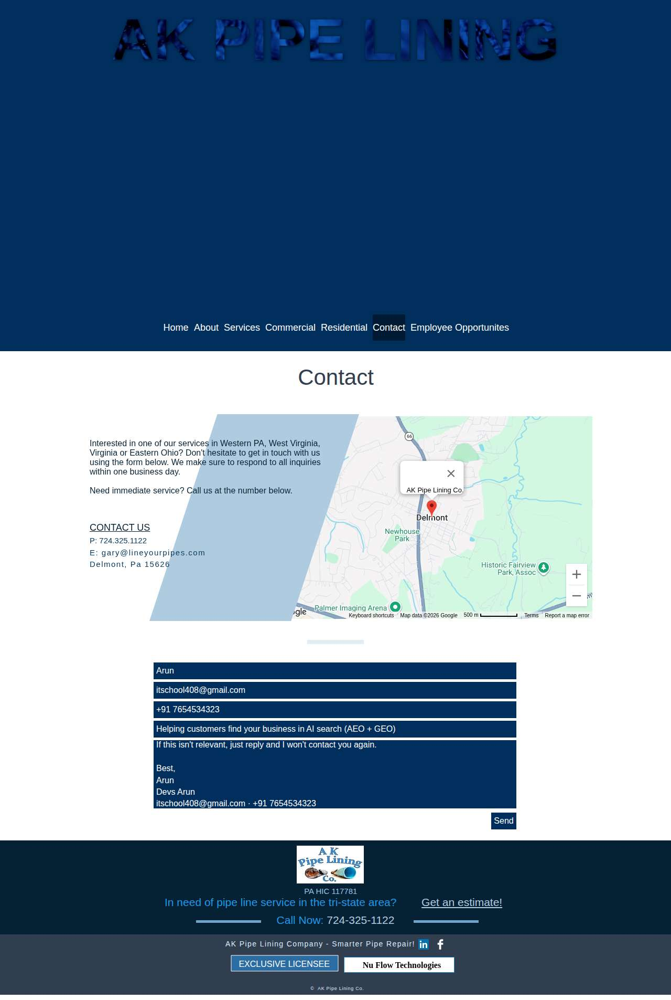

**After submit** — `run-ce59732f_attempt-b75071e0_post_attempt_2026-11-02T03-14-09-611Z.jpg`

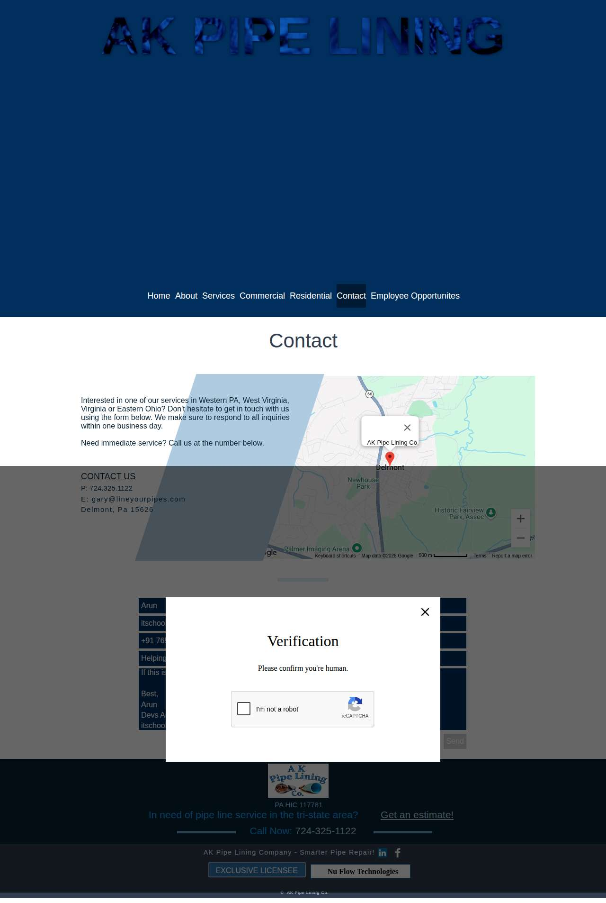

### tri-countyplumbing.com — unclear (LIVE)

| | |
|---|---|
| Attempt ID | `86207c41-4789-4b2c-921a-1b8f7f7544e2` |
| Form URL | https://www.tri-countyplumbing.com/contact |
| Final URL | https://www.tri-countyplumbing.com/contact |
| Reserved | 2026-11-02 03:14:16 UTC |
| Submit attempted | 2026-11-02 03:14:18 UTC |
| Template | standard v2 |
| Confirmation text | none observed |
| Result / error | No new success marker observed |

Exact message:

~~~text
Subject: Helping customers find your business in AI search (AEO + GEO)

Hi there,

I'm Arun from Devs Arun. More and more customers now ask ChatGPT, Gemini, Perplexity or Google's AI Overviews questions like "who should I hire for this in my area?" before they call anyone. These tools answer from websites they can clearly understand, and they tend to recommend businesses whose pages answer real customer questions.

That is what AEO + GEO (Answer Engine and Generative Engine Optimization) is for. I improve your existing service pages so they clearly answer the questions your customers ask, add structured data that matches the page, and make the call, quote or enquiry step obvious. The benefit: your business gets a better chance of being mentioned or linked in AI answers, and visitors who arrive find it easy to contact you.

The AEO + GEO Starter is a one-time $199 (about ₹16,999, negotiable) for one website: a basic audit, 10 customer questions, improvements to two existing pages, relevant structured data and an action plan, with one revision round.

You can read the full details, send an enquiry or book online here:
https://devsarun.io/aeo-geo/

If this isn't relevant, just reply and I won't contact you again.

Best,
Arun
Devs Arun
itschool408@gmail.com · +91 7654534323
~~~

Submitted field values:

- name \[name\]: Arun
- email \[email\]: itschool408@gmail.com
- phone \[phone\]: +91 7654534323
- What's your plumbing issue? \[message\]: Hi there, I'm Arun from Devs Arun. More and more customers now ask ChatGPT, Gemini, Perplexity or Google's AI Overviews 

**Filled form (before submit)** — `run-ce59732f_attempt-86207c41_filled_2026-11-02T03-14-18-526Z.jpg`

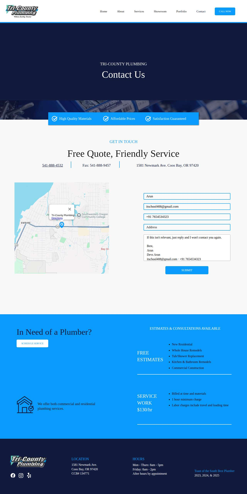

**After submit** — `run-ce59732f_attempt-86207c41_post_attempt_2026-11-02T03-14-45-239Z.jpg`

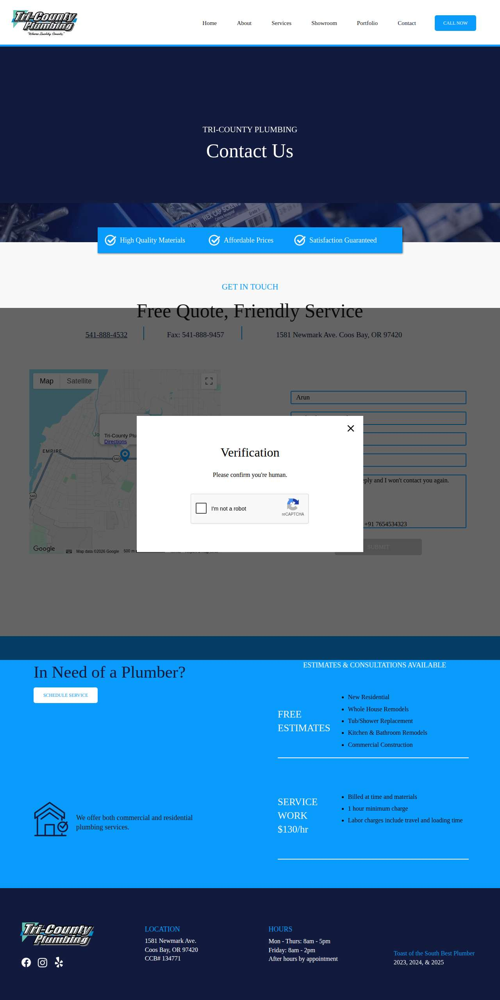

### rotorooterbck.com — unclear (LIVE)

| | |
|---|---|
| Attempt ID | `9c698366-d4ae-423e-b493-48e53f6eb99d` |
| Form URL | https://www.rotorooterbck.com/contact-us |
| Final URL | https://www.rotorooterbck.com/contact-us |
| Reserved | 2026-11-02 03:14:51 UTC |
| Submit attempted | 2026-11-02 03:14:54 UTC |
| Template | standard v2 |
| Confirmation text | none observed |
| Result / error | No new success marker observed |

Exact message:

~~~text
Subject: Helping customers find your business in AI search (AEO + GEO)

Hi there,

I'm Arun from Devs Arun. More and more customers now ask ChatGPT, Gemini, Perplexity or Google's AI Overviews questions like "who should I hire for this in my area?" before they call anyone. These tools answer from websites they can clearly understand, and they tend to recommend businesses whose pages answer real customer questions.

That is what AEO + GEO (Answer Engine and Generative Engine Optimization) is for. I improve your existing service pages so they clearly answer the questions your customers ask, add structured data that matches the page, and make the call, quote or enquiry step obvious. The benefit: your business gets a better chance of being mentioned or linked in AI answers, and visitors who arrive find it easy to contact you.

The AEO + GEO Starter is a one-time $199 (about ₹16,999, negotiable) for one website: a basic audit, 10 customer questions, improvements to two existing pages, relevant structured data and an action plan, with one revision round.

You can read the full details, send an enquiry or book online here:
https://devsarun.io/aeo-geo/

If this isn't relevant, just reply and I won't contact you again.

Best,
Arun
Devs Arun
itschool408@gmail.com · +91 7654534323
~~~

Submitted field values:

- Email \[email\]: itschool408@gmail.com
- Phone \[phone\]: +91 7654534323
- Message \[message\]: Hi there, I'm Arun from Devs Arun. More and more customers now ask ChatGPT, Gemini, Perplexity or Google's AI Overviews 
- First Name \[first\_name\]: Arun

**Filled form (before submit)** — `run-ce59732f_attempt-9c698366_filled_2026-11-02T03-14-54-710Z.jpg`

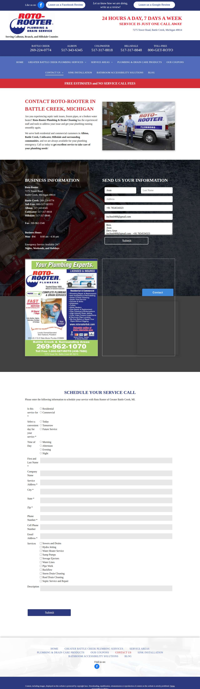

**After submit** — `run-ce59732f_attempt-9c698366_post_attempt_2026-11-02T03-15-22-723Z.jpg`

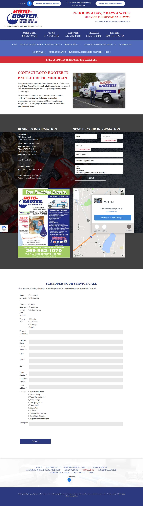

### oneillplumbing.com — failed\_before\_submit (LIVE)

| | |
|---|---|
| Attempt ID | `8aac510a-b26a-47d3-a5da-6a70d35ba0e1` |
| Form URL | https://oneillplumbing.com/contact-us/ |
| Final URL | https://oneillplumbing.com/contact-us/ |
| Reserved | 2026-11-02 03:15:29 UTC |
| Submit attempted | — |
| Template | standard v2 |
| Confirmation text | none observed |
| Result / error | Field "Phone" did not accept the value |

Exact message:

~~~text
Subject: Helping customers find your business in AI search (AEO + GEO)

Hi there,

I'm Arun from Devs Arun. More and more customers now ask ChatGPT, Gemini, Perplexity or Google's AI Overviews questions like "who should I hire for this in my area?" before they call anyone. These tools answer from websites they can clearly understand, and they tend to recommend businesses whose pages answer real customer questions.

That is what AEO + GEO (Answer Engine and Generative Engine Optimization) is for. I improve your existing service pages so they clearly answer the questions your customers ask, add structured data that matches the page, and make the call, quote or enquiry step obvious. The benefit: your business gets a better chance of being mentioned or linked in AI answers, and visitors who arrive find it easy to contact you.

The AEO + GEO Starter is a one-time $199 (about ₹16,999, negotiable) for one website: a basic audit, 10 customer questions, improvements to two existing pages, relevant structured data and an action plan, with one revision round.

You can read the full details, send an enquiry or book online here:
https://devsarun.io/aeo-geo/

If this isn't relevant, just reply and I won't contact you again.

Best,
Arun
Devs Arun
itschool408@gmail.com · +91 7654534323
~~~

Submitted field values:

- \#input\_1\_2: itschool408@gmail.com
- \#input\_1\_3: +91 7654534323
- \#input\_1\_4: Helping customers find your business in AI search (AEO + GEO)
- \#input\_1\_5: Hi there, I'm Arun from Devs Arun. More and more customers now ask ChatGPT, Gemini, Perplexity or Google's AI Overviews 
- \#input\_1\_1\_3: Arun

**Filled form (before submit)** — `run-ce59732f_attempt-8aac510a_filled_2026-11-02T03-15-34-242Z.jpg`

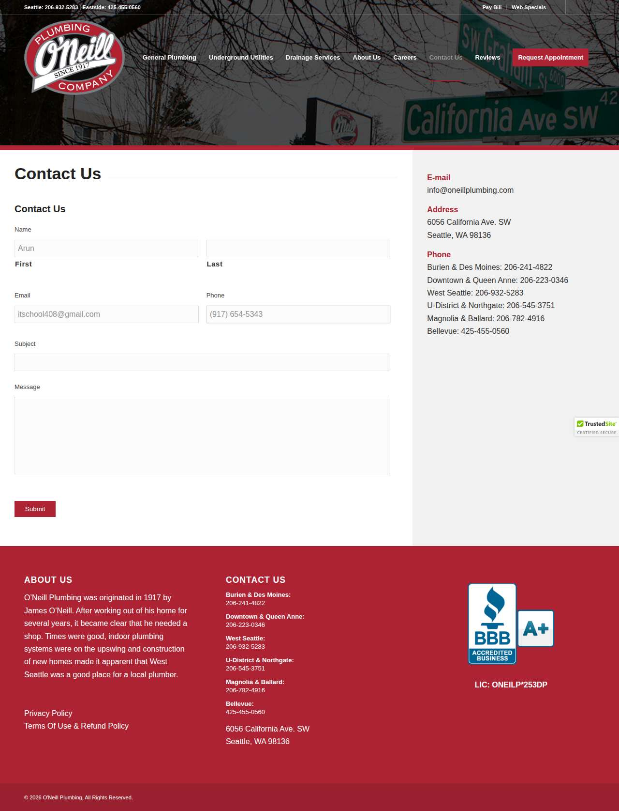

### precisionplumbingoc.com — unclear (LIVE)

| | |
|---|---|
| Attempt ID | `efca9221-78c4-4f31-a19a-d9ece4a554fd` |
| Form URL | https://precisionplumbingoc.com/ |
| Final URL | https://precisionplumbingoc.com/ |
| Reserved | 2026-11-02 03:15:39 UTC |
| Submit attempted | 2026-11-02 03:15:40 UTC |
| Template | standard v2 |
| Confirmation text | none observed |
| Result / error | No new success marker observed |

Exact message:

~~~text
Subject: Helping customers find your business in AI search (AEO + GEO)

Hi there,

I'm Arun from Devs Arun. More and more customers now ask ChatGPT, Gemini, Perplexity or Google's AI Overviews questions like "who should I hire for this in my area?" before they call anyone. These tools answer from websites they can clearly understand, and they tend to recommend businesses whose pages answer real customer questions.

That is what AEO + GEO (Answer Engine and Generative Engine Optimization) is for. I improve your existing service pages so they clearly answer the questions your customers ask, add structured data that matches the page, and make the call, quote or enquiry step obvious. The benefit: your business gets a better chance of being mentioned or linked in AI answers, and visitors who arrive find it easy to contact you.

The AEO + GEO Starter is a one-time $199 (about ₹16,999, negotiable) for one website: a basic audit, 10 customer questions, improvements to two existing pages, relevant structured data and an action plan, with one revision round.

You can read the full details, send an enquiry or book online here:
https://devsarun.io/aeo-geo/

If this isn't relevant, just reply and I won't contact you again.

Best,
Arun
Devs Arun
itschool408@gmail.com · +91 7654534323
~~~

Submitted field values:

- Email \[email\]: itschool408@gmail.com
- Subject \[subject\]: Helping customers find your business in AI search (AEO + GEO)
- Your Message \[message\]: Hi there, I'm Arun from Devs Arun. More and more customers now ask ChatGPT, Gemini, Perplexity or Google's AI Overviews 
- First Name \[first\_name\]: Arun

**Filled form (before submit)** — `run-ce59732f_attempt-efca9221_filled_2026-11-02T03-15-40-960Z.jpg`

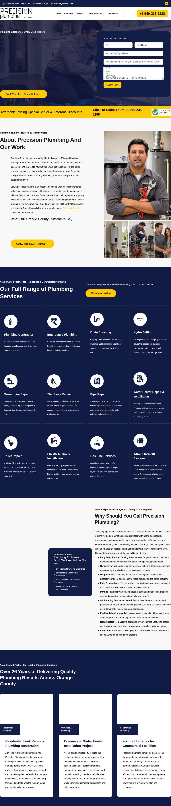

**After submit** — `run-ce59732f_attempt-efca9221_post_attempt_2026-11-02T03-16-09-635Z.jpg`

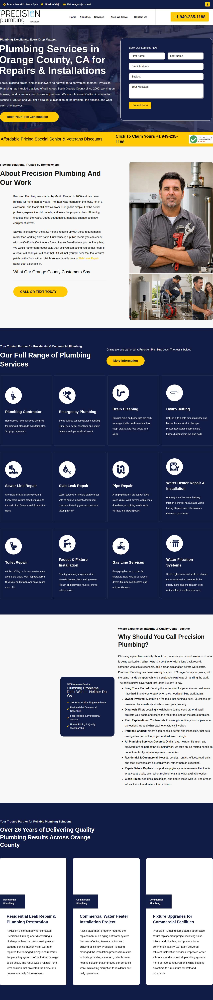

### fredjmoyer.com — error\_after\_submit (LIVE)

| | |
|---|---|
| Attempt ID | `eef9bdd6-d34b-4aba-a3b3-90e303e62b59` |
| Form URL | https://www.fredjmoyer.com/contact |
| Final URL | https://www.fredjmoyer.com/contact |
| Reserved | 2026-11-02 03:16:16 UTC |
| Submit attempted | 2026-11-02 03:16:18 UTC |
| Template | standard v2 |
| Confirmation text | - 4:00 pm Sat - Sun Closed Call to Schedule an Appointment\! This field is required © Mapbox © OpenStreetMap Improve this map LICENSED & INSURED PAOAGHIC: 002279 HOME HISTORY PLUMBING |
| Result / error | — |

Exact message:

~~~text
Subject: Helping customers find your business in AI search (AEO + GEO)

Hi there,

I'm Arun from Devs Arun. More and more customers now ask ChatGPT, Gemini, Perplexity or Google's AI Overviews questions like "who should I hire for this in my area?" before they call anyone. These tools answer from websites they can clearly understand, and they tend to recommend businesses whose pages answer real customer questions.

That is what AEO + GEO (Answer Engine and Generative Engine Optimization) is for. I improve your existing service pages so they clearly answer the questions your customers ask, add structured data that matches the page, and make the call, quote or enquiry step obvious. The benefit: your business gets a better chance of being mentioned or linked in AI answers, and visitors who arrive find it easy to contact you.

The AEO + GEO Starter is a one-time $199 (about ₹16,999, negotiable) for one website: a basic audit, 10 customer questions, improvements to two existing pages, relevant structured data and an action plan, with one revision round.

You can read the full details, send an enquiry or book online here:
https://devsarun.io/aeo-geo/

If this isn't relevant, just reply and I won't contact you again.

Best,
Arun
Devs Arun
itschool408@gmail.com · +91 7654534323
~~~

Submitted field values:

- Email \[email\]: itschool408@gmail.com
- Message \[message\]: Hi there, I'm Arun from Devs Arun. More and more customers now ask ChatGPT, Gemini, Perplexity or Google's AI Overviews 
- First Name \[first\_name\]: Arun

**Filled form (before submit)** — `run-ce59732f_attempt-eef9bdd6_filled_2026-11-02T03-16-18-091Z.jpg`

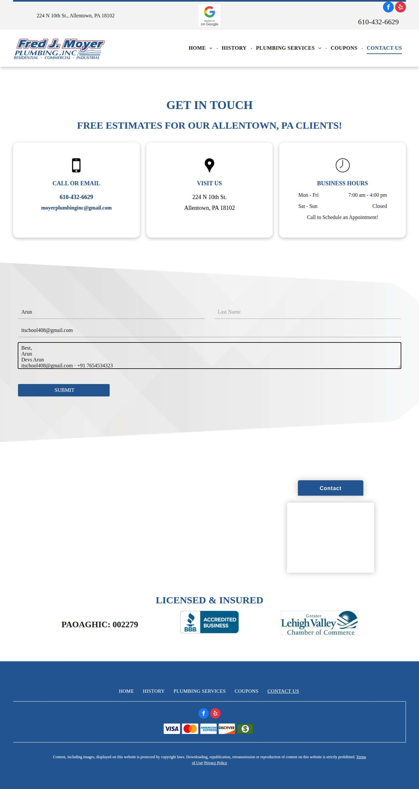

**After submit** — `run-ce59732f_attempt-eef9bdd6_post_attempt_2026-11-02T03-16-20-638Z.jpg`

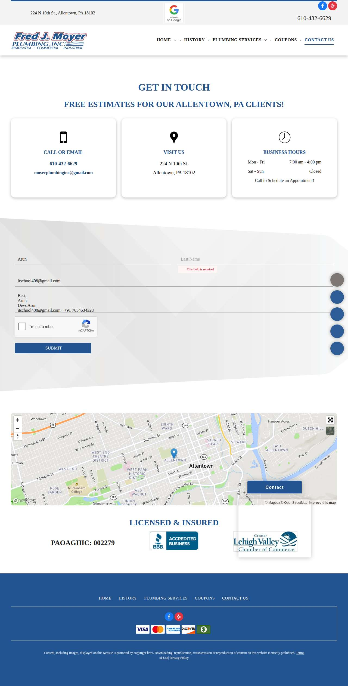

### millcreekplumbingllc.com — confirmed (LIVE)

| | |
|---|---|
| Attempt ID | `d1f427fb-4879-4b5b-a5f2-6b34adf0b4f5` |
| Form URL | http://millcreekplumbingllc.com/contact/ |
| Final URL | http://millcreekplumbingllc.com/contact/ |
| Reserved | 2026-11-02 03:16:27 UTC |
| Submit attempted | 2026-11-02 03:16:28 UTC |
| Template | standard v2 |
| Confirmation text | to provide 24/7 emergency services. Ask Us a Question Your message was sent successfully. Thanks. Your Name (required) Your Email (required) Subject Your Message Your message |
| Result / error | — |

Exact message:

~~~text
Subject: Helping customers find your business in AI search (AEO + GEO)

Hi there,

I'm Arun from Devs Arun. More and more customers now ask ChatGPT, Gemini, Perplexity or Google's AI Overviews questions like "who should I hire for this in my area?" before they call anyone. These tools answer from websites they can clearly understand, and they tend to recommend businesses whose pages answer real customer questions.

That is what AEO + GEO (Answer Engine and Generative Engine Optimization) is for. I improve your existing service pages so they clearly answer the questions your customers ask, add structured data that matches the page, and make the call, quote or enquiry step obvious. The benefit: your business gets a better chance of being mentioned or linked in AI answers, and visitors who arrive find it easy to contact you.

The AEO + GEO Starter is a one-time $199 (about ₹16,999, negotiable) for one website: a basic audit, 10 customer questions, improvements to two existing pages, relevant structured data and an action plan, with one revision round.

You can read the full details, send an enquiry or book online here:
https://devsarun.io/aeo-geo/

If this isn't relevant, just reply and I won't contact you again.

Best,
Arun
Devs Arun
itschool408@gmail.com · +91 7654534323
~~~

Submitted field values:

- your-name \[name\]: Arun
- your-email \[email\]: itschool408@gmail.com
- your-message \[message\]: Hi there, I'm Arun from Devs Arun. More and more customers now ask ChatGPT, Gemini, Perplexity or Google's AI Overviews 
- your-subject \[subject\]: Helping customers find your business in AI search (AEO + GEO)

**Filled form (before submit)** — `run-ce59732f_attempt-d1f427fb_filled_2026-11-02T03-16-28-120Z.jpg`

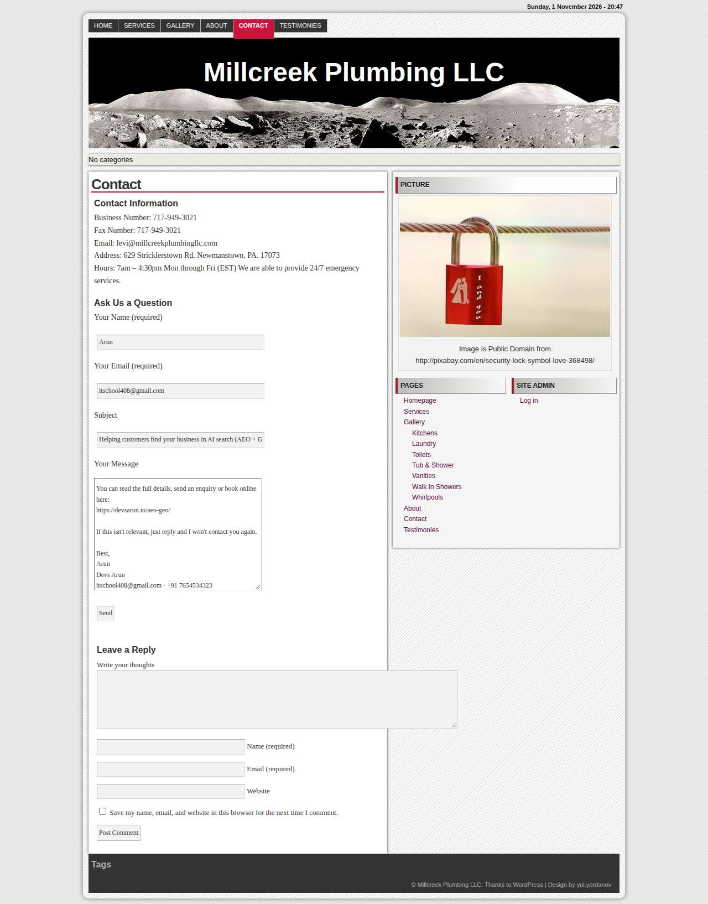

**After submit** — `run-ce59732f_attempt-d1f427fb_post_attempt_2026-11-02T03-16-30-639Z.jpg`

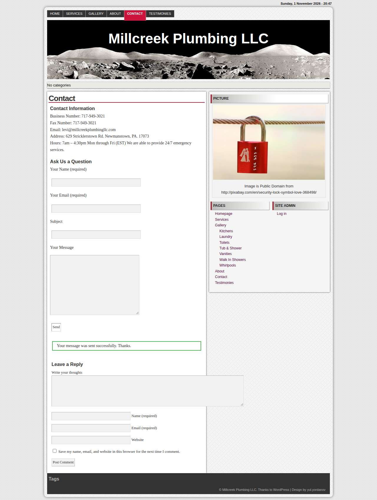

### thomasharkinsplumbing.com — confirmed (LIVE)

| | |
|---|---|
| Attempt ID | `f4f2c8c3-0709-4f0a-90c9-187c88c91206` |
| Form URL | https://www.thomasharkinsplumbing.com/contact |
| Final URL | https://www.thomasharkinsplumbing.com/contact |
| Reserved | 2026-11-02 03:16:37 UTC |
| Submit attempted | 2026-11-02 03:16:40 UTC |
| Template | standard v2 |
| Confirmation text | un Closed Get Directions Get In Touch With Rick Or Chad Now Thank you for contacting us. We will get back to you as soon as possible 518-828-1433 About Us Thomas Harkins Plumbing & Hea |
| Result / error | — |

Exact message:

~~~text
Subject: Helping customers find your business in AI search (AEO + GEO)

Hi there,

I'm Arun from Devs Arun. More and more customers now ask ChatGPT, Gemini, Perplexity or Google's AI Overviews questions like "who should I hire for this in my area?" before they call anyone. These tools answer from websites they can clearly understand, and they tend to recommend businesses whose pages answer real customer questions.

That is what AEO + GEO (Answer Engine and Generative Engine Optimization) is for. I improve your existing service pages so they clearly answer the questions your customers ask, add structured data that matches the page, and make the call, quote or enquiry step obvious. The benefit: your business gets a better chance of being mentioned or linked in AI answers, and visitors who arrive find it easy to contact you.

The AEO + GEO Starter is a one-time $199 (about ₹16,999, negotiable) for one website: a basic audit, 10 customer questions, improvements to two existing pages, relevant structured data and an action plan, with one revision round.

You can read the full details, send an enquiry or book online here:
https://devsarun.io/aeo-geo/

If this isn't relevant, just reply and I won't contact you again.

Best,
Arun
Devs Arun
itschool408@gmail.com · +91 7654534323
~~~

Submitted field values:

- Name: \[name\]: Arun
- Email: \[email\]: itschool408@gmail.com
- Phone: \[phone\]: +91 7654534323
- Message: \[message\]: Hi there, I'm Arun from Devs Arun. More and more customers now ask ChatGPT, Gemini, Perplexity or Google's AI Overviews 

**Filled form (before submit)** — `run-ce59732f_attempt-f4f2c8c3_filled_2026-11-02T03-16-40-049Z.jpg`

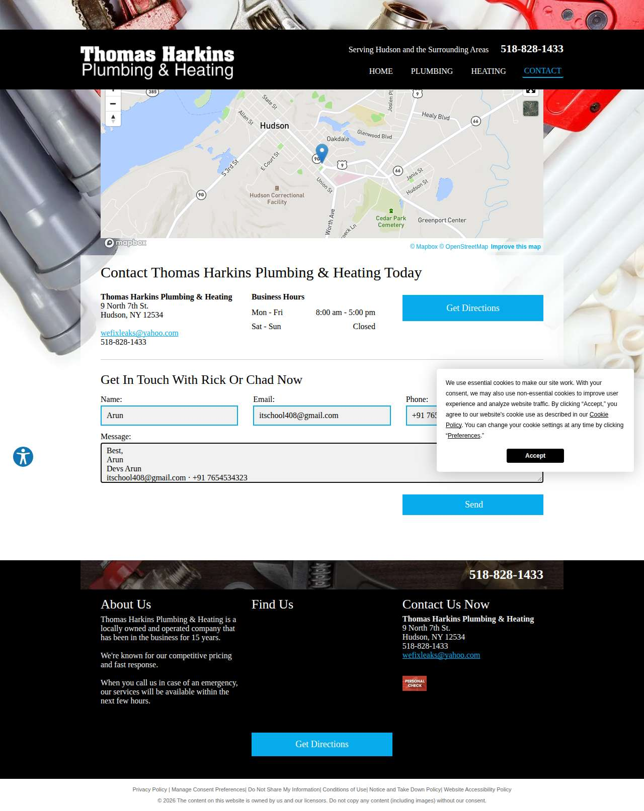

**After submit** — `run-ce59732f_attempt-f4f2c8c3_post_attempt_2026-11-02T03-16-42-895Z.jpg`

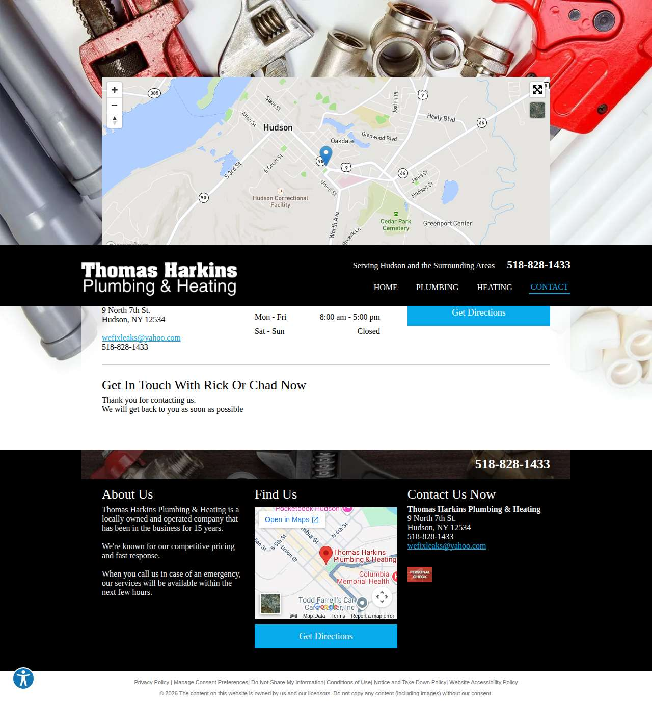

### finkeldeyseptic.com — unclear (LIVE)

| | |
|---|---|
| Attempt ID | `fba0e256-47fa-495a-849b-fee0d2624fc9` |
| Form URL | https://finkeldeyseptic.com/contact-us/ |
| Final URL | https://finkeldeyseptic.com/contact-us/ |
| Reserved | 2026-11-02 03:16:49 UTC |
| Submit attempted | 2026-11-02 03:16:51 UTC |
| Template | standard v2 |
| Confirmation text | none observed |
| Result / error | No new success marker observed |

Exact message:

~~~text
Subject: Helping customers find your business in AI search (AEO + GEO)

Hi there,

I'm Arun from Devs Arun. More and more customers now ask ChatGPT, Gemini, Perplexity or Google's AI Overviews questions like "who should I hire for this in my area?" before they call anyone. These tools answer from websites they can clearly understand, and they tend to recommend businesses whose pages answer real customer questions.

That is what AEO + GEO (Answer Engine and Generative Engine Optimization) is for. I improve your existing service pages so they clearly answer the questions your customers ask, add structured data that matches the page, and make the call, quote or enquiry step obvious. The benefit: your business gets a better chance of being mentioned or linked in AI answers, and visitors who arrive find it easy to contact you.

The AEO + GEO Starter is a one-time $199 (about ₹16,999, negotiable) for one website: a basic audit, 10 customer questions, improvements to two existing pages, relevant structured data and an action plan, with one revision round.

You can read the full details, send an enquiry or book online here:
https://devsarun.io/aeo-geo/

If this isn't relevant, just reply and I won't contact you again.

Best,
Arun
Devs Arun
itschool408@gmail.com · +91 7654534323
~~~

Submitted field values:

- Name \[name\]: Arun
- Email \[email\]: itschool408@gmail.com
- Phone Number \[phone\]: +91 7654534323
- Project Details & More (Optional) \[message\]: Hi there, I'm Arun from Devs Arun. More and more customers now ask ChatGPT, Gemini, Perplexity or Google's AI Overviews 

**Filled form (before submit)** — `run-ce59732f_attempt-fba0e256_filled_2026-11-02T03-16-51-272Z.jpg`

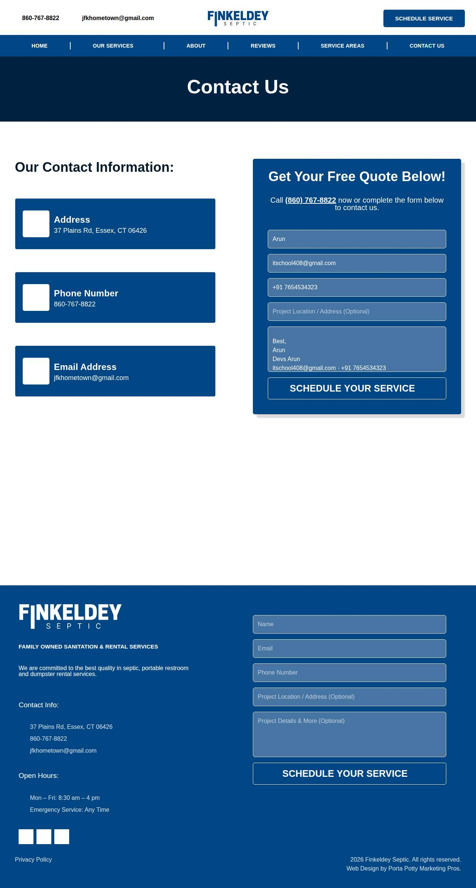

**After submit** — `run-ce59732f_attempt-fba0e256_post_attempt_2026-11-02T03-17-17-972Z.jpg`

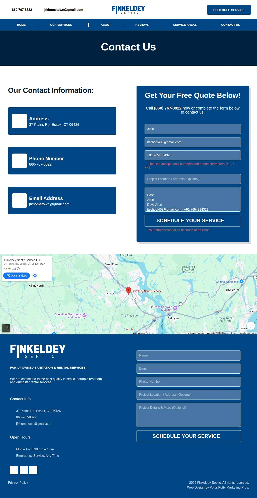

### integrityrepiping.com — unclear (LIVE)

| | |
|---|---|
| Attempt ID | `7bb0ca84-bffe-430a-8ab0-a834c9c2ff84` |
| Form URL | https://integrityrepiping.com/contact/ |
| Final URL | https://integrityrepiping.com/contact/ |
| Reserved | 2026-11-02 03:17:24 UTC |
| Submit attempted | 2026-11-02 03:17:25 UTC |
| Template | standard v2 |
| Confirmation text | none observed |
| Result / error | No new success marker observed |

Exact message:

~~~text
Subject: Helping customers find your business in AI search (AEO + GEO)

Hi there,

I'm Arun from Devs Arun. More and more customers now ask ChatGPT, Gemini, Perplexity or Google's AI Overviews questions like "who should I hire for this in my area?" before they call anyone. These tools answer from websites they can clearly understand, and they tend to recommend businesses whose pages answer real customer questions.

That is what AEO + GEO (Answer Engine and Generative Engine Optimization) is for. I improve your existing service pages so they clearly answer the questions your customers ask, add structured data that matches the page, and make the call, quote or enquiry step obvious. The benefit: your business gets a better chance of being mentioned or linked in AI answers, and visitors who arrive find it easy to contact you.

The AEO + GEO Starter is a one-time $199 (about ₹16,999, negotiable) for one website: a basic audit, 10 customer questions, improvements to two existing pages, relevant structured data and an action plan, with one revision round.

You can read the full details, send an enquiry or book online here:
https://devsarun.io/aeo-geo/

If this isn't relevant, just reply and I won't contact you again.

Best,
Arun
Devs Arun
itschool408@gmail.com · +91 7654534323
~~~

Submitted field values:

- Your Name \[name\]: Arun
- Phone Number \[phone\]: +91 7654534323
- Email Address \[email\]: itschool408@gmail.com
- How can we help? \[message\]: Hi there, I'm Arun from Devs Arun. More and more customers now ask ChatGPT, Gemini, Perplexity or Google's AI Overviews 

**Filled form (before submit)** — `run-ce59732f_attempt-7bb0ca84_filled_2026-11-02T03-17-25-755Z.jpg`

**After submit** — `run-ce59732f_attempt-7bb0ca84_post_attempt_2026-11-02T03-17-52-562Z.jpg`

### eliterooter.com — confirmed (LIVE)

| | |
|---|---|
| Attempt ID | `0c31f742-0d78-4181-953d-9d7367f26a54` |
| Form URL | https://www.eliterooter.com/contact-us/ |
| Final URL | https://www.eliterooter.com/contact-us/ |
| Reserved | 2026-11-02 03:17:59 UTC |
| Submit attempted | 2026-11-02 03:18:00 UTC |
| Template | standard v2 |
| Confirmation text | age Company website Name Phone Email Subject Message Submit Thank you\! Your message has been sent. We'll get back to you shortly. LOCATION Westminster office map 3656 W |
| Result / error | — |

Exact message:

~~~text
Subject: Helping customers find your business in AI search (AEO + GEO)

Hi there,

I'm Arun from Devs Arun. More and more customers now ask ChatGPT, Gemini, Perplexity or Google's AI Overviews questions like "who should I hire for this in my area?" before they call anyone. These tools answer from websites they can clearly understand, and they tend to recommend businesses whose pages answer real customer questions.

That is what AEO + GEO (Answer Engine and Generative Engine Optimization) is for. I improve your existing service pages so they clearly answer the questions your customers ask, add structured data that matches the page, and make the call, quote or enquiry step obvious. The benefit: your business gets a better chance of being mentioned or linked in AI answers, and visitors who arrive find it easy to contact you.

The AEO + GEO Starter is a one-time $199 (about ₹16,999, negotiable) for one website: a basic audit, 10 customer questions, improvements to two existing pages, relevant structured data and an action plan, with one revision round.

You can read the full details, send an enquiry or book online here:
https://devsarun.io/aeo-geo/

If this isn't relevant, just reply and I won't contact you again.

Best,
Arun
Devs Arun
itschool408@gmail.com · +91 7654534323
~~~

Submitted field values:

- Name \[name\]: Arun
- Email \[email\]: itschool408@gmail.com
- Phone \[phone\]: +91 7654534323
- Message \[message\]: Hi there, I'm Arun from Devs Arun. More and more customers now ask ChatGPT, Gemini, Perplexity or Google's AI Overviews 
- Subject \[subject\]: Helping customers find your business in AI search (AEO + GEO)

**Filled form (before submit)** — `run-ce59732f_attempt-0c31f742_filled_2026-11-02T03-18-00-991Z.jpg`

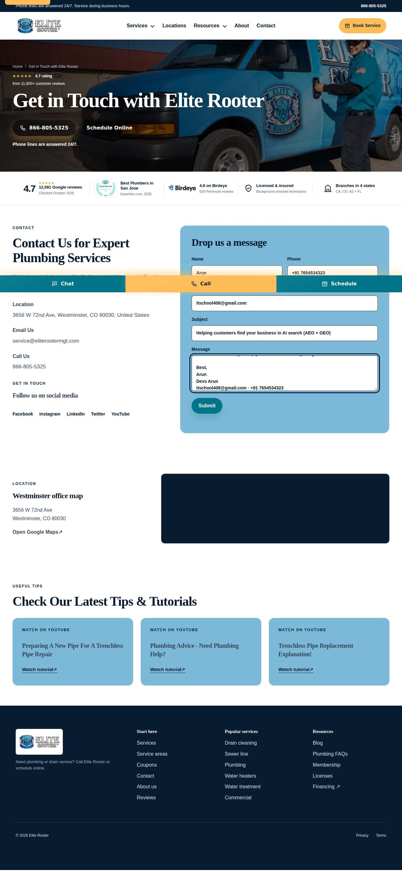

**After submit** — `run-ce59732f_attempt-0c31f742_post_attempt_2026-11-02T03-18-10-576Z.jpg`

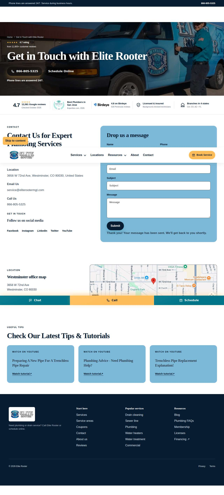

### peninsularplumbing.com — failed\_before\_submit (LIVE)

| | |
|---|---|
| Attempt ID | `a5ff4209-d050-4b37-a13f-eb30ea072494` |
| Form URL | https://peninsularplumbing.com/contact-peninsular-plumbing/ |
| Final URL | https://peninsularplumbing.com/contact-peninsular-plumbing/ |
| Reserved | 2026-11-02 03:18:17 UTC |
| Submit attempted | — |
| Template | standard v2 |
| Confirmation text | none observed |
| Result / error | Field "Phone\*" did not accept the value |

Exact message:

~~~text
Subject: Helping customers find your business in AI search (AEO + GEO)

Hi there,

I'm Arun from Devs Arun. More and more customers now ask ChatGPT, Gemini, Perplexity or Google's AI Overviews questions like "who should I hire for this in my area?" before they call anyone. These tools answer from websites they can clearly understand, and they tend to recommend businesses whose pages answer real customer questions.

That is what AEO + GEO (Answer Engine and Generative Engine Optimization) is for. I improve your existing service pages so they clearly answer the questions your customers ask, add structured data that matches the page, and make the call, quote or enquiry step obvious. The benefit: your business gets a better chance of being mentioned or linked in AI answers, and visitors who arrive find it easy to contact you.

The AEO + GEO Starter is a one-time $199 (about ₹16,999, negotiable) for one website: a basic audit, 10 customer questions, improvements to two existing pages, relevant structured data and an action plan, with one revision round.

You can read the full details, send an enquiry or book online here:
https://devsarun.io/aeo-geo/

If this isn't relevant, just reply and I won't contact you again.

Best,
Arun
Devs Arun
itschool408@gmail.com · +91 7654534323
~~~

Submitted field values:

- \#input\_1\_1: Arun
- \#input\_1\_2: itschool408@gmail.com
- \#input\_1\_3: +91 7654534323
- \#input\_1\_4: Hi there, I'm Arun from Devs Arun. More and more customers now ask ChatGPT, Gemini, Perplexity or Google's AI Overviews 

**Filled form (before submit)** — `run-ce59732f_attempt-a5ff4209_filled_2026-11-02T03-18-21-905Z.jpg`

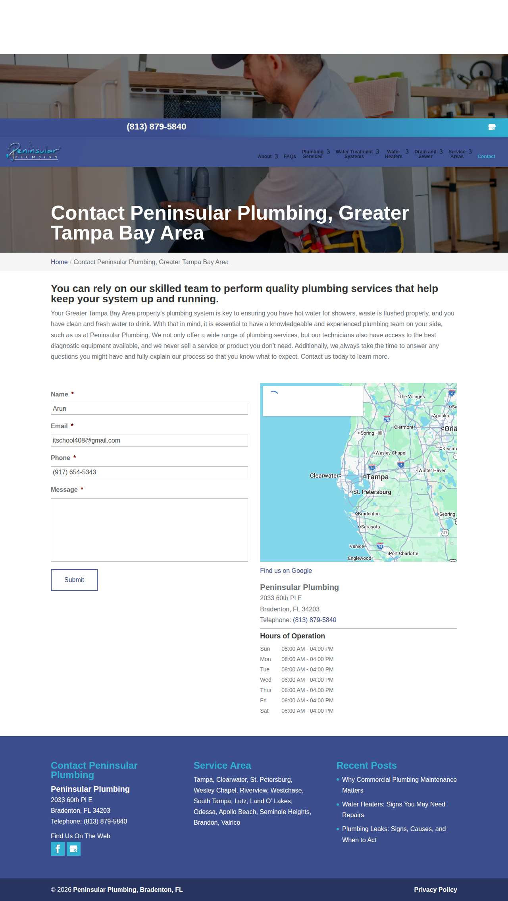

## Events (135)

| Time (UTC) | Event | Website | Details |
|---|---|---|---|
| 03:11:16 | run\_queued | — | live run requested by github:itsDevsArun |
| 03:11:16 | run\_dispatched | — | dispatch disabled (local test mode) |
| 03:11:18 | run\_started | — | Runner claimed live run |
| 03:11:19 | offer\_verified | — | Service page offer facts verified |
| 03:11:19 | website\_selected | tureksplumbing.com | Live target tureksplumbing.com |
| 03:11:19 | attempt\_reserved | tureksplumbing.com | Submission attempt reserved with template standard v2 |
| 03:11:22 | page\_opened | tureksplumbing.com | Opened form page |
| 03:11:22 | fields\_filled | tureksplumbing.com | filled |
| 03:11:22 | screenshot\_saved | tureksplumbing.com | filled screenshot saved (129 KB) |
| 03:11:22 | submit\_attempted | tureksplumbing.com | submitting |
| 03:11:25 | screenshot\_saved | tureksplumbing.com | post\_attempt screenshot saved (138 KB) |
| 03:11:25 | error | tureksplumbing.com | error after submit — "JOURNEYMAN PLUMBERS Read More The Following Errors Occurred Please enter your last name Please enter your zip code Pleas" |
| 03:11:31 | website\_selected | roddingrooter.com | Live target roddingrooter.com |
| 03:11:31 | attempt\_reserved | roddingrooter.com | Submission attempt reserved with template standard v2 |
| 03:11:33 | page\_opened | roddingrooter.com | Opened form page |
| 03:11:34 | fields\_filled | roddingrooter.com | filled |
| 03:11:34 | screenshot\_saved | roddingrooter.com | filled screenshot saved (170 KB) |
| 03:11:34 | submit\_attempted | roddingrooter.com | submitting |
| 03:12:00 | screenshot\_saved | roddingrooter.com | post\_attempt screenshot saved (165 KB) |
| 03:12:00 | review\_required | roddingrooter.com | unclear: No new success marker observed |
| 03:12:07 | website\_selected | performanceplumbinginc.com | Live target performanceplumbinginc.com |
| 03:12:07 | attempt\_reserved | performanceplumbinginc.com | Submission attempt reserved with template standard v2 |
| 03:12:08 | page\_opened | performanceplumbinginc.com | Opened form page |
| 03:12:09 | fields\_filled | performanceplumbinginc.com | filled |
| 03:12:09 | screenshot\_saved | performanceplumbinginc.com | filled screenshot saved (266 KB) |
| 03:12:09 | submit\_attempted | performanceplumbinginc.com | submitting |
| 03:12:36 | screenshot\_saved | performanceplumbinginc.com | post\_attempt screenshot saved (289 KB) |
| 03:12:36 | review\_required | performanceplumbinginc.com | unclear: No new success marker observed |
| 03:12:42 | website\_selected | integrityrepipe.com | Live target integrityrepipe.com |
| 03:12:42 | attempt\_reserved | integrityrepipe.com | Submission attempt reserved with template standard v2 |
| 03:12:43 | page\_opened | integrityrepipe.com | Opened form page |
| 03:12:44 | fields\_filled | integrityrepipe.com | filled |
| 03:12:44 | screenshot\_saved | integrityrepipe.com | filled screenshot saved (509 KB) |
| 03:12:44 | submit\_attempted | integrityrepipe.com | submitting |
| 03:12:47 | screenshot\_saved | integrityrepipe.com | post\_attempt screenshot saved (513 KB) |
| 03:12:47 | error | integrityrepipe.com | error after submit — "ndustry. One or more fields have an error. Please check and try again. The field is required. The field is required. The" |
| 03:12:53 | website\_selected | helpfulplumbing.com | Live target helpfulplumbing.com |
| 03:12:53 | attempt\_reserved | helpfulplumbing.com | Submission attempt reserved with template standard v2 |
| 03:12:55 | page\_opened | helpfulplumbing.com | Opened form page |
| 03:12:55 | fields\_filled | helpfulplumbing.com | filled |
| 03:12:55 | screenshot\_saved | helpfulplumbing.com | filled screenshot saved (141 KB) |
| 03:12:55 | submit\_attempted | helpfulplumbing.com | submitting |
| 03:13:23 | screenshot\_saved | helpfulplumbing.com | post\_attempt screenshot saved (143 KB) |
| 03:13:23 | review\_required | helpfulplumbing.com | unclear: No new success marker observed |
| 03:13:30 | website\_selected | lineyourpipes.com | Live target lineyourpipes.com |
| 03:13:30 | attempt\_reserved | lineyourpipes.com | Submission attempt reserved with template standard v2 |
| 03:13:34 | page\_opened | lineyourpipes.com | Opened form page |
| 03:13:34 | fields\_filled | lineyourpipes.com | filled |
| 03:13:34 | screenshot\_saved | lineyourpipes.com | filled screenshot saved (108 KB) |
| 03:13:34 | submit\_attempted | lineyourpipes.com | submitting |
| 03:14:09 | screenshot\_saved | lineyourpipes.com | post\_attempt screenshot saved (86 KB) |
| 03:14:09 | review\_required | lineyourpipes.com | unclear: No new success marker observed |
| 03:14:16 | website\_selected | tri-countyplumbing.com | Live target tri-countyplumbing.com |
| 03:14:16 | attempt\_reserved | tri-countyplumbing.com | Submission attempt reserved with template standard v2 |
| 03:14:18 | page\_opened | tri-countyplumbing.com | Opened form page |
| 03:14:18 | fields\_filled | tri-countyplumbing.com | filled |
| 03:14:18 | screenshot\_saved | tri-countyplumbing.com | filled screenshot saved (143 KB) |
| 03:14:18 | submit\_attempted | tri-countyplumbing.com | submitting |
| 03:14:45 | screenshot\_saved | tri-countyplumbing.com | post\_attempt screenshot saved (126 KB) |
| 03:14:45 | review\_required | tri-countyplumbing.com | unclear: No new success marker observed |
| 03:14:51 | website\_selected | rotorooterbck.com | Live target rotorooterbck.com |
| 03:14:51 | attempt\_reserved | rotorooterbck.com | Submission attempt reserved with template standard v2 |
| 03:14:53 | page\_opened | rotorooterbck.com | Opened form page |
| 03:14:54 | fields\_filled | rotorooterbck.com | filled |
| 03:14:54 | screenshot\_saved | rotorooterbck.com | filled screenshot saved (358 KB) |
| 03:14:54 | submit\_attempted | rotorooterbck.com | submitting |
| 03:15:22 | screenshot\_saved | rotorooterbck.com | post\_attempt screenshot saved (370 KB) |
| 03:15:22 | review\_required | rotorooterbck.com | unclear: No new success marker observed |
| 03:15:29 | website\_selected | oneillplumbing.com | Live target oneillplumbing.com |
| 03:15:29 | attempt\_reserved | oneillplumbing.com | Submission attempt reserved with template standard v2 |
| 03:15:34 | page\_opened | oneillplumbing.com | Opened form page |
| 03:15:34 | screenshot\_saved | oneillplumbing.com | filled screenshot saved (132 KB) |
| 03:15:34 | review\_required | oneillplumbing.com | failed before submit: Field "Phone" did not accept the value |
| 03:15:39 | website\_selected | precisionplumbingoc.com | Live target precisionplumbingoc.com |
| 03:15:39 | attempt\_reserved | precisionplumbingoc.com | Submission attempt reserved with template standard v2 |
| 03:15:40 | page\_opened | precisionplumbingoc.com | Opened form page |
| 03:15:40 | fields\_filled | precisionplumbingoc.com | filled |
| 03:15:40 | screenshot\_saved | precisionplumbingoc.com | filled screenshot saved (590 KB) |
| 03:15:40 | submit\_attempted | precisionplumbingoc.com | submitting |
| 03:16:09 | screenshot\_saved | precisionplumbingoc.com | post\_attempt screenshot saved (616 KB) |
| 03:16:09 | review\_required | precisionplumbingoc.com | unclear: No new success marker observed |
| 03:16:16 | website\_selected | fredjmoyer.com | Live target fredjmoyer.com |
| 03:16:16 | attempt\_reserved | fredjmoyer.com | Submission attempt reserved with template standard v2 |
| 03:16:17 | page\_opened | fredjmoyer.com | Opened form page |
| 03:16:17 | fields\_filled | fredjmoyer.com | filled |
| 03:16:18 | screenshot\_saved | fredjmoyer.com | filled screenshot saved (113 KB) |
| 03:16:18 | submit\_attempted | fredjmoyer.com | submitting |
| 03:16:20 | screenshot\_saved | fredjmoyer.com | post\_attempt screenshot saved (171 KB) |
| 03:16:20 | error | fredjmoyer.com | error after submit — "- 4:00 pm Sat - Sun Closed Call to Schedule an Appointment\! This field is required © Mapbox © OpenStreetMap Improve this" |
| 03:16:27 | website\_selected | millcreekplumbingllc.com | Live target millcreekplumbingllc.com |
| 03:16:27 | attempt\_reserved | millcreekplumbingllc.com | Submission attempt reserved with template standard v2 |
| 03:16:27 | page\_opened | millcreekplumbingllc.com | Opened form page |
| 03:16:28 | fields\_filled | millcreekplumbingllc.com | filled |
| 03:16:28 | screenshot\_saved | millcreekplumbingllc.com | filled screenshot saved (189 KB) |
| 03:16:28 | submit\_attempted | millcreekplumbingllc.com | submitting |
| 03:16:30 | screenshot\_saved | millcreekplumbingllc.com | post\_attempt screenshot saved (189 KB) |
| 03:16:30 | confirmation\_observed | millcreekplumbingllc.com | confirmed — "to provide 24/7 emergency services. Ask Us a Question Your message was sent successfully. Thanks. Your Name (required) Y" |
| 03:16:37 | website\_selected | thomasharkinsplumbing.com | Live target thomasharkinsplumbing.com |
| 03:16:37 | attempt\_reserved | thomasharkinsplumbing.com | Submission attempt reserved with template standard v2 |
| 03:16:39 | page\_opened | thomasharkinsplumbing.com | Opened form page |
| 03:16:39 | fields\_filled | thomasharkinsplumbing.com | filled |
| 03:16:40 | screenshot\_saved | thomasharkinsplumbing.com | filled screenshot saved (153 KB) |
| 03:16:40 | submit\_attempted | thomasharkinsplumbing.com | submitting |
| 03:16:42 | screenshot\_saved | thomasharkinsplumbing.com | post\_attempt screenshot saved (148 KB) |
| 03:16:42 | confirmation\_observed | thomasharkinsplumbing.com | confirmed — "un Closed Get Directions Get In Touch With Rick Or Chad Now Thank you for contacting us. We will get back to you as soon" |
| 03:16:49 | website\_selected | finkeldeyseptic.com | Live target finkeldeyseptic.com |
| 03:16:49 | attempt\_reserved | finkeldeyseptic.com | Submission attempt reserved with template standard v2 |
| 03:16:50 | page\_opened | finkeldeyseptic.com | Opened form page |
| 03:16:51 | fields\_filled | finkeldeyseptic.com | filled |
| 03:16:51 | screenshot\_saved | finkeldeyseptic.com | filled screenshot saved (136 KB) |
| 03:16:51 | submit\_attempted | finkeldeyseptic.com | submitting |
| 03:17:17 | screenshot\_saved | finkeldeyseptic.com | post\_attempt screenshot saved (194 KB) |
| 03:17:17 | review\_required | finkeldeyseptic.com | unclear: No new success marker observed |
| 03:17:24 | website\_selected | integrityrepiping.com | Live target integrityrepiping.com |
| 03:17:24 | attempt\_reserved | integrityrepiping.com | Submission attempt reserved with template standard v2 |
| 03:17:25 | page\_opened | integrityrepiping.com | Opened form page |
| 03:17:25 | fields\_filled | integrityrepiping.com | filled |
| 03:17:25 | screenshot\_saved | integrityrepiping.com | filled screenshot saved (100 KB) |
| 03:17:25 | submit\_attempted | integrityrepiping.com | submitting |
| 03:17:52 | screenshot\_saved | integrityrepiping.com | post\_attempt screenshot saved (113 KB) |
| 03:17:52 | review\_required | integrityrepiping.com | unclear: No new success marker observed |
| 03:17:59 | website\_selected | eliterooter.com | Live target eliterooter.com |
| 03:17:59 | attempt\_reserved | eliterooter.com | Submission attempt reserved with template standard v2 |
| 03:18:00 | page\_opened | eliterooter.com | Opened form page |
| 03:18:00 | fields\_filled | eliterooter.com | filled |
| 03:18:00 | screenshot\_saved | eliterooter.com | filled screenshot saved (191 KB) |
| 03:18:00 | submit\_attempted | eliterooter.com | submitting |
| 03:18:10 | screenshot\_saved | eliterooter.com | post\_attempt screenshot saved (202 KB) |
| 03:18:10 | confirmation\_observed | eliterooter.com | confirmed — "age Company website Name Phone Email Subject Message Submit Thank you\! Your message has been sent. We'll get back to you" |
| 03:18:17 | website\_selected | peninsularplumbing.com | Live target peninsularplumbing.com |
| 03:18:17 | attempt\_reserved | peninsularplumbing.com | Submission attempt reserved with template standard v2 |
| 03:18:21 | page\_opened | peninsularplumbing.com | Opened form page |
| 03:18:21 | screenshot\_saved | peninsularplumbing.com | filled screenshot saved (175 KB) |
| 03:18:21 | review\_required | peninsularplumbing.com | failed before submit: Field "Phone\*" did not accept the value |
| 03:18:26 | run\_completed | — | Run completed (queue\_exhausted) |
