# Run d574e5c4 — live — completed

| | |
|---|---|
| Run ID | `d574e5c4-b454-4107-bf43-21964033ceab` |
| Requested by | github:itsDevsArun |
| Started | 2026-11-02 05:43:19 UTC |
| Finished | 2026-11-02 05:47:17 UTC |
| Finish reason | queue\_exhausted |
| GitHub Actions | https://github.com/itsDevsArun/aeo-geo/actions/runs/41379081570 |

CSV for this run: [runs/2026-11-02_live_d574e5c4.csv](2026-11-02_live_d574e5c4.csv)

## Attempts (12)

### clearchoiceplumbingllc.com — failed\_before\_submit (LIVE)

| | |
|---|---|
| Attempt ID | `67ffafa3-82d7-408e-838d-37e0321109c0` |
| Form URL | https://clearchoiceplumbingllc.com/contact/ |
| Final URL | — |
| Reserved | 2026-11-02 05:43:21 UTC |
| Submit attempted | — |
| Template | standard v2 |
| Confirmation text | none observed |
| Result / error | locator.fill: Error: Cannot type text into input\[type=number\] |

Exact message:

~~~text
Subject: Helping customers find your business in AI search (AEO + GEO)

Hi there,

I'm Arun from Devs Arun. More and more customers now ask ChatGPT, Gemini, Perplexity or Google's AI Overviews questions like "who should I hire for this in my area?" before they call anyone. These tools answer from websites they can clearly understand, and they tend to recommend businesses whose pages answer real customer questions.

That is what AEO + GEO (Answer Engine and Generative Engine Optimization) is for. I improve your existing service pages so they clearly answer the questions your customers ask, add structured data that matches the page, and make the call, quote or enquiry step obvious. The benefit: your business gets a better chance of being mentioned or linked in AI answers, and visitors who arrive find it easy to contact you.

The AEO + GEO Starter is a one-time $199 (about ₹16,999, negotiable) for one website: a basic audit, 10 customer questions, improvements to two existing pages, relevant structured data and an action plan, with one revision round.

You can read the full details, send an enquiry or book online here:
https://devsarun.io/aeo-geo/

If this isn't relevant, just reply and I won't contact you again.

Best,
Arun
Devs Arun
itschool408@gmail.com · +91 7654534323
~~~

Submitted field values:

- \#wpforms-51-field\_1: Arun
- \#wpforms-51-field\_2: itschool408@gmail.com
- \#wpforms-51-field\_3: Hi there, I'm Arun from Devs Arun. More and more customers now ask ChatGPT, Gemini, Perplexity or Google's AI Overviews 
- \#wpforms-51-field\_5: +91 7654534323

**Inspected page** — `run-d574e5c4_attempt-67ffafa3_inspection_2026-11-02T05-43-22-941Z.jpg`

### ameengeneralcontracting.com — failed\_before\_submit (LIVE)

| | |
|---|---|
| Attempt ID | `6f9b3609-0506-4b7a-8145-63c479c649bb` |
| Form URL | https://ameengeneralcontracting.com/contact-ameen-general-contracting/ |
| Final URL | — |
| Reserved | 2026-11-02 05:43:27 UTC |
| Submit attempted | — |
| Template | standard v2 |
| Confirmation text | none observed |
| Result / error | locator.fill: Error: Cannot type text into input\[type=number\] |

Exact message:

~~~text
Subject: Helping customers find your business in AI search (AEO + GEO)

Hi there,

I'm Arun from Devs Arun. More and more customers now ask ChatGPT, Gemini, Perplexity or Google's AI Overviews questions like "who should I hire for this in my area?" before they call anyone. These tools answer from websites they can clearly understand, and they tend to recommend businesses whose pages answer real customer questions.

That is what AEO + GEO (Answer Engine and Generative Engine Optimization) is for. I improve your existing service pages so they clearly answer the questions your customers ask, add structured data that matches the page, and make the call, quote or enquiry step obvious. The benefit: your business gets a better chance of being mentioned or linked in AI answers, and visitors who arrive find it easy to contact you.

The AEO + GEO Starter is a one-time $199 (about ₹16,999, negotiable) for one website: a basic audit, 10 customer questions, improvements to two existing pages, relevant structured data and an action plan, with one revision round.

You can read the full details, send an enquiry or book online here:
https://devsarun.io/aeo-geo/

If this isn't relevant, just reply and I won't contact you again.

Best,
Arun
Devs Arun
itschool408@gmail.com · +91 7654534323
~~~

Submitted field values:

- \#wpforms-1233-field\_1: Arun
- \#wpforms-1233-field\_2: itschool408@gmail.com
- \#wpforms-1233-field\_3: Hi there, I'm Arun from Devs Arun. More and more customers now ask ChatGPT, Gemini, Perplexity or Google's AI Overviews 
- \#wpforms-1233-field\_4: +91 7654534323
- \#wpforms-1233-field\_5: Other
- \#wpforms-1233-field\_6: +91 7654534323

**Inspected page** — `run-d574e5c4_attempt-6f9b3609_inspection_2026-11-02T05-43-29-994Z.jpg`

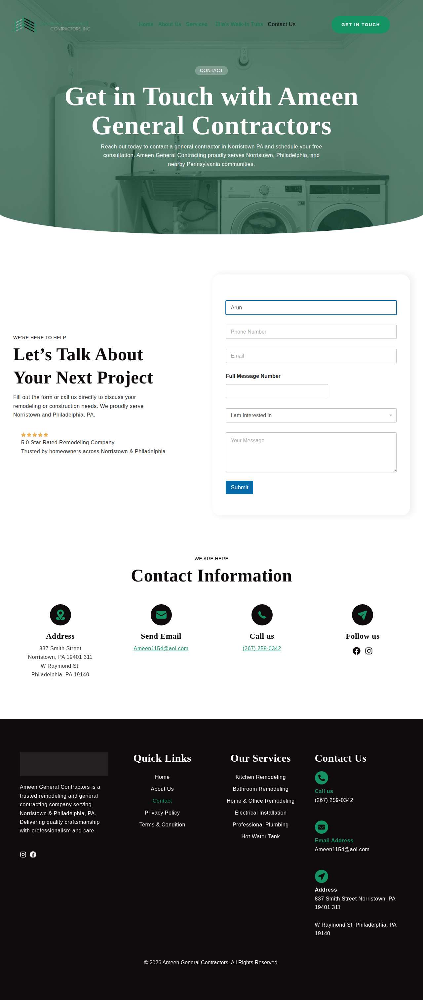

### heinscontracting.com — failed\_before\_submit (LIVE)

| | |
|---|---|
| Attempt ID | `91646553-6f59-436c-adad-37f2bdbb39d5` |
| Form URL | https://www.heinscontracting.com/contact |
| Final URL | https://www.heinscontracting.com/contact |
| Reserved | 2026-11-02 05:43:35 UTC |
| Submit attempted | — |
| Template | short v2 |
| Confirmation text | none observed |
| Result / error | Field "Phone" did not accept the value |

Exact message:

~~~text
Subject: Helping customers find your business in AI search (AEO + GEO)

Hi there,

I'm Arun from Devs Arun. Customers increasingly ask ChatGPT, Gemini and Google's AI Overviews who to hire before they call anyone. AEO + GEO makes your existing service pages clear answers these tools can understand and cite, with an easy way to call or enquire, so your business has a better chance of being recommended.

The AEO + GEO Starter is a one-time $199 (about ₹16,999, negotiable) for one website.

Full details, enquiries and online booking:
https://devsarun.io/aeo-geo/

If this isn't relevant, just reply and I won't contact you again.

Best,
Arun, Devs Arun
itschool408@gmail.com
~~~

Submitted field values:

- \#message: Hi there, I'm Arun from Devs Arun. Customers increasingly ask ChatGPT, Gemini and Google's AI Overviews who to hire befo
- \#mvk1fnd8-gkb7eofhw \> div \> div:nth-of-type(1) \> div \> div \> div \> input: Arun
- \#mvk1fnd8-gkb7eofhw \> div \> div:nth-of-type(3) \> div \> div \> div \> input: itschool408@gmail.com
- \#mvk1fnd8-gkb7eofhw \> div \> div:nth-of-type(4) \> div \> div \> div \> input: +91 7654534323

**Filled form (before submit)** — `run-d574e5c4_attempt-91646553_filled_2026-11-02T05-43-37-996Z.jpg`

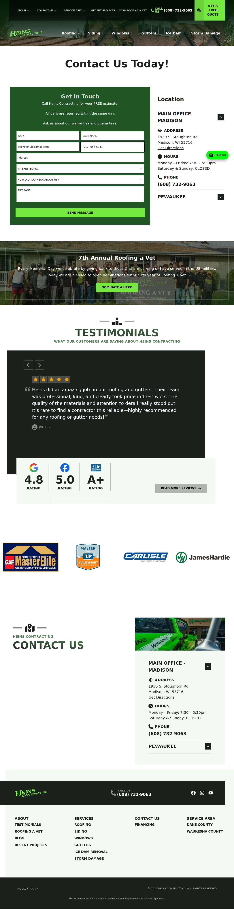

### collins-mrc.com — confirmed (LIVE)

| | |
|---|---|
| Attempt ID | `c20cf13e-d37d-408e-818e-c34a19322a7e` |
| Form URL | https://collins-mrc.com/quote/ |
| Final URL | https://collins-mrc.com/thank-you/ |
| Reserved | 2026-11-02 05:43:43 UTC |
| Submit attempted | 2026-11-02 05:43:44 UTC |
| Template | standard v2 |
| Confirmation text | Redirected to /thank-you/ |
| Result / error | — |

Exact message:

~~~text
Subject: Helping customers find your business in AI search (AEO + GEO)

Hi there,

I'm Arun from Devs Arun. More and more customers now ask ChatGPT, Gemini, Perplexity or Google's AI Overviews questions like "who should I hire for this in my area?" before they call anyone. These tools answer from websites they can clearly understand, and they tend to recommend businesses whose pages answer real customer questions.

That is what AEO + GEO (Answer Engine and Generative Engine Optimization) is for. I improve your existing service pages so they clearly answer the questions your customers ask, add structured data that matches the page, and make the call, quote or enquiry step obvious. The benefit: your business gets a better chance of being mentioned or linked in AI answers, and visitors who arrive find it easy to contact you.

The AEO + GEO Starter is a one-time $199 (about ₹16,999, negotiable) for one website: a basic audit, 10 customer questions, improvements to two existing pages, relevant structured data and an action plan, with one revision round.

You can read the full details, send an enquiry or book online here:
https://devsarun.io/aeo-geo/

If this isn't relevant, just reply and I won't contact you again.

Best,
Arun
Devs Arun
itschool408@gmail.com · +91 7654534323
~~~

Submitted field values:

- Name\* \[name\]: Arun
- Email\* \[email\]: itschool408@gmail.com
- Phone (optional) \[phone\]: +91 7654534323
- Tell us about your roof \[message\]: Hi there, I'm Arun from Devs Arun. More and more customers now ask ChatGPT, Gemini, Perplexity or Google's AI Overviews 

**Filled form (before submit)** — `run-d574e5c4_attempt-c20cf13e_filled_2026-11-02T05-43-44-616Z.jpg`

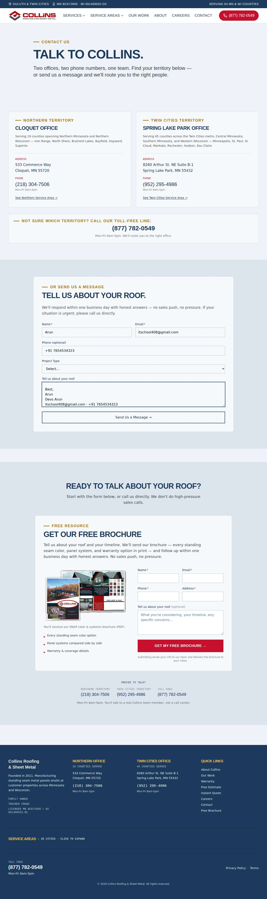

**After submit** — `run-d574e5c4_attempt-c20cf13e_post_attempt_2026-11-02T05-43-48-650Z.jpg`

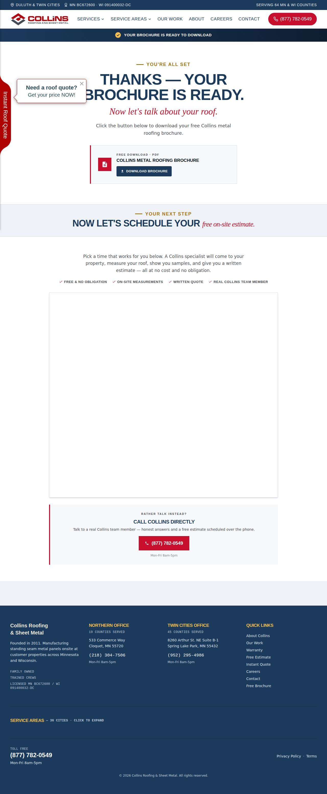

### chappelleroofing.com — error\_after\_submit (LIVE)

| | |
|---|---|
| Attempt ID | `4ef2edf5-71ef-4aaf-aa27-a583717b5912` |
| Form URL | https://chappelleroofing.com/contact-us/ |
| Final URL | https://chappelleroofing.com/contact-us/ |
| Reserved | 2026-11-02 05:43:55 UTC |
| Submit attempted | 2026-11-02 05:43:59 UTC |
| Template | standard v2 |
| Confirmation text | nspection \*\*\* Forbidden. You submitted too quickly. You may try again in a few seconds. Contains contacts. Anti-Spam by CleanTalk. \*\*\* By providing your phone number, yo |
| Result / error | — |

Exact message:

~~~text
Subject: Helping customers find your business in AI search (AEO + GEO)

Hi there,

I'm Arun from Devs Arun. More and more customers now ask ChatGPT, Gemini, Perplexity or Google's AI Overviews questions like "who should I hire for this in my area?" before they call anyone. These tools answer from websites they can clearly understand, and they tend to recommend businesses whose pages answer real customer questions.

That is what AEO + GEO (Answer Engine and Generative Engine Optimization) is for. I improve your existing service pages so they clearly answer the questions your customers ask, add structured data that matches the page, and make the call, quote or enquiry step obvious. The benefit: your business gets a better chance of being mentioned or linked in AI answers, and visitors who arrive find it easy to contact you.

The AEO + GEO Starter is a one-time $199 (about ₹16,999, negotiable) for one website: a basic audit, 10 customer questions, improvements to two existing pages, relevant structured data and an action plan, with one revision round.

You can read the full details, send an enquiry or book online here:
https://devsarun.io/aeo-geo/

If this isn't relevant, just reply and I won't contact you again.

Best,
Arun
Devs Arun
itschool408@gmail.com · +91 7654534323
~~~

Submitted field values:

- Email \[email\]: itschool408@gmail.com
- Full Name \[name\]: Arun
- Message \[message\]: Hi there, I'm Arun from Devs Arun. More and more customers now ask ChatGPT, Gemini, Perplexity or Google's AI Overviews 
- Phone number \[phone\]: +91 7654534323
- Prefered method of contact \[fixed\]: Email

**Filled form (before submit)** — `run-d574e5c4_attempt-4ef2edf5_filled_2026-11-02T05-43-59-193Z.jpg`

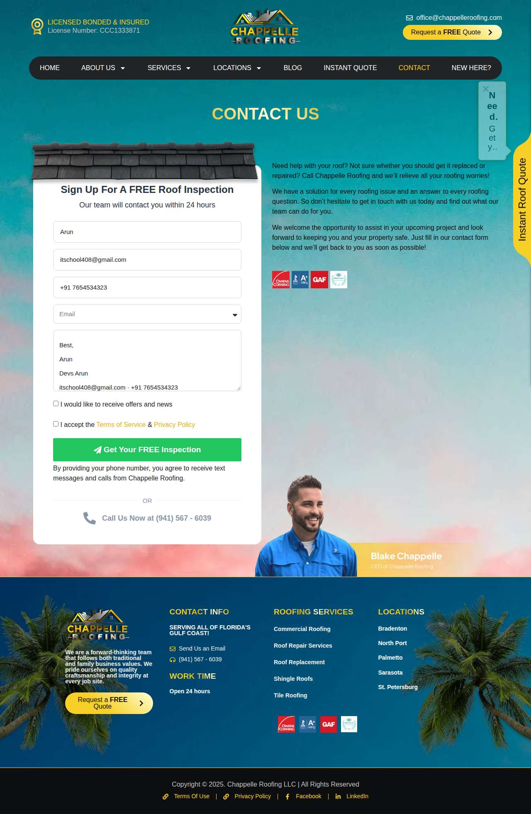

**After submit** — `run-d574e5c4_attempt-4ef2edf5_post_attempt_2026-11-02T05-44-04-299Z.jpg`

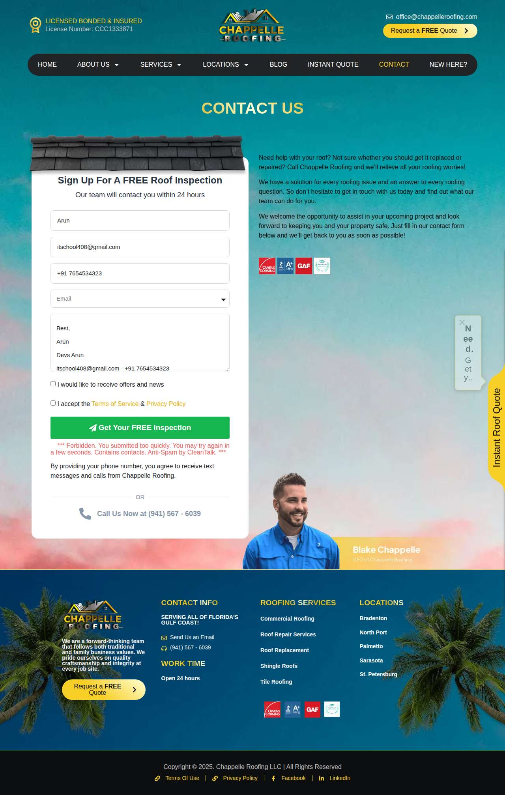

### campbellext.com — unclear (LIVE)

| | |
|---|---|
| Attempt ID | `c1fd750e-e545-4173-b134-1237e353fa49` |
| Form URL | https://www.campbellext.com/contact |
| Final URL | https://www.campbellext.com/contact |
| Reserved | 2026-11-02 05:44:10 UTC |
| Submit attempted | 2026-11-02 05:44:13 UTC |
| Template | standard v2 |
| Confirmation text | none observed |
| Result / error | No new success marker observed |

Exact message:

~~~text
Subject: Helping customers find your business in AI search (AEO + GEO)

Hi there,

I'm Arun from Devs Arun. More and more customers now ask ChatGPT, Gemini, Perplexity or Google's AI Overviews questions like "who should I hire for this in my area?" before they call anyone. These tools answer from websites they can clearly understand, and they tend to recommend businesses whose pages answer real customer questions.

That is what AEO + GEO (Answer Engine and Generative Engine Optimization) is for. I improve your existing service pages so they clearly answer the questions your customers ask, add structured data that matches the page, and make the call, quote or enquiry step obvious. The benefit: your business gets a better chance of being mentioned or linked in AI answers, and visitors who arrive find it easy to contact you.

The AEO + GEO Starter is a one-time $199 (about ₹16,999, negotiable) for one website: a basic audit, 10 customer questions, improvements to two existing pages, relevant structured data and an action plan, with one revision round.

You can read the full details, send an enquiry or book online here:
https://devsarun.io/aeo-geo/

If this isn't relevant, just reply and I won't contact you again.

Best,
Arun
Devs Arun
itschool408@gmail.com · +91 7654534323
~~~

Submitted field values:

- name \[name\]: Arun
- email \[email\]: itschool408@gmail.com
- phone \[phone\]: +91 7654534323
- Type your message here... \[message\]: Hi there, I'm Arun from Devs Arun. More and more customers now ask ChatGPT, Gemini, Perplexity or Google's AI Overviews 

**Filled form (before submit)** — `run-d574e5c4_attempt-c1fd750e_filled_2026-11-02T05-44-13-786Z.jpg`

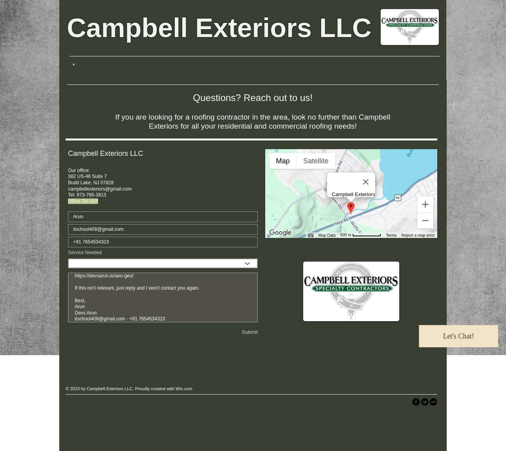

**After submit** — `run-d574e5c4_attempt-c1fd750e_post_attempt_2026-11-02T05-44-40-521Z.jpg`

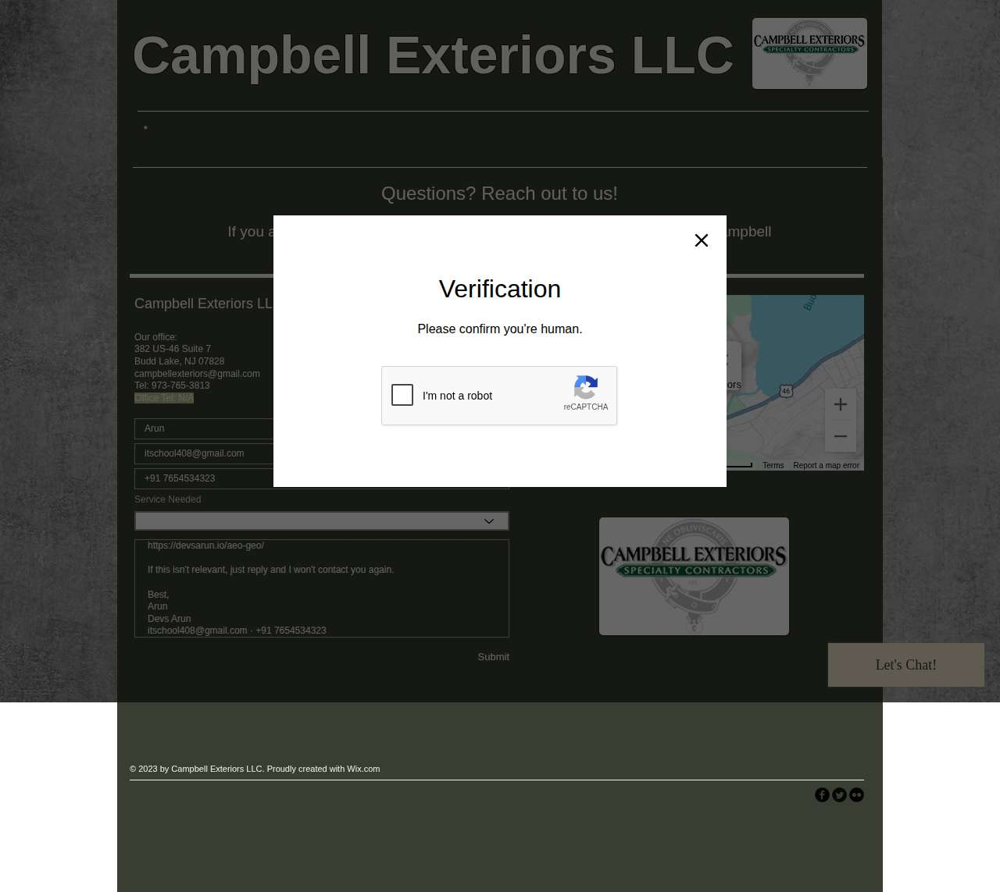

### newimageroofing.net — unclear (LIVE)

| | |
|---|---|
| Attempt ID | `c4f4ef7f-ff8c-405d-ba32-945400945ce1` |
| Form URL | https://newimageroofinghtx.com/contact-us/ |
| Final URL | https://newimageroofinghtx.com/contact-us/ |
| Reserved | 2026-11-02 05:44:47 UTC |
| Submit attempted | 2026-11-02 05:44:49 UTC |
| Template | standard v2 |
| Confirmation text | none observed |
| Result / error | No new success marker observed |

Exact message:

~~~text
Subject: Helping customers find your business in AI search (AEO + GEO)

Hi there,

I'm Arun from Devs Arun. More and more customers now ask ChatGPT, Gemini, Perplexity or Google's AI Overviews questions like "who should I hire for this in my area?" before they call anyone. These tools answer from websites they can clearly understand, and they tend to recommend businesses whose pages answer real customer questions.

That is what AEO + GEO (Answer Engine and Generative Engine Optimization) is for. I improve your existing service pages so they clearly answer the questions your customers ask, add structured data that matches the page, and make the call, quote or enquiry step obvious. The benefit: your business gets a better chance of being mentioned or linked in AI answers, and visitors who arrive find it easy to contact you.

The AEO + GEO Starter is a one-time $199 (about ₹16,999, negotiable) for one website: a basic audit, 10 customer questions, improvements to two existing pages, relevant structured data and an action plan, with one revision round.

You can read the full details, send an enquiry or book online here:
https://devsarun.io/aeo-geo/

If this isn't relevant, just reply and I won't contact you again.

Best,
Arun
Devs Arun
itschool408@gmail.com · +91 7654534323
~~~

Submitted field values:

- Name \[name\]: Arun
- Email \[email\]: itschool408@gmail.com
- Message \[message\]: Hi there, I'm Arun from Devs Arun. More and more customers now ask ChatGPT, Gemini, Perplexity or Google's AI Overviews 
- Phone Number \[phone\]: +91 7654534323

**Filled form (before submit)** — `run-d574e5c4_attempt-c4f4ef7f_filled_2026-11-02T05-44-49-767Z.jpg`

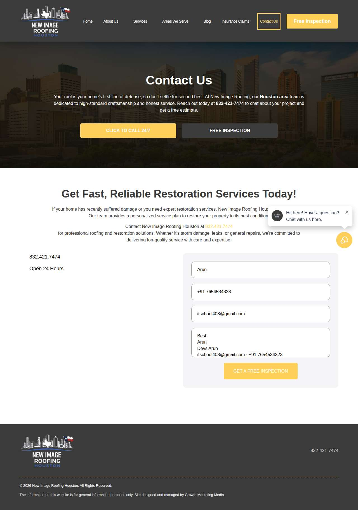

**After submit** — `run-d574e5c4_attempt-c4f4ef7f_post_attempt_2026-11-02T05-45-16-792Z.jpg`

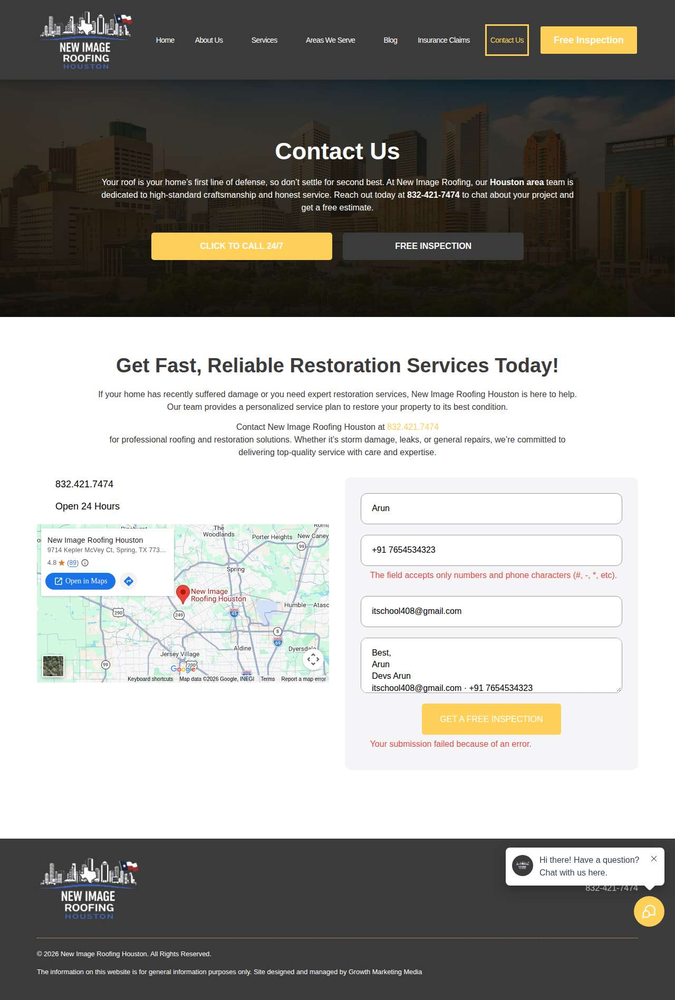

### calvaryroofingtx.com — error\_after\_submit (LIVE)

| | |
|---|---|
| Attempt ID | `ce00e08e-ecda-4018-92e9-db5894a099a6` |
| Form URL | https://calvaryroofingtx.com/contact |
| Final URL | https://calvaryroofingtx.com/contact |
| Reserved | 2026-11-02 05:45:23 UTC |
| Submit attempted | 2026-11-02 05:45:26 UTC |
| Template | short v2 |
| Confirmation text | o you within a few hours. NAME PHONE EMAIL PROPERTY ADDRESS Please enter your property address SERVICE NEEDED Select a service… Roofing Contractor Metal Roofing Flat Roofin |
| Result / error | — |

Exact message:

~~~text
Subject: Helping customers find your business in AI search (AEO + GEO)

Hi there,

I'm Arun from Devs Arun. Customers increasingly ask ChatGPT, Gemini and Google's AI Overviews who to hire before they call anyone. AEO + GEO makes your existing service pages clear answers these tools can understand and cite, with an easy way to call or enquire, so your business has a better chance of being recommended.

The AEO + GEO Starter is a one-time $199 (about ₹16,999, negotiable) for one website.

Full details, enquiries and online booking:
https://devsarun.io/aeo-geo/

If this isn't relevant, just reply and I won't contact you again.

Best,
Arun, Devs Arun
itschool408@gmail.com
~~~

Submitted field values:

- NAME \[name\]: Arun
- EMAIL \[email\]: itschool408@gmail.com
- PHONE \[phone\]: +91 7654534323
- MESSAGE \[message\]: Hi there, I'm Arun from Devs Arun. Customers increasingly ask ChatGPT, Gemini and Google's AI Overviews who to hire befo

**Filled form (before submit)** — `run-d574e5c4_attempt-ce00e08e_filled_2026-11-02T05-45-26-331Z.jpg`

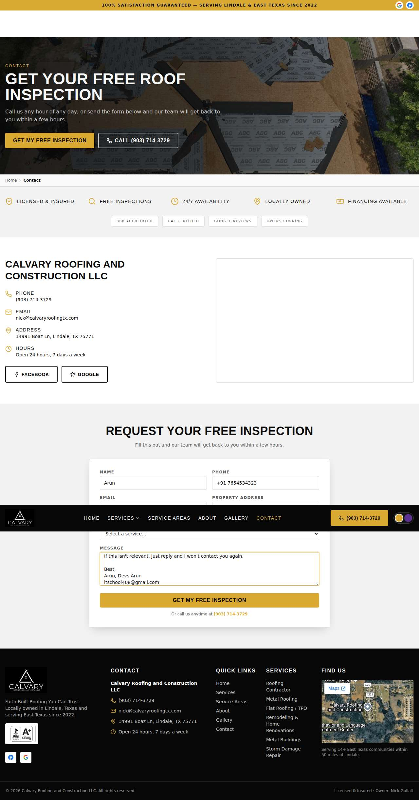

**After submit** — `run-d574e5c4_attempt-ce00e08e_post_attempt_2026-11-02T05-45-29-104Z.jpg`

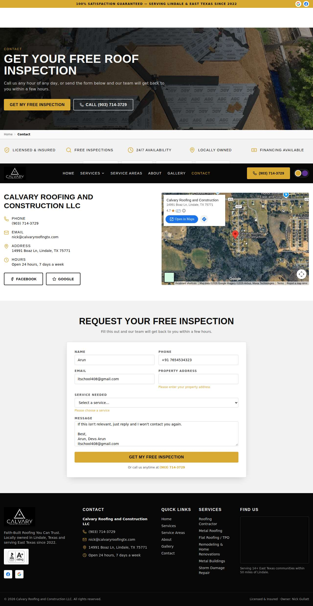

### flattoproofing.com — confirmed (LIVE)

| | |
|---|---|
| Attempt ID | `34e50ceb-e20f-4df9-9c44-f1798c628b83` |
| Form URL | https://flattoproofing.com/contact/ |
| Final URL | https://flattoproofing.com/thank-you/ |
| Reserved | 2026-11-02 05:45:35 UTC |
| Submit attempted | 2026-11-02 05:45:40 UTC |
| Template | standard v2 |
| Confirmation text | New Construction About Us Blog Contact Get A Quick Quote  Thank You Your message has been successfully sent. We will contact you soon\! For more information, you can ca |
| Result / error | — |

Exact message:

~~~text
Subject: Helping customers find your business in AI search (AEO + GEO)

Hi there,

I'm Arun from Devs Arun. More and more customers now ask ChatGPT, Gemini, Perplexity or Google's AI Overviews questions like "who should I hire for this in my area?" before they call anyone. These tools answer from websites they can clearly understand, and they tend to recommend businesses whose pages answer real customer questions.

That is what AEO + GEO (Answer Engine and Generative Engine Optimization) is for. I improve your existing service pages so they clearly answer the questions your customers ask, add structured data that matches the page, and make the call, quote or enquiry step obvious. The benefit: your business gets a better chance of being mentioned or linked in AI answers, and visitors who arrive find it easy to contact you.

The AEO + GEO Starter is a one-time $199 (about ₹16,999, negotiable) for one website: a basic audit, 10 customer questions, improvements to two existing pages, relevant structured data and an action plan, with one revision round.

You can read the full details, send an enquiry or book online here:
https://devsarun.io/aeo-geo/

If this isn't relevant, just reply and I won't contact you again.

Best,
Arun
Devs Arun
itschool408@gmail.com · +91 7654534323
~~~

Submitted field values:

- Name \[name\]: Arun
- Email \[email\]: itschool408@gmail.com
- Phone \[phone\]: +91 7654534323
- Message \[message\]: Hi there, I'm Arun from Devs Arun. More and more customers now ask ChatGPT, Gemini, Perplexity or Google's AI Overviews 

**Filled form (before submit)** — `run-d574e5c4_attempt-34e50ceb_filled_2026-11-02T05-45-40-827Z.jpg`

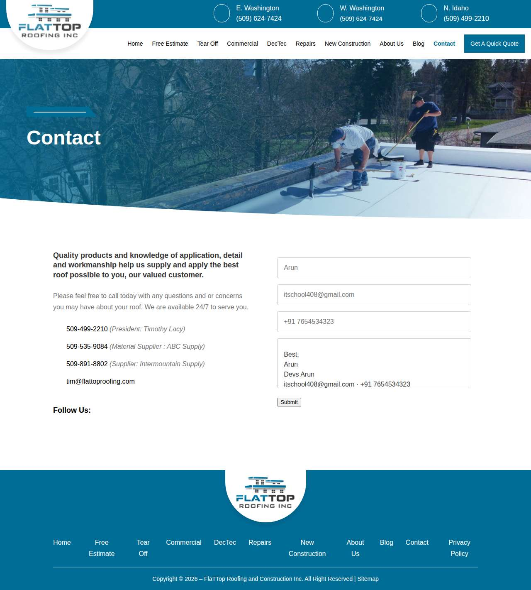

**After submit** — `run-d574e5c4_attempt-34e50ceb_post_attempt_2026-11-02T05-45-50-727Z.jpg`

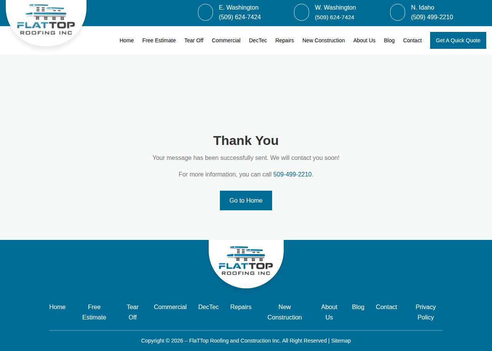

### upscalehomeinspect.com — unclear (LIVE)

| | |
|---|---|
| Attempt ID | `ff4af891-e989-448d-a995-d28f3f0e23a7` |
| Form URL | https://www.upscalehomeinspect.com/contact |
| Final URL | https://www.upscalehomeinspect.com/contact |
| Reserved | 2026-11-02 05:45:57 UTC |
| Submit attempted | 2026-11-02 05:45:59 UTC |
| Template | standard v2 |
| Confirmation text | none observed |
| Result / error | No new success marker observed |

Exact message:

~~~text
Subject: Helping customers find your business in AI search (AEO + GEO)

Hi there,

I'm Arun from Devs Arun. More and more customers now ask ChatGPT, Gemini, Perplexity or Google's AI Overviews questions like "who should I hire for this in my area?" before they call anyone. These tools answer from websites they can clearly understand, and they tend to recommend businesses whose pages answer real customer questions.

That is what AEO + GEO (Answer Engine and Generative Engine Optimization) is for. I improve your existing service pages so they clearly answer the questions your customers ask, add structured data that matches the page, and make the call, quote or enquiry step obvious. The benefit: your business gets a better chance of being mentioned or linked in AI answers, and visitors who arrive find it easy to contact you.

The AEO + GEO Starter is a one-time $199 (about ₹16,999, negotiable) for one website: a basic audit, 10 customer questions, improvements to two existing pages, relevant structured data and an action plan, with one revision round.

You can read the full details, send an enquiry or book online here:
https://devsarun.io/aeo-geo/

If this isn't relevant, just reply and I won't contact you again.

Best,
Arun
Devs Arun
itschool408@gmail.com · +91 7654534323
~~~

Submitted field values:

- Name \[name\]: Arun
- Email \[email\]: itschool408@gmail.com
- Phone \[phone\]: +91 7654534323
- Message \[message\]: Hi there, I'm Arun from Devs Arun. More and more customers now ask ChatGPT, Gemini, Perplexity or Google's AI Overviews 

**Filled form (before submit)** — `run-d574e5c4_attempt-ff4af891_filled_2026-11-02T05-45-59-857Z.jpg`

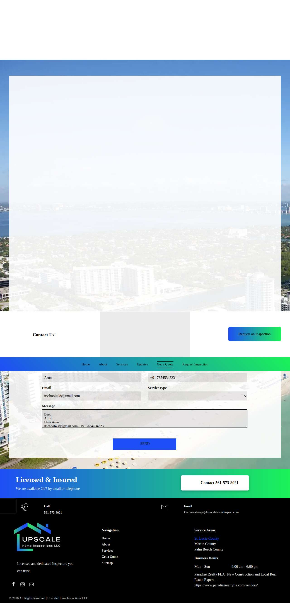

**After submit** — `run-d574e5c4_attempt-ff4af891_post_attempt_2026-11-02T05-46-26-915Z.jpg`

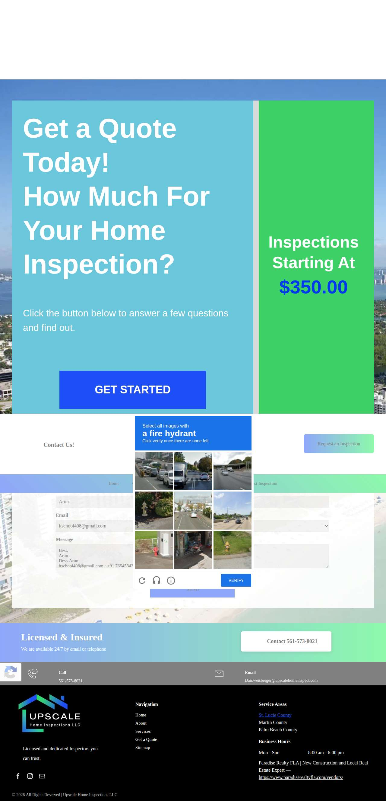

### hometown-roofingandconstruction.com — failed\_before\_submit (LIVE)

| | |
|---|---|
| Attempt ID | `9e28f868-5262-4fac-9b90-26273919ce6a` |
| Form URL | https://hometown-roofing.com/contact |
| Final URL | https://hometown-roofing.com/contact |
| Reserved | 2026-11-02 05:46:33 UTC |
| Submit attempted | — |
| Template | standard v2 |
| Confirmation text | none observed |
| Result / error | Form validation would block sending: phone: Please enter a valid 10-digit phone number. |

Exact message:

~~~text
Subject: Helping customers find your business in AI search (AEO + GEO)

Hi there,

I'm Arun from Devs Arun. More and more customers now ask ChatGPT, Gemini, Perplexity or Google's AI Overviews questions like "who should I hire for this in my area?" before they call anyone. These tools answer from websites they can clearly understand, and they tend to recommend businesses whose pages answer real customer questions.

That is what AEO + GEO (Answer Engine and Generative Engine Optimization) is for. I improve your existing service pages so they clearly answer the questions your customers ask, add structured data that matches the page, and make the call, quote or enquiry step obvious. The benefit: your business gets a better chance of being mentioned or linked in AI answers, and visitors who arrive find it easy to contact you.

The AEO + GEO Starter is a one-time $199 (about ₹16,999, negotiable) for one website: a basic audit, 10 customer questions, improvements to two existing pages, relevant structured data and an action plan, with one revision round.

You can read the full details, send an enquiry or book online here:
https://devsarun.io/aeo-geo/

If this isn't relevant, just reply and I won't contact you again.

Best,
Arun
Devs Arun
itschool408@gmail.com · +91 7654534323
~~~

Submitted field values:

- \#qf1-name: Arun
- \#qf1-email: itschool408@gmail.com
- \#qf1-phone: +91 7654534323
- \#qf1-message: Hi there, I'm Arun from Devs Arun. More and more customers now ask ChatGPT, Gemini, Perplexity or Google's AI Overviews 

**Filled form (before submit)** — `run-d574e5c4_attempt-9e28f868_filled_2026-11-02T05-46-34-792Z.jpg`

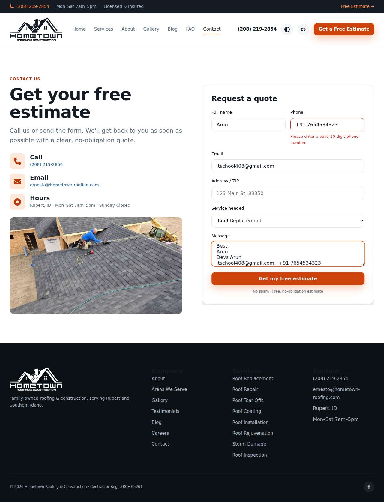

### kornerstoneroofing.com — unclear (LIVE)

| | |
|---|---|
| Attempt ID | `22f103cd-7bf4-44e0-81bb-2d258502e587` |
| Form URL | https://bluebirdroofingny.com/contact/ |
| Final URL | https://bluebirdroofingny.com/contact/ |
| Reserved | 2026-11-02 05:46:39 UTC |
| Submit attempted | 2026-11-02 05:46:42 UTC |
| Template | standard v2 |
| Confirmation text | none observed |
| Result / error | No new success marker observed |

Exact message:

~~~text
Subject: Helping customers find your business in AI search (AEO + GEO)

Hi there,

I'm Arun from Devs Arun. More and more customers now ask ChatGPT, Gemini, Perplexity or Google's AI Overviews questions like "who should I hire for this in my area?" before they call anyone. These tools answer from websites they can clearly understand, and they tend to recommend businesses whose pages answer real customer questions.

That is what AEO + GEO (Answer Engine and Generative Engine Optimization) is for. I improve your existing service pages so they clearly answer the questions your customers ask, add structured data that matches the page, and make the call, quote or enquiry step obvious. The benefit: your business gets a better chance of being mentioned or linked in AI answers, and visitors who arrive find it easy to contact you.

The AEO + GEO Starter is a one-time $199 (about ₹16,999, negotiable) for one website: a basic audit, 10 customer questions, improvements to two existing pages, relevant structured data and an action plan, with one revision round.

You can read the full details, send an enquiry or book online here:
https://devsarun.io/aeo-geo/

If this isn't relevant, just reply and I won't contact you again.

Best,
Arun
Devs Arun
itschool408@gmail.com · +91 7654534323
~~~

Submitted field values:

- EMAIL \[email\]: itschool408@gmail.com
- PHONE \[phone\]: +91 7654534323
- FULL NAME \[name\]: Arun
- TELL US ABOUT YOUR ROOF \[message\]: Hi there, I'm Arun from Devs Arun. More and more customers now ask ChatGPT, Gemini, Perplexity or Google's AI Overviews 

**Filled form (before submit)** — `run-d574e5c4_attempt-22f103cd_filled_2026-11-02T05-46-41-996Z.jpg`

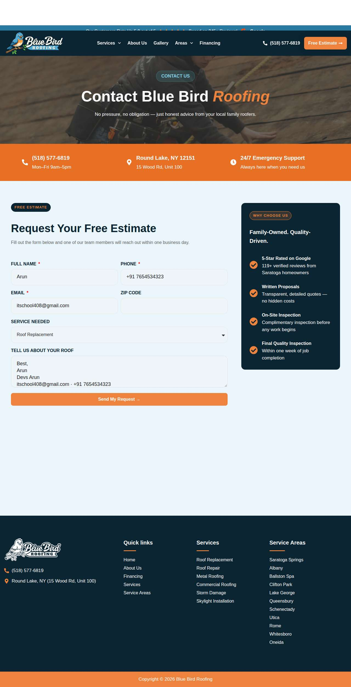

**After submit** — `run-d574e5c4_attempt-22f103cd_post_attempt_2026-11-02T05-47-10-234Z.jpg`

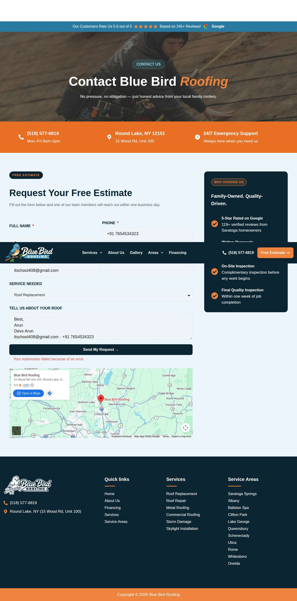

## Events (89)

| Time (UTC) | Event | Website | Details |
|---|---|---|---|
| 05:43:17 | run\_queued | — | live run requested by github:itsDevsArun |
| 05:43:17 | run\_dispatched | — | dispatch disabled (local test mode) |
| 05:43:19 | run\_started | — | Runner claimed live run |
| 05:43:21 | offer\_verified | — | Service page offer facts verified |
| 05:43:21 | website\_selected | clearchoiceplumbingllc.com | Live target clearchoiceplumbingllc.com |
| 05:43:21 | attempt\_reserved | clearchoiceplumbingllc.com | Submission attempt reserved with template standard v2 |
| 05:43:22 | page\_opened | clearchoiceplumbingllc.com | Opened form page |
| 05:43:22 | screenshot\_saved | clearchoiceplumbingllc.com | inspection screenshot saved (145 KB) |
| 05:43:22 | review\_required | clearchoiceplumbingllc.com | failed before submit: locator.fill: Error: Cannot type text into input\[type=number\] |
| 05:43:27 | website\_selected | ameengeneralcontracting.com | Live target ameengeneralcontracting.com |
| 05:43:27 | attempt\_reserved | ameengeneralcontracting.com | Submission attempt reserved with template standard v2 |
| 05:43:29 | page\_opened | ameengeneralcontracting.com | Opened form page |
| 05:43:29 | screenshot\_saved | ameengeneralcontracting.com | inspection screenshot saved (160 KB) |
| 05:43:30 | review\_required | ameengeneralcontracting.com | failed before submit: locator.fill: Error: Cannot type text into input\[type=number\] |
| 05:43:35 | website\_selected | heinscontracting.com | Live target heinscontracting.com |
| 05:43:35 | attempt\_reserved | heinscontracting.com | Submission attempt reserved with template short v2 |
| 05:43:37 | page\_opened | heinscontracting.com | Opened form page |
| 05:43:37 | screenshot\_saved | heinscontracting.com | filled screenshot saved (341 KB) |
| 05:43:38 | review\_required | heinscontracting.com | failed before submit: Field "Phone" did not accept the value |
| 05:43:43 | website\_selected | collins-mrc.com | Live target collins-mrc.com |
| 05:43:43 | attempt\_reserved | collins-mrc.com | Submission attempt reserved with template standard v2 |
| 05:43:44 | page\_opened | collins-mrc.com | Opened form page |
| 05:43:44 | fields\_filled | collins-mrc.com | filled |
| 05:43:44 | screenshot\_saved | collins-mrc.com | filled screenshot saved (270 KB) |
| 05:43:44 | submit\_attempted | collins-mrc.com | submitting |
| 05:43:48 | screenshot\_saved | collins-mrc.com | post\_attempt screenshot saved (160 KB) |
| 05:43:48 | confirmation\_observed | collins-mrc.com | confirmed — "Redirected to /thank-you/" |
| 05:43:55 | website\_selected | chappelleroofing.com | Live target chappelleroofing.com |
| 05:43:55 | attempt\_reserved | chappelleroofing.com | Submission attempt reserved with template standard v2 |
| 05:43:58 | page\_opened | chappelleroofing.com | Opened form page |
| 05:43:59 | fields\_filled | chappelleroofing.com | filled |
| 05:43:59 | screenshot\_saved | chappelleroofing.com | filled screenshot saved (181 KB) |
| 05:43:59 | submit\_attempted | chappelleroofing.com | submitting |
| 05:44:04 | screenshot\_saved | chappelleroofing.com | post\_attempt screenshot saved (185 KB) |
| 05:44:04 | error | chappelleroofing.com | error after submit — "nspection \*\*\* Forbidden. You submitted too quickly. You may try again in a few seconds. Contains contacts. Anti-Spam by " |
| 05:44:10 | website\_selected | campbellext.com | Live target campbellext.com |
| 05:44:10 | attempt\_reserved | campbellext.com | Submission attempt reserved with template standard v2 |
| 05:44:13 | page\_opened | campbellext.com | Opened form page |
| 05:44:13 | fields\_filled | campbellext.com | filled |
| 05:44:13 | screenshot\_saved | campbellext.com | filled screenshot saved (106 KB) |
| 05:44:13 | submit\_attempted | campbellext.com | submitting |
| 05:44:40 | screenshot\_saved | campbellext.com | post\_attempt screenshot saved (64 KB) |
| 05:44:40 | review\_required | campbellext.com | unclear: No new success marker observed |
| 05:44:47 | website\_selected | newimageroofing.net | Live target newimageroofing.net |
| 05:44:47 | attempt\_reserved | newimageroofing.net | Submission attempt reserved with template standard v2 |
| 05:44:49 | page\_opened | newimageroofing.net | Opened form page |
| 05:44:49 | fields\_filled | newimageroofing.net | filled |
| 05:44:49 | screenshot\_saved | newimageroofing.net | filled screenshot saved (122 KB) |
| 05:44:49 | submit\_attempted | newimageroofing.net | submitting |
| 05:45:16 | screenshot\_saved | newimageroofing.net | post\_attempt screenshot saved (156 KB) |
| 05:45:16 | review\_required | newimageroofing.net | unclear: No new success marker observed |
| 05:45:23 | website\_selected | calvaryroofingtx.com | Live target calvaryroofingtx.com |
| 05:45:23 | attempt\_reserved | calvaryroofingtx.com | Submission attempt reserved with template short v2 |
| 05:45:26 | page\_opened | calvaryroofingtx.com | Opened form page |
| 05:45:26 | fields\_filled | calvaryroofingtx.com | filled |
| 05:45:26 | screenshot\_saved | calvaryroofingtx.com | filled screenshot saved (199 KB) |
| 05:45:26 | submit\_attempted | calvaryroofingtx.com | submitting |
| 05:45:29 | screenshot\_saved | calvaryroofingtx.com | post\_attempt screenshot saved (229 KB) |
| 05:45:29 | error | calvaryroofingtx.com | error after submit — "o you within a few hours. NAME PHONE EMAIL PROPERTY ADDRESS Please enter your property address SERVICE NEEDED Select a s" |
| 05:45:35 | website\_selected | flattoproofing.com | Live target flattoproofing.com |
| 05:45:35 | attempt\_reserved | flattoproofing.com | Submission attempt reserved with template standard v2 |
| 05:45:40 | page\_opened | flattoproofing.com | Opened form page |
| 05:45:40 | fields\_filled | flattoproofing.com | filled |
| 05:45:40 | screenshot\_saved | flattoproofing.com | filled screenshot saved (126 KB) |
| 05:45:40 | submit\_attempted | flattoproofing.com | submitting |
| 05:45:50 | screenshot\_saved | flattoproofing.com | post\_attempt screenshot saved (47 KB) |
| 05:45:50 | confirmation\_observed | flattoproofing.com | confirmed — "New Construction About Us Blog Contact Get A Quick Quote  Thank You Your message has been successfully sent. We will co" |
| 05:45:57 | website\_selected | upscalehomeinspect.com | Live target upscalehomeinspect.com |
| 05:45:57 | attempt\_reserved | upscalehomeinspect.com | Submission attempt reserved with template standard v2 |
| 05:45:59 | page\_opened | upscalehomeinspect.com | Opened form page |
| 05:45:59 | fields\_filled | upscalehomeinspect.com | filled |
| 05:45:59 | screenshot\_saved | upscalehomeinspect.com | filled screenshot saved (118 KB) |
| 05:45:59 | submit\_attempted | upscalehomeinspect.com | submitting |
| 05:46:26 | screenshot\_saved | upscalehomeinspect.com | post\_attempt screenshot saved (156 KB) |
| 05:46:26 | review\_required | upscalehomeinspect.com | unclear: No new success marker observed |
| 05:46:33 | website\_selected | hometown-roofingandconstruction.com | Live target hometown-roofingandconstruction.com |
| 05:46:33 | attempt\_reserved | hometown-roofingandconstruction.com | Submission attempt reserved with template standard v2 |
| 05:46:34 | page\_opened | hometown-roofingandconstruction.com | Opened form page |
| 05:46:34 | screenshot\_saved | hometown-roofingandconstruction.com | filled screenshot saved (132 KB) |
| 05:46:34 | review\_required | hometown-roofingandconstruction.com | failed before submit: Form validation would block sending: phone: Please enter a valid 10-digit phone number. |
| 05:46:39 | website\_selected | kornerstoneroofing.com | Live target kornerstoneroofing.com |
| 05:46:39 | attempt\_reserved | kornerstoneroofing.com | Submission attempt reserved with template standard v2 |
| 05:46:41 | page\_opened | kornerstoneroofing.com | Opened form page |
| 05:46:41 | fields\_filled | kornerstoneroofing.com | filled |
| 05:46:41 | screenshot\_saved | kornerstoneroofing.com | filled screenshot saved (155 KB) |
| 05:46:42 | submit\_attempted | kornerstoneroofing.com | submitting |
| 05:47:10 | screenshot\_saved | kornerstoneroofing.com | post\_attempt screenshot saved (191 KB) |
| 05:47:10 | review\_required | kornerstoneroofing.com | unclear: No new success marker observed |
| 05:47:17 | run\_completed | — | Run completed (queue\_exhausted) |
