# Run e497e23d — live — completed

| | |
|---|---|
| Run ID | `e497e23d-1217-406b-8b5e-ebfc9d96c68d` |
| Requested by | github:itsDevsArun |
| Started | 2026-11-02 18:46:56 UTC |
| Finished | 2026-11-02 18:53:55 UTC |
| Finish reason | queue\_exhausted |
| GitHub Actions | https://github.com/itsDevsArun/aeo-geo/actions/runs/41469315389 |

CSV for this run: [runs/2026-11-02_live_e497e23d.csv](2026-11-02_live_e497e23d.csv)

## Attempts (20)

### clearchoiceplumbingllc.com — failed\_before\_submit (LIVE)

| | |
|---|---|
| Attempt ID | `3278dde9-368d-4655-a445-60b0eef9aac0` |
| Form URL | https://clearchoiceplumbingllc.com/contact/ |
| Final URL | — |
| Reserved | 2026-11-02 18:46:57 UTC |
| Submit attempted | — |
| Template | standard v2 |
| Confirmation text | none observed |
| Result / error | locator.fill: Error: Cannot type text into input\[type=number\] |

Exact message:

~~~text
Subject: Helping customers find your business in AI search (AEO + GEO)

Hi there,

I'm Arun from Devs Arun. More and more customers now ask ChatGPT, Gemini, Perplexity or Google's AI Overviews questions like "who should I hire for this in my area?" before they call anyone. These tools answer from websites they can clearly understand, and they tend to recommend businesses whose pages answer real customer questions.

That is what AEO + GEO (Answer Engine and Generative Engine Optimization) is for. I improve your existing service pages so they clearly answer the questions your customers ask, add structured data that matches the page, and make the call, quote or enquiry step obvious. The benefit: your business gets a better chance of being mentioned or linked in AI answers, and visitors who arrive find it easy to contact you.

The AEO + GEO Starter is a one-time $199 (about ₹16,999, negotiable) for one website: a basic audit, 10 customer questions, improvements to two existing pages, relevant structured data and an action plan, with one revision round.

You can read the full details, send an enquiry or book online here:
https://devsarun.io/aeo-geo/

If this isn't relevant, just reply and I won't contact you again.

Best,
Arun
Devs Arun
itschool408@gmail.com · +91 7654534323
~~~

Submitted field values:

- \#wpforms-51-field\_1: Arun
- \#wpforms-51-field\_2: itschool408@gmail.com
- \#wpforms-51-field\_3: Hi there, I'm Arun from Devs Arun. More and more customers now ask ChatGPT, Gemini, Perplexity or Google's AI Overviews 
- \#wpforms-51-field\_5: +91 7654534323

**Inspected page** — `run-e497e23d_attempt-3278dde9_inspection_2026-11-02T18-46-59-116Z.jpg`

### bwnwincpainting.com — failed\_before\_submit (LIVE)

| | |
|---|---|
| Attempt ID | `de5431c0-7b49-45ef-8f91-b44d3ead09c9` |
| Form URL | https://www.bwnwincpainting.com/contact/ |
| Final URL | — |
| Reserved | 2026-11-02 18:47:04 UTC |
| Submit attempted | — |
| Template | standard v2 |
| Confirmation text | none observed |
| Result / error | locator.fill: Error: Cannot type text into input\[type=number\] |

Exact message:

~~~text
Subject: Helping customers find your business in AI search (AEO + GEO)

Hi there,

I'm Arun from Devs Arun. More and more customers now ask ChatGPT, Gemini, Perplexity or Google's AI Overviews questions like "who should I hire for this in my area?" before they call anyone. These tools answer from websites they can clearly understand, and they tend to recommend businesses whose pages answer real customer questions.

That is what AEO + GEO (Answer Engine and Generative Engine Optimization) is for. I improve your existing service pages so they clearly answer the questions your customers ask, add structured data that matches the page, and make the call, quote or enquiry step obvious. The benefit: your business gets a better chance of being mentioned or linked in AI answers, and visitors who arrive find it easy to contact you.

The AEO + GEO Starter is a one-time $199 (about ₹16,999, negotiable) for one website: a basic audit, 10 customer questions, improvements to two existing pages, relevant structured data and an action plan, with one revision round.

You can read the full details, send an enquiry or book online here:
https://devsarun.io/aeo-geo/

If this isn't relevant, just reply and I won't contact you again.

Best,
Arun
Devs Arun
itschool408@gmail.com · +91 7654534323
~~~

Submitted field values:

- \#name-1151: Arun
- \#email-1151: itschool408@gmail.com
- \#phone-1151: +91 7654534323
- \#message-1151: Hi there, I'm Arun from Devs Arun. More and more customers now ask ChatGPT, Gemini, Perplexity or Google's AI Overviews 

**Inspected page** — `run-e497e23d_attempt-de5431c0_inspection_2026-11-02T18-47-06-493Z.jpg`

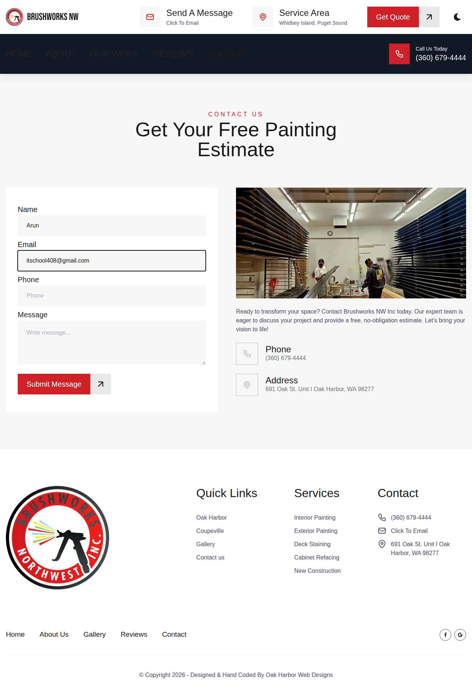

### woodcreationsllc.net — confirmed (LIVE)

| | |
|---|---|
| Attempt ID | `8d50be7b-b5c7-4905-a746-e6b155b47851` |
| Form URL | https://woodcreationsllc.net/contact |
| Final URL | https://woodcreationsllc.net/contact |
| Reserved | 2026-11-02 18:47:11 UTC |
| Submit attempted | 2026-11-02 18:47:12 UTC |
| Template | standard v2 |
| Confirmation text | m 125 West Main Street 717-351-7109 Your Name Email Message Message Sent Send Message 125 West Main Street Terre Hill, Pa 17581 OUR WORK INSTALLATION PROCESS LOGIN ABOUT US |
| Result / error | — |

Exact message:

~~~text
Subject: Helping customers find your business in AI search (AEO + GEO)

Hi there,

I'm Arun from Devs Arun. More and more customers now ask ChatGPT, Gemini, Perplexity or Google's AI Overviews questions like "who should I hire for this in my area?" before they call anyone. These tools answer from websites they can clearly understand, and they tend to recommend businesses whose pages answer real customer questions.

That is what AEO + GEO (Answer Engine and Generative Engine Optimization) is for. I improve your existing service pages so they clearly answer the questions your customers ask, add structured data that matches the page, and make the call, quote or enquiry step obvious. The benefit: your business gets a better chance of being mentioned or linked in AI answers, and visitors who arrive find it easy to contact you.

The AEO + GEO Starter is a one-time $199 (about ₹16,999, negotiable) for one website: a basic audit, 10 customer questions, improvements to two existing pages, relevant structured data and an action plan, with one revision round.

You can read the full details, send an enquiry or book online here:
https://devsarun.io/aeo-geo/

If this isn't relevant, just reply and I won't contact you again.

Best,
Arun
Devs Arun
itschool408@gmail.com · +91 7654534323
~~~

Submitted field values:

- Email \[email\]: itschool408@gmail.com
- Your Name \[name\]: Arun
- Message \[message\]: Hi there, I'm Arun from Devs Arun. More and more customers now ask ChatGPT, Gemini, Perplexity or Google's AI Overviews 

**Filled form (before submit)** — `run-e497e23d_attempt-8d50be7b_filled_2026-11-02T18-47-12-835Z.jpg`

**After submit** — `run-e497e23d_attempt-8d50be7b_post_attempt_2026-11-02T18-47-16-432Z.jpg`

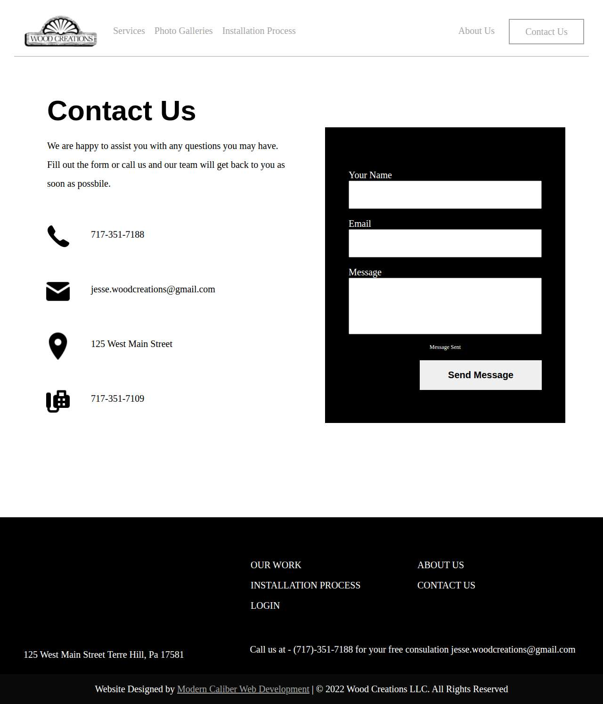

### aandpwoodworking.com — confirmed (LIVE)

| | |
|---|---|
| Attempt ID | `a7b5d780-02ed-4e2f-975a-6e0ebacfe53d` |
| Form URL | https://aandpwoodworking.com/contact-us/ |
| Final URL | https://aandpwoodworking.com/contact-us/ |
| Reserved | 2026-11-02 18:47:23 UTC |
| Submit attempted | 2026-11-02 18:47:26 UTC |
| Template | standard v2 |
| Confirmation text | oodworking.com Home Our Work About Us Contact Us Contact Us Thanks for contacting us A and P Woodworking Phone: 617- 569- 4664 Email: info@aandpwoodworking.com Business Hours: 8a-5: |
| Result / error | — |

Exact message:

~~~text
Subject: Helping customers find your business in AI search (AEO + GEO)

Hi there,

I'm Arun from Devs Arun. More and more customers now ask ChatGPT, Gemini, Perplexity or Google's AI Overviews questions like "who should I hire for this in my area?" before they call anyone. These tools answer from websites they can clearly understand, and they tend to recommend businesses whose pages answer real customer questions.

That is what AEO + GEO (Answer Engine and Generative Engine Optimization) is for. I improve your existing service pages so they clearly answer the questions your customers ask, add structured data that matches the page, and make the call, quote or enquiry step obvious. The benefit: your business gets a better chance of being mentioned or linked in AI answers, and visitors who arrive find it easy to contact you.

The AEO + GEO Starter is a one-time $199 (about ₹16,999, negotiable) for one website: a basic audit, 10 customer questions, improvements to two existing pages, relevant structured data and an action plan, with one revision round.

You can read the full details, send an enquiry or book online here:
https://devsarun.io/aeo-geo/

If this isn't relevant, just reply and I won't contact you again.

Best,
Arun
Devs Arun
itschool408@gmail.com · +91 7654534323
~~~

Submitted field values:

- Name \[name\]: Arun
- Phone \[phone\]: +91 7654534323
- Message \[message\]: Hi there, I'm Arun from Devs Arun. More and more customers now ask ChatGPT, Gemini, Perplexity or Google's AI Overviews 
- Email Address \[email\]: itschool408@gmail.com

**Filled form (before submit)** — `run-e497e23d_attempt-a7b5d780_filled_2026-11-02T18-47-26-433Z.jpg`

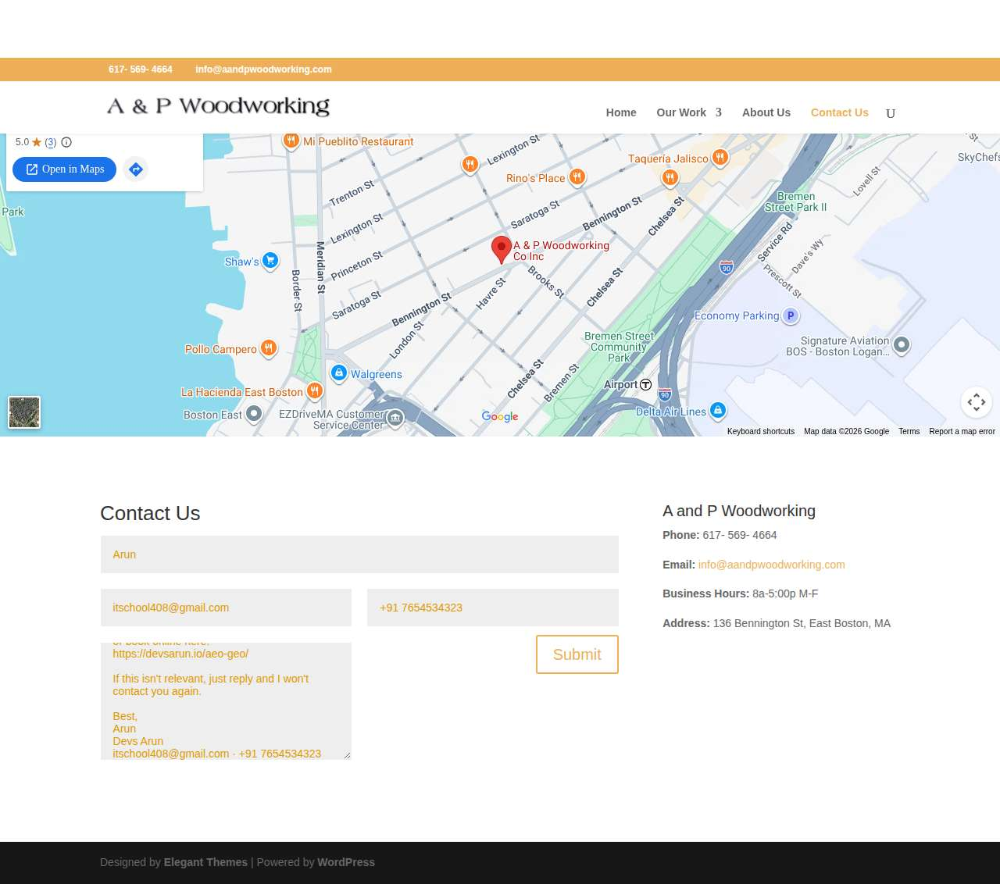

**After submit** — `run-e497e23d_attempt-a7b5d780_post_attempt_2026-11-02T18-47-30-878Z.jpg`

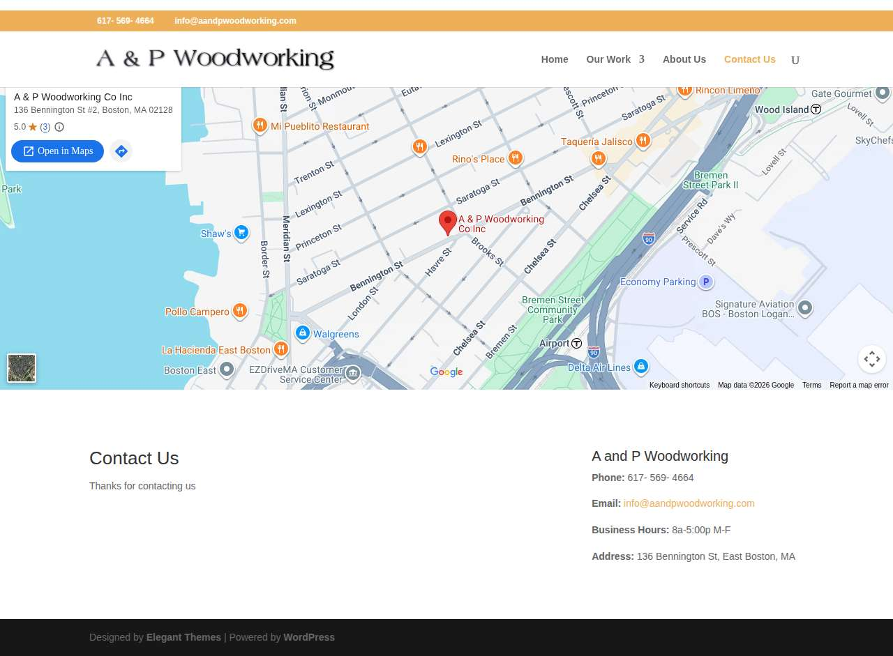

### granitemill.com — confirmed (LIVE)

| | |
|---|---|
| Attempt ID | `e2e401b5-ead8-4001-9cd9-b1a82032167d` |
| Form URL | https://www.granitemill.com/ |
| Final URL | https://www.granitemill.com/ |
| Reserved | 2026-11-02 18:47:38 UTC |
| Submit attempted | 2026-11-02 18:47:39 UTC |
| Template | standard v2 |
| Confirmation text | n behalf of my office and the citizens of Salt Lake County, thank you for your contributions to our community, and congratulations on 100 years of serving Utah. We are v |
| Result / error | — |

Exact message:

~~~text
Subject: Helping customers find your business in AI search (AEO + GEO)

Hi there,

I'm Arun from Devs Arun. More and more customers now ask ChatGPT, Gemini, Perplexity or Google's AI Overviews questions like "who should I hire for this in my area?" before they call anyone. These tools answer from websites they can clearly understand, and they tend to recommend businesses whose pages answer real customer questions.

That is what AEO + GEO (Answer Engine and Generative Engine Optimization) is for. I improve your existing service pages so they clearly answer the questions your customers ask, add structured data that matches the page, and make the call, quote or enquiry step obvious. The benefit: your business gets a better chance of being mentioned or linked in AI answers, and visitors who arrive find it easy to contact you.

The AEO + GEO Starter is a one-time $199 (about ₹16,999, negotiable) for one website: a basic audit, 10 customer questions, improvements to two existing pages, relevant structured data and an action plan, with one revision round.

You can read the full details, send an enquiry or book online here:
https://devsarun.io/aeo-geo/

If this isn't relevant, just reply and I won't contact you again.

Best,
Arun
Devs Arun
itschool408@gmail.com · +91 7654534323
~~~

Submitted field values:

- Name \[name\]: Arun
- Message \[message\]: Hi there, I'm Arun from Devs Arun. More and more customers now ask ChatGPT, Gemini, Perplexity or Google's AI Overviews 
- Email Address \[email\]: itschool408@gmail.com

**Filled form (before submit)** — `run-e497e23d_attempt-e2e401b5_filled_2026-11-02T18-47-39-801Z.jpg`

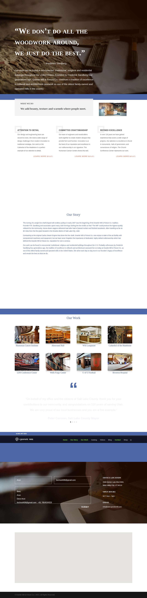

**After submit** — `run-e497e23d_attempt-e2e401b5_post_attempt_2026-11-02T18-48-07-631Z.jpg`

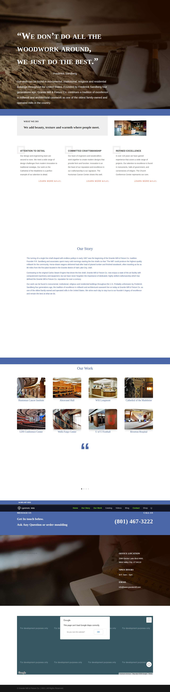

### edisonpallet.net — confirmed (LIVE)

| | |
|---|---|
| Attempt ID | `ef09f284-fead-400e-9123-e729d6553788` |
| Form URL | https://www.edisonpallet.net/contact |
| Final URL | https://www.edisonpallet.net/contact |
| Reserved | 2026-11-02 18:48:15 UTC |
| Submit attempted | 2026-11-02 18:48:17 UTC |
| Template | standard v2 |
| Confirmation text | ington, Bolingbrook, and all of Illinois. Send Us A Message Thank you for contacting us. We will get back to you as soon as possible 630-653-3416 About Edison Pallet & Wood Products Wh |
| Result / error | — |

Exact message:

~~~text
Subject: Helping customers find your business in AI search (AEO + GEO)

Hi there,

I'm Arun from Devs Arun. More and more customers now ask ChatGPT, Gemini, Perplexity or Google's AI Overviews questions like "who should I hire for this in my area?" before they call anyone. These tools answer from websites they can clearly understand, and they tend to recommend businesses whose pages answer real customer questions.

That is what AEO + GEO (Answer Engine and Generative Engine Optimization) is for. I improve your existing service pages so they clearly answer the questions your customers ask, add structured data that matches the page, and make the call, quote or enquiry step obvious. The benefit: your business gets a better chance of being mentioned or linked in AI answers, and visitors who arrive find it easy to contact you.

The AEO + GEO Starter is a one-time $199 (about ₹16,999, negotiable) for one website: a basic audit, 10 customer questions, improvements to two existing pages, relevant structured data and an action plan, with one revision round.

You can read the full details, send an enquiry or book online here:
https://devsarun.io/aeo-geo/

If this isn't relevant, just reply and I won't contact you again.

Best,
Arun
Devs Arun
itschool408@gmail.com · +91 7654534323
~~~

Submitted field values:

- Name: \[name\]: Arun
- Email: \[email\]: itschool408@gmail.com
- Phone: \[phone\]: +91 7654534323
- Message: \[message\]: Hi there, I'm Arun from Devs Arun. More and more customers now ask ChatGPT, Gemini, Perplexity or Google's AI Overviews 

**Filled form (before submit)** — `run-e497e23d_attempt-ef09f284_filled_2026-11-02T18-48-17-233Z.jpg`

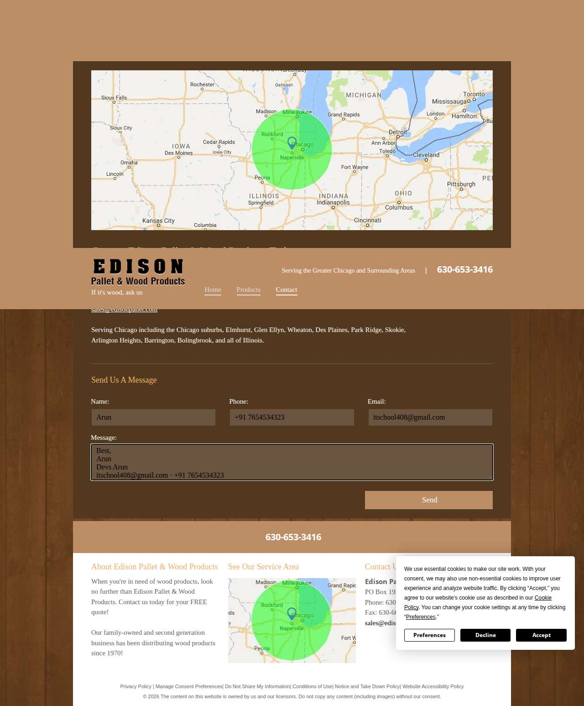

**After submit** — `run-e497e23d_attempt-ef09f284_post_attempt_2026-11-02T18-48-22-345Z.jpg`

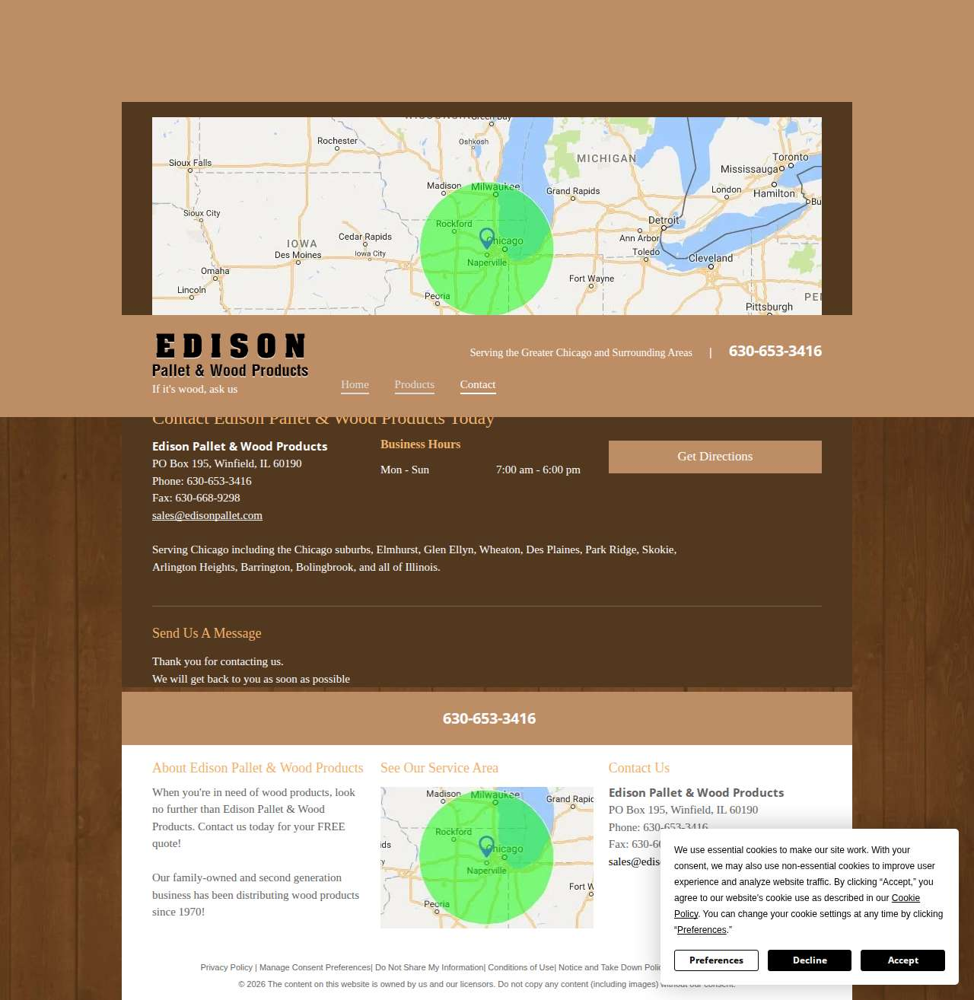

### granitestaterainbowplay.net — error\_after\_submit (LIVE)

| | |
|---|---|
| Attempt ID | `6bc4b599-fa43-4913-ae3e-814f28deb099` |
| Form URL | https://www.granitestaterainbowplay.net/contact-more |
| Final URL | https://www.granitestaterainbowplay.net/contact-more |
| Reserved | 2026-11-02 18:48:30 UTC |
| Submit attempted | 2026-11-02 18:48:32 UTC |
| Template | standard v2 |
| Confirmation text | none observed |
| Result / error | Submit click error (outcome unknown, not retried): locator.click: Timeout 10000ms exceeded. |

Exact message:

~~~text
Subject: Helping customers find your business in AI search (AEO + GEO)

Hi there,

I'm Arun from Devs Arun. More and more customers now ask ChatGPT, Gemini, Perplexity or Google's AI Overviews questions like "who should I hire for this in my area?" before they call anyone. These tools answer from websites they can clearly understand, and they tend to recommend businesses whose pages answer real customer questions.

That is what AEO + GEO (Answer Engine and Generative Engine Optimization) is for. I improve your existing service pages so they clearly answer the questions your customers ask, add structured data that matches the page, and make the call, quote or enquiry step obvious. The benefit: your business gets a better chance of being mentioned or linked in AI answers, and visitors who arrive find it easy to contact you.

The AEO + GEO Starter is a one-time $199 (about ₹16,999, negotiable) for one website: a basic audit, 10 customer questions, improvements to two existing pages, relevant structured data and an action plan, with one revision round.

You can read the full details, send an enquiry or book online here:
https://devsarun.io/aeo-geo/

If this isn't relevant, just reply and I won't contact you again.

Best,
Arun
Devs Arun
itschool408@gmail.com · +91 7654534323
~~~

Submitted field values:

- email \[email\]: itschool408@gmail.com
- name-\* \[name\]: Arun
- Message \[message\]: Hi there, I'm Arun from Devs Arun. More and more customers now ask ChatGPT, Gemini, Perplexity or Google's AI Overviews 
- subject \[subject\]: Helping customers find your business in AI search (AEO + GEO)

**Filled form (before submit)** — `run-e497e23d_attempt-6bc4b599_filled_2026-11-02T18-48-32-885Z.jpg`

**After submit** — `run-e497e23d_attempt-6bc4b599_post_attempt_2026-11-02T18-48-45-168Z.jpg`

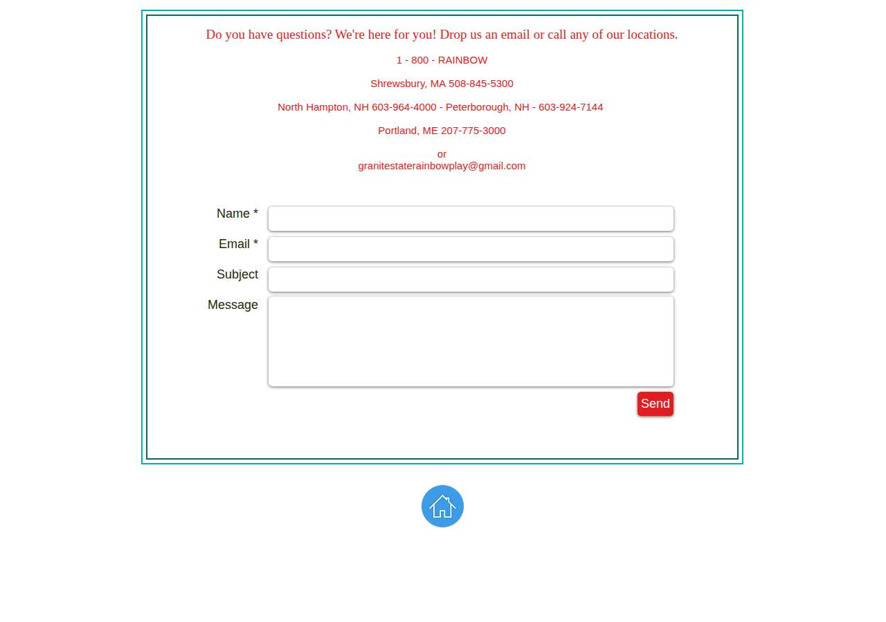

### tdsmanufacturingllc.com — failed\_before\_submit (LIVE)

| | |
|---|---|
| Attempt ID | `3bec183f-cd42-4b32-ae60-8af71ccc69ff` |
| Form URL | https://www.tdsmillwork.com/ |
| Final URL | https://www.tdsmillwork.com/ |
| Reserved | 2026-11-02 18:48:52 UTC |
| Submit attempted | — |
| Template | standard v2 |
| Confirmation text | none observed |
| Result / error | Message field truncated the text; the required link https://devsarun.io/aeo-geo/ would be lost |

Exact message:

~~~text
Subject: Helping customers find your business in AI search (AEO + GEO)

Hi there,

I'm Arun from Devs Arun. More and more customers now ask ChatGPT, Gemini, Perplexity or Google's AI Overviews questions like "who should I hire for this in my area?" before they call anyone. These tools answer from websites they can clearly understand, and they tend to recommend businesses whose pages answer real customer questions.

That is what AEO + GEO (Answer Engine and Generative Engine Optimization) is for. I improve your existing service pages so they clearly answer the questions your customers ask, add structured data that matches the page, and make the call, quote or enquiry step obvious. The benefit: your business gets a better chance of being mentioned or linked in AI answers, and visitors who arrive find it easy to contact you.

The AEO + GEO Starter is a one-time $199 (about ₹16,999, negotiable) for one website: a basic audit, 10 customer questions, improvements to two existing pages, relevant structured data and an action plan, with one revision round.

You can read the full details, send an enquiry or book online here:
https://devsarun.io/aeo-geo/

If this isn't relevant, just reply and I won't contact you again.

Best,
Arun
Devs Arun
itschool408@gmail.com · +91 7654534323
~~~

Submitted field values:

- \#name-2: Arun
- \#Message: Hi there, I'm Arun from Devs Arun. More and more customers now ask ChatGPT, Gemini, Perplexity or Google's AI Overviews 
- \#email-3: itschool408@gmail.com

**Filled form (before submit)** — `run-e497e23d_attempt-3bec183f_filled_2026-11-02T18-48-55-758Z.jpg`

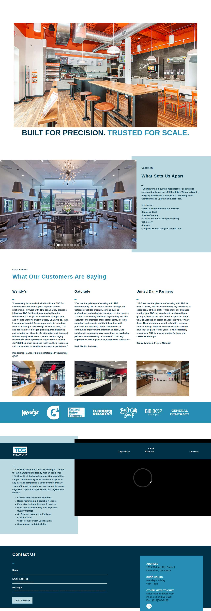

### rainierwoodworking.com — unclear (LIVE)

| | |
|---|---|
| Attempt ID | `f59e1cf6-83ea-4c7e-9927-96715cbc250f` |
| Form URL | https://rainierwoodworking.com/contact.html |
| Final URL | https://rainierwoodworking.com/contact.html |
| Reserved | 2026-11-02 18:49:00 UTC |
| Submit attempted | 2026-11-02 18:49:03 UTC |
| Template | standard v2 |
| Confirmation text | none observed |
| Result / error | No new success marker observed |

Exact message:

~~~text
Subject: Helping customers find your business in AI search (AEO + GEO)

Hi there,

I'm Arun from Devs Arun. More and more customers now ask ChatGPT, Gemini, Perplexity or Google's AI Overviews questions like "who should I hire for this in my area?" before they call anyone. These tools answer from websites they can clearly understand, and they tend to recommend businesses whose pages answer real customer questions.

That is what AEO + GEO (Answer Engine and Generative Engine Optimization) is for. I improve your existing service pages so they clearly answer the questions your customers ask, add structured data that matches the page, and make the call, quote or enquiry step obvious. The benefit: your business gets a better chance of being mentioned or linked in AI answers, and visitors who arrive find it easy to contact you.

The AEO + GEO Starter is a one-time $199 (about ₹16,999, negotiable) for one website: a basic audit, 10 customer questions, improvements to two existing pages, relevant structured data and an action plan, with one revision round.

You can read the full details, send an enquiry or book online here:
https://devsarun.io/aeo-geo/

If this isn't relevant, just reply and I won't contact you again.

Best,
Arun
Devs Arun
itschool408@gmail.com · +91 7654534323
~~~

Submitted field values:

- 1 \[name\]: Arun
- 2 \[email\]: itschool408@gmail.com
- 5 \[message\]: Hi there, I'm Arun from Devs Arun. More and more customers now ask ChatGPT, Gemini, Perplexity or Google's AI Overviews 

**Filled form (before submit)** — `run-e497e23d_attempt-f59e1cf6_filled_2026-11-02T18-49-03-012Z.jpg`

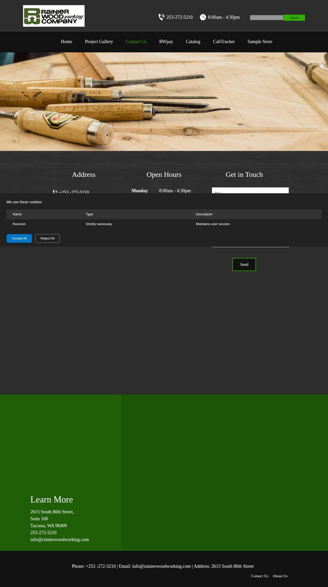

**After submit** — `run-e497e23d_attempt-f59e1cf6_post_attempt_2026-11-02T18-49-30-855Z.jpg`

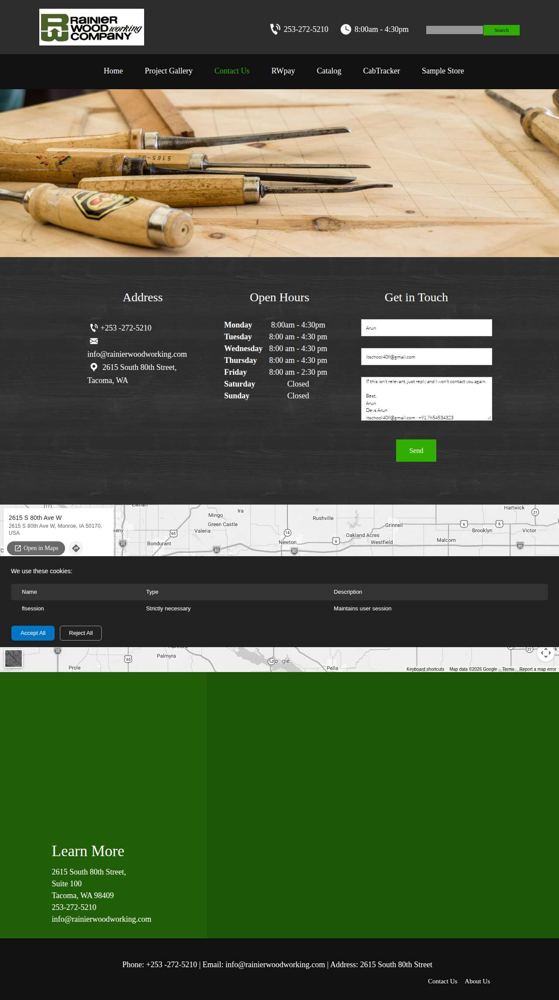

### valleycustomclosets.com — confirmed (LIVE)

| | |
|---|---|
| Attempt ID | `53dd96d3-3ba1-44a6-a01a-2662f8e400b8` |
| Form URL | https://valleycustomclosets.com/contact-us/ |
| Final URL | https://valleycustomclosets.com/contact-us/ |
| Reserved | 2026-11-02 18:49:38 UTC |
| Submit attempted | 2026-11-02 18:49:43 UTC |
| Template | standard v2 |
| Confirmation text | Call Now (559)515-6373 Schedule a Free Design Consultation Thank you\! Form submitted successfully. Your Details Let us know how to get back to you. Full Name \* Enter yo |
| Result / error | — |

Exact message:

~~~text
Subject: Helping customers find your business in AI search (AEO + GEO)

Hi there,

I'm Arun from Devs Arun. More and more customers now ask ChatGPT, Gemini, Perplexity or Google's AI Overviews questions like "who should I hire for this in my area?" before they call anyone. These tools answer from websites they can clearly understand, and they tend to recommend businesses whose pages answer real customer questions.

That is what AEO + GEO (Answer Engine and Generative Engine Optimization) is for. I improve your existing service pages so they clearly answer the questions your customers ask, add structured data that matches the page, and make the call, quote or enquiry step obvious. The benefit: your business gets a better chance of being mentioned or linked in AI answers, and visitors who arrive find it easy to contact you.

The AEO + GEO Starter is a one-time $199 (about ₹16,999, negotiable) for one website: a basic audit, 10 customer questions, improvements to two existing pages, relevant structured data and an action plan, with one revision round.

You can read the full details, send an enquiry or book online here:
https://devsarun.io/aeo-geo/

If this isn't relevant, just reply and I won't contact you again.

Best,
Arun
Devs Arun
itschool408@gmail.com · +91 7654534323
~~~

Submitted field values:

- Subject \* \[subject\]: Helping customers find your business in AI search (AEO + GEO)
- Telephone \* \[phone\]: +91 7654534323
- Email Address \* \[email\]: itschool408@gmail.com
- Full Name \* \[first\_name\]: Arun
- Comments / Questions \* \[message\]: Hi there, I'm Arun from Devs Arun. More and more customers now ask ChatGPT, Gemini, Perplexity or Google's AI Overviews 

**Filled form (before submit)** — `run-e497e23d_attempt-53dd96d3_filled_2026-11-02T18-49-43-235Z.jpg`

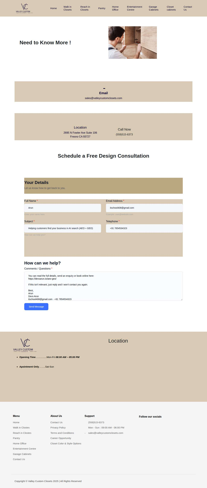

**After submit** — `run-e497e23d_attempt-53dd96d3_post_attempt_2026-11-02T18-49-53-886Z.jpg`

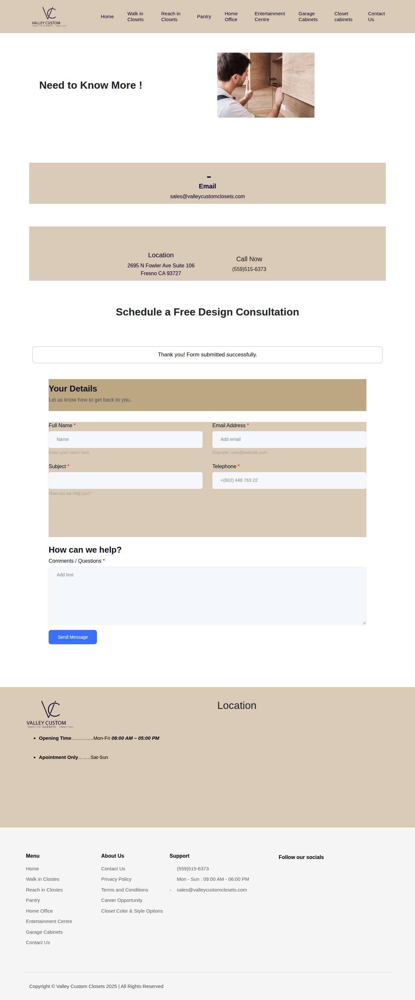

### thebarnbuilders.com — error\_after\_submit (LIVE)

| | |
|---|---|
| Attempt ID | `5301f7f1-5ded-4755-aaed-38ff48274047` |
| Form URL | https://thebarnbuilders.com/get-a-quote |
| Final URL | https://thebarnbuilders.com/get-a-quote |
| Reserved | 2026-11-02 18:50:01 UTC |
| Submit attempted | 2026-11-02 18:50:06 UTC |
| Template | standard v2 |
| Confirmation text | Not listed Not sure yet OVERHEAD DOORS (SIZE & QUANTITY) \* Please enter the overhead door size and quantity ENTRY DOORS (QUANTITY) WINDOWS (QUANTITY) STREET ADDRESS \* Stre |
| Result / error | — |

Exact message:

~~~text
Subject: Helping customers find your business in AI search (AEO + GEO)

Hi there,

I'm Arun from Devs Arun. More and more customers now ask ChatGPT, Gemini, Perplexity or Google's AI Overviews questions like "who should I hire for this in my area?" before they call anyone. These tools answer from websites they can clearly understand, and they tend to recommend businesses whose pages answer real customer questions.

That is what AEO + GEO (Answer Engine and Generative Engine Optimization) is for. I improve your existing service pages so they clearly answer the questions your customers ask, add structured data that matches the page, and make the call, quote or enquiry step obvious. The benefit: your business gets a better chance of being mentioned or linked in AI answers, and visitors who arrive find it easy to contact you.

The AEO + GEO Starter is a one-time $199 (about ₹16,999, negotiable) for one website: a basic audit, 10 customer questions, improvements to two existing pages, relevant structured data and an action plan, with one revision round.

You can read the full details, send an enquiry or book online here:
https://devsarun.io/aeo-geo/

If this isn't relevant, just reply and I won't contact you again.

Best,
Arun
Devs Arun
itschool408@gmail.com · +91 7654534323
~~~

Submitted field values:

- FULL NAME \* \[name\]: Arun
- PHONE NUMBER \* \[phone\]: +91 7654534323
- EMAIL ADDRESS \* \[email\]: itschool408@gmail.com
- PROJECT DETAILS \* \[message\]: Hi there, I'm Arun from Devs Arun. More and more customers now ask ChatGPT, Gemini, Perplexity or Google's AI Overviews 

**Filled form (before submit)** — `run-e497e23d_attempt-5301f7f1_filled_2026-11-02T18-50-06-204Z.jpg`

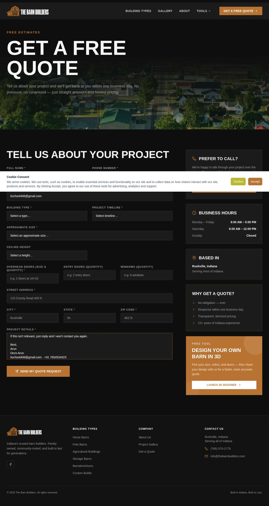

**After submit** — `run-e497e23d_attempt-5301f7f1_post_attempt_2026-11-02T18-50-16-694Z.jpg`

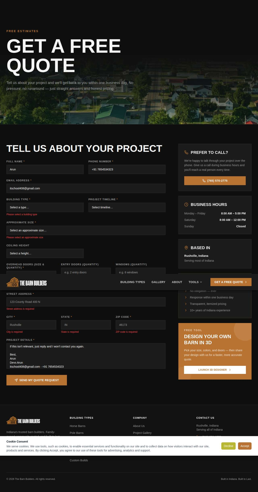

### thebarnwoodshop.com — unclear (LIVE)

| | |
|---|---|
| Attempt ID | `98aabeca-4fb3-410d-b523-036ea8566684` |
| Form URL | https://thebarnwoodshop.com/inquire.html |
| Final URL | https://thebarnwoodshop.com/inquire.html |
| Reserved | 2026-11-02 18:50:24 UTC |
| Submit attempted | 2026-11-02 18:50:25 UTC |
| Template | standard v2 |
| Confirmation text | none observed |
| Result / error | No new success marker observed |

Exact message:

~~~text
Subject: Helping customers find your business in AI search (AEO + GEO)

Hi there,

I'm Arun from Devs Arun. More and more customers now ask ChatGPT, Gemini, Perplexity or Google's AI Overviews questions like "who should I hire for this in my area?" before they call anyone. These tools answer from websites they can clearly understand, and they tend to recommend businesses whose pages answer real customer questions.

That is what AEO + GEO (Answer Engine and Generative Engine Optimization) is for. I improve your existing service pages so they clearly answer the questions your customers ask, add structured data that matches the page, and make the call, quote or enquiry step obvious. The benefit: your business gets a better chance of being mentioned or linked in AI answers, and visitors who arrive find it easy to contact you.

The AEO + GEO Starter is a one-time $199 (about ₹16,999, negotiable) for one website: a basic audit, 10 customer questions, improvements to two existing pages, relevant structured data and an action plan, with one revision round.

You can read the full details, send an enquiry or book online here:
https://devsarun.io/aeo-geo/

If this isn't relevant, just reply and I won't contact you again.

Best,
Arun
Devs Arun
itschool408@gmail.com · +91 7654534323
~~~

Submitted field values:

- NAME \[name\]: Arun
- EMAIL \[email\]: itschool408@gmail.com
- THE PIECE \[message\]: Hi there, I'm Arun from Devs Arun. More and more customers now ask ChatGPT, Gemini, Perplexity or Google's AI Overviews 
- PHONE (optional) \[phone\]: +91 7654534323

**Filled form (before submit)** — `run-e497e23d_attempt-98aabeca_filled_2026-11-02T18-50-25-657Z.jpg`

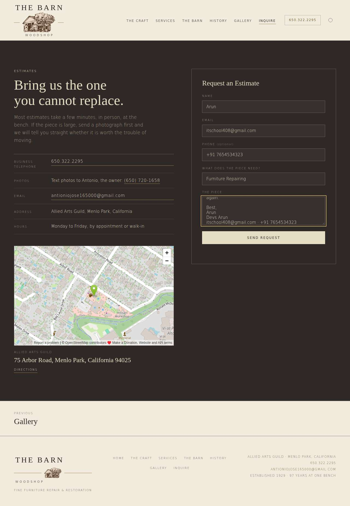

**After submit** — `run-e497e23d_attempt-98aabeca_post_attempt_2026-11-02T18-50-54-208Z.jpg`

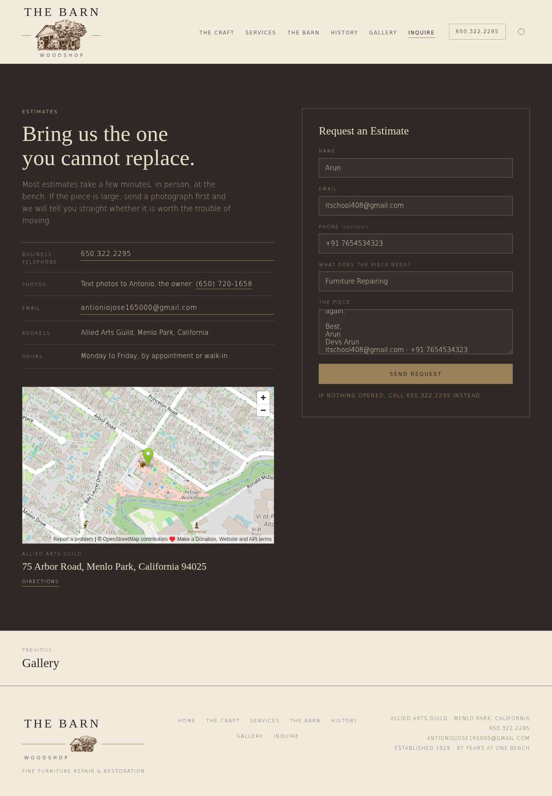

### jmdesignseattle.com — confirmed (LIVE)

| | |
|---|---|
| Attempt ID | `58853d32-04ce-4945-acda-137c553587a2` |
| Form URL | https://www.jmdesignseattle.com/contact/ |
| Final URL | https://www.jmdesignseattle.com/contact/ |
| Reserved | 2026-11-02 18:51:01 UTC |
| Submit attempted | 2026-11-02 18:51:04 UTC |
| Template | standard v2 |
| Confirmation text | 19 Fishermen’s Terminal C-10 Building HAVE A QUESTION? Your message was sent successfully. Thanks. Your Name (required) Your Email (required) Subject Your Message JM Design 201 |
| Result / error | — |

Exact message:

~~~text
Subject: Helping customers find your business in AI search (AEO + GEO)

Hi there,

I'm Arun from Devs Arun. More and more customers now ask ChatGPT, Gemini, Perplexity or Google's AI Overviews questions like "who should I hire for this in my area?" before they call anyone. These tools answer from websites they can clearly understand, and they tend to recommend businesses whose pages answer real customer questions.

That is what AEO + GEO (Answer Engine and Generative Engine Optimization) is for. I improve your existing service pages so they clearly answer the questions your customers ask, add structured data that matches the page, and make the call, quote or enquiry step obvious. The benefit: your business gets a better chance of being mentioned or linked in AI answers, and visitors who arrive find it easy to contact you.

The AEO + GEO Starter is a one-time $199 (about ₹16,999, negotiable) for one website: a basic audit, 10 customer questions, improvements to two existing pages, relevant structured data and an action plan, with one revision round.

You can read the full details, send an enquiry or book online here:
https://devsarun.io/aeo-geo/

If this isn't relevant, just reply and I won't contact you again.

Best,
Arun
Devs Arun
itschool408@gmail.com · +91 7654534323
~~~

Submitted field values:

- your-name \[name\]: Arun
- your-email \[email\]: itschool408@gmail.com
- your-message \[message\]: Hi there, I'm Arun from Devs Arun. More and more customers now ask ChatGPT, Gemini, Perplexity or Google's AI Overviews 
- your-subject \[subject\]: Helping customers find your business in AI search (AEO + GEO)

**Filled form (before submit)** — `run-e497e23d_attempt-58853d32_filled_2026-11-02T18-51-04-307Z.jpg`

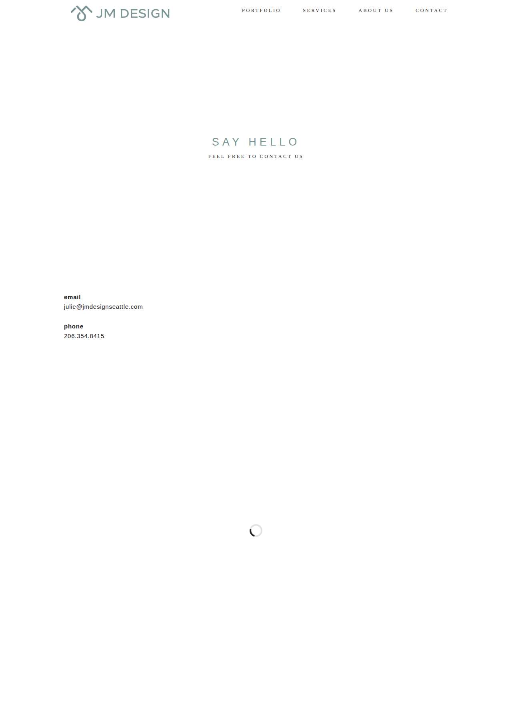

**After submit** — `run-e497e23d_attempt-58853d32_post_attempt_2026-11-02T18-51-08-711Z.jpg`

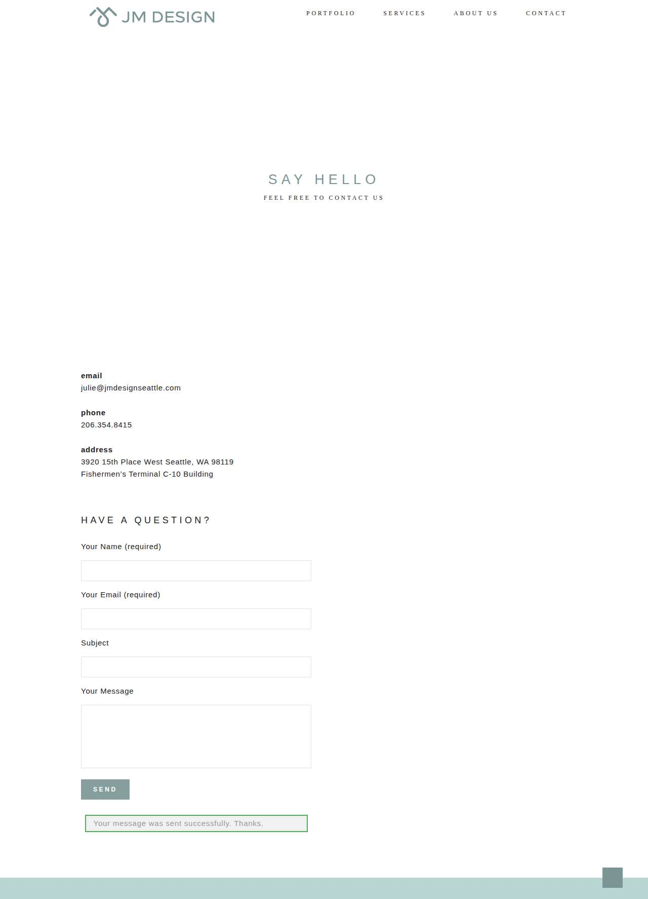

### centurylumbercenter.com — error\_after\_submit (LIVE)

| | |
|---|---|
| Attempt ID | `a938cd8a-8c96-43cc-8060-89ed9d753c5e` |
| Form URL | https://century-lumber.com/pages/contact |
| Final URL | https://century-lumber.com/pages/contact |
| Reserved | 2026-11-02 18:51:15 UTC |
| Submit attempted | 2026-11-02 18:51:21 UTC |
| Template | standard v2 |
| Confirmation text | none observed |
| Result / error | Submit click error (outcome unknown, not retried): locator.click: Timeout 10000ms exceeded. |

Exact message:

~~~text
Subject: Helping customers find your business in AI search (AEO + GEO)

Hi there,

I'm Arun from Devs Arun. More and more customers now ask ChatGPT, Gemini, Perplexity or Google's AI Overviews questions like "who should I hire for this in my area?" before they call anyone. These tools answer from websites they can clearly understand, and they tend to recommend businesses whose pages answer real customer questions.

That is what AEO + GEO (Answer Engine and Generative Engine Optimization) is for. I improve your existing service pages so they clearly answer the questions your customers ask, add structured data that matches the page, and make the call, quote or enquiry step obvious. The benefit: your business gets a better chance of being mentioned or linked in AI answers, and visitors who arrive find it easy to contact you.

The AEO + GEO Starter is a one-time $199 (about ₹16,999, negotiable) for one website: a basic audit, 10 customer questions, improvements to two existing pages, relevant structured data and an action plan, with one revision round.

You can read the full details, send an enquiry or book online here:
https://devsarun.io/aeo-geo/

If this isn't relevant, just reply and I won't contact you again.

Best,
Arun
Devs Arun
itschool408@gmail.com · +91 7654534323
~~~

Submitted field values:

- Enter your full name \[name\]: Arun
- Enter your phone number \[phone\]: +91 7654534323
- Enter your email address \[email\]: itschool408@gmail.com
- Tell us how we can help you... \[message\]: Hi there, I'm Arun from Devs Arun. More and more customers now ask ChatGPT, Gemini, Perplexity or Google's AI Overviews 

**Filled form (before submit)** — `run-e497e23d_attempt-a938cd8a_filled_2026-11-02T18-51-21-003Z.jpg`

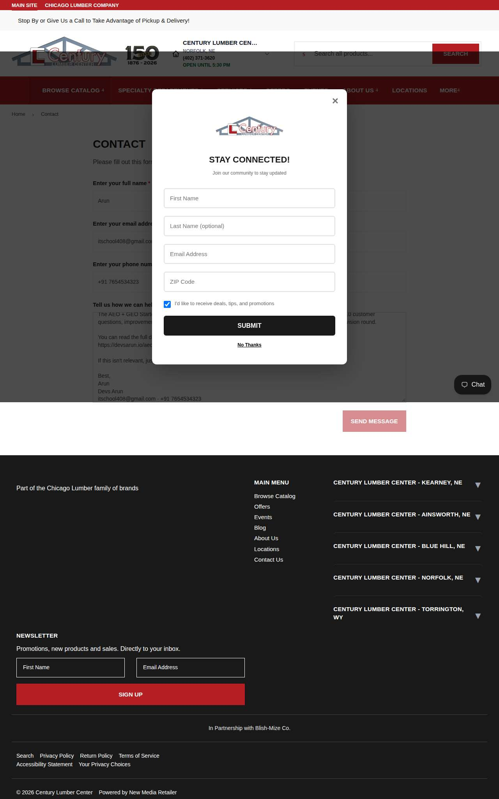

**After submit** — `run-e497e23d_attempt-a938cd8a_post_attempt_2026-11-02T18-51-33-751Z.jpg`

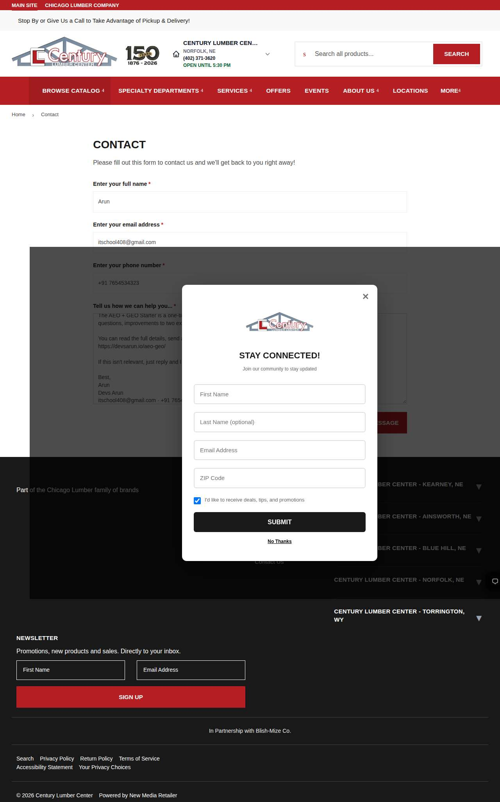

### alamocabinetry.com — unclear (LIVE)

| | |
|---|---|
| Attempt ID | `fd9e00ca-a714-4631-96b6-8724d04ed390` |
| Form URL | https://www.alamocabinetry.com/ |
| Final URL | https://www.alamocabinetry.com/ |
| Reserved | 2026-11-02 18:51:41 UTC |
| Submit attempted | 2026-11-02 18:51:47 UTC |
| Template | standard v2 |
| Confirmation text | none observed |
| Result / error | No new success marker observed |

Exact message:

~~~text
Subject: Helping customers find your business in AI search (AEO + GEO)

Hi there,

I'm Arun from Devs Arun. More and more customers now ask ChatGPT, Gemini, Perplexity or Google's AI Overviews questions like "who should I hire for this in my area?" before they call anyone. These tools answer from websites they can clearly understand, and they tend to recommend businesses whose pages answer real customer questions.

That is what AEO + GEO (Answer Engine and Generative Engine Optimization) is for. I improve your existing service pages so they clearly answer the questions your customers ask, add structured data that matches the page, and make the call, quote or enquiry step obvious. The benefit: your business gets a better chance of being mentioned or linked in AI answers, and visitors who arrive find it easy to contact you.

The AEO + GEO Starter is a one-time $199 (about ₹16,999, negotiable) for one website: a basic audit, 10 customer questions, improvements to two existing pages, relevant structured data and an action plan, with one revision round.

You can read the full details, send an enquiry or book online here:
https://devsarun.io/aeo-geo/

If this isn't relevant, just reply and I won't contact you again.

Best,
Arun
Devs Arun
itschool408@gmail.com · +91 7654534323
~~~

Submitted field values:

- name \[name\]: Arun
- email \[email\]: itschool408@gmail.com
- phone \[phone\]: +91 7654534323
- subject \[subject\]: Helping customers find your business in AI search (AEO + GEO)
- Type your message here... \[message\]: Hi there, I'm Arun from Devs Arun. More and more customers now ask ChatGPT, Gemini, Perplexity or Google's AI Overviews 

**Filled form (before submit)** — `run-e497e23d_attempt-fd9e00ca_filled_2026-11-02T18-51-47-417Z.jpg`

**After submit** — `run-e497e23d_attempt-fd9e00ca_post_attempt_2026-11-02T18-52-23-067Z.jpg`

### modernboywoodshop.com — unclear (LIVE)

| | |
|---|---|
| Attempt ID | `10854833-b514-4da8-90c9-bd862f45175a` |
| Form URL | https://www.modernboywoodshop.com/contact |
| Final URL | https://www.modernboywoodshop.com/contact |
| Reserved | 2026-11-02 18:52:30 UTC |
| Submit attempted | 2026-11-02 18:52:32 UTC |
| Template | standard v2 |
| Confirmation text | none observed |
| Result / error | No new success marker observed |

Exact message:

~~~text
Subject: Helping customers find your business in AI search (AEO + GEO)

Hi there,

I'm Arun from Devs Arun. More and more customers now ask ChatGPT, Gemini, Perplexity or Google's AI Overviews questions like "who should I hire for this in my area?" before they call anyone. These tools answer from websites they can clearly understand, and they tend to recommend businesses whose pages answer real customer questions.

That is what AEO + GEO (Answer Engine and Generative Engine Optimization) is for. I improve your existing service pages so they clearly answer the questions your customers ask, add structured data that matches the page, and make the call, quote or enquiry step obvious. The benefit: your business gets a better chance of being mentioned or linked in AI answers, and visitors who arrive find it easy to contact you.

The AEO + GEO Starter is a one-time $199 (about ₹16,999, negotiable) for one website: a basic audit, 10 customer questions, improvements to two existing pages, relevant structured data and an action plan, with one revision round.

You can read the full details, send an enquiry or book online here:
https://devsarun.io/aeo-geo/

If this isn't relevant, just reply and I won't contact you again.

Best,
Arun
Devs Arun
itschool408@gmail.com · +91 7654534323
~~~

Submitted field values:

- Enter Your Name \[name\]: Arun
- Enter Your Email \[email\]: itschool408@gmail.com
- Enter Your Subject \[subject\]: Helping customers find your business in AI search (AEO + GEO)
- Enter Your Message Here \[message\]: Hi there, I'm Arun from Devs Arun. More and more customers now ask ChatGPT, Gemini, Perplexity or Google's AI Overviews 

**Filled form (before submit)** — `run-e497e23d_attempt-10854833_filled_2026-11-02T18-52-32-645Z.jpg`

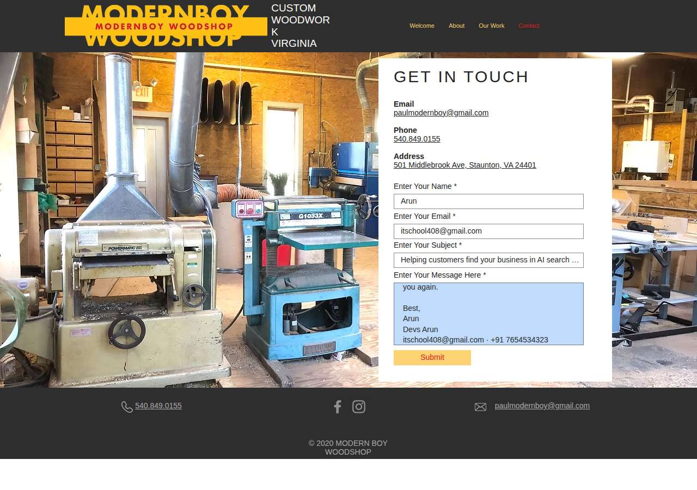

**After submit** — `run-e497e23d_attempt-10854833_post_attempt_2026-11-02T18-53-00-128Z.jpg`

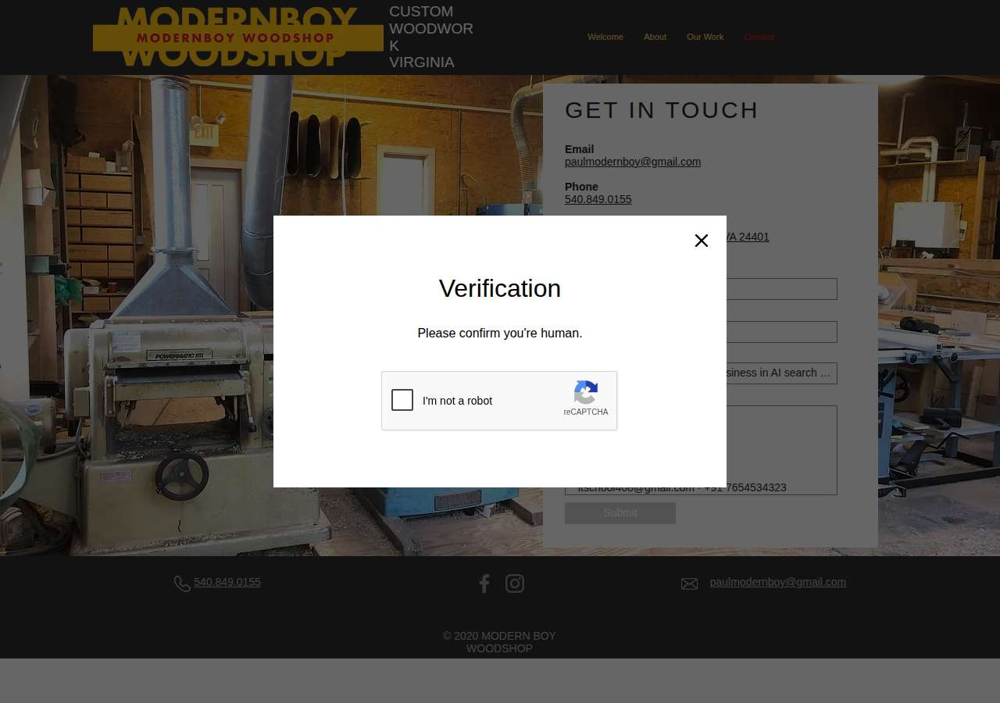

### woodworkersnaples.com — failed\_before\_submit (LIVE)

| | |
|---|---|
| Attempt ID | `cca61168-c143-4da8-a3ee-675a23ff69d3` |
| Form URL | https://www.woodworkersnaples.com/contact |
| Final URL | https://www.woodworkersnaples.com/contact |
| Reserved | 2026-11-02 18:53:07 UTC |
| Submit attempted | — |
| Template | standard v2 |
| Confirmation text | none observed |
| Result / error | Field "Phone (required)" did not accept the value |

Exact message:

~~~text
Subject: Helping customers find your business in AI search (AEO + GEO)

Hi there,

I'm Arun from Devs Arun. More and more customers now ask ChatGPT, Gemini, Perplexity or Google's AI Overviews questions like "who should I hire for this in my area?" before they call anyone. These tools answer from websites they can clearly understand, and they tend to recommend businesses whose pages answer real customer questions.

That is what AEO + GEO (Answer Engine and Generative Engine Optimization) is for. I improve your existing service pages so they clearly answer the questions your customers ask, add structured data that matches the page, and make the call, quote or enquiry step obvious. The benefit: your business gets a better chance of being mentioned or linked in AI answers, and visitors who arrive find it easy to contact you.

The AEO + GEO Starter is a one-time $199 (about ₹16,999, negotiable) for one website: a basic audit, 10 customer questions, improvements to two existing pages, relevant structured data and an action plan, with one revision round.

You can read the full details, send an enquiry or book online here:
https://devsarun.io/aeo-geo/

If this isn't relevant, just reply and I won't contact you again.

Best,
Arun
Devs Arun
itschool408@gmail.com · +91 7654534323
~~~

Submitted field values:

- \#text-yui\_3\_17\_2\_1\_1450202961467\_143934-field: Helping customers find your business in AI search (AEO + GEO)
- \#email-yui\_3\_17\_2\_1\_1450202961467\_143506-field: itschool408@gmail.com
- \#textarea-yui\_3\_17\_2\_1\_1450202961467\_144362-field: Hi there, I'm Arun from Devs Arun. More and more customers now ask ChatGPT, Gemini, Perplexity or Google's AI Overviews 
- \#phone-yui\_3\_17\_2\_1\_1491331058684\_1833453-input-field: +91 7654534323

**Filled form (before submit)** — `run-e497e23d_attempt-cca61168_filled_2026-11-02T18-53-08-928Z.jpg`

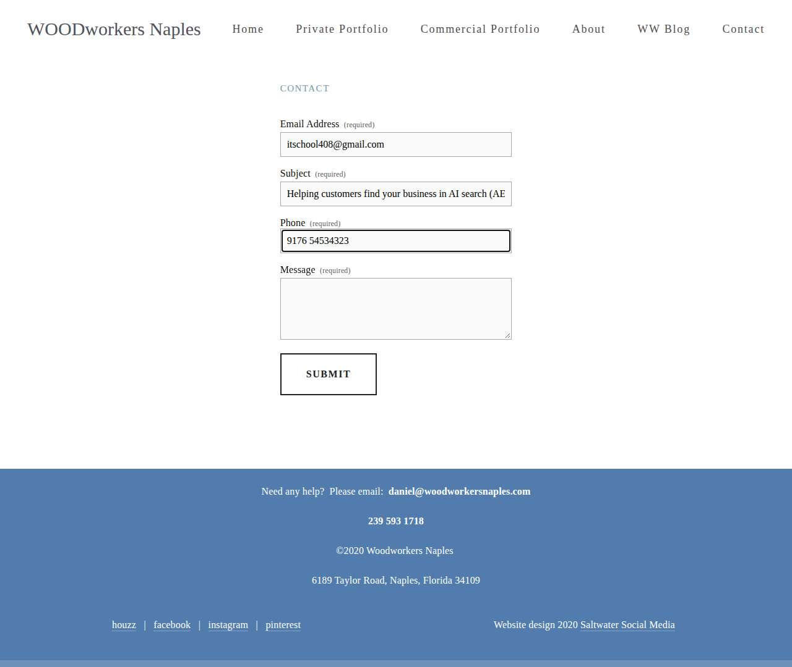

### noblewoodwork.com — failed\_before\_submit (LIVE)

| | |
|---|---|
| Attempt ID | `a0de43b3-95c5-4292-be93-43d5081f3bcc` |
| Form URL | https://www.noblewoodwork.com/contact/ |
| Final URL | https://www.noblewoodwork.com/contact/ |
| Reserved | 2026-11-02 18:53:13 UTC |
| Submit attempted | — |
| Template | standard v2 |
| Confirmation text | none observed |
| Result / error | Message field truncated the text; the required link https://devsarun.io/aeo-geo/ would be lost |

Exact message:

~~~text
Subject: Helping customers find your business in AI search (AEO + GEO)

Hi there,

I'm Arun from Devs Arun. More and more customers now ask ChatGPT, Gemini, Perplexity or Google's AI Overviews questions like "who should I hire for this in my area?" before they call anyone. These tools answer from websites they can clearly understand, and they tend to recommend businesses whose pages answer real customer questions.

That is what AEO + GEO (Answer Engine and Generative Engine Optimization) is for. I improve your existing service pages so they clearly answer the questions your customers ask, add structured data that matches the page, and make the call, quote or enquiry step obvious. The benefit: your business gets a better chance of being mentioned or linked in AI answers, and visitors who arrive find it easy to contact you.

The AEO + GEO Starter is a one-time $199 (about ₹16,999, negotiable) for one website: a basic audit, 10 customer questions, improvements to two existing pages, relevant structured data and an action plan, with one revision round.

You can read the full details, send an enquiry or book online here:
https://devsarun.io/aeo-geo/

If this isn't relevant, just reply and I won't contact you again.

Best,
Arun
Devs Arun
itschool408@gmail.com · +91 7654534323
~~~

Submitted field values:

- \#forminator-field-email-1\_6ae8d73a1e6e1: itschool408@gmail.com
- \#forminator-field-phone-1\_6ae8d73a1e6e1: +91 7654534323
- \#forminator-field-textarea-1\_6ae8d73a1e6e1: Hi there, I'm Arun from Devs Arun. More and more customers now ask ChatGPT, Gemini, Perplexity or Google's AI Overviews 
- \#forminator-field-first-name-1\_6ae8d73a1e6e1: Arun

**Filled form (before submit)** — `run-e497e23d_attempt-a0de43b3_filled_2026-11-02T18-53-17-535Z.jpg`

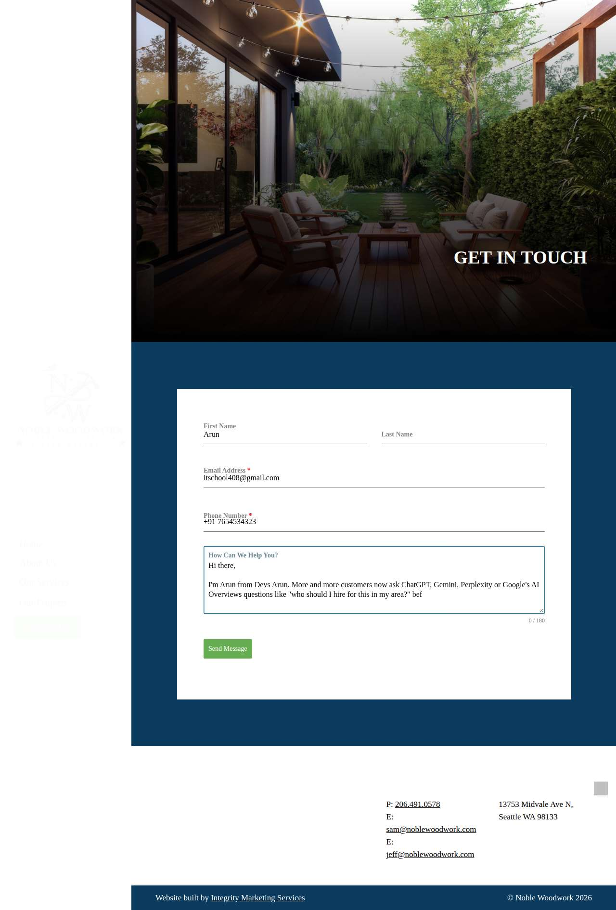

### liveedgehardwoods.com — error\_after\_submit (LIVE)

| | |
|---|---|
| Attempt ID | `1ae89205-16d0-47f2-a2be-c2e322b43620` |
| Form URL | https://liveedgehardwoods.com/furniture/home |
| Final URL | https://liveedgehardwoods.com/furniture/home |
| Reserved | 2026-11-02 18:53:22 UTC |
| Submit attempted | 2026-11-02 18:53:25 UTC |
| Template | standard v2 |
| Confirmation text | pod Details: with Live edge & Sapwood Full Name \* Full Name is required Company Name (if applicable) Phone \* Phone is required Email \* Email is required Your Location \* Yo |
| Result / error | — |

Exact message:

~~~text
Subject: Helping customers find your business in AI search (AEO + GEO)

Hi there,

I'm Arun from Devs Arun. More and more customers now ask ChatGPT, Gemini, Perplexity or Google's AI Overviews questions like "who should I hire for this in my area?" before they call anyone. These tools answer from websites they can clearly understand, and they tend to recommend businesses whose pages answer real customer questions.

That is what AEO + GEO (Answer Engine and Generative Engine Optimization) is for. I improve your existing service pages so they clearly answer the questions your customers ask, add structured data that matches the page, and make the call, quote or enquiry step obvious. The benefit: your business gets a better chance of being mentioned or linked in AI answers, and visitors who arrive find it easy to contact you.

The AEO + GEO Starter is a one-time $199 (about ₹16,999, negotiable) for one website: a basic audit, 10 customer questions, improvements to two existing pages, relevant structured data and an action plan, with one revision round.

You can read the full details, send an enquiry or book online here:
https://devsarun.io/aeo-geo/

If this isn't relevant, just reply and I won't contact you again.

Best,
Arun
Devs Arun
itschool408@gmail.com · +91 7654534323
~~~

Submitted field values:

- Email \* \[email\]: itschool408@gmail.com
- Phone \* \[phone\]: +91 7654534323
- Full Name \* \[name\]: Arun
- Project Details \* \[message\]: Hi there, I'm Arun from Devs Arun. More and more customers now ask ChatGPT, Gemini, Perplexity or Google's AI Overviews 
- Message / Questions \[message\]: Hi there, I'm Arun from Devs Arun. More and more customers now ask ChatGPT, Gemini, Perplexity or Google's AI Overviews 
- Company Name (if applicable) \[company\]: Devs Arun

**Filled form (before submit)** — `run-e497e23d_attempt-1ae89205_filled_2026-11-02T18-53-25-585Z.jpg`

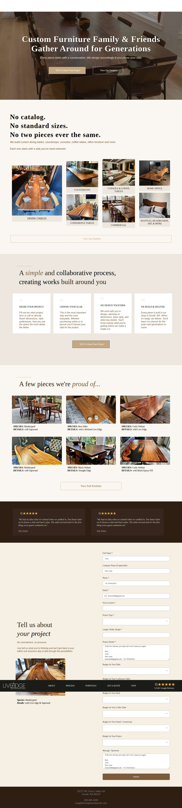

**After submit** — `run-e497e23d_attempt-1ae89205_post_attempt_2026-11-02T18-53-28-733Z.jpg`

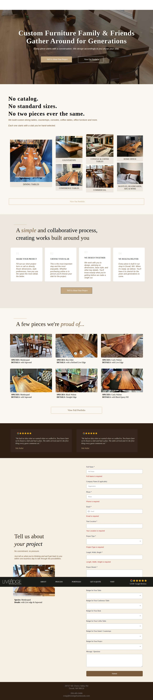

### riverwoodsmill.com — confirmed (LIVE)

| | |
|---|---|
| Attempt ID | `1bc5a8e2-8919-4c9a-8833-f2216678921d` |
| Form URL | https://www.riverwoodsmill.com/getintouch |
| Final URL | https://www.riverwoodsmill.com/getintouch |
| Reserved | 2026-11-02 18:53:36 UTC |
| Submit attempted | 2026-11-02 18:53:41 UTC |
| Template | standard v2 |
| Confirmation text | 80921 directions\> kbrown@riverwoodsmill.com (719) 377-3738 Thank you\! WHAT IS THE FOUNDRY? The Foundry is a campus created to elevate and inspire the design/build envir |
| Result / error | — |

Exact message:

~~~text
Subject: Helping customers find your business in AI search (AEO + GEO)

Hi there,

I'm Arun from Devs Arun. More and more customers now ask ChatGPT, Gemini, Perplexity or Google's AI Overviews questions like "who should I hire for this in my area?" before they call anyone. These tools answer from websites they can clearly understand, and they tend to recommend businesses whose pages answer real customer questions.

That is what AEO + GEO (Answer Engine and Generative Engine Optimization) is for. I improve your existing service pages so they clearly answer the questions your customers ask, add structured data that matches the page, and make the call, quote or enquiry step obvious. The benefit: your business gets a better chance of being mentioned or linked in AI answers, and visitors who arrive find it easy to contact you.

The AEO + GEO Starter is a one-time $199 (about ₹16,999, negotiable) for one website: a basic audit, 10 customer questions, improvements to two existing pages, relevant structured data and an action plan, with one revision round.

You can read the full details, send an enquiry or book online here:
https://devsarun.io/aeo-geo/

If this isn't relevant, just reply and I won't contact you again.

Best,
Arun
Devs Arun
itschool408@gmail.com · +91 7654534323
~~~

Submitted field values:

- Message \[message\]: Hi there, I'm Arun from Devs Arun. More and more customers now ask ChatGPT, Gemini, Perplexity or Google's AI Overviews 
- (required) \[email\]: itschool408@gmail.com
- (required) \[phone\]: +91 7654534323
- First Name (required) \[first\_name\]: Arun

**Filled form (before submit)** — `run-e497e23d_attempt-1bc5a8e2_filled_2026-11-02T18-53-41-301Z.jpg`

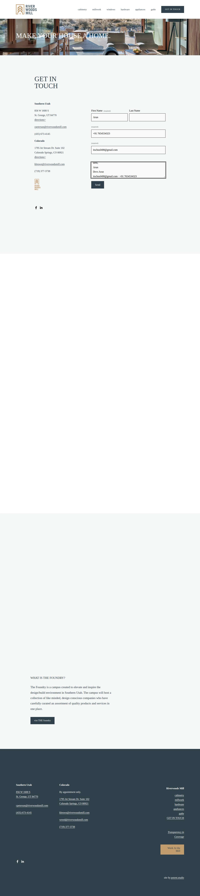

**After submit** — `run-e497e23d_attempt-1bc5a8e2_post_attempt_2026-11-02T18-53-46-392Z.jpg`

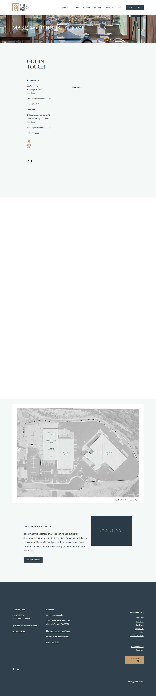

## Events (150)

| Time (UTC) | Event | Website | Details |
|---|---|---|---|
| 18:46:53 | run\_queued | — | live run requested by github:itsDevsArun |
| 18:46:53 | run\_dispatched | — | dispatch disabled (local test mode) |
| 18:46:56 | run\_started | — | Runner claimed live run |
| 18:46:57 | offer\_verified | — | Service page offer facts verified |
| 18:46:57 | website\_selected | clearchoiceplumbingllc.com | Live target clearchoiceplumbingllc.com |
| 18:46:57 | attempt\_reserved | clearchoiceplumbingllc.com | Submission attempt reserved with template standard v2 |
| 18:46:58 | page\_opened | clearchoiceplumbingllc.com | Opened form page |
| 18:46:59 | screenshot\_saved | clearchoiceplumbingllc.com | inspection screenshot saved (145 KB) |
| 18:46:59 | review\_required | clearchoiceplumbingllc.com | failed before submit: locator.fill: Error: Cannot type text into input\[type=number\] |
| 18:47:04 | website\_selected | bwnwincpainting.com | Live target bwnwincpainting.com |
| 18:47:04 | attempt\_reserved | bwnwincpainting.com | Submission attempt reserved with template standard v2 |
| 18:47:06 | page\_opened | bwnwincpainting.com | Opened form page |
| 18:47:06 | screenshot\_saved | bwnwincpainting.com | inspection screenshot saved (131 KB) |
| 18:47:06 | review\_required | bwnwincpainting.com | failed before submit: locator.fill: Error: Cannot type text into input\[type=number\] |
| 18:47:11 | website\_selected | woodcreationsllc.net | Live target woodcreationsllc.net |
| 18:47:11 | attempt\_reserved | woodcreationsllc.net | Submission attempt reserved with template standard v2 |
| 18:47:12 | page\_opened | woodcreationsllc.net | Opened form page |
| 18:47:12 | fields\_filled | woodcreationsllc.net | filled |
| 18:47:12 | screenshot\_saved | woodcreationsllc.net | filled screenshot saved (79 KB) |
| 18:47:12 | submit\_attempted | woodcreationsllc.net | submitting |
| 18:47:16 | screenshot\_saved | woodcreationsllc.net | post\_attempt screenshot saved (73 KB) |
| 18:47:16 | confirmation\_observed | woodcreationsllc.net | confirmed — "m 125 West Main Street 717-351-7109 Your Name Email Message Message Sent Send Message 125 West Main Street Terre Hill, P" |
| 18:47:23 | website\_selected | aandpwoodworking.com | Live target aandpwoodworking.com |
| 18:47:23 | attempt\_reserved | aandpwoodworking.com | Submission attempt reserved with template standard v2 |
| 18:47:26 | page\_opened | aandpwoodworking.com | Opened form page |
| 18:47:26 | fields\_filled | aandpwoodworking.com | filled |
| 18:47:26 | screenshot\_saved | aandpwoodworking.com | filled screenshot saved (86 KB) |
| 18:47:26 | submit\_attempted | aandpwoodworking.com | submitting |
| 18:47:30 | screenshot\_saved | aandpwoodworking.com | post\_attempt screenshot saved (85 KB) |
| 18:47:30 | confirmation\_observed | aandpwoodworking.com | confirmed — "oodworking.com Home Our Work About Us Contact Us Contact Us Thanks for contacting us A and P Woodworking Phone: 617- 569" |
| 18:47:38 | website\_selected | granitemill.com | Live target granitemill.com |
| 18:47:38 | attempt\_reserved | granitemill.com | Submission attempt reserved with template standard v2 |
| 18:47:39 | page\_opened | granitemill.com | Opened form page |
| 18:47:39 | fields\_filled | granitemill.com | filled |
| 18:47:39 | screenshot\_saved | granitemill.com | filled screenshot saved (327 KB) |
| 18:47:39 | submit\_attempted | granitemill.com | submitting |
| 18:48:07 | screenshot\_saved | granitemill.com | post\_attempt screenshot saved (334 KB) |
| 18:48:07 | confirmation\_observed | granitemill.com | confirmed — "n behalf of my office and the citizens of Salt Lake County, thank you for your contributions to our community, and congr" |
| 18:48:15 | website\_selected | edisonpallet.net | Live target edisonpallet.net |
| 18:48:15 | attempt\_reserved | edisonpallet.net | Submission attempt reserved with template standard v2 |
| 18:48:17 | page\_opened | edisonpallet.net | Opened form page |
| 18:48:17 | fields\_filled | edisonpallet.net | filled |
| 18:48:17 | screenshot\_saved | edisonpallet.net | filled screenshot saved (126 KB) |
| 18:48:17 | submit\_attempted | edisonpallet.net | submitting |
| 18:48:22 | screenshot\_saved | edisonpallet.net | post\_attempt screenshot saved (117 KB) |
| 18:48:22 | confirmation\_observed | edisonpallet.net | confirmed — "ington, Bolingbrook, and all of Illinois. Send Us A Message Thank you for contacting us. We will get back to you as soon" |
| 18:48:30 | website\_selected | granitestaterainbowplay.net | Live target granitestaterainbowplay.net |
| 18:48:30 | attempt\_reserved | granitestaterainbowplay.net | Submission attempt reserved with template standard v2 |
| 18:48:32 | page\_opened | granitestaterainbowplay.net | Opened form page |
| 18:48:32 | fields\_filled | granitestaterainbowplay.net | filled |
| 18:48:32 | screenshot\_saved | granitestaterainbowplay.net | filled screenshot saved (39 KB) |
| 18:48:32 | submit\_attempted | granitestaterainbowplay.net | submitting |
| 18:48:45 | screenshot\_saved | granitestaterainbowplay.net | post\_attempt screenshot saved (39 KB) |
| 18:48:45 | error | granitestaterainbowplay.net | error after submit: Submit click error (outcome unknown, not retried): locator.click: Timeout 10000ms exceeded. |
| 18:48:52 | website\_selected | tdsmanufacturingllc.com | Live target tdsmanufacturingllc.com |
| 18:48:52 | attempt\_reserved | tdsmanufacturingllc.com | Submission attempt reserved with template standard v2 |
| 18:48:55 | page\_opened | tdsmanufacturingllc.com | Opened form page |
| 18:48:55 | screenshot\_saved | tdsmanufacturingllc.com | filled screenshot saved (416 KB) |
| 18:48:55 | review\_required | tdsmanufacturingllc.com | failed before submit: Message field truncated the text; the required link https://devsarun.io/aeo-geo/ would be lost |
| 18:49:00 | website\_selected | rainierwoodworking.com | Live target rainierwoodworking.com |
| 18:49:00 | attempt\_reserved | rainierwoodworking.com | Submission attempt reserved with template standard v2 |
| 18:49:02 | page\_opened | rainierwoodworking.com | Opened form page |
| 18:49:02 | fields\_filled | rainierwoodworking.com | filled |
| 18:49:03 | screenshot\_saved | rainierwoodworking.com | filled screenshot saved (107 KB) |
| 18:49:03 | submit\_attempted | rainierwoodworking.com | submitting |
| 18:49:30 | screenshot\_saved | rainierwoodworking.com | post\_attempt screenshot saved (157 KB) |
| 18:49:30 | review\_required | rainierwoodworking.com | unclear: No new success marker observed |
| 18:49:38 | website\_selected | valleycustomclosets.com | Live target valleycustomclosets.com |
| 18:49:38 | attempt\_reserved | valleycustomclosets.com | Submission attempt reserved with template standard v2 |
| 18:49:42 | page\_opened | valleycustomclosets.com | Opened form page |
| 18:49:43 | fields\_filled | valleycustomclosets.com | filled |
| 18:49:43 | screenshot\_saved | valleycustomclosets.com | filled screenshot saved (120 KB) |
| 18:49:43 | submit\_attempted | valleycustomclosets.com | submitting |
| 18:49:53 | screenshot\_saved | valleycustomclosets.com | post\_attempt screenshot saved (111 KB) |
| 18:49:53 | confirmation\_observed | valleycustomclosets.com | confirmed — "Call Now (559)515-6373 Schedule a Free Design Consultation Thank you\! Form submitted successfully. Your Details Let us k" |
| 18:50:01 | website\_selected | thebarnbuilders.com | Live target thebarnbuilders.com |
| 18:50:01 | attempt\_reserved | thebarnbuilders.com | Submission attempt reserved with template standard v2 |
| 18:50:05 | page\_opened | thebarnbuilders.com | Opened form page |
| 18:50:06 | fields\_filled | thebarnbuilders.com | filled |
| 18:50:06 | screenshot\_saved | thebarnbuilders.com | filled screenshot saved (172 KB) |
| 18:50:06 | submit\_attempted | thebarnbuilders.com | submitting |
| 18:50:16 | screenshot\_saved | thebarnbuilders.com | post\_attempt screenshot saved (172 KB) |
| 18:50:16 | error | thebarnbuilders.com | error after submit — "Not listed Not sure yet OVERHEAD DOORS (SIZE & QUANTITY) \* Please enter the overhead door size and quantity ENTRY DOORS " |
| 18:50:24 | website\_selected | thebarnwoodshop.com | Live target thebarnwoodshop.com |
| 18:50:24 | attempt\_reserved | thebarnwoodshop.com | Submission attempt reserved with template standard v2 |
| 18:50:25 | page\_opened | thebarnwoodshop.com | Opened form page |
| 18:50:25 | fields\_filled | thebarnwoodshop.com | filled |
| 18:50:25 | screenshot\_saved | thebarnwoodshop.com | filled screenshot saved (127 KB) |
| 18:50:25 | submit\_attempted | thebarnwoodshop.com | submitting |
| 18:50:54 | screenshot\_saved | thebarnwoodshop.com | post\_attempt screenshot saved (126 KB) |
| 18:50:54 | review\_required | thebarnwoodshop.com | unclear: No new success marker observed |
| 18:51:01 | website\_selected | jmdesignseattle.com | Live target jmdesignseattle.com |
| 18:51:01 | attempt\_reserved | jmdesignseattle.com | Submission attempt reserved with template standard v2 |
| 18:51:04 | page\_opened | jmdesignseattle.com | Opened form page |
| 18:51:04 | fields\_filled | jmdesignseattle.com | filled |
| 18:51:04 | screenshot\_saved | jmdesignseattle.com | filled screenshot saved (23 KB) |
| 18:51:04 | submit\_attempted | jmdesignseattle.com | submitting |
| 18:51:08 | screenshot\_saved | jmdesignseattle.com | post\_attempt screenshot saved (41 KB) |
| 18:51:08 | confirmation\_observed | jmdesignseattle.com | confirmed — "19 Fishermen’s Terminal C-10 Building HAVE A QUESTION? Your message was sent successfully. Thanks. Your Name (required) " |
| 18:51:15 | website\_selected | centurylumbercenter.com | Live target centurylumbercenter.com |
| 18:51:15 | attempt\_reserved | centurylumbercenter.com | Submission attempt reserved with template standard v2 |
| 18:51:20 | page\_opened | centurylumbercenter.com | Opened form page |
| 18:51:20 | fields\_filled | centurylumbercenter.com | filled |
| 18:51:21 | screenshot\_saved | centurylumbercenter.com | filled screenshot saved (106 KB) |
| 18:51:21 | submit\_attempted | centurylumbercenter.com | submitting |
| 18:51:33 | screenshot\_saved | centurylumbercenter.com | post\_attempt screenshot saved (111 KB) |
| 18:51:33 | error | centurylumbercenter.com | error after submit: Submit click error (outcome unknown, not retried): locator.click: Timeout 10000ms exceeded. |
| 18:51:41 | website\_selected | alamocabinetry.com | Live target alamocabinetry.com |
| 18:51:41 | attempt\_reserved | alamocabinetry.com | Submission attempt reserved with template standard v2 |
| 18:51:45 | page\_opened | alamocabinetry.com | Opened form page |
| 18:51:47 | fields\_filled | alamocabinetry.com | filled |
| 18:51:47 | screenshot\_saved | alamocabinetry.com | filled screenshot saved (263 KB) |
| 18:51:47 | submit\_attempted | alamocabinetry.com | submitting |
| 18:52:23 | screenshot\_saved | alamocabinetry.com | post\_attempt screenshot saved (263 KB) |
| 18:52:23 | review\_required | alamocabinetry.com | unclear: No new success marker observed |
| 18:52:30 | website\_selected | modernboywoodshop.com | Live target modernboywoodshop.com |
| 18:52:30 | attempt\_reserved | modernboywoodshop.com | Submission attempt reserved with template standard v2 |
| 18:52:32 | page\_opened | modernboywoodshop.com | Opened form page |
| 18:52:32 | fields\_filled | modernboywoodshop.com | filled |
| 18:52:32 | screenshot\_saved | modernboywoodshop.com | filled screenshot saved (131 KB) |
| 18:52:32 | submit\_attempted | modernboywoodshop.com | submitting |
| 18:53:00 | screenshot\_saved | modernboywoodshop.com | post\_attempt screenshot saved (66 KB) |
| 18:53:00 | review\_required | modernboywoodshop.com | unclear: No new success marker observed |
| 18:53:07 | website\_selected | woodworkersnaples.com | Live target woodworkersnaples.com |
| 18:53:07 | attempt\_reserved | woodworkersnaples.com | Submission attempt reserved with template standard v2 |
| 18:53:08 | page\_opened | woodworkersnaples.com | Opened form page |
| 18:53:08 | screenshot\_saved | woodworkersnaples.com | filled screenshot saved (42 KB) |
| 18:53:08 | review\_required | woodworkersnaples.com | failed before submit: Field "Phone (required)" did not accept the value |
| 18:53:13 | website\_selected | noblewoodwork.com | Live target noblewoodwork.com |
| 18:53:13 | attempt\_reserved | noblewoodwork.com | Submission attempt reserved with template standard v2 |
| 18:53:17 | page\_opened | noblewoodwork.com | Opened form page |
| 18:53:17 | screenshot\_saved | noblewoodwork.com | filled screenshot saved (129 KB) |
| 18:53:17 | review\_required | noblewoodwork.com | failed before submit: Message field truncated the text; the required link https://devsarun.io/aeo-geo/ would be lost |
| 18:53:22 | website\_selected | liveedgehardwoods.com | Live target liveedgehardwoods.com |
| 18:53:22 | attempt\_reserved | liveedgehardwoods.com | Submission attempt reserved with template standard v2 |
| 18:53:25 | page\_opened | liveedgehardwoods.com | Opened form page |
| 18:53:25 | fields\_filled | liveedgehardwoods.com | filled |
| 18:53:25 | screenshot\_saved | liveedgehardwoods.com | filled screenshot saved (455 KB) |
| 18:53:25 | submit\_attempted | liveedgehardwoods.com | submitting |
| 18:53:28 | screenshot\_saved | liveedgehardwoods.com | post\_attempt screenshot saved (453 KB) |
| 18:53:28 | error | liveedgehardwoods.com | error after submit — "pod Details: with Live edge & Sapwood Full Name \* Full Name is required Company Name (if applicable) Phone \* Phone is re" |
| 18:53:36 | website\_selected | riverwoodsmill.com | Live target riverwoodsmill.com |
| 18:53:36 | attempt\_reserved | riverwoodsmill.com | Submission attempt reserved with template standard v2 |
| 18:53:41 | page\_opened | riverwoodsmill.com | Opened form page |
| 18:53:41 | fields\_filled | riverwoodsmill.com | filled |
| 18:53:41 | screenshot\_saved | riverwoodsmill.com | filled screenshot saved (163 KB) |
| 18:53:41 | submit\_attempted | riverwoodsmill.com | submitting |
| 18:53:46 | screenshot\_saved | riverwoodsmill.com | post\_attempt screenshot saved (215 KB) |
| 18:53:46 | confirmation\_observed | riverwoodsmill.com | confirmed — "80921 directions\> kbrown@riverwoodsmill.com (719) 377-3738 Thank you\! WHAT IS THE FOUNDRY? The Foundry is a campus creat" |
| 18:53:55 | run\_completed | — | Run completed (queue\_exhausted) |
