# Run 0129ec72 — dry\_run — completed

| | |
|---|---|
| Run ID | `0129ec72-a05e-4050-bfd0-db3341ab4dd5` |
| Requested by | github:itsDevsArun |
| Started | 2026-11-03 02:21:29 UTC |
| Finished | 2026-11-03 02:24:05 UTC |
| Finish reason | queue\_exhausted |
| GitHub Actions | https://github.com/itsDevsArun/aeo-geo/actions/runs/41562188869 |

CSV for this run: [runs/2026-11-03_dry_run_0129ec72.csv](2026-11-03_dry_run_0129ec72.csv)

## Attempts (21)

### helixmechanical.com — dry\_run\_failed (dry run)

| | |
|---|---|
| Attempt ID | `434fa821-c80f-4adb-a020-87ff479b9cfa` |
| Form URL | https://helixmechanical.com/contact/ |
| Final URL | https://helixmechanical.com/contact/ |
| Reserved | 2026-11-03 02:21:29 UTC |
| Submit attempted | — |
| Template | standard v2 |
| Confirmation text | none observed |
| Result / error | Mapped field "First Name \*" not found uniquely |

Exact message:

~~~text
Subject: Helping customers find your business in AI search (AEO + GEO)

Hi there,

I'm Arun from Devs Arun. More and more customers now ask ChatGPT, Gemini, Perplexity or Google's AI Overviews questions like "who should I hire for this in my area?" before they call anyone. These tools answer from websites they can clearly understand, and they tend to recommend businesses whose pages answer real customer questions.

That is what AEO + GEO (Answer Engine and Generative Engine Optimization) is for. I improve your existing service pages so they clearly answer the questions your customers ask, add structured data that matches the page, and make the call, quote or enquiry step obvious. The benefit: your business gets a better chance of being mentioned or linked in AI answers, and visitors who arrive find it easy to contact you.

The AEO + GEO Starter is a one-time $199 (about ₹16,999, negotiable) for one website: a basic audit, 10 customer questions, improvements to two existing pages, relevant structured data and an action plan, with one revision round.

You can read the full details, send an enquiry or book online here:
https://devsarun.io/aeo-geo/

If this isn't relevant, just reply and I won't contact you again.

Best,
Arun
Devs Arun
itschool408@gmail.com · +91 7654534323
~~~

Submitted field values:

- \#forminator-field-name-1\_6ae7ff023fd3c: Arun
- \#forminator-field-email-1\_6ae7ff023fd3c: itschool408@gmail.com
- \#forminator-field-phone-1\_6ae7ff023fd3c: +91 7654534323
- \#forminator-field-textarea-1\_6ae7ff023fd3c: Hi there, I'm Arun from Devs Arun. More and more customers now ask ChatGPT, Gemini, Perplexity or Google's AI Overviews 

**Inspected page** — `run-0129ec72_attempt-434fa821_inspection_2026-11-03T02-21-32-050Z.jpg`

### knoxvilleelectrician.com — dry\_run\_failed (dry run)

| | |
|---|---|
| Attempt ID | `58599660-fb16-4b6c-ac57-e279f0852406` |
| Form URL | https://knoxvilleelectrician.com/contact-us/ |
| Final URL | https://knoxvilleelectrician.com/contact-us/ |
| Reserved | 2026-11-03 02:21:37 UTC |
| Submit attempted | — |
| Template | standard v2 |
| Confirmation text | none observed |
| Result / error | Mapped field "Name" not found uniquely |

Exact message:

~~~text
Subject: Helping customers find your business in AI search (AEO + GEO)

Hi there,

I'm Arun from Devs Arun. More and more customers now ask ChatGPT, Gemini, Perplexity or Google's AI Overviews questions like "who should I hire for this in my area?" before they call anyone. These tools answer from websites they can clearly understand, and they tend to recommend businesses whose pages answer real customer questions.

That is what AEO + GEO (Answer Engine and Generative Engine Optimization) is for. I improve your existing service pages so they clearly answer the questions your customers ask, add structured data that matches the page, and make the call, quote or enquiry step obvious. The benefit: your business gets a better chance of being mentioned or linked in AI answers, and visitors who arrive find it easy to contact you.

The AEO + GEO Starter is a one-time $199 (about ₹16,999, negotiable) for one website: a basic audit, 10 customer questions, improvements to two existing pages, relevant structured data and an action plan, with one revision round.

You can read the full details, send an enquiry or book online here:
https://devsarun.io/aeo-geo/

If this isn't relevant, just reply and I won't contact you again.

Best,
Arun
Devs Arun
itschool408@gmail.com · +91 7654534323
~~~

Submitted field values:

- \#form-field-1b7221: itschool408@gmail.com
- \#form-field-2fa3ac: +91 7654534323
- \#form-field-96f51f: Arun
- \#form-field-fed9d8: Hi there, I'm Arun from Devs Arun. More and more customers now ask ChatGPT, Gemini, Perplexity or Google's AI Overviews 

**Inspected page** — `run-0129ec72_attempt-58599660_inspection_2026-11-03T02-21-38-896Z.jpg`

### coderestoration.com — dry\_run\_ok (dry run)

| | |
|---|---|
| Attempt ID | `e73caef2-1459-4630-a807-bb95ae847f7a` |
| Form URL | https://coderestoration.com/contact-us/ |
| Final URL | https://coderestoration.com/contact-us/ |
| Reserved | 2026-11-03 02:21:43 UTC |
| Submit attempted | — |
| Template | standard v2 |
| Confirmation text | none observed |
| Result / error | Selectors verified; fields not typed (domain not in dry-run fill list); not submitted |

Exact message:

~~~text
Subject: Helping customers find your business in AI search (AEO + GEO)

Hi there,

I'm Arun from Devs Arun. More and more customers now ask ChatGPT, Gemini, Perplexity or Google's AI Overviews questions like "who should I hire for this in my area?" before they call anyone. These tools answer from websites they can clearly understand, and they tend to recommend businesses whose pages answer real customer questions.

That is what AEO + GEO (Answer Engine and Generative Engine Optimization) is for. I improve your existing service pages so they clearly answer the questions your customers ask, add structured data that matches the page, and make the call, quote or enquiry step obvious. The benefit: your business gets a better chance of being mentioned or linked in AI answers, and visitors who arrive find it easy to contact you.

The AEO + GEO Starter is a one-time $199 (about ₹16,999, negotiable) for one website: a basic audit, 10 customer questions, improvements to two existing pages, relevant structured data and an action plan, with one revision round.

You can read the full details, send an enquiry or book online here:
https://devsarun.io/aeo-geo/

If this isn't relevant, just reply and I won't contact you again.

Best,
Arun
Devs Arun
itschool408@gmail.com · +91 7654534323
~~~

Submitted field values:

- \#et\_pb\_contact\_name\_0: Arun
- \#et\_pb\_contact\_email\_0: itschool408@gmail.com
- \#et\_pb\_contact\_phone\_0: +91 7654534323
- \#et\_pb\_contact\_message\_0: Hi there, I'm Arun from Devs Arun. More and more customers now ask ChatGPT, Gemini, Perplexity or Google's AI Overviews 

**Inspected page** — `run-0129ec72_attempt-e73caef2_inspection_2026-11-03T02-21-45-875Z.jpg`

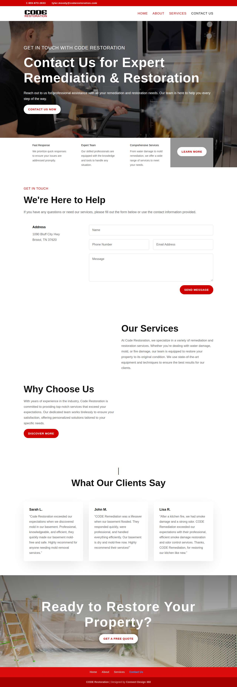

### easttexasconcreters.com — dry\_run\_ok (dry run)

| | |
|---|---|
| Attempt ID | `ab0b3737-edac-4e35-9c51-50d92635907f` |
| Form URL | https://easttexasconcreters.com/contact/ |
| Final URL | https://easttexasconcreters.com/contact/ |
| Reserved | 2026-11-03 02:21:50 UTC |
| Submit attempted | — |
| Template | standard v2 |
| Confirmation text | none observed |
| Result / error | Selectors verified; fields not typed (domain not in dry-run fill list); not submitted |

Exact message:

~~~text
Subject: Helping customers find your business in AI search (AEO + GEO)

Hi there,

I'm Arun from Devs Arun. More and more customers now ask ChatGPT, Gemini, Perplexity or Google's AI Overviews questions like "who should I hire for this in my area?" before they call anyone. These tools answer from websites they can clearly understand, and they tend to recommend businesses whose pages answer real customer questions.

That is what AEO + GEO (Answer Engine and Generative Engine Optimization) is for. I improve your existing service pages so they clearly answer the questions your customers ask, add structured data that matches the page, and make the call, quote or enquiry step obvious. The benefit: your business gets a better chance of being mentioned or linked in AI answers, and visitors who arrive find it easy to contact you.

The AEO + GEO Starter is a one-time $199 (about ₹16,999, negotiable) for one website: a basic audit, 10 customer questions, improvements to two existing pages, relevant structured data and an action plan, with one revision round.

You can read the full details, send an enquiry or book online here:
https://devsarun.io/aeo-geo/

If this isn't relevant, just reply and I won't contact you again.

Best,
Arun
Devs Arun
itschool408@gmail.com · +91 7654534323
~~~

Submitted field values:

- input\[name="name"\]: Arun
- input\[name="email"\]: itschool408@gmail.com
- input\[name="phone"\]: +91 7654534323
- select\[name="service"\]: Other
- textarea\[name="message"\]: Hi there, I'm Arun from Devs Arun. More and more customers now ask ChatGPT, Gemini, Perplexity or Google's AI Overviews 

**Inspected page** — `run-0129ec72_attempt-ab0b3737_inspection_2026-11-03T02-21-52-976Z.jpg`

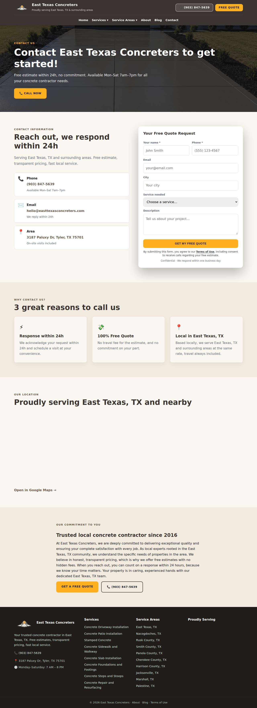

### updpavers.com — dry\_run\_ok (dry run)

| | |
|---|---|
| Attempt ID | `cbe7b9ea-ebbf-438b-ab04-1dd1111f0305` |
| Form URL | https://updpavers.com/contact-us |
| Final URL | https://updpavers.com/contact-us |
| Reserved | 2026-11-03 02:21:58 UTC |
| Submit attempted | — |
| Template | standard v2 |
| Confirmation text | none observed |
| Result / error | Selectors verified; fields not typed (domain not in dry-run fill list); not submitted |

Exact message:

~~~text
Subject: Helping customers find your business in AI search (AEO + GEO)

Hi there,

I'm Arun from Devs Arun. More and more customers now ask ChatGPT, Gemini, Perplexity or Google's AI Overviews questions like "who should I hire for this in my area?" before they call anyone. These tools answer from websites they can clearly understand, and they tend to recommend businesses whose pages answer real customer questions.

That is what AEO + GEO (Answer Engine and Generative Engine Optimization) is for. I improve your existing service pages so they clearly answer the questions your customers ask, add structured data that matches the page, and make the call, quote or enquiry step obvious. The benefit: your business gets a better chance of being mentioned or linked in AI answers, and visitors who arrive find it easy to contact you.

The AEO + GEO Starter is a one-time $199 (about ₹16,999, negotiable) for one website: a basic audit, 10 customer questions, improvements to two existing pages, relevant structured data and an action plan, with one revision round.

You can read the full details, send an enquiry or book online here:
https://devsarun.io/aeo-geo/

If this isn't relevant, just reply and I won't contact you again.

Best,
Arun
Devs Arun
itschool408@gmail.com · +91 7654534323
~~~

Submitted field values:

- \#name-Name: Arun
- \#email-Email: itschool408@gmail.com
- \#phone-Phone: +91 7654534323
- \#message-Leave\\ us\\ a\\ message: Hi there, I'm Arun from Devs Arun. More and more customers now ask ChatGPT, Gemini, Perplexity or Google's AI Overviews 

**Inspected page** — `run-0129ec72_attempt-cbe7b9ea_inspection_2026-11-03T02-21-59-905Z.jpg`

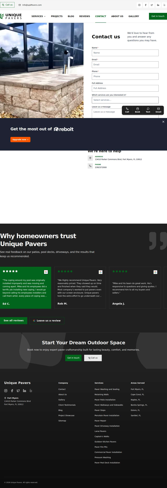

### danieleccleshomes.com — dry\_run\_ok (dry run)

| | |
|---|---|
| Attempt ID | `1062b486-d485-484d-acc7-d6a9583c5ba6` |
| Form URL | https://www.danieleccleshomes.com/contact |
| Final URL | https://www.danieleccleshomes.com/contact |
| Reserved | 2026-11-03 02:22:04 UTC |
| Submit attempted | — |
| Template | standard v2 |
| Confirmation text | none observed |
| Result / error | Selectors verified; fields not typed (domain not in dry-run fill list); not submitted |

Exact message:

~~~text
Subject: Helping customers find your business in AI search (AEO + GEO)

Hi there,

I'm Arun from Devs Arun. More and more customers now ask ChatGPT, Gemini, Perplexity or Google's AI Overviews questions like "who should I hire for this in my area?" before they call anyone. These tools answer from websites they can clearly understand, and they tend to recommend businesses whose pages answer real customer questions.

That is what AEO + GEO (Answer Engine and Generative Engine Optimization) is for. I improve your existing service pages so they clearly answer the questions your customers ask, add structured data that matches the page, and make the call, quote or enquiry step obvious. The benefit: your business gets a better chance of being mentioned or linked in AI answers, and visitors who arrive find it easy to contact you.

The AEO + GEO Starter is a one-time $199 (about ₹16,999, negotiable) for one website: a basic audit, 10 customer questions, improvements to two existing pages, relevant structured data and an action plan, with one revision round.

You can read the full details, send an enquiry or book online here:
https://devsarun.io/aeo-geo/

If this isn't relevant, just reply and I won't contact you again.

Best,
Arun
Devs Arun
itschool408@gmail.com · +91 7654534323
~~~

Submitted field values:

- \#input\_comp-jkkwhet3: itschool408@gmail.com
- \#input\_comp-jkkwhet8: Arun
- \#input\_comp-mg5dlk2w: +91 7654534323
- \#textarea\_comp-kue5z8eo: Hi there, I'm Arun from Devs Arun. More and more customers now ask ChatGPT, Gemini, Perplexity or Google's AI Overviews 

**Inspected page** — `run-0129ec72_attempt-1062b486_inspection_2026-11-03T02-22-07-193Z.jpg`

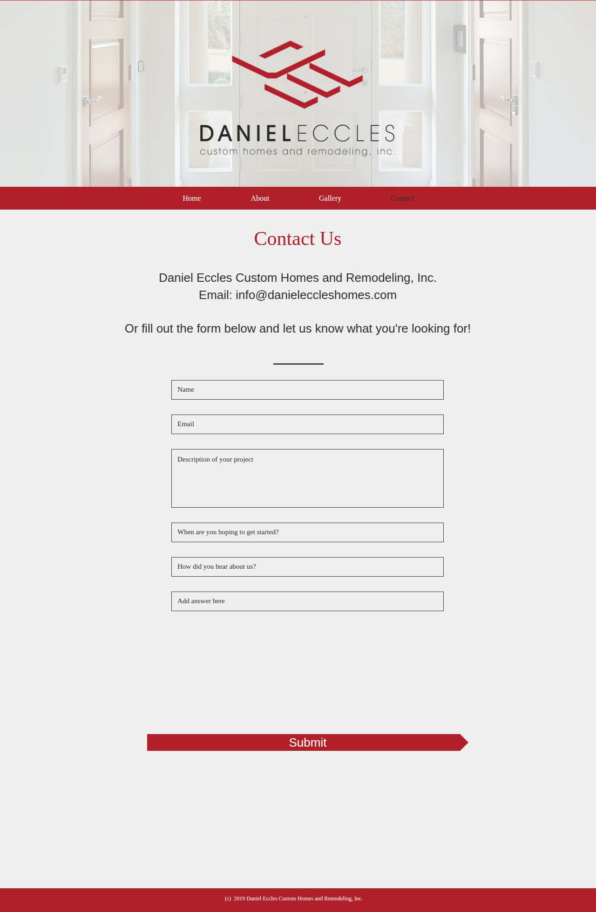

### danddseamlessgutters.com — dry\_run\_ok (dry run)

| | |
|---|---|
| Attempt ID | `ca607b3f-1b58-4059-a8d6-db3789a7dc03` |
| Form URL | https://danddseamlessgutters.com/contact-seamless-gutter-experts/ |
| Final URL | https://danddseamlessgutters.com/contact-seamless-gutter-experts/ |
| Reserved | 2026-11-03 02:22:12 UTC |
| Submit attempted | — |
| Template | standard v2 |
| Confirmation text | none observed |
| Result / error | Selectors verified; fields not typed (domain not in dry-run fill list); not submitted |

Exact message:

~~~text
Subject: Helping customers find your business in AI search (AEO + GEO)

Hi there,

I'm Arun from Devs Arun. More and more customers now ask ChatGPT, Gemini, Perplexity or Google's AI Overviews questions like "who should I hire for this in my area?" before they call anyone. These tools answer from websites they can clearly understand, and they tend to recommend businesses whose pages answer real customer questions.

That is what AEO + GEO (Answer Engine and Generative Engine Optimization) is for. I improve your existing service pages so they clearly answer the questions your customers ask, add structured data that matches the page, and make the call, quote or enquiry step obvious. The benefit: your business gets a better chance of being mentioned or linked in AI answers, and visitors who arrive find it easy to contact you.

The AEO + GEO Starter is a one-time $199 (about ₹16,999, negotiable) for one website: a basic audit, 10 customer questions, improvements to two existing pages, relevant structured data and an action plan, with one revision round.

You can read the full details, send an enquiry or book online here:
https://devsarun.io/aeo-geo/

If this isn't relevant, just reply and I won't contact you again.

Best,
Arun
Devs Arun
itschool408@gmail.com · +91 7654534323
~~~

Submitted field values:

- \#form-field-name: Arun
- \#form-field-email: itschool408@gmail.com
- \#form-field-phone: +91 7654534323
- \#form-field-message: Hi there, I'm Arun from Devs Arun. More and more customers now ask ChatGPT, Gemini, Perplexity or Google's AI Overviews 

**Inspected page** — `run-0129ec72_attempt-ca607b3f_inspection_2026-11-03T02-22-14-087Z.jpg`

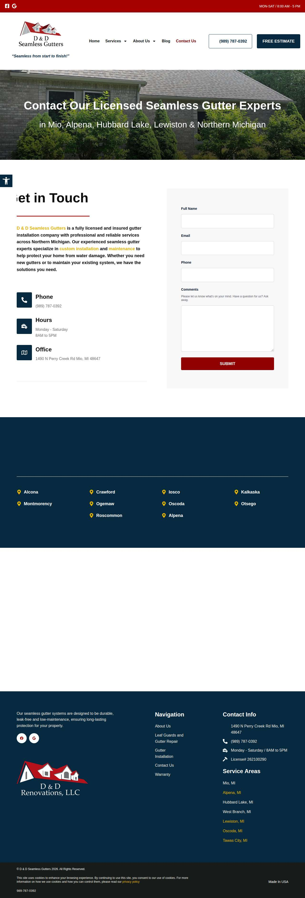

### buntinconstruction.com — dry\_run\_ok (dry run)

| | |
|---|---|
| Attempt ID | `ffa2d36a-479f-4301-b7a2-72124ed086fa` |
| Form URL | https://www.buntinconstruction.com/contact/ |
| Final URL | https://www.buntinconstruction.com/contact/ |
| Reserved | 2026-11-03 02:22:19 UTC |
| Submit attempted | — |
| Template | standard v2 |
| Confirmation text | none observed |
| Result / error | Selectors verified; fields not typed (domain not in dry-run fill list); not submitted |

Exact message:

~~~text
Subject: Helping customers find your business in AI search (AEO + GEO)

Hi there,

I'm Arun from Devs Arun. More and more customers now ask ChatGPT, Gemini, Perplexity or Google's AI Overviews questions like "who should I hire for this in my area?" before they call anyone. These tools answer from websites they can clearly understand, and they tend to recommend businesses whose pages answer real customer questions.

That is what AEO + GEO (Answer Engine and Generative Engine Optimization) is for. I improve your existing service pages so they clearly answer the questions your customers ask, add structured data that matches the page, and make the call, quote or enquiry step obvious. The benefit: your business gets a better chance of being mentioned or linked in AI answers, and visitors who arrive find it easy to contact you.

The AEO + GEO Starter is a one-time $199 (about ₹16,999, negotiable) for one website: a basic audit, 10 customer questions, improvements to two existing pages, relevant structured data and an action plan, with one revision round.

You can read the full details, send an enquiry or book online here:
https://devsarun.io/aeo-geo/

If this isn't relevant, just reply and I won't contact you again.

Best,
Arun
Devs Arun
itschool408@gmail.com · +91 7654534323
~~~

Submitted field values:

- input\[name="your-name"\]: Arun
- input\[name="your-email"\]: itschool408@gmail.com
- input\[name="your-subject"\]: Helping customers find your business in AI search (AEO + GEO)
- textarea\[name="your-message"\]: Hi there, I'm Arun from Devs Arun. More and more customers now ask ChatGPT, Gemini, Perplexity or Google's AI Overviews 

**Inspected page** — `run-0129ec72_attempt-ffa2d36a_inspection_2026-11-03T02-22-21-567Z.jpg`

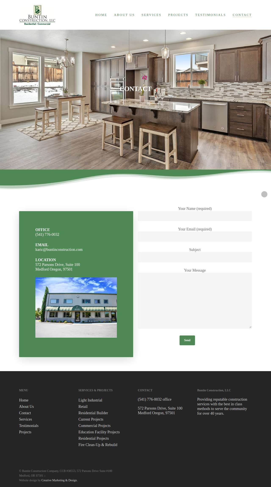

### danddreno.com — dry\_run\_ok (dry run)

| | |
|---|---|
| Attempt ID | `8a169b2d-cef6-4f6e-aa7b-432e803f3ca1` |
| Form URL | https://www.danddreno.com/contact |
| Final URL | https://www.danddreno.com/contact |
| Reserved | 2026-11-03 02:22:26 UTC |
| Submit attempted | — |
| Template | standard v2 |
| Confirmation text | none observed |
| Result / error | Selectors verified; fields not typed (domain not in dry-run fill list); not submitted |

Exact message:

~~~text
Subject: Helping customers find your business in AI search (AEO + GEO)

Hi there,

I'm Arun from Devs Arun. More and more customers now ask ChatGPT, Gemini, Perplexity or Google's AI Overviews questions like "who should I hire for this in my area?" before they call anyone. These tools answer from websites they can clearly understand, and they tend to recommend businesses whose pages answer real customer questions.

That is what AEO + GEO (Answer Engine and Generative Engine Optimization) is for. I improve your existing service pages so they clearly answer the questions your customers ask, add structured data that matches the page, and make the call, quote or enquiry step obvious. The benefit: your business gets a better chance of being mentioned or linked in AI answers, and visitors who arrive find it easy to contact you.

The AEO + GEO Starter is a one-time $199 (about ₹16,999, negotiable) for one website: a basic audit, 10 customer questions, improvements to two existing pages, relevant structured data and an action plan, with one revision round.

You can read the full details, send an enquiry or book online here:
https://devsarun.io/aeo-geo/

If this isn't relevant, just reply and I won't contact you again.

Best,
Arun
Devs Arun
itschool408@gmail.com · +91 7654534323
~~~

Submitted field values:

- \#input\_comp-ls4w188h4: Arun
- \#input\_comp-ls4w188q5: itschool408@gmail.com
- \#input\_comp-ls4w188s4: Helping customers find your business in AI search (AEO + GEO)
- \#textarea\_comp-ls4w188u3: Hi there, I'm Arun from Devs Arun. More and more customers now ask ChatGPT, Gemini, Perplexity or Google's AI Overviews 

**Inspected page** — `run-0129ec72_attempt-8a169b2d_inspection_2026-11-03T02-22-28-633Z.jpg`

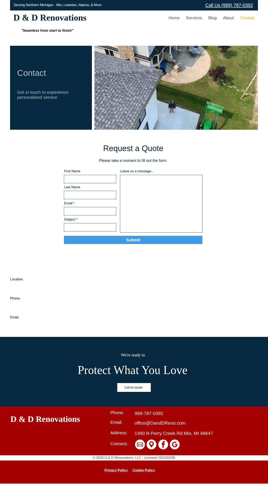

### unityconstructioninccompany.com — dry\_run\_ok (dry run)

| | |
|---|---|
| Attempt ID | `96869ce3-c5e5-403e-82b5-a5001d7b82d5` |
| Form URL | https://www.unityconstructioninccompany.com/contact |
| Final URL | https://www.unityconstructioninccompany.com/contact |
| Reserved | 2026-11-03 02:22:33 UTC |
| Submit attempted | — |
| Template | standard v2 |
| Confirmation text | none observed |
| Result / error | Selectors verified; fields not typed (domain not in dry-run fill list); not submitted |

Exact message:

~~~text
Subject: Helping customers find your business in AI search (AEO + GEO)

Hi there,

I'm Arun from Devs Arun. More and more customers now ask ChatGPT, Gemini, Perplexity or Google's AI Overviews questions like "who should I hire for this in my area?" before they call anyone. These tools answer from websites they can clearly understand, and they tend to recommend businesses whose pages answer real customer questions.

That is what AEO + GEO (Answer Engine and Generative Engine Optimization) is for. I improve your existing service pages so they clearly answer the questions your customers ask, add structured data that matches the page, and make the call, quote or enquiry step obvious. The benefit: your business gets a better chance of being mentioned or linked in AI answers, and visitors who arrive find it easy to contact you.

The AEO + GEO Starter is a one-time $199 (about ₹16,999, negotiable) for one website: a basic audit, 10 customer questions, improvements to two existing pages, relevant structured data and an action plan, with one revision round.

You can read the full details, send an enquiry or book online here:
https://devsarun.io/aeo-geo/

If this isn't relevant, just reply and I won't contact you again.

Best,
Arun
Devs Arun
itschool408@gmail.com · +91 7654534323
~~~

Submitted field values:

- \#\\31 553166632: itschool408@gmail.com
- \#\\31 579383773: +91 7654534323
- \#\\31 679072901: Hi there, I'm Arun from Devs Arun. More and more customers now ask ChatGPT, Gemini, Perplexity or Google's AI Overviews 
- \#\\31 722991041: Arun

**Inspected page** — `run-0129ec72_attempt-96869ce3_inspection_2026-11-03T02-22-36-301Z.jpg`

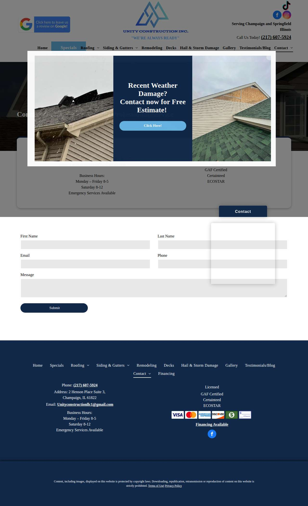

### contmech.com — dry\_run\_ok (dry run)

| | |
|---|---|
| Attempt ID | `fc3da35c-46f2-4ef4-9a84-cc4837640f0d` |
| Form URL | https://contmech.com/contact-us/ |
| Final URL | https://contmech.com/contact-us/ |
| Reserved | 2026-11-03 02:22:41 UTC |
| Submit attempted | — |
| Template | standard v2 |
| Confirmation text | none observed |
| Result / error | Selectors verified; fields not typed (domain not in dry-run fill list); not submitted |

Exact message:

~~~text
Subject: Helping customers find your business in AI search (AEO + GEO)

Hi there,

I'm Arun from Devs Arun. More and more customers now ask ChatGPT, Gemini, Perplexity or Google's AI Overviews questions like "who should I hire for this in my area?" before they call anyone. These tools answer from websites they can clearly understand, and they tend to recommend businesses whose pages answer real customer questions.

That is what AEO + GEO (Answer Engine and Generative Engine Optimization) is for. I improve your existing service pages so they clearly answer the questions your customers ask, add structured data that matches the page, and make the call, quote or enquiry step obvious. The benefit: your business gets a better chance of being mentioned or linked in AI answers, and visitors who arrive find it easy to contact you.

The AEO + GEO Starter is a one-time $199 (about ₹16,999, negotiable) for one website: a basic audit, 10 customer questions, improvements to two existing pages, relevant structured data and an action plan, with one revision round.

You can read the full details, send an enquiry or book online here:
https://devsarun.io/aeo-geo/

If this isn't relevant, just reply and I won't contact you again.

Best,
Arun
Devs Arun
itschool408@gmail.com · +91 7654534323
~~~

Submitted field values:

- \#input\_1\_2: itschool408@gmail.com
- \#input\_1\_3: Helping customers find your business in AI search (AEO + GEO)
- \#input\_1\_4: Hi there, I'm Arun from Devs Arun. More and more customers now ask ChatGPT, Gemini, Perplexity or Google's AI Overviews 
- \#input\_1\_1\_3: Arun

**Inspected page** — `run-0129ec72_attempt-fc3da35c_inspection_2026-11-03T02-22-45-796Z.jpg`

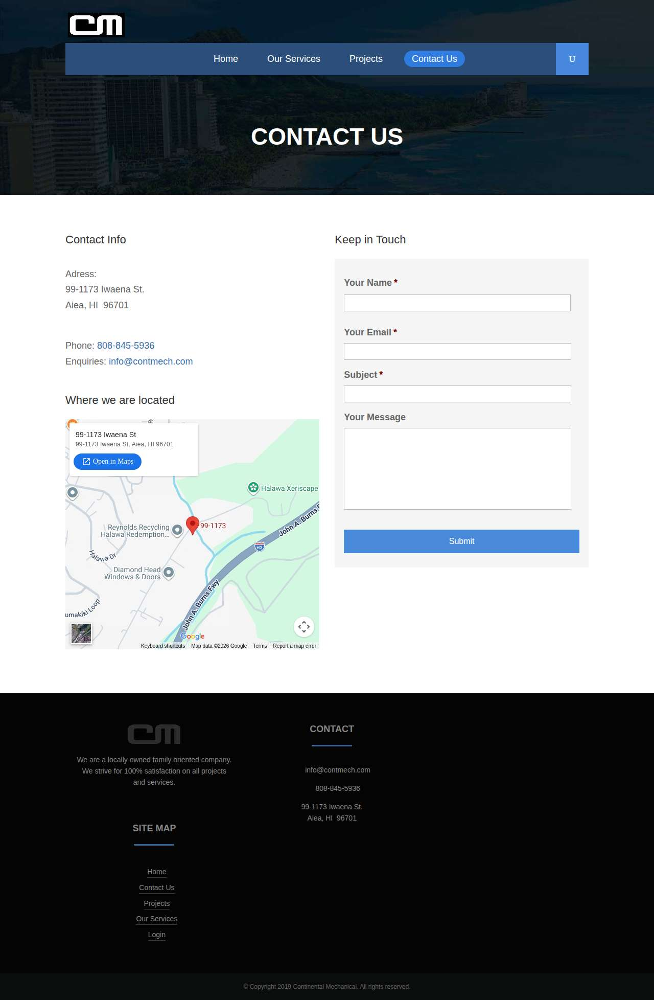

### legacyporch.com — dry\_run\_ok (dry run)

| | |
|---|---|
| Attempt ID | `961679ff-560c-4cba-a042-ec3e6d8d48c3` |
| Form URL | https://www.legacyporch.com/form\_\_map |
| Final URL | https://www.legacyporch.com/form\_\_map |
| Reserved | 2026-11-03 02:22:50 UTC |
| Submit attempted | — |
| Template | standard v2 |
| Confirmation text | none observed |
| Result / error | Selectors verified; fields not typed (domain not in dry-run fill list); not submitted |

Exact message:

~~~text
Subject: Helping customers find your business in AI search (AEO + GEO)

Hi there,

I'm Arun from Devs Arun. More and more customers now ask ChatGPT, Gemini, Perplexity or Google's AI Overviews questions like "who should I hire for this in my area?" before they call anyone. These tools answer from websites they can clearly understand, and they tend to recommend businesses whose pages answer real customer questions.

That is what AEO + GEO (Answer Engine and Generative Engine Optimization) is for. I improve your existing service pages so they clearly answer the questions your customers ask, add structured data that matches the page, and make the call, quote or enquiry step obvious. The benefit: your business gets a better chance of being mentioned or linked in AI answers, and visitors who arrive find it easy to contact you.

The AEO + GEO Starter is a one-time $199 (about ₹16,999, negotiable) for one website: a basic audit, 10 customer questions, improvements to two existing pages, relevant structured data and an action plan, with one revision round.

You can read the full details, send an enquiry or book online here:
https://devsarun.io/aeo-geo/

If this isn't relevant, just reply and I won't contact you again.

Best,
Arun
Devs Arun
itschool408@gmail.com · +91 7654534323
~~~

Submitted field values:

- \#input\_comp-jlq7m0j6: itschool408@gmail.com
- \#input\_comp-jlq7m0je: Arun
- \#input\_comp-jxq7u8te: Helping customers find your business in AI search (AEO + GEO)
- \#input\_comp-ke93t75x: +91 7654534323
- \#textarea\_comp-jlq7m0jd: Hi there, I'm Arun from Devs Arun. More and more customers now ask ChatGPT, Gemini, Perplexity or Google's AI Overviews 

**Inspected page** — `run-0129ec72_attempt-961679ff_inspection_2026-11-03T02-22-55-065Z.jpg`

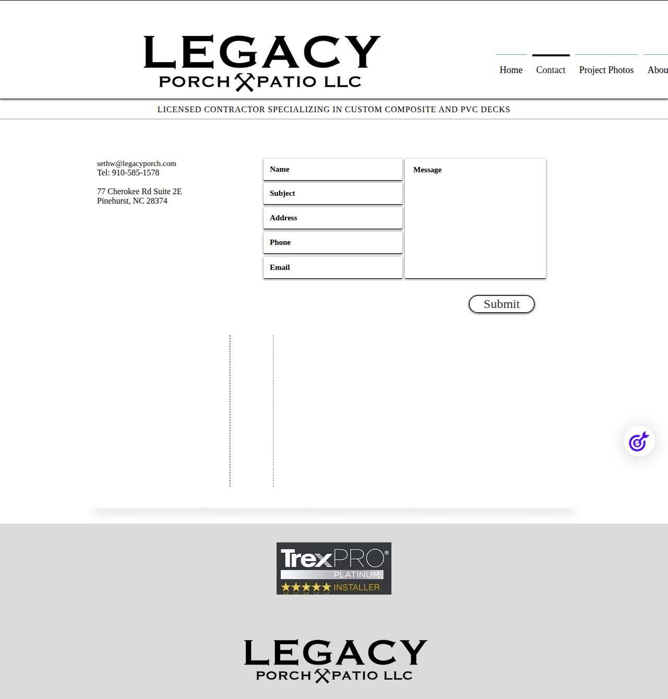

### signaturehomes.ws — dry\_run\_ok (dry run)

| | |
|---|---|
| Attempt ID | `9c79996a-d8b2-4b16-835a-e6f42bea051d` |
| Form URL | https://www.signaturehomes.ws/contact-us |
| Final URL | https://www.signaturehomes.ws/contact-us |
| Reserved | 2026-11-03 02:23:00 UTC |
| Submit attempted | — |
| Template | standard v2 |
| Confirmation text | none observed |
| Result / error | Selectors verified; fields not typed (domain not in dry-run fill list); not submitted |

Exact message:

~~~text
Subject: Helping customers find your business in AI search (AEO + GEO)

Hi there,

I'm Arun from Devs Arun. More and more customers now ask ChatGPT, Gemini, Perplexity or Google's AI Overviews questions like "who should I hire for this in my area?" before they call anyone. These tools answer from websites they can clearly understand, and they tend to recommend businesses whose pages answer real customer questions.

That is what AEO + GEO (Answer Engine and Generative Engine Optimization) is for. I improve your existing service pages so they clearly answer the questions your customers ask, add structured data that matches the page, and make the call, quote or enquiry step obvious. The benefit: your business gets a better chance of being mentioned or linked in AI answers, and visitors who arrive find it easy to contact you.

The AEO + GEO Starter is a one-time $199 (about ₹16,999, negotiable) for one website: a basic audit, 10 customer questions, improvements to two existing pages, relevant structured data and an action plan, with one revision round.

You can read the full details, send an enquiry or book online here:
https://devsarun.io/aeo-geo/

If this isn't relevant, just reply and I won't contact you again.

Best,
Arun
Devs Arun
itschool408@gmail.com · +91 7654534323
~~~

Submitted field values:

- \#input\_comp-l7hw4dg9: Arun
- \#input\_comp-l7hw4dgj: itschool408@gmail.com
- \#input\_comp-l7hw4dgn: +91 7654534323
- \#input\_comp-l7hw4dgt: Helping customers find your business in AI search (AEO + GEO)
- \#textarea\_comp-l7hw4dgv1: Hi there, I'm Arun from Devs Arun. More and more customers now ask ChatGPT, Gemini, Perplexity or Google's AI Overviews 

**Inspected page** — `run-0129ec72_attempt-9c79996a_inspection_2026-11-03T02-23-03-366Z.jpg`

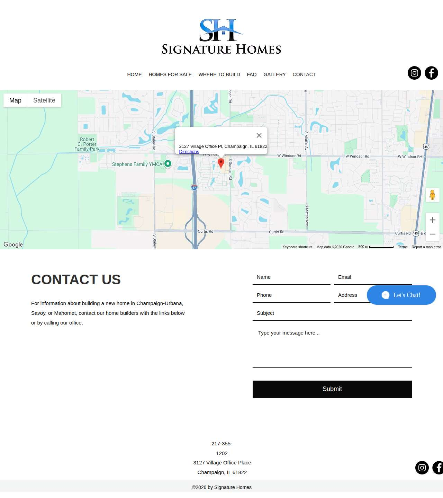

### levansdesigngroup.com — dry\_run\_ok (dry run)

| | |
|---|---|
| Attempt ID | `6fd7a027-d1ba-4697-b5a7-465d9cc29330` |
| Form URL | https://levansdesigngroup.com/contact-us/ |
| Final URL | https://levansdesigngroup.com/contact-us/ |
| Reserved | 2026-11-03 02:23:08 UTC |
| Submit attempted | — |
| Template | standard v2 |
| Confirmation text | none observed |
| Result / error | Selectors verified; fields not typed (domain not in dry-run fill list); not submitted |

Exact message:

~~~text
Subject: Helping customers find your business in AI search (AEO + GEO)

Hi there,

I'm Arun from Devs Arun. More and more customers now ask ChatGPT, Gemini, Perplexity or Google's AI Overviews questions like "who should I hire for this in my area?" before they call anyone. These tools answer from websites they can clearly understand, and they tend to recommend businesses whose pages answer real customer questions.

That is what AEO + GEO (Answer Engine and Generative Engine Optimization) is for. I improve your existing service pages so they clearly answer the questions your customers ask, add structured data that matches the page, and make the call, quote or enquiry step obvious. The benefit: your business gets a better chance of being mentioned or linked in AI answers, and visitors who arrive find it easy to contact you.

The AEO + GEO Starter is a one-time $199 (about ₹16,999, negotiable) for one website: a basic audit, 10 customer questions, improvements to two existing pages, relevant structured data and an action plan, with one revision round.

You can read the full details, send an enquiry or book online here:
https://devsarun.io/aeo-geo/

If this isn't relevant, just reply and I won't contact you again.

Best,
Arun
Devs Arun
itschool408@gmail.com · +91 7654534323
~~~

Submitted field values:

- \#input\_1\_2: itschool408@gmail.com
- \#input\_1\_3: +91 7654534323
- \#input\_1\_4: Hi there, I'm Arun from Devs Arun. More and more customers now ask ChatGPT, Gemini, Perplexity or Google's AI Overviews 
- \#input\_1\_5: Arun

**Inspected page** — `run-0129ec72_attempt-6fd7a027_inspection_2026-11-03T02-23-11-601Z.jpg`

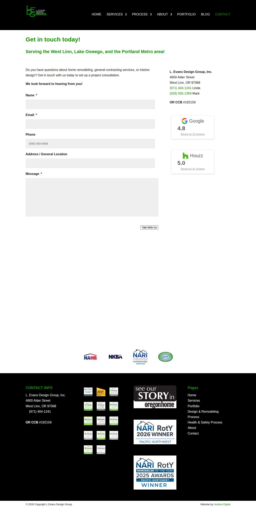

### centrexconstruction.net — dry\_run\_ok (dry run)

| | |
|---|---|
| Attempt ID | `015ed7d8-f4a9-4527-952e-0a8dda7c917f` |
| Form URL | https://www.centrex.cc/contact |
| Final URL | https://www.centrex.cc/contact |
| Reserved | 2026-11-03 02:23:16 UTC |
| Submit attempted | — |
| Template | standard v2 |
| Confirmation text | none observed |
| Result / error | Selectors verified; fields not typed (domain not in dry-run fill list); not submitted |

Exact message:

~~~text
Subject: Helping customers find your business in AI search (AEO + GEO)

Hi there,

I'm Arun from Devs Arun. More and more customers now ask ChatGPT, Gemini, Perplexity or Google's AI Overviews questions like "who should I hire for this in my area?" before they call anyone. These tools answer from websites they can clearly understand, and they tend to recommend businesses whose pages answer real customer questions.

That is what AEO + GEO (Answer Engine and Generative Engine Optimization) is for. I improve your existing service pages so they clearly answer the questions your customers ask, add structured data that matches the page, and make the call, quote or enquiry step obvious. The benefit: your business gets a better chance of being mentioned or linked in AI answers, and visitors who arrive find it easy to contact you.

The AEO + GEO Starter is a one-time $199 (about ₹16,999, negotiable) for one website: a basic audit, 10 customer questions, improvements to two existing pages, relevant structured data and an action plan, with one revision round.

You can read the full details, send an enquiry or book online here:
https://devsarun.io/aeo-geo/

If this isn't relevant, just reply and I won't contact you again.

Best,
Arun
Devs Arun
itschool408@gmail.com · +91 7654534323
~~~

Submitted field values:

- input\[name="email"\]: itschool408@gmail.com
- input\[name="phone"\]: +91 7654534323
- input\[name="firstname"\]: Arun
- textarea\[name="message"\]: Hi there, I'm Arun from Devs Arun. More and more customers now ask ChatGPT, Gemini, Perplexity or Google's AI Overviews 

**Inspected page** — `run-0129ec72_attempt-015ed7d8_inspection_2026-11-03T02-23-18-153Z.jpg`

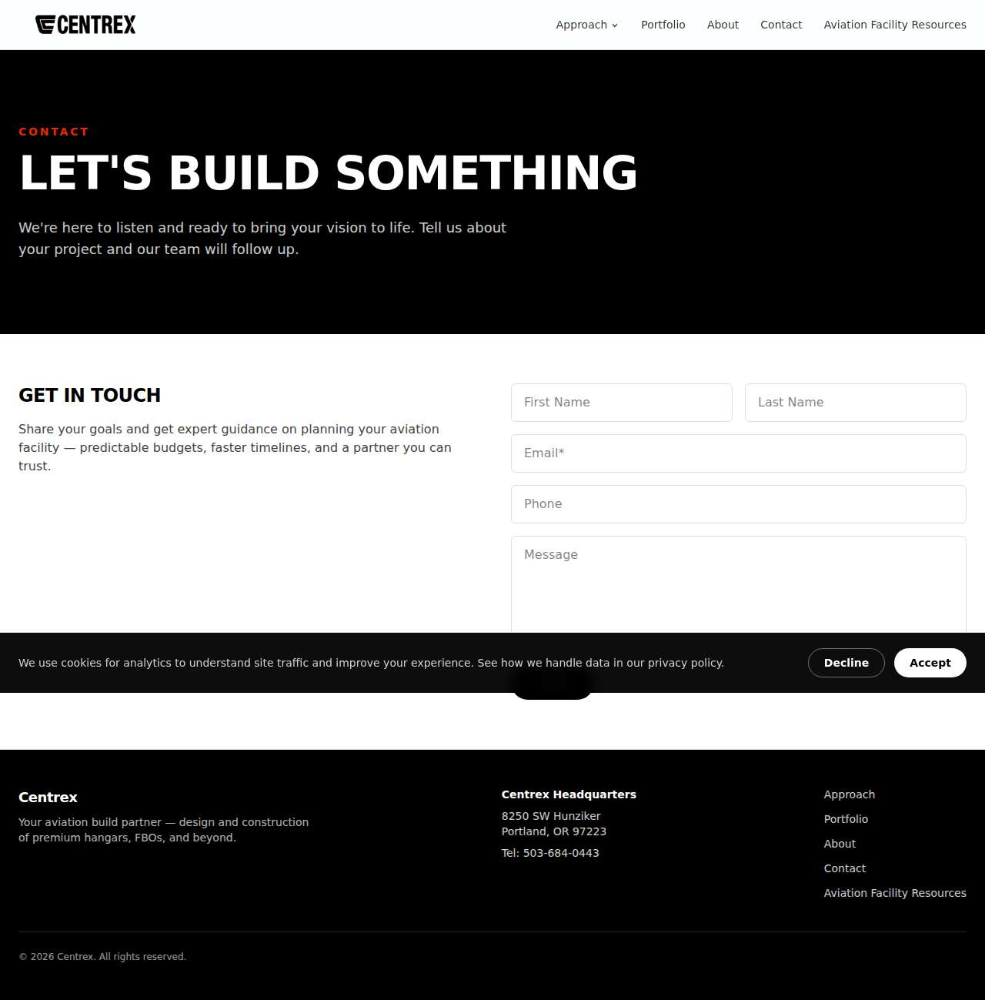

### visser.com — dry\_run\_ok (dry run)

| | |
|---|---|
| Attempt ID | `8091bb1e-e9c4-429b-8f2c-012e77e8c7b2` |
| Form URL | https://www.visser.com/contact |
| Final URL | https://www.visser.com/contact |
| Reserved | 2026-11-03 02:23:23 UTC |
| Submit attempted | — |
| Template | standard v2 |
| Confirmation text | none observed |
| Result / error | Selectors verified; fields not typed (domain not in dry-run fill list); not submitted |

Exact message:

~~~text
Subject: Helping customers find your business in AI search (AEO + GEO)

Hi there,

I'm Arun from Devs Arun. More and more customers now ask ChatGPT, Gemini, Perplexity or Google's AI Overviews questions like "who should I hire for this in my area?" before they call anyone. These tools answer from websites they can clearly understand, and they tend to recommend businesses whose pages answer real customer questions.

That is what AEO + GEO (Answer Engine and Generative Engine Optimization) is for. I improve your existing service pages so they clearly answer the questions your customers ask, add structured data that matches the page, and make the call, quote or enquiry step obvious. The benefit: your business gets a better chance of being mentioned or linked in AI answers, and visitors who arrive find it easy to contact you.

The AEO + GEO Starter is a one-time $199 (about ₹16,999, negotiable) for one website: a basic audit, 10 customer questions, improvements to two existing pages, relevant structured data and an action plan, with one revision round.

You can read the full details, send an enquiry or book online here:
https://devsarun.io/aeo-geo/

If this isn't relevant, just reply and I won't contact you again.

Best,
Arun
Devs Arun
itschool408@gmail.com · +91 7654534323
~~~

Submitted field values:

- \#input\_comp-lw5pct56: itschool408@gmail.com
- \#input\_comp-lw5pct4t1: Arun
- \#textarea\_comp-lw5pct58: Hi there, I'm Arun from Devs Arun. More and more customers now ask ChatGPT, Gemini, Perplexity or Google's AI Overviews 

**Inspected page** — `run-0129ec72_attempt-8091bb1e_inspection_2026-11-03T02-23-25-406Z.jpg`

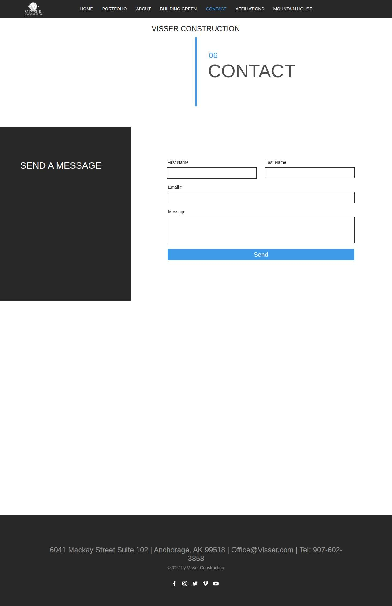

### vetindustrial.com — dry\_run\_ok (dry run)

| | |
|---|---|
| Attempt ID | `ee3d0b15-eac5-4a84-89f1-fc321f4e4c2e` |
| Form URL | https://www.vetindustrial.com/contact/ |
| Final URL | https://www.vetindustrial.com/contact/ |
| Reserved | 2026-11-03 02:23:30 UTC |
| Submit attempted | — |
| Template | standard v2 |
| Confirmation text | none observed |
| Result / error | Selectors verified; fields not typed (domain not in dry-run fill list); not submitted |

Exact message:

~~~text
Subject: Helping customers find your business in AI search (AEO + GEO)

Hi there,

I'm Arun from Devs Arun. More and more customers now ask ChatGPT, Gemini, Perplexity or Google's AI Overviews questions like "who should I hire for this in my area?" before they call anyone. These tools answer from websites they can clearly understand, and they tend to recommend businesses whose pages answer real customer questions.

That is what AEO + GEO (Answer Engine and Generative Engine Optimization) is for. I improve your existing service pages so they clearly answer the questions your customers ask, add structured data that matches the page, and make the call, quote or enquiry step obvious. The benefit: your business gets a better chance of being mentioned or linked in AI answers, and visitors who arrive find it easy to contact you.

The AEO + GEO Starter is a one-time $199 (about ₹16,999, negotiable) for one website: a basic audit, 10 customer questions, improvements to two existing pages, relevant structured data and an action plan, with one revision round.

You can read the full details, send an enquiry or book online here:
https://devsarun.io/aeo-geo/

If this isn't relevant, just reply and I won't contact you again.

Best,
Arun
Devs Arun
itschool408@gmail.com · +91 7654534323
~~~

Submitted field values:

- \#input\_1\_2: itschool408@gmail.com
- \#input\_1\_3: +91 7654534323
- \#input\_1\_4: Hi there, I'm Arun from Devs Arun. More and more customers now ask ChatGPT, Gemini, Perplexity or Google's AI Overviews 
- \#input\_1\_1\_3: Arun

**Inspected page** — `run-0129ec72_attempt-ee3d0b15_inspection_2026-11-03T02-23-31-710Z.jpg`

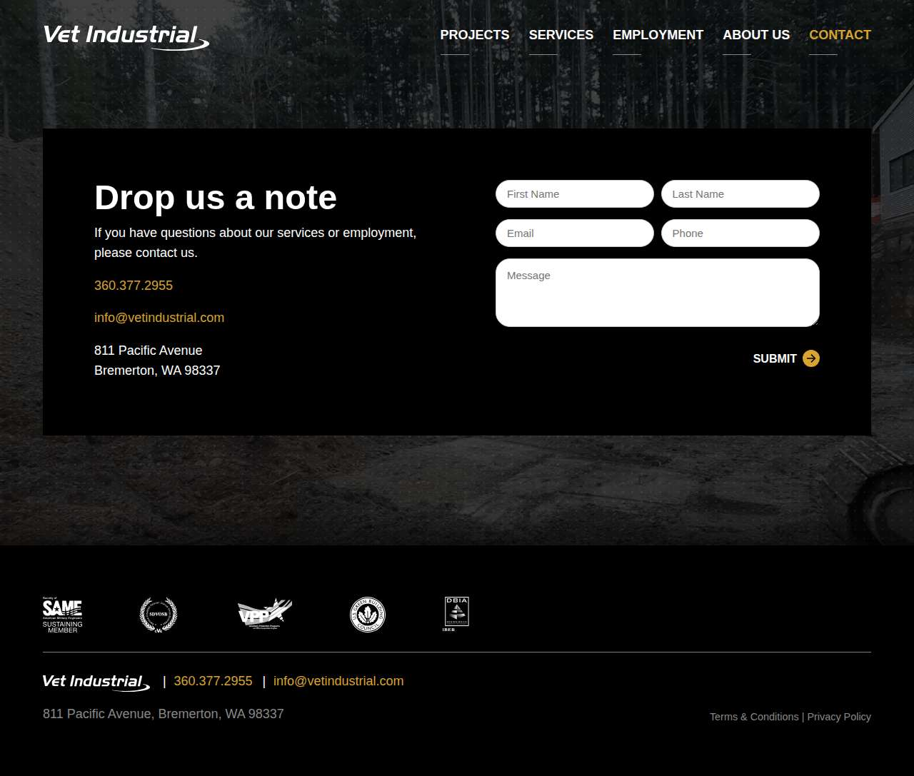

### troutmancustomhomes.com — dry\_run\_ok (dry run)

| | |
|---|---|
| Attempt ID | `61d7d1f5-6bff-4bcd-86d6-4b677e7f2e9f` |
| Form URL | https://www.troutmancustomhomes.com/contact |
| Final URL | https://www.troutmancustomhomes.com/contact |
| Reserved | 2026-11-03 02:23:36 UTC |
| Submit attempted | — |
| Template | standard v2 |
| Confirmation text | none observed |
| Result / error | Selectors verified; fields not typed (domain not in dry-run fill list); not submitted |

Exact message:

~~~text
Subject: Helping customers find your business in AI search (AEO + GEO)

Hi there,

I'm Arun from Devs Arun. More and more customers now ask ChatGPT, Gemini, Perplexity or Google's AI Overviews questions like "who should I hire for this in my area?" before they call anyone. These tools answer from websites they can clearly understand, and they tend to recommend businesses whose pages answer real customer questions.

That is what AEO + GEO (Answer Engine and Generative Engine Optimization) is for. I improve your existing service pages so they clearly answer the questions your customers ask, add structured data that matches the page, and make the call, quote or enquiry step obvious. The benefit: your business gets a better chance of being mentioned or linked in AI answers, and visitors who arrive find it easy to contact you.

The AEO + GEO Starter is a one-time $199 (about ₹16,999, negotiable) for one website: a basic audit, 10 customer questions, improvements to two existing pages, relevant structured data and an action plan, with one revision round.

You can read the full details, send an enquiry or book online here:
https://devsarun.io/aeo-geo/

If this isn't relevant, just reply and I won't contact you again.

Best,
Arun
Devs Arun
itschool408@gmail.com · +91 7654534323
~~~

Submitted field values:

- \#input\_comp-kebjhsu3: Arun
- \#input\_comp-kebjhsue: itschool408@gmail.com
- \#input\_comp-kebjhsui: +91 7654534323
- \#textarea\_comp-kebjhsul: Hi there, I'm Arun from Devs Arun. More and more customers now ask ChatGPT, Gemini, Perplexity or Google's AI Overviews 

**Inspected page** — `run-0129ec72_attempt-61d7d1f5_inspection_2026-11-03T02-23-38-700Z.jpg`

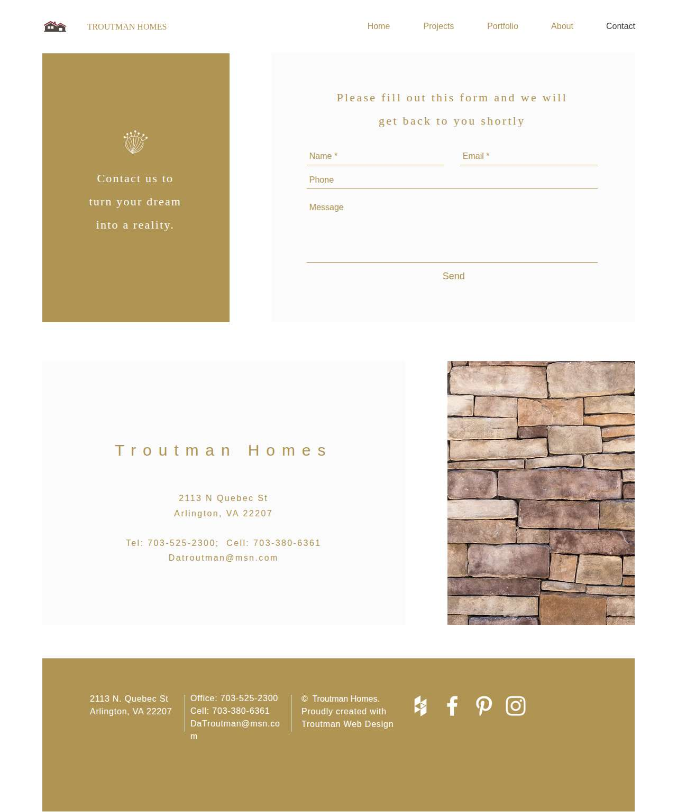

### mcmeekinconstruction.com — dry\_run\_ok (dry run)

| | |
|---|---|
| Attempt ID | `76d9ebe6-61e7-442e-8bc8-7a7790a143d6` |
| Form URL | https://www.mcmeekinconstruction.com/contact |
| Final URL | https://www.mcmeekinconstruction.com/contact |
| Reserved | 2026-11-03 02:23:43 UTC |
| Submit attempted | — |
| Template | standard v2 |
| Confirmation text | none observed |
| Result / error | Selectors verified; fields not typed (domain not in dry-run fill list); not submitted |

Exact message:

~~~text
Subject: Helping customers find your business in AI search (AEO + GEO)

Hi there,

I'm Arun from Devs Arun. More and more customers now ask ChatGPT, Gemini, Perplexity or Google's AI Overviews questions like "who should I hire for this in my area?" before they call anyone. These tools answer from websites they can clearly understand, and they tend to recommend businesses whose pages answer real customer questions.

That is what AEO + GEO (Answer Engine and Generative Engine Optimization) is for. I improve your existing service pages so they clearly answer the questions your customers ask, add structured data that matches the page, and make the call, quote or enquiry step obvious. The benefit: your business gets a better chance of being mentioned or linked in AI answers, and visitors who arrive find it easy to contact you.

The AEO + GEO Starter is a one-time $199 (about ₹16,999, negotiable) for one website: a basic audit, 10 customer questions, improvements to two existing pages, relevant structured data and an action plan, with one revision round.

You can read the full details, send an enquiry or book online here:
https://devsarun.io/aeo-geo/

If this isn't relevant, just reply and I won't contact you again.

Best,
Arun
Devs Arun
itschool408@gmail.com · +91 7654534323
~~~

Submitted field values:

- \#input\_comp-jqc72i4i: Arun
- \#input\_comp-jqc72i4k: itschool408@gmail.com
- \#input\_comp-jqc72i4o: +91 7654534323
- \#textarea\_comp-jqc72i4u: Hi there, I'm Arun from Devs Arun. More and more customers now ask ChatGPT, Gemini, Perplexity or Google's AI Overviews 

**Inspected page** — `run-0129ec72_attempt-76d9ebe6_inspection_2026-11-03T02-23-45-585Z.jpg`

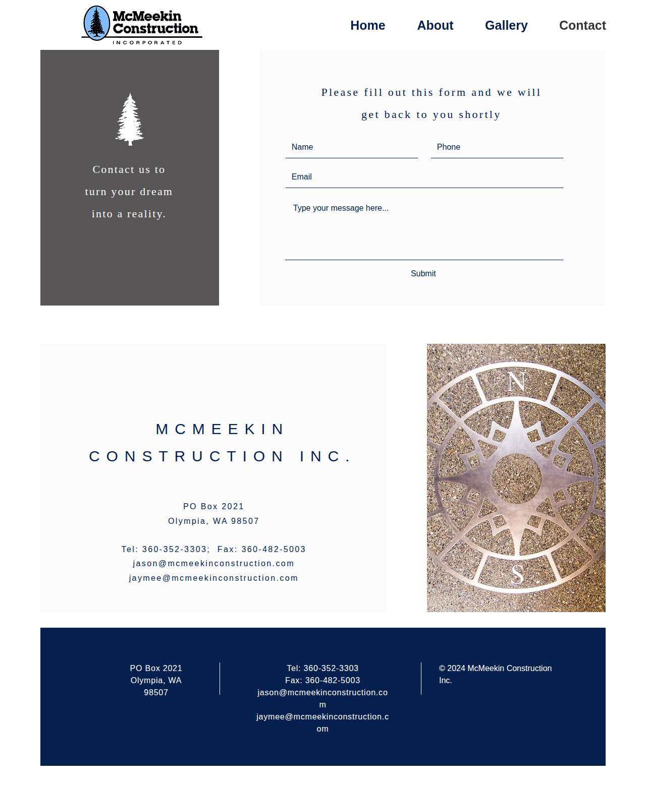

### lehtolabuildersinc.com — dry\_run\_ok (dry run)

| | |
|---|---|
| Attempt ID | `8b879826-3e54-470c-a267-26ebd64a2315` |
| Form URL | https://www.lehtolabuildersinc.com/contact-us |
| Final URL | https://www.lehtolabuildersinc.com/contact-us |
| Reserved | 2026-11-03 02:23:50 UTC |
| Submit attempted | — |
| Template | standard v2 |
| Confirmation text | none observed |
| Result / error | Selectors verified; fields not typed (domain not in dry-run fill list); not submitted |

Exact message:

~~~text
Subject: Helping customers find your business in AI search (AEO + GEO)

Hi there,

I'm Arun from Devs Arun. More and more customers now ask ChatGPT, Gemini, Perplexity or Google's AI Overviews questions like "who should I hire for this in my area?" before they call anyone. These tools answer from websites they can clearly understand, and they tend to recommend businesses whose pages answer real customer questions.

That is what AEO + GEO (Answer Engine and Generative Engine Optimization) is for. I improve your existing service pages so they clearly answer the questions your customers ask, add structured data that matches the page, and make the call, quote or enquiry step obvious. The benefit: your business gets a better chance of being mentioned or linked in AI answers, and visitors who arrive find it easy to contact you.

The AEO + GEO Starter is a one-time $199 (about ₹16,999, negotiable) for one website: a basic audit, 10 customer questions, improvements to two existing pages, relevant structured data and an action plan, with one revision round.

You can read the full details, send an enquiry or book online here:
https://devsarun.io/aeo-geo/

If this isn't relevant, just reply and I won't contact you again.

Best,
Arun
Devs Arun
itschool408@gmail.com · +91 7654534323
~~~

Submitted field values:

- \#input\_comp-kf4jyp8b: Arun
- \#input\_comp-kf4jyp8n: itschool408@gmail.com
- \#input\_comp-kf4jyp8s: Helping customers find your business in AI search (AEO + GEO)
- \#textarea\_comp-kf4jyp8y: Hi there, I'm Arun from Devs Arun. More and more customers now ask ChatGPT, Gemini, Perplexity or Google's AI Overviews 

**Inspected page** — `run-0129ec72_attempt-8b879826_inspection_2026-11-03T02-23-52-543Z.jpg`

### coachhousegarages.com — dry\_run\_ok (dry run)

| | |
|---|---|
| Attempt ID | `0b9e6729-5269-4b04-ae15-905b39b90553` |
| Form URL | https://coachhousegarages.com/contact-coach-house/ |
| Final URL | https://coachhousegarages.com/contact-coach-house/ |
| Reserved | 2026-11-03 02:23:57 UTC |
| Submit attempted | — |
| Template | standard v2 |
| Confirmation text | none observed |
| Result / error | Selectors verified; fields not typed (domain not in dry-run fill list); not submitted |

Exact message:

~~~text
Subject: Helping customers find your business in AI search (AEO + GEO)

Hi there,

I'm Arun from Devs Arun. More and more customers now ask ChatGPT, Gemini, Perplexity or Google's AI Overviews questions like "who should I hire for this in my area?" before they call anyone. These tools answer from websites they can clearly understand, and they tend to recommend businesses whose pages answer real customer questions.

That is what AEO + GEO (Answer Engine and Generative Engine Optimization) is for. I improve your existing service pages so they clearly answer the questions your customers ask, add structured data that matches the page, and make the call, quote or enquiry step obvious. The benefit: your business gets a better chance of being mentioned or linked in AI answers, and visitors who arrive find it easy to contact you.

The AEO + GEO Starter is a one-time $199 (about ₹16,999, negotiable) for one website: a basic audit, 10 customer questions, improvements to two existing pages, relevant structured data and an action plan, with one revision round.

You can read the full details, send an enquiry or book online here:
https://devsarun.io/aeo-geo/

If this isn't relevant, just reply and I won't contact you again.

Best,
Arun
Devs Arun
itschool408@gmail.com · +91 7654534323
~~~

Submitted field values:

- \#forminator-field-name-1\_6ae943f472b82: Arun
- \#forminator-field-text-1\_6ae943f472b82: Helping customers find your business in AI search (AEO + GEO)
- \#forminator-field-email-1\_6ae943f472b82: itschool408@gmail.com
- \#forminator-field-phone-1\_6ae943f472b82: +91 7654534323
- \#forminator-field-textarea-1\_6ae943f472b82: Hi there, I'm Arun from Devs Arun. More and more customers now ask ChatGPT, Gemini, Perplexity or Google's AI Overviews 

**Inspected page** — `run-0129ec72_attempt-0b9e6729_inspection_2026-11-03T02-24-00-556Z.jpg`

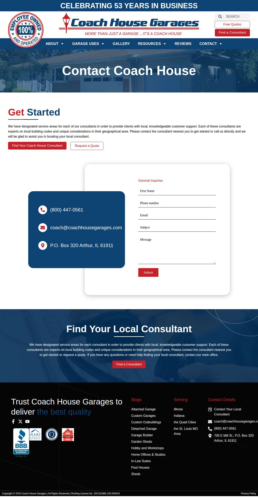

## Events (109)

| Time (UTC) | Event | Website | Details |
|---|---|---|---|
| 02:21:26 | run\_queued | — | dry\_run run requested by github:itsDevsArun |
| 02:21:26 | run\_dispatched | — | dispatch disabled (local test mode) |
| 02:21:29 | run\_started | — | Runner claimed dry\_run run |
| 02:21:29 | website\_selected | helixmechanical.com | Dry-run target helixmechanical.com |
| 02:21:29 | draft\_prepared | helixmechanical.com | Draft prepared with template standard v2 |
| 02:21:31 | page\_opened | helixmechanical.com | Opened form page |
| 02:21:32 | screenshot\_saved | helixmechanical.com | inspection screenshot saved (54 KB) |
| 02:21:32 | review\_required | helixmechanical.com | dry run failed: Mapped field "First Name \*" not found uniquely |
| 02:21:37 | website\_selected | knoxvilleelectrician.com | Dry-run target knoxvilleelectrician.com |
| 02:21:37 | draft\_prepared | knoxvilleelectrician.com | Draft prepared with template standard v2 |
| 02:21:38 | page\_opened | knoxvilleelectrician.com | Opened form page |
| 02:21:38 | screenshot\_saved | knoxvilleelectrician.com | inspection screenshot saved (137 KB) |
| 02:21:38 | review\_required | knoxvilleelectrician.com | dry run failed: Mapped field "Name" not found uniquely |
| 02:21:43 | website\_selected | coderestoration.com | Dry-run target coderestoration.com |
| 02:21:43 | draft\_prepared | coderestoration.com | Draft prepared with template standard v2 |
| 02:21:45 | page\_opened | coderestoration.com | Opened form page |
| 02:21:45 | screenshot\_saved | coderestoration.com | inspection screenshot saved (254 KB) |
| 02:21:45 | dry\_run\_checked | coderestoration.com | dry run ok: Selectors verified; fields not typed (domain not in dry-run fill list); not submitted |
| 02:21:50 | website\_selected | easttexasconcreters.com | Dry-run target easttexasconcreters.com |
| 02:21:50 | draft\_prepared | easttexasconcreters.com | Draft prepared with template standard v2 |
| 02:21:52 | page\_opened | easttexasconcreters.com | Opened form page |
| 02:21:52 | screenshot\_saved | easttexasconcreters.com | inspection screenshot saved (234 KB) |
| 02:21:52 | dry\_run\_checked | easttexasconcreters.com | dry run ok: Selectors verified; fields not typed (domain not in dry-run fill list); not submitted |
| 02:21:58 | website\_selected | updpavers.com | Dry-run target updpavers.com |
| 02:21:58 | draft\_prepared | updpavers.com | Draft prepared with template standard v2 |
| 02:21:59 | page\_opened | updpavers.com | Opened form page |
| 02:21:59 | screenshot\_saved | updpavers.com | inspection screenshot saved (236 KB) |
| 02:21:59 | dry\_run\_checked | updpavers.com | dry run ok: Selectors verified; fields not typed (domain not in dry-run fill list); not submitted |
| 02:22:04 | website\_selected | danieleccleshomes.com | Dry-run target danieleccleshomes.com |
| 02:22:04 | draft\_prepared | danieleccleshomes.com | Draft prepared with template standard v2 |
| 02:22:07 | page\_opened | danieleccleshomes.com | Opened form page |
| 02:22:07 | screenshot\_saved | danieleccleshomes.com | inspection screenshot saved (82 KB) |
| 02:22:07 | dry\_run\_checked | danieleccleshomes.com | dry run ok: Selectors verified; fields not typed (domain not in dry-run fill list); not submitted |
| 02:22:12 | website\_selected | danddseamlessgutters.com | Dry-run target danddseamlessgutters.com |
| 02:22:12 | draft\_prepared | danddseamlessgutters.com | Draft prepared with template standard v2 |
| 02:22:13 | page\_opened | danddseamlessgutters.com | Opened form page |
| 02:22:14 | screenshot\_saved | danddseamlessgutters.com | inspection screenshot saved (235 KB) |
| 02:22:14 | dry\_run\_checked | danddseamlessgutters.com | dry run ok: Selectors verified; fields not typed (domain not in dry-run fill list); not submitted |
| 02:22:19 | website\_selected | buntinconstruction.com | Dry-run target buntinconstruction.com |
| 02:22:19 | draft\_prepared | buntinconstruction.com | Draft prepared with template standard v2 |
| 02:22:21 | page\_opened | buntinconstruction.com | Opened form page |
| 02:22:21 | screenshot\_saved | buntinconstruction.com | inspection screenshot saved (179 KB) |
| 02:22:21 | dry\_run\_checked | buntinconstruction.com | dry run ok: Selectors verified; fields not typed (domain not in dry-run fill list); not submitted |
| 02:22:26 | website\_selected | danddreno.com | Dry-run target danddreno.com |
| 02:22:26 | draft\_prepared | danddreno.com | Draft prepared with template standard v2 |
| 02:22:28 | page\_opened | danddreno.com | Opened form page |
| 02:22:28 | screenshot\_saved | danddreno.com | inspection screenshot saved (161 KB) |
| 02:22:28 | dry\_run\_checked | danddreno.com | dry run ok: Selectors verified; fields not typed (domain not in dry-run fill list); not submitted |
| 02:22:33 | website\_selected | unityconstructioninccompany.com | Dry-run target unityconstructioninccompany.com |
| 02:22:33 | draft\_prepared | unityconstructioninccompany.com | Draft prepared with template standard v2 |
| 02:22:36 | page\_opened | unityconstructioninccompany.com | Opened form page |
| 02:22:36 | screenshot\_saved | unityconstructioninccompany.com | inspection screenshot saved (136 KB) |
| 02:22:36 | dry\_run\_checked | unityconstructioninccompany.com | dry run ok: Selectors verified; fields not typed (domain not in dry-run fill list); not submitted |
| 02:22:41 | website\_selected | contmech.com | Dry-run target contmech.com |
| 02:22:41 | draft\_prepared | contmech.com | Draft prepared with template standard v2 |
| 02:22:45 | page\_opened | contmech.com | Opened form page |
| 02:22:45 | screenshot\_saved | contmech.com | inspection screenshot saved (93 KB) |
| 02:22:45 | dry\_run\_checked | contmech.com | dry run ok: Selectors verified; fields not typed (domain not in dry-run fill list); not submitted |
| 02:22:50 | website\_selected | legacyporch.com | Dry-run target legacyporch.com |
| 02:22:50 | draft\_prepared | legacyporch.com | Draft prepared with template standard v2 |
| 02:22:54 | page\_opened | legacyporch.com | Opened form page |
| 02:22:55 | screenshot\_saved | legacyporch.com | inspection screenshot saved (60 KB) |
| 02:22:55 | dry\_run\_checked | legacyporch.com | dry run ok: Selectors verified; fields not typed (domain not in dry-run fill list); not submitted |
| 02:23:00 | website\_selected | signaturehomes.ws | Dry-run target signaturehomes.ws |
| 02:23:00 | draft\_prepared | signaturehomes.ws | Draft prepared with template standard v2 |
| 02:23:03 | page\_opened | signaturehomes.ws | Opened form page |
| 02:23:03 | screenshot\_saved | signaturehomes.ws | inspection screenshot saved (93 KB) |
| 02:23:03 | dry\_run\_checked | signaturehomes.ws | dry run ok: Selectors verified; fields not typed (domain not in dry-run fill list); not submitted |
| 02:23:08 | website\_selected | levansdesigngroup.com | Dry-run target levansdesigngroup.com |
| 02:23:08 | draft\_prepared | levansdesigngroup.com | Draft prepared with template standard v2 |
| 02:23:11 | page\_opened | levansdesigngroup.com | Opened form page |
| 02:23:11 | screenshot\_saved | levansdesigngroup.com | inspection screenshot saved (121 KB) |
| 02:23:11 | dry\_run\_checked | levansdesigngroup.com | dry run ok: Selectors verified; fields not typed (domain not in dry-run fill list); not submitted |
| 02:23:16 | website\_selected | centrexconstruction.net | Dry-run target centrexconstruction.net |
| 02:23:16 | draft\_prepared | centrexconstruction.net | Draft prepared with template standard v2 |
| 02:23:18 | page\_opened | centrexconstruction.net | Opened form page |
| 02:23:18 | screenshot\_saved | centrexconstruction.net | inspection screenshot saved (75 KB) |
| 02:23:18 | dry\_run\_checked | centrexconstruction.net | dry run ok: Selectors verified; fields not typed (domain not in dry-run fill list); not submitted |
| 02:23:23 | website\_selected | visser.com | Dry-run target visser.com |
| 02:23:23 | draft\_prepared | visser.com | Draft prepared with template standard v2 |
| 02:23:25 | page\_opened | visser.com | Opened form page |
| 02:23:25 | screenshot\_saved | visser.com | inspection screenshot saved (51 KB) |
| 02:23:25 | dry\_run\_checked | visser.com | dry run ok: Selectors verified; fields not typed (domain not in dry-run fill list); not submitted |
| 02:23:30 | website\_selected | vetindustrial.com | Dry-run target vetindustrial.com |
| 02:23:30 | draft\_prepared | vetindustrial.com | Draft prepared with template standard v2 |
| 02:23:31 | page\_opened | vetindustrial.com | Opened form page |
| 02:23:31 | screenshot\_saved | vetindustrial.com | inspection screenshot saved (85 KB) |
| 02:23:31 | dry\_run\_checked | vetindustrial.com | dry run ok: Selectors verified; fields not typed (domain not in dry-run fill list); not submitted |
| 02:23:36 | website\_selected | troutmancustomhomes.com | Dry-run target troutmancustomhomes.com |
| 02:23:36 | draft\_prepared | troutmancustomhomes.com | Draft prepared with template standard v2 |
| 02:23:38 | page\_opened | troutmancustomhomes.com | Opened form page |
| 02:23:38 | screenshot\_saved | troutmancustomhomes.com | inspection screenshot saved (77 KB) |
| 02:23:38 | dry\_run\_checked | troutmancustomhomes.com | dry run ok: Selectors verified; fields not typed (domain not in dry-run fill list); not submitted |
| 02:23:43 | website\_selected | mcmeekinconstruction.com | Dry-run target mcmeekinconstruction.com |
| 02:23:43 | draft\_prepared | mcmeekinconstruction.com | Draft prepared with template standard v2 |
| 02:23:45 | page\_opened | mcmeekinconstruction.com | Opened form page |
| 02:23:45 | screenshot\_saved | mcmeekinconstruction.com | inspection screenshot saved (124 KB) |
| 02:23:45 | dry\_run\_checked | mcmeekinconstruction.com | dry run ok: Selectors verified; fields not typed (domain not in dry-run fill list); not submitted |
| 02:23:50 | website\_selected | lehtolabuildersinc.com | Dry-run target lehtolabuildersinc.com |
| 02:23:50 | draft\_prepared | lehtolabuildersinc.com | Draft prepared with template standard v2 |
| 02:23:52 | page\_opened | lehtolabuildersinc.com | Opened form page |
| 02:23:52 | screenshot\_saved | lehtolabuildersinc.com | inspection screenshot saved (140 KB) |
| 02:23:52 | dry\_run\_checked | lehtolabuildersinc.com | dry run ok: Selectors verified; fields not typed (domain not in dry-run fill list); not submitted |
| 02:23:57 | website\_selected | coachhousegarages.com | Dry-run target coachhousegarages.com |
| 02:23:57 | draft\_prepared | coachhousegarages.com | Draft prepared with template standard v2 |
| 02:24:00 | page\_opened | coachhousegarages.com | Opened form page |
| 02:24:00 | screenshot\_saved | coachhousegarages.com | inspection screenshot saved (211 KB) |
| 02:24:00 | dry\_run\_checked | coachhousegarages.com | dry run ok: Selectors verified; fields not typed (domain not in dry-run fill list); not submitted |
| 02:24:05 | run\_completed | — | Run completed (queue\_exhausted) |
