# Run e6900625 — live — completed

| | |
|---|---|
| Run ID | `e6900625-cea3-4b2d-b73b-a3264eb596fb` |
| Requested by | github:itsDevsArun |
| Started | 2026-11-03 02:24:11 UTC |
| Finished | 2026-11-03 02:36:46 UTC |
| Finish reason | queue\_exhausted |
| GitHub Actions | https://github.com/itsDevsArun/aeo-geo/actions/runs/41562188869 |

CSV for this run: [runs/2026-11-03_live_e6900625.csv](2026-11-03_live_e6900625.csv)

## Attempts (34)

### clearchoiceplumbingllc.com — failed\_before\_submit (LIVE)

| | |
|---|---|
| Attempt ID | `91730293-232a-4c88-91f5-9a6212de02d6` |
| Form URL | https://clearchoiceplumbingllc.com/contact/ |
| Final URL | — |
| Reserved | 2026-11-03 02:24:12 UTC |
| Submit attempted | — |
| Template | standard v2 |
| Confirmation text | none observed |
| Result / error | locator.fill: Error: Cannot type text into input\[type=number\] |

Exact message:

~~~text
Subject: Helping customers find your business in AI search (AEO + GEO)

Hi there,

I'm Arun from Devs Arun. More and more customers now ask ChatGPT, Gemini, Perplexity or Google's AI Overviews questions like "who should I hire for this in my area?" before they call anyone. These tools answer from websites they can clearly understand, and they tend to recommend businesses whose pages answer real customer questions.

That is what AEO + GEO (Answer Engine and Generative Engine Optimization) is for. I improve your existing service pages so they clearly answer the questions your customers ask, add structured data that matches the page, and make the call, quote or enquiry step obvious. The benefit: your business gets a better chance of being mentioned or linked in AI answers, and visitors who arrive find it easy to contact you.

The AEO + GEO Starter is a one-time $199 (about ₹16,999, negotiable) for one website: a basic audit, 10 customer questions, improvements to two existing pages, relevant structured data and an action plan, with one revision round.

You can read the full details, send an enquiry or book online here:
https://devsarun.io/aeo-geo/

If this isn't relevant, just reply and I won't contact you again.

Best,
Arun
Devs Arun
itschool408@gmail.com · +91 7654534323
~~~

Submitted field values:

- \#wpforms-51-field\_1: Arun
- \#wpforms-51-field\_2: itschool408@gmail.com
- \#wpforms-51-field\_3: Hi there, I'm Arun from Devs Arun. More and more customers now ask ChatGPT, Gemini, Perplexity or Google's AI Overviews 
- \#wpforms-51-field\_5: +91 7654534323

**Inspected page** — `run-e6900625_attempt-91730293_inspection_2026-11-03T02-24-14-228Z.jpg`

### bwnwincpainting.com — failed\_before\_submit (LIVE)

| | |
|---|---|
| Attempt ID | `3d33993a-2af6-40ee-93a5-f927278b1413` |
| Form URL | https://www.bwnwincpainting.com/contact/ |
| Final URL | — |
| Reserved | 2026-11-03 02:24:19 UTC |
| Submit attempted | — |
| Template | standard v2 |
| Confirmation text | none observed |
| Result / error | locator.fill: Error: Cannot type text into input\[type=number\] |

Exact message:

~~~text
Subject: Helping customers find your business in AI search (AEO + GEO)

Hi there,

I'm Arun from Devs Arun. More and more customers now ask ChatGPT, Gemini, Perplexity or Google's AI Overviews questions like "who should I hire for this in my area?" before they call anyone. These tools answer from websites they can clearly understand, and they tend to recommend businesses whose pages answer real customer questions.

That is what AEO + GEO (Answer Engine and Generative Engine Optimization) is for. I improve your existing service pages so they clearly answer the questions your customers ask, add structured data that matches the page, and make the call, quote or enquiry step obvious. The benefit: your business gets a better chance of being mentioned or linked in AI answers, and visitors who arrive find it easy to contact you.

The AEO + GEO Starter is a one-time $199 (about ₹16,999, negotiable) for one website: a basic audit, 10 customer questions, improvements to two existing pages, relevant structured data and an action plan, with one revision round.

You can read the full details, send an enquiry or book online here:
https://devsarun.io/aeo-geo/

If this isn't relevant, just reply and I won't contact you again.

Best,
Arun
Devs Arun
itschool408@gmail.com · +91 7654534323
~~~

Submitted field values:

- \#name-1151: Arun
- \#email-1151: itschool408@gmail.com
- \#phone-1151: +91 7654534323
- \#message-1151: Hi there, I'm Arun from Devs Arun. More and more customers now ask ChatGPT, Gemini, Perplexity or Google's AI Overviews 

**Inspected page** — `run-e6900625_attempt-3d33993a_inspection_2026-11-03T02-24-21-026Z.jpg`

### dupaulconstruction.com — error\_after\_submit (LIVE)

| | |
|---|---|
| Attempt ID | `b4e4572e-b271-4ac8-81e6-e767b8e2fc0a` |
| Form URL | https://www.dupaulconstruction.com/contact |
| Final URL | https://www.dupaulconstruction.com/contact |
| Reserved | 2026-11-03 02:24:26 UTC |
| Submit attempted | 2026-11-03 02:24:28 UTC |
| Template | standard v2 |
| Confirmation text | osed Phone (304) 258-9800 Contact Us First Name\* Last Name\* This field is required Email\* Phone\* Message\* All fields marked with an asterisk \* are required Call Us: (304) 258-9800 Ou |
| Result / error | — |

Exact message:

~~~text
Subject: Helping customers find your business in AI search (AEO + GEO)

Hi there,

I'm Arun from Devs Arun. More and more customers now ask ChatGPT, Gemini, Perplexity or Google's AI Overviews questions like "who should I hire for this in my area?" before they call anyone. These tools answer from websites they can clearly understand, and they tend to recommend businesses whose pages answer real customer questions.

That is what AEO + GEO (Answer Engine and Generative Engine Optimization) is for. I improve your existing service pages so they clearly answer the questions your customers ask, add structured data that matches the page, and make the call, quote or enquiry step obvious. The benefit: your business gets a better chance of being mentioned or linked in AI answers, and visitors who arrive find it easy to contact you.

The AEO + GEO Starter is a one-time $199 (about ₹16,999, negotiable) for one website: a basic audit, 10 customer questions, improvements to two existing pages, relevant structured data and an action plan, with one revision round.

You can read the full details, send an enquiry or book online here:
https://devsarun.io/aeo-geo/

If this isn't relevant, just reply and I won't contact you again.

Best,
Arun
Devs Arun
itschool408@gmail.com · +91 7654534323
~~~

Submitted field values:

- Email\* \[email\]: itschool408@gmail.com
- Phone\* \[phone\]: +91 7654534323
- Message\* \[message\]: Hi there, I'm Arun from Devs Arun. More and more customers now ask ChatGPT, Gemini, Perplexity or Google's AI Overviews 
- First Name\* \[first\_name\]: Arun

**Filled form (before submit)** — `run-e6900625_attempt-b4e4572e_filled_2026-11-03T02-24-28-820Z.jpg`

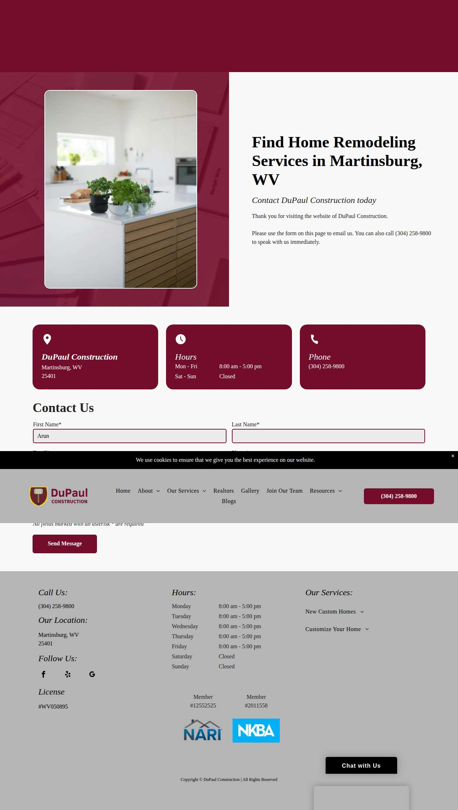

**After submit** — `run-e6900625_attempt-b4e4572e_post_attempt_2026-11-03T02-24-32-080Z.jpg`

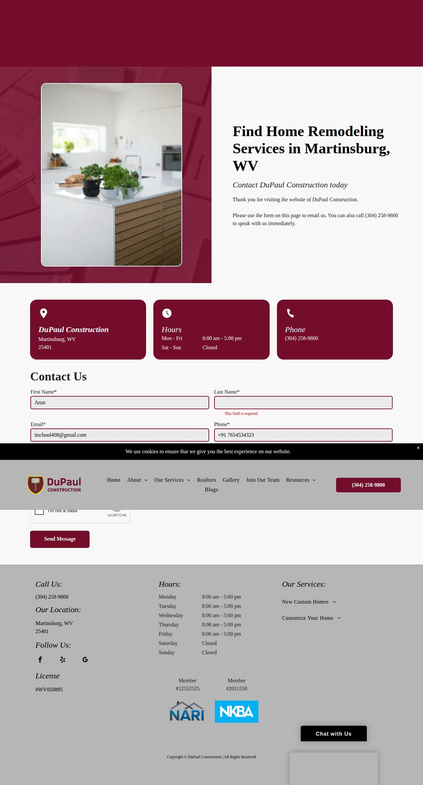

### rosewoodcommunities.com — unclear (LIVE)

| | |
|---|---|
| Attempt ID | `0217663e-4920-4bb9-8ce4-60f0e0789dbd` |
| Form URL | https://www.rosewoodcommunities.com/contact-us |
| Final URL | https://www.rosewoodcommunities.com/contact-us |
| Reserved | 2026-11-03 02:24:39 UTC |
| Submit attempted | 2026-11-03 02:24:42 UTC |
| Template | standard v2 |
| Confirmation text | none observed |
| Result / error | No new success marker observed |

Exact message:

~~~text
Subject: Helping customers find your business in AI search (AEO + GEO)

Hi there,

I'm Arun from Devs Arun. More and more customers now ask ChatGPT, Gemini, Perplexity or Google's AI Overviews questions like "who should I hire for this in my area?" before they call anyone. These tools answer from websites they can clearly understand, and they tend to recommend businesses whose pages answer real customer questions.

That is what AEO + GEO (Answer Engine and Generative Engine Optimization) is for. I improve your existing service pages so they clearly answer the questions your customers ask, add structured data that matches the page, and make the call, quote or enquiry step obvious. The benefit: your business gets a better chance of being mentioned or linked in AI answers, and visitors who arrive find it easy to contact you.

The AEO + GEO Starter is a one-time $199 (about ₹16,999, negotiable) for one website: a basic audit, 10 customer questions, improvements to two existing pages, relevant structured data and an action plan, with one revision round.

You can read the full details, send an enquiry or book online here:
https://devsarun.io/aeo-geo/

If this isn't relevant, just reply and I won't contact you again.

Best,
Arun
Devs Arun
itschool408@gmail.com · +91 7654534323
~~~

Submitted field values:

- Email \* \[email\]: itschool408@gmail.com
- Phone \* \[phone\]: +91 7654534323
- First Name \* \[first\_name\]: Arun
- Comments/Questions \* \[message\]: Hi there, I'm Arun from Devs Arun. More and more customers now ask ChatGPT, Gemini, Perplexity or Google's AI Overviews 

**Filled form (before submit)** — `run-e6900625_attempt-0217663e_filled_2026-11-03T02-24-42-019Z.jpg`

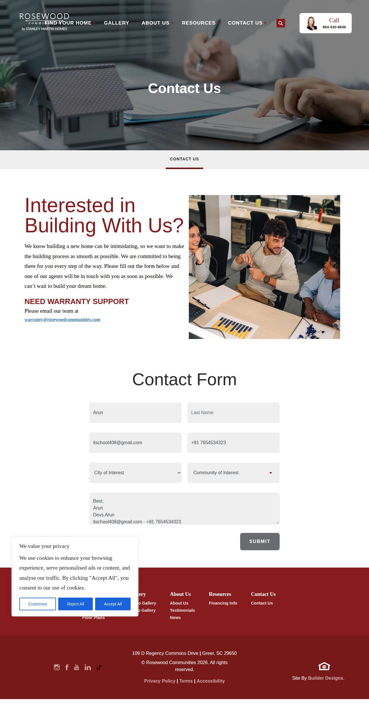

**After submit** — `run-e6900625_attempt-0217663e_post_attempt_2026-11-03T02-25-09-584Z.jpg`

### castconconstruction.com — unclear (LIVE)

| | |
|---|---|
| Attempt ID | `371bacc7-0379-40d2-ae03-51f5b4ee2bee` |
| Form URL | https://www.castconconstruction.com/ |
| Final URL | https://www.castconconstruction.com/ |
| Reserved | 2026-11-03 02:25:16 UTC |
| Submit attempted | 2026-11-03 02:25:20 UTC |
| Template | standard v2 |
| Confirmation text | none observed |
| Result / error | No new success marker observed |

Exact message:

~~~text
Subject: Helping customers find your business in AI search (AEO + GEO)

Hi there,

I'm Arun from Devs Arun. More and more customers now ask ChatGPT, Gemini, Perplexity or Google's AI Overviews questions like "who should I hire for this in my area?" before they call anyone. These tools answer from websites they can clearly understand, and they tend to recommend businesses whose pages answer real customer questions.

That is what AEO + GEO (Answer Engine and Generative Engine Optimization) is for. I improve your existing service pages so they clearly answer the questions your customers ask, add structured data that matches the page, and make the call, quote or enquiry step obvious. The benefit: your business gets a better chance of being mentioned or linked in AI answers, and visitors who arrive find it easy to contact you.

The AEO + GEO Starter is a one-time $199 (about ₹16,999, negotiable) for one website: a basic audit, 10 customer questions, improvements to two existing pages, relevant structured data and an action plan, with one revision round.

You can read the full details, send an enquiry or book online here:
https://devsarun.io/aeo-geo/

If this isn't relevant, just reply and I won't contact you again.

Best,
Arun
Devs Arun
itschool408@gmail.com · +91 7654534323
~~~

Submitted field values:

- email \[email\]: itschool408@gmail.com
- name-\* \[name\]: Arun
- Message \[message\]: Hi there, I'm Arun from Devs Arun. More and more customers now ask ChatGPT, Gemini, Perplexity or Google's AI Overviews 
- subject \[subject\]: Helping customers find your business in AI search (AEO + GEO)

**Filled form (before submit)** — `run-e6900625_attempt-371bacc7_filled_2026-11-03T02-25-20-339Z.jpg`

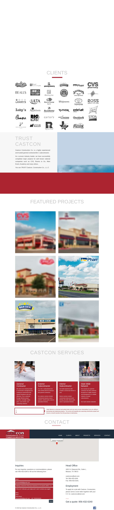

**After submit** — `run-e6900625_attempt-371bacc7_post_attempt_2026-11-03T02-25-48-131Z.jpg`

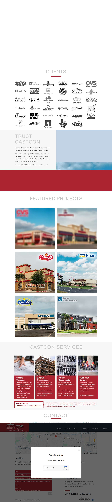

### wdbp.com — unclear (LIVE)

| | |
|---|---|
| Attempt ID | `79e0bba6-205e-41c7-baa5-5e3ef22b2f26` |
| Form URL | https://welldonebuildingproducts.com/contact.html |
| Final URL | chrome-error://chromewebdata/ |
| Reserved | 2026-11-03 02:25:55 UTC |
| Submit attempted | 2026-11-03 02:25:57 UTC |
| Template | standard v2 |
| Confirmation text | none observed |
| Result / error | No new success marker observed |

Exact message:

~~~text
Subject: Helping customers find your business in AI search (AEO + GEO)

Hi there,

I'm Arun from Devs Arun. More and more customers now ask ChatGPT, Gemini, Perplexity or Google's AI Overviews questions like "who should I hire for this in my area?" before they call anyone. These tools answer from websites they can clearly understand, and they tend to recommend businesses whose pages answer real customer questions.

That is what AEO + GEO (Answer Engine and Generative Engine Optimization) is for. I improve your existing service pages so they clearly answer the questions your customers ask, add structured data that matches the page, and make the call, quote or enquiry step obvious. The benefit: your business gets a better chance of being mentioned or linked in AI answers, and visitors who arrive find it easy to contact you.

The AEO + GEO Starter is a one-time $199 (about ₹16,999, negotiable) for one website: a basic audit, 10 customer questions, improvements to two existing pages, relevant structured data and an action plan, with one revision round.

You can read the full details, send an enquiry or book online here:
https://devsarun.io/aeo-geo/

If this isn't relevant, just reply and I won't contact you again.

Best,
Arun
Devs Arun
itschool408@gmail.com · +91 7654534323
~~~

Submitted field values:

- Email\* \[email\]: itschool408@gmail.com
- Subject \[subject\]: Helping customers find your business in AI search (AEO + GEO)
- Message\* \[message\]: Hi there, I'm Arun from Devs Arun. More and more customers now ask ChatGPT, Gemini, Perplexity or Google's AI Overviews 
- Phone number \[phone\]: +91 7654534323
- name-FirstName \[first\_name\]: Arun

**Filled form (before submit)** — `run-e6900625_attempt-79e0bba6_filled_2026-11-03T02-25-57-837Z.jpg`

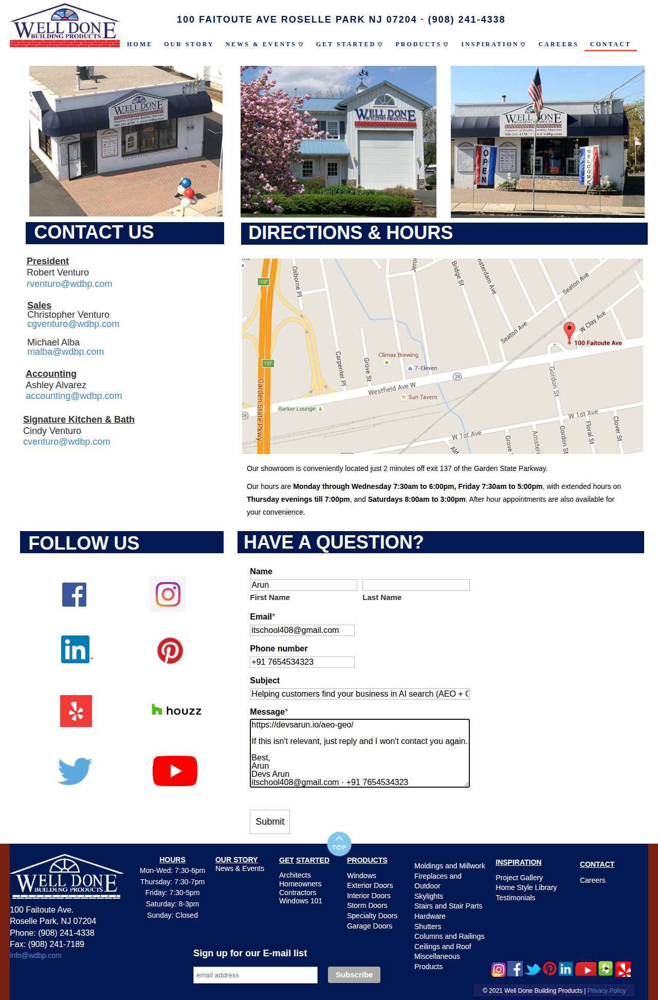

**After submit** — `run-e6900625_attempt-79e0bba6_post_attempt_2026-11-03T02-26-25-483Z.jpg`

### westcousa.com — confirmed (LIVE)

| | |
|---|---|
| Attempt ID | `f5c93c6c-e640-4ca7-bc5f-c0f8eb95f731` |
| Form URL | https://www.westcousa.com/contact/ |
| Final URL | https://www.westcousa.com/contact/ |
| Reserved | 2026-11-03 02:26:32 UTC |
| Submit attempted | 2026-11-03 02:26:34 UTC |
| Template | standard v2 |
| Confirmation text | 0 E. 14th Street, Suite 301, Tulsa, OK 74104 (918) 627-3326 Form submitted successfully. A confirmation email was sent to itschool408@gmail.com. Dean West Construction, Inc. |
| Result / error | — |

Exact message:

~~~text
Subject: Helping customers find your business in AI search (AEO + GEO)

Hi there,

I'm Arun from Devs Arun. More and more customers now ask ChatGPT, Gemini, Perplexity or Google's AI Overviews questions like "who should I hire for this in my area?" before they call anyone. These tools answer from websites they can clearly understand, and they tend to recommend businesses whose pages answer real customer questions.

That is what AEO + GEO (Answer Engine and Generative Engine Optimization) is for. I improve your existing service pages so they clearly answer the questions your customers ask, add structured data that matches the page, and make the call, quote or enquiry step obvious. The benefit: your business gets a better chance of being mentioned or linked in AI answers, and visitors who arrive find it easy to contact you.

The AEO + GEO Starter is a one-time $199 (about ₹16,999, negotiable) for one website: a basic audit, 10 customer questions, improvements to two existing pages, relevant structured data and an action plan, with one revision round.

You can read the full details, send an enquiry or book online here:
https://devsarun.io/aeo-geo/

If this isn't relevant, just reply and I won't contact you again.

Best,
Arun
Devs Arun
itschool408@gmail.com · +91 7654534323
~~~

Submitted field values:

- Name \[name\]: Arun
- Email \[email\]: itschool408@gmail.com
- Message \[message\]: Hi there, I'm Arun from Devs Arun. More and more customers now ask ChatGPT, Gemini, Perplexity or Google's AI Overviews 

**Filled form (before submit)** — `run-e6900625_attempt-f5c93c6c_filled_2026-11-03T02-26-34-910Z.jpg`

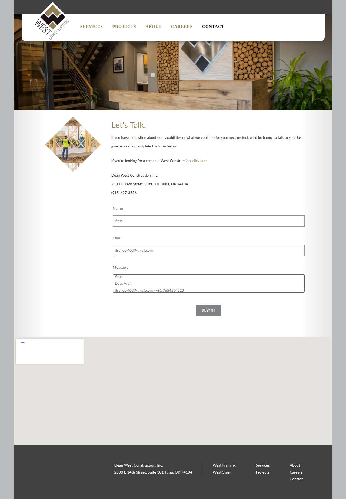

**After submit** — `run-e6900625_attempt-f5c93c6c_post_attempt_2026-11-03T02-26-38-329Z.jpg`

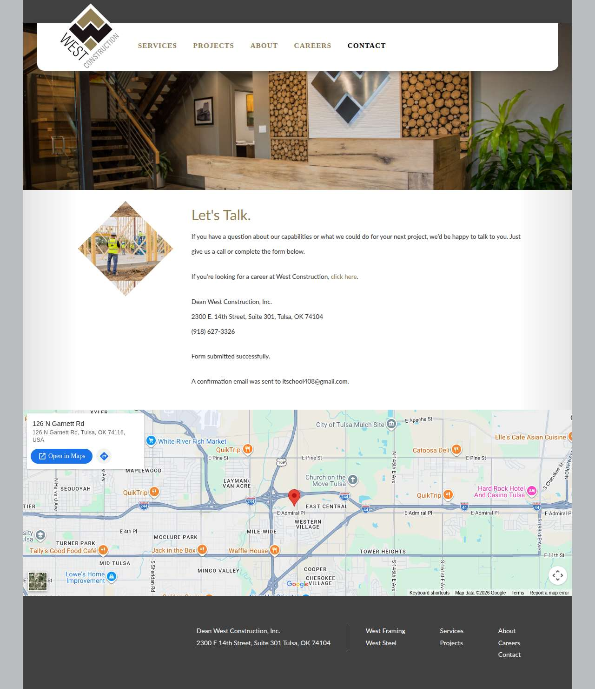

### finishingtouch.us — error\_after\_submit (LIVE)

| | |
|---|---|
| Attempt ID | `2dc40feb-fdd7-45fd-922b-6c9817447ee9` |
| Form URL | https://www.finishingtouch.us/contact-us |
| Final URL | https://www.finishingtouch.us/contact-us |
| Reserved | 2026-11-03 02:26:45 UTC |
| Submit attempted | 2026-11-03 02:26:47 UTC |
| Template | standard v2 |
| Confirmation text | Finishing Touch Construction Request A Free Estimate Today\! This field is required TO LEARN MORE ABOUT OUR FINISHING INTERIOR WORK OR TO REQUEST AN ESTIMATE, CONTACT OUR TEAM TODAY A |
| Result / error | — |

Exact message:

~~~text
Subject: Helping customers find your business in AI search (AEO + GEO)

Hi there,

I'm Arun from Devs Arun. More and more customers now ask ChatGPT, Gemini, Perplexity or Google's AI Overviews questions like "who should I hire for this in my area?" before they call anyone. These tools answer from websites they can clearly understand, and they tend to recommend businesses whose pages answer real customer questions.

That is what AEO + GEO (Answer Engine and Generative Engine Optimization) is for. I improve your existing service pages so they clearly answer the questions your customers ask, add structured data that matches the page, and make the call, quote or enquiry step obvious. The benefit: your business gets a better chance of being mentioned or linked in AI answers, and visitors who arrive find it easy to contact you.

The AEO + GEO Starter is a one-time $199 (about ₹16,999, negotiable) for one website: a basic audit, 10 customer questions, improvements to two existing pages, relevant structured data and an action plan, with one revision round.

You can read the full details, send an enquiry or book online here:
https://devsarun.io/aeo-geo/

If this isn't relevant, just reply and I won't contact you again.

Best,
Arun
Devs Arun
itschool408@gmail.com · +91 7654534323
~~~

Submitted field values:

- Email \[email\]: itschool408@gmail.com
- Phone \[phone\]: +91 7654534323
- Message \[message\]: Hi there, I'm Arun from Devs Arun. More and more customers now ask ChatGPT, Gemini, Perplexity or Google's AI Overviews 
- First Name \[first\_name\]: Arun

**Filled form (before submit)** — `run-e6900625_attempt-2dc40feb_filled_2026-11-03T02-26-47-568Z.jpg`

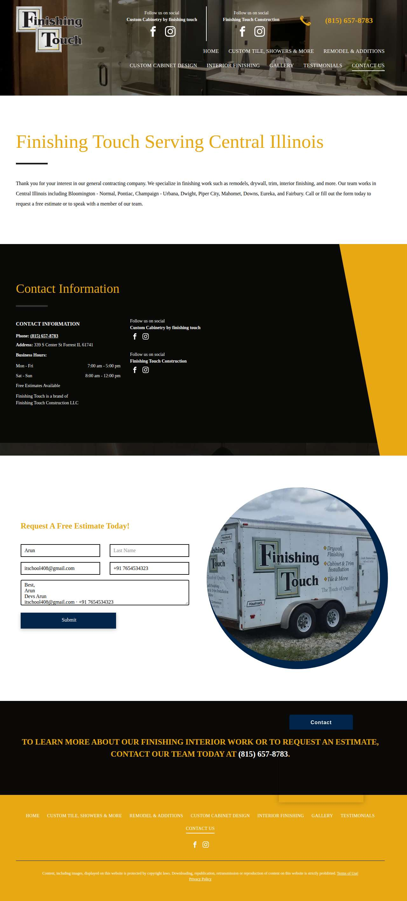

**After submit** — `run-e6900625_attempt-2dc40feb_post_attempt_2026-11-03T02-26-50-212Z.jpg`

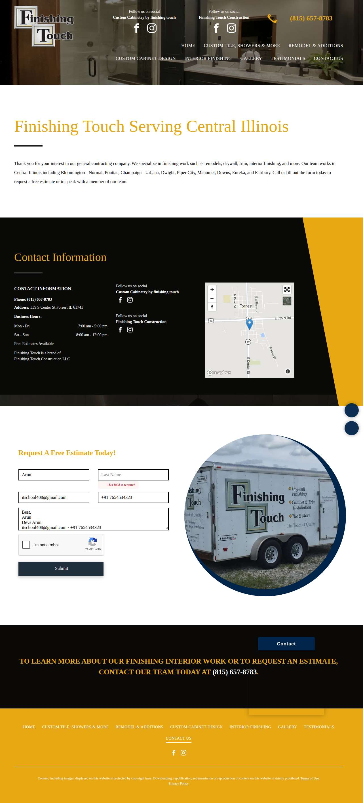

### bigwoodtimberframes.com — confirmed (LIVE)

| | |
|---|---|
| Attempt ID | `34abfc92-2a6e-43e1-a154-b1bae4e8a815` |
| Form URL | https://bigwoodtimberframes.com/?page\_id=5167 |
| Final URL | https://bigwoodtimberframes.com/?page\_id=5167 |
| Reserved | 2026-11-03 02:26:57 UTC |
| Submit attempted | 2026-11-03 02:27:00 UTC |
| Template | standard v2 |
| Confirmation text | & Inquiries Home/Questions & Inquiries Get In Touch With Us Thanks for contacting us\! We will get in touch with you shortly. OUR SERVICE What We Do Order Samples CONTACT US Direct y |
| Result / error | — |

Exact message:

~~~text
Subject: Helping customers find your business in AI search (AEO + GEO)

Hi there,

I'm Arun from Devs Arun. More and more customers now ask ChatGPT, Gemini, Perplexity or Google's AI Overviews questions like "who should I hire for this in my area?" before they call anyone. These tools answer from websites they can clearly understand, and they tend to recommend businesses whose pages answer real customer questions.

That is what AEO + GEO (Answer Engine and Generative Engine Optimization) is for. I improve your existing service pages so they clearly answer the questions your customers ask, add structured data that matches the page, and make the call, quote or enquiry step obvious. The benefit: your business gets a better chance of being mentioned or linked in AI answers, and visitors who arrive find it easy to contact you.

The AEO + GEO Starter is a one-time $199 (about ₹16,999, negotiable) for one website: a basic audit, 10 customer questions, improvements to two existing pages, relevant structured data and an action plan, with one revision round.

You can read the full details, send an enquiry or book online here:
https://devsarun.io/aeo-geo/

If this isn't relevant, just reply and I won't contact you again.

Best,
Arun
Devs Arun
itschool408@gmail.com · +91 7654534323
~~~

Submitted field values:

- Message \[message\]: Hi there, I'm Arun from Devs Arun. More and more customers now ask ChatGPT, Gemini, Perplexity or Google's AI Overviews 
- Name (Required) \[name\]: Arun
- Email (Required) \[email\]: itschool408@gmail.com

**Filled form (before submit)** — `run-e6900625_attempt-34abfc92_filled_2026-11-03T02-27-00-209Z.jpg`

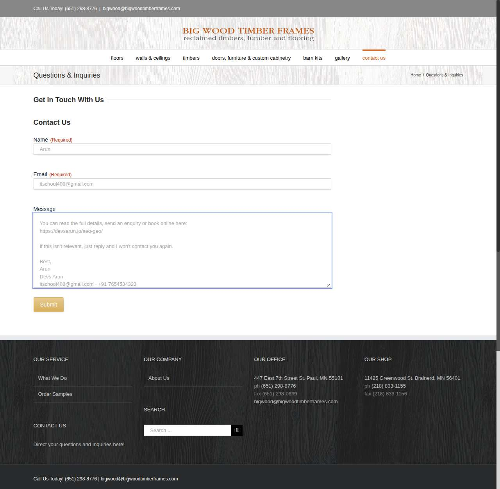

**After submit** — `run-e6900625_attempt-34abfc92_post_attempt_2026-11-03T02-27-04-549Z.jpg`

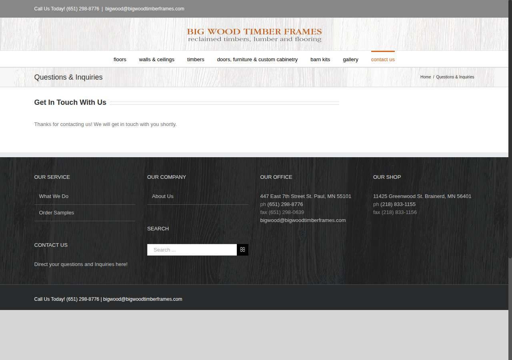

### absoluterestorepa.com — failed\_before\_submit (LIVE)

| | |
|---|---|
| Attempt ID | `8ae11e0c-9f8c-4c71-a775-c50f62547d92` |
| Form URL | https://absoluterestorepa.com/contact-us/ |
| Final URL | — |
| Reserved | 2026-11-03 02:27:11 UTC |
| Submit attempted | — |
| Template | standard v2 |
| Confirmation text | none observed |
| Result / error | locator.fill: Error: Cannot type text into input\[type=number\] |

Exact message:

~~~text
Subject: Helping customers find your business in AI search (AEO + GEO)

Hi there,

I'm Arun from Devs Arun. More and more customers now ask ChatGPT, Gemini, Perplexity or Google's AI Overviews questions like "who should I hire for this in my area?" before they call anyone. These tools answer from websites they can clearly understand, and they tend to recommend businesses whose pages answer real customer questions.

That is what AEO + GEO (Answer Engine and Generative Engine Optimization) is for. I improve your existing service pages so they clearly answer the questions your customers ask, add structured data that matches the page, and make the call, quote or enquiry step obvious. The benefit: your business gets a better chance of being mentioned or linked in AI answers, and visitors who arrive find it easy to contact you.

The AEO + GEO Starter is a one-time $199 (about ₹16,999, negotiable) for one website: a basic audit, 10 customer questions, improvements to two existing pages, relevant structured data and an action plan, with one revision round.

You can read the full details, send an enquiry or book online here:
https://devsarun.io/aeo-geo/

If this isn't relevant, just reply and I won't contact you again.

Best,
Arun
Devs Arun
itschool408@gmail.com · +91 7654534323
~~~

Submitted field values:

- \#form-field-name: Arun
- \#form-field-message: Hi there, I'm Arun from Devs Arun. More and more customers now ask ChatGPT, Gemini, Perplexity or Google's AI Overviews 
- \#form-field-field\_ed02ec2: +91 7654534323
- \#content \> div \> div \> div:nth-of-type(2) \> div \> div:nth-of-type(1) \> div:nth-of-type(2) \> div \> form \> div \> div:nth-of-type(3) \> input: itschool408@gmail.com

**Inspected page** — `run-e6900625_attempt-8ae11e0c_inspection_2026-11-03T02-27-14-930Z.jpg`

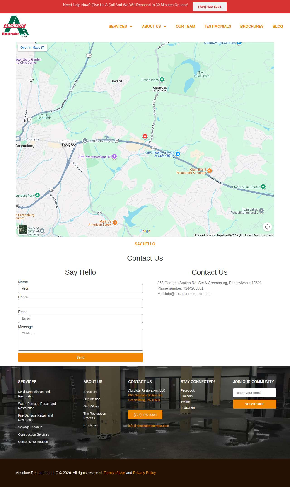

### toddbuildersinc.com — unclear (LIVE)

| | |
|---|---|
| Attempt ID | `8ed78685-ad04-4d89-9119-a883dc2cebd4` |
| Form URL | https://www.toddbuildersinc.com/contact |
| Final URL | https://www.toddbuildersinc.com/contact |
| Reserved | 2026-11-03 02:27:19 UTC |
| Submit attempted | 2026-11-03 02:27:22 UTC |
| Template | standard v2 |
| Confirmation text | none observed |
| Result / error | No new success marker observed |

Exact message:

~~~text
Subject: Helping customers find your business in AI search (AEO + GEO)

Hi there,

I'm Arun from Devs Arun. More and more customers now ask ChatGPT, Gemini, Perplexity or Google's AI Overviews questions like "who should I hire for this in my area?" before they call anyone. These tools answer from websites they can clearly understand, and they tend to recommend businesses whose pages answer real customer questions.

That is what AEO + GEO (Answer Engine and Generative Engine Optimization) is for. I improve your existing service pages so they clearly answer the questions your customers ask, add structured data that matches the page, and make the call, quote or enquiry step obvious. The benefit: your business gets a better chance of being mentioned or linked in AI answers, and visitors who arrive find it easy to contact you.

The AEO + GEO Starter is a one-time $199 (about ₹16,999, negotiable) for one website: a basic audit, 10 customer questions, improvements to two existing pages, relevant structured data and an action plan, with one revision round.

You can read the full details, send an enquiry or book online here:
https://devsarun.io/aeo-geo/

If this isn't relevant, just reply and I won't contact you again.

Best,
Arun
Devs Arun
itschool408@gmail.com · +91 7654534323
~~~

Submitted field values:

- email \[email\]: itschool408@gmail.com
- name-\* \[name\]: Arun
- Message \[message\]: Hi there, I'm Arun from Devs Arun. More and more customers now ask ChatGPT, Gemini, Perplexity or Google's AI Overviews 
- subject \[subject\]: Helping customers find your business in AI search (AEO + GEO)

**Filled form (before submit)** — `run-e6900625_attempt-8ed78685_filled_2026-11-03T02-27-22-307Z.jpg`

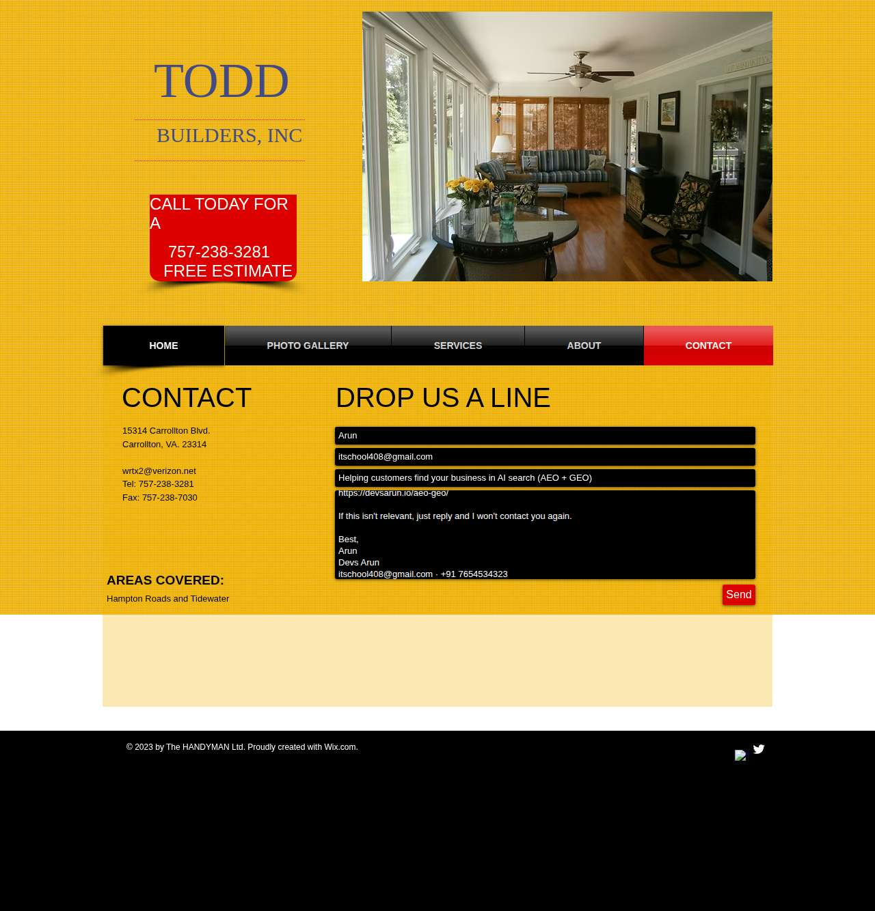

**After submit** — `run-e6900625_attempt-8ed78685_post_attempt_2026-11-03T02-27-49-905Z.jpg`

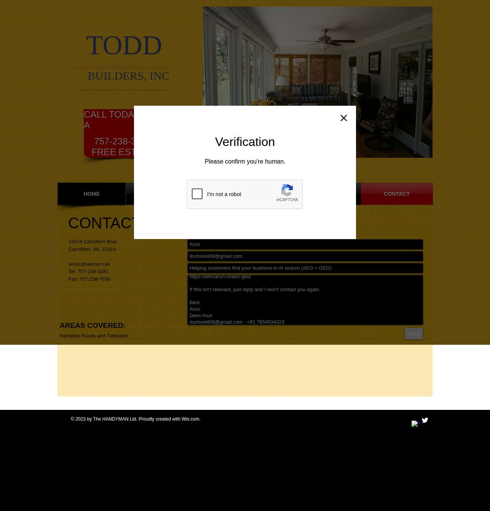

### phoenixremodelingnw.com — failed\_before\_submit (LIVE)

| | |
|---|---|
| Attempt ID | `16621752-fbc0-4fbc-9e05-6ede74ea08f4` |
| Form URL | https://phoenixremodelingnw.com/contact-us/ |
| Final URL | https://phoenixremodelingnw.com/contact-us/ |
| Reserved | 2026-11-03 02:27:57 UTC |
| Submit attempted | — |
| Template | standard v2 |
| Confirmation text | none observed |
| Result / error | Form validation would block sending: et\_pb\_contact\_phone\_0: Please match the requested format. |

Exact message:

~~~text
Subject: Helping customers find your business in AI search (AEO + GEO)

Hi there,

I'm Arun from Devs Arun. More and more customers now ask ChatGPT, Gemini, Perplexity or Google's AI Overviews questions like "who should I hire for this in my area?" before they call anyone. These tools answer from websites they can clearly understand, and they tend to recommend businesses whose pages answer real customer questions.

That is what AEO + GEO (Answer Engine and Generative Engine Optimization) is for. I improve your existing service pages so they clearly answer the questions your customers ask, add structured data that matches the page, and make the call, quote or enquiry step obvious. The benefit: your business gets a better chance of being mentioned or linked in AI answers, and visitors who arrive find it easy to contact you.

The AEO + GEO Starter is a one-time $199 (about ₹16,999, negotiable) for one website: a basic audit, 10 customer questions, improvements to two existing pages, relevant structured data and an action plan, with one revision round.

You can read the full details, send an enquiry or book online here:
https://devsarun.io/aeo-geo/

If this isn't relevant, just reply and I won't contact you again.

Best,
Arun
Devs Arun
itschool408@gmail.com · +91 7654534323
~~~

Submitted field values:

- \#et\_pb\_contact\_name\_0: Arun
- \#et\_pb\_contact\_email\_0: itschool408@gmail.com
- \#et\_pb\_contact\_phone\_0: +91 7654534323
- \#et\_pb\_contact\_message\_0: Hi there, I'm Arun from Devs Arun. More and more customers now ask ChatGPT, Gemini, Perplexity or Google's AI Overviews 

**Filled form (before submit)** — `run-e6900625_attempt-16621752_filled_2026-11-03T02-27-58-951Z.jpg`

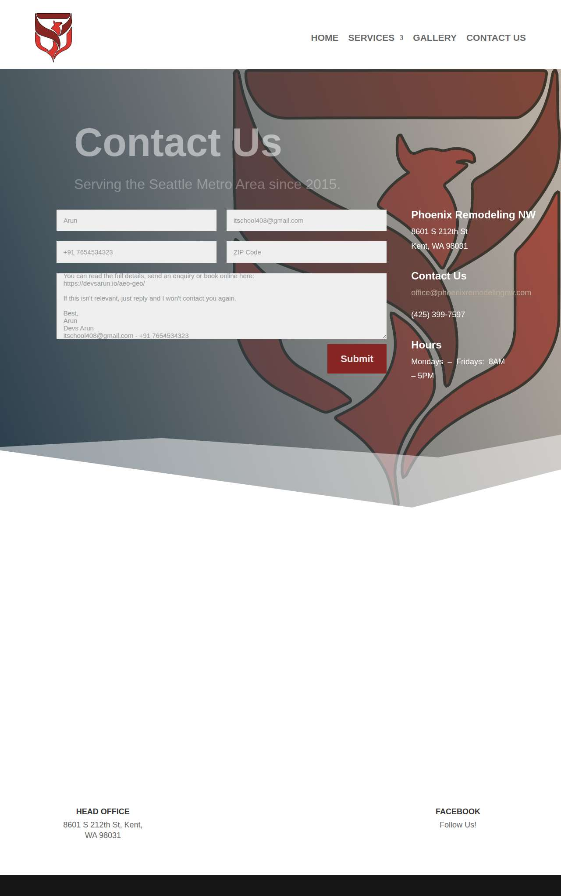

### homepreservation.com — failed\_before\_submit (LIVE)

| | |
|---|---|
| Attempt ID | `3832084e-51bc-40c4-9f65-fe42ac020fd7` |
| Form URL | https://www.homepreservation.com/contact |
| Final URL | https://www.homepreservation.com/contact |
| Reserved | 2026-11-03 02:28:03 UTC |
| Submit attempted | — |
| Template | standard v2 |
| Confirmation text | none observed |
| Result / error | Form validation would block sending: phone: Please enter between 4 to 17 digits. You can include hyphens (-) or start with a (+), e.g., 555-123-4567 or +(222)987654321.; : Please check this box if you want to proceed.; : Please check this box if you want to proceed. |

Exact message:

~~~text
Subject: Helping customers find your business in AI search (AEO + GEO)

Hi there,

I'm Arun from Devs Arun. More and more customers now ask ChatGPT, Gemini, Perplexity or Google's AI Overviews questions like "who should I hire for this in my area?" before they call anyone. These tools answer from websites they can clearly understand, and they tend to recommend businesses whose pages answer real customer questions.

That is what AEO + GEO (Answer Engine and Generative Engine Optimization) is for. I improve your existing service pages so they clearly answer the questions your customers ask, add structured data that matches the page, and make the call, quote or enquiry step obvious. The benefit: your business gets a better chance of being mentioned or linked in AI answers, and visitors who arrive find it easy to contact you.

The AEO + GEO Starter is a one-time $199 (about ₹16,999, negotiable) for one website: a basic audit, 10 customer questions, improvements to two existing pages, relevant structured data and an action plan, with one revision round.

You can read the full details, send an enquiry or book online here:
https://devsarun.io/aeo-geo/

If this isn't relevant, just reply and I won't contact you again.

Best,
Arun
Devs Arun
itschool408@gmail.com · +91 7654534323
~~~

Submitted field values:

- \#input\_comp-l6gou45b: +91 7654534323
- \#input\_comp-l6gou44w1: Arun
- \#input\_comp-l6gou4571: itschool408@gmail.com
- \#textarea\_comp-l6gou45s: Hi there, I'm Arun from Devs Arun. More and more customers now ask ChatGPT, Gemini, Perplexity or Google's AI Overviews 

**Filled form (before submit)** — `run-e6900625_attempt-3832084e_filled_2026-11-03T02-28-07-465Z.jpg`

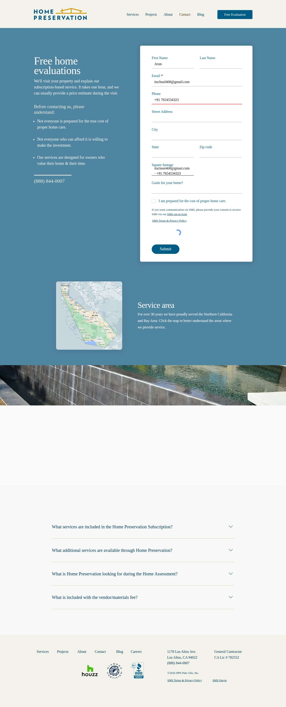

### deckbuildersinc.com — unclear (LIVE)

| | |
|---|---|
| Attempt ID | `7ba62baf-d93f-40ec-8b97-bf86c46aa2f0` |
| Form URL | https://www.deckbuildersinc.com/contact |
| Final URL | https://www.deckbuildersinc.com/contact |
| Reserved | 2026-11-03 02:28:12 UTC |
| Submit attempted | 2026-11-03 02:28:14 UTC |
| Template | standard v2 |
| Confirmation text | none observed |
| Result / error | No new success marker observed |

Exact message:

~~~text
Subject: Helping customers find your business in AI search (AEO + GEO)

Hi there,

I'm Arun from Devs Arun. More and more customers now ask ChatGPT, Gemini, Perplexity or Google's AI Overviews questions like "who should I hire for this in my area?" before they call anyone. These tools answer from websites they can clearly understand, and they tend to recommend businesses whose pages answer real customer questions.

That is what AEO + GEO (Answer Engine and Generative Engine Optimization) is for. I improve your existing service pages so they clearly answer the questions your customers ask, add structured data that matches the page, and make the call, quote or enquiry step obvious. The benefit: your business gets a better chance of being mentioned or linked in AI answers, and visitors who arrive find it easy to contact you.

The AEO + GEO Starter is a one-time $199 (about ₹16,999, negotiable) for one website: a basic audit, 10 customer questions, improvements to two existing pages, relevant structured data and an action plan, with one revision round.

You can read the full details, send an enquiry or book online here:
https://devsarun.io/aeo-geo/

If this isn't relevant, just reply and I won't contact you again.

Best,
Arun
Devs Arun
itschool408@gmail.com · +91 7654534323
~~~

Submitted field values:

- Email\* \[email\]: itschool408@gmail.com
- Phone\* \[phone\]: +91 7654534323
- Message\* \[message\]: Hi there, I'm Arun from Devs Arun. More and more customers now ask ChatGPT, Gemini, Perplexity or Google's AI Overviews 
- First Name\* \[first\_name\]: Arun

**Filled form (before submit)** — `run-e6900625_attempt-7ba62baf_filled_2026-11-03T02-28-14-726Z.jpg`

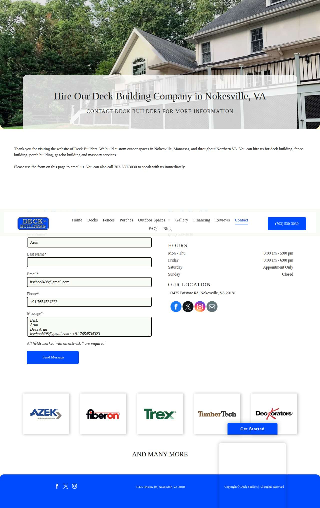

**After submit** — `run-e6900625_attempt-7ba62baf_post_attempt_2026-11-03T02-28-43-119Z.jpg`

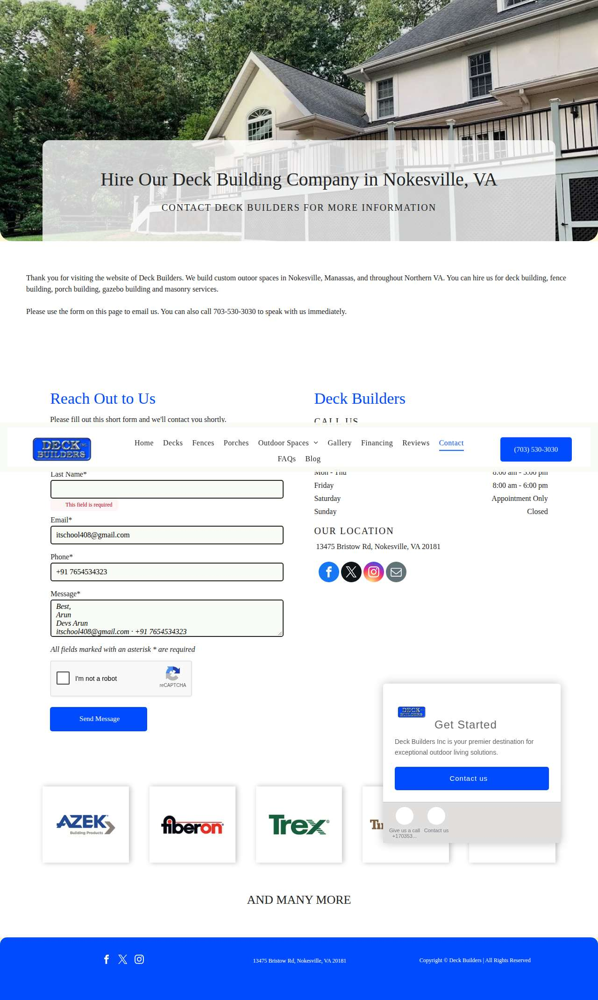

### mchenryhomeremodeling.com — confirmed (LIVE)

| | |
|---|---|
| Attempt ID | `2a16eae9-6925-43e0-b358-28e9431445ca` |
| Form URL | https://mchenryhomeremodeling.com/contact |
| Final URL | https://mchenryhomeremodeling.com/contact |
| Reserved | 2026-11-03 02:28:50 UTC |
| Submit attempted | 2026-11-03 02:28:54 UTC |
| Template | standard v2 |
| Confirmation text | Tok Repeat Customer Yelp Other WHERE DID YOU HEAR ABOUT US? THANK YOU VISIT 606 QUEEN AVE SW ALBANY, OR 97322 CALL 541-926-5903 HOURS Monday – Friday 8:00 am to 4:00 pm |
| Result / error | — |

Exact message:

~~~text
Subject: Helping customers find your business in AI search (AEO + GEO)

Hi there,

I'm Arun from Devs Arun. More and more customers now ask ChatGPT, Gemini, Perplexity or Google's AI Overviews questions like "who should I hire for this in my area?" before they call anyone. These tools answer from websites they can clearly understand, and they tend to recommend businesses whose pages answer real customer questions.

That is what AEO + GEO (Answer Engine and Generative Engine Optimization) is for. I improve your existing service pages so they clearly answer the questions your customers ask, add structured data that matches the page, and make the call, quote or enquiry step obvious. The benefit: your business gets a better chance of being mentioned or linked in AI answers, and visitors who arrive find it easy to contact you.

The AEO + GEO Starter is a one-time $199 (about ₹16,999, negotiable) for one website: a basic audit, 10 customer questions, improvements to two existing pages, relevant structured data and an action plan, with one revision round.

You can read the full details, send an enquiry or book online here:
https://devsarun.io/aeo-geo/

If this isn't relevant, just reply and I won't contact you again.

Best,
Arun
Devs Arun
itschool408@gmail.com · +91 7654534323
~~~

Submitted field values:

- NAME \[name\]: Arun
- EMAIL \[email\]: itschool408@gmail.com
- PHONE \[phone\]: +91 7654534323
- PROJECT DETAILS \[message\]: Hi there, I'm Arun from Devs Arun. More and more customers now ask ChatGPT, Gemini, Perplexity or Google's AI Overviews 
- PROJECT TYPE Select one... Kitchen Bathroom Addition Custom Home Countertops Cabinets Other \[fixed\]: Other
- HOW DID YOU HEAR ABOUT US? Select one... Linked-In Instagram Facebook Referral Google TikTok Repeat Customer Yelp Other \[fixed\]: Other

**Filled form (before submit)** — `run-e6900625_attempt-2a16eae9_filled_2026-11-03T02-28-54-944Z.jpg`

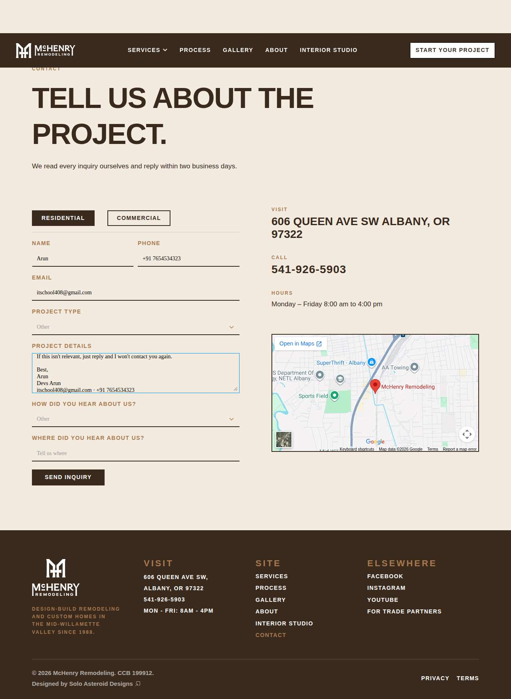

**After submit** — `run-e6900625_attempt-2a16eae9_post_attempt_2026-11-03T02-29-05-260Z.jpg`

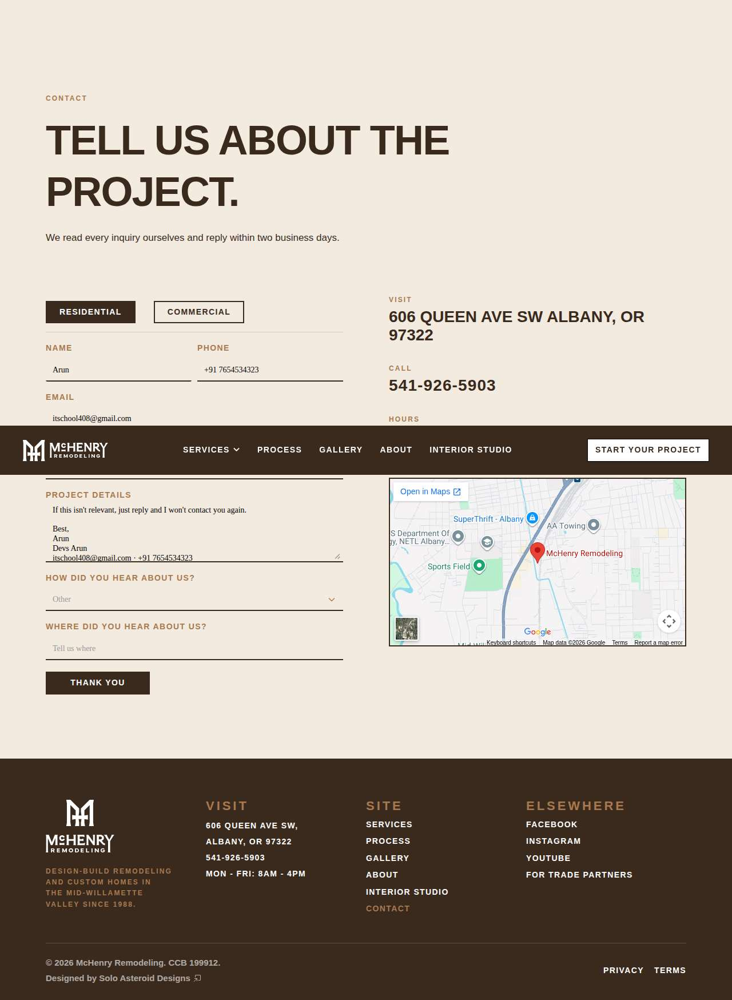

### danieleccleshomes.com — unclear (LIVE)

| | |
|---|---|
| Attempt ID | `70868305-8ab7-4388-bd19-2528959e56f9` |
| Form URL | https://www.danieleccleshomes.com/contact |
| Final URL | https://www.danieleccleshomes.com/contact |
| Reserved | 2026-11-03 02:29:12 UTC |
| Submit attempted | 2026-11-03 02:29:15 UTC |
| Template | standard v2 |
| Confirmation text | none observed |
| Result / error | No new success marker observed |

Exact message:

~~~text
Subject: Helping customers find your business in AI search (AEO + GEO)

Hi there,

I'm Arun from Devs Arun. More and more customers now ask ChatGPT, Gemini, Perplexity or Google's AI Overviews questions like "who should I hire for this in my area?" before they call anyone. These tools answer from websites they can clearly understand, and they tend to recommend businesses whose pages answer real customer questions.

That is what AEO + GEO (Answer Engine and Generative Engine Optimization) is for. I improve your existing service pages so they clearly answer the questions your customers ask, add structured data that matches the page, and make the call, quote or enquiry step obvious. The benefit: your business gets a better chance of being mentioned or linked in AI answers, and visitors who arrive find it easy to contact you.

The AEO + GEO Starter is a one-time $199 (about ₹16,999, negotiable) for one website: a basic audit, 10 customer questions, improvements to two existing pages, relevant structured data and an action plan, with one revision round.

You can read the full details, send an enquiry or book online here:
https://devsarun.io/aeo-geo/

If this isn't relevant, just reply and I won't contact you again.

Best,
Arun
Devs Arun
itschool408@gmail.com · +91 7654534323
~~~

Submitted field values:

- name \[name\]: Arun
- email \[email\]: itschool408@gmail.com
- phone \[phone\]: +91 7654534323
- Description of your project \[message\]: Hi there, I'm Arun from Devs Arun. More and more customers now ask ChatGPT, Gemini, Perplexity or Google's AI Overviews 

**Filled form (before submit)** — `run-e6900625_attempt-70868305_filled_2026-11-03T02-29-15-009Z.jpg`

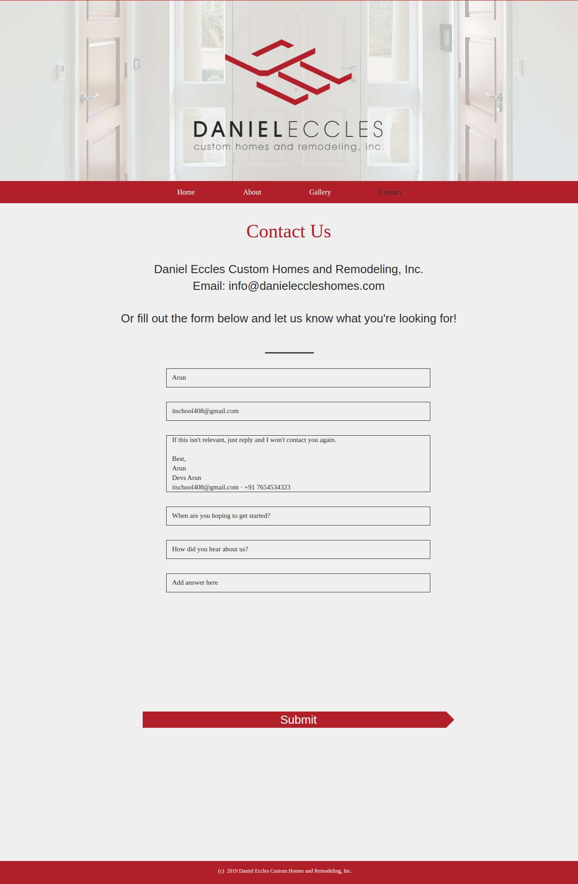

**After submit** — `run-e6900625_attempt-70868305_post_attempt_2026-11-03T02-29-42-475Z.jpg`

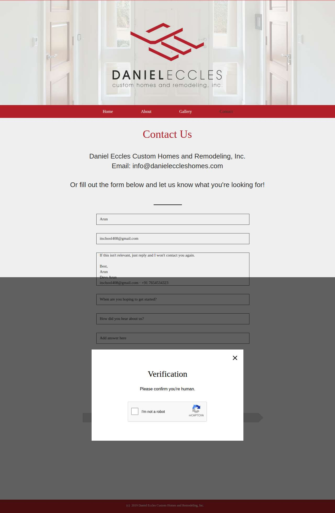

### unityconstructioninccompany.com — error\_after\_submit (LIVE)

| | |
|---|---|
| Attempt ID | `2ea61eea-5fbe-4ccb-ad42-26bc7fc2af28` |
| Form URL | https://www.unityconstructioninccompany.com/contact |
| Final URL | https://www.unityconstructioninccompany.com/contact |
| Reserved | 2026-11-03 02:29:49 UTC |
| Submit attempted | 2026-11-03 02:29:52 UTC |
| Template | standard v2 |
| Confirmation text | none observed |
| Result / error | Submit click error (outcome unknown, not retried): locator.click: Timeout 10000ms exceeded. |

Exact message:

~~~text
Subject: Helping customers find your business in AI search (AEO + GEO)

Hi there,

I'm Arun from Devs Arun. More and more customers now ask ChatGPT, Gemini, Perplexity or Google's AI Overviews questions like "who should I hire for this in my area?" before they call anyone. These tools answer from websites they can clearly understand, and they tend to recommend businesses whose pages answer real customer questions.

That is what AEO + GEO (Answer Engine and Generative Engine Optimization) is for. I improve your existing service pages so they clearly answer the questions your customers ask, add structured data that matches the page, and make the call, quote or enquiry step obvious. The benefit: your business gets a better chance of being mentioned or linked in AI answers, and visitors who arrive find it easy to contact you.

The AEO + GEO Starter is a one-time $199 (about ₹16,999, negotiable) for one website: a basic audit, 10 customer questions, improvements to two existing pages, relevant structured data and an action plan, with one revision round.

You can read the full details, send an enquiry or book online here:
https://devsarun.io/aeo-geo/

If this isn't relevant, just reply and I won't contact you again.

Best,
Arun
Devs Arun
itschool408@gmail.com · +91 7654534323
~~~

Submitted field values:

- Email \[email\]: itschool408@gmail.com
- Phone \[phone\]: +91 7654534323
- Message \[message\]: Hi there, I'm Arun from Devs Arun. More and more customers now ask ChatGPT, Gemini, Perplexity or Google's AI Overviews 
- First Name \[first\_name\]: Arun

**Filled form (before submit)** — `run-e6900625_attempt-2ea61eea_filled_2026-11-03T02-29-52-398Z.jpg`

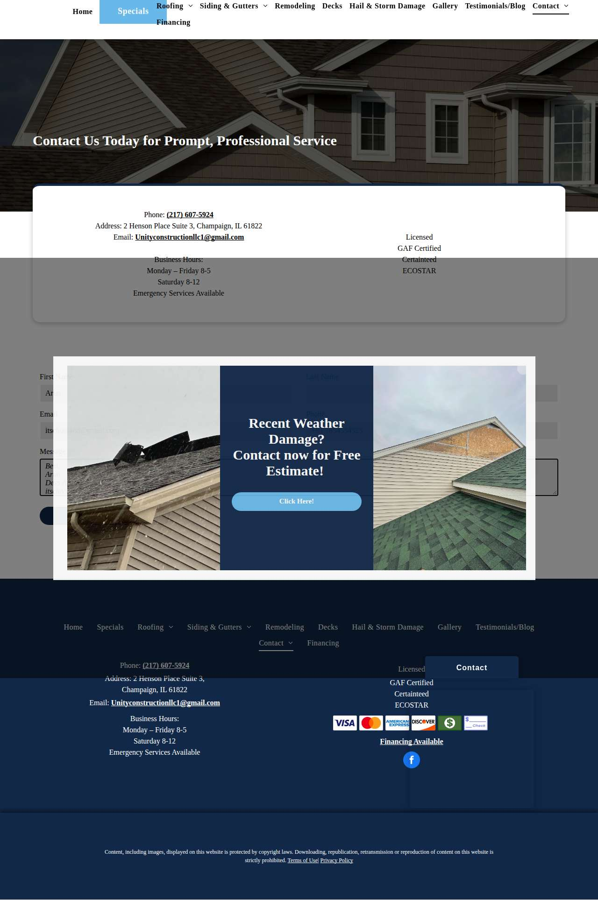

**After submit** — `run-e6900625_attempt-2ea61eea_post_attempt_2026-11-03T02-30-04-943Z.jpg`

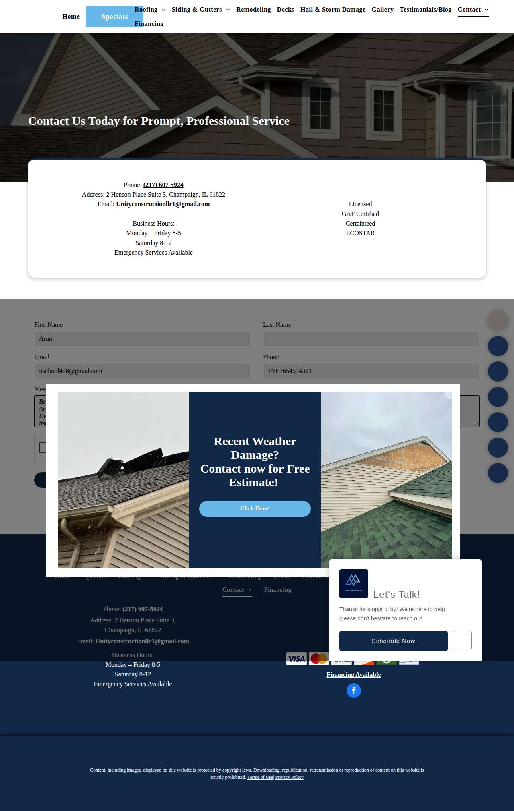

### contmech.com — confirmed (LIVE)

| | |
|---|---|
| Attempt ID | `8d66a24a-1605-4110-8dfd-1dec0f8493f9` |
| Form URL | https://contmech.com/contact-us/ |
| Final URL | https://contmech.com/contact-us/ |
| Reserved | 2026-11-03 02:30:12 UTC |
| Submit attempted | 2026-11-03 02:30:16 UTC |
| Template | standard v2 |
| Confirmation text | iries: info@contmech.com Where we are located Keep in Touch Thanks for contacting us\! We will get in touch with you shortly. We are a locally owned family oriented company. We striv |
| Result / error | — |

Exact message:

~~~text
Subject: Helping customers find your business in AI search (AEO + GEO)

Hi there,

I'm Arun from Devs Arun. More and more customers now ask ChatGPT, Gemini, Perplexity or Google's AI Overviews questions like "who should I hire for this in my area?" before they call anyone. These tools answer from websites they can clearly understand, and they tend to recommend businesses whose pages answer real customer questions.

That is what AEO + GEO (Answer Engine and Generative Engine Optimization) is for. I improve your existing service pages so they clearly answer the questions your customers ask, add structured data that matches the page, and make the call, quote or enquiry step obvious. The benefit: your business gets a better chance of being mentioned or linked in AI answers, and visitors who arrive find it easy to contact you.

The AEO + GEO Starter is a one-time $199 (about ₹16,999, negotiable) for one website: a basic audit, 10 customer questions, improvements to two existing pages, relevant structured data and an action plan, with one revision round.

You can read the full details, send an enquiry or book online here:
https://devsarun.io/aeo-geo/

If this isn't relevant, just reply and I won't contact you again.

Best,
Arun
Devs Arun
itschool408@gmail.com · +91 7654534323
~~~

Submitted field values:

- First \[first\_name\]: Arun
- Subject\* \[subject\]: Helping customers find your business in AI search (AEO + GEO)
- Your Email\* \[email\]: itschool408@gmail.com
- Your Message \[message\]: Hi there, I'm Arun from Devs Arun. More and more customers now ask ChatGPT, Gemini, Perplexity or Google's AI Overviews 

**Filled form (before submit)** — `run-e6900625_attempt-8d66a24a_filled_2026-11-03T02-30-16-958Z.jpg`

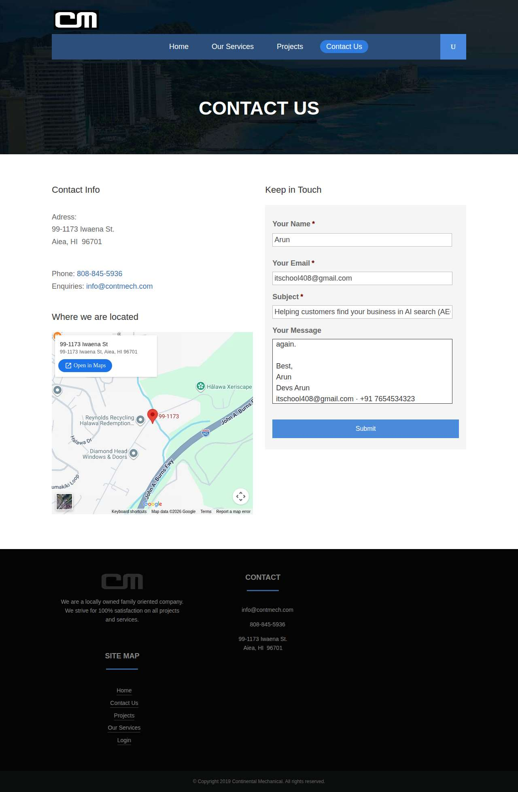

**After submit** — `run-e6900625_attempt-8d66a24a_post_attempt_2026-11-03T02-30-36-664Z.jpg`

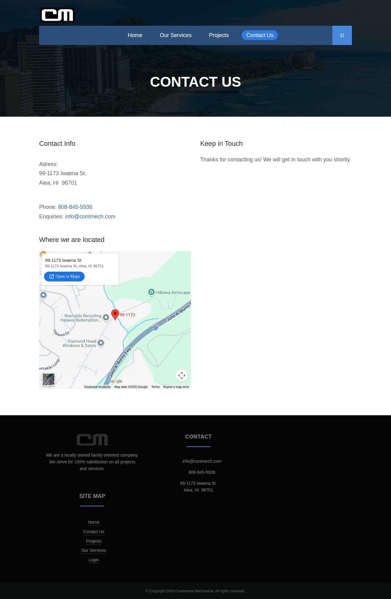

### signaturehomes.ws — unclear (LIVE)

| | |
|---|---|
| Attempt ID | `80542b75-20b8-4cf2-8643-b0c832fa8227` |
| Form URL | https://www.signaturehomes.ws/contact-us |
| Final URL | https://www.signaturehomes.ws/contact-us |
| Reserved | 2026-11-03 02:30:44 UTC |
| Submit attempted | 2026-11-03 02:30:47 UTC |
| Template | standard v2 |
| Confirmation text | none observed |
| Result / error | No new success marker observed |

Exact message:

~~~text
Subject: Helping customers find your business in AI search (AEO + GEO)

Hi there,

I'm Arun from Devs Arun. More and more customers now ask ChatGPT, Gemini, Perplexity or Google's AI Overviews questions like "who should I hire for this in my area?" before they call anyone. These tools answer from websites they can clearly understand, and they tend to recommend businesses whose pages answer real customer questions.

That is what AEO + GEO (Answer Engine and Generative Engine Optimization) is for. I improve your existing service pages so they clearly answer the questions your customers ask, add structured data that matches the page, and make the call, quote or enquiry step obvious. The benefit: your business gets a better chance of being mentioned or linked in AI answers, and visitors who arrive find it easy to contact you.

The AEO + GEO Starter is a one-time $199 (about ₹16,999, negotiable) for one website: a basic audit, 10 customer questions, improvements to two existing pages, relevant structured data and an action plan, with one revision round.

You can read the full details, send an enquiry or book online here:
https://devsarun.io/aeo-geo/

If this isn't relevant, just reply and I won't contact you again.

Best,
Arun
Devs Arun
itschool408@gmail.com · +91 7654534323
~~~

Submitted field values:

- name \[name\]: Arun
- email \[email\]: itschool408@gmail.com
- phone \[phone\]: +91 7654534323
- subject \[subject\]: Helping customers find your business in AI search (AEO + GEO)
- Type your message here... \[message\]: Hi there, I'm Arun from Devs Arun. More and more customers now ask ChatGPT, Gemini, Perplexity or Google's AI Overviews 

**Filled form (before submit)** — `run-e6900625_attempt-80542b75_filled_2026-11-03T02-30-47-399Z.jpg`

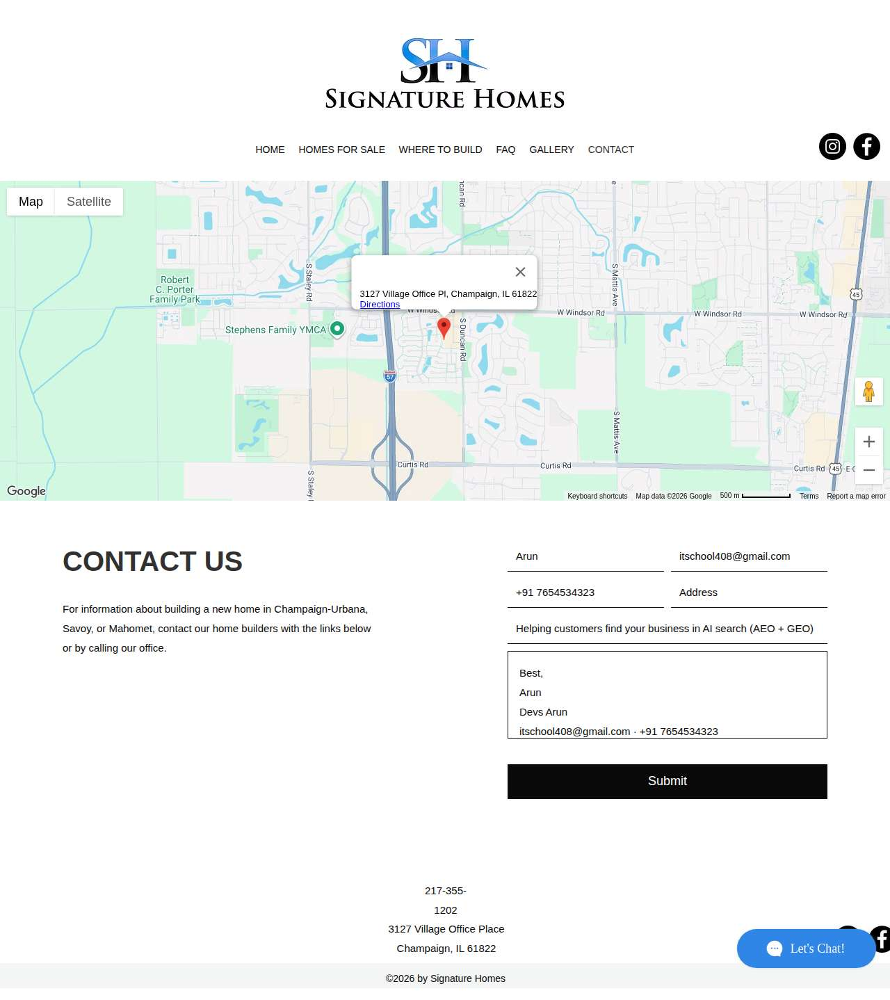

**After submit** — `run-e6900625_attempt-80542b75_post_attempt_2026-11-03T02-31-14-772Z.jpg`

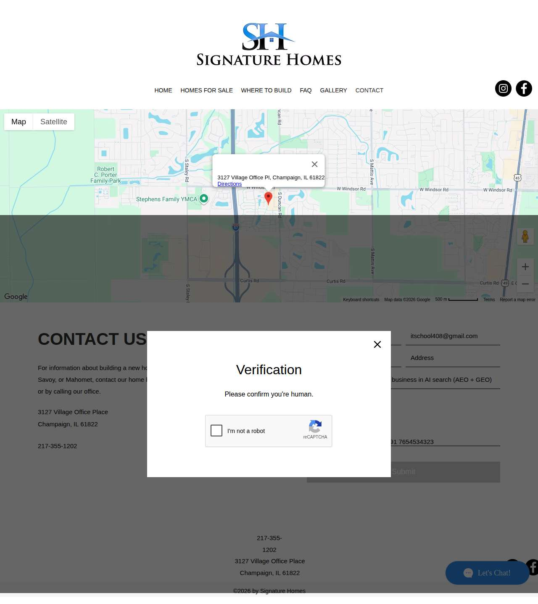

### troutmancustomhomes.com — unclear (LIVE)

| | |
|---|---|
| Attempt ID | `43f3420e-088b-4287-a8a3-fa4bdc5bbd51` |
| Form URL | https://www.troutmancustomhomes.com/contact |
| Final URL | https://www.troutmancustomhomes.com/contact |
| Reserved | 2026-11-03 02:31:22 UTC |
| Submit attempted | 2026-11-03 02:31:24 UTC |
| Template | standard v2 |
| Confirmation text | none observed |
| Result / error | No new success marker observed |

Exact message:

~~~text
Subject: Helping customers find your business in AI search (AEO + GEO)

Hi there,

I'm Arun from Devs Arun. More and more customers now ask ChatGPT, Gemini, Perplexity or Google's AI Overviews questions like "who should I hire for this in my area?" before they call anyone. These tools answer from websites they can clearly understand, and they tend to recommend businesses whose pages answer real customer questions.

That is what AEO + GEO (Answer Engine and Generative Engine Optimization) is for. I improve your existing service pages so they clearly answer the questions your customers ask, add structured data that matches the page, and make the call, quote or enquiry step obvious. The benefit: your business gets a better chance of being mentioned or linked in AI answers, and visitors who arrive find it easy to contact you.

The AEO + GEO Starter is a one-time $199 (about ₹16,999, negotiable) for one website: a basic audit, 10 customer questions, improvements to two existing pages, relevant structured data and an action plan, with one revision round.

You can read the full details, send an enquiry or book online here:
https://devsarun.io/aeo-geo/

If this isn't relevant, just reply and I won't contact you again.

Best,
Arun
Devs Arun
itschool408@gmail.com · +91 7654534323
~~~

Submitted field values:

- email \[email\]: itschool408@gmail.com
- name-\* \[name\]: Arun
- phone \[phone\]: +91 7654534323
- Message \[message\]: Hi there, I'm Arun from Devs Arun. More and more customers now ask ChatGPT, Gemini, Perplexity or Google's AI Overviews 

**Filled form (before submit)** — `run-e6900625_attempt-43f3420e_filled_2026-11-03T02-31-24-332Z.jpg`

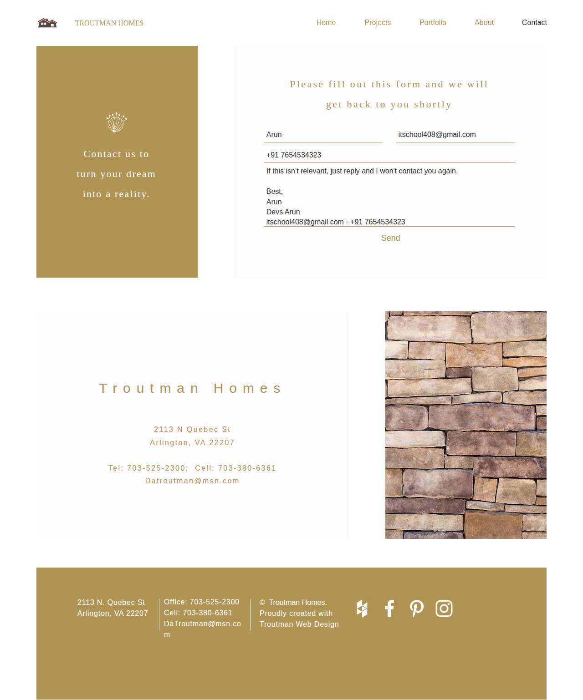

**After submit** — `run-e6900625_attempt-43f3420e_post_attempt_2026-11-03T02-31-51-998Z.jpg`

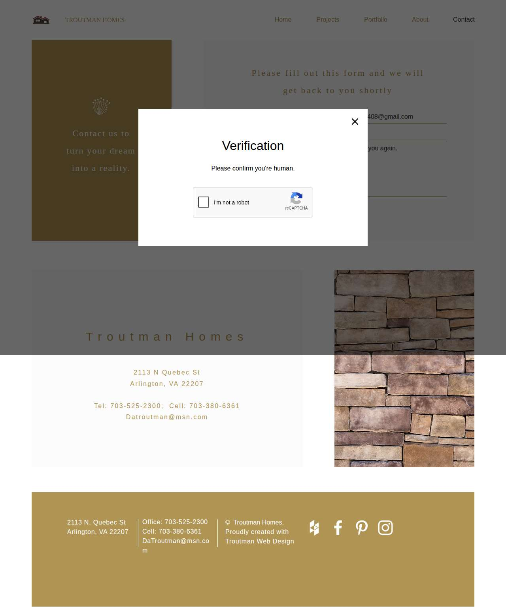

### mcmeekinconstruction.com — unclear (LIVE)

| | |
|---|---|
| Attempt ID | `480aca14-92cf-49ba-a78b-3e920e40fd7b` |
| Form URL | https://www.mcmeekinconstruction.com/contact |
| Final URL | https://www.mcmeekinconstruction.com/contact |
| Reserved | 2026-11-03 02:31:59 UTC |
| Submit attempted | 2026-11-03 02:32:01 UTC |
| Template | standard v2 |
| Confirmation text | none observed |
| Result / error | No new success marker observed |

Exact message:

~~~text
Subject: Helping customers find your business in AI search (AEO + GEO)

Hi there,

I'm Arun from Devs Arun. More and more customers now ask ChatGPT, Gemini, Perplexity or Google's AI Overviews questions like "who should I hire for this in my area?" before they call anyone. These tools answer from websites they can clearly understand, and they tend to recommend businesses whose pages answer real customer questions.

That is what AEO + GEO (Answer Engine and Generative Engine Optimization) is for. I improve your existing service pages so they clearly answer the questions your customers ask, add structured data that matches the page, and make the call, quote or enquiry step obvious. The benefit: your business gets a better chance of being mentioned or linked in AI answers, and visitors who arrive find it easy to contact you.

The AEO + GEO Starter is a one-time $199 (about ₹16,999, negotiable) for one website: a basic audit, 10 customer questions, improvements to two existing pages, relevant structured data and an action plan, with one revision round.

You can read the full details, send an enquiry or book online here:
https://devsarun.io/aeo-geo/

If this isn't relevant, just reply and I won't contact you again.

Best,
Arun
Devs Arun
itschool408@gmail.com · +91 7654534323
~~~

Submitted field values:

- name \[name\]: Arun
- email \[email\]: itschool408@gmail.com
- phone \[phone\]: +91 7654534323
- Type your message here... \[message\]: Hi there, I'm Arun from Devs Arun. More and more customers now ask ChatGPT, Gemini, Perplexity or Google's AI Overviews 

**Filled form (before submit)** — `run-e6900625_attempt-480aca14_filled_2026-11-03T02-32-01-400Z.jpg`

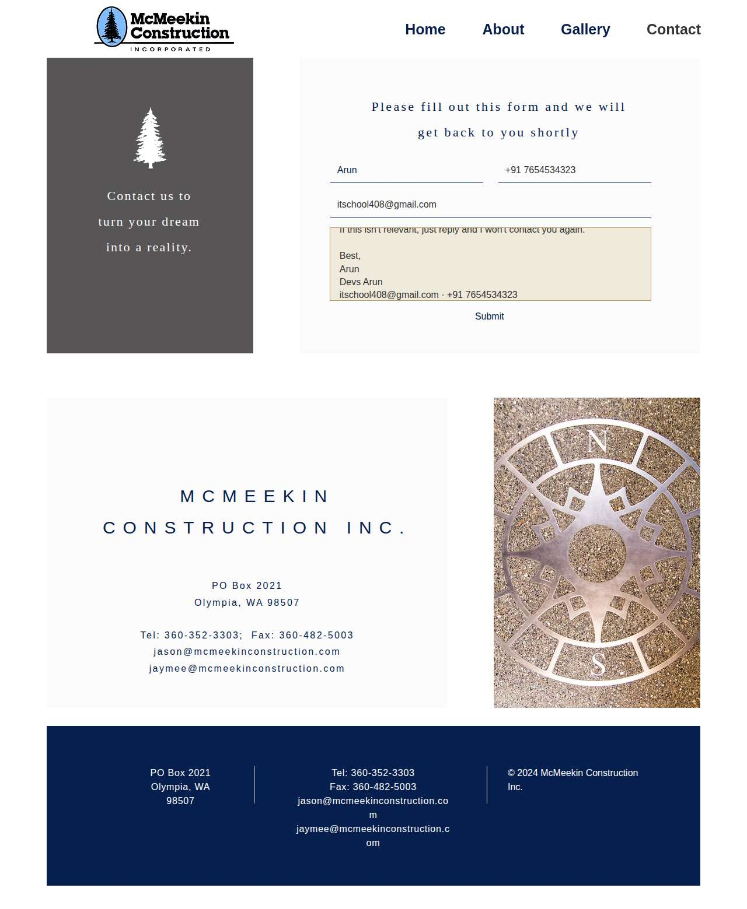

**After submit** — `run-e6900625_attempt-480aca14_post_attempt_2026-11-03T02-32-29-033Z.jpg`

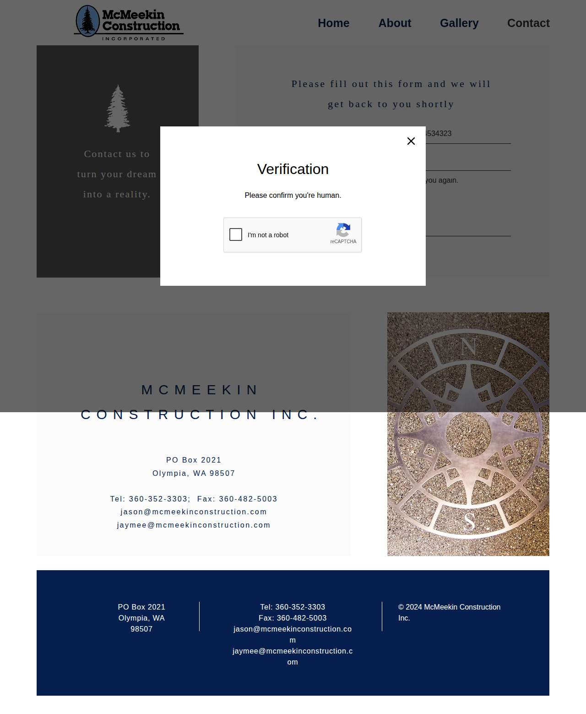

### coderestoration.com — confirmed (LIVE)

| | |
|---|---|
| Attempt ID | `d6495457-9f0e-4112-ae10-3b1cbbf62bbe` |
| Form URL | https://coderestoration.com/contact-us/ |
| Final URL | https://coderestoration.com/contact-us/ |
| Reserved | 2026-11-03 02:32:36 UTC |
| Submit attempted | 2026-11-03 02:32:38 UTC |
| Template | standard v2 |
| Confirmation text | n provided.  Address 1090 Bluff City Hwy Bristol, TN 37620 Thanks for contacting us Our Services At Code Restoration, we specialize in a variety of remediation and restoration serv |
| Result / error | — |

Exact message:

~~~text
Subject: Helping customers find your business in AI search (AEO + GEO)

Hi there,

I'm Arun from Devs Arun. More and more customers now ask ChatGPT, Gemini, Perplexity or Google's AI Overviews questions like "who should I hire for this in my area?" before they call anyone. These tools answer from websites they can clearly understand, and they tend to recommend businesses whose pages answer real customer questions.

That is what AEO + GEO (Answer Engine and Generative Engine Optimization) is for. I improve your existing service pages so they clearly answer the questions your customers ask, add structured data that matches the page, and make the call, quote or enquiry step obvious. The benefit: your business gets a better chance of being mentioned or linked in AI answers, and visitors who arrive find it easy to contact you.

The AEO + GEO Starter is a one-time $199 (about ₹16,999, negotiable) for one website: a basic audit, 10 customer questions, improvements to two existing pages, relevant structured data and an action plan, with one revision round.

You can read the full details, send an enquiry or book online here:
https://devsarun.io/aeo-geo/

If this isn't relevant, just reply and I won't contact you again.

Best,
Arun
Devs Arun
itschool408@gmail.com · +91 7654534323
~~~

Submitted field values:

- Name \[name\]: Arun
- Message \[message\]: Hi there, I'm Arun from Devs Arun. More and more customers now ask ChatGPT, Gemini, Perplexity or Google's AI Overviews 
- Phone Number \[phone\]: +91 7654534323
- Email Address \[email\]: itschool408@gmail.com

**Filled form (before submit)** — `run-e6900625_attempt-d6495457_filled_2026-11-03T02-32-38-724Z.jpg`

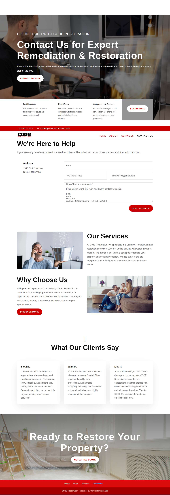

**After submit** — `run-e6900625_attempt-d6495457_post_attempt_2026-11-03T02-32-42-176Z.jpg`

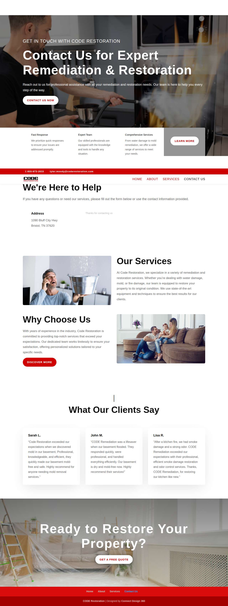

### buntinconstruction.com — confirmed (LIVE)

| | |
|---|---|
| Attempt ID | `892e54c9-f208-4eef-ad19-097f6255029b` |
| Form URL | https://www.buntinconstruction.com/contact/ |
| Final URL | https://www.buntinconstruction.com/contact/ |
| Reserved | 2026-11-03 02:32:49 UTC |
| Submit attempted | 2026-11-03 02:32:51 UTC |
| Template | standard v2 |
| Confirmation text | LOCATION 572 Parsons Drive, Suite 100 Medford Oregon, 97501 Thank you for your message. It has been sent. Your Name (required) Your Email (required) Subject Your Message Thank you for yo |
| Result / error | — |

Exact message:

~~~text
Subject: Helping customers find your business in AI search (AEO + GEO)

Hi there,

I'm Arun from Devs Arun. More and more customers now ask ChatGPT, Gemini, Perplexity or Google's AI Overviews questions like "who should I hire for this in my area?" before they call anyone. These tools answer from websites they can clearly understand, and they tend to recommend businesses whose pages answer real customer questions.

That is what AEO + GEO (Answer Engine and Generative Engine Optimization) is for. I improve your existing service pages so they clearly answer the questions your customers ask, add structured data that matches the page, and make the call, quote or enquiry step obvious. The benefit: your business gets a better chance of being mentioned or linked in AI answers, and visitors who arrive find it easy to contact you.

The AEO + GEO Starter is a one-time $199 (about ₹16,999, negotiable) for one website: a basic audit, 10 customer questions, improvements to two existing pages, relevant structured data and an action plan, with one revision round.

You can read the full details, send an enquiry or book online here:
https://devsarun.io/aeo-geo/

If this isn't relevant, just reply and I won't contact you again.

Best,
Arun
Devs Arun
itschool408@gmail.com · +91 7654534323
~~~

Submitted field values:

- Subject \[subject\]: Helping customers find your business in AI search (AEO + GEO)
- Your Message \[message\]: Hi there, I'm Arun from Devs Arun. More and more customers now ask ChatGPT, Gemini, Perplexity or Google's AI Overviews 
- Your Name (required) \[name\]: Arun
- Your Email (required) \[email\]: itschool408@gmail.com

**Filled form (before submit)** — `run-e6900625_attempt-892e54c9_filled_2026-11-03T02-32-51-144Z.jpg`

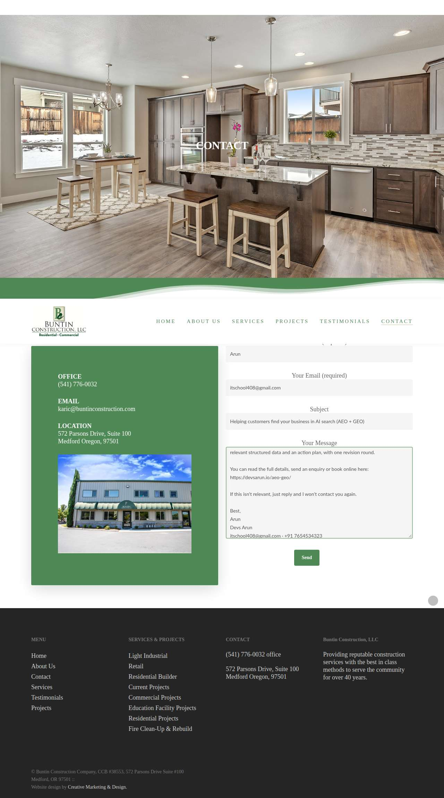

**After submit** — `run-e6900625_attempt-892e54c9_post_attempt_2026-11-03T02-32-56-675Z.jpg`

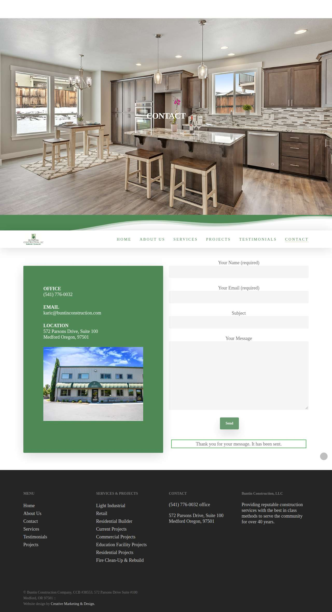

### levansdesigngroup.com — failed\_before\_submit (LIVE)

| | |
|---|---|
| Attempt ID | `acc7a22f-b136-4977-b3f0-b301db7b0946` |
| Form URL | https://levansdesigngroup.com/contact-us/ |
| Final URL | https://levansdesigngroup.com/contact-us/ |
| Reserved | 2026-11-03 02:33:04 UTC |
| Submit attempted | — |
| Template | standard v2 |
| Confirmation text | none observed |
| Result / error | Field "Phone" did not accept the value |

Exact message:

~~~text
Subject: Helping customers find your business in AI search (AEO + GEO)

Hi there,

I'm Arun from Devs Arun. More and more customers now ask ChatGPT, Gemini, Perplexity or Google's AI Overviews questions like "who should I hire for this in my area?" before they call anyone. These tools answer from websites they can clearly understand, and they tend to recommend businesses whose pages answer real customer questions.

That is what AEO + GEO (Answer Engine and Generative Engine Optimization) is for. I improve your existing service pages so they clearly answer the questions your customers ask, add structured data that matches the page, and make the call, quote or enquiry step obvious. The benefit: your business gets a better chance of being mentioned or linked in AI answers, and visitors who arrive find it easy to contact you.

The AEO + GEO Starter is a one-time $199 (about ₹16,999, negotiable) for one website: a basic audit, 10 customer questions, improvements to two existing pages, relevant structured data and an action plan, with one revision round.

You can read the full details, send an enquiry or book online here:
https://devsarun.io/aeo-geo/

If this isn't relevant, just reply and I won't contact you again.

Best,
Arun
Devs Arun
itschool408@gmail.com · +91 7654534323
~~~

Submitted field values:

- \#input\_1\_2: itschool408@gmail.com
- \#input\_1\_3: +91 7654534323
- \#input\_1\_4: Hi there, I'm Arun from Devs Arun. More and more customers now ask ChatGPT, Gemini, Perplexity or Google's AI Overviews 
- \#input\_1\_5: Arun

**Filled form (before submit)** — `run-e6900625_attempt-acc7a22f_filled_2026-11-03T02-33-06-958Z.jpg`

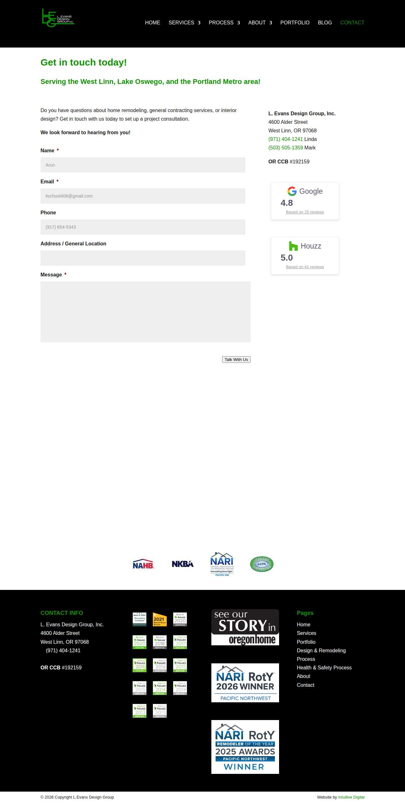

### danddreno.com — failed\_before\_submit (LIVE)

| | |
|---|---|
| Attempt ID | `85edfbe7-a34d-4306-8e67-385dec8c1976` |
| Form URL | https://www.danddreno.com/contact |
| Final URL | https://www.danddreno.com/contact |
| Reserved | 2026-11-03 02:33:12 UTC |
| Submit attempted | — |
| Template | standard v2 |
| Confirmation text | none observed |
| Result / error | Field "Subject" did not accept the value |

Exact message:

~~~text
Subject: Helping customers find your business in AI search (AEO + GEO)

Hi there,

I'm Arun from Devs Arun. More and more customers now ask ChatGPT, Gemini, Perplexity or Google's AI Overviews questions like "who should I hire for this in my area?" before they call anyone. These tools answer from websites they can clearly understand, and they tend to recommend businesses whose pages answer real customer questions.

That is what AEO + GEO (Answer Engine and Generative Engine Optimization) is for. I improve your existing service pages so they clearly answer the questions your customers ask, add structured data that matches the page, and make the call, quote or enquiry step obvious. The benefit: your business gets a better chance of being mentioned or linked in AI answers, and visitors who arrive find it easy to contact you.

The AEO + GEO Starter is a one-time $199 (about ₹16,999, negotiable) for one website: a basic audit, 10 customer questions, improvements to two existing pages, relevant structured data and an action plan, with one revision round.

You can read the full details, send an enquiry or book online here:
https://devsarun.io/aeo-geo/

If this isn't relevant, just reply and I won't contact you again.

Best,
Arun
Devs Arun
itschool408@gmail.com · +91 7654534323
~~~

Submitted field values:

- \#input\_comp-ls4w188h4: Arun
- \#input\_comp-ls4w188q5: itschool408@gmail.com
- \#input\_comp-ls4w188s4: Helping customers find your business in AI search (AEO + GEO)
- \#textarea\_comp-ls4w188u3: Hi there, I'm Arun from Devs Arun. More and more customers now ask ChatGPT, Gemini, Perplexity or Google's AI Overviews 

**Filled form (before submit)** — `run-e6900625_attempt-85edfbe7_filled_2026-11-03T02-33-14-123Z.jpg`

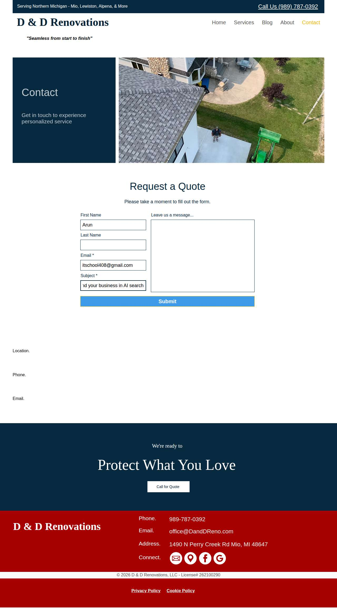

### easttexasconcreters.com — confirmed (LIVE)

| | |
|---|---|
| Attempt ID | `4224a14f-0dff-403e-abc8-e3fcf4e69e21` |
| Form URL | https://easttexasconcreters.com/contact/ |
| Final URL | https://easttexasconcreters.com/contact/ |
| Reserved | 2026-11-03 02:33:19 UTC |
| Submit attempted | 2026-11-03 02:33:21 UTC |
| Template | standard v2 |
| Confirmation text | , Tyler, TX 75701 On-site visits included Company Website ✓ Thank you, Arun, your request is in\! We've received your free quote request. A member of the East Texas Concr |
| Result / error | — |

Exact message:

~~~text
Subject: Helping customers find your business in AI search (AEO + GEO)

Hi there,

I'm Arun from Devs Arun. More and more customers now ask ChatGPT, Gemini, Perplexity or Google's AI Overviews questions like "who should I hire for this in my area?" before they call anyone. These tools answer from websites they can clearly understand, and they tend to recommend businesses whose pages answer real customer questions.

That is what AEO + GEO (Answer Engine and Generative Engine Optimization) is for. I improve your existing service pages so they clearly answer the questions your customers ask, add structured data that matches the page, and make the call, quote or enquiry step obvious. The benefit: your business gets a better chance of being mentioned or linked in AI answers, and visitors who arrive find it easy to contact you.

The AEO + GEO Starter is a one-time $199 (about ₹16,999, negotiable) for one website: a basic audit, 10 customer questions, improvements to two existing pages, relevant structured data and an action plan, with one revision round.

You can read the full details, send an enquiry or book online here:
https://devsarun.io/aeo-geo/

If this isn't relevant, just reply and I won't contact you again.

Best,
Arun
Devs Arun
itschool408@gmail.com · +91 7654534323
~~~

Submitted field values:

- Email \[email\]: itschool408@gmail.com
- Phone \* \[phone\]: +91 7654534323
- Your name \* \[name\]: Arun
- Description \[message\]: Hi there, I'm Arun from Devs Arun. More and more customers now ask ChatGPT, Gemini, Perplexity or Google's AI Overviews 
- Service needed \[fixed\]: Other

**Filled form (before submit)** — `run-e6900625_attempt-4224a14f_filled_2026-11-03T02-33-21-194Z.jpg`

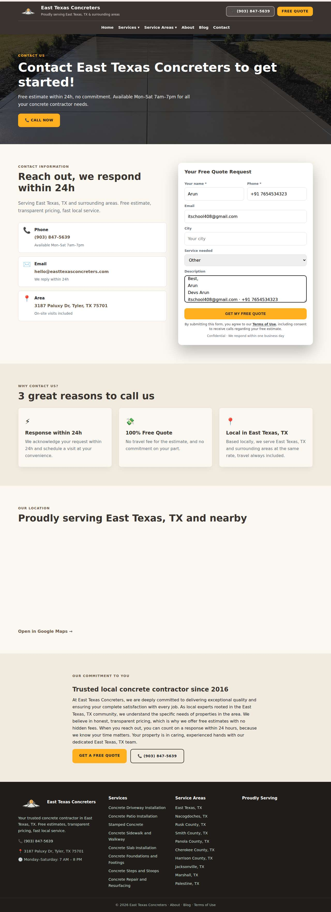

**After submit** — `run-e6900625_attempt-4224a14f_post_attempt_2026-11-03T02-33-24-772Z.jpg`

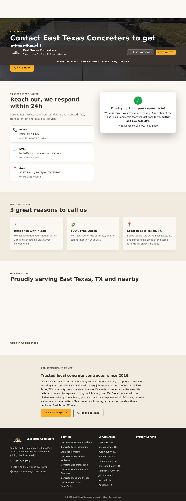

### updpavers.com — failed\_before\_submit (LIVE)

| | |
|---|---|
| Attempt ID | `a2e72f46-782e-4c05-888a-dde50cd0b18c` |
| Form URL | https://updpavers.com/contact-us |
| Final URL | https://updpavers.com/contact-us |
| Reserved | 2026-11-03 02:33:32 UTC |
| Submit attempted | — |
| Template | standard v2 |
| Confirmation text | none observed |
| Result / error | Field "Phone\* required" did not accept the value |

Exact message:

~~~text
Subject: Helping customers find your business in AI search (AEO + GEO)

Hi there,

I'm Arun from Devs Arun. More and more customers now ask ChatGPT, Gemini, Perplexity or Google's AI Overviews questions like "who should I hire for this in my area?" before they call anyone. These tools answer from websites they can clearly understand, and they tend to recommend businesses whose pages answer real customer questions.

That is what AEO + GEO (Answer Engine and Generative Engine Optimization) is for. I improve your existing service pages so they clearly answer the questions your customers ask, add structured data that matches the page, and make the call, quote or enquiry step obvious. The benefit: your business gets a better chance of being mentioned or linked in AI answers, and visitors who arrive find it easy to contact you.

The AEO + GEO Starter is a one-time $199 (about ₹16,999, negotiable) for one website: a basic audit, 10 customer questions, improvements to two existing pages, relevant structured data and an action plan, with one revision round.

You can read the full details, send an enquiry or book online here:
https://devsarun.io/aeo-geo/

If this isn't relevant, just reply and I won't contact you again.

Best,
Arun
Devs Arun
itschool408@gmail.com · +91 7654534323
~~~

Submitted field values:

- \#name-Name: Arun
- \#email-Email: itschool408@gmail.com
- \#phone-Phone: +91 7654534323
- \#message-Leave\\ us\\ a\\ message: Hi there, I'm Arun from Devs Arun. More and more customers now ask ChatGPT, Gemini, Perplexity or Google's AI Overviews 

**Filled form (before submit)** — `run-e6900625_attempt-a2e72f46_filled_2026-11-03T02-33-34-593Z.jpg`

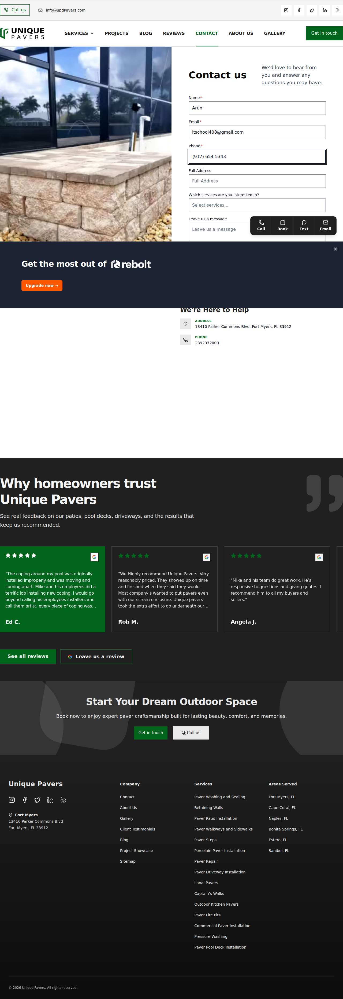

### danddseamlessgutters.com — unclear (LIVE)

| | |
|---|---|
| Attempt ID | `05c46e1d-16bc-4d70-b638-7f2c4659bb32` |
| Form URL | https://danddseamlessgutters.com/contact-seamless-gutter-experts/ |
| Final URL | https://danddseamlessgutters.com/contact-seamless-gutter-experts/ |
| Reserved | 2026-11-03 02:33:39 UTC |
| Submit attempted | 2026-11-03 02:33:41 UTC |
| Template | standard v2 |
| Confirmation text | none observed |
| Result / error | No new success marker observed |

Exact message:

~~~text
Subject: Helping customers find your business in AI search (AEO + GEO)

Hi there,

I'm Arun from Devs Arun. More and more customers now ask ChatGPT, Gemini, Perplexity or Google's AI Overviews questions like "who should I hire for this in my area?" before they call anyone. These tools answer from websites they can clearly understand, and they tend to recommend businesses whose pages answer real customer questions.

That is what AEO + GEO (Answer Engine and Generative Engine Optimization) is for. I improve your existing service pages so they clearly answer the questions your customers ask, add structured data that matches the page, and make the call, quote or enquiry step obvious. The benefit: your business gets a better chance of being mentioned or linked in AI answers, and visitors who arrive find it easy to contact you.

The AEO + GEO Starter is a one-time $199 (about ₹16,999, negotiable) for one website: a basic audit, 10 customer questions, improvements to two existing pages, relevant structured data and an action plan, with one revision round.

You can read the full details, send an enquiry or book online here:
https://devsarun.io/aeo-geo/

If this isn't relevant, just reply and I won't contact you again.

Best,
Arun
Devs Arun
itschool408@gmail.com · +91 7654534323
~~~

Submitted field values:

- Email \[email\]: itschool408@gmail.com
- Phone \[phone\]: +91 7654534323
- Full Name \[name\]: Arun
- Comments Please let us know what's on your mind. Have a question for us? Ask away. \[message\]: Hi there, I'm Arun from Devs Arun. More and more customers now ask ChatGPT, Gemini, Perplexity or Google's AI Overviews 

**Filled form (before submit)** — `run-e6900625_attempt-05c46e1d_filled_2026-11-03T02-33-41-578Z.jpg`

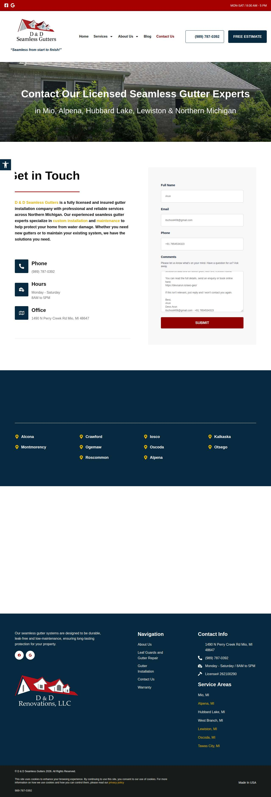

**After submit** — `run-e6900625_attempt-05c46e1d_post_attempt_2026-11-03T02-34-09-178Z.jpg`

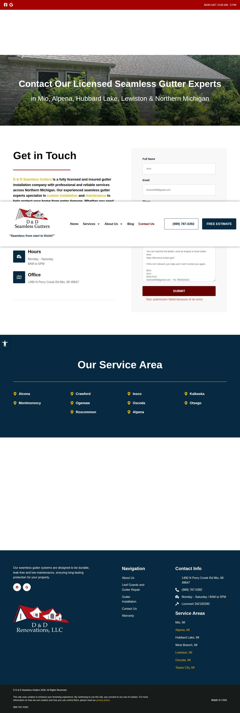

### centrexconstruction.net — confirmed (LIVE)

| | |
|---|---|
| Attempt ID | `54caa42a-8f21-45c5-bea9-8037fd5a41f1` |
| Form URL | https://www.centrex.cc/contact |
| Final URL | https://www.centrex.cc/contact |
| Reserved | 2026-11-03 02:34:16 UTC |
| Submit attempted | 2026-11-03 02:34:18 UTC |
| Template | standard v2 |
| Confirmation text | ble budgets, faster timelines, and a partner you can trust. Thanks — we'll be in touch. Your message has been received. Centrex Your aviation build partner — design a |
| Result / error | — |

Exact message:

~~~text
Subject: Helping customers find your business in AI search (AEO + GEO)

Hi there,

I'm Arun from Devs Arun. More and more customers now ask ChatGPT, Gemini, Perplexity or Google's AI Overviews questions like "who should I hire for this in my area?" before they call anyone. These tools answer from websites they can clearly understand, and they tend to recommend businesses whose pages answer real customer questions.

That is what AEO + GEO (Answer Engine and Generative Engine Optimization) is for. I improve your existing service pages so they clearly answer the questions your customers ask, add structured data that matches the page, and make the call, quote or enquiry step obvious. The benefit: your business gets a better chance of being mentioned or linked in AI answers, and visitors who arrive find it easy to contact you.

The AEO + GEO Starter is a one-time $199 (about ₹16,999, negotiable) for one website: a basic audit, 10 customer questions, improvements to two existing pages, relevant structured data and an action plan, with one revision round.

You can read the full details, send an enquiry or book online here:
https://devsarun.io/aeo-geo/

If this isn't relevant, just reply and I won't contact you again.

Best,
Arun
Devs Arun
itschool408@gmail.com · +91 7654534323
~~~

Submitted field values:

- Email \[email\]: itschool408@gmail.com
- Phone \[phone\]: +91 7654534323
- Message \[message\]: Hi there, I'm Arun from Devs Arun. More and more customers now ask ChatGPT, Gemini, Perplexity or Google's AI Overviews 
- First Name \[first\_name\]: Arun

**Filled form (before submit)** — `run-e6900625_attempt-54caa42a_filled_2026-11-03T02-34-18-060Z.jpg`

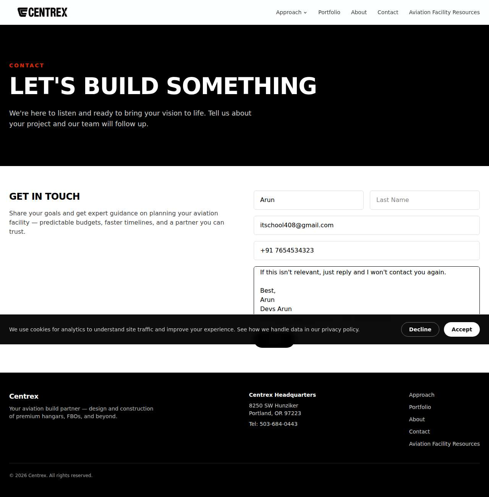

**After submit** — `run-e6900625_attempt-54caa42a_post_attempt_2026-11-03T02-34-21-436Z.jpg`

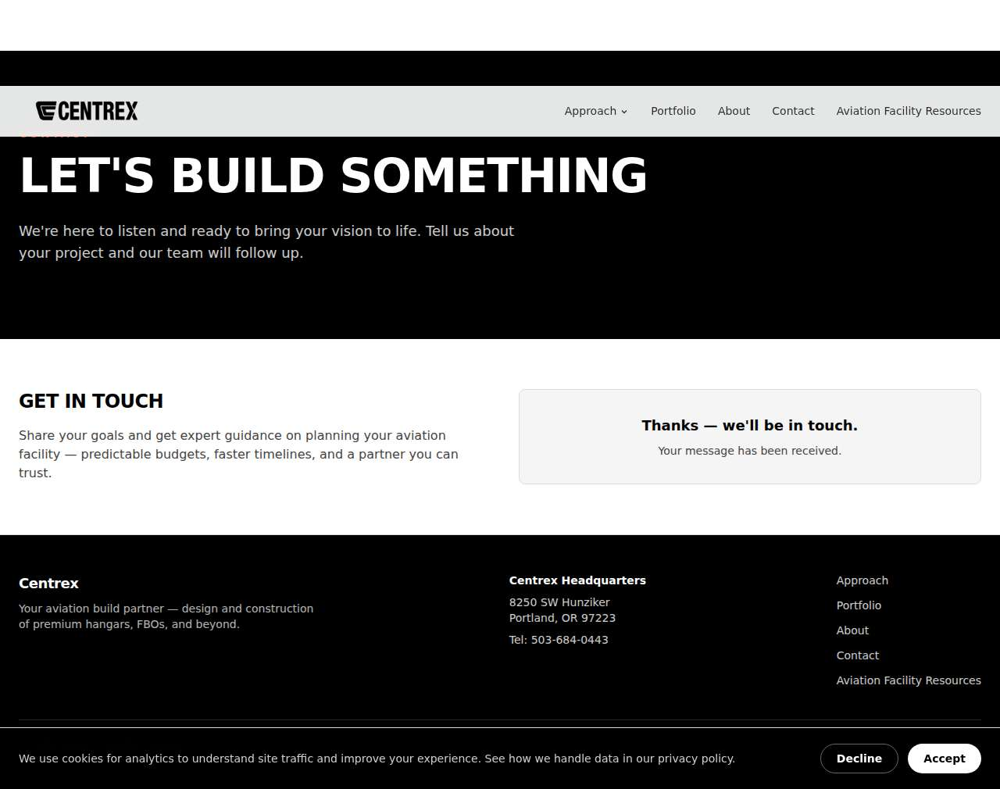

### coachhousegarages.com — confirmed (LIVE)

| | |
|---|---|
| Attempt ID | `2c2a9405-7019-45ba-adb4-b70e2f4a0390` |
| Form URL | https://coachhousegarages.com/contact-coach-house/ |
| Final URL | https://coachhousegarages.com/contact-coach-house/ |
| Reserved | 2026-11-03 02:34:28 UTC |
| Submit attempted | 2026-11-03 02:34:32 UTC |
| Template | standard v2 |
| Confirmation text | garages.com P.O. Box 320 Arthur, IL 61911 General Inquiries Thank you for contacting us, we will be in touch shortly. Submit Find Your Local Consultant We have designated service areas |
| Result / error | — |

Exact message:

~~~text
Subject: Helping customers find your business in AI search (AEO + GEO)

Hi there,

I'm Arun from Devs Arun. More and more customers now ask ChatGPT, Gemini, Perplexity or Google's AI Overviews questions like "who should I hire for this in my area?" before they call anyone. These tools answer from websites they can clearly understand, and they tend to recommend businesses whose pages answer real customer questions.

That is what AEO + GEO (Answer Engine and Generative Engine Optimization) is for. I improve your existing service pages so they clearly answer the questions your customers ask, add structured data that matches the page, and make the call, quote or enquiry step obvious. The benefit: your business gets a better chance of being mentioned or linked in AI answers, and visitors who arrive find it easy to contact you.

The AEO + GEO Starter is a one-time $199 (about ₹16,999, negotiable) for one website: a basic audit, 10 customer questions, improvements to two existing pages, relevant structured data and an action plan, with one revision round.

You can read the full details, send an enquiry or book online here:
https://devsarun.io/aeo-geo/

If this isn't relevant, just reply and I won't contact you again.

Best,
Arun
Devs Arun
itschool408@gmail.com · +91 7654534323
~~~

Submitted field values:

- Name \* \[name\]: Arun
- Text \[message\]: Hi there, I'm Arun from Devs Arun. More and more customers now ask ChatGPT, Gemini, Perplexity or Google's AI Overviews 
- Phone \* \[phone\]: +91 7654534323
- Subject \[subject\]: Helping customers find your business in AI search (AEO + GEO)
- Email Address \* \[email\]: itschool408@gmail.com

**Filled form (before submit)** — `run-e6900625_attempt-2c2a9405_filled_2026-11-03T02-34-32-777Z.jpg`

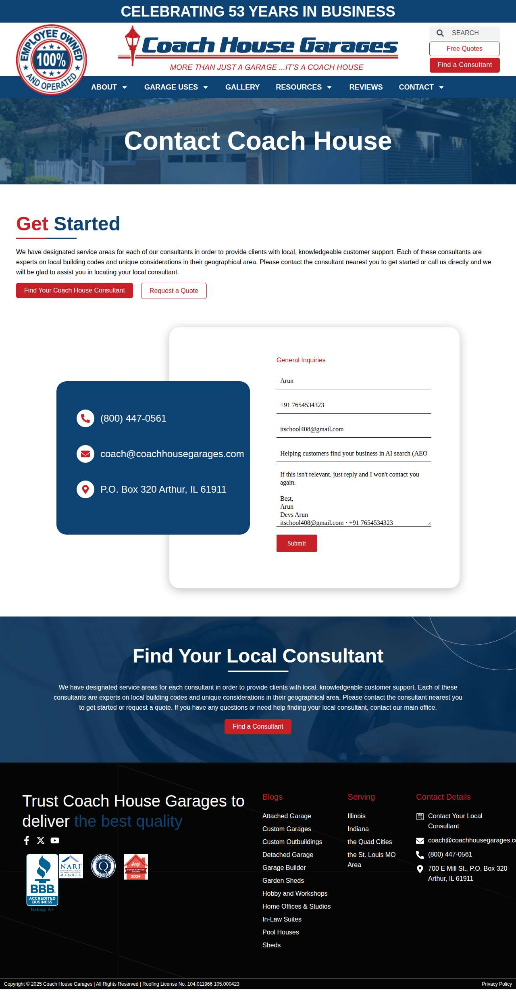

**After submit** — `run-e6900625_attempt-2c2a9405_post_attempt_2026-11-03T02-34-39-309Z.jpg`

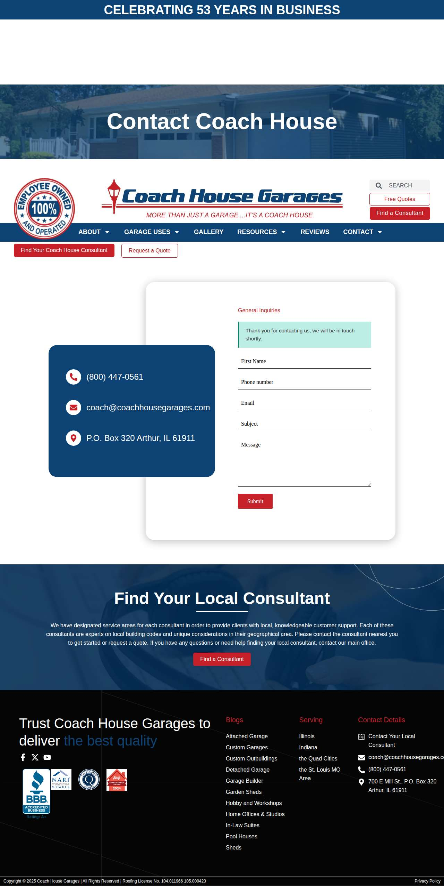

### legacyporch.com — unclear (LIVE)

| | |
|---|---|
| Attempt ID | `db93a6e0-a583-4972-92df-67a0b6d86a8e` |
| Form URL | https://www.legacyporch.com/form\_\_map |
| Final URL | https://www.legacyporch.com/form\_\_map |
| Reserved | 2026-11-03 02:34:46 UTC |
| Submit attempted | 2026-11-03 02:34:51 UTC |
| Template | standard v2 |
| Confirmation text | none observed |
| Result / error | No new success marker observed |

Exact message:

~~~text
Subject: Helping customers find your business in AI search (AEO + GEO)

Hi there,

I'm Arun from Devs Arun. More and more customers now ask ChatGPT, Gemini, Perplexity or Google's AI Overviews questions like "who should I hire for this in my area?" before they call anyone. These tools answer from websites they can clearly understand, and they tend to recommend businesses whose pages answer real customer questions.

That is what AEO + GEO (Answer Engine and Generative Engine Optimization) is for. I improve your existing service pages so they clearly answer the questions your customers ask, add structured data that matches the page, and make the call, quote or enquiry step obvious. The benefit: your business gets a better chance of being mentioned or linked in AI answers, and visitors who arrive find it easy to contact you.

The AEO + GEO Starter is a one-time $199 (about ₹16,999, negotiable) for one website: a basic audit, 10 customer questions, improvements to two existing pages, relevant structured data and an action plan, with one revision round.

You can read the full details, send an enquiry or book online here:
https://devsarun.io/aeo-geo/

If this isn't relevant, just reply and I won't contact you again.

Best,
Arun
Devs Arun
itschool408@gmail.com · +91 7654534323
~~~

Submitted field values:

- name \[name\]: Arun
- email \[email\]: itschool408@gmail.com
- phone \[phone\]: +91 7654534323
- Message \[message\]: Hi there, I'm Arun from Devs Arun. More and more customers now ask ChatGPT, Gemini, Perplexity or Google's AI Overviews 
- subject \[subject\]: Helping customers find your business in AI search (AEO + GEO)

**Filled form (before submit)** — `run-e6900625_attempt-db93a6e0_filled_2026-11-03T02-34-51-220Z.jpg`

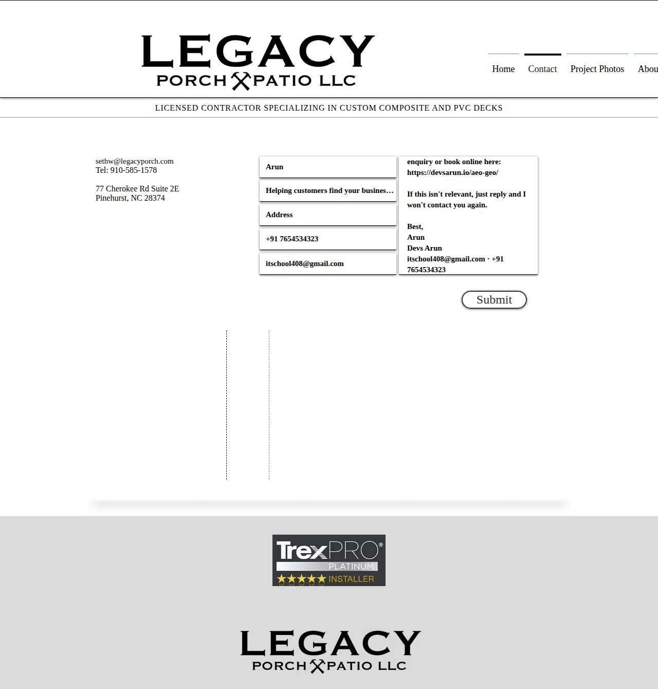

**After submit** — `run-e6900625_attempt-db93a6e0_post_attempt_2026-11-03T02-35-18-753Z.jpg`

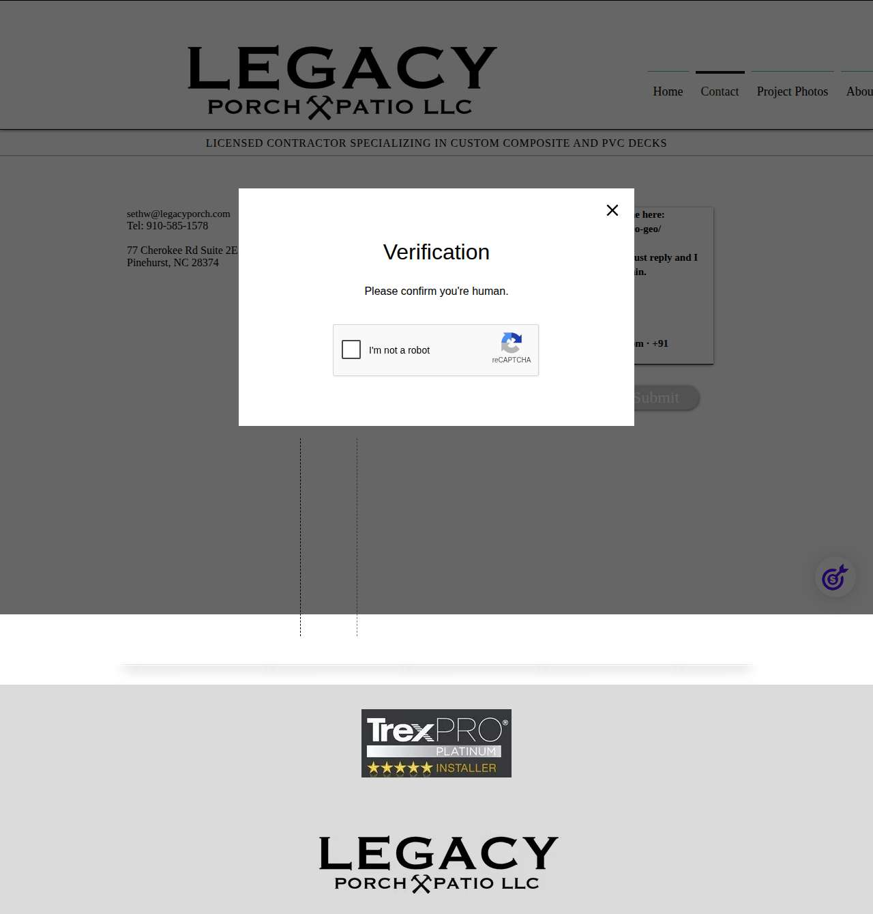

### visser.com — unclear (LIVE)

| | |
|---|---|
| Attempt ID | `c071b345-26d8-4578-87a1-3e0a6d37d91a` |
| Form URL | https://www.visser.com/contact |
| Final URL | https://www.visser.com/contact |
| Reserved | 2026-11-03 02:35:26 UTC |
| Submit attempted | 2026-11-03 02:35:28 UTC |
| Template | standard v2 |
| Confirmation text | none observed |
| Result / error | No new success marker observed |

Exact message:

~~~text
Subject: Helping customers find your business in AI search (AEO + GEO)

Hi there,

I'm Arun from Devs Arun. More and more customers now ask ChatGPT, Gemini, Perplexity or Google's AI Overviews questions like "who should I hire for this in my area?" before they call anyone. These tools answer from websites they can clearly understand, and they tend to recommend businesses whose pages answer real customer questions.

That is what AEO + GEO (Answer Engine and Generative Engine Optimization) is for. I improve your existing service pages so they clearly answer the questions your customers ask, add structured data that matches the page, and make the call, quote or enquiry step obvious. The benefit: your business gets a better chance of being mentioned or linked in AI answers, and visitors who arrive find it easy to contact you.

The AEO + GEO Starter is a one-time $199 (about ₹16,999, negotiable) for one website: a basic audit, 10 customer questions, improvements to two existing pages, relevant structured data and an action plan, with one revision round.

You can read the full details, send an enquiry or book online here:
https://devsarun.io/aeo-geo/

If this isn't relevant, just reply and I won't contact you again.

Best,
Arun
Devs Arun
itschool408@gmail.com · +91 7654534323
~~~

Submitted field values:

- Email \[email\]: itschool408@gmail.com
- Message \[message\]: Hi there, I'm Arun from Devs Arun. More and more customers now ask ChatGPT, Gemini, Perplexity or Google's AI Overviews 
- First Name \[first\_name\]: Arun

**Filled form (before submit)** — `run-e6900625_attempt-c071b345_filled_2026-11-03T02-35-28-476Z.jpg`

**After submit** — `run-e6900625_attempt-c071b345_post_attempt_2026-11-03T02-35-55-991Z.jpg`

### lehtolabuildersinc.com — unclear (LIVE)

| | |
|---|---|
| Attempt ID | `2c14f071-1782-43f9-93f6-4b2fab18f282` |
| Form URL | https://www.lehtolabuildersinc.com/contact-us |
| Final URL | https://www.lehtolabuildersinc.com/contact-us |
| Reserved | 2026-11-03 02:36:03 UTC |
| Submit attempted | 2026-11-03 02:36:05 UTC |
| Template | standard v2 |
| Confirmation text | none observed |
| Result / error | No new success marker observed |

Exact message:

~~~text
Subject: Helping customers find your business in AI search (AEO + GEO)

Hi there,

I'm Arun from Devs Arun. More and more customers now ask ChatGPT, Gemini, Perplexity or Google's AI Overviews questions like "who should I hire for this in my area?" before they call anyone. These tools answer from websites they can clearly understand, and they tend to recommend businesses whose pages answer real customer questions.

That is what AEO + GEO (Answer Engine and Generative Engine Optimization) is for. I improve your existing service pages so they clearly answer the questions your customers ask, add structured data that matches the page, and make the call, quote or enquiry step obvious. The benefit: your business gets a better chance of being mentioned or linked in AI answers, and visitors who arrive find it easy to contact you.

The AEO + GEO Starter is a one-time $199 (about ₹16,999, negotiable) for one website: a basic audit, 10 customer questions, improvements to two existing pages, relevant structured data and an action plan, with one revision round.

You can read the full details, send an enquiry or book online here:
https://devsarun.io/aeo-geo/

If this isn't relevant, just reply and I won't contact you again.

Best,
Arun
Devs Arun
itschool408@gmail.com · +91 7654534323
~~~

Submitted field values:

- name \[name\]: Arun
- email \[email\]: itschool408@gmail.com
- MESSAGE \[message\]: Hi there, I'm Arun from Devs Arun. More and more customers now ask ChatGPT, Gemini, Perplexity or Google's AI Overviews 
- subject \[subject\]: Helping customers find your business in AI search (AEO + GEO)

**Filled form (before submit)** — `run-e6900625_attempt-2c14f071_filled_2026-11-03T02-36-05-281Z.jpg`

**After submit** — `run-e6900625_attempt-2c14f071_post_attempt_2026-11-03T02-36-32-913Z.jpg`

### vetindustrial.com — failed\_before\_submit (LIVE)

| | |
|---|---|
| Attempt ID | `2a2831cf-c3ae-46f2-840c-ed4754800bf6` |
| Form URL | https://www.vetindustrial.com/contact/ |
| Final URL | https://www.vetindustrial.com/contact/ |
| Reserved | 2026-11-03 02:36:40 UTC |
| Submit attempted | — |
| Template | standard v2 |
| Confirmation text | none observed |
| Result / error | Field "Phone" did not accept the value |

Exact message:

~~~text
Subject: Helping customers find your business in AI search (AEO + GEO)

Hi there,

I'm Arun from Devs Arun. More and more customers now ask ChatGPT, Gemini, Perplexity or Google's AI Overviews questions like "who should I hire for this in my area?" before they call anyone. These tools answer from websites they can clearly understand, and they tend to recommend businesses whose pages answer real customer questions.

That is what AEO + GEO (Answer Engine and Generative Engine Optimization) is for. I improve your existing service pages so they clearly answer the questions your customers ask, add structured data that matches the page, and make the call, quote or enquiry step obvious. The benefit: your business gets a better chance of being mentioned or linked in AI answers, and visitors who arrive find it easy to contact you.

The AEO + GEO Starter is a one-time $199 (about ₹16,999, negotiable) for one website: a basic audit, 10 customer questions, improvements to two existing pages, relevant structured data and an action plan, with one revision round.

You can read the full details, send an enquiry or book online here:
https://devsarun.io/aeo-geo/

If this isn't relevant, just reply and I won't contact you again.

Best,
Arun
Devs Arun
itschool408@gmail.com · +91 7654534323
~~~

Submitted field values:

- \#input\_1\_2: itschool408@gmail.com
- \#input\_1\_3: +91 7654534323
- \#input\_1\_4: Hi there, I'm Arun from Devs Arun. More and more customers now ask ChatGPT, Gemini, Perplexity or Google's AI Overviews 
- \#input\_1\_1\_3: Arun

**Filled form (before submit)** — `run-e6900625_attempt-2a2831cf_filled_2026-11-03T02-36-41-697Z.jpg`

## Events (250)

| Time (UTC) | Event | Website | Details |
|---|---|---|---|
| 02:24:08 | run\_queued | — | live run requested by github:itsDevsArun |
| 02:24:08 | run\_dispatched | — | dispatch disabled (local test mode) |
| 02:24:11 | run\_started | — | Runner claimed live run |
| 02:24:12 | offer\_verified | — | Service page offer facts verified |
| 02:24:12 | website\_selected | clearchoiceplumbingllc.com | Live target clearchoiceplumbingllc.com |
| 02:24:12 | attempt\_reserved | clearchoiceplumbingllc.com | Submission attempt reserved with template standard v2 |
| 02:24:14 | page\_opened | clearchoiceplumbingllc.com | Opened form page |
| 02:24:14 | screenshot\_saved | clearchoiceplumbingllc.com | inspection screenshot saved (145 KB) |
| 02:24:14 | review\_required | clearchoiceplumbingllc.com | failed before submit: locator.fill: Error: Cannot type text into input\[type=number\] |
| 02:24:19 | website\_selected | bwnwincpainting.com | Live target bwnwincpainting.com |
| 02:24:19 | attempt\_reserved | bwnwincpainting.com | Submission attempt reserved with template standard v2 |
| 02:24:20 | page\_opened | bwnwincpainting.com | Opened form page |
| 02:24:21 | screenshot\_saved | bwnwincpainting.com | inspection screenshot saved (118 KB) |
| 02:24:21 | review\_required | bwnwincpainting.com | failed before submit: locator.fill: Error: Cannot type text into input\[type=number\] |
| 02:24:26 | website\_selected | dupaulconstruction.com | Live target dupaulconstruction.com |
| 02:24:26 | attempt\_reserved | dupaulconstruction.com | Submission attempt reserved with template standard v2 |
| 02:24:28 | page\_opened | dupaulconstruction.com | Opened form page |
| 02:24:28 | fields\_filled | dupaulconstruction.com | filled |
| 02:24:28 | screenshot\_saved | dupaulconstruction.com | filled screenshot saved (118 KB) |
| 02:24:28 | submit\_attempted | dupaulconstruction.com | submitting |
| 02:24:32 | screenshot\_saved | dupaulconstruction.com | post\_attempt screenshot saved (127 KB) |
| 02:24:32 | error | dupaulconstruction.com | error after submit — "osed Phone (304) 258-9800 Contact Us First Name\* Last Name\* This field is required Email\* Phone\* Message\* All fields mar" |
| 02:24:39 | website\_selected | rosewoodcommunities.com | Live target rosewoodcommunities.com |
| 02:24:39 | attempt\_reserved | rosewoodcommunities.com | Submission attempt reserved with template standard v2 |
| 02:24:41 | page\_opened | rosewoodcommunities.com | Opened form page |
| 02:24:41 | fields\_filled | rosewoodcommunities.com | filled |
| 02:24:42 | screenshot\_saved | rosewoodcommunities.com | filled screenshot saved (173 KB) |
| 02:24:42 | submit\_attempted | rosewoodcommunities.com | submitting |
| 02:25:09 | screenshot\_saved | rosewoodcommunities.com | post\_attempt screenshot saved (177 KB) |
| 02:25:09 | review\_required | rosewoodcommunities.com | unclear: No new success marker observed |
| 02:25:16 | website\_selected | castconconstruction.com | Live target castconconstruction.com |
| 02:25:16 | attempt\_reserved | castconconstruction.com | Submission attempt reserved with template standard v2 |
| 02:25:19 | page\_opened | castconconstruction.com | Opened form page |
| 02:25:20 | fields\_filled | castconconstruction.com | filled |
| 02:25:20 | screenshot\_saved | castconconstruction.com | filled screenshot saved (358 KB) |
| 02:25:20 | submit\_attempted | castconconstruction.com | submitting |
| 02:25:48 | screenshot\_saved | castconconstruction.com | post\_attempt screenshot saved (433 KB) |
| 02:25:48 | review\_required | castconconstruction.com | unclear: No new success marker observed |
| 02:25:55 | website\_selected | wdbp.com | Live target wdbp.com |
| 02:25:55 | attempt\_reserved | wdbp.com | Submission attempt reserved with template standard v2 |
| 02:25:57 | page\_opened | wdbp.com | Opened form page |
| 02:25:57 | fields\_filled | wdbp.com | filled |
| 02:25:57 | screenshot\_saved | wdbp.com | filled screenshot saved (226 KB) |
| 02:25:57 | submit\_attempted | wdbp.com | submitting |
| 02:26:25 | screenshot\_saved | wdbp.com | post\_attempt screenshot saved (7 KB) |
| 02:26:25 | review\_required | wdbp.com | unclear: No new success marker observed |
| 02:26:32 | website\_selected | westcousa.com | Live target westcousa.com |
| 02:26:32 | attempt\_reserved | westcousa.com | Submission attempt reserved with template standard v2 |
| 02:26:34 | page\_opened | westcousa.com | Opened form page |
| 02:26:34 | fields\_filled | westcousa.com | filled |
| 02:26:34 | screenshot\_saved | westcousa.com | filled screenshot saved (99 KB) |
| 02:26:34 | submit\_attempted | westcousa.com | submitting |
| 02:26:38 | screenshot\_saved | westcousa.com | post\_attempt screenshot saved (142 KB) |
| 02:26:38 | confirmation\_observed | westcousa.com | confirmed — "0 E. 14th Street, Suite 301, Tulsa, OK 74104 (918) 627-3326 Form submitted successfully. A confirmation email was sent t" |
| 02:26:45 | website\_selected | finishingtouch.us | Live target finishingtouch.us |
| 02:26:45 | attempt\_reserved | finishingtouch.us | Submission attempt reserved with template standard v2 |
| 02:26:47 | page\_opened | finishingtouch.us | Opened form page |
| 02:26:47 | fields\_filled | finishingtouch.us | filled |
| 02:26:47 | screenshot\_saved | finishingtouch.us | filled screenshot saved (186 KB) |
| 02:26:47 | submit\_attempted | finishingtouch.us | submitting |
| 02:26:50 | screenshot\_saved | finishingtouch.us | post\_attempt screenshot saved (197 KB) |
| 02:26:50 | error | finishingtouch.us | error after submit — "Finishing Touch Construction Request A Free Estimate Today\! This field is required TO LEARN MORE ABOUT OUR FINISHING INT" |
| 02:26:57 | website\_selected | bigwoodtimberframes.com | Live target bigwoodtimberframes.com |
| 02:26:57 | attempt\_reserved | bigwoodtimberframes.com | Submission attempt reserved with template standard v2 |
| 02:27:00 | page\_opened | bigwoodtimberframes.com | Opened form page |
| 02:27:00 | fields\_filled | bigwoodtimberframes.com | filled |
| 02:27:00 | screenshot\_saved | bigwoodtimberframes.com | filled screenshot saved (87 KB) |
| 02:27:00 | submit\_attempted | bigwoodtimberframes.com | submitting |
| 02:27:04 | screenshot\_saved | bigwoodtimberframes.com | post\_attempt screenshot saved (73 KB) |
| 02:27:04 | confirmation\_observed | bigwoodtimberframes.com | confirmed — "& Inquiries Home/Questions & Inquiries Get In Touch With Us Thanks for contacting us\! We will get in touch with you shor" |
| 02:27:11 | website\_selected | absoluterestorepa.com | Live target absoluterestorepa.com |
| 02:27:11 | attempt\_reserved | absoluterestorepa.com | Submission attempt reserved with template standard v2 |
| 02:27:14 | page\_opened | absoluterestorepa.com | Opened form page |
| 02:27:14 | screenshot\_saved | absoluterestorepa.com | inspection screenshot saved (175 KB) |
| 02:27:14 | review\_required | absoluterestorepa.com | failed before submit: locator.fill: Error: Cannot type text into input\[type=number\] |
| 02:27:19 | website\_selected | toddbuildersinc.com | Live target toddbuildersinc.com |
| 02:27:19 | attempt\_reserved | toddbuildersinc.com | Submission attempt reserved with template standard v2 |
| 02:27:22 | page\_opened | toddbuildersinc.com | Opened form page |
| 02:27:22 | fields\_filled | toddbuildersinc.com | filled |
| 02:27:22 | screenshot\_saved | toddbuildersinc.com | filled screenshot saved (132 KB) |
| 02:27:22 | submit\_attempted | toddbuildersinc.com | submitting |
| 02:27:49 | screenshot\_saved | toddbuildersinc.com | post\_attempt screenshot saved (72 KB) |
| 02:27:49 | review\_required | toddbuildersinc.com | unclear: No new success marker observed |
| 02:27:57 | website\_selected | phoenixremodelingnw.com | Live target phoenixremodelingnw.com |
| 02:27:57 | attempt\_reserved | phoenixremodelingnw.com | Submission attempt reserved with template standard v2 |
| 02:27:58 | page\_opened | phoenixremodelingnw.com | Opened form page |
| 02:27:58 | screenshot\_saved | phoenixremodelingnw.com | filled screenshot saved (84 KB) |
| 02:27:58 | review\_required | phoenixremodelingnw.com | failed before submit: Form validation would block sending: et\_pb\_contact\_phone\_0: Please match the requested format. |
| 02:28:03 | website\_selected | homepreservation.com | Live target homepreservation.com |
| 02:28:03 | attempt\_reserved | homepreservation.com | Submission attempt reserved with template standard v2 |
| 02:28:07 | page\_opened | homepreservation.com | Opened form page |
| 02:28:07 | screenshot\_saved | homepreservation.com | filled screenshot saved (172 KB) |
| 02:28:07 | review\_required | homepreservation.com | failed before submit: Form validation would block sending: phone: Please enter between 4 to 17 digits. You can include hyphens (-) or start with a (+), e.g., 555-123-4567 or +(222)987654321.; : Please check this box if you want to proceed.; : Please check this box if you want to proceed. |
| 02:28:12 | website\_selected | deckbuildersinc.com | Live target deckbuildersinc.com |
| 02:28:12 | attempt\_reserved | deckbuildersinc.com | Submission attempt reserved with template standard v2 |
| 02:28:14 | page\_opened | deckbuildersinc.com | Opened form page |
| 02:28:14 | fields\_filled | deckbuildersinc.com | filled |
| 02:28:14 | screenshot\_saved | deckbuildersinc.com | filled screenshot saved (185 KB) |
| 02:28:14 | submit\_attempted | deckbuildersinc.com | submitting |
| 02:28:43 | screenshot\_saved | deckbuildersinc.com | post\_attempt screenshot saved (195 KB) |
| 02:28:43 | review\_required | deckbuildersinc.com | unclear: No new success marker observed |
| 02:28:50 | website\_selected | mchenryhomeremodeling.com | Live target mchenryhomeremodeling.com |
| 02:28:50 | attempt\_reserved | mchenryhomeremodeling.com | Submission attempt reserved with template standard v2 |
| 02:28:54 | page\_opened | mchenryhomeremodeling.com | Opened form page |
| 02:28:54 | fields\_filled | mchenryhomeremodeling.com | filled |
| 02:28:54 | screenshot\_saved | mchenryhomeremodeling.com | filled screenshot saved (109 KB) |
| 02:28:54 | submit\_attempted | mchenryhomeremodeling.com | submitting |
| 02:29:05 | screenshot\_saved | mchenryhomeremodeling.com | post\_attempt screenshot saved (103 KB) |
| 02:29:05 | confirmation\_observed | mchenryhomeremodeling.com | confirmed — "Tok Repeat Customer Yelp Other WHERE DID YOU HEAR ABOUT US? THANK YOU VISIT 606 QUEEN AVE SW ALBANY, OR 97322 CALL 541-9" |
| 02:29:12 | website\_selected | danieleccleshomes.com | Live target danieleccleshomes.com |
| 02:29:12 | attempt\_reserved | danieleccleshomes.com | Submission attempt reserved with template standard v2 |
| 02:29:14 | page\_opened | danieleccleshomes.com | Opened form page |
| 02:29:14 | fields\_filled | danieleccleshomes.com | filled |
| 02:29:15 | screenshot\_saved | danieleccleshomes.com | filled screenshot saved (86 KB) |
| 02:29:15 | submit\_attempted | danieleccleshomes.com | submitting |
| 02:29:42 | screenshot\_saved | danieleccleshomes.com | post\_attempt screenshot saved (89 KB) |
| 02:29:42 | review\_required | danieleccleshomes.com | unclear: No new success marker observed |
| 02:29:49 | website\_selected | unityconstructioninccompany.com | Live target unityconstructioninccompany.com |
| 02:29:49 | attempt\_reserved | unityconstructioninccompany.com | Submission attempt reserved with template standard v2 |
| 02:29:52 | page\_opened | unityconstructioninccompany.com | Opened form page |
| 02:29:52 | fields\_filled | unityconstructioninccompany.com | filled |
| 02:29:52 | screenshot\_saved | unityconstructioninccompany.com | filled screenshot saved (155 KB) |
| 02:29:52 | submit\_attempted | unityconstructioninccompany.com | submitting |
| 02:30:04 | screenshot\_saved | unityconstructioninccompany.com | post\_attempt screenshot saved (159 KB) |
| 02:30:04 | error | unityconstructioninccompany.com | error after submit: Submit click error (outcome unknown, not retried): locator.click: Timeout 10000ms exceeded. |
| 02:30:12 | website\_selected | contmech.com | Live target contmech.com |
| 02:30:12 | attempt\_reserved | contmech.com | Submission attempt reserved with template standard v2 |
| 02:30:16 | page\_opened | contmech.com | Opened form page |
| 02:30:16 | fields\_filled | contmech.com | filled |
| 02:30:16 | screenshot\_saved | contmech.com | filled screenshot saved (101 KB) |
| 02:30:16 | submit\_attempted | contmech.com | submitting |
| 02:30:36 | screenshot\_saved | contmech.com | post\_attempt screenshot saved (86 KB) |
| 02:30:36 | confirmation\_observed | contmech.com | confirmed — "iries: info@contmech.com Where we are located Keep in Touch Thanks for contacting us\! We will get in touch with you shor" |
| 02:30:44 | website\_selected | signaturehomes.ws | Live target signaturehomes.ws |
| 02:30:44 | attempt\_reserved | signaturehomes.ws | Submission attempt reserved with template standard v2 |
| 02:30:47 | page\_opened | signaturehomes.ws | Opened form page |
| 02:30:47 | fields\_filled | signaturehomes.ws | filled |
| 02:30:47 | screenshot\_saved | signaturehomes.ws | filled screenshot saved (99 KB) |
| 02:30:47 | submit\_attempted | signaturehomes.ws | submitting |
| 02:31:14 | screenshot\_saved | signaturehomes.ws | post\_attempt screenshot saved (82 KB) |
| 02:31:14 | review\_required | signaturehomes.ws | unclear: No new success marker observed |
| 02:31:22 | website\_selected | troutmancustomhomes.com | Live target troutmancustomhomes.com |
| 02:31:22 | attempt\_reserved | troutmancustomhomes.com | Submission attempt reserved with template standard v2 |
| 02:31:24 | page\_opened | troutmancustomhomes.com | Opened form page |
| 02:31:24 | fields\_filled | troutmancustomhomes.com | filled |
| 02:31:24 | screenshot\_saved | troutmancustomhomes.com | filled screenshot saved (84 KB) |
| 02:31:24 | submit\_attempted | troutmancustomhomes.com | submitting |
| 02:31:51 | screenshot\_saved | troutmancustomhomes.com | post\_attempt screenshot saved (71 KB) |
| 02:31:52 | review\_required | troutmancustomhomes.com | unclear: No new success marker observed |
| 02:31:59 | website\_selected | mcmeekinconstruction.com | Live target mcmeekinconstruction.com |
| 02:31:59 | attempt\_reserved | mcmeekinconstruction.com | Submission attempt reserved with template standard v2 |
| 02:32:01 | page\_opened | mcmeekinconstruction.com | Opened form page |
| 02:32:01 | fields\_filled | mcmeekinconstruction.com | filled |
| 02:32:01 | screenshot\_saved | mcmeekinconstruction.com | filled screenshot saved (130 KB) |
| 02:32:01 | submit\_attempted | mcmeekinconstruction.com | submitting |
| 02:32:29 | screenshot\_saved | mcmeekinconstruction.com | post\_attempt screenshot saved (109 KB) |
| 02:32:29 | review\_required | mcmeekinconstruction.com | unclear: No new success marker observed |
| 02:32:36 | website\_selected | coderestoration.com | Live target coderestoration.com |
| 02:32:36 | attempt\_reserved | coderestoration.com | Submission attempt reserved with template standard v2 |
| 02:32:38 | page\_opened | coderestoration.com | Opened form page |
| 02:32:38 | fields\_filled | coderestoration.com | filled |
| 02:32:38 | screenshot\_saved | coderestoration.com | filled screenshot saved (285 KB) |
| 02:32:38 | submit\_attempted | coderestoration.com | submitting |
| 02:32:42 | screenshot\_saved | coderestoration.com | post\_attempt screenshot saved (266 KB) |
| 02:32:42 | confirmation\_observed | coderestoration.com | confirmed — "n provided.  Address 1090 Bluff City Hwy Bristol, TN 37620 Thanks for contacting us Our Services At Code Restoration, w" |
| 02:32:49 | website\_selected | buntinconstruction.com | Live target buntinconstruction.com |
| 02:32:49 | attempt\_reserved | buntinconstruction.com | Submission attempt reserved with template standard v2 |
| 02:32:50 | page\_opened | buntinconstruction.com | Opened form page |
| 02:32:51 | fields\_filled | buntinconstruction.com | filled |
| 02:32:51 | screenshot\_saved | buntinconstruction.com | filled screenshot saved (195 KB) |
| 02:32:51 | submit\_attempted | buntinconstruction.com | submitting |
| 02:32:56 | screenshot\_saved | buntinconstruction.com | post\_attempt screenshot saved (186 KB) |
| 02:32:56 | confirmation\_observed | buntinconstruction.com | confirmed — "LOCATION 572 Parsons Drive, Suite 100 Medford Oregon, 97501 Thank you for your message. It has been sent. Your Name (req" |
| 02:33:04 | website\_selected | levansdesigngroup.com | Live target levansdesigngroup.com |
| 02:33:04 | attempt\_reserved | levansdesigngroup.com | Submission attempt reserved with template standard v2 |
| 02:33:06 | page\_opened | levansdesigngroup.com | Opened form page |
| 02:33:06 | screenshot\_saved | levansdesigngroup.com | filled screenshot saved (121 KB) |
| 02:33:06 | review\_required | levansdesigngroup.com | failed before submit: Field "Phone" did not accept the value |
| 02:33:12 | website\_selected | danddreno.com | Live target danddreno.com |
| 02:33:12 | attempt\_reserved | danddreno.com | Submission attempt reserved with template standard v2 |
| 02:33:13 | page\_opened | danddreno.com | Opened form page |
| 02:33:14 | screenshot\_saved | danddreno.com | filled screenshot saved (165 KB) |
| 02:33:14 | review\_required | danddreno.com | failed before submit: Field "Subject" did not accept the value |
| 02:33:19 | website\_selected | easttexasconcreters.com | Live target easttexasconcreters.com |
| 02:33:19 | attempt\_reserved | easttexasconcreters.com | Submission attempt reserved with template standard v2 |
| 02:33:20 | page\_opened | easttexasconcreters.com | Opened form page |
| 02:33:21 | fields\_filled | easttexasconcreters.com | filled |
| 02:33:21 | screenshot\_saved | easttexasconcreters.com | filled screenshot saved (239 KB) |
| 02:33:21 | submit\_attempted | easttexasconcreters.com | submitting |
| 02:33:24 | screenshot\_saved | easttexasconcreters.com | post\_attempt screenshot saved (215 KB) |
| 02:33:24 | confirmation\_observed | easttexasconcreters.com | confirmed — ", Tyler, TX 75701 On-site visits included Company Website ✓ Thank you, Arun, your request is in\! We've received your fre" |
| 02:33:32 | website\_selected | updpavers.com | Live target updpavers.com |
| 02:33:32 | attempt\_reserved | updpavers.com | Submission attempt reserved with template standard v2 |
| 02:33:34 | page\_opened | updpavers.com | Opened form page |
| 02:33:34 | screenshot\_saved | updpavers.com | filled screenshot saved (236 KB) |
| 02:33:34 | review\_required | updpavers.com | failed before submit: Field "Phone\* required" did not accept the value |
| 02:33:39 | website\_selected | danddseamlessgutters.com | Live target danddseamlessgutters.com |
| 02:33:39 | attempt\_reserved | danddseamlessgutters.com | Submission attempt reserved with template standard v2 |
| 02:33:41 | page\_opened | danddseamlessgutters.com | Opened form page |
| 02:33:41 | fields\_filled | danddseamlessgutters.com | filled |
| 02:33:41 | screenshot\_saved | danddseamlessgutters.com | filled screenshot saved (243 KB) |
| 02:33:41 | submit\_attempted | danddseamlessgutters.com | submitting |
| 02:34:09 | screenshot\_saved | danddseamlessgutters.com | post\_attempt screenshot saved (240 KB) |
| 02:34:09 | review\_required | danddseamlessgutters.com | unclear: No new success marker observed |
| 02:34:16 | website\_selected | centrexconstruction.net | Live target centrexconstruction.net |
| 02:34:16 | attempt\_reserved | centrexconstruction.net | Submission attempt reserved with template standard v2 |
| 02:34:17 | page\_opened | centrexconstruction.net | Opened form page |
| 02:34:17 | fields\_filled | centrexconstruction.net | filled |
| 02:34:18 | screenshot\_saved | centrexconstruction.net | filled screenshot saved (81 KB) |
| 02:34:18 | submit\_attempted | centrexconstruction.net | submitting |
| 02:34:21 | screenshot\_saved | centrexconstruction.net | post\_attempt screenshot saved (67 KB) |
| 02:34:21 | confirmation\_observed | centrexconstruction.net | confirmed — "ble budgets, faster timelines, and a partner you can trust. Thanks — we'll be in touch. Your message has been received. " |
| 02:34:28 | website\_selected | coachhousegarages.com | Live target coachhousegarages.com |
| 02:34:28 | attempt\_reserved | coachhousegarages.com | Submission attempt reserved with template standard v2 |
| 02:34:32 | page\_opened | coachhousegarages.com | Opened form page |
| 02:34:32 | fields\_filled | coachhousegarages.com | filled |
| 02:34:32 | screenshot\_saved | coachhousegarages.com | filled screenshot saved (219 KB) |
| 02:34:32 | submit\_attempted | coachhousegarages.com | submitting |
| 02:34:39 | screenshot\_saved | coachhousegarages.com | post\_attempt screenshot saved (198 KB) |
| 02:34:39 | confirmation\_observed | coachhousegarages.com | confirmed — "garages.com P.O. Box 320 Arthur, IL 61911 General Inquiries Thank you for contacting us, we will be in touch shortly. Su" |
| 02:34:46 | website\_selected | legacyporch.com | Live target legacyporch.com |
| 02:34:46 | attempt\_reserved | legacyporch.com | Submission attempt reserved with template standard v2 |
| 02:34:51 | page\_opened | legacyporch.com | Opened form page |
| 02:34:51 | fields\_filled | legacyporch.com | filled |
| 02:34:51 | screenshot\_saved | legacyporch.com | filled screenshot saved (69 KB) |
| 02:34:51 | submit\_attempted | legacyporch.com | submitting |
| 02:35:18 | screenshot\_saved | legacyporch.com | post\_attempt screenshot saved (53 KB) |
| 02:35:18 | review\_required | legacyporch.com | unclear: No new success marker observed |
| 02:35:26 | website\_selected | visser.com | Live target visser.com |
| 02:35:26 | attempt\_reserved | visser.com | Submission attempt reserved with template standard v2 |
| 02:35:28 | page\_opened | visser.com | Opened form page |
| 02:35:28 | fields\_filled | visser.com | filled |
| 02:35:28 | screenshot\_saved | visser.com | filled screenshot saved (55 KB) |
| 02:35:28 | submit\_attempted | visser.com | submitting |
| 02:35:55 | screenshot\_saved | visser.com | post\_attempt screenshot saved (51 KB) |
| 02:35:55 | review\_required | visser.com | unclear: No new success marker observed |
| 02:36:03 | website\_selected | lehtolabuildersinc.com | Live target lehtolabuildersinc.com |
| 02:36:03 | attempt\_reserved | lehtolabuildersinc.com | Submission attempt reserved with template standard v2 |
| 02:36:05 | page\_opened | lehtolabuildersinc.com | Opened form page |
| 02:36:05 | fields\_filled | lehtolabuildersinc.com | filled |
| 02:36:05 | screenshot\_saved | lehtolabuildersinc.com | filled screenshot saved (144 KB) |
| 02:36:05 | submit\_attempted | lehtolabuildersinc.com | submitting |
| 02:36:32 | screenshot\_saved | lehtolabuildersinc.com | post\_attempt screenshot saved (75 KB) |
| 02:36:32 | review\_required | lehtolabuildersinc.com | unclear: No new success marker observed |
| 02:36:40 | website\_selected | vetindustrial.com | Live target vetindustrial.com |
| 02:36:40 | attempt\_reserved | vetindustrial.com | Submission attempt reserved with template standard v2 |
| 02:36:41 | page\_opened | vetindustrial.com | Opened form page |
| 02:36:41 | screenshot\_saved | vetindustrial.com | filled screenshot saved (86 KB) |
| 02:36:41 | review\_required | vetindustrial.com | failed before submit: Field "Phone" did not accept the value |
| 02:36:46 | run\_completed | — | Run completed (queue\_exhausted) |
