# Run eadb96b1 — live — completed

| | |
|---|---|
| Run ID | `eadb96b1-6339-43f7-868a-7f4997e7d568` |
| Requested by | github:itsDevsArun |
| Started | 2026-11-03 03:08:28 UTC |
| Finished | 2026-11-03 03:13:26 UTC |
| Finish reason | queue\_exhausted |
| GitHub Actions | https://github.com/itsDevsArun/aeo-geo/actions/runs/41562188869 |

CSV for this run: [runs/2026-11-03_live_eadb96b1.csv](2026-11-03_live_eadb96b1.csv)

## Attempts (15)

### clearchoiceplumbingllc.com — failed\_before\_submit (LIVE)

| | |
|---|---|
| Attempt ID | `64703785-75d1-467a-a95e-01d5a9e54081` |
| Form URL | https://clearchoiceplumbingllc.com/contact/ |
| Final URL | — |
| Reserved | 2026-11-03 03:08:29 UTC |
| Submit attempted | — |
| Template | standard v2 |
| Confirmation text | none observed |
| Result / error | locator.fill: Error: Cannot type text into input\[type=number\] |

Exact message:

~~~text
Subject: Helping customers find your business in AI search (AEO + GEO)

Hi there,

I'm Arun from Devs Arun. More and more customers now ask ChatGPT, Gemini, Perplexity or Google's AI Overviews questions like "who should I hire for this in my area?" before they call anyone. These tools answer from websites they can clearly understand, and they tend to recommend businesses whose pages answer real customer questions.

That is what AEO + GEO (Answer Engine and Generative Engine Optimization) is for. I improve your existing service pages so they clearly answer the questions your customers ask, add structured data that matches the page, and make the call, quote or enquiry step obvious. The benefit: your business gets a better chance of being mentioned or linked in AI answers, and visitors who arrive find it easy to contact you.

The AEO + GEO Starter is a one-time $199 (about ₹16,999, negotiable) for one website: a basic audit, 10 customer questions, improvements to two existing pages, relevant structured data and an action plan, with one revision round.

You can read the full details, send an enquiry or book online here:
https://devsarun.io/aeo-geo/

If this isn't relevant, just reply and I won't contact you again.

Best,
Arun
Devs Arun
itschool408@gmail.com · +91 7654534323
~~~

Submitted field values:

- \#wpforms-51-field\_1: Arun
- \#wpforms-51-field\_2: itschool408@gmail.com
- \#wpforms-51-field\_3: Hi there, I'm Arun from Devs Arun. More and more customers now ask ChatGPT, Gemini, Perplexity or Google's AI Overviews 
- \#wpforms-51-field\_5: +91 7654534323

**Inspected page** — `run-eadb96b1_attempt-64703785_inspection_2026-11-03T03-08-30-939Z.jpg`

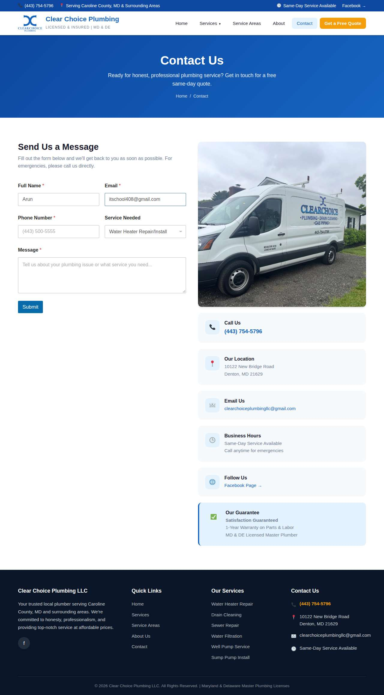

### bwnwincpainting.com — failed\_before\_submit (LIVE)

| | |
|---|---|
| Attempt ID | `752821b0-0ba5-45df-964e-a9e4873cfe7a` |
| Form URL | https://www.bwnwincpainting.com/contact/ |
| Final URL | — |
| Reserved | 2026-11-03 03:08:35 UTC |
| Submit attempted | — |
| Template | standard v2 |
| Confirmation text | none observed |
| Result / error | locator.fill: Error: Cannot type text into input\[type=number\] |

Exact message:

~~~text
Subject: Helping customers find your business in AI search (AEO + GEO)

Hi there,

I'm Arun from Devs Arun. More and more customers now ask ChatGPT, Gemini, Perplexity or Google's AI Overviews questions like "who should I hire for this in my area?" before they call anyone. These tools answer from websites they can clearly understand, and they tend to recommend businesses whose pages answer real customer questions.

That is what AEO + GEO (Answer Engine and Generative Engine Optimization) is for. I improve your existing service pages so they clearly answer the questions your customers ask, add structured data that matches the page, and make the call, quote or enquiry step obvious. The benefit: your business gets a better chance of being mentioned or linked in AI answers, and visitors who arrive find it easy to contact you.

The AEO + GEO Starter is a one-time $199 (about ₹16,999, negotiable) for one website: a basic audit, 10 customer questions, improvements to two existing pages, relevant structured data and an action plan, with one revision round.

You can read the full details, send an enquiry or book online here:
https://devsarun.io/aeo-geo/

If this isn't relevant, just reply and I won't contact you again.

Best,
Arun
Devs Arun
itschool408@gmail.com · +91 7654534323
~~~

Submitted field values:

- \#name-1151: Arun
- \#email-1151: itschool408@gmail.com
- \#phone-1151: +91 7654534323
- \#message-1151: Hi there, I'm Arun from Devs Arun. More and more customers now ask ChatGPT, Gemini, Perplexity or Google's AI Overviews 

**Inspected page** — `run-eadb96b1_attempt-752821b0_inspection_2026-11-03T03-08-37-651Z.jpg`

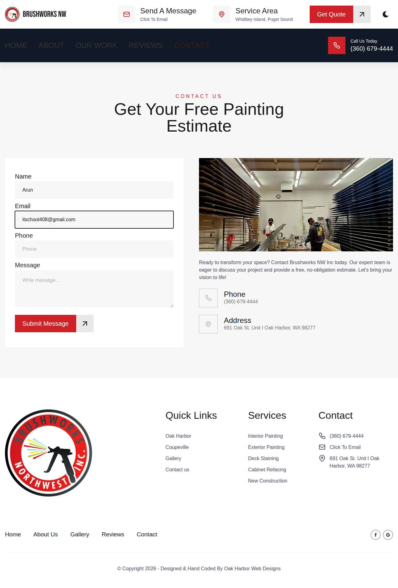

### absoluterestorepa.com — failed\_before\_submit (LIVE)

| | |
|---|---|
| Attempt ID | `fd77f11f-3ebc-4e38-bca4-10d6181aba2a` |
| Form URL | https://absoluterestorepa.com/contact-us/ |
| Final URL | — |
| Reserved | 2026-11-03 03:08:42 UTC |
| Submit attempted | — |
| Template | standard v2 |
| Confirmation text | none observed |
| Result / error | locator.fill: Error: Cannot type text into input\[type=number\] |

Exact message:

~~~text
Subject: Helping customers find your business in AI search (AEO + GEO)

Hi there,

I'm Arun from Devs Arun. More and more customers now ask ChatGPT, Gemini, Perplexity or Google's AI Overviews questions like "who should I hire for this in my area?" before they call anyone. These tools answer from websites they can clearly understand, and they tend to recommend businesses whose pages answer real customer questions.

That is what AEO + GEO (Answer Engine and Generative Engine Optimization) is for. I improve your existing service pages so they clearly answer the questions your customers ask, add structured data that matches the page, and make the call, quote or enquiry step obvious. The benefit: your business gets a better chance of being mentioned or linked in AI answers, and visitors who arrive find it easy to contact you.

The AEO + GEO Starter is a one-time $199 (about ₹16,999, negotiable) for one website: a basic audit, 10 customer questions, improvements to two existing pages, relevant structured data and an action plan, with one revision round.

You can read the full details, send an enquiry or book online here:
https://devsarun.io/aeo-geo/

If this isn't relevant, just reply and I won't contact you again.

Best,
Arun
Devs Arun
itschool408@gmail.com · +91 7654534323
~~~

Submitted field values:

- \#form-field-name: Arun
- \#form-field-message: Hi there, I'm Arun from Devs Arun. More and more customers now ask ChatGPT, Gemini, Perplexity or Google's AI Overviews 
- \#form-field-field\_ed02ec2: +91 7654534323
- \#content \> div \> div \> div:nth-of-type(2) \> div \> div:nth-of-type(1) \> div:nth-of-type(2) \> div \> form \> div \> div:nth-of-type(3) \> input: itschool408@gmail.com

**Inspected page** — `run-eadb96b1_attempt-fd77f11f_inspection_2026-11-03T03-08-45-476Z.jpg`

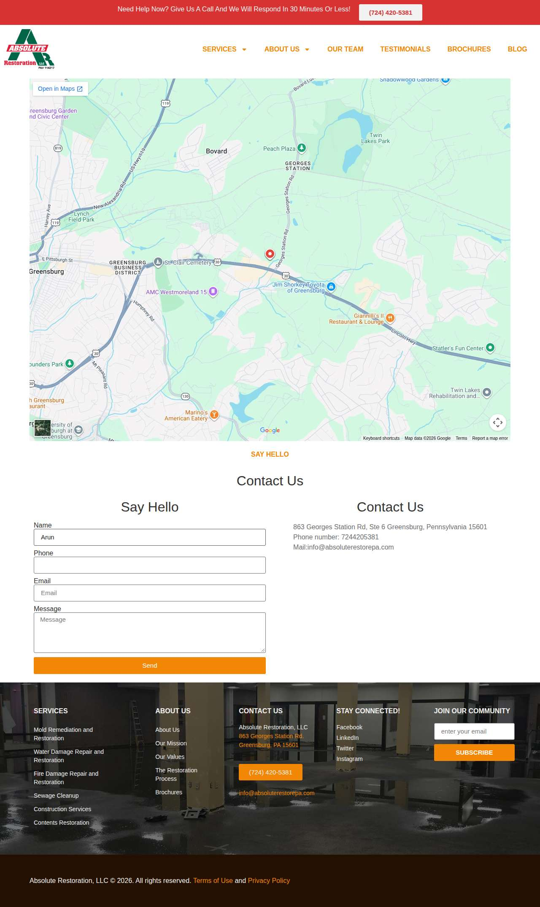

### getmovingmuscle.com — confirmed (LIVE)

| | |
|---|---|
| Attempt ID | `55cc5d07-c40a-4a05-9c26-b422fa534d66` |
| Form URL | https://www.getmovingmuscle.com/contact |
| Final URL | https://www.getmovingmuscle.com/contact |
| Reserved | 2026-11-03 03:08:50 UTC |
| Submit attempted | 2026-11-03 03:08:54 UTC |
| Template | standard v2 |
| Confirmation text | o hear from you. (980) 920-3022 support@getmovingmuscle.com Thank you\! Your message has been received. We will respond as soon as we can. Thank you for your patience. Bo |
| Result / error | — |

Exact message:

~~~text
Subject: Helping customers find your business in AI search (AEO + GEO)

Hi there,

I'm Arun from Devs Arun. More and more customers now ask ChatGPT, Gemini, Perplexity or Google's AI Overviews questions like "who should I hire for this in my area?" before they call anyone. These tools answer from websites they can clearly understand, and they tend to recommend businesses whose pages answer real customer questions.

That is what AEO + GEO (Answer Engine and Generative Engine Optimization) is for. I improve your existing service pages so they clearly answer the questions your customers ask, add structured data that matches the page, and make the call, quote or enquiry step obvious. The benefit: your business gets a better chance of being mentioned or linked in AI answers, and visitors who arrive find it easy to contact you.

The AEO + GEO Starter is a one-time $199 (about ₹16,999, negotiable) for one website: a basic audit, 10 customer questions, improvements to two existing pages, relevant structured data and an action plan, with one revision round.

You can read the full details, send an enquiry or book online here:
https://devsarun.io/aeo-geo/

If this isn't relevant, just reply and I won't contact you again.

Best,
Arun
Devs Arun
itschool408@gmail.com · +91 7654534323
~~~

Submitted field values:

- Full name \[name\]: Arun
- Phone number \[phone\]: +91 7654534323
- Email address \[email\]: itschool408@gmail.com
- What can we help you with? \[message\]: Hi there, I'm Arun from Devs Arun. More and more customers now ask ChatGPT, Gemini, Perplexity or Google's AI Overviews 

**Filled form (before submit)** — `run-eadb96b1_attempt-55cc5d07_filled_2026-11-03T03-08-54-929Z.jpg`

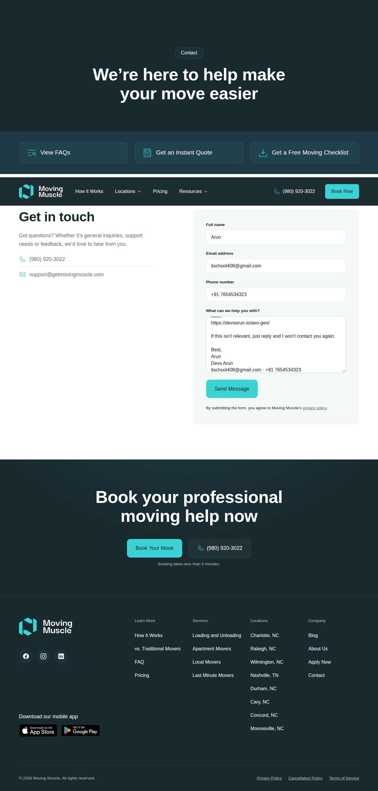

**After submit** — `run-eadb96b1_attempt-55cc5d07_post_attempt_2026-11-03T03-09-05-642Z.jpg`

### professionalmovingandstorage.com — error\_after\_submit (LIVE)

| | |
|---|---|
| Attempt ID | `7d4f00d1-4ad3-4e77-9b10-c1f61baca85a` |
| Form URL | https://professionalmovingandstorage.com/contact/ |
| Final URL | https://professionalmovingandstorage.com/contact/ |
| Reserved | 2026-11-03 03:09:13 UTC |
| Submit attempted | 2026-11-03 03:09:14 UTC |
| Template | standard v2 |
| Confirmation text | MESSAGE One or more fields have an error. Please check and try again. The field is required. The field is required. The field is required. The field is required. One or |
| Result / error | — |

Exact message:

~~~text
Subject: Helping customers find your business in AI search (AEO + GEO)

Hi there,

I'm Arun from Devs Arun. More and more customers now ask ChatGPT, Gemini, Perplexity or Google's AI Overviews questions like "who should I hire for this in my area?" before they call anyone. These tools answer from websites they can clearly understand, and they tend to recommend businesses whose pages answer real customer questions.

That is what AEO + GEO (Answer Engine and Generative Engine Optimization) is for. I improve your existing service pages so they clearly answer the questions your customers ask, add structured data that matches the page, and make the call, quote or enquiry step obvious. The benefit: your business gets a better chance of being mentioned or linked in AI answers, and visitors who arrive find it easy to contact you.

The AEO + GEO Starter is a one-time $199 (about ₹16,999, negotiable) for one website: a basic audit, 10 customer questions, improvements to two existing pages, relevant structured data and an action plan, with one revision round.

You can read the full details, send an enquiry or book online here:
https://devsarun.io/aeo-geo/

If this isn't relevant, just reply and I won't contact you again.

Best,
Arun
Devs Arun
itschool408@gmail.com · +91 7654534323
~~~

Submitted field values:

- your-name \[name\]: Arun
- your-email \[email\]: itschool408@gmail.com
- your-message \[message\]: Hi there, I'm Arun from Devs Arun. More and more customers now ask ChatGPT, Gemini, Perplexity or Google's AI Overviews 

**Filled form (before submit)** — `run-eadb96b1_attempt-7d4f00d1_filled_2026-11-03T03-09-14-836Z.jpg`

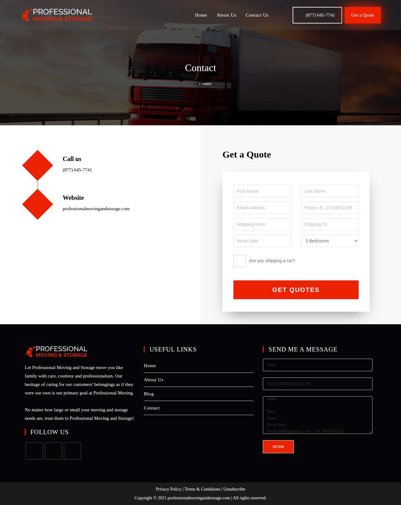

**After submit** — `run-eadb96b1_attempt-7d4f00d1_post_attempt_2026-11-03T03-09-20-433Z.jpg`

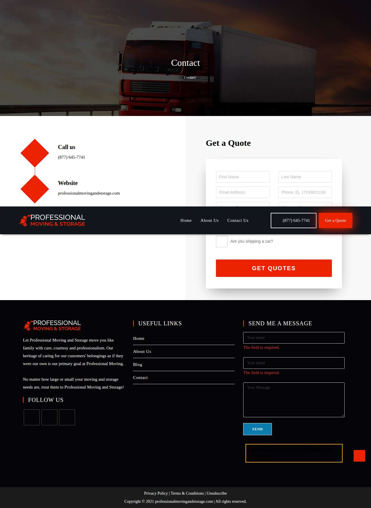

### themoveplace.com — unclear (LIVE)

| | |
|---|---|
| Attempt ID | `81a3078e-2074-4b96-892e-ada9f331fde3` |
| Form URL | https://themoveplace.com/contact/ |
| Final URL | https://themoveplace.com/contact/ |
| Reserved | 2026-11-03 03:09:27 UTC |
| Submit attempted | 2026-11-03 03:09:29 UTC |
| Template | standard v2 |
| Confirmation text | none observed |
| Result / error | No new success marker observed |

Exact message:

~~~text
Subject: Helping customers find your business in AI search (AEO + GEO)

Hi there,

I'm Arun from Devs Arun. More and more customers now ask ChatGPT, Gemini, Perplexity or Google's AI Overviews questions like "who should I hire for this in my area?" before they call anyone. These tools answer from websites they can clearly understand, and they tend to recommend businesses whose pages answer real customer questions.

That is what AEO + GEO (Answer Engine and Generative Engine Optimization) is for. I improve your existing service pages so they clearly answer the questions your customers ask, add structured data that matches the page, and make the call, quote or enquiry step obvious. The benefit: your business gets a better chance of being mentioned or linked in AI answers, and visitors who arrive find it easy to contact you.

The AEO + GEO Starter is a one-time $199 (about ₹16,999, negotiable) for one website: a basic audit, 10 customer questions, improvements to two existing pages, relevant structured data and an action plan, with one revision round.

You can read the full details, send an enquiry or book online here:
https://devsarun.io/aeo-geo/

If this isn't relevant, just reply and I won't contact you again.

Best,
Arun
Devs Arun
itschool408@gmail.com · +91 7654534323
~~~

Submitted field values:

- Email \[email\]: itschool408@gmail.com
- Full Name \[name\]: Arun
- Message \[message\]: Hi there, I'm Arun from Devs Arun. More and more customers now ask ChatGPT, Gemini, Perplexity or Google's AI Overviews 
- Phone Number \[phone\]: +91 7654534323

**Filled form (before submit)** — `run-eadb96b1_attempt-81a3078e_filled_2026-11-03T03-09-29-519Z.jpg`

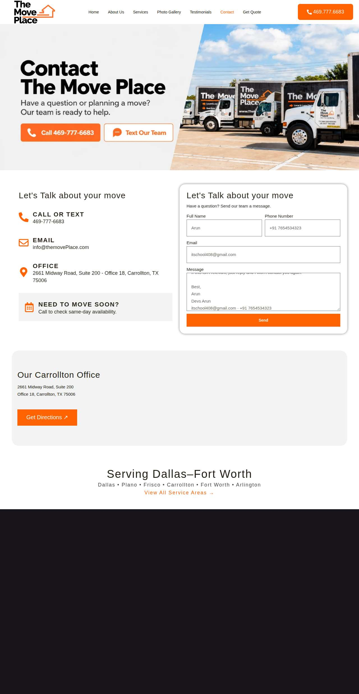

**After submit** — `run-eadb96b1_attempt-81a3078e_post_attempt_2026-11-03T03-09-58-906Z.jpg`

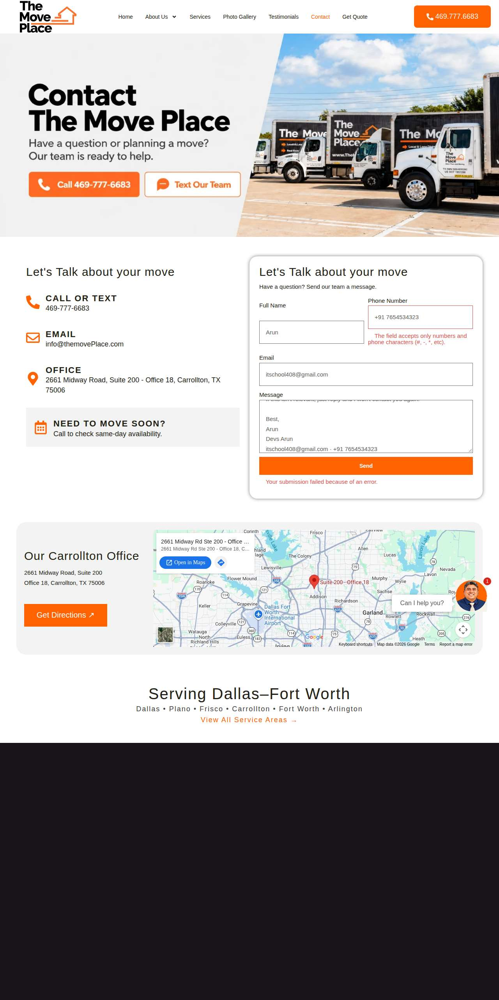

### auburnmoving.com — confirmed (LIVE)

| | |
|---|---|
| Attempt ID | `d599c682-1f12-417a-a3a6-472e9615cad8` |
| Form URL | https://auburnmoving.com/contact/ |
| Final URL | https://auburnmoving.com/thank-you/ |
| Reserved | 2026-11-03 03:10:06 UTC |
| Submit attempted | 2026-11-03 03:10:11 UTC |
| Template | standard v2 |
| Confirmation text | Thank You\! Thank you for contacting Auburn Moving & Storage\! One of our staff members will be calling shortly |
| Result / error | — |

Exact message:

~~~text
Subject: Helping customers find your business in AI search (AEO + GEO)

Hi there,

I'm Arun from Devs Arun. More and more customers now ask ChatGPT, Gemini, Perplexity or Google's AI Overviews questions like "who should I hire for this in my area?" before they call anyone. These tools answer from websites they can clearly understand, and they tend to recommend businesses whose pages answer real customer questions.

That is what AEO + GEO (Answer Engine and Generative Engine Optimization) is for. I improve your existing service pages so they clearly answer the questions your customers ask, add structured data that matches the page, and make the call, quote or enquiry step obvious. The benefit: your business gets a better chance of being mentioned or linked in AI answers, and visitors who arrive find it easy to contact you.

The AEO + GEO Starter is a one-time $199 (about ₹16,999, negotiable) for one website: a basic audit, 10 customer questions, improvements to two existing pages, relevant structured data and an action plan, with one revision round.

You can read the full details, send an enquiry or book online here:
https://devsarun.io/aeo-geo/

If this isn't relevant, just reply and I won't contact you again.

Best,
Arun
Devs Arun
itschool408@gmail.com · +91 7654534323
~~~

Submitted field values:

- Name \[name\]: Arun
- Email \[email\]: itschool408@gmail.com
- Message \[message\]: Hi there, I'm Arun from Devs Arun. More and more customers now ask ChatGPT, Gemini, Perplexity or Google's AI Overviews 
- Phone Number \[phone\]: +91 7654534323

**Filled form (before submit)** — `run-eadb96b1_attempt-d599c682_filled_2026-11-03T03-10-11-371Z.jpg`

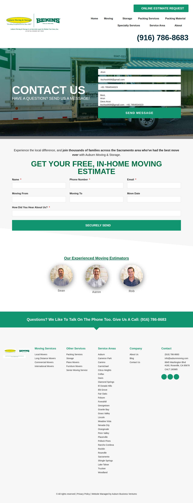

**After submit** — `run-eadb96b1_attempt-d599c682_post_attempt_2026-11-03T03-10-21-927Z.jpg`

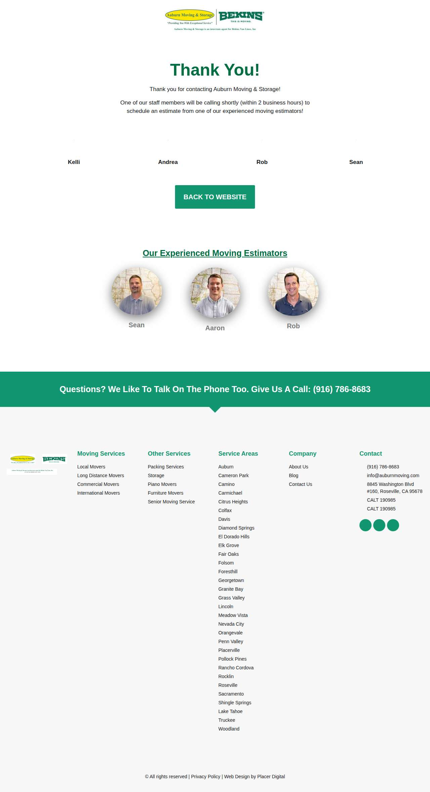

### mikesrecyclingandservices.com — unclear (LIVE)

| | |
|---|---|
| Attempt ID | `00e2d45b-3e98-4a76-9252-b57b96aed700` |
| Form URL | https://www.mikesrecyclingandservices.com/ |
| Final URL | https://www.mikesrecyclingandservices.com/ |
| Reserved | 2026-11-03 03:10:29 UTC |
| Submit attempted | 2026-11-03 03:10:32 UTC |
| Template | standard v2 |
| Confirmation text | none observed |
| Result / error | No new success marker observed |

Exact message:

~~~text
Subject: Helping customers find your business in AI search (AEO + GEO)

Hi there,

I'm Arun from Devs Arun. More and more customers now ask ChatGPT, Gemini, Perplexity or Google's AI Overviews questions like "who should I hire for this in my area?" before they call anyone. These tools answer from websites they can clearly understand, and they tend to recommend businesses whose pages answer real customer questions.

That is what AEO + GEO (Answer Engine and Generative Engine Optimization) is for. I improve your existing service pages so they clearly answer the questions your customers ask, add structured data that matches the page, and make the call, quote or enquiry step obvious. The benefit: your business gets a better chance of being mentioned or linked in AI answers, and visitors who arrive find it easy to contact you.

The AEO + GEO Starter is a one-time $199 (about ₹16,999, negotiable) for one website: a basic audit, 10 customer questions, improvements to two existing pages, relevant structured data and an action plan, with one revision round.

You can read the full details, send an enquiry or book online here:
https://devsarun.io/aeo-geo/

If this isn't relevant, just reply and I won't contact you again.

Best,
Arun
Devs Arun
itschool408@gmail.com · +91 7654534323
~~~

Submitted field values:

- email \[email\]: itschool408@gmail.com
- name-\* \[name\]: Arun
- Message \[message\]: Hi there, I'm Arun from Devs Arun. More and more customers now ask ChatGPT, Gemini, Perplexity or Google's AI Overviews 
- subject \[subject\]: Helping customers find your business in AI search (AEO + GEO)

**Filled form (before submit)** — `run-eadb96b1_attempt-00e2d45b_filled_2026-11-03T03-10-32-903Z.jpg`

**After submit** — `run-eadb96b1_attempt-00e2d45b_post_attempt_2026-11-03T03-11-00-720Z.jpg`

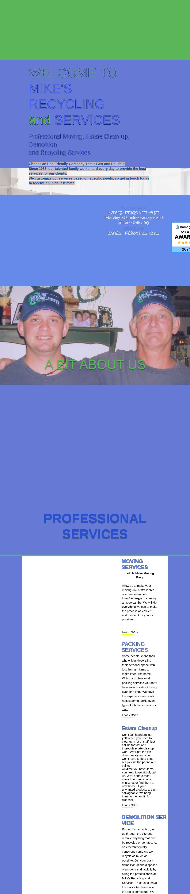

### transitionalcaremovers.com — confirmed (LIVE)

| | |
|---|---|
| Attempt ID | `70c4e57f-7ce2-45bd-89f1-6597baa19798` |
| Form URL | https://www.transitionalcaremovers.com/ |
| Final URL | https://www.transitionalcaremovers.com/ |
| Reserved | 2026-11-03 03:11:07 UTC |
| Submit attempted | 2026-11-03 03:11:10 UTC |
| Template | standard v2 |
| Confirmation text | Call Us Today: 352-561-3330 or Fill out the Form Below and We'll Get Back to You with a Quote Contact Us about us We are a family owned and operated company. We are very fam |
| Result / error | — |

Exact message:

~~~text
Subject: Helping customers find your business in AI search (AEO + GEO)

Hi there,

I'm Arun from Devs Arun. More and more customers now ask ChatGPT, Gemini, Perplexity or Google's AI Overviews questions like "who should I hire for this in my area?" before they call anyone. These tools answer from websites they can clearly understand, and they tend to recommend businesses whose pages answer real customer questions.

That is what AEO + GEO (Answer Engine and Generative Engine Optimization) is for. I improve your existing service pages so they clearly answer the questions your customers ask, add structured data that matches the page, and make the call, quote or enquiry step obvious. The benefit: your business gets a better chance of being mentioned or linked in AI answers, and visitors who arrive find it easy to contact you.

The AEO + GEO Starter is a one-time $199 (about ₹16,999, negotiable) for one website: a basic audit, 10 customer questions, improvements to two existing pages, relevant structured data and an action plan, with one revision round.

You can read the full details, send an enquiry or book online here:
https://devsarun.io/aeo-geo/

If this isn't relevant, just reply and I won't contact you again.

Best,
Arun
Devs Arun
itschool408@gmail.com · +91 7654534323
~~~

Submitted field values:

- email \[email\]: itschool408@gmail.com
- name-\* \[name\]: Arun
- Message \[message\]: Hi there, I'm Arun from Devs Arun. More and more customers now ask ChatGPT, Gemini, Perplexity or Google's AI Overviews 
- subject \[subject\]: Helping customers find your business in AI search (AEO + GEO)

**Filled form (before submit)** — `run-eadb96b1_attempt-70c4e57f_filled_2026-11-03T03-11-10-799Z.jpg`

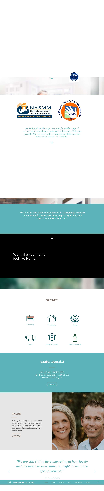

**After submit** — `run-eadb96b1_attempt-70c4e57f_post_attempt_2026-11-03T03-11-14-381Z.jpg`

### knoxmover.com — failed\_before\_submit (LIVE)

| | |
|---|---|
| Attempt ID | `00b26cb8-97bf-4e24-892a-260fee60b55c` |
| Form URL | https://knoxmover.com/contact-us/ |
| Final URL | https://knoxmover.com/contact-us/ |
| Reserved | 2026-11-03 03:11:21 UTC |
| Submit attempted | — |
| Template | standard v2 |
| Confirmation text | none observed |
| Result / error | Message field altered the text (length limit?) |

Exact message:

~~~text
Subject: Helping customers find your business in AI search (AEO + GEO)

Hi there,

I'm Arun from Devs Arun. More and more customers now ask ChatGPT, Gemini, Perplexity or Google's AI Overviews questions like "who should I hire for this in my area?" before they call anyone. These tools answer from websites they can clearly understand, and they tend to recommend businesses whose pages answer real customer questions.

That is what AEO + GEO (Answer Engine and Generative Engine Optimization) is for. I improve your existing service pages so they clearly answer the questions your customers ask, add structured data that matches the page, and make the call, quote or enquiry step obvious. The benefit: your business gets a better chance of being mentioned or linked in AI answers, and visitors who arrive find it easy to contact you.

The AEO + GEO Starter is a one-time $199 (about ₹16,999, negotiable) for one website: a basic audit, 10 customer questions, improvements to two existing pages, relevant structured data and an action plan, with one revision round.

You can read the full details, send an enquiry or book online here:
https://devsarun.io/aeo-geo/

If this isn't relevant, just reply and I won't contact you again.

Best,
Arun
Devs Arun
itschool408@gmail.com · +91 7654534323
~~~

Submitted field values:

- \#wpforms-375-field\_1: Hi there, I'm Arun from Devs Arun. More and more customers now ask ChatGPT, Gemini, Perplexity or Google's AI Overviews 
- \#wpforms-375-field\_2: Arun
- \#wpforms-375-field\_6: +91 7654534323
- \#wpforms-375-field\_12: itschool408@gmail.com

**Filled form (before submit)** — `run-eadb96b1_attempt-00b26cb8_filled_2026-11-03T03-11-23-240Z.jpg`

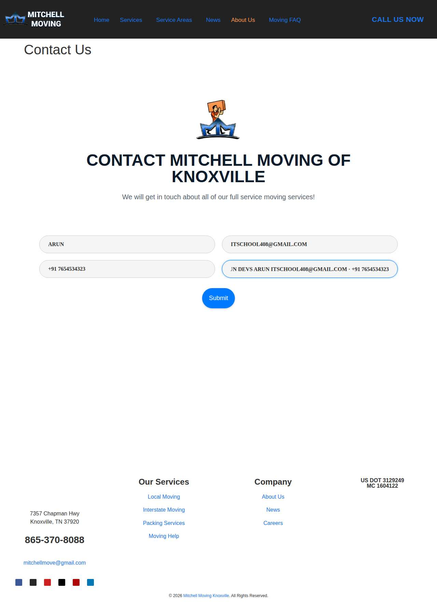

### azvalleywidemovers.com — error\_after\_submit (LIVE)

| | |
|---|---|
| Attempt ID | `e715d770-337d-4af9-8494-ee1e4ae8f286` |
| Form URL | https://www.azvalleywidemovers.com/free-quote/ |
| Final URL | https://www.azvalleywidemovers.com/free-quote/ |
| Reserved | 2026-11-03 03:11:28 UTC |
| Submit attempted | 2026-11-03 03:11:29 UTC |
| Template | standard v2 |
| Confirmation text | rs occurred. Please confirm the fields and submit it again. Please fill in the required field. Please fill in the required field. Please fill in the required field. Get A |
| Result / error | — |

Exact message:

~~~text
Subject: Helping customers find your business in AI search (AEO + GEO)

Hi there,

I'm Arun from Devs Arun. More and more customers now ask ChatGPT, Gemini, Perplexity or Google's AI Overviews questions like "who should I hire for this in my area?" before they call anyone. These tools answer from websites they can clearly understand, and they tend to recommend businesses whose pages answer real customer questions.

That is what AEO + GEO (Answer Engine and Generative Engine Optimization) is for. I improve your existing service pages so they clearly answer the questions your customers ask, add structured data that matches the page, and make the call, quote or enquiry step obvious. The benefit: your business gets a better chance of being mentioned or linked in AI answers, and visitors who arrive find it easy to contact you.

The AEO + GEO Starter is a one-time $199 (about ₹16,999, negotiable) for one website: a basic audit, 10 customer questions, improvements to two existing pages, relevant structured data and an action plan, with one revision round.

You can read the full details, send an enquiry or book online here:
https://devsarun.io/aeo-geo/

If this isn't relevant, just reply and I won't contact you again.

Best,
Arun
Devs Arun
itschool408@gmail.com · +91 7654534323
~~~

Submitted field values:

- Name \[name\]: Arun
- Email \[email\]: itschool408@gmail.com
- Phone \[phone\]: +91 7654534323
- Tell us about your move. How many bedrooms? Apartment/condo, house or business? Let us know more about what you need. \[message\]: Hi there, I'm Arun from Devs Arun. More and more customers now ask ChatGPT, Gemini, Perplexity or Google's AI Overviews 

**Filled form (before submit)** — `run-eadb96b1_attempt-e715d770_filled_2026-11-03T03-11-29-406Z.jpg`

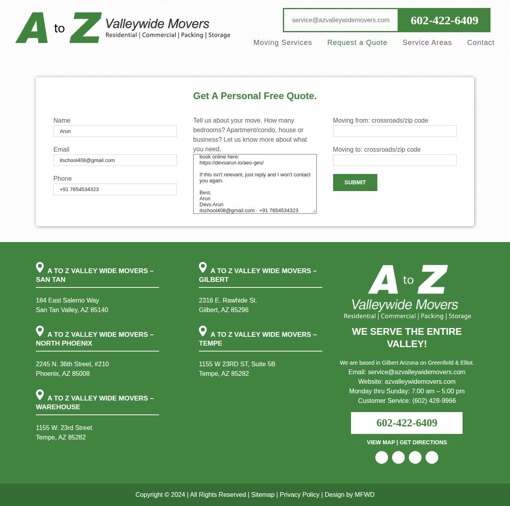

**After submit** — `run-eadb96b1_attempt-e715d770_post_attempt_2026-11-03T03-11-35-521Z.jpg`

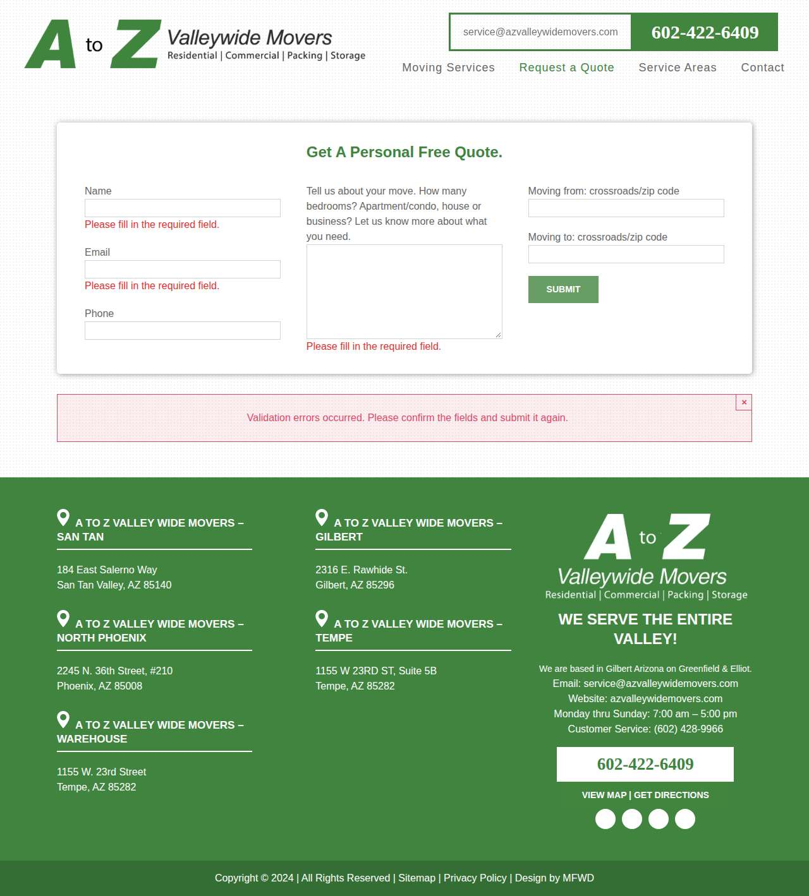

### whiteglovedc.com — unclear (LIVE)

| | |
|---|---|
| Attempt ID | `3814a3d4-7d0c-4619-bbb2-4de1b3b7c0a3` |
| Form URL | https://www.whiteglovedc.com/contact-us |
| Final URL | https://www.whiteglovedc.com/contact-us |
| Reserved | 2026-11-03 03:11:43 UTC |
| Submit attempted | 2026-11-03 03:11:46 UTC |
| Template | standard v2 |
| Confirmation text | none observed |
| Result / error | No new success marker observed |

Exact message:

~~~text
Subject: Helping customers find your business in AI search (AEO + GEO)

Hi there,

I'm Arun from Devs Arun. More and more customers now ask ChatGPT, Gemini, Perplexity or Google's AI Overviews questions like "who should I hire for this in my area?" before they call anyone. These tools answer from websites they can clearly understand, and they tend to recommend businesses whose pages answer real customer questions.

That is what AEO + GEO (Answer Engine and Generative Engine Optimization) is for. I improve your existing service pages so they clearly answer the questions your customers ask, add structured data that matches the page, and make the call, quote or enquiry step obvious. The benefit: your business gets a better chance of being mentioned or linked in AI answers, and visitors who arrive find it easy to contact you.

The AEO + GEO Starter is a one-time $199 (about ₹16,999, negotiable) for one website: a basic audit, 10 customer questions, improvements to two existing pages, relevant structured data and an action plan, with one revision round.

You can read the full details, send an enquiry or book online here:
https://devsarun.io/aeo-geo/

If this isn't relevant, just reply and I won't contact you again.

Best,
Arun
Devs Arun
itschool408@gmail.com · +91 7654534323
~~~

Submitted field values:

- email \[email\]: itschool408@gmail.com
- name-\* \[name\]: Arun
- phone \[phone\]: +91 7654534323
- Message \[message\]: Hi there, I'm Arun from Devs Arun. More and more customers now ask ChatGPT, Gemini, Perplexity or Google's AI Overviews 
- subject \[subject\]: Helping customers find your business in AI search (AEO + GEO)

**Filled form (before submit)** — `run-eadb96b1_attempt-3814a3d4_filled_2026-11-03T03-11-46-594Z.jpg`

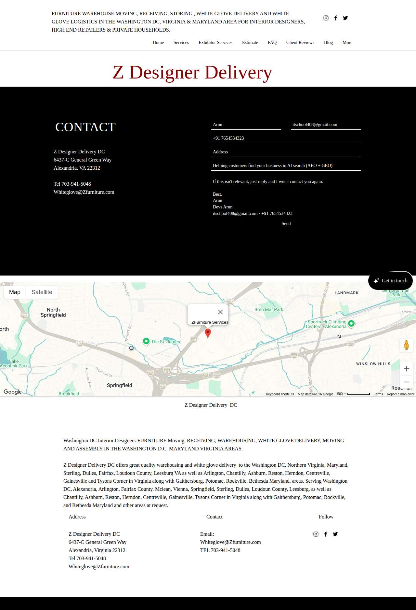

**After submit** — `run-eadb96b1_attempt-3814a3d4_post_attempt_2026-11-03T03-12-14-329Z.jpg`

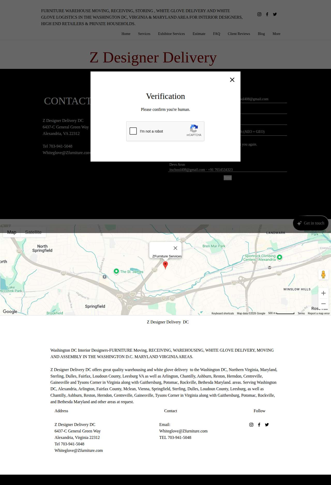

### steelvalleymoving.com — confirmed (LIVE)

| | |
|---|---|
| Attempt ID | `4858e854-fa01-428a-ac0a-375dc1aec863` |
| Form URL | https://steelvalleymoving.com/contact-us/ |
| Final URL | https://steelvalleymoving.com/contact-us/ |
| Reserved | 2026-11-03 03:12:21 UTC |
| Submit attempted | 2026-11-03 03:12:24 UTC |
| Template | standard v2 |
| Confirmation text | 94960 Home About Us Services Contact Us GET A QUOTE Contact Thank you\! Form submitted successfully. MESSAGE US Send A Message Call now or send us a message and get a per |
| Result / error | — |

Exact message:

~~~text
Subject: Helping customers find your business in AI search (AEO + GEO)

Hi there,

I'm Arun from Devs Arun. More and more customers now ask ChatGPT, Gemini, Perplexity or Google's AI Overviews questions like "who should I hire for this in my area?" before they call anyone. These tools answer from websites they can clearly understand, and they tend to recommend businesses whose pages answer real customer questions.

That is what AEO + GEO (Answer Engine and Generative Engine Optimization) is for. I improve your existing service pages so they clearly answer the questions your customers ask, add structured data that matches the page, and make the call, quote or enquiry step obvious. The benefit: your business gets a better chance of being mentioned or linked in AI answers, and visitors who arrive find it easy to contact you.

The AEO + GEO Starter is a one-time $199 (about ₹16,999, negotiable) for one website: a basic audit, 10 customer questions, improvements to two existing pages, relevant structured data and an action plan, with one revision round.

You can read the full details, send an enquiry or book online here:
https://devsarun.io/aeo-geo/

If this isn't relevant, just reply and I won't contact you again.

Best,
Arun
Devs Arun
itschool408@gmail.com · +91 7654534323
~~~

Submitted field values:

- mf-text \[name\]: Arun
- mf-email \[email\]: itschool408@gmail.com
- mf-text \[subject\]: Helping customers find your business in AI search (AEO + GEO)
- mf-telephone \[phone\]: +91 7654534323
- mf-textarea \[message\]: Hi there, I'm Arun from Devs Arun. More and more customers now ask ChatGPT, Gemini, Perplexity or Google's AI Overviews 

**Filled form (before submit)** — `run-eadb96b1_attempt-4858e854_filled_2026-11-03T03-12-24-707Z.jpg`

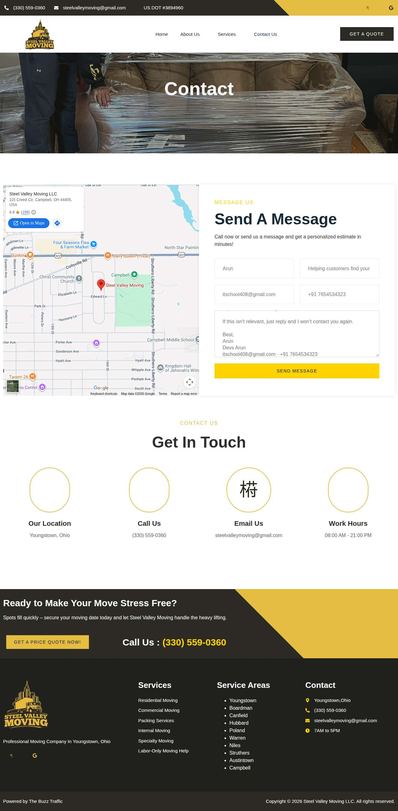

**After submit** — `run-eadb96b1_attempt-4858e854_post_attempt_2026-11-03T03-12-28-354Z.jpg`

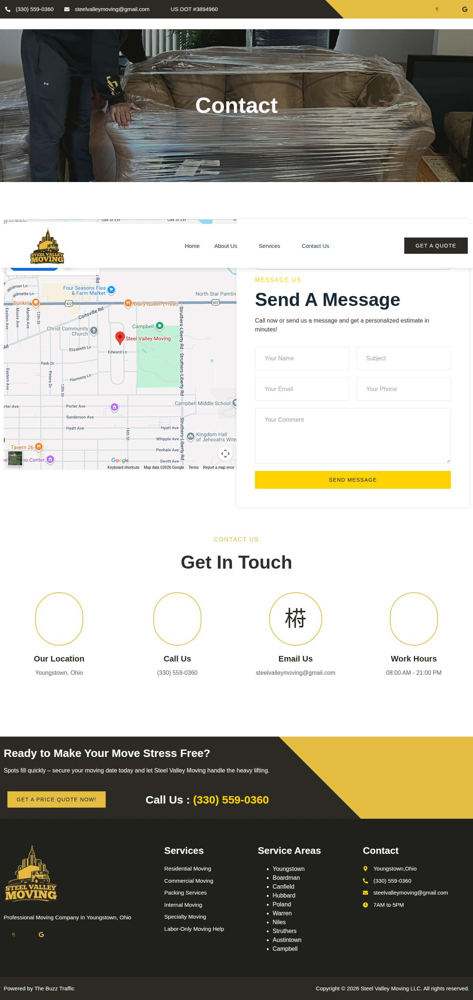

### greatwhitemovers.net — unclear (LIVE)

| | |
|---|---|
| Attempt ID | `26d403d9-c03a-4405-a24a-919194a72368` |
| Form URL | https://greatwhitemovers.net/contact/ |
| Final URL | https://greatwhitemovers.net/contact/ |
| Reserved | 2026-11-03 03:12:35 UTC |
| Submit attempted | 2026-11-03 03:12:38 UTC |
| Template | standard v2 |
| Confirmation text | none observed |
| Result / error | No new success marker observed |

Exact message:

~~~text
Subject: Helping customers find your business in AI search (AEO + GEO)

Hi there,

I'm Arun from Devs Arun. More and more customers now ask ChatGPT, Gemini, Perplexity or Google's AI Overviews questions like "who should I hire for this in my area?" before they call anyone. These tools answer from websites they can clearly understand, and they tend to recommend businesses whose pages answer real customer questions.

That is what AEO + GEO (Answer Engine and Generative Engine Optimization) is for. I improve your existing service pages so they clearly answer the questions your customers ask, add structured data that matches the page, and make the call, quote or enquiry step obvious. The benefit: your business gets a better chance of being mentioned or linked in AI answers, and visitors who arrive find it easy to contact you.

The AEO + GEO Starter is a one-time $199 (about ₹16,999, negotiable) for one website: a basic audit, 10 customer questions, improvements to two existing pages, relevant structured data and an action plan, with one revision round.

You can read the full details, send an enquiry or book online here:
https://devsarun.io/aeo-geo/

If this isn't relevant, just reply and I won't contact you again.

Best,
Arun
Devs Arun
itschool408@gmail.com · +91 7654534323
~~~

Submitted field values:

- Name\* \[name\]: Arun
- Email\* \[email\]: itschool408@gmail.com
- Comments \[message\]: Hi there, I'm Arun from Devs Arun. More and more customers now ask ChatGPT, Gemini, Perplexity or Google's AI Overviews 
- Phone number \[phone\]: +91 7654534323

**Filled form (before submit)** — `run-eadb96b1_attempt-26d403d9_filled_2026-11-03T03-12-38-442Z.jpg`

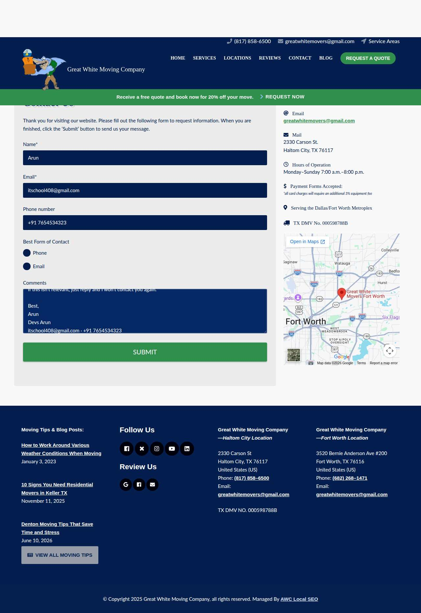

**After submit** — `run-eadb96b1_attempt-26d403d9_post_attempt_2026-11-03T03-13-06-228Z.jpg`

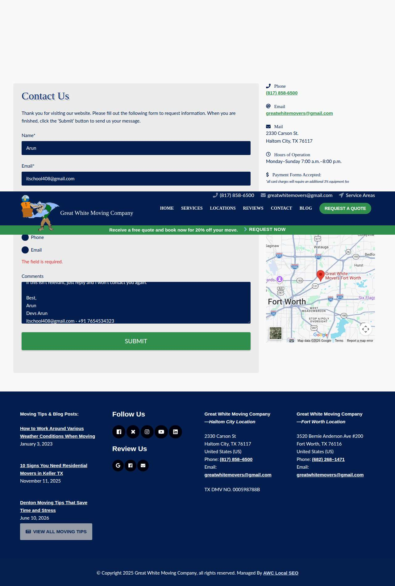

### awisemoveaz.com — error\_after\_submit (LIVE)

| | |
|---|---|
| Attempt ID | `1d7a55db-c90d-494f-b820-7736dbcee64f` |
| Form URL | https://awisemoveaz.com/contact/ |
| Final URL | https://awisemoveaz.com/contact/ |
| Reserved | 2026-11-03 03:13:13 UTC |
| Submit attempted | 2026-11-03 03:13:15 UTC |
| Template | standard v2 |
| Confirmation text | \#1407365 One or more fields have an error. Please check and try again. The field is required. The field is required. The field is required. The field is required. The fi |
| Result / error | — |

Exact message:

~~~text
Subject: Helping customers find your business in AI search (AEO + GEO)

Hi there,

I'm Arun from Devs Arun. More and more customers now ask ChatGPT, Gemini, Perplexity or Google's AI Overviews questions like "who should I hire for this in my area?" before they call anyone. These tools answer from websites they can clearly understand, and they tend to recommend businesses whose pages answer real customer questions.

That is what AEO + GEO (Answer Engine and Generative Engine Optimization) is for. I improve your existing service pages so they clearly answer the questions your customers ask, add structured data that matches the page, and make the call, quote or enquiry step obvious. The benefit: your business gets a better chance of being mentioned or linked in AI answers, and visitors who arrive find it easy to contact you.

The AEO + GEO Starter is a one-time $199 (about ₹16,999, negotiable) for one website: a basic audit, 10 customer questions, improvements to two existing pages, relevant structured data and an action plan, with one revision round.

You can read the full details, send an enquiry or book online here:
https://devsarun.io/aeo-geo/

If this isn't relevant, just reply and I won't contact you again.

Best,
Arun
Devs Arun
itschool408@gmail.com · +91 7654534323
~~~

Submitted field values:

- your-name \[name\]: Arun
- your-email \[email\]: itschool408@gmail.com
- your-phone \[phone\]: +91 7654534323
- your-message \[message\]: Hi there, I'm Arun from Devs Arun. More and more customers now ask ChatGPT, Gemini, Perplexity or Google's AI Overviews 
- your-subject \[subject\]: Helping customers find your business in AI search (AEO + GEO)

**Filled form (before submit)** — `run-eadb96b1_attempt-1d7a55db_filled_2026-11-03T03-13-15-248Z.jpg`

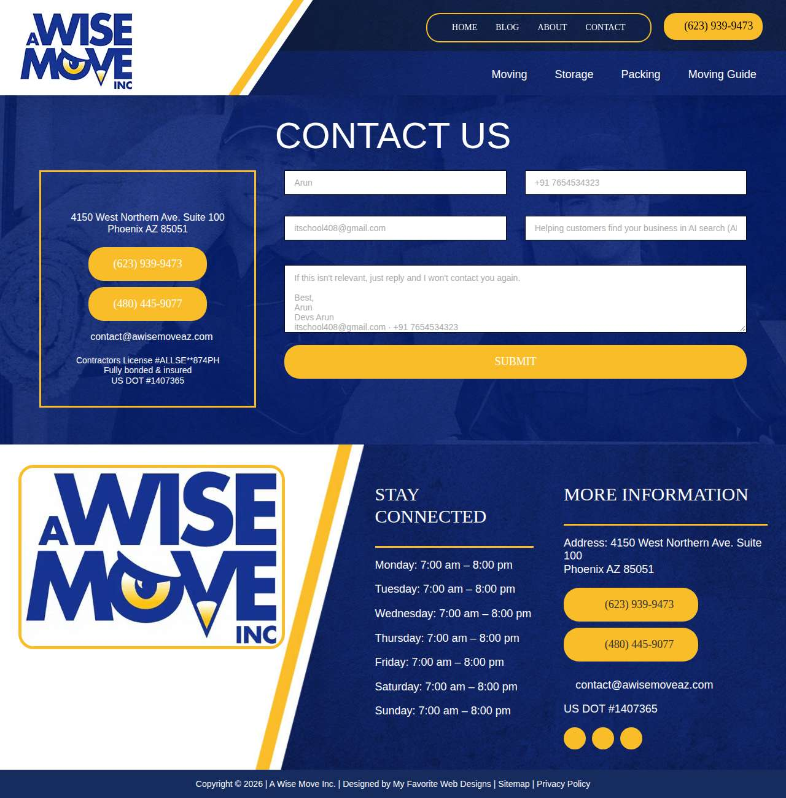

**After submit** — `run-eadb96b1_attempt-1d7a55db_post_attempt_2026-11-03T03-13-18-983Z.jpg`

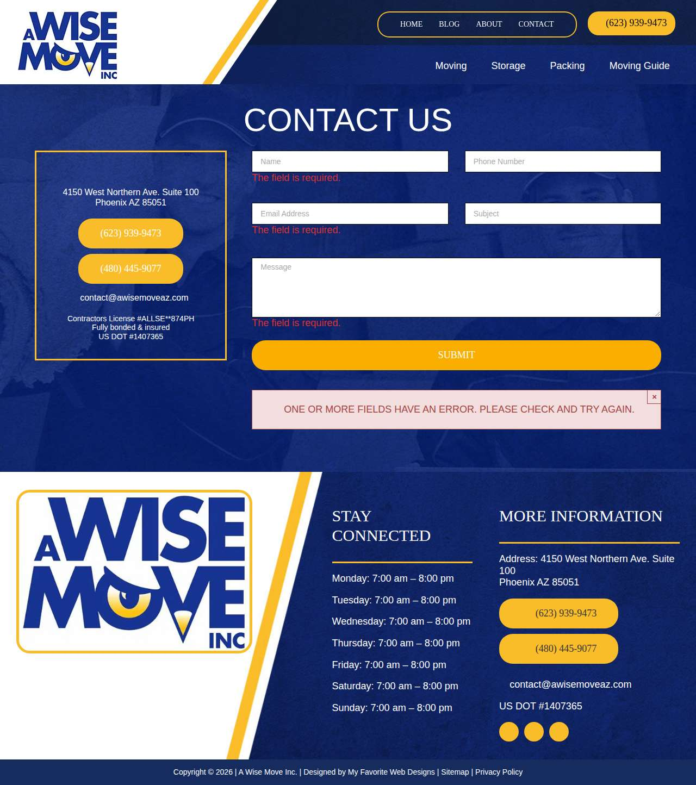

## Events (113)

| Time (UTC) | Event | Website | Details |
|---|---|---|---|
| 03:08:25 | run\_queued | — | live run requested by github:itsDevsArun |
| 03:08:25 | run\_dispatched | — | dispatch disabled (local test mode) |
| 03:08:28 | run\_started | — | Runner claimed live run |
| 03:08:29 | offer\_verified | — | Service page offer facts verified |
| 03:08:29 | website\_selected | clearchoiceplumbingllc.com | Live target clearchoiceplumbingllc.com |
| 03:08:29 | attempt\_reserved | clearchoiceplumbingllc.com | Submission attempt reserved with template standard v2 |
| 03:08:30 | page\_opened | clearchoiceplumbingllc.com | Opened form page |
| 03:08:30 | screenshot\_saved | clearchoiceplumbingllc.com | inspection screenshot saved (144 KB) |
| 03:08:30 | review\_required | clearchoiceplumbingllc.com | failed before submit: locator.fill: Error: Cannot type text into input\[type=number\] |
| 03:08:35 | website\_selected | bwnwincpainting.com | Live target bwnwincpainting.com |
| 03:08:35 | attempt\_reserved | bwnwincpainting.com | Submission attempt reserved with template standard v2 |
| 03:08:37 | page\_opened | bwnwincpainting.com | Opened form page |
| 03:08:37 | screenshot\_saved | bwnwincpainting.com | inspection screenshot saved (132 KB) |
| 03:08:37 | review\_required | bwnwincpainting.com | failed before submit: locator.fill: Error: Cannot type text into input\[type=number\] |
| 03:08:42 | website\_selected | absoluterestorepa.com | Live target absoluterestorepa.com |
| 03:08:42 | attempt\_reserved | absoluterestorepa.com | Submission attempt reserved with template standard v2 |
| 03:08:45 | page\_opened | absoluterestorepa.com | Opened form page |
| 03:08:45 | screenshot\_saved | absoluterestorepa.com | inspection screenshot saved (175 KB) |
| 03:08:45 | review\_required | absoluterestorepa.com | failed before submit: locator.fill: Error: Cannot type text into input\[type=number\] |
| 03:08:50 | website\_selected | getmovingmuscle.com | Live target getmovingmuscle.com |
| 03:08:50 | attempt\_reserved | getmovingmuscle.com | Submission attempt reserved with template standard v2 |
| 03:08:54 | page\_opened | getmovingmuscle.com | Opened form page |
| 03:08:54 | fields\_filled | getmovingmuscle.com | filled |
| 03:08:54 | screenshot\_saved | getmovingmuscle.com | filled screenshot saved (128 KB) |
| 03:08:54 | submit\_attempted | getmovingmuscle.com | submitting |
| 03:09:05 | screenshot\_saved | getmovingmuscle.com | post\_attempt screenshot saved (106 KB) |
| 03:09:05 | confirmation\_observed | getmovingmuscle.com | confirmed — "o hear from you. (980) 920-3022 support@getmovingmuscle.com Thank you\! Your message has been received. We will respond a" |
| 03:09:13 | website\_selected | professionalmovingandstorage.com | Live target professionalmovingandstorage.com |
| 03:09:13 | attempt\_reserved | professionalmovingandstorage.com | Submission attempt reserved with template standard v2 |
| 03:09:14 | page\_opened | professionalmovingandstorage.com | Opened form page |
| 03:09:14 | fields\_filled | professionalmovingandstorage.com | filled |
| 03:09:14 | screenshot\_saved | professionalmovingandstorage.com | filled screenshot saved (88 KB) |
| 03:09:14 | submit\_attempted | professionalmovingandstorage.com | submitting |
| 03:09:20 | screenshot\_saved | professionalmovingandstorage.com | post\_attempt screenshot saved (91 KB) |
| 03:09:20 | error | professionalmovingandstorage.com | error after submit — "MESSAGE One or more fields have an error. Please check and try again. The field is required. The field is required. The " |
| 03:09:27 | website\_selected | themoveplace.com | Live target themoveplace.com |
| 03:09:27 | attempt\_reserved | themoveplace.com | Submission attempt reserved with template standard v2 |
| 03:09:29 | page\_opened | themoveplace.com | Opened form page |
| 03:09:29 | fields\_filled | themoveplace.com | filled |
| 03:09:29 | screenshot\_saved | themoveplace.com | filled screenshot saved (142 KB) |
| 03:09:29 | submit\_attempted | themoveplace.com | submitting |
| 03:09:58 | screenshot\_saved | themoveplace.com | post\_attempt screenshot saved (194 KB) |
| 03:09:58 | review\_required | themoveplace.com | unclear: No new success marker observed |
| 03:10:06 | website\_selected | auburnmoving.com | Live target auburnmoving.com |
| 03:10:06 | attempt\_reserved | auburnmoving.com | Submission attempt reserved with template standard v2 |
| 03:10:11 | page\_opened | auburnmoving.com | Opened form page |
| 03:10:11 | fields\_filled | auburnmoving.com | filled |
| 03:10:11 | screenshot\_saved | auburnmoving.com | filled screenshot saved (205 KB) |
| 03:10:11 | submit\_attempted | auburnmoving.com | submitting |
| 03:10:21 | screenshot\_saved | auburnmoving.com | post\_attempt screenshot saved (104 KB) |
| 03:10:21 | confirmation\_observed | auburnmoving.com | confirmed — "Thank You\! Thank you for contacting Auburn Moving & Storage\! One of our staff members will be calling shortly" |
| 03:10:29 | website\_selected | mikesrecyclingandservices.com | Live target mikesrecyclingandservices.com |
| 03:10:29 | attempt\_reserved | mikesrecyclingandservices.com | Submission attempt reserved with template standard v2 |
| 03:10:32 | page\_opened | mikesrecyclingandservices.com | Opened form page |
| 03:10:32 | fields\_filled | mikesrecyclingandservices.com | filled |
| 03:10:32 | screenshot\_saved | mikesrecyclingandservices.com | filled screenshot saved (312 KB) |
| 03:10:32 | submit\_attempted | mikesrecyclingandservices.com | submitting |
| 03:11:00 | screenshot\_saved | mikesrecyclingandservices.com | post\_attempt screenshot saved (312 KB) |
| 03:11:00 | review\_required | mikesrecyclingandservices.com | unclear: No new success marker observed |
| 03:11:07 | website\_selected | transitionalcaremovers.com | Live target transitionalcaremovers.com |
| 03:11:07 | attempt\_reserved | transitionalcaremovers.com | Submission attempt reserved with template standard v2 |
| 03:11:10 | page\_opened | transitionalcaremovers.com | Opened form page |
| 03:11:10 | fields\_filled | transitionalcaremovers.com | filled |
| 03:11:10 | screenshot\_saved | transitionalcaremovers.com | filled screenshot saved (238 KB) |
| 03:11:10 | submit\_attempted | transitionalcaremovers.com | submitting |
| 03:11:14 | screenshot\_saved | transitionalcaremovers.com | post\_attempt screenshot saved (232 KB) |
| 03:11:14 | confirmation\_observed | transitionalcaremovers.com | confirmed — "Call Us Today: 352-561-3330 or Fill out the Form Below and We'll Get Back to You with a Quote Contact Us about us We are" |
| 03:11:21 | website\_selected | knoxmover.com | Live target knoxmover.com |
| 03:11:21 | attempt\_reserved | knoxmover.com | Submission attempt reserved with template standard v2 |
| 03:11:23 | page\_opened | knoxmover.com | Opened form page |
| 03:11:23 | screenshot\_saved | knoxmover.com | filled screenshot saved (71 KB) |
| 03:11:23 | review\_required | knoxmover.com | failed before submit: Message field altered the text (length limit?) |
| 03:11:28 | website\_selected | azvalleywidemovers.com | Live target azvalleywidemovers.com |
| 03:11:28 | attempt\_reserved | azvalleywidemovers.com | Submission attempt reserved with template standard v2 |
| 03:11:29 | page\_opened | azvalleywidemovers.com | Opened form page |
| 03:11:29 | fields\_filled | azvalleywidemovers.com | filled |
| 03:11:29 | screenshot\_saved | azvalleywidemovers.com | filled screenshot saved (117 KB) |
| 03:11:29 | submit\_attempted | azvalleywidemovers.com | submitting |
| 03:11:35 | screenshot\_saved | azvalleywidemovers.com | post\_attempt screenshot saved (132 KB) |
| 03:11:35 | error | azvalleywidemovers.com | error after submit — "rs occurred. Please confirm the fields and submit it again. Please fill in the required field. Please fill in the requir" |
| 03:11:43 | website\_selected | whiteglovedc.com | Live target whiteglovedc.com |
| 03:11:43 | attempt\_reserved | whiteglovedc.com | Submission attempt reserved with template standard v2 |
| 03:11:46 | page\_opened | whiteglovedc.com | Opened form page |
| 03:11:46 | fields\_filled | whiteglovedc.com | filled |
| 03:11:46 | screenshot\_saved | whiteglovedc.com | filled screenshot saved (162 KB) |
| 03:11:46 | submit\_attempted | whiteglovedc.com | submitting |
| 03:12:14 | screenshot\_saved | whiteglovedc.com | post\_attempt screenshot saved (146 KB) |
| 03:12:14 | review\_required | whiteglovedc.com | unclear: No new success marker observed |
| 03:12:21 | website\_selected | steelvalleymoving.com | Live target steelvalleymoving.com |
| 03:12:21 | attempt\_reserved | steelvalleymoving.com | Submission attempt reserved with template standard v2 |
| 03:12:24 | page\_opened | steelvalleymoving.com | Opened form page |
| 03:12:24 | fields\_filled | steelvalleymoving.com | filled |
| 03:12:24 | screenshot\_saved | steelvalleymoving.com | filled screenshot saved (202 KB) |
| 03:12:24 | submit\_attempted | steelvalleymoving.com | submitting |
| 03:12:28 | screenshot\_saved | steelvalleymoving.com | post\_attempt screenshot saved (205 KB) |
| 03:12:28 | confirmation\_observed | steelvalleymoving.com | confirmed — "94960 Home About Us Services Contact Us GET A QUOTE Contact Thank you\! Form submitted successfully. MESSAGE US Send A Me" |
| 03:12:35 | website\_selected | greatwhitemovers.net | Live target greatwhitemovers.net |
| 03:12:35 | attempt\_reserved | greatwhitemovers.net | Submission attempt reserved with template standard v2 |
| 03:12:38 | page\_opened | greatwhitemovers.net | Opened form page |
| 03:12:38 | fields\_filled | greatwhitemovers.net | filled |
| 03:12:38 | screenshot\_saved | greatwhitemovers.net | filled screenshot saved (150 KB) |
| 03:12:38 | submit\_attempted | greatwhitemovers.net | submitting |
| 03:13:06 | screenshot\_saved | greatwhitemovers.net | post\_attempt screenshot saved (142 KB) |
| 03:13:06 | review\_required | greatwhitemovers.net | unclear: No new success marker observed |
| 03:13:13 | website\_selected | awisemoveaz.com | Live target awisemoveaz.com |
| 03:13:13 | attempt\_reserved | awisemoveaz.com | Submission attempt reserved with template standard v2 |
| 03:13:15 | page\_opened | awisemoveaz.com | Opened form page |
| 03:13:15 | fields\_filled | awisemoveaz.com | filled |
| 03:13:15 | screenshot\_saved | awisemoveaz.com | filled screenshot saved (137 KB) |
| 03:13:15 | submit\_attempted | awisemoveaz.com | submitting |
| 03:13:18 | screenshot\_saved | awisemoveaz.com | post\_attempt screenshot saved (149 KB) |
| 03:13:18 | error | awisemoveaz.com | error after submit — "\#1407365 One or more fields have an error. Please check and try again. The field is required. The field is required. The" |
| 03:13:26 | run\_completed | — | Run completed (queue\_exhausted) |
