# Run 495c543b — dry\_run — completed

| | |
|---|---|
| Run ID | `495c543b-cad3-4686-aa71-63a6239cefcc` |
| Requested by | github:itsDevsArun |
| Started | 2026-11-04 04:15:42 UTC |
| Finished | 2026-11-04 04:18:50 UTC |
| Finish reason | queue\_exhausted |
| GitHub Actions | https://github.com/itsDevsArun/aeo-geo/actions/runs/41763788389 |

CSV for this run: [runs/2026-11-04_dry_run_495c543b.csv](2026-11-04_dry_run_495c543b.csv)

## Attempts (25)

### helixmechanical.com — dry\_run\_failed (dry run)

| | |
|---|---|
| Attempt ID | `ee38e4cc-decf-4a88-8f0d-046809ce7c27` |
| Form URL | https://helixmechanical.com/contact/ |
| Final URL | https://helixmechanical.com/contact/ |
| Reserved | 2026-11-04 04:15:43 UTC |
| Submit attempted | — |
| Template | standard v2 |
| Confirmation text | none observed |
| Result / error | Mapped field "First Name \*" not found uniquely |

Exact message:

~~~text
Subject: Helping customers find your business in AI search (AEO + GEO)

Hi there,

I'm Arun from Devs Arun. More and more customers now ask ChatGPT, Gemini, Perplexity or Google's AI Overviews questions like "who should I hire for this in my area?" before they call anyone. These tools answer from websites they can clearly understand, and they tend to recommend businesses whose pages answer real customer questions.

That is what AEO + GEO (Answer Engine and Generative Engine Optimization) is for. I improve your existing service pages so they clearly answer the questions your customers ask, add structured data that matches the page, and make the call, quote or enquiry step obvious. The benefit: your business gets a better chance of being mentioned or linked in AI answers, and visitors who arrive find it easy to contact you.

The AEO + GEO Starter is a one-time $199 (about ₹16,999, negotiable) for one website: a basic audit, 10 customer questions, improvements to two existing pages, relevant structured data and an action plan, with one revision round.

You can read the full details, send an enquiry or book online here:
https://devsarun.io/aeo-geo/

If this isn't relevant, just reply and I won't contact you again.

Best,
Arun
Devs Arun
itschool408@gmail.com · +91 7654534323
~~~

Submitted field values:

- \#forminator-field-name-1\_6ae7ff023fd3c: Arun
- \#forminator-field-email-1\_6ae7ff023fd3c: itschool408@gmail.com
- \#forminator-field-phone-1\_6ae7ff023fd3c: +91 7654534323
- \#forminator-field-textarea-1\_6ae7ff023fd3c: Hi there, I'm Arun from Devs Arun. More and more customers now ask ChatGPT, Gemini, Perplexity or Google's AI Overviews 

**Inspected page** — `run-495c543b_attempt-ee38e4cc_inspection_2026-11-04T04-15-46-296Z.jpg`

### knoxvilleelectrician.com — dry\_run\_failed (dry run)

| | |
|---|---|
| Attempt ID | `b509588b-7611-41a1-9e69-0ca0872fe7d6` |
| Form URL | https://knoxvilleelectrician.com/contact-us/ |
| Final URL | https://knoxvilleelectrician.com/contact-us/ |
| Reserved | 2026-11-04 04:15:51 UTC |
| Submit attempted | — |
| Template | standard v2 |
| Confirmation text | none observed |
| Result / error | Mapped field "Name" not found uniquely |

Exact message:

~~~text
Subject: Helping customers find your business in AI search (AEO + GEO)

Hi there,

I'm Arun from Devs Arun. More and more customers now ask ChatGPT, Gemini, Perplexity or Google's AI Overviews questions like "who should I hire for this in my area?" before they call anyone. These tools answer from websites they can clearly understand, and they tend to recommend businesses whose pages answer real customer questions.

That is what AEO + GEO (Answer Engine and Generative Engine Optimization) is for. I improve your existing service pages so they clearly answer the questions your customers ask, add structured data that matches the page, and make the call, quote or enquiry step obvious. The benefit: your business gets a better chance of being mentioned or linked in AI answers, and visitors who arrive find it easy to contact you.

The AEO + GEO Starter is a one-time $199 (about ₹16,999, negotiable) for one website: a basic audit, 10 customer questions, improvements to two existing pages, relevant structured data and an action plan, with one revision round.

You can read the full details, send an enquiry or book online here:
https://devsarun.io/aeo-geo/

If this isn't relevant, just reply and I won't contact you again.

Best,
Arun
Devs Arun
itschool408@gmail.com · +91 7654534323
~~~

Submitted field values:

- \#form-field-1b7221: itschool408@gmail.com
- \#form-field-2fa3ac: +91 7654534323
- \#form-field-96f51f: Arun
- \#form-field-fed9d8: Hi there, I'm Arun from Devs Arun. More and more customers now ask ChatGPT, Gemini, Perplexity or Google's AI Overviews 

**Inspected page** — `run-495c543b_attempt-b509588b_inspection_2026-11-04T04-15-53-495Z.jpg`

### familylawdelaware.com — dry\_run\_failed (dry run)

| | |
|---|---|
| Attempt ID | `0e9c0a98-3b0e-450a-aef5-cdc302ac5b63` |
| Form URL | https://www.familylawdelaware.com/contact/ |
| Final URL | https://www.familylawdelaware.com/contact/ |
| Reserved | 2026-11-04 04:15:58 UTC |
| Submit attempted | — |
| Template | standard v2 |
| Confirmation text | none observed |
| Result / error | Reviewed form not found on page (site changed) |

Exact message:

~~~text
Subject: Helping customers find your business in AI search (AEO + GEO)

Hi there,

I'm Arun from Devs Arun. More and more customers now ask ChatGPT, Gemini, Perplexity or Google's AI Overviews questions like "who should I hire for this in my area?" before they call anyone. These tools answer from websites they can clearly understand, and they tend to recommend businesses whose pages answer real customer questions.

That is what AEO + GEO (Answer Engine and Generative Engine Optimization) is for. I improve your existing service pages so they clearly answer the questions your customers ask, add structured data that matches the page, and make the call, quote or enquiry step obvious. The benefit: your business gets a better chance of being mentioned or linked in AI answers, and visitors who arrive find it easy to contact you.

The AEO + GEO Starter is a one-time $199 (about ₹16,999, negotiable) for one website: a basic audit, 10 customer questions, improvements to two existing pages, relevant structured data and an action plan, with one revision round.

You can read the full details, send an enquiry or book online here:
https://devsarun.io/aeo-geo/

If this isn't relevant, just reply and I won't contact you again.

Best,
Arun
Devs Arun
itschool408@gmail.com · +91 7654534323
~~~

Submitted field values:

- \#nf-field-2: Arun
- \#nf-field-3: itschool408@gmail.com
- \#nf-field-4: +91 7654534323
- \#nf-field-10: Hi there, I'm Arun from Devs Arun. More and more customers now ask ChatGPT, Gemini, Perplexity or Google's AI Overviews 

**Inspected page** — `run-495c543b_attempt-0e9c0a98_inspection_2026-11-04T04-16-01-250Z.jpg`

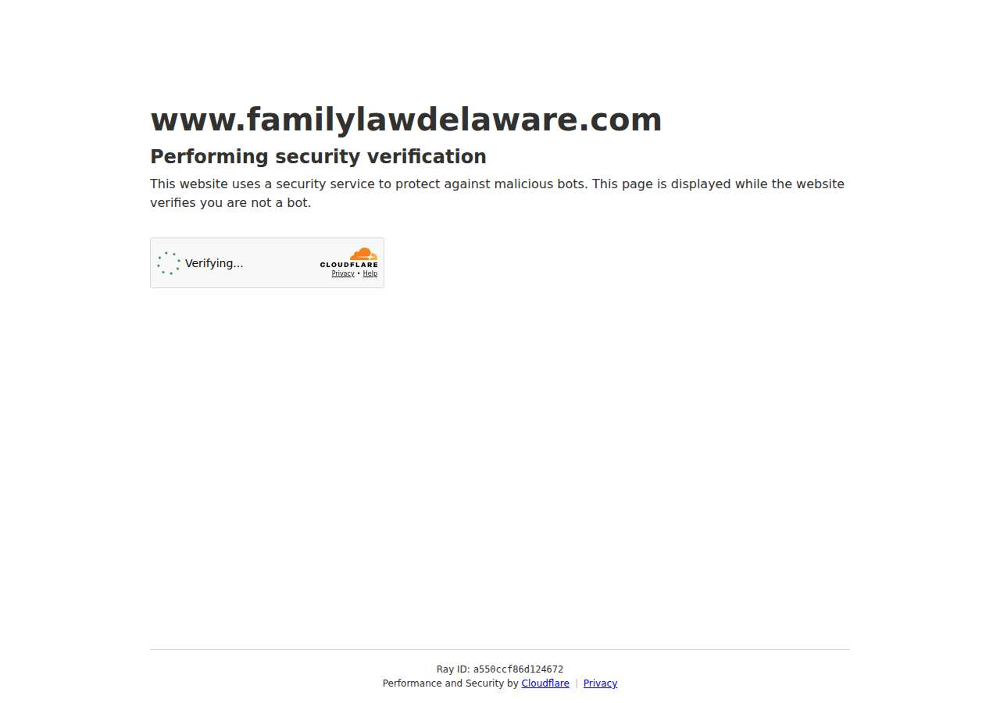

### barbierilawoffice.com — dry\_run\_ok (dry run)

| | |
|---|---|
| Attempt ID | `4ce87cca-66c6-44c5-ab9e-2ebc78f6a98f` |
| Form URL | https://www.barbierilawoffice.com/contact |
| Final URL | https://www.barbierilawoffice.com/contact |
| Reserved | 2026-11-04 04:16:06 UTC |
| Submit attempted | — |
| Template | standard v2 |
| Confirmation text | none observed |
| Result / error | Selectors verified; fields not typed (domain not in dry-run fill list); not submitted |

Exact message:

~~~text
Subject: Helping customers find your business in AI search (AEO + GEO)

Hi there,

I'm Arun from Devs Arun. More and more customers now ask ChatGPT, Gemini, Perplexity or Google's AI Overviews questions like "who should I hire for this in my area?" before they call anyone. These tools answer from websites they can clearly understand, and they tend to recommend businesses whose pages answer real customer questions.

That is what AEO + GEO (Answer Engine and Generative Engine Optimization) is for. I improve your existing service pages so they clearly answer the questions your customers ask, add structured data that matches the page, and make the call, quote or enquiry step obvious. The benefit: your business gets a better chance of being mentioned or linked in AI answers, and visitors who arrive find it easy to contact you.

The AEO + GEO Starter is a one-time $199 (about ₹16,999, negotiable) for one website: a basic audit, 10 customer questions, improvements to two existing pages, relevant structured data and an action plan, with one revision round.

You can read the full details, send an enquiry or book online here:
https://devsarun.io/aeo-geo/

If this isn't relevant, just reply and I won't contact you again.

Best,
Arun
Devs Arun
itschool408@gmail.com · +91 7654534323
~~~

Submitted field values:

- \#\\31 070166448: itschool408@gmail.com
- \#\\31 272690316: Hi there, I'm Arun from Devs Arun. More and more customers now ask ChatGPT, Gemini, Perplexity or Google's AI Overviews 
- \#\\31 324410313: +91 7654534323
- \#\\31 513765028: Arun

**Inspected page** — `run-495c543b_attempt-4ce87cca_inspection_2026-11-04T04-16-09-995Z.jpg`

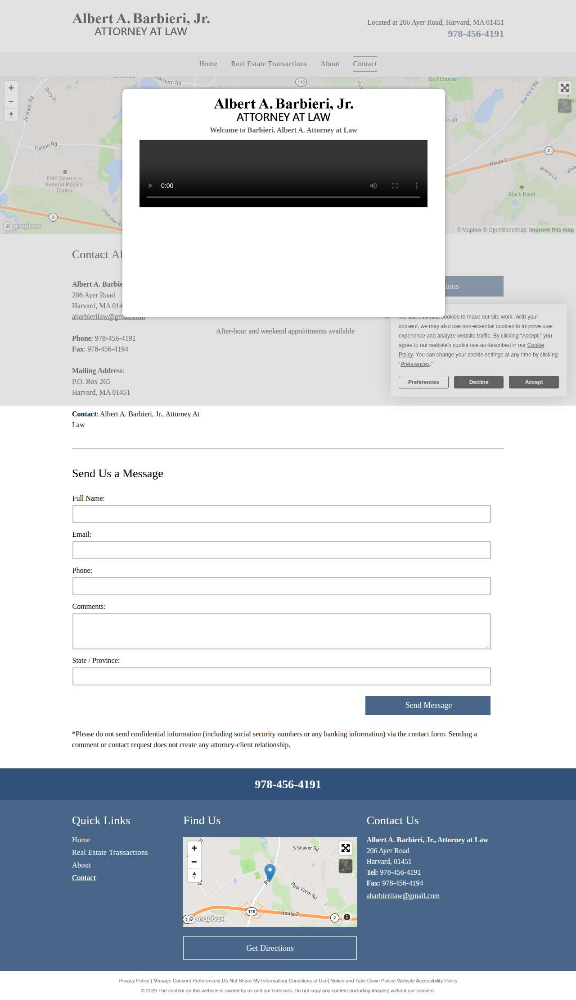

### rutledgelawcenter.com — dry\_run\_ok (dry run)

| | |
|---|---|
| Attempt ID | `b7ee5c26-2d05-493c-9c35-69b5e6cfb5c8` |
| Form URL | https://www.rutledgelawcenter.com/contact |
| Final URL | https://www.rutledgelawcenter.com/contact |
| Reserved | 2026-11-04 04:16:15 UTC |
| Submit attempted | — |
| Template | standard v2 |
| Confirmation text | none observed |
| Result / error | Selectors verified; fields not typed (domain not in dry-run fill list); not submitted |

Exact message:

~~~text
Subject: Helping customers find your business in AI search (AEO + GEO)

Hi there,

I'm Arun from Devs Arun. More and more customers now ask ChatGPT, Gemini, Perplexity or Google's AI Overviews questions like "who should I hire for this in my area?" before they call anyone. These tools answer from websites they can clearly understand, and they tend to recommend businesses whose pages answer real customer questions.

That is what AEO + GEO (Answer Engine and Generative Engine Optimization) is for. I improve your existing service pages so they clearly answer the questions your customers ask, add structured data that matches the page, and make the call, quote or enquiry step obvious. The benefit: your business gets a better chance of being mentioned or linked in AI answers, and visitors who arrive find it easy to contact you.

The AEO + GEO Starter is a one-time $199 (about ₹16,999, negotiable) for one website: a basic audit, 10 customer questions, improvements to two existing pages, relevant structured data and an action plan, with one revision round.

You can read the full details, send an enquiry or book online here:
https://devsarun.io/aeo-geo/

If this isn't relevant, just reply and I won't contact you again.

Best,
Arun
Devs Arun
itschool408@gmail.com · +91 7654534323
~~~

Submitted field values:

- \#input\_comp-kjvs8rqs2: Arun
- \#input\_comp-kjvs8rqx4: itschool408@gmail.com
- \#input\_comp-kjvs8rqz2: +91 7654534323
- \#textarea\_comp-kjvs8rr04: Hi there, I'm Arun from Devs Arun. More and more customers now ask ChatGPT, Gemini, Perplexity or Google's AI Overviews 

**Inspected page** — `run-495c543b_attempt-b7ee5c26_inspection_2026-11-04T04-16-17-637Z.jpg`

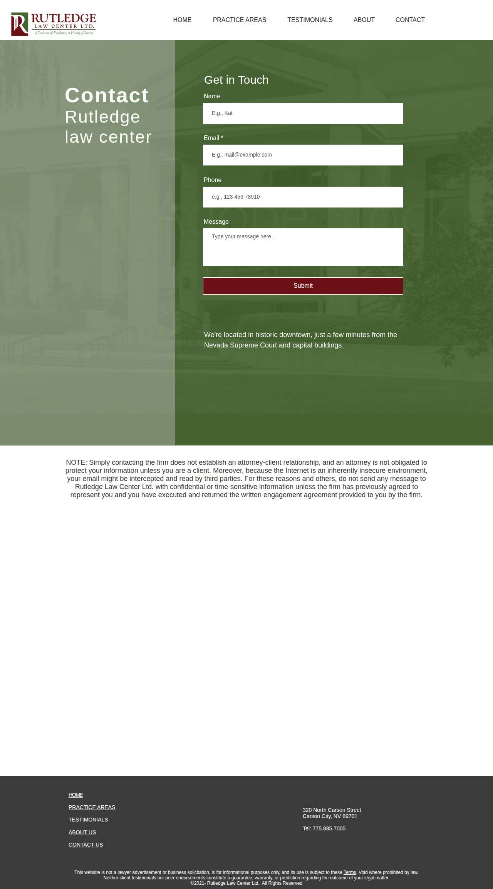

### drdale.net — dry\_run\_ok (dry run)

| | |
|---|---|
| Attempt ID | `b0837750-f382-4510-9b82-3b5d674f3cdc` |
| Form URL | https://www.drdale.net/contact |
| Final URL | https://www.drdale.net/contact |
| Reserved | 2026-11-04 04:16:22 UTC |
| Submit attempted | — |
| Template | standard v2 |
| Confirmation text | none observed |
| Result / error | Selectors verified; fields not typed (domain not in dry-run fill list); not submitted |

Exact message:

~~~text
Subject: Helping customers find your business in AI search (AEO + GEO)

Hi there,

I'm Arun from Devs Arun. More and more customers now ask ChatGPT, Gemini, Perplexity or Google's AI Overviews questions like "who should I hire for this in my area?" before they call anyone. These tools answer from websites they can clearly understand, and they tend to recommend businesses whose pages answer real customer questions.

That is what AEO + GEO (Answer Engine and Generative Engine Optimization) is for. I improve your existing service pages so they clearly answer the questions your customers ask, add structured data that matches the page, and make the call, quote or enquiry step obvious. The benefit: your business gets a better chance of being mentioned or linked in AI answers, and visitors who arrive find it easy to contact you.

The AEO + GEO Starter is a one-time $199 (about ₹16,999, negotiable) for one website: a basic audit, 10 customer questions, improvements to two existing pages, relevant structured data and an action plan, with one revision round.

You can read the full details, send an enquiry or book online here:
https://devsarun.io/aeo-geo/

If this isn't relevant, just reply and I won't contact you again.

Best,
Arun
Devs Arun
itschool408@gmail.com · +91 7654534323
~~~

Submitted field values:

- \#name: Arun
- \#field: Hi there, I'm Arun from Devs Arun. More and more customers now ask ChatGPT, Gemini, Perplexity or Google's AI Overviews 
- \#name-3: itschool408@gmail.com

**Inspected page** — `run-495c543b_attempt-b0837750_inspection_2026-11-04T04-16-24-077Z.jpg`

### curthamiltonlaw.com — dry\_run\_failed (dry run)

| | |
|---|---|
| Attempt ID | `dbc36067-5db9-473a-aca0-2c6c123c3765` |
| Form URL | https://www.curthamiltonlaw.com/contact/ |
| Final URL | https://www.curthamiltonlaw.com/contact/ |
| Reserved | 2026-11-04 04:16:29 UTC |
| Submit attempted | — |
| Template | standard v2 |
| Confirmation text | none observed |
| Result / error | Reviewed form not found on page (site changed) |

Exact message:

~~~text
Subject: Helping customers find your business in AI search (AEO + GEO)

Hi there,

I'm Arun from Devs Arun. More and more customers now ask ChatGPT, Gemini, Perplexity or Google's AI Overviews questions like "who should I hire for this in my area?" before they call anyone. These tools answer from websites they can clearly understand, and they tend to recommend businesses whose pages answer real customer questions.

That is what AEO + GEO (Answer Engine and Generative Engine Optimization) is for. I improve your existing service pages so they clearly answer the questions your customers ask, add structured data that matches the page, and make the call, quote or enquiry step obvious. The benefit: your business gets a better chance of being mentioned or linked in AI answers, and visitors who arrive find it easy to contact you.

The AEO + GEO Starter is a one-time $199 (about ₹16,999, negotiable) for one website: a basic audit, 10 customer questions, improvements to two existing pages, relevant structured data and an action plan, with one revision round.

You can read the full details, send an enquiry or book online here:
https://devsarun.io/aeo-geo/

If this isn't relevant, just reply and I won't contact you again.

Best,
Arun
Devs Arun
itschool408@gmail.com · +91 7654534323
~~~

Submitted field values:

- \#nf-field-2: Arun
- \#nf-field-3: itschool408@gmail.com
- \#nf-field-4: +91 7654534323
- \#nf-field-10: Hi there, I'm Arun from Devs Arun. More and more customers now ask ChatGPT, Gemini, Perplexity or Google's AI Overviews 

**Inspected page** — `run-495c543b_attempt-dbc36067_inspection_2026-11-04T04-16-31-350Z.jpg`

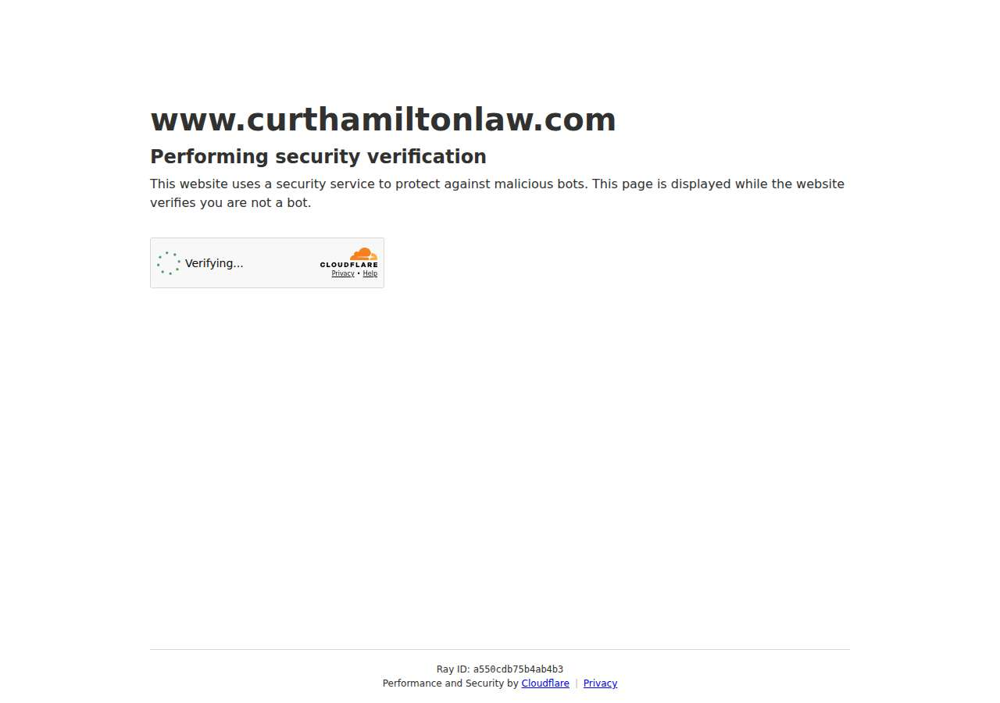

### masoudlawfirm.com — dry\_run\_ok (dry run)

| | |
|---|---|
| Attempt ID | `9a4e5305-30e9-49b7-9cf3-f88a1d95fe22` |
| Form URL | https://masoudlawfirm.com/contact/ |
| Final URL | https://masoudlawfirm.com/contact/ |
| Reserved | 2026-11-04 04:16:36 UTC |
| Submit attempted | — |
| Template | standard v2 |
| Confirmation text | none observed |
| Result / error | Selectors verified; fields not typed (domain not in dry-run fill list); not submitted |

Exact message:

~~~text
Subject: Helping customers find your business in AI search (AEO + GEO)

Hi there,

I'm Arun from Devs Arun. More and more customers now ask ChatGPT, Gemini, Perplexity or Google's AI Overviews questions like "who should I hire for this in my area?" before they call anyone. These tools answer from websites they can clearly understand, and they tend to recommend businesses whose pages answer real customer questions.

That is what AEO + GEO (Answer Engine and Generative Engine Optimization) is for. I improve your existing service pages so they clearly answer the questions your customers ask, add structured data that matches the page, and make the call, quote or enquiry step obvious. The benefit: your business gets a better chance of being mentioned or linked in AI answers, and visitors who arrive find it easy to contact you.

The AEO + GEO Starter is a one-time $199 (about ₹16,999, negotiable) for one website: a basic audit, 10 customer questions, improvements to two existing pages, relevant structured data and an action plan, with one revision round.

You can read the full details, send an enquiry or book online here:
https://devsarun.io/aeo-geo/

If this isn't relevant, just reply and I won't contact you again.

Best,
Arun
Devs Arun
itschool408@gmail.com · +91 7654534323
~~~

Submitted field values:

- \#form-field-name: Arun
- \#form-field-field\_3374379: Hi there, I'm Arun from Devs Arun. More and more customers now ask ChatGPT, Gemini, Perplexity or Google's AI Overviews 
- \#form-field-field\_7731784: +91 7654534323
- \#form-field-field\_8bd0f16: itschool408@gmail.com

**Inspected page** — `run-495c543b_attempt-9a4e5305_inspection_2026-11-04T04-16-40-314Z.jpg`

### fishertalwar.com — dry\_run\_ok (dry run)

| | |
|---|---|
| Attempt ID | `7be10f3d-c28d-4887-80d6-4947b830d29f` |
| Form URL | https://www.fishertalwar.com/contact-us/ |
| Final URL | https://www.fishertalwar.com/contact-us/ |
| Reserved | 2026-11-04 04:16:45 UTC |
| Submit attempted | — |
| Template | standard v2 |
| Confirmation text | none observed |
| Result / error | Selectors verified; fields not typed (domain not in dry-run fill list); not submitted |

Exact message:

~~~text
Subject: Helping customers find your business in AI search (AEO + GEO)

Hi there,

I'm Arun from Devs Arun. More and more customers now ask ChatGPT, Gemini, Perplexity or Google's AI Overviews questions like "who should I hire for this in my area?" before they call anyone. These tools answer from websites they can clearly understand, and they tend to recommend businesses whose pages answer real customer questions.

That is what AEO + GEO (Answer Engine and Generative Engine Optimization) is for. I improve your existing service pages so they clearly answer the questions your customers ask, add structured data that matches the page, and make the call, quote or enquiry step obvious. The benefit: your business gets a better chance of being mentioned or linked in AI answers, and visitors who arrive find it easy to contact you.

The AEO + GEO Starter is a one-time $199 (about ₹16,999, negotiable) for one website: a basic audit, 10 customer questions, improvements to two existing pages, relevant structured data and an action plan, with one revision round.

You can read the full details, send an enquiry or book online here:
https://devsarun.io/aeo-geo/

If this isn't relevant, just reply and I won't contact you again.

Best,
Arun
Devs Arun
itschool408@gmail.com · +91 7654534323
~~~

Submitted field values:

- \#input\_10\_1: Arun
- \#input\_10\_3: itschool408@gmail.com
- \#input\_10\_4: +91 7654534323
- \#input\_10\_5: Hi there, I'm Arun from Devs Arun. More and more customers now ask ChatGPT, Gemini, Perplexity or Google's AI Overviews 

**Inspected page** — `run-495c543b_attempt-7be10f3d_inspection_2026-11-04T04-16-49-328Z.jpg`

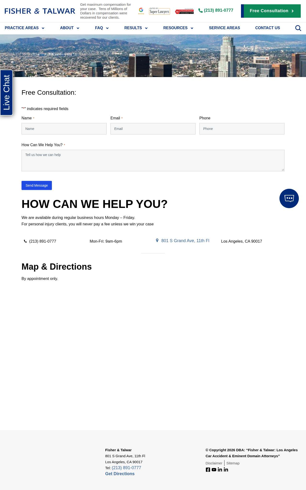

### mmrvt.com — dry\_run\_ok (dry run)

| | |
|---|---|
| Attempt ID | `be8b81a4-9bd5-4242-aca5-93323d1b580f` |
| Form URL | https://www.mmrvt.com/?page\_id=29 |
| Final URL | https://www.mmrvt.com/?page\_id=29 |
| Reserved | 2026-11-04 04:16:54 UTC |
| Submit attempted | — |
| Template | standard v2 |
| Confirmation text | none observed |
| Result / error | Selectors verified; fields not typed (domain not in dry-run fill list); not submitted |

Exact message:

~~~text
Subject: Helping customers find your business in AI search (AEO + GEO)

Hi there,

I'm Arun from Devs Arun. More and more customers now ask ChatGPT, Gemini, Perplexity or Google's AI Overviews questions like "who should I hire for this in my area?" before they call anyone. These tools answer from websites they can clearly understand, and they tend to recommend businesses whose pages answer real customer questions.

That is what AEO + GEO (Answer Engine and Generative Engine Optimization) is for. I improve your existing service pages so they clearly answer the questions your customers ask, add structured data that matches the page, and make the call, quote or enquiry step obvious. The benefit: your business gets a better chance of being mentioned or linked in AI answers, and visitors who arrive find it easy to contact you.

The AEO + GEO Starter is a one-time $199 (about ₹16,999, negotiable) for one website: a basic audit, 10 customer questions, improvements to two existing pages, relevant structured data and an action plan, with one revision round.

You can read the full details, send an enquiry or book online here:
https://devsarun.io/aeo-geo/

If this isn't relevant, just reply and I won't contact you again.

Best,
Arun
Devs Arun
itschool408@gmail.com · +91 7654534323
~~~

Submitted field values:

- \#input\_1\_1: Arun
- \#input\_1\_2: itschool408@gmail.com
- \#input\_1\_3: Helping customers find your business in AI search (AEO + GEO)
- \#input\_1\_4: Hi there, I'm Arun from Devs Arun. More and more customers now ask ChatGPT, Gemini, Perplexity or Google's AI Overviews 

**Inspected page** — `run-495c543b_attempt-be8b81a4_inspection_2026-11-04T04-16-55-939Z.jpg`

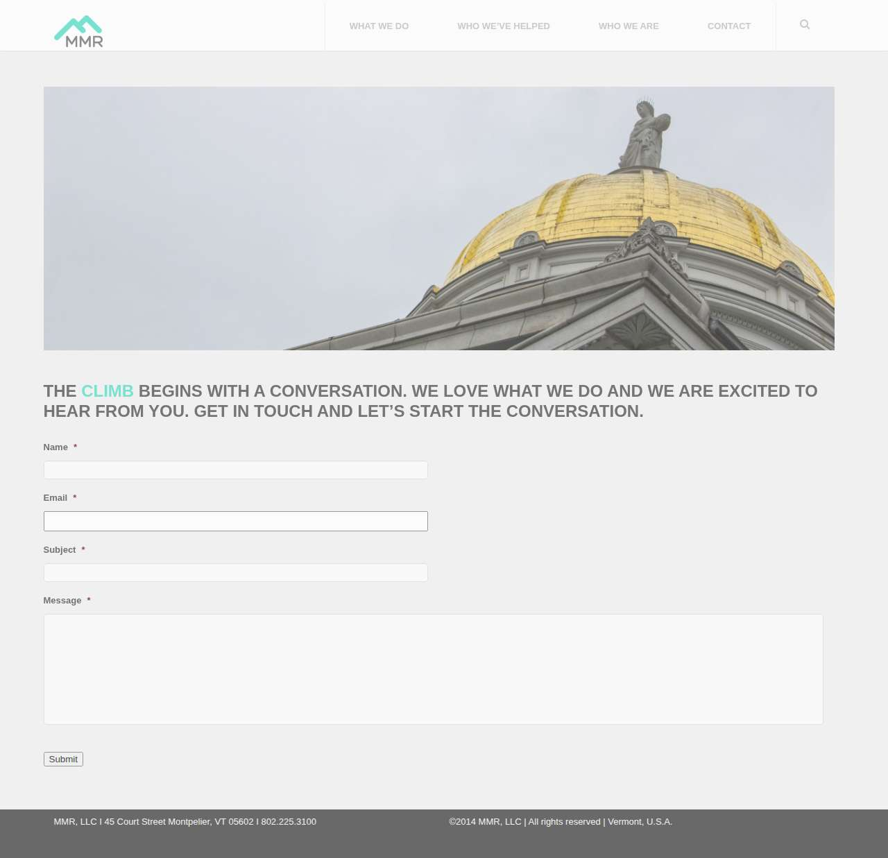

### hkwllp.com — dry\_run\_ok (dry run)

| | |
|---|---|
| Attempt ID | `7a7d7deb-6601-4fc4-820b-bc7b4d2ef026` |
| Form URL | https://hkwllp.com/contact-us/ |
| Final URL | https://hkwllp.com/contact-us/ |
| Reserved | 2026-11-04 04:17:00 UTC |
| Submit attempted | — |
| Template | standard v2 |
| Confirmation text | none observed |
| Result / error | Selectors verified; fields not typed (domain not in dry-run fill list); not submitted |

Exact message:

~~~text
Subject: Helping customers find your business in AI search (AEO + GEO)

Hi there,

I'm Arun from Devs Arun. More and more customers now ask ChatGPT, Gemini, Perplexity or Google's AI Overviews questions like "who should I hire for this in my area?" before they call anyone. These tools answer from websites they can clearly understand, and they tend to recommend businesses whose pages answer real customer questions.

That is what AEO + GEO (Answer Engine and Generative Engine Optimization) is for. I improve your existing service pages so they clearly answer the questions your customers ask, add structured data that matches the page, and make the call, quote or enquiry step obvious. The benefit: your business gets a better chance of being mentioned or linked in AI answers, and visitors who arrive find it easy to contact you.

The AEO + GEO Starter is a one-time $199 (about ₹16,999, negotiable) for one website: a basic audit, 10 customer questions, improvements to two existing pages, relevant structured data and an action plan, with one revision round.

You can read the full details, send an enquiry or book online here:
https://devsarun.io/aeo-geo/

If this isn't relevant, just reply and I won't contact you again.

Best,
Arun
Devs Arun
itschool408@gmail.com · +91 7654534323
~~~

Submitted field values:

- input\[name="phone"\]: +91 7654534323
- input\[name="your-name"\]: Arun
- input\[name="your-email"\]: itschool408@gmail.com
- textarea\[name="your-message"\]: Hi there, I'm Arun from Devs Arun. More and more customers now ask ChatGPT, Gemini, Perplexity or Google's AI Overviews 

**Inspected page** — `run-495c543b_attempt-7a7d7deb_inspection_2026-11-04T04-17-03-729Z.jpg`

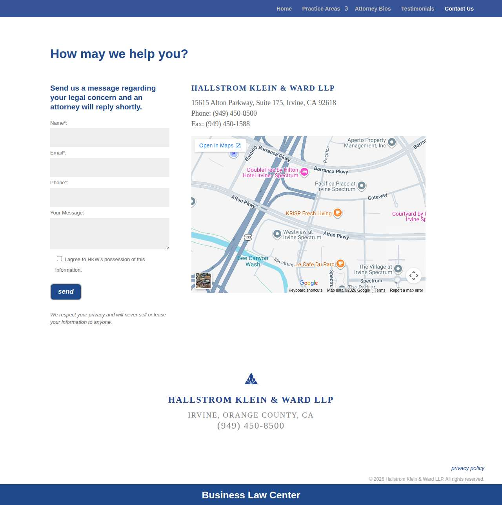

### maltezoslaw.com — dry\_run\_ok (dry run)

| | |
|---|---|
| Attempt ID | `6e595108-8d32-4d42-9cae-e0ec42d62ec4` |
| Form URL | https://maltezoslaw.com/contact |
| Final URL | https://maltezoslaw.com/contact |
| Reserved | 2026-11-04 04:17:08 UTC |
| Submit attempted | — |
| Template | standard v2 |
| Confirmation text | none observed |
| Result / error | Selectors verified; fields not typed (domain not in dry-run fill list); not submitted |

Exact message:

~~~text
Subject: Helping customers find your business in AI search (AEO + GEO)

Hi there,

I'm Arun from Devs Arun. More and more customers now ask ChatGPT, Gemini, Perplexity or Google's AI Overviews questions like "who should I hire for this in my area?" before they call anyone. These tools answer from websites they can clearly understand, and they tend to recommend businesses whose pages answer real customer questions.

That is what AEO + GEO (Answer Engine and Generative Engine Optimization) is for. I improve your existing service pages so they clearly answer the questions your customers ask, add structured data that matches the page, and make the call, quote or enquiry step obvious. The benefit: your business gets a better chance of being mentioned or linked in AI answers, and visitors who arrive find it easy to contact you.

The AEO + GEO Starter is a one-time $199 (about ₹16,999, negotiable) for one website: a basic audit, 10 customer questions, improvements to two existing pages, relevant structured data and an action plan, with one revision round.

You can read the full details, send an enquiry or book online here:
https://devsarun.io/aeo-geo/

If this isn't relevant, just reply and I won't contact you again.

Best,
Arun
Devs Arun
itschool408@gmail.com · +91 7654534323
~~~

Submitted field values:

- \#root \> div:nth-of-type(2) \> section:nth-of-type(2) \> div \> div:nth-of-type(2) \> div:nth-of-type(2) \> form \> div:nth-of-type(1) \> input: Arun
- \#root \> div:nth-of-type(2) \> section:nth-of-type(2) \> div \> div:nth-of-type(2) \> div:nth-of-type(2) \> form \> div:nth-of-type(3) \> textarea: Hi there, I'm Arun from Devs Arun. More and more customers now ask ChatGPT, Gemini, Perplexity or Google's AI Overviews 
- \#root \> div:nth-of-type(2) \> section:nth-of-type(2) \> div \> div:nth-of-type(2) \> div:nth-of-type(2) \> form \> div:nth-of-type(2) \> div:nth-of-type(1) \> input: itschool408@gmail.com
- \#root \> div:nth-of-type(2) \> section:nth-of-type(2) \> div \> div:nth-of-type(2) \> div:nth-of-type(2) \> form \> div:nth-of-type(2) \> div:nth-of-type(2) \> input: +91 7654534323

**Inspected page** — `run-495c543b_attempt-6e595108_inspection_2026-11-04T04-17-10-688Z.jpg`

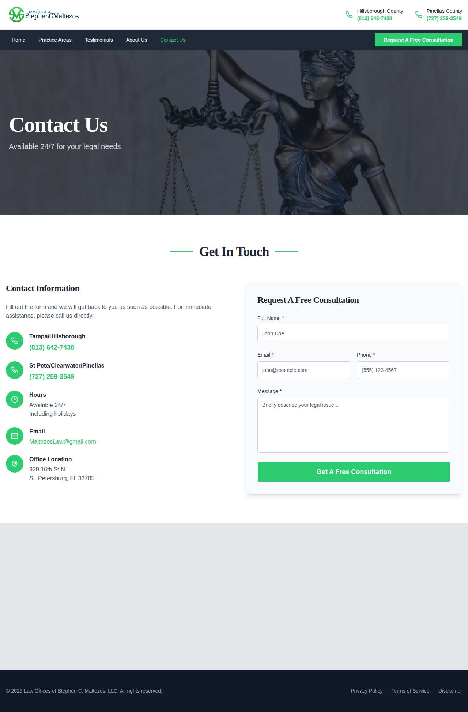

### hamtinilaw.com — dry\_run\_ok (dry run)

| | |
|---|---|
| Attempt ID | `2bf697f8-c684-40b7-a898-a8562bf9486e` |
| Form URL | https://www.hamtinilaw.com/contact |
| Final URL | https://www.hamtinilaw.com/contact |
| Reserved | 2026-11-04 04:17:15 UTC |
| Submit attempted | — |
| Template | standard v2 |
| Confirmation text | none observed |
| Result / error | Selectors verified; fields not typed (domain not in dry-run fill list); not submitted |

Exact message:

~~~text
Subject: Helping customers find your business in AI search (AEO + GEO)

Hi there,

I'm Arun from Devs Arun. More and more customers now ask ChatGPT, Gemini, Perplexity or Google's AI Overviews questions like "who should I hire for this in my area?" before they call anyone. These tools answer from websites they can clearly understand, and they tend to recommend businesses whose pages answer real customer questions.

That is what AEO + GEO (Answer Engine and Generative Engine Optimization) is for. I improve your existing service pages so they clearly answer the questions your customers ask, add structured data that matches the page, and make the call, quote or enquiry step obvious. The benefit: your business gets a better chance of being mentioned or linked in AI answers, and visitors who arrive find it easy to contact you.

The AEO + GEO Starter is a one-time $199 (about ₹16,999, negotiable) for one website: a basic audit, 10 customer questions, improvements to two existing pages, relevant structured data and an action plan, with one revision round.

You can read the full details, send an enquiry or book online here:
https://devsarun.io/aeo-geo/

If this isn't relevant, just reply and I won't contact you again.

Best,
Arun
Devs Arun
itschool408@gmail.com · +91 7654534323
~~~

Submitted field values:

- \#input\_comp-jxab8e8a: Arun
- \#input\_comp-jxab8e8j: itschool408@gmail.com
- \#input\_comp-jxab8e8p: +91 7654534323
- \#textarea\_comp-jxab8e8u: Hi there, I'm Arun from Devs Arun. More and more customers now ask ChatGPT, Gemini, Perplexity or Google's AI Overviews 

**Inspected page** — `run-495c543b_attempt-2bf697f8_inspection_2026-11-04T04-17-18-917Z.jpg`

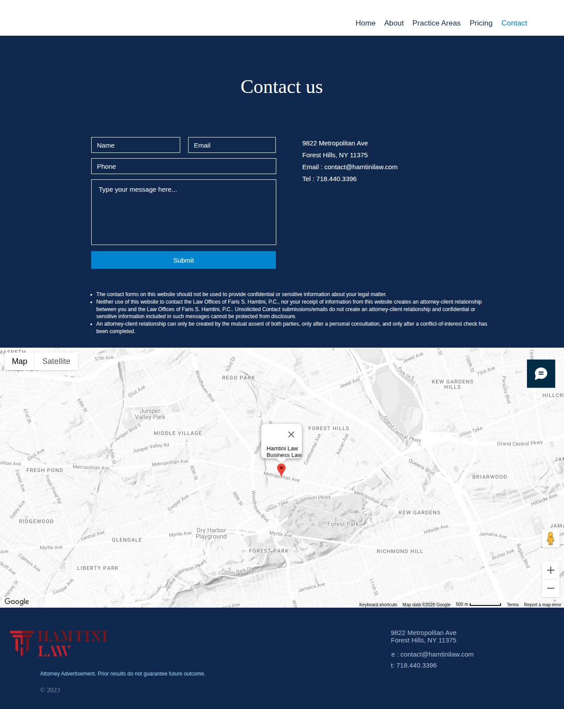

### wolflawcolorado.com — dry\_run\_ok (dry run)

| | |
|---|---|
| Attempt ID | `38354629-c492-447d-bcbd-04411923eaf6` |
| Form URL | https://wolflawcolorado.com/contact-us/ |
| Final URL | https://wolflawcolorado.com/contact-us/ |
| Reserved | 2026-11-04 04:17:23 UTC |
| Submit attempted | — |
| Template | standard v2 |
| Confirmation text | none observed |
| Result / error | Selectors verified; fields not typed (domain not in dry-run fill list); not submitted |

Exact message:

~~~text
Subject: Helping customers find your business in AI search (AEO + GEO)

Hi there,

I'm Arun from Devs Arun. More and more customers now ask ChatGPT, Gemini, Perplexity or Google's AI Overviews questions like "who should I hire for this in my area?" before they call anyone. These tools answer from websites they can clearly understand, and they tend to recommend businesses whose pages answer real customer questions.

That is what AEO + GEO (Answer Engine and Generative Engine Optimization) is for. I improve your existing service pages so they clearly answer the questions your customers ask, add structured data that matches the page, and make the call, quote or enquiry step obvious. The benefit: your business gets a better chance of being mentioned or linked in AI answers, and visitors who arrive find it easy to contact you.

The AEO + GEO Starter is a one-time $199 (about ₹16,999, negotiable) for one website: a basic audit, 10 customer questions, improvements to two existing pages, relevant structured data and an action plan, with one revision round.

You can read the full details, send an enquiry or book online here:
https://devsarun.io/aeo-geo/

If this isn't relevant, just reply and I won't contact you again.

Best,
Arun
Devs Arun
itschool408@gmail.com · +91 7654534323
~~~

Submitted field values:

- \#main \> div:nth-of-type(1) \> div:nth-of-type(2) \> div:nth-of-type(1) \> div \> div \> form \> div:nth-of-type(1) \> ul \> li:nth-of-type(3) \> div \> input: Arun
- \#main \> div:nth-of-type(1) \> div:nth-of-type(2) \> div:nth-of-type(1) \> div \> div \> form \> div:nth-of-type(1) \> ul \> li:nth-of-type(4) \> div \> input: +91 7654534323
- \#main \> div:nth-of-type(1) \> div:nth-of-type(2) \> div:nth-of-type(1) \> div \> div \> form \> div:nth-of-type(1) \> ul \> li:nth-of-type(5) \> div \> input: itschool408@gmail.com
- \#main \> div:nth-of-type(1) \> div:nth-of-type(2) \> div:nth-of-type(1) \> div \> div \> form \> div:nth-of-type(1) \> ul \> li:nth-of-type(6) \> div \> textarea: Hi there, I'm Arun from Devs Arun. More and more customers now ask ChatGPT, Gemini, Perplexity or Google's AI Overviews 

**Inspected page** — `run-495c543b_attempt-38354629_inspection_2026-11-04T04-17-25-306Z.jpg`

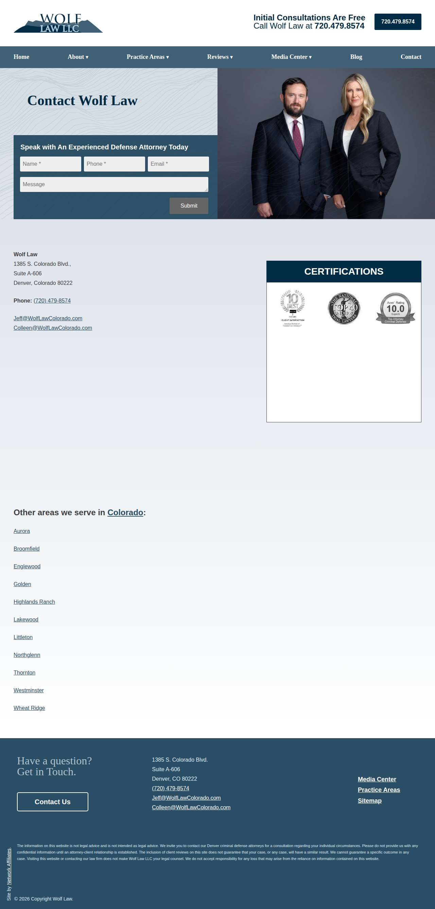

### david-ware.com — dry\_run\_failed (dry run)

| | |
|---|---|
| Attempt ID | `3bb86b70-676c-4e06-8eb8-c9a721313127` |
| Form URL | https://www.david-ware.com/contact/ |
| Final URL | https://www.david-ware.com/contact/ |
| Reserved | 2026-11-04 04:17:30 UTC |
| Submit attempted | — |
| Template | short v2 |
| Confirmation text | none observed |
| Result / error | Reviewed form not found on page (site changed) |

Exact message:

~~~text
Subject: Helping customers find your business in AI search (AEO + GEO)

Hi there,

I'm Arun from Devs Arun. Customers increasingly ask ChatGPT, Gemini and Google's AI Overviews who to hire before they call anyone. AEO + GEO makes your existing service pages clear answers these tools can understand and cite, with an easy way to call or enquire, so your business has a better chance of being recommended.

The AEO + GEO Starter is a one-time $199 (about ₹16,999, negotiable) for one website.

Full details, enquiries and online booking:
https://devsarun.io/aeo-geo/

If this isn't relevant, just reply and I won't contact you again.

Best,
Arun, Devs Arun
itschool408@gmail.com
~~~

Submitted field values:

- \#nf-field-2: Arun
- \#nf-field-3: itschool408@gmail.com
- \#nf-field-4: +91 7654534323
- \#nf-field-10: Hi there, I'm Arun from Devs Arun. Customers increasingly ask ChatGPT, Gemini and Google's AI Overviews who to hire befo

**Inspected page** — `run-495c543b_attempt-3bb86b70_inspection_2026-11-04T04-17-32-909Z.jpg`

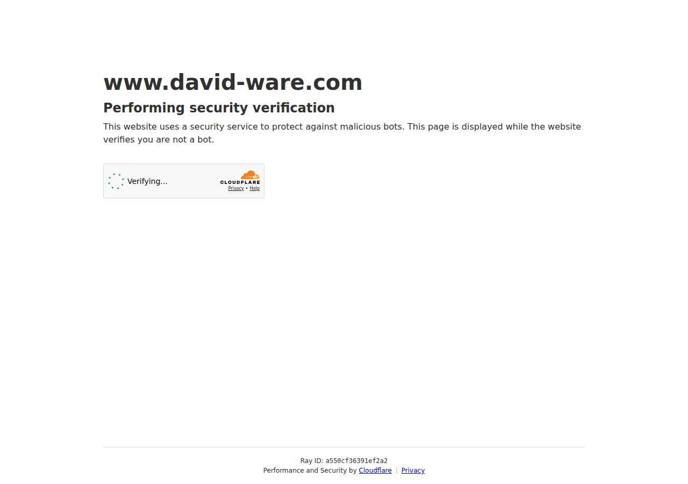

### lexingtondefense.com — dry\_run\_ok (dry run)

| | |
|---|---|
| Attempt ID | `27a9a21e-ef1f-42dd-aef7-a0d108d66193` |
| Form URL | https://www.lexingtondefense.com/contact-us/ |
| Final URL | https://www.lexingtondefense.com/contact-us/ |
| Reserved | 2026-11-04 04:17:37 UTC |
| Submit attempted | — |
| Template | standard v2 |
| Confirmation text | none observed |
| Result / error | Selectors verified; fields not typed (domain not in dry-run fill list); not submitted |

Exact message:

~~~text
Subject: Helping customers find your business in AI search (AEO + GEO)

Hi there,

I'm Arun from Devs Arun. More and more customers now ask ChatGPT, Gemini, Perplexity or Google's AI Overviews questions like "who should I hire for this in my area?" before they call anyone. These tools answer from websites they can clearly understand, and they tend to recommend businesses whose pages answer real customer questions.

That is what AEO + GEO (Answer Engine and Generative Engine Optimization) is for. I improve your existing service pages so they clearly answer the questions your customers ask, add structured data that matches the page, and make the call, quote or enquiry step obvious. The benefit: your business gets a better chance of being mentioned or linked in AI answers, and visitors who arrive find it easy to contact you.

The AEO + GEO Starter is a one-time $199 (about ₹16,999, negotiable) for one website: a basic audit, 10 customer questions, improvements to two existing pages, relevant structured data and an action plan, with one revision round.

You can read the full details, send an enquiry or book online here:
https://devsarun.io/aeo-geo/

If this isn't relevant, just reply and I won't contact you again.

Best,
Arun
Devs Arun
itschool408@gmail.com · +91 7654534323
~~~

Submitted field values:

- \#name: Arun
- \#email: itschool408@gmail.com
- \#phone: +91 7654534323
- \#message: Hi there, I'm Arun from Devs Arun. More and more customers now ask ChatGPT, Gemini, Perplexity or Google's AI Overviews 

**Inspected page** — `run-495c543b_attempt-27a9a21e_inspection_2026-11-04T04-17-39-992Z.jpg`

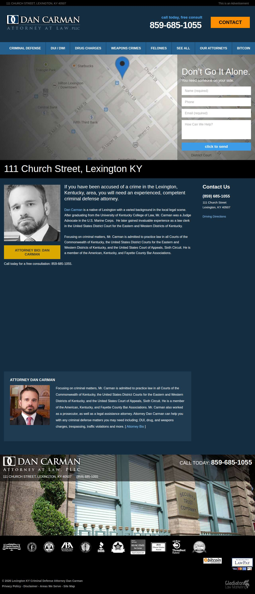

### wicklaw.com — dry\_run\_ok (dry run)

| | |
|---|---|
| Attempt ID | `0bb9c0b0-6a6c-44bc-a9c0-10b453e4861d` |
| Form URL | https://www.wicklaw.com/contact |
| Final URL | https://www.wicklaw.com/contact |
| Reserved | 2026-11-04 04:17:45 UTC |
| Submit attempted | — |
| Template | standard v2 |
| Confirmation text | none observed |
| Result / error | Selectors verified; fields not typed (domain not in dry-run fill list); not submitted |

Exact message:

~~~text
Subject: Helping customers find your business in AI search (AEO + GEO)

Hi there,

I'm Arun from Devs Arun. More and more customers now ask ChatGPT, Gemini, Perplexity or Google's AI Overviews questions like "who should I hire for this in my area?" before they call anyone. These tools answer from websites they can clearly understand, and they tend to recommend businesses whose pages answer real customer questions.

That is what AEO + GEO (Answer Engine and Generative Engine Optimization) is for. I improve your existing service pages so they clearly answer the questions your customers ask, add structured data that matches the page, and make the call, quote or enquiry step obvious. The benefit: your business gets a better chance of being mentioned or linked in AI answers, and visitors who arrive find it easy to contact you.

The AEO + GEO Starter is a one-time $199 (about ₹16,999, negotiable) for one website: a basic audit, 10 customer questions, improvements to two existing pages, relevant structured data and an action plan, with one revision round.

You can read the full details, send an enquiry or book online here:
https://devsarun.io/aeo-geo/

If this isn't relevant, just reply and I won't contact you again.

Best,
Arun
Devs Arun
itschool408@gmail.com · +91 7654534323
~~~

Submitted field values:

- \#Name: Arun
- \#Email: itschool408@gmail.com
- \#Phone: +91 7654534323
- \#Message: Hi there, I'm Arun from Devs Arun. More and more customers now ask ChatGPT, Gemini, Perplexity or Google's AI Overviews 

**Inspected page** — `run-495c543b_attempt-0bb9c0b0_inspection_2026-11-04T04-17-46-363Z.jpg`

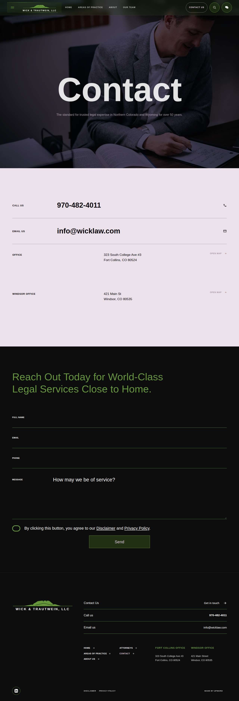

### lawnj.net — dry\_run\_ok (dry run)

| | |
|---|---|
| Attempt ID | `6500fd6f-6520-4872-b293-43e642207c7d` |
| Form URL | https://lawnj.net/contact/ |
| Final URL | https://lawnj.net/contact/ |
| Reserved | 2026-11-04 04:17:51 UTC |
| Submit attempted | — |
| Template | standard v2 |
| Confirmation text | none observed |
| Result / error | Selectors verified; fields not typed (domain not in dry-run fill list); not submitted |

Exact message:

~~~text
Subject: Helping customers find your business in AI search (AEO + GEO)

Hi there,

I'm Arun from Devs Arun. More and more customers now ask ChatGPT, Gemini, Perplexity or Google's AI Overviews questions like "who should I hire for this in my area?" before they call anyone. These tools answer from websites they can clearly understand, and they tend to recommend businesses whose pages answer real customer questions.

That is what AEO + GEO (Answer Engine and Generative Engine Optimization) is for. I improve your existing service pages so they clearly answer the questions your customers ask, add structured data that matches the page, and make the call, quote or enquiry step obvious. The benefit: your business gets a better chance of being mentioned or linked in AI answers, and visitors who arrive find it easy to contact you.

The AEO + GEO Starter is a one-time $199 (about ₹16,999, negotiable) for one website: a basic audit, 10 customer questions, improvements to two existing pages, relevant structured data and an action plan, with one revision round.

You can read the full details, send an enquiry or book online here:
https://devsarun.io/aeo-geo/

If this isn't relevant, just reply and I won't contact you again.

Best,
Arun
Devs Arun
itschool408@gmail.com · +91 7654534323
~~~

Submitted field values:

- \#input\_4\_1: Arun
- \#input\_4\_2: itschool408@gmail.com
- \#input\_4\_3: +91 7654534323
- \#input\_4\_4: Hi there, I'm Arun from Devs Arun. More and more customers now ask ChatGPT, Gemini, Perplexity or Google's AI Overviews 

**Inspected page** — `run-495c543b_attempt-6500fd6f_inspection_2026-11-04T04-17-53-216Z.jpg`

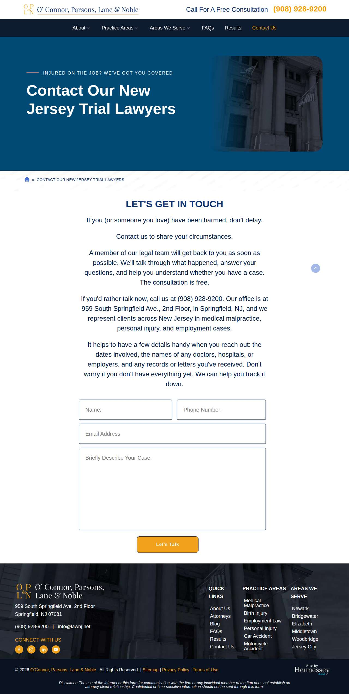

### helbert-allemang.com — dry\_run\_ok (dry run)

| | |
|---|---|
| Attempt ID | `d5a049f1-a3c9-4492-9d58-6d69c7d19448` |
| Form URL | https://www.helbert-allemang.com/contact |
| Final URL | https://www.helbert-allemang.com/contact |
| Reserved | 2026-11-04 04:17:58 UTC |
| Submit attempted | — |
| Template | standard v2 |
| Confirmation text | none observed |
| Result / error | Selectors verified; fields not typed (domain not in dry-run fill list); not submitted |

Exact message:

~~~text
Subject: Helping customers find your business in AI search (AEO + GEO)

Hi there,

I'm Arun from Devs Arun. More and more customers now ask ChatGPT, Gemini, Perplexity or Google's AI Overviews questions like "who should I hire for this in my area?" before they call anyone. These tools answer from websites they can clearly understand, and they tend to recommend businesses whose pages answer real customer questions.

That is what AEO + GEO (Answer Engine and Generative Engine Optimization) is for. I improve your existing service pages so they clearly answer the questions your customers ask, add structured data that matches the page, and make the call, quote or enquiry step obvious. The benefit: your business gets a better chance of being mentioned or linked in AI answers, and visitors who arrive find it easy to contact you.

The AEO + GEO Starter is a one-time $199 (about ₹16,999, negotiable) for one website: a basic audit, 10 customer questions, improvements to two existing pages, relevant structured data and an action plan, with one revision round.

You can read the full details, send an enquiry or book online here:
https://devsarun.io/aeo-geo/

If this isn't relevant, just reply and I won't contact you again.

Best,
Arun
Devs Arun
itschool408@gmail.com · +91 7654534323
~~~

Submitted field values:

- \#\\31 026385178: Arun
- \#\\31 281776668: +91 7654534323
- \#\\31 677942703: Hi there, I'm Arun from Devs Arun. More and more customers now ask ChatGPT, Gemini, Perplexity or Google's AI Overviews 
- \#\\31 819202934: itschool408@gmail.com

**Inspected page** — `run-495c543b_attempt-d5a049f1_inspection_2026-11-04T04-18-01-066Z.jpg`

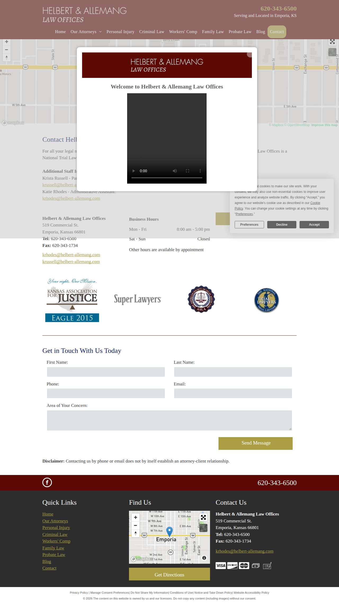

### kenwilsonlaw.com — dry\_run\_ok (dry run)

| | |
|---|---|
| Attempt ID | `2c0ced07-8cdf-4168-9f7e-9ee38e2bf1f5` |
| Form URL | https://www.kenwilsonlaw.com/contact/ |
| Final URL | https://www.kenwilsonlaw.com/contact/ |
| Reserved | 2026-11-04 04:18:06 UTC |
| Submit attempted | — |
| Template | standard v2 |
| Confirmation text | none observed |
| Result / error | Selectors verified; fields not typed (domain not in dry-run fill list); not submitted |

Exact message:

~~~text
Subject: Helping customers find your business in AI search (AEO + GEO)

Hi there,

I'm Arun from Devs Arun. More and more customers now ask ChatGPT, Gemini, Perplexity or Google's AI Overviews questions like "who should I hire for this in my area?" before they call anyone. These tools answer from websites they can clearly understand, and they tend to recommend businesses whose pages answer real customer questions.

That is what AEO + GEO (Answer Engine and Generative Engine Optimization) is for. I improve your existing service pages so they clearly answer the questions your customers ask, add structured data that matches the page, and make the call, quote or enquiry step obvious. The benefit: your business gets a better chance of being mentioned or linked in AI answers, and visitors who arrive find it easy to contact you.

The AEO + GEO Starter is a one-time $199 (about ₹16,999, negotiable) for one website: a basic audit, 10 customer questions, improvements to two existing pages, relevant structured data and an action plan, with one revision round.

You can read the full details, send an enquiry or book online here:
https://devsarun.io/aeo-geo/

If this isn't relevant, just reply and I won't contact you again.

Best,
Arun
Devs Arun
itschool408@gmail.com · +91 7654534323
~~~

Submitted field values:

- \#form-field-name: Arun
- \#form-field-email: itschool408@gmail.com
- \#form-field-message: Hi there, I'm Arun from Devs Arun. More and more customers now ask ChatGPT, Gemini, Perplexity or Google's AI Overviews 

**Inspected page** — `run-495c543b_attempt-2c0ced07_inspection_2026-11-04T04-18-09-481Z.jpg`

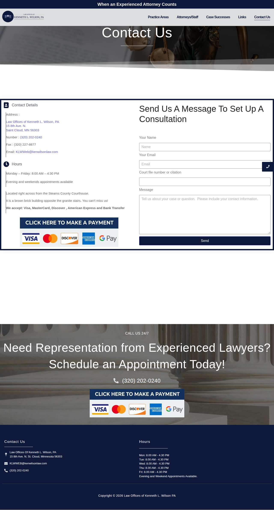

### robertreeveslaw.com — dry\_run\_ok (dry run)

| | |
|---|---|
| Attempt ID | `6266bb1b-90a9-4b10-bc46-9b91d18899ec` |
| Form URL | https://www.robertreeveslaw.com/contact-us/ |
| Final URL | https://www.robertreeveslaw.com/contact-us/ |
| Reserved | 2026-11-04 04:18:14 UTC |
| Submit attempted | — |
| Template | standard v2 |
| Confirmation text | none observed |
| Result / error | Selectors verified; fields not typed (domain not in dry-run fill list); not submitted |

Exact message:

~~~text
Subject: Helping customers find your business in AI search (AEO + GEO)

Hi there,

I'm Arun from Devs Arun. More and more customers now ask ChatGPT, Gemini, Perplexity or Google's AI Overviews questions like "who should I hire for this in my area?" before they call anyone. These tools answer from websites they can clearly understand, and they tend to recommend businesses whose pages answer real customer questions.

That is what AEO + GEO (Answer Engine and Generative Engine Optimization) is for. I improve your existing service pages so they clearly answer the questions your customers ask, add structured data that matches the page, and make the call, quote or enquiry step obvious. The benefit: your business gets a better chance of being mentioned or linked in AI answers, and visitors who arrive find it easy to contact you.

The AEO + GEO Starter is a one-time $199 (about ₹16,999, negotiable) for one website: a basic audit, 10 customer questions, improvements to two existing pages, relevant structured data and an action plan, with one revision round.

You can read the full details, send an enquiry or book online here:
https://devsarun.io/aeo-geo/

If this isn't relevant, just reply and I won't contact you again.

Best,
Arun
Devs Arun
itschool408@gmail.com · +91 7654534323
~~~

Submitted field values:

- \#input\_1\_1: Arun
- \#input\_1\_2: Hi there, I'm Arun from Devs Arun. More and more customers now ask ChatGPT, Gemini, Perplexity or Google's AI Overviews 
- \#input\_1\_3: +91 7654534323
- \#input\_1\_4: itschool408@gmail.com

**Inspected page** — `run-495c543b_attempt-6266bb1b_inspection_2026-11-04T04-18-17-754Z.jpg`

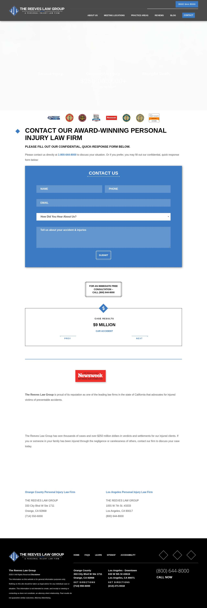

### hatchlawfirm.com — dry\_run\_ok (dry run)

| | |
|---|---|
| Attempt ID | `c3af223a-f058-41b8-86bd-c13f79162fb3` |
| Form URL | https://www.hatchlawfirm.com/contact |
| Final URL | https://www.hatchlawfirm.com/contact |
| Reserved | 2026-11-04 04:18:22 UTC |
| Submit attempted | — |
| Template | standard v2 |
| Confirmation text | none observed |
| Result / error | Selectors verified; fields not typed (domain not in dry-run fill list); not submitted |

Exact message:

~~~text
Subject: Helping customers find your business in AI search (AEO + GEO)

Hi there,

I'm Arun from Devs Arun. More and more customers now ask ChatGPT, Gemini, Perplexity or Google's AI Overviews questions like "who should I hire for this in my area?" before they call anyone. These tools answer from websites they can clearly understand, and they tend to recommend businesses whose pages answer real customer questions.

That is what AEO + GEO (Answer Engine and Generative Engine Optimization) is for. I improve your existing service pages so they clearly answer the questions your customers ask, add structured data that matches the page, and make the call, quote or enquiry step obvious. The benefit: your business gets a better chance of being mentioned or linked in AI answers, and visitors who arrive find it easy to contact you.

The AEO + GEO Starter is a one-time $199 (about ₹16,999, negotiable) for one website: a basic audit, 10 customer questions, improvements to two existing pages, relevant structured data and an action plan, with one revision round.

You can read the full details, send an enquiry or book online here:
https://devsarun.io/aeo-geo/

If this isn't relevant, just reply and I won't contact you again.

Best,
Arun
Devs Arun
itschool408@gmail.com · +91 7654534323
~~~

Submitted field values:

- \#name: Arun
- \#email: itschool408@gmail.com
- \#phone: +91 7654534323
- \#message: Hi there, I'm Arun from Devs Arun. More and more customers now ask ChatGPT, Gemini, Perplexity or Google's AI Overviews 

**Inspected page** — `run-495c543b_attempt-c3af223a_inspection_2026-11-04T04-18-24-352Z.jpg`

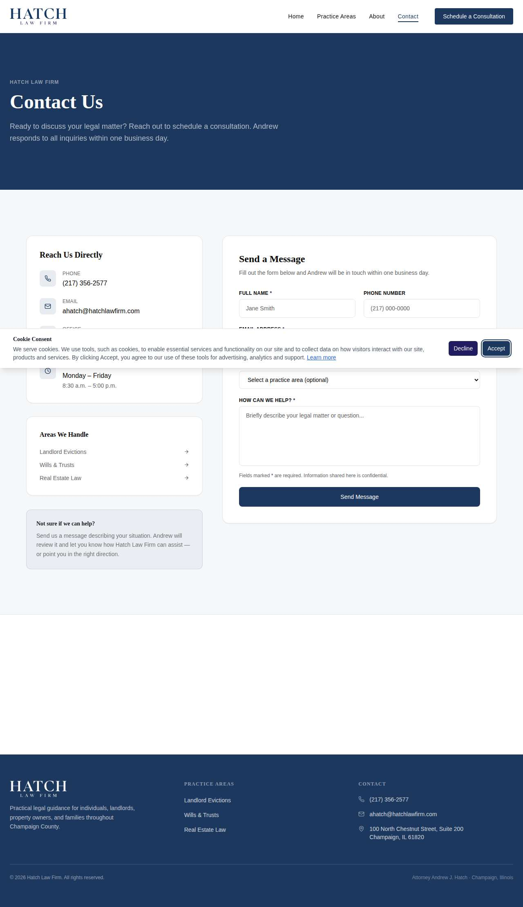

### atkinsonlawyers.com — dry\_run\_ok (dry run)

| | |
|---|---|
| Attempt ID | `5b63b7d7-e1c3-41e7-80d2-e806edf29892` |
| Form URL | https://www.atkinsonlawyers.com/contact-us/ |
| Final URL | https://www.atkinsonlawyers.com/contact-us/ |
| Reserved | 2026-11-04 04:18:29 UTC |
| Submit attempted | — |
| Template | standard v2 |
| Confirmation text | none observed |
| Result / error | Selectors verified; fields not typed (domain not in dry-run fill list); not submitted |

Exact message:

~~~text
Subject: Helping customers find your business in AI search (AEO + GEO)

Hi there,

I'm Arun from Devs Arun. More and more customers now ask ChatGPT, Gemini, Perplexity or Google's AI Overviews questions like "who should I hire for this in my area?" before they call anyone. These tools answer from websites they can clearly understand, and they tend to recommend businesses whose pages answer real customer questions.

That is what AEO + GEO (Answer Engine and Generative Engine Optimization) is for. I improve your existing service pages so they clearly answer the questions your customers ask, add structured data that matches the page, and make the call, quote or enquiry step obvious. The benefit: your business gets a better chance of being mentioned or linked in AI answers, and visitors who arrive find it easy to contact you.

The AEO + GEO Starter is a one-time $199 (about ₹16,999, negotiable) for one website: a basic audit, 10 customer questions, improvements to two existing pages, relevant structured data and an action plan, with one revision round.

You can read the full details, send an enquiry or book online here:
https://devsarun.io/aeo-geo/

If this isn't relevant, just reply and I won't contact you again.

Best,
Arun
Devs Arun
itschool408@gmail.com · +91 7654534323
~~~

Submitted field values:

- \#name-6701: Arun
- \#email-6701: itschool408@gmail.com
- \#phone-6701: +91 7654534323
- \#inquiry-6701: Hi there, I'm Arun from Devs Arun. More and more customers now ask ChatGPT, Gemini, Perplexity or Google's AI Overviews 

**Inspected page** — `run-495c543b_attempt-5b63b7d7_inspection_2026-11-04T04-18-31-445Z.jpg`

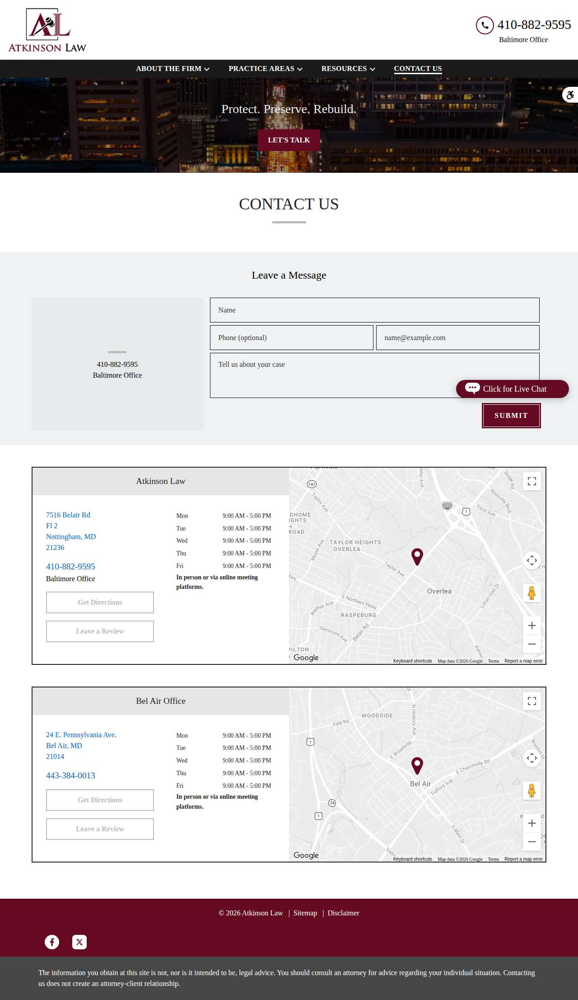

### injuryclaimnyclaw.com — dry\_run\_ok (dry run)

| | |
|---|---|
| Attempt ID | `bb654a59-dcf0-4898-ab96-5f59553a7ce3` |
| Form URL | https://www.injuryclaimnyclaw.com/contact-us/ |
| Final URL | https://www.injuryclaimnyclaw.com/contact-us/ |
| Reserved | 2026-11-04 04:18:36 UTC |
| Submit attempted | — |
| Template | standard v2 |
| Confirmation text | none observed |
| Result / error | Selectors verified; fields not typed (domain not in dry-run fill list); not submitted |

Exact message:

~~~text
Subject: Helping customers find your business in AI search (AEO + GEO)

Hi there,

I'm Arun from Devs Arun. More and more customers now ask ChatGPT, Gemini, Perplexity or Google's AI Overviews questions like "who should I hire for this in my area?" before they call anyone. These tools answer from websites they can clearly understand, and they tend to recommend businesses whose pages answer real customer questions.

That is what AEO + GEO (Answer Engine and Generative Engine Optimization) is for. I improve your existing service pages so they clearly answer the questions your customers ask, add structured data that matches the page, and make the call, quote or enquiry step obvious. The benefit: your business gets a better chance of being mentioned or linked in AI answers, and visitors who arrive find it easy to contact you.

The AEO + GEO Starter is a one-time $199 (about ₹16,999, negotiable) for one website: a basic audit, 10 customer questions, improvements to two existing pages, relevant structured data and an action plan, with one revision round.

You can read the full details, send an enquiry or book online here:
https://devsarun.io/aeo-geo/

If this isn't relevant, just reply and I won't contact you again.

Best,
Arun
Devs Arun
itschool408@gmail.com · +91 7654534323
~~~

Submitted field values:

- article \> section:nth-of-type(2) \> div \> div:nth-of-type(1) \> div \> div:nth-of-type(2) \> form \> div:nth-of-type(2) \> div \> div:nth-of-type(2) \> div \> input: Arun
- article \> section:nth-of-type(2) \> div \> div:nth-of-type(1) \> div \> div:nth-of-type(2) \> form \> div:nth-of-type(2) \> div \> div:nth-of-type(3) \> div \> input: +91 7654534323
- article \> section:nth-of-type(2) \> div \> div:nth-of-type(1) \> div \> div:nth-of-type(2) \> form \> div:nth-of-type(2) \> div \> div:nth-of-type(4) \> div \> input: itschool408@gmail.com
- article \> section:nth-of-type(2) \> div \> div:nth-of-type(1) \> div \> div:nth-of-type(2) \> form \> div:nth-of-type(2) \> div \> div:nth-of-type(5) \> div \> textarea: Hi there, I'm Arun from Devs Arun. More and more customers now ask ChatGPT, Gemini, Perplexity or Google's AI Overviews 

**Inspected page** — `run-495c543b_attempt-bb654a59_inspection_2026-11-04T04-18-38-017Z.jpg`

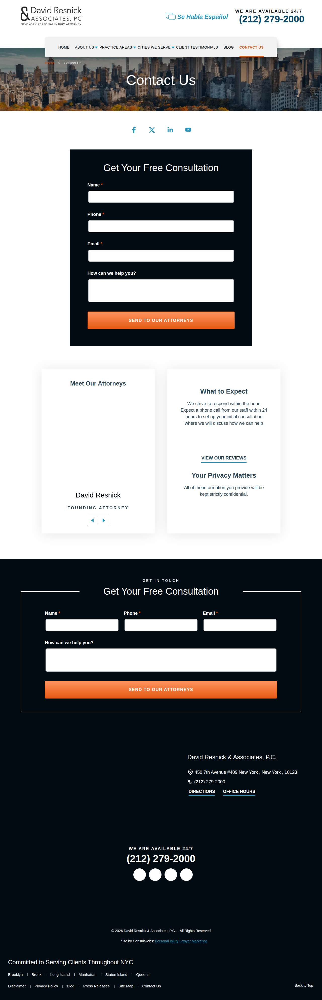

### leevanhorn.com — dry\_run\_ok (dry run)

| | |
|---|---|
| Attempt ID | `32858e51-16e8-4eb6-94db-40f778cc051a` |
| Form URL | https://www.vanhornlawoffice.net/ |
| Final URL | https://www.vanhornlawoffice.net/ |
| Reserved | 2026-11-04 04:18:43 UTC |
| Submit attempted | — |
| Template | standard v2 |
| Confirmation text | none observed |
| Result / error | Selectors verified; fields not typed (domain not in dry-run fill list); not submitted |

Exact message:

~~~text
Subject: Helping customers find your business in AI search (AEO + GEO)

Hi there,

I'm Arun from Devs Arun. More and more customers now ask ChatGPT, Gemini, Perplexity or Google's AI Overviews questions like "who should I hire for this in my area?" before they call anyone. These tools answer from websites they can clearly understand, and they tend to recommend businesses whose pages answer real customer questions.

That is what AEO + GEO (Answer Engine and Generative Engine Optimization) is for. I improve your existing service pages so they clearly answer the questions your customers ask, add structured data that matches the page, and make the call, quote or enquiry step obvious. The benefit: your business gets a better chance of being mentioned or linked in AI answers, and visitors who arrive find it easy to contact you.

The AEO + GEO Starter is a one-time $199 (about ₹16,999, negotiable) for one website: a basic audit, 10 customer questions, improvements to two existing pages, relevant structured data and an action plan, with one revision round.

You can read the full details, send an enquiry or book online here:
https://devsarun.io/aeo-geo/

If this isn't relevant, just reply and I won't contact you again.

Best,
Arun
Devs Arun
itschool408@gmail.com · +91 7654534323
~~~

Submitted field values:

- \#input\_comp-l87vpdfu: Arun
- \#input\_comp-l87vpdfz: itschool408@gmail.com
- \#input\_comp-l87vpdg2: Helping customers find your business in AI search (AEO + GEO)
- \#textarea\_comp-l87vpdg52: Hi there, I'm Arun from Devs Arun. More and more customers now ask ChatGPT, Gemini, Perplexity or Google's AI Overviews 

**Inspected page** — `run-495c543b_attempt-32858e51_inspection_2026-11-04T04-18-45-683Z.jpg`

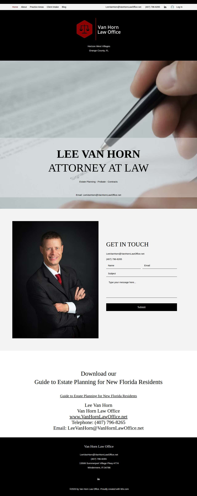

## Events (129)

| Time (UTC) | Event | Website | Details |
|---|---|---|---|
| 04:15:39 | run\_queued | — | dry\_run run requested by github:itsDevsArun |
| 04:15:39 | run\_dispatched | — | dispatch disabled (local test mode) |
| 04:15:42 | run\_started | — | Runner claimed dry\_run run |
| 04:15:43 | website\_selected | helixmechanical.com | Dry-run target helixmechanical.com |
| 04:15:43 | draft\_prepared | helixmechanical.com | Draft prepared with template standard v2 |
| 04:15:46 | page\_opened | helixmechanical.com | Opened form page |
| 04:15:46 | screenshot\_saved | helixmechanical.com | inspection screenshot saved (54 KB) |
| 04:15:46 | review\_required | helixmechanical.com | dry run failed: Mapped field "First Name \*" not found uniquely |
| 04:15:51 | website\_selected | knoxvilleelectrician.com | Dry-run target knoxvilleelectrician.com |
| 04:15:51 | draft\_prepared | knoxvilleelectrician.com | Draft prepared with template standard v2 |
| 04:15:53 | page\_opened | knoxvilleelectrician.com | Opened form page |
| 04:15:53 | screenshot\_saved | knoxvilleelectrician.com | inspection screenshot saved (137 KB) |
| 04:15:53 | review\_required | knoxvilleelectrician.com | dry run failed: Mapped field "Name" not found uniquely |
| 04:15:58 | website\_selected | familylawdelaware.com | Dry-run target familylawdelaware.com |
| 04:15:58 | draft\_prepared | familylawdelaware.com | Draft prepared with template standard v2 |
| 04:16:01 | page\_opened | familylawdelaware.com | Opened form page |
| 04:16:01 | screenshot\_saved | familylawdelaware.com | inspection screenshot saved (31 KB) |
| 04:16:01 | review\_required | familylawdelaware.com | dry run failed: Reviewed form not found on page (site changed) |
| 04:16:06 | website\_selected | barbierilawoffice.com | Dry-run target barbierilawoffice.com |
| 04:16:06 | draft\_prepared | barbierilawoffice.com | Draft prepared with template standard v2 |
| 04:16:09 | page\_opened | barbierilawoffice.com | Opened form page |
| 04:16:09 | screenshot\_saved | barbierilawoffice.com | inspection screenshot saved (133 KB) |
| 04:16:10 | dry\_run\_checked | barbierilawoffice.com | dry run ok: Selectors verified; fields not typed (domain not in dry-run fill list); not submitted |
| 04:16:15 | website\_selected | rutledgelawcenter.com | Dry-run target rutledgelawcenter.com |
| 04:16:15 | draft\_prepared | rutledgelawcenter.com | Draft prepared with template standard v2 |
| 04:16:17 | page\_opened | rutledgelawcenter.com | Opened form page |
| 04:16:17 | screenshot\_saved | rutledgelawcenter.com | inspection screenshot saved (117 KB) |
| 04:16:17 | dry\_run\_checked | rutledgelawcenter.com | dry run ok: Selectors verified; fields not typed (domain not in dry-run fill list); not submitted |
| 04:16:22 | website\_selected | drdale.net | Dry-run target drdale.net |
| 04:16:22 | draft\_prepared | drdale.net | Draft prepared with template standard v2 |
| 04:16:23 | page\_opened | drdale.net | Opened form page |
| 04:16:24 | screenshot\_saved | drdale.net | inspection screenshot saved (35 KB) |
| 04:16:24 | dry\_run\_checked | drdale.net | dry run ok: Selectors verified; fields not typed (domain not in dry-run fill list); not submitted |
| 04:16:29 | website\_selected | curthamiltonlaw.com | Dry-run target curthamiltonlaw.com |
| 04:16:29 | draft\_prepared | curthamiltonlaw.com | Draft prepared with template standard v2 |
| 04:16:31 | page\_opened | curthamiltonlaw.com | Opened form page |
| 04:16:31 | screenshot\_saved | curthamiltonlaw.com | inspection screenshot saved (30 KB) |
| 04:16:31 | review\_required | curthamiltonlaw.com | dry run failed: Reviewed form not found on page (site changed) |
| 04:16:36 | website\_selected | masoudlawfirm.com | Dry-run target masoudlawfirm.com |
| 04:16:36 | draft\_prepared | masoudlawfirm.com | Draft prepared with template standard v2 |
| 04:16:40 | page\_opened | masoudlawfirm.com | Opened form page |
| 04:16:40 | screenshot\_saved | masoudlawfirm.com | inspection screenshot saved (167 KB) |
| 04:16:40 | dry\_run\_checked | masoudlawfirm.com | dry run ok: Selectors verified; fields not typed (domain not in dry-run fill list); not submitted |
| 04:16:45 | website\_selected | fishertalwar.com | Dry-run target fishertalwar.com |
| 04:16:45 | draft\_prepared | fishertalwar.com | Draft prepared with template standard v2 |
| 04:16:49 | page\_opened | fishertalwar.com | Opened form page |
| 04:16:49 | screenshot\_saved | fishertalwar.com | inspection screenshot saved (132 KB) |
| 04:16:49 | dry\_run\_checked | fishertalwar.com | dry run ok: Selectors verified; fields not typed (domain not in dry-run fill list); not submitted |
| 04:16:54 | website\_selected | mmrvt.com | Dry-run target mmrvt.com |
| 04:16:54 | draft\_prepared | mmrvt.com | Draft prepared with template standard v2 |
| 04:16:55 | page\_opened | mmrvt.com | Opened form page |
| 04:16:55 | screenshot\_saved | mmrvt.com | inspection screenshot saved (58 KB) |
| 04:16:55 | dry\_run\_checked | mmrvt.com | dry run ok: Selectors verified; fields not typed (domain not in dry-run fill list); not submitted |
| 04:17:00 | website\_selected | hkwllp.com | Dry-run target hkwllp.com |
| 04:17:00 | draft\_prepared | hkwllp.com | Draft prepared with template standard v2 |
| 04:17:03 | page\_opened | hkwllp.com | Opened form page |
| 04:17:03 | screenshot\_saved | hkwllp.com | inspection screenshot saved (82 KB) |
| 04:17:03 | dry\_run\_checked | hkwllp.com | dry run ok: Selectors verified; fields not typed (domain not in dry-run fill list); not submitted |
| 04:17:08 | website\_selected | maltezoslaw.com | Dry-run target maltezoslaw.com |
| 04:17:08 | draft\_prepared | maltezoslaw.com | Draft prepared with template standard v2 |
| 04:17:10 | page\_opened | maltezoslaw.com | Opened form page |
| 04:17:10 | screenshot\_saved | maltezoslaw.com | inspection screenshot saved (91 KB) |
| 04:17:10 | dry\_run\_checked | maltezoslaw.com | dry run ok: Selectors verified; fields not typed (domain not in dry-run fill list); not submitted |
| 04:17:15 | website\_selected | hamtinilaw.com | Dry-run target hamtinilaw.com |
| 04:17:15 | draft\_prepared | hamtinilaw.com | Draft prepared with template standard v2 |
| 04:17:18 | page\_opened | hamtinilaw.com | Opened form page |
| 04:17:18 | screenshot\_saved | hamtinilaw.com | inspection screenshot saved (126 KB) |
| 04:17:18 | dry\_run\_checked | hamtinilaw.com | dry run ok: Selectors verified; fields not typed (domain not in dry-run fill list); not submitted |
| 04:17:23 | website\_selected | wolflawcolorado.com | Dry-run target wolflawcolorado.com |
| 04:17:23 | draft\_prepared | wolflawcolorado.com | Draft prepared with template standard v2 |
| 04:17:25 | page\_opened | wolflawcolorado.com | Opened form page |
| 04:17:25 | screenshot\_saved | wolflawcolorado.com | inspection screenshot saved (132 KB) |
| 04:17:25 | dry\_run\_checked | wolflawcolorado.com | dry run ok: Selectors verified; fields not typed (domain not in dry-run fill list); not submitted |
| 04:17:30 | website\_selected | david-ware.com | Dry-run target david-ware.com |
| 04:17:30 | draft\_prepared | david-ware.com | Draft prepared with template short v2 |
| 04:17:32 | page\_opened | david-ware.com | Opened form page |
| 04:17:32 | screenshot\_saved | david-ware.com | inspection screenshot saved (29 KB) |
| 04:17:32 | review\_required | david-ware.com | dry run failed: Reviewed form not found on page (site changed) |
| 04:17:37 | website\_selected | lexingtondefense.com | Dry-run target lexingtondefense.com |
| 04:17:37 | draft\_prepared | lexingtondefense.com | Draft prepared with template standard v2 |
| 04:17:39 | page\_opened | lexingtondefense.com | Opened form page |
| 04:17:39 | screenshot\_saved | lexingtondefense.com | inspection screenshot saved (308 KB) |
| 04:17:40 | dry\_run\_checked | lexingtondefense.com | dry run ok: Selectors verified; fields not typed (domain not in dry-run fill list); not submitted |
| 04:17:45 | website\_selected | wicklaw.com | Dry-run target wicklaw.com |
| 04:17:45 | draft\_prepared | wicklaw.com | Draft prepared with template standard v2 |
| 04:17:45 | page\_opened | wicklaw.com | Opened form page |
| 04:17:46 | screenshot\_saved | wicklaw.com | inspection screenshot saved (145 KB) |
| 04:17:46 | dry\_run\_checked | wicklaw.com | dry run ok: Selectors verified; fields not typed (domain not in dry-run fill list); not submitted |
| 04:17:51 | website\_selected | lawnj.net | Dry-run target lawnj.net |
| 04:17:51 | draft\_prepared | lawnj.net | Draft prepared with template standard v2 |
| 04:17:53 | page\_opened | lawnj.net | Opened form page |
| 04:17:53 | screenshot\_saved | lawnj.net | inspection screenshot saved (207 KB) |
| 04:17:53 | dry\_run\_checked | lawnj.net | dry run ok: Selectors verified; fields not typed (domain not in dry-run fill list); not submitted |
| 04:17:58 | website\_selected | helbert-allemang.com | Dry-run target helbert-allemang.com |
| 04:17:58 | draft\_prepared | helbert-allemang.com | Draft prepared with template standard v2 |
| 04:18:00 | page\_opened | helbert-allemang.com | Opened form page |
| 04:18:01 | screenshot\_saved | helbert-allemang.com | inspection screenshot saved (148 KB) |
| 04:18:01 | dry\_run\_checked | helbert-allemang.com | dry run ok: Selectors verified; fields not typed (domain not in dry-run fill list); not submitted |
| 04:18:06 | website\_selected | kenwilsonlaw.com | Dry-run target kenwilsonlaw.com |
| 04:18:06 | draft\_prepared | kenwilsonlaw.com | Draft prepared with template standard v2 |
| 04:18:09 | page\_opened | kenwilsonlaw.com | Opened form page |
| 04:18:09 | screenshot\_saved | kenwilsonlaw.com | inspection screenshot saved (165 KB) |
| 04:18:09 | dry\_run\_checked | kenwilsonlaw.com | dry run ok: Selectors verified; fields not typed (domain not in dry-run fill list); not submitted |
| 04:18:14 | website\_selected | robertreeveslaw.com | Dry-run target robertreeveslaw.com |
| 04:18:14 | draft\_prepared | robertreeveslaw.com | Draft prepared with template standard v2 |
| 04:18:17 | page\_opened | robertreeveslaw.com | Opened form page |
| 04:18:17 | screenshot\_saved | robertreeveslaw.com | inspection screenshot saved (182 KB) |
| 04:18:17 | dry\_run\_checked | robertreeveslaw.com | dry run ok: Selectors verified; fields not typed (domain not in dry-run fill list); not submitted |
| 04:18:22 | website\_selected | hatchlawfirm.com | Dry-run target hatchlawfirm.com |
| 04:18:22 | draft\_prepared | hatchlawfirm.com | Draft prepared with template standard v2 |
| 04:18:24 | page\_opened | hatchlawfirm.com | Opened form page |
| 04:18:24 | screenshot\_saved | hatchlawfirm.com | inspection screenshot saved (105 KB) |
| 04:18:24 | dry\_run\_checked | hatchlawfirm.com | dry run ok: Selectors verified; fields not typed (domain not in dry-run fill list); not submitted |
| 04:18:29 | website\_selected | atkinsonlawyers.com | Dry-run target atkinsonlawyers.com |
| 04:18:29 | draft\_prepared | atkinsonlawyers.com | Draft prepared with template standard v2 |
| 04:18:31 | page\_opened | atkinsonlawyers.com | Opened form page |
| 04:18:31 | screenshot\_saved | atkinsonlawyers.com | inspection screenshot saved (160 KB) |
| 04:18:31 | dry\_run\_checked | atkinsonlawyers.com | dry run ok: Selectors verified; fields not typed (domain not in dry-run fill list); not submitted |
| 04:18:36 | website\_selected | injuryclaimnyclaw.com | Dry-run target injuryclaimnyclaw.com |
| 04:18:36 | draft\_prepared | injuryclaimnyclaw.com | Draft prepared with template standard v2 |
| 04:18:37 | page\_opened | injuryclaimnyclaw.com | Opened form page |
| 04:18:38 | screenshot\_saved | injuryclaimnyclaw.com | inspection screenshot saved (209 KB) |
| 04:18:38 | dry\_run\_checked | injuryclaimnyclaw.com | dry run ok: Selectors verified; fields not typed (domain not in dry-run fill list); not submitted |
| 04:18:43 | website\_selected | leevanhorn.com | Dry-run target leevanhorn.com |
| 04:18:43 | draft\_prepared | leevanhorn.com | Draft prepared with template standard v2 |
| 04:18:45 | page\_opened | leevanhorn.com | Opened form page |
| 04:18:45 | screenshot\_saved | leevanhorn.com | inspection screenshot saved (153 KB) |
| 04:18:45 | dry\_run\_checked | leevanhorn.com | dry run ok: Selectors verified; fields not typed (domain not in dry-run fill list); not submitted |
| 04:18:50 | run\_completed | — | Run completed (queue\_exhausted) |
