# Run 68773158 — dry\_run — completed

| | |
|---|---|
| Run ID | `68773158-4165-451c-8540-6d52540fa554` |
| Requested by | github:itsDevsArun |
| Started | 2026-11-04 03:35:04 UTC |
| Finished | 2026-11-04 03:37:23 UTC |
| Finish reason | queue\_exhausted |
| GitHub Actions | https://github.com/itsDevsArun/aeo-geo/actions/runs/41763788389 |

CSV for this run: [runs/2026-11-04_dry_run_68773158.csv](2026-11-04_dry_run_68773158.csv)

## Attempts (19)

### helixmechanical.com — dry\_run\_failed (dry run)

| | |
|---|---|
| Attempt ID | `3888d65c-a802-4f35-9da9-fb53724f56e1` |
| Form URL | https://helixmechanical.com/contact/ |
| Final URL | https://helixmechanical.com/contact/ |
| Reserved | 2026-11-04 03:35:04 UTC |
| Submit attempted | — |
| Template | standard v2 |
| Confirmation text | none observed |
| Result / error | Mapped field "First Name \*" not found uniquely |

Exact message:

~~~text
Subject: Helping customers find your business in AI search (AEO + GEO)

Hi there,

I'm Arun from Devs Arun. More and more customers now ask ChatGPT, Gemini, Perplexity or Google's AI Overviews questions like "who should I hire for this in my area?" before they call anyone. These tools answer from websites they can clearly understand, and they tend to recommend businesses whose pages answer real customer questions.

That is what AEO + GEO (Answer Engine and Generative Engine Optimization) is for. I improve your existing service pages so they clearly answer the questions your customers ask, add structured data that matches the page, and make the call, quote or enquiry step obvious. The benefit: your business gets a better chance of being mentioned or linked in AI answers, and visitors who arrive find it easy to contact you.

The AEO + GEO Starter is a one-time $199 (about ₹16,999, negotiable) for one website: a basic audit, 10 customer questions, improvements to two existing pages, relevant structured data and an action plan, with one revision round.

You can read the full details, send an enquiry or book online here:
https://devsarun.io/aeo-geo/

If this isn't relevant, just reply and I won't contact you again.

Best,
Arun
Devs Arun
itschool408@gmail.com · +91 7654534323
~~~

Submitted field values:

- \#forminator-field-name-1\_6ae7ff023fd3c: Arun
- \#forminator-field-email-1\_6ae7ff023fd3c: itschool408@gmail.com
- \#forminator-field-phone-1\_6ae7ff023fd3c: +91 7654534323
- \#forminator-field-textarea-1\_6ae7ff023fd3c: Hi there, I'm Arun from Devs Arun. More and more customers now ask ChatGPT, Gemini, Perplexity or Google's AI Overviews 

**Inspected page** — `run-68773158_attempt-3888d65c_inspection_2026-11-04T03-35-06-476Z.jpg`

### knoxvilleelectrician.com — dry\_run\_failed (dry run)

| | |
|---|---|
| Attempt ID | `2c75071f-5459-4267-9c6b-acd815e6a9a6` |
| Form URL | https://knoxvilleelectrician.com/contact-us/ |
| Final URL | https://knoxvilleelectrician.com/contact-us/ |
| Reserved | 2026-11-04 03:35:11 UTC |
| Submit attempted | — |
| Template | standard v2 |
| Confirmation text | none observed |
| Result / error | Mapped field "Name" not found uniquely |

Exact message:

~~~text
Subject: Helping customers find your business in AI search (AEO + GEO)

Hi there,

I'm Arun from Devs Arun. More and more customers now ask ChatGPT, Gemini, Perplexity or Google's AI Overviews questions like "who should I hire for this in my area?" before they call anyone. These tools answer from websites they can clearly understand, and they tend to recommend businesses whose pages answer real customer questions.

That is what AEO + GEO (Answer Engine and Generative Engine Optimization) is for. I improve your existing service pages so they clearly answer the questions your customers ask, add structured data that matches the page, and make the call, quote or enquiry step obvious. The benefit: your business gets a better chance of being mentioned or linked in AI answers, and visitors who arrive find it easy to contact you.

The AEO + GEO Starter is a one-time $199 (about ₹16,999, negotiable) for one website: a basic audit, 10 customer questions, improvements to two existing pages, relevant structured data and an action plan, with one revision round.

You can read the full details, send an enquiry or book online here:
https://devsarun.io/aeo-geo/

If this isn't relevant, just reply and I won't contact you again.

Best,
Arun
Devs Arun
itschool408@gmail.com · +91 7654534323
~~~

Submitted field values:

- \#form-field-1b7221: itschool408@gmail.com
- \#form-field-2fa3ac: +91 7654534323
- \#form-field-96f51f: Arun
- \#form-field-fed9d8: Hi there, I'm Arun from Devs Arun. More and more customers now ask ChatGPT, Gemini, Perplexity or Google's AI Overviews 

**Inspected page** — `run-68773158_attempt-2c75071f_inspection_2026-11-04T03-35-14-845Z.jpg`

### got2move.com — dry\_run\_ok (dry run)

| | |
|---|---|
| Attempt ID | `1bb7030a-0b8d-4ed5-89ce-51964bbfeee0` |
| Form URL | https://got2move.com/contact/ |
| Final URL | https://got2move.com/contact/ |
| Reserved | 2026-11-04 03:35:19 UTC |
| Submit attempted | — |
| Template | standard v2 |
| Confirmation text | none observed |
| Result / error | Selectors verified; fields not typed (domain not in dry-run fill list); not submitted |

Exact message:

~~~text
Subject: Helping customers find your business in AI search (AEO + GEO)

Hi there,

I'm Arun from Devs Arun. More and more customers now ask ChatGPT, Gemini, Perplexity or Google's AI Overviews questions like "who should I hire for this in my area?" before they call anyone. These tools answer from websites they can clearly understand, and they tend to recommend businesses whose pages answer real customer questions.

That is what AEO + GEO (Answer Engine and Generative Engine Optimization) is for. I improve your existing service pages so they clearly answer the questions your customers ask, add structured data that matches the page, and make the call, quote or enquiry step obvious. The benefit: your business gets a better chance of being mentioned or linked in AI answers, and visitors who arrive find it easy to contact you.

The AEO + GEO Starter is a one-time $199 (about ₹16,999, negotiable) for one website: a basic audit, 10 customer questions, improvements to two existing pages, relevant structured data and an action plan, with one revision round.

You can read the full details, send an enquiry or book online here:
https://devsarun.io/aeo-geo/

If this isn't relevant, just reply and I won't contact you again.

Best,
Arun
Devs Arun
itschool408@gmail.com · +91 7654534323
~~~

Submitted field values:

- \#form-header-9-name: Arun
- \#form-header-9-email: itschool408@gmail.com
- \#form-header-9-phone: +91 7654534323
- \#form-header-9-comment: Hi there, I'm Arun from Devs Arun. More and more customers now ask ChatGPT, Gemini, Perplexity or Google's AI Overviews 

**Inspected page** — `run-68773158_attempt-1bb7030a_inspection_2026-11-04T03-35-22-151Z.jpg`

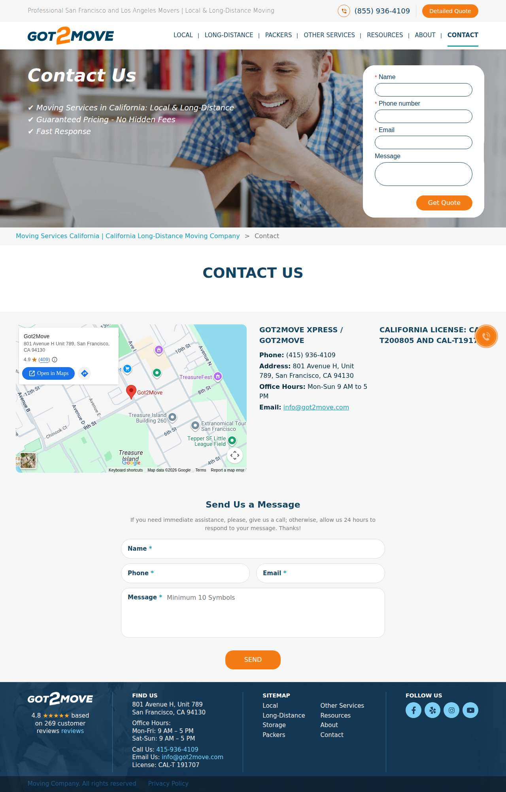

### undergrads.com — dry\_run\_ok (dry run)

| | |
|---|---|
| Attempt ID | `5e06f2d3-a581-4290-8dab-e307a773e839` |
| Form URL | https://undergrads.com/contact/ |
| Final URL | https://undergrads.com/contact/ |
| Reserved | 2026-11-04 03:35:27 UTC |
| Submit attempted | — |
| Template | standard v2 |
| Confirmation text | none observed |
| Result / error | Selectors verified; fields not typed (domain not in dry-run fill list); not submitted |

Exact message:

~~~text
Subject: Helping customers find your business in AI search (AEO + GEO)

Hi there,

I'm Arun from Devs Arun. More and more customers now ask ChatGPT, Gemini, Perplexity or Google's AI Overviews questions like "who should I hire for this in my area?" before they call anyone. These tools answer from websites they can clearly understand, and they tend to recommend businesses whose pages answer real customer questions.

That is what AEO + GEO (Answer Engine and Generative Engine Optimization) is for. I improve your existing service pages so they clearly answer the questions your customers ask, add structured data that matches the page, and make the call, quote or enquiry step obvious. The benefit: your business gets a better chance of being mentioned or linked in AI answers, and visitors who arrive find it easy to contact you.

The AEO + GEO Starter is a one-time $199 (about ₹16,999, negotiable) for one website: a basic audit, 10 customer questions, improvements to two existing pages, relevant structured data and an action plan, with one revision round.

You can read the full details, send an enquiry or book online here:
https://devsarun.io/aeo-geo/

If this isn't relevant, just reply and I won't contact you again.

Best,
Arun
Devs Arun
itschool408@gmail.com · +91 7654534323
~~~

Submitted field values:

- \#main-content \> div \> section:nth-of-type(3) \> div \> div \> div:nth-of-type(2) \> form \> div:nth-of-type(2) \> input: itschool408@gmail.com
- \#main-content \> div \> section:nth-of-type(3) \> div \> div \> div:nth-of-type(2) \> form \> div:nth-of-type(3) \> input: +91 7654534323
- \#main-content \> div \> section:nth-of-type(3) \> div \> div \> div:nth-of-type(2) \> form \> div:nth-of-type(4) \> textarea: Hi there, I'm Arun from Devs Arun. More and more customers now ask ChatGPT, Gemini, Perplexity or Google's AI Overviews 
- \#main-content \> div \> section:nth-of-type(3) \> div \> div \> div:nth-of-type(2) \> form \> div:nth-of-type(1) \> div:nth-of-type(1) \> input: Arun

**Inspected page** — `run-68773158_attempt-5e06f2d3_inspection_2026-11-04T03-35-29-898Z.jpg`

### bravo-moving.com — dry\_run\_ok (dry run)

| | |
|---|---|
| Attempt ID | `a1700dd4-e0ea-4d9e-927e-62da666ec139` |
| Form URL | https://bravo-moving.com/contact/ |
| Final URL | https://bravo-moving.com/contact/ |
| Reserved | 2026-11-04 03:35:34 UTC |
| Submit attempted | — |
| Template | standard v2 |
| Confirmation text | none observed |
| Result / error | Selectors verified; fields not typed (domain not in dry-run fill list); not submitted |

Exact message:

~~~text
Subject: Helping customers find your business in AI search (AEO + GEO)

Hi there,

I'm Arun from Devs Arun. More and more customers now ask ChatGPT, Gemini, Perplexity or Google's AI Overviews questions like "who should I hire for this in my area?" before they call anyone. These tools answer from websites they can clearly understand, and they tend to recommend businesses whose pages answer real customer questions.

That is what AEO + GEO (Answer Engine and Generative Engine Optimization) is for. I improve your existing service pages so they clearly answer the questions your customers ask, add structured data that matches the page, and make the call, quote or enquiry step obvious. The benefit: your business gets a better chance of being mentioned or linked in AI answers, and visitors who arrive find it easy to contact you.

The AEO + GEO Starter is a one-time $199 (about ₹16,999, negotiable) for one website: a basic audit, 10 customer questions, improvements to two existing pages, relevant structured data and an action plan, with one revision round.

You can read the full details, send an enquiry or book online here:
https://devsarun.io/aeo-geo/

If this isn't relevant, just reply and I won't contact you again.

Best,
Arun
Devs Arun
itschool408@gmail.com · +91 7654534323
~~~

Submitted field values:

- \#message: Hi there, I'm Arun from Devs Arun. More and more customers now ask ChatGPT, Gemini, Perplexity or Google's AI Overviews 
- input\[name="subject"\]: Helping customers find your business in AI search (AEO + GEO)
- input\[name="first\_name"\]: Arun
- input\[name="email\_address"\]: itschool408@gmail.com

**Inspected page** — `run-68773158_attempt-a1700dd4_inspection_2026-11-04T03-35-40-046Z.jpg`

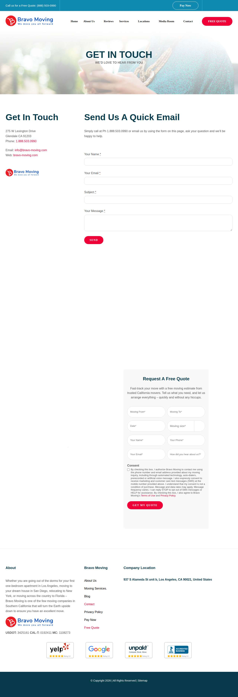

### flytmoving.com — dry\_run\_ok (dry run)

| | |
|---|---|
| Attempt ID | `9d91d917-875d-40d1-a4d6-c5987eb07c29` |
| Form URL | https://flytmoving.com/contact/ |
| Final URL | https://flytmoving.com/contact/ |
| Reserved | 2026-11-04 03:35:45 UTC |
| Submit attempted | — |
| Template | standard v2 |
| Confirmation text | none observed |
| Result / error | Selectors verified; fields not typed (domain not in dry-run fill list); not submitted |

Exact message:

~~~text
Subject: Helping customers find your business in AI search (AEO + GEO)

Hi there,

I'm Arun from Devs Arun. More and more customers now ask ChatGPT, Gemini, Perplexity or Google's AI Overviews questions like "who should I hire for this in my area?" before they call anyone. These tools answer from websites they can clearly understand, and they tend to recommend businesses whose pages answer real customer questions.

That is what AEO + GEO (Answer Engine and Generative Engine Optimization) is for. I improve your existing service pages so they clearly answer the questions your customers ask, add structured data that matches the page, and make the call, quote or enquiry step obvious. The benefit: your business gets a better chance of being mentioned or linked in AI answers, and visitors who arrive find it easy to contact you.

The AEO + GEO Starter is a one-time $199 (about ₹16,999, negotiable) for one website: a basic audit, 10 customer questions, improvements to two existing pages, relevant structured data and an action plan, with one revision round.

You can read the full details, send an enquiry or book online here:
https://devsarun.io/aeo-geo/

If this isn't relevant, just reply and I won't contact you again.

Best,
Arun
Devs Arun
itschool408@gmail.com · +91 7654534323
~~~

Submitted field values:

- input\[name="name"\]: Arun
- input\[name="email"\]: itschool408@gmail.com
- input\[name="phone"\]: +91 7654534323
- textarea\[name="message"\]: Hi there, I'm Arun from Devs Arun. More and more customers now ask ChatGPT, Gemini, Perplexity or Google's AI Overviews 

**Inspected page** — `run-68773158_attempt-9d91d917_inspection_2026-11-04T03-35-46-871Z.jpg`

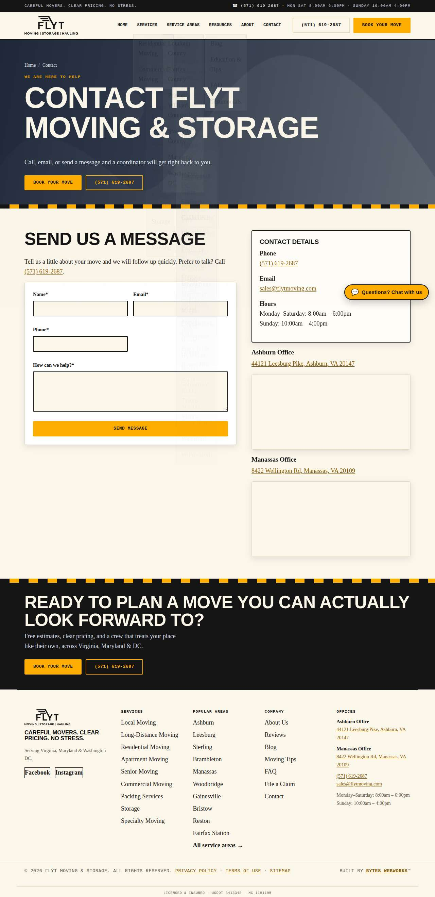

### raysmovers.com — dry\_run\_ok (dry run)

| | |
|---|---|
| Attempt ID | `54f18b79-c445-4d8f-8865-83b085ffb641` |
| Form URL | https://www.raysmovers.com/contact |
| Final URL | https://www.raysmovers.com/contact |
| Reserved | 2026-11-04 03:35:51 UTC |
| Submit attempted | — |
| Template | standard v2 |
| Confirmation text | none observed |
| Result / error | Selectors verified; fields not typed (domain not in dry-run fill list); not submitted |

Exact message:

~~~text
Subject: Helping customers find your business in AI search (AEO + GEO)

Hi there,

I'm Arun from Devs Arun. More and more customers now ask ChatGPT, Gemini, Perplexity or Google's AI Overviews questions like "who should I hire for this in my area?" before they call anyone. These tools answer from websites they can clearly understand, and they tend to recommend businesses whose pages answer real customer questions.

That is what AEO + GEO (Answer Engine and Generative Engine Optimization) is for. I improve your existing service pages so they clearly answer the questions your customers ask, add structured data that matches the page, and make the call, quote or enquiry step obvious. The benefit: your business gets a better chance of being mentioned or linked in AI answers, and visitors who arrive find it easy to contact you.

The AEO + GEO Starter is a one-time $199 (about ₹16,999, negotiable) for one website: a basic audit, 10 customer questions, improvements to two existing pages, relevant structured data and an action plan, with one revision round.

You can read the full details, send an enquiry or book online here:
https://devsarun.io/aeo-geo/

If this isn't relevant, just reply and I won't contact you again.

Best,
Arun
Devs Arun
itschool408@gmail.com · +91 7654534323
~~~

Submitted field values:

- \#email-325716ea-7717-4d9a-ab29-77ce5323b43f-field: itschool408@gmail.com
- \#textarea-8f4e84c7-8f8c-49c0-9d96-ff8f47f44a34-field: Hi there, I'm Arun from Devs Arun. More and more customers now ask ChatGPT, Gemini, Perplexity or Google's AI Overviews 
- \#name-2c7cb667-6d67-4db8-adcf-3409e8e68f6e-fname-field: Arun

**Inspected page** — `run-68773158_attempt-54f18b79_inspection_2026-11-04T03-35-54-480Z.jpg`

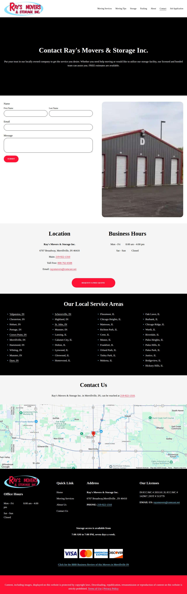

### moveauto.com — dry\_run\_ok (dry run)

| | |
|---|---|
| Attempt ID | `43a238fe-1320-4538-a9ba-91129c89dfbd` |
| Form URL | https://moveauto.com/contact/ |
| Final URL | https://moveauto.com/contact/ |
| Reserved | 2026-11-04 03:35:59 UTC |
| Submit attempted | — |
| Template | standard v2 |
| Confirmation text | none observed |
| Result / error | Selectors verified; fields not typed (domain not in dry-run fill list); not submitted |

Exact message:

~~~text
Subject: Helping customers find your business in AI search (AEO + GEO)

Hi there,

I'm Arun from Devs Arun. More and more customers now ask ChatGPT, Gemini, Perplexity or Google's AI Overviews questions like "who should I hire for this in my area?" before they call anyone. These tools answer from websites they can clearly understand, and they tend to recommend businesses whose pages answer real customer questions.

That is what AEO + GEO (Answer Engine and Generative Engine Optimization) is for. I improve your existing service pages so they clearly answer the questions your customers ask, add structured data that matches the page, and make the call, quote or enquiry step obvious. The benefit: your business gets a better chance of being mentioned or linked in AI answers, and visitors who arrive find it easy to contact you.

The AEO + GEO Starter is a one-time $199 (about ₹16,999, negotiable) for one website: a basic audit, 10 customer questions, improvements to two existing pages, relevant structured data and an action plan, with one revision round.

You can read the full details, send an enquiry or book online here:
https://devsarun.io/aeo-geo/

If this isn't relevant, just reply and I won't contact you again.

Best,
Arun
Devs Arun
itschool408@gmail.com · +91 7654534323
~~~

Submitted field values:

- \#form-field-name: Arun
- \#form-field-email: +91 7654534323
- \#form-field-message: Hi there, I'm Arun from Devs Arun. More and more customers now ask ChatGPT, Gemini, Perplexity or Google's AI Overviews 
- \#form-field-field\_bbafd6f: itschool408@gmail.com

**Inspected page** — `run-68773158_attempt-43a238fe_inspection_2026-11-04T03-36-02-071Z.jpg`

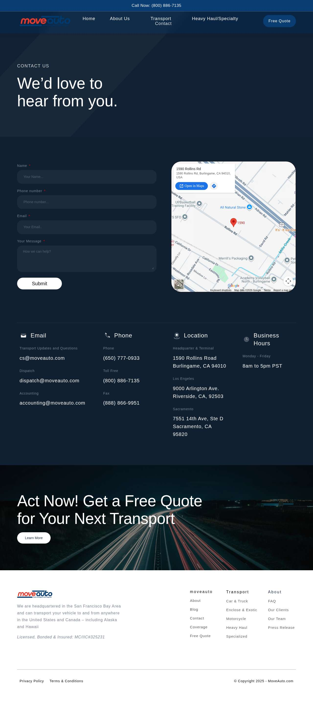

### waterdamagecheyenne.com — dry\_run\_ok (dry run)

| | |
|---|---|
| Attempt ID | `915a0f7e-8cb3-4067-901a-ec94d2049c6a` |
| Form URL | https://waterdamagecheyenne.com/contact/ |
| Final URL | https://waterdamagecheyenne.com/contact/ |
| Reserved | 2026-11-04 03:36:07 UTC |
| Submit attempted | — |
| Template | standard v2 |
| Confirmation text | none observed |
| Result / error | Selectors verified; fields not typed (domain not in dry-run fill list); not submitted |

Exact message:

~~~text
Subject: Helping customers find your business in AI search (AEO + GEO)

Hi there,

I'm Arun from Devs Arun. More and more customers now ask ChatGPT, Gemini, Perplexity or Google's AI Overviews questions like "who should I hire for this in my area?" before they call anyone. These tools answer from websites they can clearly understand, and they tend to recommend businesses whose pages answer real customer questions.

That is what AEO + GEO (Answer Engine and Generative Engine Optimization) is for. I improve your existing service pages so they clearly answer the questions your customers ask, add structured data that matches the page, and make the call, quote or enquiry step obvious. The benefit: your business gets a better chance of being mentioned or linked in AI answers, and visitors who arrive find it easy to contact you.

The AEO + GEO Starter is a one-time $199 (about ₹16,999, negotiable) for one website: a basic audit, 10 customer questions, improvements to two existing pages, relevant structured data and an action plan, with one revision round.

You can read the full details, send an enquiry or book online here:
https://devsarun.io/aeo-geo/

If this isn't relevant, just reply and I won't contact you again.

Best,
Arun
Devs Arun
itschool408@gmail.com · +91 7654534323
~~~

Submitted field values:

- \#cf-msg: Hi there, I'm Arun from Devs Arun. More and more customers now ask ChatGPT, Gemini, Perplexity or Google's AI Overviews 
- \#cf-name: Arun
- \#cf-email: itschool408@gmail.com
- \#cf-phone: +91 7654534323

**Inspected page** — `run-68773158_attempt-915a0f7e_inspection_2026-11-04T03-36-08-257Z.jpg`

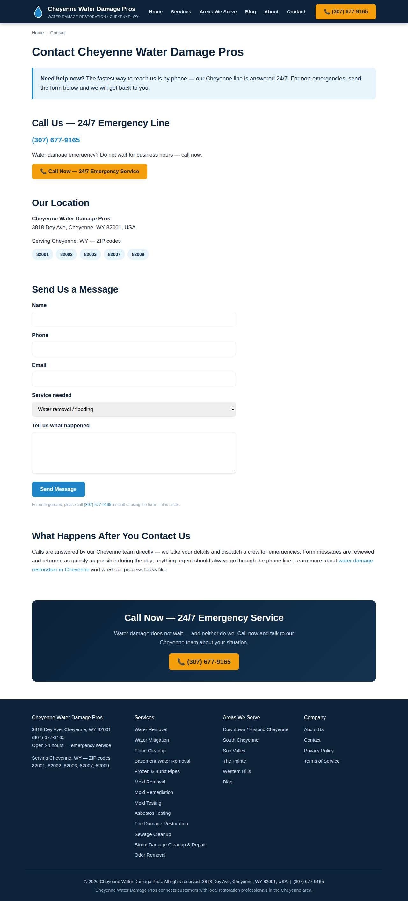

### bookonemove.com — dry\_run\_ok (dry run)

| | |
|---|---|
| Attempt ID | `3f77305e-741f-4b3b-9cfc-2ee226b03e9f` |
| Form URL | https://www.bookonemove.com/contact/ |
| Final URL | https://www.bookonemove.com/contact/ |
| Reserved | 2026-11-04 03:36:13 UTC |
| Submit attempted | — |
| Template | standard v2 |
| Confirmation text | none observed |
| Result / error | Selectors verified; fields not typed (domain not in dry-run fill list); not submitted |

Exact message:

~~~text
Subject: Helping customers find your business in AI search (AEO + GEO)

Hi there,

I'm Arun from Devs Arun. More and more customers now ask ChatGPT, Gemini, Perplexity or Google's AI Overviews questions like "who should I hire for this in my area?" before they call anyone. These tools answer from websites they can clearly understand, and they tend to recommend businesses whose pages answer real customer questions.

That is what AEO + GEO (Answer Engine and Generative Engine Optimization) is for. I improve your existing service pages so they clearly answer the questions your customers ask, add structured data that matches the page, and make the call, quote or enquiry step obvious. The benefit: your business gets a better chance of being mentioned or linked in AI answers, and visitors who arrive find it easy to contact you.

The AEO + GEO Starter is a one-time $199 (about ₹16,999, negotiable) for one website: a basic audit, 10 customer questions, improvements to two existing pages, relevant structured data and an action plan, with one revision round.

You can read the full details, send an enquiry or book online here:
https://devsarun.io/aeo-geo/

If this isn't relevant, just reply and I won't contact you again.

Best,
Arun
Devs Arun
itschool408@gmail.com · +91 7654534323
~~~

Submitted field values:

- \#name-1600: Arun
- \#email-1600: itschool408@gmail.com
- \#phone-1600: +91 7654534323
- \#message-1600: Hi there, I'm Arun from Devs Arun. More and more customers now ask ChatGPT, Gemini, Perplexity or Google's AI Overviews 

**Inspected page** — `run-68773158_attempt-3f77305e_inspection_2026-11-04T03-36-15-460Z.jpg`

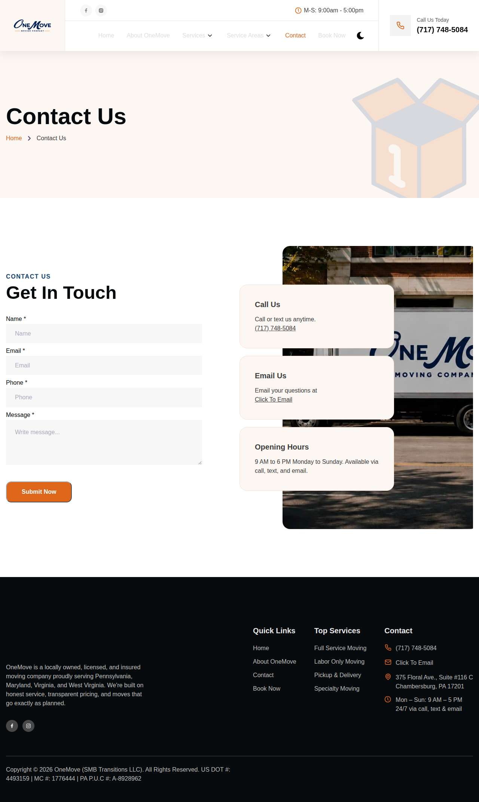

### legendmovers4youfl.com — dry\_run\_ok (dry run)

| | |
|---|---|
| Attempt ID | `0a586705-57d7-4ed6-80ce-061b5ae7f222` |
| Form URL | https://legendmovers4youfl.com/contact-us/ |
| Final URL | https://legendmovers4youfl.com/contact-us/ |
| Reserved | 2026-11-04 03:36:20 UTC |
| Submit attempted | — |
| Template | standard v2 |
| Confirmation text | none observed |
| Result / error | Selectors verified; fields not typed (domain not in dry-run fill list); not submitted |

Exact message:

~~~text
Subject: Helping customers find your business in AI search (AEO + GEO)

Hi there,

I'm Arun from Devs Arun. More and more customers now ask ChatGPT, Gemini, Perplexity or Google's AI Overviews questions like "who should I hire for this in my area?" before they call anyone. These tools answer from websites they can clearly understand, and they tend to recommend businesses whose pages answer real customer questions.

That is what AEO + GEO (Answer Engine and Generative Engine Optimization) is for. I improve your existing service pages so they clearly answer the questions your customers ask, add structured data that matches the page, and make the call, quote or enquiry step obvious. The benefit: your business gets a better chance of being mentioned or linked in AI answers, and visitors who arrive find it easy to contact you.

The AEO + GEO Starter is a one-time $199 (about ₹16,999, negotiable) for one website: a basic audit, 10 customer questions, improvements to two existing pages, relevant structured data and an action plan, with one revision round.

You can read the full details, send an enquiry or book online here:
https://devsarun.io/aeo-geo/

If this isn't relevant, just reply and I won't contact you again.

Best,
Arun
Devs Arun
itschool408@gmail.com · +91 7654534323
~~~

Submitted field values:

- \#c-msg: Hi there, I'm Arun from Devs Arun. More and more customers now ask ChatGPT, Gemini, Perplexity or Google's AI Overviews 
- \#c-name: Arun
- \#c-email: itschool408@gmail.com
- \#c-phone: +91 7654534323

**Inspected page** — `run-68773158_attempt-0a586705_inspection_2026-11-04T03-36-21-641Z.jpg`

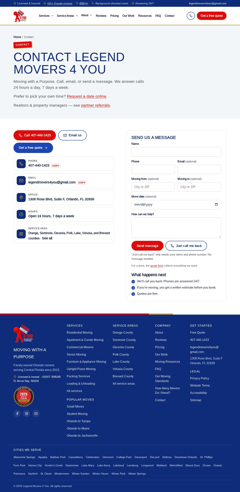

### cactusvalleymoving.com — dry\_run\_ok (dry run)

| | |
|---|---|
| Attempt ID | `f812bfcf-3625-495d-9f11-d9c5e58b680b` |
| Form URL | https://cactusvalleymoving.com/contact/ |
| Final URL | https://cactusvalleymoving.com/contact/ |
| Reserved | 2026-11-04 03:36:26 UTC |
| Submit attempted | — |
| Template | standard v2 |
| Confirmation text | none observed |
| Result / error | Selectors verified; fields not typed (domain not in dry-run fill list); not submitted |

Exact message:

~~~text
Subject: Helping customers find your business in AI search (AEO + GEO)

Hi there,

I'm Arun from Devs Arun. More and more customers now ask ChatGPT, Gemini, Perplexity or Google's AI Overviews questions like "who should I hire for this in my area?" before they call anyone. These tools answer from websites they can clearly understand, and they tend to recommend businesses whose pages answer real customer questions.

That is what AEO + GEO (Answer Engine and Generative Engine Optimization) is for. I improve your existing service pages so they clearly answer the questions your customers ask, add structured data that matches the page, and make the call, quote or enquiry step obvious. The benefit: your business gets a better chance of being mentioned or linked in AI answers, and visitors who arrive find it easy to contact you.

The AEO + GEO Starter is a one-time $199 (about ₹16,999, negotiable) for one website: a basic audit, 10 customer questions, improvements to two existing pages, relevant structured data and an action plan, with one revision round.

You can read the full details, send an enquiry or book online here:
https://devsarun.io/aeo-geo/

If this isn't relevant, just reply and I won't contact you again.

Best,
Arun
Devs Arun
itschool408@gmail.com · +91 7654534323
~~~

Submitted field values:

- \#name-tp: Arun
- \#your-email-tp: itschool408@gmail.com
- \#your-phone-tp: +91 7654534323
- \#your-message-tp: Hi there, I'm Arun from Devs Arun. More and more customers now ask ChatGPT, Gemini, Perplexity or Google's AI Overviews 

**Inspected page** — `run-68773158_attempt-f812bfcf_inspection_2026-11-04T03-36-27-541Z.jpg`

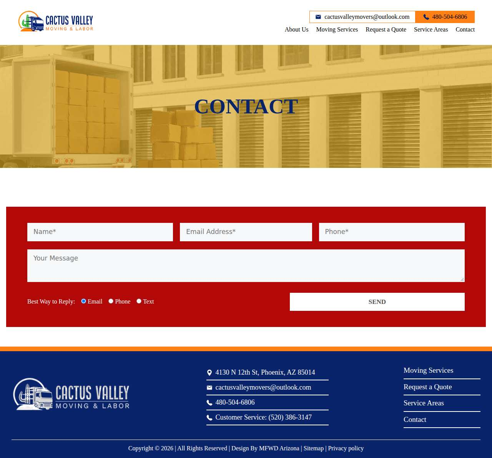

### golambertteam.com — dry\_run\_ok (dry run)

| | |
|---|---|
| Attempt ID | `e2073ba0-4e7a-4dda-845c-a0c33f32291e` |
| Form URL | https://opelika.golambertteam.com/contact-us |
| Final URL | https://opelika.golambertteam.com/contact-us |
| Reserved | 2026-11-04 03:36:32 UTC |
| Submit attempted | — |
| Template | standard v2 |
| Confirmation text | none observed |
| Result / error | Selectors verified; fields not typed (domain not in dry-run fill list); not submitted |

Exact message:

~~~text
Subject: Helping customers find your business in AI search (AEO + GEO)

Hi there,

I'm Arun from Devs Arun. More and more customers now ask ChatGPT, Gemini, Perplexity or Google's AI Overviews questions like "who should I hire for this in my area?" before they call anyone. These tools answer from websites they can clearly understand, and they tend to recommend businesses whose pages answer real customer questions.

That is what AEO + GEO (Answer Engine and Generative Engine Optimization) is for. I improve your existing service pages so they clearly answer the questions your customers ask, add structured data that matches the page, and make the call, quote or enquiry step obvious. The benefit: your business gets a better chance of being mentioned or linked in AI answers, and visitors who arrive find it easy to contact you.

The AEO + GEO Starter is a one-time $199 (about ₹16,999, negotiable) for one website: a basic audit, 10 customer questions, improvements to two existing pages, relevant structured data and an action plan, with one revision round.

You can read the full details, send an enquiry or book online here:
https://devsarun.io/aeo-geo/

If this isn't relevant, just reply and I won't contact you again.

Best,
Arun
Devs Arun
itschool408@gmail.com · +91 7654534323
~~~

Submitted field values:

- \#form-0-f-67: Arun
- \#form-0-f-69: itschool408@gmail.com
- \#form-0-f-70: +91 7654534323
- \#form-0-f-71: Hi there, I'm Arun from Devs Arun. More and more customers now ask ChatGPT, Gemini, Perplexity or Google's AI Overviews 

**Inspected page** — `run-68773158_attempt-e2073ba0_inspection_2026-11-04T03-36-34-665Z.jpg`

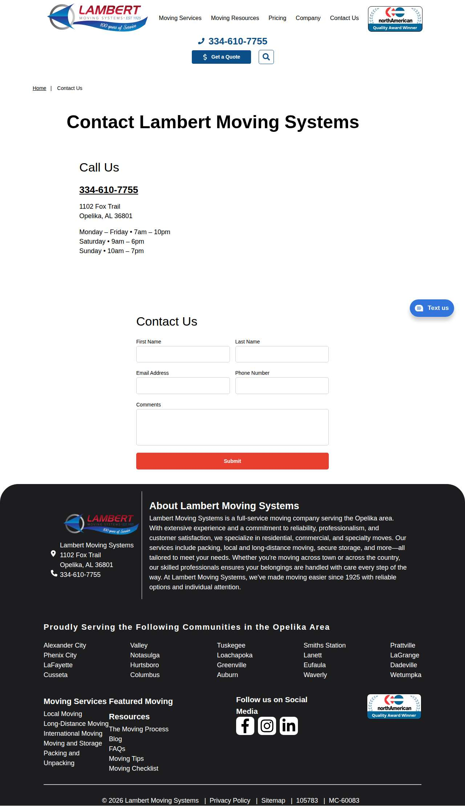

### shamrockmovingstorage.com — dry\_run\_ok (dry run)

| | |
|---|---|
| Attempt ID | `4392d159-8f0a-4aeb-8d84-3c48fae2844f` |
| Form URL | https://shamrockmovingstorage.com/contact/ |
| Final URL | https://shamrockmovingstorage.com/contact/ |
| Reserved | 2026-11-04 03:36:39 UTC |
| Submit attempted | — |
| Template | standard v2 |
| Confirmation text | none observed |
| Result / error | Selectors verified; fields not typed (domain not in dry-run fill list); not submitted |

Exact message:

~~~text
Subject: Helping customers find your business in AI search (AEO + GEO)

Hi there,

I'm Arun from Devs Arun. More and more customers now ask ChatGPT, Gemini, Perplexity or Google's AI Overviews questions like "who should I hire for this in my area?" before they call anyone. These tools answer from websites they can clearly understand, and they tend to recommend businesses whose pages answer real customer questions.

That is what AEO + GEO (Answer Engine and Generative Engine Optimization) is for. I improve your existing service pages so they clearly answer the questions your customers ask, add structured data that matches the page, and make the call, quote or enquiry step obvious. The benefit: your business gets a better chance of being mentioned or linked in AI answers, and visitors who arrive find it easy to contact you.

The AEO + GEO Starter is a one-time $199 (about ₹16,999, negotiable) for one website: a basic audit, 10 customer questions, improvements to two existing pages, relevant structured data and an action plan, with one revision round.

You can read the full details, send an enquiry or book online here:
https://devsarun.io/aeo-geo/

If this isn't relevant, just reply and I won't contact you again.

Best,
Arun
Devs Arun
itschool408@gmail.com · +91 7654534323
~~~

Submitted field values:

- input\[name="tel-940"\]: +91 7654534323
- input\[name="your-name"\]: Arun
- input\[name="your-email"\]: itschool408@gmail.com
- textarea\[name="your-message"\]: Hi there, I'm Arun from Devs Arun. More and more customers now ask ChatGPT, Gemini, Perplexity or Google's AI Overviews 

**Inspected page** — `run-68773158_attempt-4392d159_inspection_2026-11-04T03-36-42-342Z.jpg`

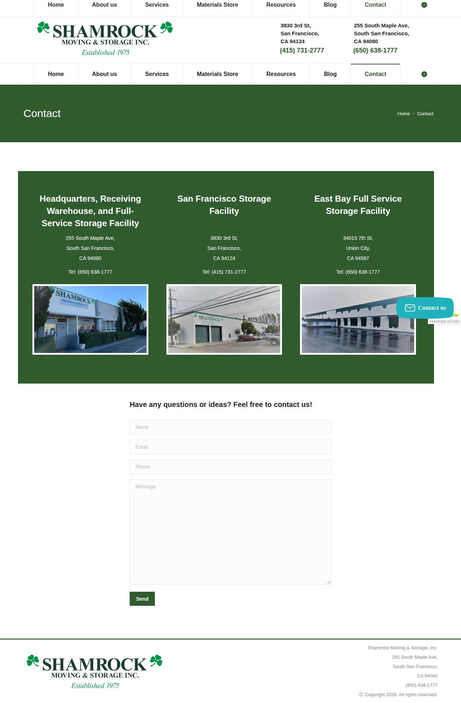

### cowboymoving.com — dry\_run\_ok (dry run)

| | |
|---|---|
| Attempt ID | `0cabf25d-7ce2-494d-85e5-5c014033ae69` |
| Form URL | https://www.cowboymoving.com/contact |
| Final URL | https://www.cowboymoving.com/contact |
| Reserved | 2026-11-04 03:36:47 UTC |
| Submit attempted | — |
| Template | standard v2 |
| Confirmation text | none observed |
| Result / error | Selectors verified; fields not typed (domain not in dry-run fill list); not submitted |

Exact message:

~~~text
Subject: Helping customers find your business in AI search (AEO + GEO)

Hi there,

I'm Arun from Devs Arun. More and more customers now ask ChatGPT, Gemini, Perplexity or Google's AI Overviews questions like "who should I hire for this in my area?" before they call anyone. These tools answer from websites they can clearly understand, and they tend to recommend businesses whose pages answer real customer questions.

That is what AEO + GEO (Answer Engine and Generative Engine Optimization) is for. I improve your existing service pages so they clearly answer the questions your customers ask, add structured data that matches the page, and make the call, quote or enquiry step obvious. The benefit: your business gets a better chance of being mentioned or linked in AI answers, and visitors who arrive find it easy to contact you.

The AEO + GEO Starter is a one-time $199 (about ₹16,999, negotiable) for one website: a basic audit, 10 customer questions, improvements to two existing pages, relevant structured data and an action plan, with one revision round.

You can read the full details, send an enquiry or book online here:
https://devsarun.io/aeo-geo/

If this isn't relevant, just reply and I won't contact you again.

Best,
Arun
Devs Arun
itschool408@gmail.com · +91 7654534323
~~~

Submitted field values:

- \#input\_comp-mmlhtl8b: Arun
- \#input\_comp-mmlhtl8h: itschool408@gmail.com
- \#input\_comp-mmlhtl8j: +91 7654534323
- \#textarea\_comp-mmlhtl8l: Hi there, I'm Arun from Devs Arun. More and more customers now ask ChatGPT, Gemini, Perplexity or Google's AI Overviews 

**Inspected page** — `run-68773158_attempt-0cabf25d_inspection_2026-11-04T03-36-52-009Z.jpg`

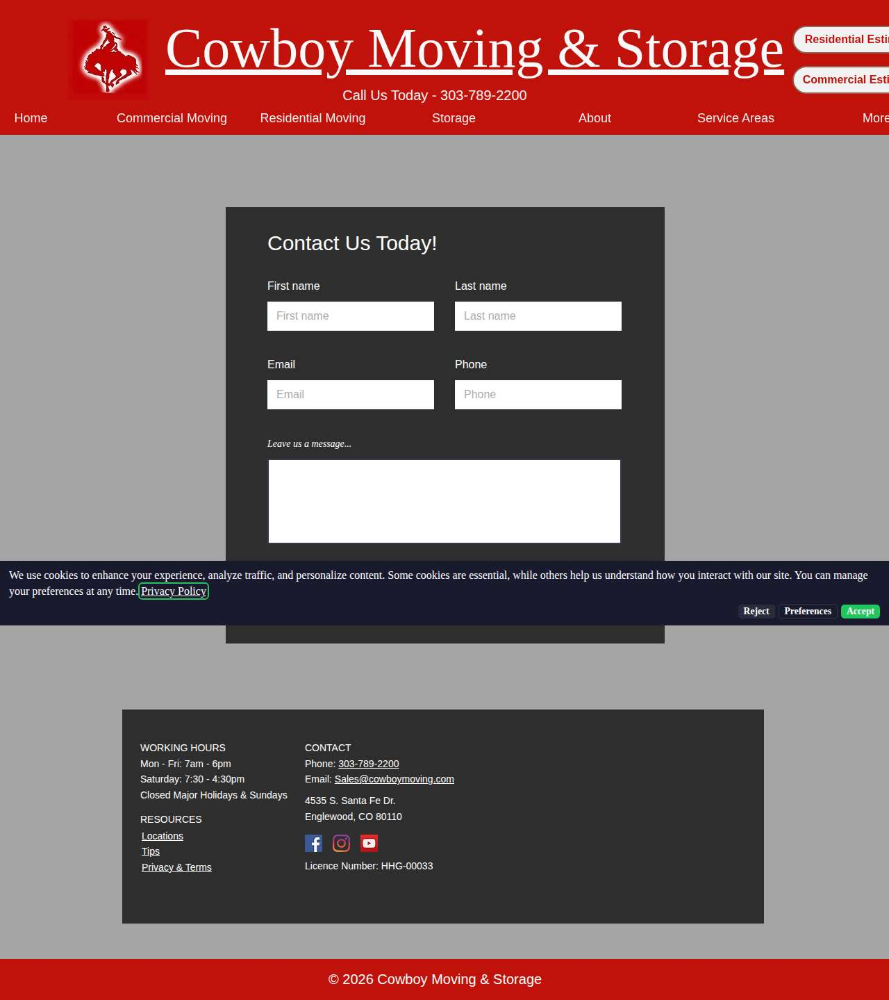

### alphamovingutah.com — dry\_run\_ok (dry run)

| | |
|---|---|
| Attempt ID | `b57a5af9-b02f-4e45-a6d3-db7b2d0b4938` |
| Form URL | https://alphamovingutah.com/contact |
| Final URL | https://alphamovingutah.com/contact |
| Reserved | 2026-11-04 03:36:57 UTC |
| Submit attempted | — |
| Template | standard v2 |
| Confirmation text | none observed |
| Result / error | Selectors verified; fields not typed (domain not in dry-run fill list); not submitted |

Exact message:

~~~text
Subject: Helping customers find your business in AI search (AEO + GEO)

Hi there,

I'm Arun from Devs Arun. More and more customers now ask ChatGPT, Gemini, Perplexity or Google's AI Overviews questions like "who should I hire for this in my area?" before they call anyone. These tools answer from websites they can clearly understand, and they tend to recommend businesses whose pages answer real customer questions.

That is what AEO + GEO (Answer Engine and Generative Engine Optimization) is for. I improve your existing service pages so they clearly answer the questions your customers ask, add structured data that matches the page, and make the call, quote or enquiry step obvious. The benefit: your business gets a better chance of being mentioned or linked in AI answers, and visitors who arrive find it easy to contact you.

The AEO + GEO Starter is a one-time $199 (about ₹16,999, negotiable) for one website: a basic audit, 10 customer questions, improvements to two existing pages, relevant structured data and an action plan, with one revision round.

You can read the full details, send an enquiry or book online here:
https://devsarun.io/aeo-geo/

If this isn't relevant, just reply and I won't contact you again.

Best,
Arun
Devs Arun
itschool408@gmail.com · +91 7654534323
~~~

Submitted field values:

- \#cname: Arun
- \#cemail: itschool408@gmail.com
- \#cphone: +91 7654534323
- \#cmessage: Hi there, I'm Arun from Devs Arun. More and more customers now ask ChatGPT, Gemini, Perplexity or Google's AI Overviews 

**Inspected page** — `run-68773158_attempt-b57a5af9_inspection_2026-11-04T03-36-58-674Z.jpg`

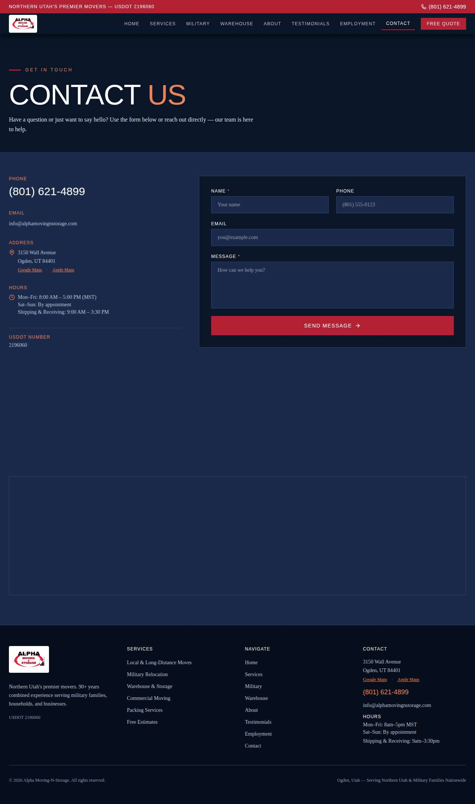

### thompsonsmoving.net — dry\_run\_ok (dry run)

| | |
|---|---|
| Attempt ID | `3b35c84a-7b89-458d-aa43-ad8eaf639c34` |
| Form URL | https://www.thompsonsmoving.net/contact/4493840 |
| Final URL | https://www.thompsonsmoving.net/contact/4493840 |
| Reserved | 2026-11-04 03:37:03 UTC |
| Submit attempted | — |
| Template | standard v2 |
| Confirmation text | none observed |
| Result / error | Selectors verified; fields not typed (domain not in dry-run fill list); not submitted |

Exact message:

~~~text
Subject: Helping customers find your business in AI search (AEO + GEO)

Hi there,

I'm Arun from Devs Arun. More and more customers now ask ChatGPT, Gemini, Perplexity or Google's AI Overviews questions like "who should I hire for this in my area?" before they call anyone. These tools answer from websites they can clearly understand, and they tend to recommend businesses whose pages answer real customer questions.

That is what AEO + GEO (Answer Engine and Generative Engine Optimization) is for. I improve your existing service pages so they clearly answer the questions your customers ask, add structured data that matches the page, and make the call, quote or enquiry step obvious. The benefit: your business gets a better chance of being mentioned or linked in AI answers, and visitors who arrive find it easy to contact you.

The AEO + GEO Starter is a one-time $199 (about ₹16,999, negotiable) for one website: a basic audit, 10 customer questions, improvements to two existing pages, relevant structured data and an action plan, with one revision round.

You can read the full details, send an enquiry or book online here:
https://devsarun.io/aeo-geo/

If this isn't relevant, just reply and I won't contact you again.

Best,
Arun
Devs Arun
itschool408@gmail.com · +91 7654534323
~~~

Submitted field values:

- \#\\31 264337758: Hi there, I'm Arun from Devs Arun. More and more customers now ask ChatGPT, Gemini, Perplexity or Google's AI Overviews 
- \#\\31 316581473: Arun
- \#\\31 384283772: +91 7654534323
- \#\\31 536844943: itschool408@gmail.com

**Inspected page** — `run-68773158_attempt-3b35c84a_inspection_2026-11-04T03-37-05-415Z.jpg`

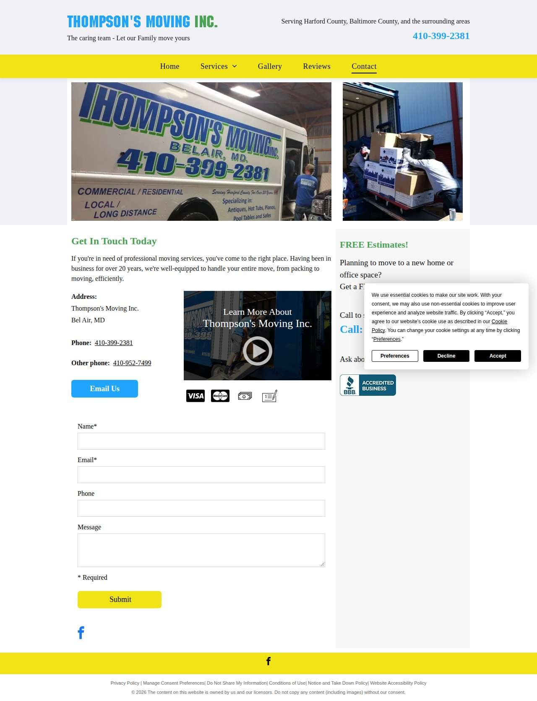

### patrickmoorelaw.com — dry\_run\_ok (dry run)

| | |
|---|---|
| Attempt ID | `f609a92a-2cb9-44f1-b9c6-3cace1a0145b` |
| Form URL | https://www.patrickmoorelaw.com/contact-us/ |
| Final URL | https://www.patrickmoorelaw.com/contact-us/ |
| Reserved | 2026-11-04 03:37:10 UTC |
| Submit attempted | — |
| Template | standard v2 |
| Confirmation text | none observed |
| Result / error | Selectors verified; fields not typed (domain not in dry-run fill list); not submitted |

Exact message:

~~~text
Subject: Helping customers find your business in AI search (AEO + GEO)

Hi there,

I'm Arun from Devs Arun. More and more customers now ask ChatGPT, Gemini, Perplexity or Google's AI Overviews questions like "who should I hire for this in my area?" before they call anyone. These tools answer from websites they can clearly understand, and they tend to recommend businesses whose pages answer real customer questions.

That is what AEO + GEO (Answer Engine and Generative Engine Optimization) is for. I improve your existing service pages so they clearly answer the questions your customers ask, add structured data that matches the page, and make the call, quote or enquiry step obvious. The benefit: your business gets a better chance of being mentioned or linked in AI answers, and visitors who arrive find it easy to contact you.

The AEO + GEO Starter is a one-time $199 (about ₹16,999, negotiable) for one website: a basic audit, 10 customer questions, improvements to two existing pages, relevant structured data and an action plan, with one revision round.

You can read the full details, send an enquiry or book online here:
https://devsarun.io/aeo-geo/

If this isn't relevant, just reply and I won't contact you again.

Best,
Arun
Devs Arun
itschool408@gmail.com · +91 7654534323
~~~

Submitted field values:

- \#name-199800: Arun
- \#email-199800: itschool408@gmail.com
- \#phone-199800: +91 7654534323
- \#inquiry-199800: Hi there, I'm Arun from Devs Arun. More and more customers now ask ChatGPT, Gemini, Perplexity or Google's AI Overviews 

**Inspected page** — `run-68773158_attempt-f609a92a_inspection_2026-11-04T03-37-12-539Z.jpg`

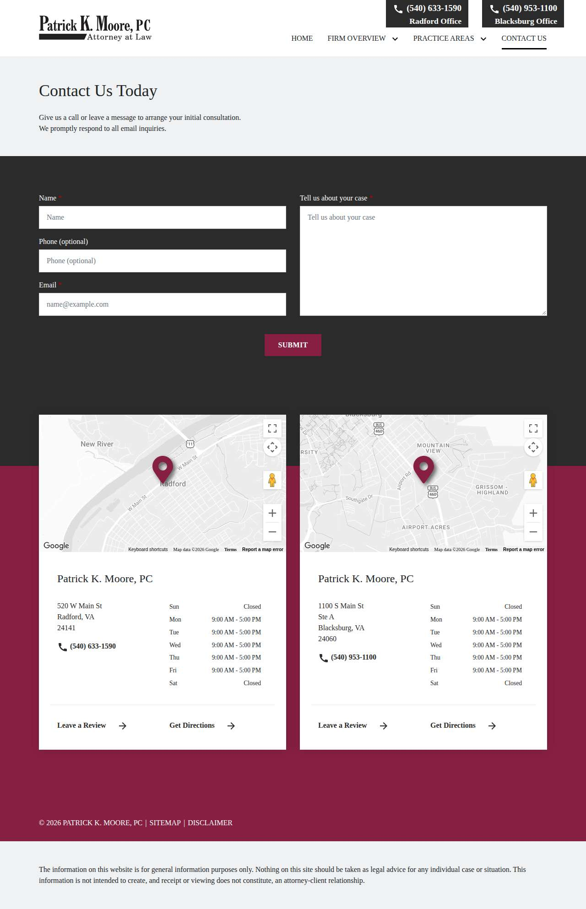

### familylawdelaware.com — dry\_run\_failed (dry run)

| | |
|---|---|
| Attempt ID | `0051aaa8-e324-4c36-9275-d1dbee627100` |
| Form URL | https://www.familylawdelaware.com/contact/ |
| Final URL | https://www.familylawdelaware.com/contact/ |
| Reserved | 2026-11-04 03:37:17 UTC |
| Submit attempted | — |
| Template | standard v2 |
| Confirmation text | none observed |
| Result / error | Reviewed form not found on page (site changed) |

Exact message:

~~~text
Subject: Helping customers find your business in AI search (AEO + GEO)

Hi there,

I'm Arun from Devs Arun. More and more customers now ask ChatGPT, Gemini, Perplexity or Google's AI Overviews questions like "who should I hire for this in my area?" before they call anyone. These tools answer from websites they can clearly understand, and they tend to recommend businesses whose pages answer real customer questions.

That is what AEO + GEO (Answer Engine and Generative Engine Optimization) is for. I improve your existing service pages so they clearly answer the questions your customers ask, add structured data that matches the page, and make the call, quote or enquiry step obvious. The benefit: your business gets a better chance of being mentioned or linked in AI answers, and visitors who arrive find it easy to contact you.

The AEO + GEO Starter is a one-time $199 (about ₹16,999, negotiable) for one website: a basic audit, 10 customer questions, improvements to two existing pages, relevant structured data and an action plan, with one revision round.

You can read the full details, send an enquiry or book online here:
https://devsarun.io/aeo-geo/

If this isn't relevant, just reply and I won't contact you again.

Best,
Arun
Devs Arun
itschool408@gmail.com · +91 7654534323
~~~

Submitted field values:

- \#nf-field-2: Arun
- \#nf-field-3: itschool408@gmail.com
- \#nf-field-4: +91 7654534323
- \#nf-field-10: Hi there, I'm Arun from Devs Arun. More and more customers now ask ChatGPT, Gemini, Perplexity or Google's AI Overviews 

**Inspected page** — `run-68773158_attempt-0051aaa8_inspection_2026-11-04T03-37-18-659Z.jpg`

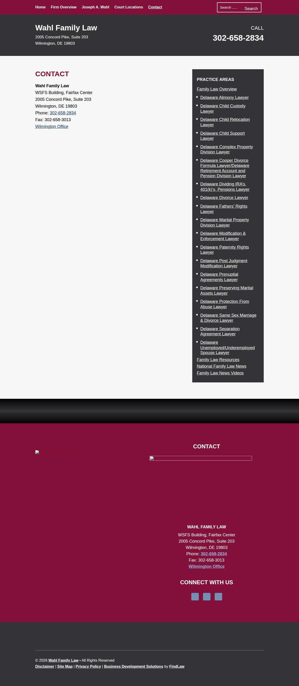

## Events (99)

| Time (UTC) | Event | Website | Details |
|---|---|---|---|
| 03:35:01 | run\_queued | — | dry\_run run requested by github:itsDevsArun |
| 03:35:01 | run\_dispatched | — | dispatch disabled (local test mode) |
| 03:35:04 | run\_started | — | Runner claimed dry\_run run |
| 03:35:04 | website\_selected | helixmechanical.com | Dry-run target helixmechanical.com |
| 03:35:04 | draft\_prepared | helixmechanical.com | Draft prepared with template standard v2 |
| 03:35:06 | page\_opened | helixmechanical.com | Opened form page |
| 03:35:06 | screenshot\_saved | helixmechanical.com | inspection screenshot saved (54 KB) |
| 03:35:06 | review\_required | helixmechanical.com | dry run failed: Mapped field "First Name \*" not found uniquely |
| 03:35:11 | website\_selected | knoxvilleelectrician.com | Dry-run target knoxvilleelectrician.com |
| 03:35:11 | draft\_prepared | knoxvilleelectrician.com | Draft prepared with template standard v2 |
| 03:35:14 | page\_opened | knoxvilleelectrician.com | Opened form page |
| 03:35:14 | screenshot\_saved | knoxvilleelectrician.com | inspection screenshot saved (137 KB) |
| 03:35:14 | review\_required | knoxvilleelectrician.com | dry run failed: Mapped field "Name" not found uniquely |
| 03:35:19 | website\_selected | got2move.com | Dry-run target got2move.com |
| 03:35:19 | draft\_prepared | got2move.com | Draft prepared with template standard v2 |
| 03:35:21 | page\_opened | got2move.com | Opened form page |
| 03:35:22 | screenshot\_saved | got2move.com | inspection screenshot saved (160 KB) |
| 03:35:22 | dry\_run\_checked | got2move.com | dry run ok: Selectors verified; fields not typed (domain not in dry-run fill list); not submitted |
| 03:35:27 | website\_selected | undergrads.com | Dry-run target undergrads.com |
| 03:35:27 | draft\_prepared | undergrads.com | Draft prepared with template standard v2 |
| 03:35:29 | page\_opened | undergrads.com | Opened form page |
| 03:35:29 | screenshot\_saved | undergrads.com | inspection screenshot saved (386 KB) |
| 03:35:29 | dry\_run\_checked | undergrads.com | dry run ok: Selectors verified; fields not typed (domain not in dry-run fill list); not submitted |
| 03:35:34 | website\_selected | bravo-moving.com | Dry-run target bravo-moving.com |
| 03:35:34 | draft\_prepared | bravo-moving.com | Draft prepared with template standard v2 |
| 03:35:39 | page\_opened | bravo-moving.com | Opened form page |
| 03:35:40 | screenshot\_saved | bravo-moving.com | inspection screenshot saved (178 KB) |
| 03:35:40 | dry\_run\_checked | bravo-moving.com | dry run ok: Selectors verified; fields not typed (domain not in dry-run fill list); not submitted |
| 03:35:45 | website\_selected | flytmoving.com | Dry-run target flytmoving.com |
| 03:35:45 | draft\_prepared | flytmoving.com | Draft prepared with template standard v2 |
| 03:35:46 | page\_opened | flytmoving.com | Opened form page |
| 03:35:46 | screenshot\_saved | flytmoving.com | inspection screenshot saved (192 KB) |
| 03:35:46 | dry\_run\_checked | flytmoving.com | dry run ok: Selectors verified; fields not typed (domain not in dry-run fill list); not submitted |
| 03:35:51 | website\_selected | raysmovers.com | Dry-run target raysmovers.com |
| 03:35:51 | draft\_prepared | raysmovers.com | Draft prepared with template standard v2 |
| 03:35:54 | page\_opened | raysmovers.com | Opened form page |
| 03:35:54 | screenshot\_saved | raysmovers.com | inspection screenshot saved (271 KB) |
| 03:35:54 | dry\_run\_checked | raysmovers.com | dry run ok: Selectors verified; fields not typed (domain not in dry-run fill list); not submitted |
| 03:35:59 | website\_selected | moveauto.com | Dry-run target moveauto.com |
| 03:35:59 | draft\_prepared | moveauto.com | Draft prepared with template standard v2 |
| 03:36:01 | page\_opened | moveauto.com | Opened form page |
| 03:36:02 | screenshot\_saved | moveauto.com | inspection screenshot saved (172 KB) |
| 03:36:02 | dry\_run\_checked | moveauto.com | dry run ok: Selectors verified; fields not typed (domain not in dry-run fill list); not submitted |
| 03:36:07 | website\_selected | waterdamagecheyenne.com | Dry-run target waterdamagecheyenne.com |
| 03:36:07 | draft\_prepared | waterdamagecheyenne.com | Draft prepared with template standard v2 |
| 03:36:08 | page\_opened | waterdamagecheyenne.com | Opened form page |
| 03:36:08 | screenshot\_saved | waterdamagecheyenne.com | inspection screenshot saved (161 KB) |
| 03:36:08 | dry\_run\_checked | waterdamagecheyenne.com | dry run ok: Selectors verified; fields not typed (domain not in dry-run fill list); not submitted |
| 03:36:13 | website\_selected | bookonemove.com | Dry-run target bookonemove.com |
| 03:36:13 | draft\_prepared | bookonemove.com | Draft prepared with template standard v2 |
| 03:36:15 | page\_opened | bookonemove.com | Opened form page |
| 03:36:15 | screenshot\_saved | bookonemove.com | inspection screenshot saved (112 KB) |
| 03:36:15 | dry\_run\_checked | bookonemove.com | dry run ok: Selectors verified; fields not typed (domain not in dry-run fill list); not submitted |
| 03:36:20 | website\_selected | legendmovers4youfl.com | Dry-run target legendmovers4youfl.com |
| 03:36:20 | draft\_prepared | legendmovers4youfl.com | Draft prepared with template standard v2 |
| 03:36:21 | page\_opened | legendmovers4youfl.com | Opened form page |
| 03:36:21 | screenshot\_saved | legendmovers4youfl.com | inspection screenshot saved (204 KB) |
| 03:36:21 | dry\_run\_checked | legendmovers4youfl.com | dry run ok: Selectors verified; fields not typed (domain not in dry-run fill list); not submitted |
| 03:36:26 | website\_selected | cactusvalleymoving.com | Dry-run target cactusvalleymoving.com |
| 03:36:26 | draft\_prepared | cactusvalleymoving.com | Draft prepared with template standard v2 |
| 03:36:27 | page\_opened | cactusvalleymoving.com | Opened form page |
| 03:36:27 | screenshot\_saved | cactusvalleymoving.com | inspection screenshot saved (101 KB) |
| 03:36:27 | dry\_run\_checked | cactusvalleymoving.com | dry run ok: Selectors verified; fields not typed (domain not in dry-run fill list); not submitted |
| 03:36:32 | website\_selected | golambertteam.com | Dry-run target golambertteam.com |
| 03:36:32 | draft\_prepared | golambertteam.com | Draft prepared with template standard v2 |
| 03:36:34 | page\_opened | golambertteam.com | Opened form page |
| 03:36:34 | screenshot\_saved | golambertteam.com | inspection screenshot saved (161 KB) |
| 03:36:34 | dry\_run\_checked | golambertteam.com | dry run ok: Selectors verified; fields not typed (domain not in dry-run fill list); not submitted |
| 03:36:39 | website\_selected | shamrockmovingstorage.com | Dry-run target shamrockmovingstorage.com |
| 03:36:39 | draft\_prepared | shamrockmovingstorage.com | Draft prepared with template standard v2 |
| 03:36:42 | page\_opened | shamrockmovingstorage.com | Opened form page |
| 03:36:42 | screenshot\_saved | shamrockmovingstorage.com | inspection screenshot saved (121 KB) |
| 03:36:42 | dry\_run\_checked | shamrockmovingstorage.com | dry run ok: Selectors verified; fields not typed (domain not in dry-run fill list); not submitted |
| 03:36:47 | website\_selected | cowboymoving.com | Dry-run target cowboymoving.com |
| 03:36:47 | draft\_prepared | cowboymoving.com | Draft prepared with template standard v2 |
| 03:36:51 | page\_opened | cowboymoving.com | Opened form page |
| 03:36:52 | screenshot\_saved | cowboymoving.com | inspection screenshot saved (86 KB) |
| 03:36:52 | dry\_run\_checked | cowboymoving.com | dry run ok: Selectors verified; fields not typed (domain not in dry-run fill list); not submitted |
| 03:36:57 | website\_selected | alphamovingutah.com | Dry-run target alphamovingutah.com |
| 03:36:57 | draft\_prepared | alphamovingutah.com | Draft prepared with template standard v2 |
| 03:36:58 | page\_opened | alphamovingutah.com | Opened form page |
| 03:36:58 | screenshot\_saved | alphamovingutah.com | inspection screenshot saved (95 KB) |
| 03:36:58 | dry\_run\_checked | alphamovingutah.com | dry run ok: Selectors verified; fields not typed (domain not in dry-run fill list); not submitted |
| 03:37:03 | website\_selected | thompsonsmoving.net | Dry-run target thompsonsmoving.net |
| 03:37:03 | draft\_prepared | thompsonsmoving.net | Draft prepared with template standard v2 |
| 03:37:05 | page\_opened | thompsonsmoving.net | Opened form page |
| 03:37:05 | screenshot\_saved | thompsonsmoving.net | inspection screenshot saved (141 KB) |
| 03:37:05 | dry\_run\_checked | thompsonsmoving.net | dry run ok: Selectors verified; fields not typed (domain not in dry-run fill list); not submitted |
| 03:37:10 | website\_selected | patrickmoorelaw.com | Dry-run target patrickmoorelaw.com |
| 03:37:10 | draft\_prepared | patrickmoorelaw.com | Draft prepared with template standard v2 |
| 03:37:12 | page\_opened | patrickmoorelaw.com | Opened form page |
| 03:37:12 | screenshot\_saved | patrickmoorelaw.com | inspection screenshot saved (126 KB) |
| 03:37:12 | dry\_run\_checked | patrickmoorelaw.com | dry run ok: Selectors verified; fields not typed (domain not in dry-run fill list); not submitted |
| 03:37:17 | website\_selected | familylawdelaware.com | Dry-run target familylawdelaware.com |
| 03:37:17 | draft\_prepared | familylawdelaware.com | Draft prepared with template standard v2 |
| 03:37:18 | page\_opened | familylawdelaware.com | Opened form page |
| 03:37:18 | screenshot\_saved | familylawdelaware.com | inspection screenshot saved (143 KB) |
| 03:37:18 | review\_required | familylawdelaware.com | dry run failed: Reviewed form not found on page (site changed) |
| 03:37:23 | run\_completed | — | Run completed (queue\_exhausted) |
