# Run 688cf675 — dry\_run — completed

| | |
|---|---|
| Run ID | `688cf675-5a88-4a6e-b991-40154d135c83` |
| Requested by | github:itsDevsArun |
| Started | 2026-11-04 05:31:06 UTC |
| Finished | 2026-11-04 05:38:10 UTC |
| Finish reason | queue\_exhausted |
| GitHub Actions | https://github.com/itsDevsArun/aeo-geo/actions/runs/41763788389 |

CSV for this run: [runs/2026-11-04_dry_run_688cf675.csv](2026-11-04_dry_run_688cf675.csv)

## Attempts (23)

### helixmechanical.com — dry\_run\_failed (dry run)

| | |
|---|---|
| Attempt ID | `e5c48653-55dd-4ae5-a82b-6bed224c7706` |
| Form URL | https://helixmechanical.com/contact/ |
| Final URL | https://helixmechanical.com/contact/ |
| Reserved | 2026-11-04 05:31:06 UTC |
| Submit attempted | — |
| Template | standard v2 |
| Confirmation text | none observed |
| Result / error | Mapped field "First Name \*" not found uniquely |

Exact message:

~~~text
Subject: Helping customers find your business in AI search (AEO + GEO)

Hi there,

I'm Arun from Devs Arun. More and more customers now ask ChatGPT, Gemini, Perplexity or Google's AI Overviews questions like "who should I hire for this in my area?" before they call anyone. These tools answer from websites they can clearly understand, and they tend to recommend businesses whose pages answer real customer questions.

That is what AEO + GEO (Answer Engine and Generative Engine Optimization) is for. I improve your existing service pages so they clearly answer the questions your customers ask, add structured data that matches the page, and make the call, quote or enquiry step obvious. The benefit: your business gets a better chance of being mentioned or linked in AI answers, and visitors who arrive find it easy to contact you.

The AEO + GEO Starter is a one-time $199 (about ₹16,999, negotiable) for one website: a basic audit, 10 customer questions, improvements to two existing pages, relevant structured data and an action plan, with one revision round.

You can read the full details, send an enquiry or book online here:
https://devsarun.io/aeo-geo/

If this isn't relevant, just reply and I won't contact you again.

Best,
Arun
Devs Arun
itschool408@gmail.com · +91 7654534323
~~~

Submitted field values:

- \#forminator-field-name-1\_6ae7ff023fd3c: Arun
- \#forminator-field-email-1\_6ae7ff023fd3c: itschool408@gmail.com
- \#forminator-field-phone-1\_6ae7ff023fd3c: +91 7654534323
- \#forminator-field-textarea-1\_6ae7ff023fd3c: Hi there, I'm Arun from Devs Arun. More and more customers now ask ChatGPT, Gemini, Perplexity or Google's AI Overviews 

**Inspected page** — `run-688cf675_attempt-e5c48653_inspection_2026-11-04T05-31-09-016Z.jpg`

### knoxvilleelectrician.com — dry\_run\_failed (dry run)

| | |
|---|---|
| Attempt ID | `7de0bca4-f963-4a09-819c-e584bc015fb2` |
| Form URL | https://knoxvilleelectrician.com/contact-us/ |
| Final URL | https://knoxvilleelectrician.com/contact-us/ |
| Reserved | 2026-11-04 05:31:14 UTC |
| Submit attempted | — |
| Template | standard v2 |
| Confirmation text | none observed |
| Result / error | Mapped field "Name" not found uniquely |

Exact message:

~~~text
Subject: Helping customers find your business in AI search (AEO + GEO)

Hi there,

I'm Arun from Devs Arun. More and more customers now ask ChatGPT, Gemini, Perplexity or Google's AI Overviews questions like "who should I hire for this in my area?" before they call anyone. These tools answer from websites they can clearly understand, and they tend to recommend businesses whose pages answer real customer questions.

That is what AEO + GEO (Answer Engine and Generative Engine Optimization) is for. I improve your existing service pages so they clearly answer the questions your customers ask, add structured data that matches the page, and make the call, quote or enquiry step obvious. The benefit: your business gets a better chance of being mentioned or linked in AI answers, and visitors who arrive find it easy to contact you.

The AEO + GEO Starter is a one-time $199 (about ₹16,999, negotiable) for one website: a basic audit, 10 customer questions, improvements to two existing pages, relevant structured data and an action plan, with one revision round.

You can read the full details, send an enquiry or book online here:
https://devsarun.io/aeo-geo/

If this isn't relevant, just reply and I won't contact you again.

Best,
Arun
Devs Arun
itschool408@gmail.com · +91 7654534323
~~~

Submitted field values:

- \#form-field-1b7221: itschool408@gmail.com
- \#form-field-2fa3ac: +91 7654534323
- \#form-field-96f51f: Arun
- \#form-field-fed9d8: Hi there, I'm Arun from Devs Arun. More and more customers now ask ChatGPT, Gemini, Perplexity or Google's AI Overviews 

**Inspected page** — `run-688cf675_attempt-7de0bca4_inspection_2026-11-04T05-31-17-851Z.jpg`

### david-ware.com — dry\_run\_failed (dry run)

| | |
|---|---|
| Attempt ID | `2635db68-7c96-4910-9c70-1e520a62b74d` |
| Form URL | https://www.david-ware.com/contact/ |
| Final URL | https://www.david-ware.com/contact/ |
| Reserved | 2026-11-04 05:31:22 UTC |
| Submit attempted | — |
| Template | short v2 |
| Confirmation text | none observed |
| Result / error | Reviewed form not found on page (site changed) |

Exact message:

~~~text
Subject: Helping customers find your business in AI search (AEO + GEO)

Hi there,

I'm Arun from Devs Arun. Customers increasingly ask ChatGPT, Gemini and Google's AI Overviews who to hire before they call anyone. AEO + GEO makes your existing service pages clear answers these tools can understand and cite, with an easy way to call or enquire, so your business has a better chance of being recommended.

The AEO + GEO Starter is a one-time $199 (about ₹16,999, negotiable) for one website.

Full details, enquiries and online booking:
https://devsarun.io/aeo-geo/

If this isn't relevant, just reply and I won't contact you again.

Best,
Arun, Devs Arun
itschool408@gmail.com
~~~

Submitted field values:

- \#nf-field-2: Arun
- \#nf-field-3: itschool408@gmail.com
- \#nf-field-4: +91 7654534323
- \#nf-field-10: Hi there, I'm Arun from Devs Arun. Customers increasingly ask ChatGPT, Gemini and Google's AI Overviews who to hire befo

**Inspected page** — `run-688cf675_attempt-2635db68_inspection_2026-11-04T05-31-25-692Z.jpg`

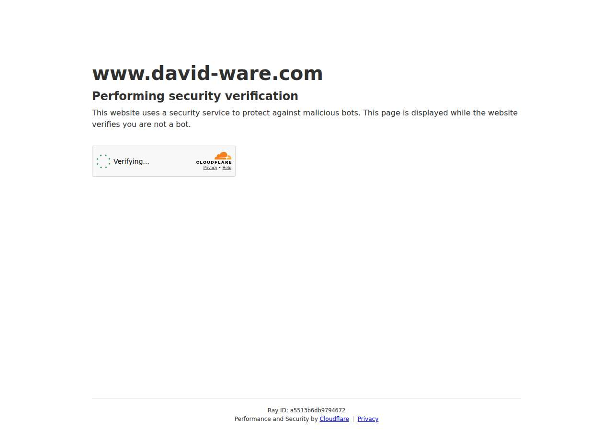

### shayandassociates.com — dry\_run\_ok (dry run)

| | |
|---|---|
| Attempt ID | `6a026561-5d35-41f0-a7a7-1a449c4bf075` |
| Form URL | https://www.shayandassociates.com/contact |
| Final URL | https://www.shayandassociates.com/contact |
| Reserved | 2026-11-04 05:31:30 UTC |
| Submit attempted | — |
| Template | standard v2 |
| Confirmation text | none observed |
| Result / error | Selectors verified; fields not typed (domain not in dry-run fill list); not submitted |

Exact message:

~~~text
Subject: Helping customers find your business in AI search (AEO + GEO)

Hi there,

I'm Arun from Devs Arun. More and more customers now ask ChatGPT, Gemini, Perplexity or Google's AI Overviews questions like "who should I hire for this in my area?" before they call anyone. These tools answer from websites they can clearly understand, and they tend to recommend businesses whose pages answer real customer questions.

That is what AEO + GEO (Answer Engine and Generative Engine Optimization) is for. I improve your existing service pages so they clearly answer the questions your customers ask, add structured data that matches the page, and make the call, quote or enquiry step obvious. The benefit: your business gets a better chance of being mentioned or linked in AI answers, and visitors who arrive find it easy to contact you.

The AEO + GEO Starter is a one-time $199 (about ₹16,999, negotiable) for one website: a basic audit, 10 customer questions, improvements to two existing pages, relevant structured data and an action plan, with one revision round.

You can read the full details, send an enquiry or book online here:
https://devsarun.io/aeo-geo/

If this isn't relevant, just reply and I won't contact you again.

Best,
Arun
Devs Arun
itschool408@gmail.com · +91 7654534323
~~~

Submitted field values:

- \#input\_comp-le8u9377: itschool408@gmail.com
- \#input\_comp-le8u936y2: Arun
- \#textarea\_comp-le8u9379: Hi there, I'm Arun from Devs Arun. More and more customers now ask ChatGPT, Gemini, Perplexity or Google's AI Overviews 

**Inspected page** — `run-688cf675_attempt-6a026561_inspection_2026-11-04T05-31-35-539Z.jpg`

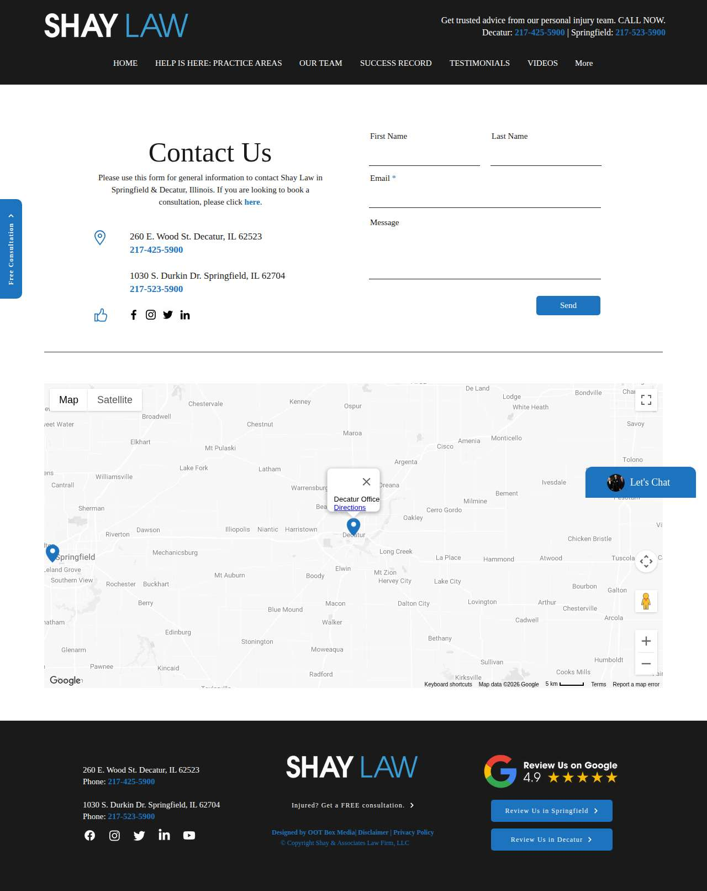

### thechesnuttlawfirm.com — dry\_run\_ok (dry run)

| | |
|---|---|
| Attempt ID | `3430a4a8-ba01-4e19-99c7-11cbbc55a75f` |
| Form URL | https://thechesnuttlawfirm.com/contact/ |
| Final URL | https://thechesnuttlawfirm.com/contact/ |
| Reserved | 2026-11-04 05:31:40 UTC |
| Submit attempted | — |
| Template | standard v2 |
| Confirmation text | none observed |
| Result / error | Selectors verified; fields not typed (domain not in dry-run fill list); not submitted |

Exact message:

~~~text
Subject: Helping customers find your business in AI search (AEO + GEO)

Hi there,

I'm Arun from Devs Arun. More and more customers now ask ChatGPT, Gemini, Perplexity or Google's AI Overviews questions like "who should I hire for this in my area?" before they call anyone. These tools answer from websites they can clearly understand, and they tend to recommend businesses whose pages answer real customer questions.

That is what AEO + GEO (Answer Engine and Generative Engine Optimization) is for. I improve your existing service pages so they clearly answer the questions your customers ask, add structured data that matches the page, and make the call, quote or enquiry step obvious. The benefit: your business gets a better chance of being mentioned or linked in AI answers, and visitors who arrive find it easy to contact you.

The AEO + GEO Starter is a one-time $199 (about ₹16,999, negotiable) for one website: a basic audit, 10 customer questions, improvements to two existing pages, relevant structured data and an action plan, with one revision round.

You can read the full details, send an enquiry or book online here:
https://devsarun.io/aeo-geo/

If this isn't relevant, just reply and I won't contact you again.

Best,
Arun
Devs Arun
itschool408@gmail.com · +91 7654534323
~~~

Submitted field values:

- \#form-field-name: Arun
- \#form-field-email: +91 7654534323
- \#form-field-message: Hi there, I'm Arun from Devs Arun. More and more customers now ask ChatGPT, Gemini, Perplexity or Google's AI Overviews 
- \#form-field-field\_1ce8b83: itschool408@gmail.com

**Inspected page** — `run-688cf675_attempt-3430a4a8_inspection_2026-11-04T05-31-44-602Z.jpg`

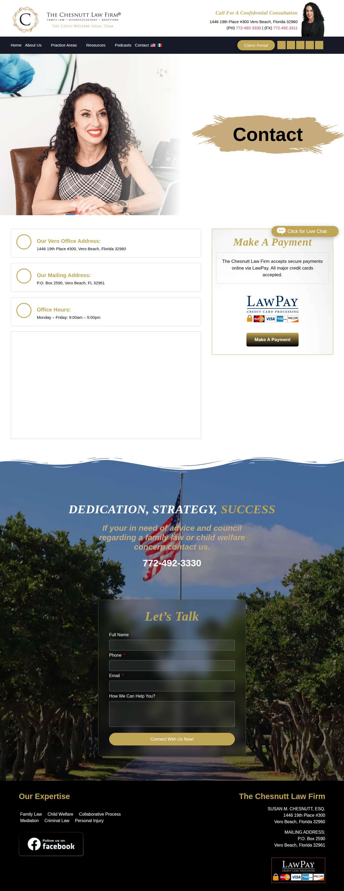

### accidentattorneysvermont.com — dry\_run\_ok (dry run)

| | |
|---|---|
| Attempt ID | `4622c061-4b85-49ab-bfce-6cc49c08cb93` |
| Form URL | https://community.focuseddevelopment.com/contact-us/ |
| Final URL | https://community.focuseddevelopment.com/contact-us/ |
| Reserved | 2026-11-04 05:31:49 UTC |
| Submit attempted | — |
| Template | standard v2 |
| Confirmation text | none observed |
| Result / error | Selectors verified; fields not typed (domain not in dry-run fill list); not submitted |

Exact message:

~~~text
Subject: Helping customers find your business in AI search (AEO + GEO)

Hi there,

I'm Arun from Devs Arun. More and more customers now ask ChatGPT, Gemini, Perplexity or Google's AI Overviews questions like "who should I hire for this in my area?" before they call anyone. These tools answer from websites they can clearly understand, and they tend to recommend businesses whose pages answer real customer questions.

That is what AEO + GEO (Answer Engine and Generative Engine Optimization) is for. I improve your existing service pages so they clearly answer the questions your customers ask, add structured data that matches the page, and make the call, quote or enquiry step obvious. The benefit: your business gets a better chance of being mentioned or linked in AI answers, and visitors who arrive find it easy to contact you.

The AEO + GEO Starter is a one-time $199 (about ₹16,999, negotiable) for one website: a basic audit, 10 customer questions, improvements to two existing pages, relevant structured data and an action plan, with one revision round.

You can read the full details, send an enquiry or book online here:
https://devsarun.io/aeo-geo/

If this isn't relevant, just reply and I won't contact you again.

Best,
Arun
Devs Arun
itschool408@gmail.com · +91 7654534323
~~~

Submitted field values:

- \#et\_pb\_contact\_1\_email\_7: itschool408@gmail.com
- \#et\_pb\_contact\_1\_message\_9: Hi there, I'm Arun from Devs Arun. More and more customers now ask ChatGPT, Gemini, Perplexity or Google's AI Overviews 
- \#et\_pb\_contact\_1\_subject\_8: Helping customers find your business in AI search (AEO + GEO)
- \#et\_pb\_contact\_1\_first\_name\_5: Arun

**Inspected page** — `run-688cf675_attempt-4622c061_inspection_2026-11-04T05-31-56-415Z.jpg`

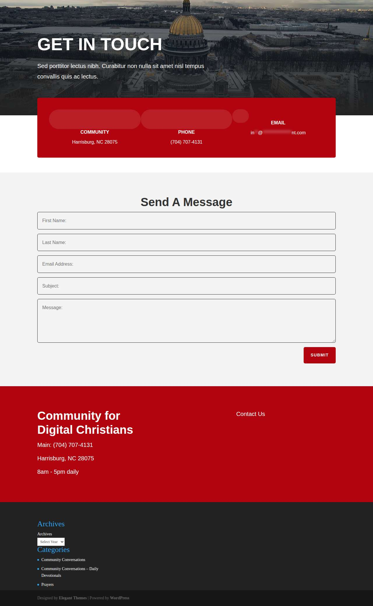

### browarddivorcelaw.com — dry\_run\_failed (dry run)

| | |
|---|---|
| Attempt ID | `1d5ce79c-82e7-4557-b88a-a569a8b9f657` |
| Form URL | https://www.browarddivorcelaw.com/contact/ |
| Final URL | https://www.browarddivorcelaw.com/contact/ |
| Reserved | 2026-11-04 05:32:01 UTC |
| Submit attempted | — |
| Template | standard v2 |
| Confirmation text | none observed |
| Result / error | Reviewed form not found on page (site changed) |

Exact message:

~~~text
Subject: Helping customers find your business in AI search (AEO + GEO)

Hi there,

I'm Arun from Devs Arun. More and more customers now ask ChatGPT, Gemini, Perplexity or Google's AI Overviews questions like "who should I hire for this in my area?" before they call anyone. These tools answer from websites they can clearly understand, and they tend to recommend businesses whose pages answer real customer questions.

That is what AEO + GEO (Answer Engine and Generative Engine Optimization) is for. I improve your existing service pages so they clearly answer the questions your customers ask, add structured data that matches the page, and make the call, quote or enquiry step obvious. The benefit: your business gets a better chance of being mentioned or linked in AI answers, and visitors who arrive find it easy to contact you.

The AEO + GEO Starter is a one-time $199 (about ₹16,999, negotiable) for one website: a basic audit, 10 customer questions, improvements to two existing pages, relevant structured data and an action plan, with one revision round.

You can read the full details, send an enquiry or book online here:
https://devsarun.io/aeo-geo/

If this isn't relevant, just reply and I won't contact you again.

Best,
Arun
Devs Arun
itschool408@gmail.com · +91 7654534323
~~~

Submitted field values:

- \#nf-field-2: Arun
- \#nf-field-3: itschool408@gmail.com
- \#nf-field-4: +91 7654534323
- \#nf-field-10: Hi there, I'm Arun from Devs Arun. More and more customers now ask ChatGPT, Gemini, Perplexity or Google's AI Overviews 

**Inspected page** — `run-688cf675_attempt-1d5ce79c_inspection_2026-11-04T05-32-04-164Z.jpg`

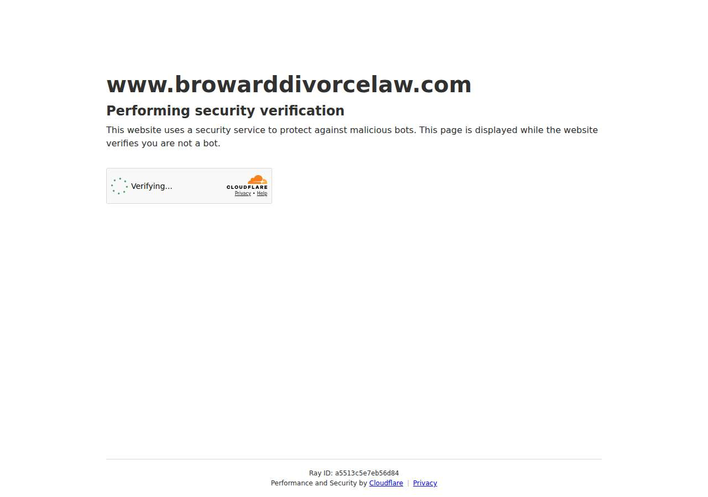

### etinarilaw.com — dry\_run\_ok (dry run)

| | |
|---|---|
| Attempt ID | `4b22bbfd-a7c5-450c-be53-ccb2fd15b909` |
| Form URL | https://www.tinarilawfirm.com/ |
| Final URL | https://www.tinarilawfirm.com/ |
| Reserved | 2026-11-04 05:32:09 UTC |
| Submit attempted | — |
| Template | standard v2 |
| Confirmation text | none observed |
| Result / error | Selectors verified; fields not typed (domain not in dry-run fill list); not submitted |

Exact message:

~~~text
Subject: Helping customers find your business in AI search (AEO + GEO)

Hi there,

I'm Arun from Devs Arun. More and more customers now ask ChatGPT, Gemini, Perplexity or Google's AI Overviews questions like "who should I hire for this in my area?" before they call anyone. These tools answer from websites they can clearly understand, and they tend to recommend businesses whose pages answer real customer questions.

That is what AEO + GEO (Answer Engine and Generative Engine Optimization) is for. I improve your existing service pages so they clearly answer the questions your customers ask, add structured data that matches the page, and make the call, quote or enquiry step obvious. The benefit: your business gets a better chance of being mentioned or linked in AI answers, and visitors who arrive find it easy to contact you.

The AEO + GEO Starter is a one-time $199 (about ₹16,999, negotiable) for one website: a basic audit, 10 customer questions, improvements to two existing pages, relevant structured data and an action plan, with one revision round.

You can read the full details, send an enquiry or book online here:
https://devsarun.io/aeo-geo/

If this isn't relevant, just reply and I won't contact you again.

Best,
Arun
Devs Arun
itschool408@gmail.com · +91 7654534323
~~~

Submitted field values:

- \#input\_comp-jqgiz358: Arun
- \#input\_comp-jqgiz35b: itschool408@gmail.com
- \#input\_comp-jqgizu0c: +91 7654534323
- \#textarea\_comp-jqgizujj: Hi there, I'm Arun from Devs Arun. More and more customers now ask ChatGPT, Gemini, Perplexity or Google's AI Overviews 

**Inspected page** — `run-688cf675_attempt-4b22bbfd_inspection_2026-11-04T05-32-11-827Z.jpg`

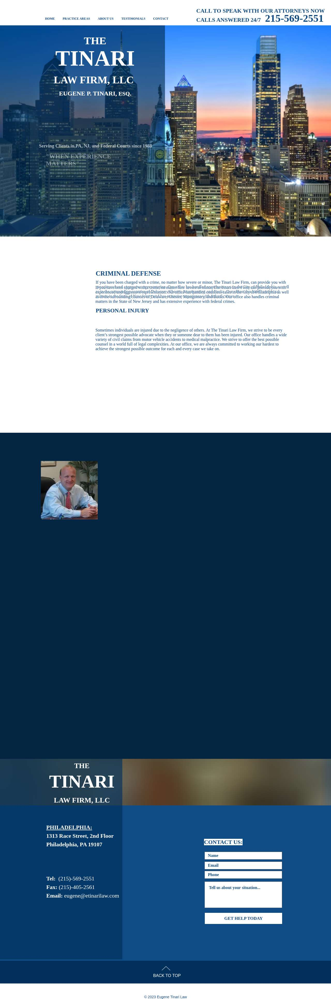

### servicioslegales.org — dry\_run\_failed (dry run)

| | |
|---|---|
| Attempt ID | `1b0232c4-657b-49b9-bdc3-b65c57efba9a` |
| Form URL | https://www.servicioslegales.org/contact-2/ |
| Final URL | https://www.servicioslegales.org/contact-2/ |
| Reserved | 2026-11-04 05:32:16 UTC |
| Submit attempted | — |
| Template | standard v2 |
| Confirmation text | none observed |
| Result / error | Reviewed form not found on page (site changed) |

Exact message:

~~~text
Subject: Helping customers find your business in AI search (AEO + GEO)

Hi there,

I'm Arun from Devs Arun. More and more customers now ask ChatGPT, Gemini, Perplexity or Google's AI Overviews questions like "who should I hire for this in my area?" before they call anyone. These tools answer from websites they can clearly understand, and they tend to recommend businesses whose pages answer real customer questions.

That is what AEO + GEO (Answer Engine and Generative Engine Optimization) is for. I improve your existing service pages so they clearly answer the questions your customers ask, add structured data that matches the page, and make the call, quote or enquiry step obvious. The benefit: your business gets a better chance of being mentioned or linked in AI answers, and visitors who arrive find it easy to contact you.

The AEO + GEO Starter is a one-time $199 (about ₹16,999, negotiable) for one website: a basic audit, 10 customer questions, improvements to two existing pages, relevant structured data and an action plan, with one revision round.

You can read the full details, send an enquiry or book online here:
https://devsarun.io/aeo-geo/

If this isn't relevant, just reply and I won't contact you again.

Best,
Arun
Devs Arun
itschool408@gmail.com · +91 7654534323
~~~

Submitted field values:

- input\[name="your-name"\]: Arun
- input\[name="your-email"\]: itschool408@gmail.com
- textarea\[name="your-message"\]: Hi there, I'm Arun from Devs Arun. More and more customers now ask ChatGPT, Gemini, Perplexity or Google's AI Overviews 

**Inspected page** — `run-688cf675_attempt-1b0232c4_inspection_2026-11-04T05-32-19-119Z.jpg`

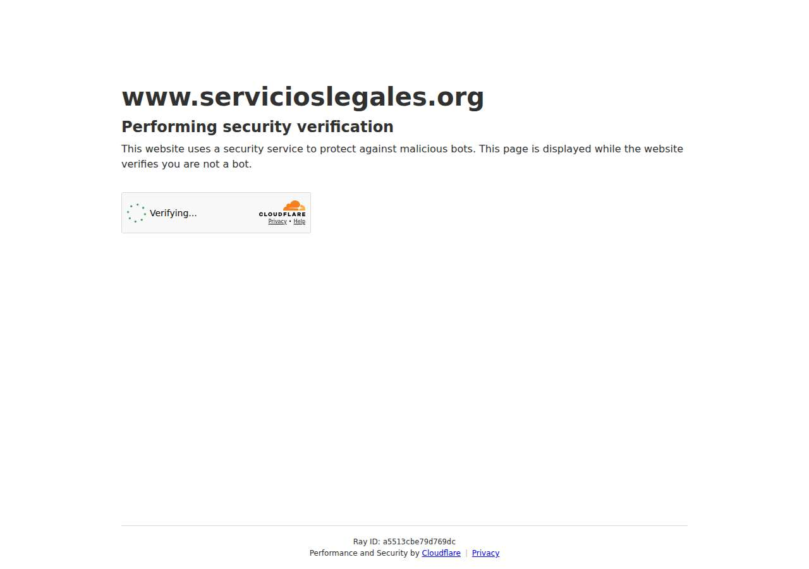

### thomasessexlaw.com — dry\_run\_ok (dry run)

| | |
|---|---|
| Attempt ID | `dc692663-cbf7-483f-8543-cb7f7275c85f` |
| Form URL | https://www.thomasessexlaw.com/contact-us/ |
| Final URL | https://www.thomasessexlaw.com/contact-us/ |
| Reserved | 2026-11-04 05:32:24 UTC |
| Submit attempted | — |
| Template | standard v2 |
| Confirmation text | none observed |
| Result / error | Selectors verified; fields not typed (domain not in dry-run fill list); not submitted |

Exact message:

~~~text
Subject: Helping customers find your business in AI search (AEO + GEO)

Hi there,

I'm Arun from Devs Arun. More and more customers now ask ChatGPT, Gemini, Perplexity or Google's AI Overviews questions like "who should I hire for this in my area?" before they call anyone. These tools answer from websites they can clearly understand, and they tend to recommend businesses whose pages answer real customer questions.

That is what AEO + GEO (Answer Engine and Generative Engine Optimization) is for. I improve your existing service pages so they clearly answer the questions your customers ask, add structured data that matches the page, and make the call, quote or enquiry step obvious. The benefit: your business gets a better chance of being mentioned or linked in AI answers, and visitors who arrive find it easy to contact you.

The AEO + GEO Starter is a one-time $199 (about ₹16,999, negotiable) for one website: a basic audit, 10 customer questions, improvements to two existing pages, relevant structured data and an action plan, with one revision round.

You can read the full details, send an enquiry or book online here:
https://devsarun.io/aeo-geo/

If this isn't relevant, just reply and I won't contact you again.

Best,
Arun
Devs Arun
itschool408@gmail.com · +91 7654534323
~~~

Submitted field values:

- \#contactform-name: Arun
- \#contactform-email: itschool408@gmail.com
- \#contactform-phone: +91 7654534323
- \#contactform-reason: Hi there, I'm Arun from Devs Arun. More and more customers now ask ChatGPT, Gemini, Perplexity or Google's AI Overviews 
- \#contactform-company: Devs Arun

**Inspected page** — `run-688cf675_attempt-dc692663_inspection_2026-11-04T05-32-25-772Z.jpg`

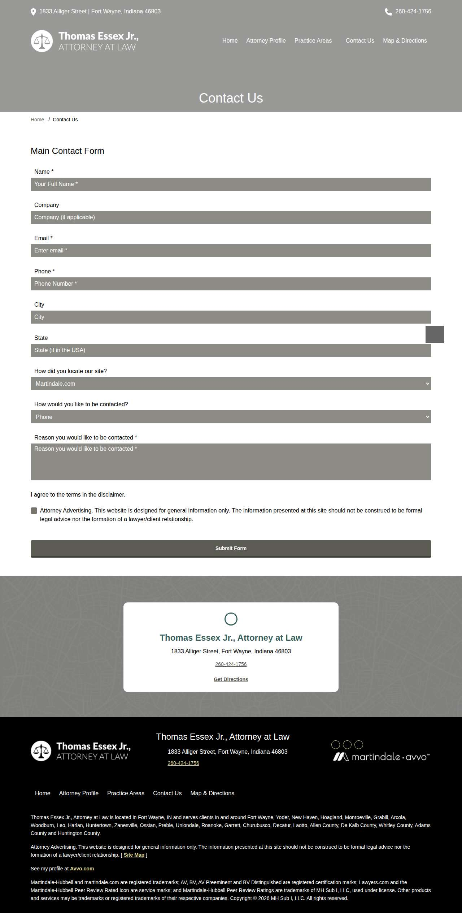

### asamoahcpa.com — dry\_run\_ok (dry run)

| | |
|---|---|
| Attempt ID | `f15b866b-29d4-4354-aae9-014a88f7e401` |
| Form URL | https://asamoacpa.com/contacts/index.html |
| Final URL | https://asamoacpa.com/contacts/index.html |
| Reserved | 2026-11-04 05:32:30 UTC |
| Submit attempted | — |
| Template | standard v2 |
| Confirmation text | none observed |
| Result / error | Selectors verified; fields not typed (domain not in dry-run fill list); not submitted |

Exact message:

~~~text
Subject: Helping customers find your business in AI search (AEO + GEO)

Hi there,

I'm Arun from Devs Arun. More and more customers now ask ChatGPT, Gemini, Perplexity or Google's AI Overviews questions like "who should I hire for this in my area?" before they call anyone. These tools answer from websites they can clearly understand, and they tend to recommend businesses whose pages answer real customer questions.

That is what AEO + GEO (Answer Engine and Generative Engine Optimization) is for. I improve your existing service pages so they clearly answer the questions your customers ask, add structured data that matches the page, and make the call, quote or enquiry step obvious. The benefit: your business gets a better chance of being mentioned or linked in AI answers, and visitors who arrive find it easy to contact you.

The AEO + GEO Starter is a one-time $199 (about ₹16,999, negotiable) for one website: a basic audit, 10 customer questions, improvements to two existing pages, relevant structured data and an action plan, with one revision round.

You can read the full details, send an enquiry or book online here:
https://devsarun.io/aeo-geo/

If this isn't relevant, just reply and I won't contact you again.

Best,
Arun
Devs Arun
itschool408@gmail.com · +91 7654534323
~~~

Submitted field values:

- \#tm\_pb\_contact\_name\_1: Arun
- \#tm\_pb\_contact\_email\_1: itschool408@gmail.com
- \#tm\_pb\_contact\_message\_1: Hi there, I'm Arun from Devs Arun. More and more customers now ask ChatGPT, Gemini, Perplexity or Google's AI Overviews 

**Inspected page** — `run-688cf675_attempt-f15b866b_inspection_2026-11-04T05-32-33-754Z.jpg`

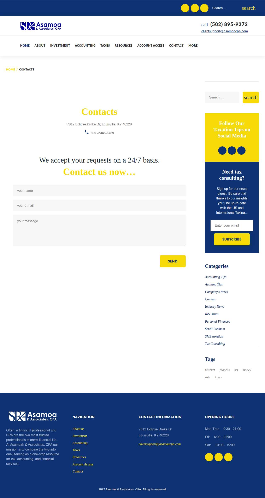

### howestax.com — dry\_run\_ok (dry run)

| | |
|---|---|
| Attempt ID | `5d7ccf80-b59b-42f2-a7af-75964b976de9` |
| Form URL | https://www.howestax.com/contact-us |
| Final URL | https://www.howestax.com/contact-us |
| Reserved | 2026-11-04 05:32:38 UTC |
| Submit attempted | — |
| Template | standard v2 |
| Confirmation text | none observed |
| Result / error | Selectors verified; fields not typed (domain not in dry-run fill list); not submitted |

Exact message:

~~~text
Subject: Helping customers find your business in AI search (AEO + GEO)

Hi there,

I'm Arun from Devs Arun. More and more customers now ask ChatGPT, Gemini, Perplexity or Google's AI Overviews questions like "who should I hire for this in my area?" before they call anyone. These tools answer from websites they can clearly understand, and they tend to recommend businesses whose pages answer real customer questions.

That is what AEO + GEO (Answer Engine and Generative Engine Optimization) is for. I improve your existing service pages so they clearly answer the questions your customers ask, add structured data that matches the page, and make the call, quote or enquiry step obvious. The benefit: your business gets a better chance of being mentioned or linked in AI answers, and visitors who arrive find it easy to contact you.

The AEO + GEO Starter is a one-time $199 (about ₹16,999, negotiable) for one website: a basic audit, 10 customer questions, improvements to two existing pages, relevant structured data and an action plan, with one revision round.

You can read the full details, send an enquiry or book online here:
https://devsarun.io/aeo-geo/

If this isn't relevant, just reply and I won't contact you again.

Best,
Arun
Devs Arun
itschool408@gmail.com · +91 7654534323
~~~

Submitted field values:

- \#input\_comp-kf4ff9fx: Arun
- \#input\_comp-kf4ff9ga: itschool408@gmail.com
- \#input\_comp-kf4ff9gf: +91 7654534323
- \#textarea\_comp-kf4ff9gk: Hi there, I'm Arun from Devs Arun. More and more customers now ask ChatGPT, Gemini, Perplexity or Google's AI Overviews 

**Inspected page** — `run-688cf675_attempt-5d7ccf80_inspection_2026-11-04T05-32-42-246Z.jpg`

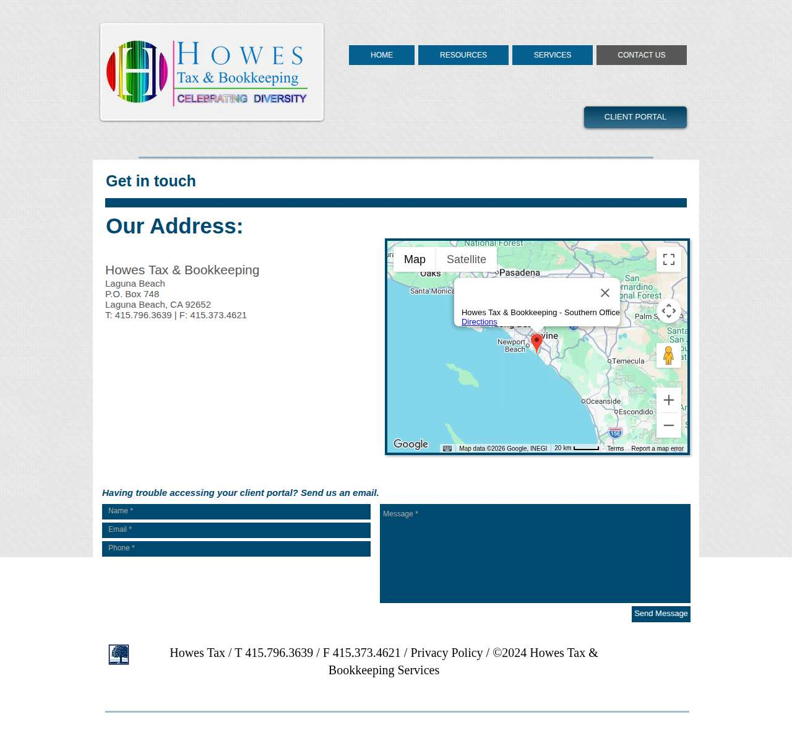

### abletaxllc.com — dry\_run\_ok (dry run)

| | |
|---|---|
| Attempt ID | `a573fe48-dca2-4f09-aa49-41b246f34672` |
| Form URL | https://www.abletaxllc.com/contact |
| Final URL | https://www.abletaxllc.com/contact |
| Reserved | 2026-11-04 05:32:47 UTC |
| Submit attempted | — |
| Template | standard v2 |
| Confirmation text | none observed |
| Result / error | Selectors verified; fields not typed (domain not in dry-run fill list); not submitted |

Exact message:

~~~text
Subject: Helping customers find your business in AI search (AEO + GEO)

Hi there,

I'm Arun from Devs Arun. More and more customers now ask ChatGPT, Gemini, Perplexity or Google's AI Overviews questions like "who should I hire for this in my area?" before they call anyone. These tools answer from websites they can clearly understand, and they tend to recommend businesses whose pages answer real customer questions.

That is what AEO + GEO (Answer Engine and Generative Engine Optimization) is for. I improve your existing service pages so they clearly answer the questions your customers ask, add structured data that matches the page, and make the call, quote or enquiry step obvious. The benefit: your business gets a better chance of being mentioned or linked in AI answers, and visitors who arrive find it easy to contact you.

The AEO + GEO Starter is a one-time $199 (about ₹16,999, negotiable) for one website: a basic audit, 10 customer questions, improvements to two existing pages, relevant structured data and an action plan, with one revision round.

You can read the full details, send an enquiry or book online here:
https://devsarun.io/aeo-geo/

If this isn't relevant, just reply and I won't contact you again.

Best,
Arun
Devs Arun
itschool408@gmail.com · +91 7654534323
~~~

Submitted field values:

- input\[name="Email"\]: itschool408@gmail.com
- textarea\[name="Message"\]: Hi there, I'm Arun from Devs Arun. More and more customers now ask ChatGPT, Gemini, Perplexity or Google's AI Overviews 

**Inspected page** — `run-688cf675_attempt-a573fe48_inspection_2026-11-04T05-32-50-500Z.jpg`

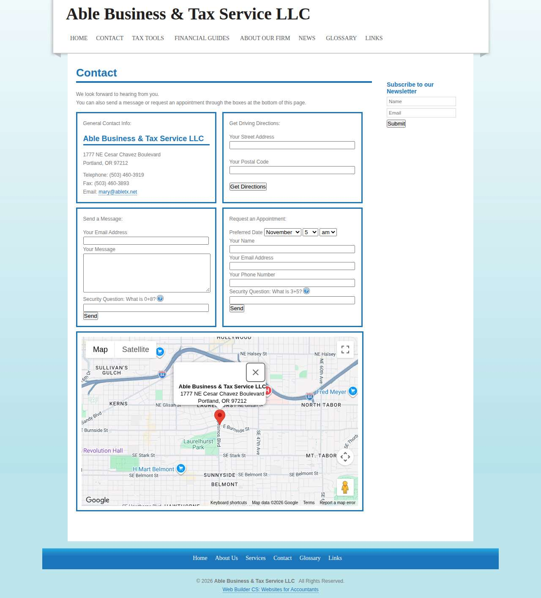

### loiaconofirm.com — dry\_run\_ok (dry run)

| | |
|---|---|
| Attempt ID | `4f61efce-d93e-4155-8d6e-09534df21042` |
| Form URL | https://www.loiaconofirm.com/rome-ny-location |
| Final URL | https://www.loiaconofirm.com/rome-ny-location |
| Reserved | 2026-11-04 05:32:55 UTC |
| Submit attempted | — |
| Template | standard v2 |
| Confirmation text | none observed |
| Result / error | Selectors verified; fields not typed (domain not in dry-run fill list); not submitted |

Exact message:

~~~text
Subject: Helping customers find your business in AI search (AEO + GEO)

Hi there,

I'm Arun from Devs Arun. More and more customers now ask ChatGPT, Gemini, Perplexity or Google's AI Overviews questions like "who should I hire for this in my area?" before they call anyone. These tools answer from websites they can clearly understand, and they tend to recommend businesses whose pages answer real customer questions.

That is what AEO + GEO (Answer Engine and Generative Engine Optimization) is for. I improve your existing service pages so they clearly answer the questions your customers ask, add structured data that matches the page, and make the call, quote or enquiry step obvious. The benefit: your business gets a better chance of being mentioned or linked in AI answers, and visitors who arrive find it easy to contact you.

The AEO + GEO Starter is a one-time $199 (about ₹16,999, negotiable) for one website: a basic audit, 10 customer questions, improvements to two existing pages, relevant structured data and an action plan, with one revision round.

You can read the full details, send an enquiry or book online here:
https://devsarun.io/aeo-geo/

If this isn't relevant, just reply and I won't contact you again.

Best,
Arun
Devs Arun
itschool408@gmail.com · +91 7654534323
~~~

Submitted field values:

- \#\\31 151434059: itschool408@gmail.com
- \#\\31 366846915: Arun
- \#\\31 610750467: Hi there, I'm Arun from Devs Arun. More and more customers now ask ChatGPT, Gemini, Perplexity or Google's AI Overviews 
- \#\\31 974247376: +91 7654534323

**Inspected page** — `run-688cf675_attempt-4f61efce_inspection_2026-11-04T05-32-59-552Z.jpg`

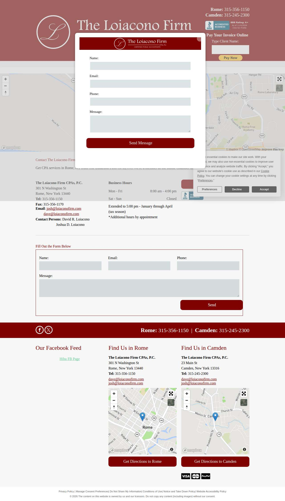

### irvinabrahamson.com — dry\_run\_ok (dry run)

| | |
|---|---|
| Attempt ID | `661bf602-da94-4f4a-bff7-f291b977391e` |
| Form URL | https://www.irvinabrahamson.com/contact |
| Final URL | https://www.irvinabrahamson.com/contact |
| Reserved | 2026-11-04 05:33:04 UTC |
| Submit attempted | — |
| Template | standard v2 |
| Confirmation text | none observed |
| Result / error | Selectors verified; fields not typed (domain not in dry-run fill list); not submitted |

Exact message:

~~~text
Subject: Helping customers find your business in AI search (AEO + GEO)

Hi there,

I'm Arun from Devs Arun. More and more customers now ask ChatGPT, Gemini, Perplexity or Google's AI Overviews questions like "who should I hire for this in my area?" before they call anyone. These tools answer from websites they can clearly understand, and they tend to recommend businesses whose pages answer real customer questions.

That is what AEO + GEO (Answer Engine and Generative Engine Optimization) is for. I improve your existing service pages so they clearly answer the questions your customers ask, add structured data that matches the page, and make the call, quote or enquiry step obvious. The benefit: your business gets a better chance of being mentioned or linked in AI answers, and visitors who arrive find it easy to contact you.

The AEO + GEO Starter is a one-time $199 (about ₹16,999, negotiable) for one website: a basic audit, 10 customer questions, improvements to two existing pages, relevant structured data and an action plan, with one revision round.

You can read the full details, send an enquiry or book online here:
https://devsarun.io/aeo-geo/

If this isn't relevant, just reply and I won't contact you again.

Best,
Arun
Devs Arun
itschool408@gmail.com · +91 7654534323
~~~

Submitted field values:

- \#edit-mail: itschool408@gmail.com
- \#edit-name: Arun
- \#edit-message-0-value: Hi there, I'm Arun from Devs Arun. More and more customers now ask ChatGPT, Gemini, Perplexity or Google's AI Overviews 
- \#edit-subject-0-value: Helping customers find your business in AI search (AEO + GEO)

**Inspected page** — `run-688cf675_attempt-661bf602_inspection_2026-11-04T05-33-07-912Z.jpg`

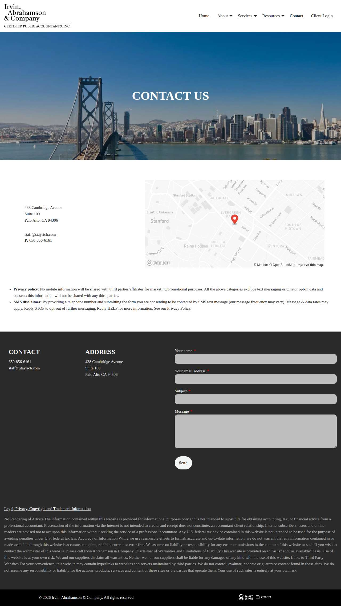

### pvttaxaccounting.com — dry\_run\_ok (dry run)

| | |
|---|---|
| Attempt ID | `df7c1e69-ace3-4acf-9e99-192011d1a257` |
| Form URL | https://www.pvttaxaccounting.com/contact |
| Final URL | https://www.pvttaxaccounting.com/contact |
| Reserved | 2026-11-04 05:33:12 UTC |
| Submit attempted | — |
| Template | standard v2 |
| Confirmation text | none observed |
| Result / error | Selectors verified; fields not typed (domain not in dry-run fill list); not submitted |

Exact message:

~~~text
Subject: Helping customers find your business in AI search (AEO + GEO)

Hi there,

I'm Arun from Devs Arun. More and more customers now ask ChatGPT, Gemini, Perplexity or Google's AI Overviews questions like "who should I hire for this in my area?" before they call anyone. These tools answer from websites they can clearly understand, and they tend to recommend businesses whose pages answer real customer questions.

That is what AEO + GEO (Answer Engine and Generative Engine Optimization) is for. I improve your existing service pages so they clearly answer the questions your customers ask, add structured data that matches the page, and make the call, quote or enquiry step obvious. The benefit: your business gets a better chance of being mentioned or linked in AI answers, and visitors who arrive find it easy to contact you.

The AEO + GEO Starter is a one-time $199 (about ₹16,999, negotiable) for one website: a basic audit, 10 customer questions, improvements to two existing pages, relevant structured data and an action plan, with one revision round.

You can read the full details, send an enquiry or book online here:
https://devsarun.io/aeo-geo/

If this isn't relevant, just reply and I won't contact you again.

Best,
Arun
Devs Arun
itschool408@gmail.com · +91 7654534323
~~~

Submitted field values:

- \#input\_comp-l5bgohil: Arun
- \#input\_comp-l5bgohiz: itschool408@gmail.com
- \#input\_comp-l5bgohj8: +91 7654534323
- \#input\_comp-l5bgohjm: Helping customers find your business in AI search (AEO + GEO)
- \#textarea\_comp-l5bgohjt: Hi there, I'm Arun from Devs Arun. More and more customers now ask ChatGPT, Gemini, Perplexity or Google's AI Overviews 

**Inspected page** — `run-688cf675_attempt-df7c1e69_inspection_2026-11-04T05-33-15-904Z.jpg`

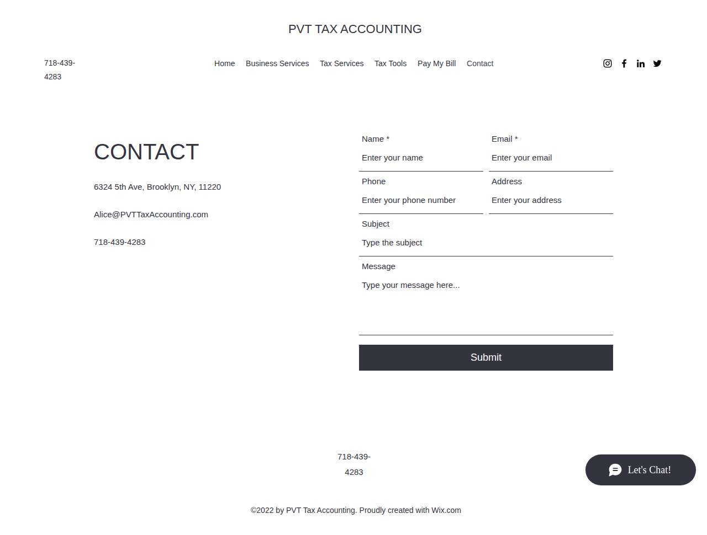

### cpawells.com — dry\_run\_ok (dry run)

| | |
|---|---|
| Attempt ID | `e83b51a5-a09d-4476-b455-1ae1088ff918` |
| Form URL | https://cpawells.com/contact-us/ |
| Final URL | https://cpawells.com/contact-us/ |
| Reserved | 2026-11-04 05:33:20 UTC |
| Submit attempted | — |
| Template | standard v2 |
| Confirmation text | none observed |
| Result / error | Selectors verified; fields not typed (domain not in dry-run fill list); not submitted |

Exact message:

~~~text
Subject: Helping customers find your business in AI search (AEO + GEO)

Hi there,

I'm Arun from Devs Arun. More and more customers now ask ChatGPT, Gemini, Perplexity or Google's AI Overviews questions like "who should I hire for this in my area?" before they call anyone. These tools answer from websites they can clearly understand, and they tend to recommend businesses whose pages answer real customer questions.

That is what AEO + GEO (Answer Engine and Generative Engine Optimization) is for. I improve your existing service pages so they clearly answer the questions your customers ask, add structured data that matches the page, and make the call, quote or enquiry step obvious. The benefit: your business gets a better chance of being mentioned or linked in AI answers, and visitors who arrive find it easy to contact you.

The AEO + GEO Starter is a one-time $199 (about ₹16,999, negotiable) for one website: a basic audit, 10 customer questions, improvements to two existing pages, relevant structured data and an action plan, with one revision round.

You can read the full details, send an enquiry or book online here:
https://devsarun.io/aeo-geo/

If this isn't relevant, just reply and I won't contact you again.

Best,
Arun
Devs Arun
itschool408@gmail.com · +91 7654534323
~~~

Submitted field values:

- \#input\_3\_2: +91 7654534323
- \#input\_3\_3: itschool408@gmail.com
- \#input\_3\_4: Hi there, I'm Arun from Devs Arun. More and more customers now ask ChatGPT, Gemini, Perplexity or Google's AI Overviews 
- \#input\_3\_5: Helping customers find your business in AI search (AEO + GEO)
- \#input\_3\_1\_3: Arun

**Inspected page** — `run-688cf675_attempt-e83b51a5_inspection_2026-11-04T05-33-22-668Z.jpg`

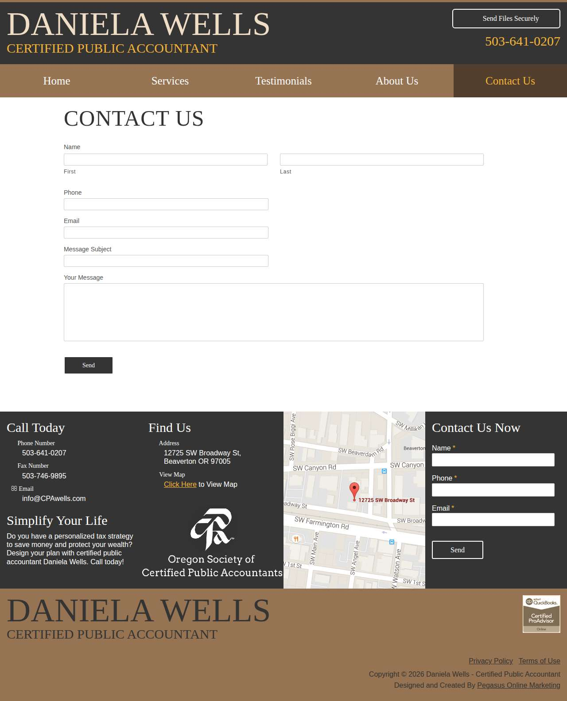

### cpanw.com — dry\_run\_ok (dry run)

| | |
|---|---|
| Attempt ID | `00b30ec8-aa97-4eef-897f-03f28e37d9eb` |
| Form URL | https://www.cpanw.com/contact |
| Final URL | https://www.cpanw.com/contact |
| Reserved | 2026-11-04 05:33:27 UTC |
| Submit attempted | — |
| Template | standard v2 |
| Confirmation text | none observed |
| Result / error | Selectors verified; fields not typed (domain not in dry-run fill list); not submitted |

Exact message:

~~~text
Subject: Helping customers find your business in AI search (AEO + GEO)

Hi there,

I'm Arun from Devs Arun. More and more customers now ask ChatGPT, Gemini, Perplexity or Google's AI Overviews questions like "who should I hire for this in my area?" before they call anyone. These tools answer from websites they can clearly understand, and they tend to recommend businesses whose pages answer real customer questions.

That is what AEO + GEO (Answer Engine and Generative Engine Optimization) is for. I improve your existing service pages so they clearly answer the questions your customers ask, add structured data that matches the page, and make the call, quote or enquiry step obvious. The benefit: your business gets a better chance of being mentioned or linked in AI answers, and visitors who arrive find it easy to contact you.

The AEO + GEO Starter is a one-time $199 (about ₹16,999, negotiable) for one website: a basic audit, 10 customer questions, improvements to two existing pages, relevant structured data and an action plan, with one revision round.

You can read the full details, send an enquiry or book online here:
https://devsarun.io/aeo-geo/

If this isn't relevant, just reply and I won't contact you again.

Best,
Arun
Devs Arun
itschool408@gmail.com · +91 7654534323
~~~

Submitted field values:

- \#edit-mail: itschool408@gmail.com
- \#edit-name: Arun
- \#edit-message-0-value: Hi there, I'm Arun from Devs Arun. More and more customers now ask ChatGPT, Gemini, Perplexity or Google's AI Overviews 
- \#edit-subject-0-value: Helping customers find your business in AI search (AEO + GEO)

**Inspected page** — `run-688cf675_attempt-00b30ec8_inspection_2026-11-04T05-33-29-967Z.jpg`

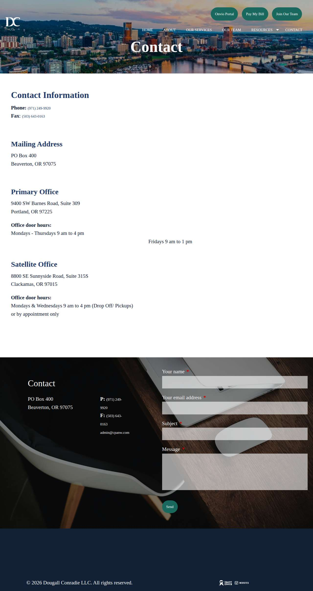

### kzcpas.com — dry\_run\_ok (dry run)

| | |
|---|---|
| Attempt ID | `ff959f7c-49d2-45f0-9d64-afea679ae85f` |
| Form URL | https://www.kzcpas.com/\#contact |
| Final URL | https://www.kzcpas.com/\#contact |
| Reserved | 2026-11-04 05:33:34 UTC |
| Submit attempted | — |
| Template | standard v2 |
| Confirmation text | none observed |
| Result / error | Selectors verified; fields not typed (domain not in dry-run fill list); not submitted |

Exact message:

~~~text
Subject: Helping customers find your business in AI search (AEO + GEO)

Hi there,

I'm Arun from Devs Arun. More and more customers now ask ChatGPT, Gemini, Perplexity or Google's AI Overviews questions like "who should I hire for this in my area?" before they call anyone. These tools answer from websites they can clearly understand, and they tend to recommend businesses whose pages answer real customer questions.

That is what AEO + GEO (Answer Engine and Generative Engine Optimization) is for. I improve your existing service pages so they clearly answer the questions your customers ask, add structured data that matches the page, and make the call, quote or enquiry step obvious. The benefit: your business gets a better chance of being mentioned or linked in AI answers, and visitors who arrive find it easy to contact you.

The AEO + GEO Starter is a one-time $199 (about ₹16,999, negotiable) for one website: a basic audit, 10 customer questions, improvements to two existing pages, relevant structured data and an action plan, with one revision round.

You can read the full details, send an enquiry or book online here:
https://devsarun.io/aeo-geo/

If this isn't relevant, just reply and I won't contact you again.

Best,
Arun
Devs Arun
itschool408@gmail.com · +91 7654534323
~~~

Submitted field values:

- input\[name="your-name"\]: Arun
- input\[name="your-email"\]: itschool408@gmail.com
- input\[name="your-subject"\]: Helping customers find your business in AI search (AEO + GEO)
- textarea\[name="your-message"\]: Hi there, I'm Arun from Devs Arun. More and more customers now ask ChatGPT, Gemini, Perplexity or Google's AI Overviews 

**Inspected page** — `run-688cf675_attempt-ff959f7c_inspection_2026-11-04T05-33-38-330Z.jpg`

### cpa-utah.com — dry\_run\_ok (dry run)

| | |
|---|---|
| Attempt ID | `4747b1f2-aa92-4c90-b9bb-7b9790dbc75e` |
| Form URL | http://cpa-utah.com/contact-us/ |
| Final URL | http://cpa-utah.com/contact-us/ |
| Reserved | 2026-11-04 05:33:43 UTC |
| Submit attempted | — |
| Template | standard v2 |
| Confirmation text | none observed |
| Result / error | Selectors verified; fields not typed (domain not in dry-run fill list); not submitted |

Exact message:

~~~text
Subject: Helping customers find your business in AI search (AEO + GEO)

Hi there,

I'm Arun from Devs Arun. More and more customers now ask ChatGPT, Gemini, Perplexity or Google's AI Overviews questions like "who should I hire for this in my area?" before they call anyone. These tools answer from websites they can clearly understand, and they tend to recommend businesses whose pages answer real customer questions.

That is what AEO + GEO (Answer Engine and Generative Engine Optimization) is for. I improve your existing service pages so they clearly answer the questions your customers ask, add structured data that matches the page, and make the call, quote or enquiry step obvious. The benefit: your business gets a better chance of being mentioned or linked in AI answers, and visitors who arrive find it easy to contact you.

The AEO + GEO Starter is a one-time $199 (about ₹16,999, negotiable) for one website: a basic audit, 10 customer questions, improvements to two existing pages, relevant structured data and an action plan, with one revision round.

You can read the full details, send an enquiry or book online here:
https://devsarun.io/aeo-geo/

If this isn't relevant, just reply and I won't contact you again.

Best,
Arun
Devs Arun
itschool408@gmail.com · +91 7654534323
~~~

Submitted field values:

- input\[name="your-name"\]: Arun
- input\[name="your-email"\]: itschool408@gmail.com
- input\[name="your-phone"\]: +91 7654534323
- input\[name="your-subject"\]: Helping customers find your business in AI search (AEO + GEO)
- textarea\[name="your-message"\]: Hi there, I'm Arun from Devs Arun. More and more customers now ask ChatGPT, Gemini, Perplexity or Google's AI Overviews 

**Inspected page** — `run-688cf675_attempt-4747b1f2_inspection_2026-11-04T05-33-45-509Z.jpg`

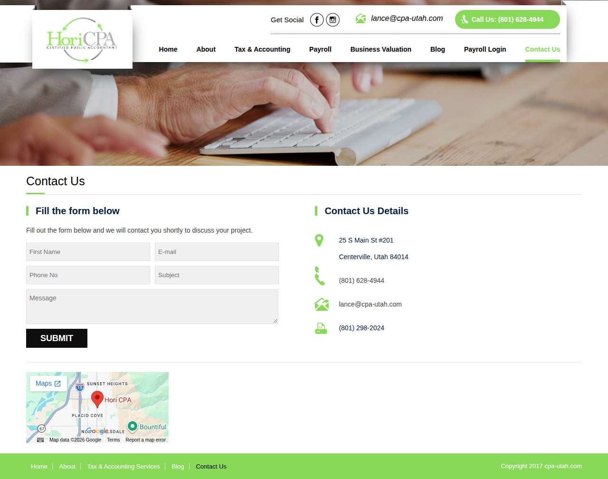

### fi-team.com — dry\_run\_ok (dry run)

| | |
|---|---|
| Attempt ID | `7198f38d-e674-4d29-ba48-a2efa92b3a96` |
| Form URL | https://fi-team.com/contact |
| Final URL | https://fi-team.com/contact |
| Reserved | 2026-11-04 05:33:50 UTC |
| Submit attempted | — |
| Template | standard v2 |
| Confirmation text | none observed |
| Result / error | Selectors verified; fields not typed (domain not in dry-run fill list); not submitted |

Exact message:

~~~text
Subject: Helping customers find your business in AI search (AEO + GEO)

Hi there,

I'm Arun from Devs Arun. More and more customers now ask ChatGPT, Gemini, Perplexity or Google's AI Overviews questions like "who should I hire for this in my area?" before they call anyone. These tools answer from websites they can clearly understand, and they tend to recommend businesses whose pages answer real customer questions.

That is what AEO + GEO (Answer Engine and Generative Engine Optimization) is for. I improve your existing service pages so they clearly answer the questions your customers ask, add structured data that matches the page, and make the call, quote or enquiry step obvious. The benefit: your business gets a better chance of being mentioned or linked in AI answers, and visitors who arrive find it easy to contact you.

The AEO + GEO Starter is a one-time $199 (about ₹16,999, negotiable) for one website: a basic audit, 10 customer questions, improvements to two existing pages, relevant structured data and an action plan, with one revision round.

You can read the full details, send an enquiry or book online here:
https://devsarun.io/aeo-geo/

If this isn't relevant, just reply and I won't contact you again.

Best,
Arun
Devs Arun
itschool408@gmail.com · +91 7654534323
~~~

Submitted field values:

- input\[name="contact\[name\]"\]: Arun
- input\[name="contact\[email\]"\]: itschool408@gmail.com
- input\[name="contact\[phone\]"\]: +91 7654534323
- textarea\[name="contact\[message\]"\]: Hi there, I'm Arun from Devs Arun. More and more customers now ask ChatGPT, Gemini, Perplexity or Google's AI Overviews 

**Inspected page** — `run-688cf675_attempt-7198f38d_inspection_2026-11-04T05-33-52-564Z.jpg`

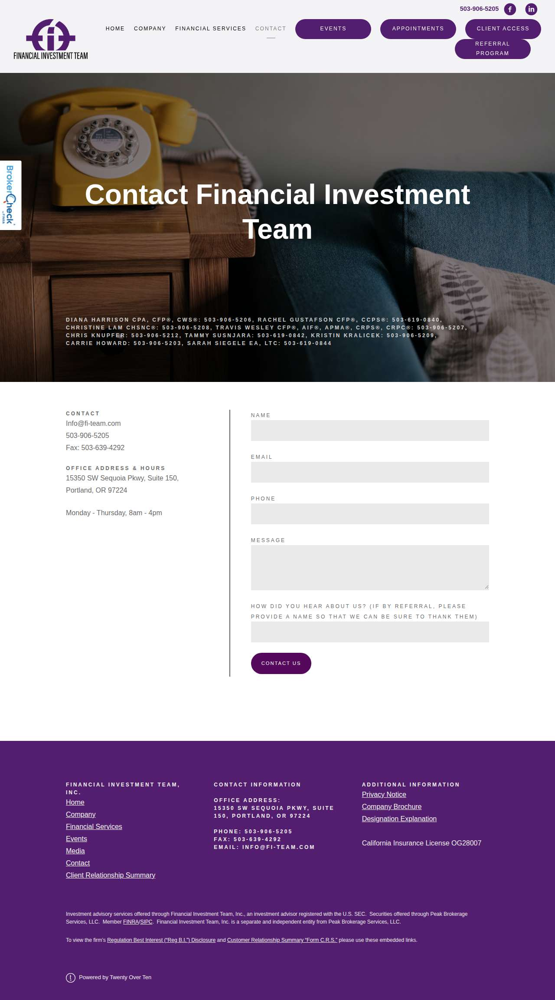

### besprofessionalservices.com — dry\_run\_ok (dry run)

| | |
|---|---|
| Attempt ID | `433affb5-68f9-4f60-b247-bc4855959ce9` |
| Form URL | https://www.besps.com/ |
| Final URL | https://www.besps.com/ |
| Reserved | 2026-11-04 05:33:57 UTC |
| Submit attempted | — |
| Template | standard v2 |
| Confirmation text | none observed |
| Result / error | Selectors verified; fields not typed (domain not in dry-run fill list); not submitted |

Exact message:

~~~text
Subject: Helping customers find your business in AI search (AEO + GEO)

Hi there,

I'm Arun from Devs Arun. More and more customers now ask ChatGPT, Gemini, Perplexity or Google's AI Overviews questions like "who should I hire for this in my area?" before they call anyone. These tools answer from websites they can clearly understand, and they tend to recommend businesses whose pages answer real customer questions.

That is what AEO + GEO (Answer Engine and Generative Engine Optimization) is for. I improve your existing service pages so they clearly answer the questions your customers ask, add structured data that matches the page, and make the call, quote or enquiry step obvious. The benefit: your business gets a better chance of being mentioned or linked in AI answers, and visitors who arrive find it easy to contact you.

The AEO + GEO Starter is a one-time $199 (about ₹16,999, negotiable) for one website: a basic audit, 10 customer questions, improvements to two existing pages, relevant structured data and an action plan, with one revision round.

You can read the full details, send an enquiry or book online here:
https://devsarun.io/aeo-geo/

If this isn't relevant, just reply and I won't contact you again.

Best,
Arun
Devs Arun
itschool408@gmail.com · +91 7654534323
~~~

Submitted field values:

- \#input\_comp-jkmdcbph: itschool408@gmail.com
- \#input\_comp-jkmdcbpi: +91 7654534323
- \#input\_comp-jkmdcbpm1: Arun
- \#textarea\_comp-jkmdcbpm: Hi there, I'm Arun from Devs Arun. More and more customers now ask ChatGPT, Gemini, Perplexity or Google's AI Overviews 

**Inspected page** — `run-688cf675_attempt-433affb5_inspection_2026-11-04T05-34-00-385Z.jpg`

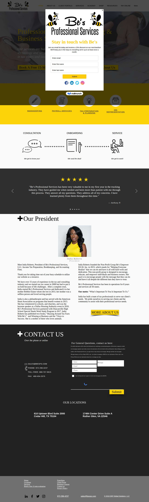

### redman-cpa.com — dry\_run\_failed (dry run)

| | |
|---|---|
| Attempt ID | `e2f5ed54-d447-42da-933b-70e73dea9031` |
| Form URL | https://www.redman-cpa.com/contact |
| Final URL | — |
| Reserved | 2026-11-04 05:34:05 UTC |
| Submit attempted | — |
| Template | standard v2 |
| Confirmation text | none observed |
| Result / error | page.goto: Timeout 30000ms exceeded. |

Exact message:

~~~text
Subject: Helping customers find your business in AI search (AEO + GEO)

Hi there,

I'm Arun from Devs Arun. More and more customers now ask ChatGPT, Gemini, Perplexity or Google's AI Overviews questions like "who should I hire for this in my area?" before they call anyone. These tools answer from websites they can clearly understand, and they tend to recommend businesses whose pages answer real customer questions.

That is what AEO + GEO (Answer Engine and Generative Engine Optimization) is for. I improve your existing service pages so they clearly answer the questions your customers ask, add structured data that matches the page, and make the call, quote or enquiry step obvious. The benefit: your business gets a better chance of being mentioned or linked in AI answers, and visitors who arrive find it easy to contact you.

The AEO + GEO Starter is a one-time $199 (about ₹16,999, negotiable) for one website: a basic audit, 10 customer questions, improvements to two existing pages, relevant structured data and an action plan, with one revision round.

You can read the full details, send an enquiry or book online here:
https://devsarun.io/aeo-geo/

If this isn't relevant, just reply and I won't contact you again.

Best,
Arun
Devs Arun
itschool408@gmail.com · +91 7654534323
~~~

Submitted field values:

- input\[name="Email"\]: itschool408@gmail.com
- textarea\[name="Message"\]: Hi there, I'm Arun from Devs Arun. More and more customers now ask ChatGPT, Gemini, Perplexity or Google's AI Overviews 

**Inspected page** — capture failed: page.screenshot: Target page, context or browser has been closed

## Events (118)

| Time (UTC) | Event | Website | Details |
|---|---|---|---|
| 05:31:03 | run\_queued | — | dry\_run run requested by github:itsDevsArun |
| 05:31:03 | run\_dispatched | — | dispatch disabled (local test mode) |
| 05:31:06 | run\_started | — | Runner claimed dry\_run run |
| 05:31:06 | website\_selected | helixmechanical.com | Dry-run target helixmechanical.com |
| 05:31:06 | draft\_prepared | helixmechanical.com | Draft prepared with template standard v2 |
| 05:31:08 | page\_opened | helixmechanical.com | Opened form page |
| 05:31:09 | screenshot\_saved | helixmechanical.com | inspection screenshot saved (54 KB) |
| 05:31:09 | review\_required | helixmechanical.com | dry run failed: Mapped field "First Name \*" not found uniquely |
| 05:31:14 | website\_selected | knoxvilleelectrician.com | Dry-run target knoxvilleelectrician.com |
| 05:31:14 | draft\_prepared | knoxvilleelectrician.com | Draft prepared with template standard v2 |
| 05:31:17 | page\_opened | knoxvilleelectrician.com | Opened form page |
| 05:31:17 | screenshot\_saved | knoxvilleelectrician.com | inspection screenshot saved (137 KB) |
| 05:31:17 | review\_required | knoxvilleelectrician.com | dry run failed: Mapped field "Name" not found uniquely |
| 05:31:22 | website\_selected | david-ware.com | Dry-run target david-ware.com |
| 05:31:22 | draft\_prepared | david-ware.com | Draft prepared with template short v2 |
| 05:31:25 | page\_opened | david-ware.com | Opened form page |
| 05:31:25 | screenshot\_saved | david-ware.com | inspection screenshot saved (29 KB) |
| 05:31:25 | review\_required | david-ware.com | dry run failed: Reviewed form not found on page (site changed) |
| 05:31:30 | website\_selected | shayandassociates.com | Dry-run target shayandassociates.com |
| 05:31:30 | draft\_prepared | shayandassociates.com | Draft prepared with template standard v2 |
| 05:31:35 | page\_opened | shayandassociates.com | Opened form page |
| 05:31:35 | screenshot\_saved | shayandassociates.com | inspection screenshot saved (103 KB) |
| 05:31:35 | dry\_run\_checked | shayandassociates.com | dry run ok: Selectors verified; fields not typed (domain not in dry-run fill list); not submitted |
| 05:31:40 | website\_selected | thechesnuttlawfirm.com | Dry-run target thechesnuttlawfirm.com |
| 05:31:40 | draft\_prepared | thechesnuttlawfirm.com | Draft prepared with template standard v2 |
| 05:31:44 | page\_opened | thechesnuttlawfirm.com | Opened form page |
| 05:31:44 | screenshot\_saved | thechesnuttlawfirm.com | inspection screenshot saved (250 KB) |
| 05:31:44 | dry\_run\_checked | thechesnuttlawfirm.com | dry run ok: Selectors verified; fields not typed (domain not in dry-run fill list); not submitted |
| 05:31:49 | website\_selected | accidentattorneysvermont.com | Dry-run target accidentattorneysvermont.com |
| 05:31:49 | draft\_prepared | accidentattorneysvermont.com | Draft prepared with template standard v2 |
| 05:31:56 | page\_opened | accidentattorneysvermont.com | Opened form page |
| 05:31:56 | screenshot\_saved | accidentattorneysvermont.com | inspection screenshot saved (119 KB) |
| 05:31:56 | dry\_run\_checked | accidentattorneysvermont.com | dry run ok: Selectors verified; fields not typed (domain not in dry-run fill list); not submitted |
| 05:32:01 | website\_selected | browarddivorcelaw.com | Dry-run target browarddivorcelaw.com |
| 05:32:01 | draft\_prepared | browarddivorcelaw.com | Draft prepared with template standard v2 |
| 05:32:03 | page\_opened | browarddivorcelaw.com | Opened form page |
| 05:32:04 | screenshot\_saved | browarddivorcelaw.com | inspection screenshot saved (31 KB) |
| 05:32:04 | review\_required | browarddivorcelaw.com | dry run failed: Reviewed form not found on page (site changed) |
| 05:32:09 | website\_selected | etinarilaw.com | Dry-run target etinarilaw.com |
| 05:32:09 | draft\_prepared | etinarilaw.com | Draft prepared with template standard v2 |
| 05:32:11 | page\_opened | etinarilaw.com | Opened form page |
| 05:32:11 | screenshot\_saved | etinarilaw.com | inspection screenshot saved (245 KB) |
| 05:32:11 | dry\_run\_checked | etinarilaw.com | dry run ok: Selectors verified; fields not typed (domain not in dry-run fill list); not submitted |
| 05:32:16 | website\_selected | servicioslegales.org | Dry-run target servicioslegales.org |
| 05:32:16 | draft\_prepared | servicioslegales.org | Draft prepared with template standard v2 |
| 05:32:19 | page\_opened | servicioslegales.org | Opened form page |
| 05:32:19 | screenshot\_saved | servicioslegales.org | inspection screenshot saved (30 KB) |
| 05:32:19 | review\_required | servicioslegales.org | dry run failed: Reviewed form not found on page (site changed) |
| 05:32:24 | website\_selected | thomasessexlaw.com | Dry-run target thomasessexlaw.com |
| 05:32:24 | draft\_prepared | thomasessexlaw.com | Draft prepared with template standard v2 |
| 05:32:25 | page\_opened | thomasessexlaw.com | Opened form page |
| 05:32:25 | screenshot\_saved | thomasessexlaw.com | inspection screenshot saved (156 KB) |
| 05:32:25 | dry\_run\_checked | thomasessexlaw.com | dry run ok: Selectors verified; fields not typed (domain not in dry-run fill list); not submitted |
| 05:32:30 | website\_selected | asamoahcpa.com | Dry-run target asamoahcpa.com |
| 05:32:30 | draft\_prepared | asamoahcpa.com | Draft prepared with template standard v2 |
| 05:32:33 | page\_opened | asamoahcpa.com | Opened form page |
| 05:32:33 | screenshot\_saved | asamoahcpa.com | inspection screenshot saved (120 KB) |
| 05:32:33 | dry\_run\_checked | asamoahcpa.com | dry run ok: Selectors verified; fields not typed (domain not in dry-run fill list); not submitted |
| 05:32:38 | website\_selected | howestax.com | Dry-run target howestax.com |
| 05:32:38 | draft\_prepared | howestax.com | Draft prepared with template standard v2 |
| 05:32:42 | page\_opened | howestax.com | Opened form page |
| 05:32:42 | screenshot\_saved | howestax.com | inspection screenshot saved (92 KB) |
| 05:32:42 | dry\_run\_checked | howestax.com | dry run ok: Selectors verified; fields not typed (domain not in dry-run fill list); not submitted |
| 05:32:47 | website\_selected | abletaxllc.com | Dry-run target abletaxllc.com |
| 05:32:47 | draft\_prepared | abletaxllc.com | Draft prepared with template standard v2 |
| 05:32:50 | page\_opened | abletaxllc.com | Opened form page |
| 05:32:50 | screenshot\_saved | abletaxllc.com | inspection screenshot saved (116 KB) |
| 05:32:50 | dry\_run\_checked | abletaxllc.com | dry run ok: Selectors verified; fields not typed (domain not in dry-run fill list); not submitted |
| 05:32:55 | website\_selected | loiaconofirm.com | Dry-run target loiaconofirm.com |
| 05:32:55 | draft\_prepared | loiaconofirm.com | Draft prepared with template standard v2 |
| 05:32:58 | page\_opened | loiaconofirm.com | Opened form page |
| 05:32:59 | screenshot\_saved | loiaconofirm.com | inspection screenshot saved (163 KB) |
| 05:32:59 | dry\_run\_checked | loiaconofirm.com | dry run ok: Selectors verified; fields not typed (domain not in dry-run fill list); not submitted |
| 05:33:04 | website\_selected | irvinabrahamson.com | Dry-run target irvinabrahamson.com |
| 05:33:04 | draft\_prepared | irvinabrahamson.com | Draft prepared with template standard v2 |
| 05:33:07 | page\_opened | irvinabrahamson.com | Opened form page |
| 05:33:07 | screenshot\_saved | irvinabrahamson.com | inspection screenshot saved (160 KB) |
| 05:33:07 | dry\_run\_checked | irvinabrahamson.com | dry run ok: Selectors verified; fields not typed (domain not in dry-run fill list); not submitted |
| 05:33:12 | website\_selected | pvttaxaccounting.com | Dry-run target pvttaxaccounting.com |
| 05:33:12 | draft\_prepared | pvttaxaccounting.com | Draft prepared with template standard v2 |
| 05:33:15 | page\_opened | pvttaxaccounting.com | Opened form page |
| 05:33:15 | screenshot\_saved | pvttaxaccounting.com | inspection screenshot saved (35 KB) |
| 05:33:15 | dry\_run\_checked | pvttaxaccounting.com | dry run ok: Selectors verified; fields not typed (domain not in dry-run fill list); not submitted |
| 05:33:20 | website\_selected | cpawells.com | Dry-run target cpawells.com |
| 05:33:20 | draft\_prepared | cpawells.com | Draft prepared with template standard v2 |
| 05:33:22 | page\_opened | cpawells.com | Opened form page |
| 05:33:22 | screenshot\_saved | cpawells.com | inspection screenshot saved (107 KB) |
| 05:33:22 | dry\_run\_checked | cpawells.com | dry run ok: Selectors verified; fields not typed (domain not in dry-run fill list); not submitted |
| 05:33:27 | website\_selected | cpanw.com | Dry-run target cpanw.com |
| 05:33:27 | draft\_prepared | cpanw.com | Draft prepared with template standard v2 |
| 05:33:29 | page\_opened | cpanw.com | Opened form page |
| 05:33:29 | screenshot\_saved | cpanw.com | inspection screenshot saved (148 KB) |
| 05:33:29 | dry\_run\_checked | cpanw.com | dry run ok: Selectors verified; fields not typed (domain not in dry-run fill list); not submitted |
| 05:33:35 | website\_selected | kzcpas.com | Dry-run target kzcpas.com |
| 05:33:35 | draft\_prepared | kzcpas.com | Draft prepared with template standard v2 |
| 05:33:38 | page\_opened | kzcpas.com | Opened form page |
| 05:33:38 | screenshot\_saved | kzcpas.com | inspection screenshot saved (413 KB) |
| 05:33:38 | dry\_run\_checked | kzcpas.com | dry run ok: Selectors verified; fields not typed (domain not in dry-run fill list); not submitted |
| 05:33:43 | website\_selected | cpa-utah.com | Dry-run target cpa-utah.com |
| 05:33:43 | draft\_prepared | cpa-utah.com | Draft prepared with template standard v2 |
| 05:33:45 | page\_opened | cpa-utah.com | Opened form page |
| 05:33:45 | screenshot\_saved | cpa-utah.com | inspection screenshot saved (74 KB) |
| 05:33:45 | dry\_run\_checked | cpa-utah.com | dry run ok: Selectors verified; fields not typed (domain not in dry-run fill list); not submitted |
| 05:33:50 | website\_selected | fi-team.com | Dry-run target fi-team.com |
| 05:33:50 | draft\_prepared | fi-team.com | Draft prepared with template standard v2 |
| 05:33:52 | page\_opened | fi-team.com | Opened form page |
| 05:33:52 | screenshot\_saved | fi-team.com | inspection screenshot saved (154 KB) |
| 05:33:52 | dry\_run\_checked | fi-team.com | dry run ok: Selectors verified; fields not typed (domain not in dry-run fill list); not submitted |
| 05:33:57 | website\_selected | besprofessionalservices.com | Dry-run target besprofessionalservices.com |
| 05:33:57 | draft\_prepared | besprofessionalservices.com | Draft prepared with template standard v2 |
| 05:34:00 | page\_opened | besprofessionalservices.com | Opened form page |
| 05:34:00 | screenshot\_saved | besprofessionalservices.com | inspection screenshot saved (302 KB) |
| 05:34:00 | dry\_run\_checked | besprofessionalservices.com | dry run ok: Selectors verified; fields not typed (domain not in dry-run fill list); not submitted |
| 05:34:05 | website\_selected | redman-cpa.com | Dry-run target redman-cpa.com |
| 05:34:05 | draft\_prepared | redman-cpa.com | Draft prepared with template standard v2 |
| 05:38:05 | error | redman-cpa.com | Screenshot capture failed (inspection): page.screenshot: Target page, context or browser has been closed |
| 05:38:05 | review\_required | redman-cpa.com | dry run failed: page.goto: Timeout 30000ms exceeded. |
| 05:38:10 | run\_completed | — | Run completed (queue\_exhausted) |
