# Run b6bce34c — dry\_run — completed

| | |
|---|---|
| Run ID | `b6bce34c-5edc-455a-8465-5ff7a89257b8` |
| Requested by | github:itsDevsArun |
| Started | 2026-11-04 06:54:53 UTC |
| Finished | 2026-11-04 06:57:32 UTC |
| Finish reason | queue\_exhausted |
| GitHub Actions | https://github.com/itsDevsArun/aeo-geo/actions/runs/41763788389 |

CSV for this run: [runs/2026-11-04_dry_run_b6bce34c.csv](2026-11-04_dry_run_b6bce34c.csv)

## Attempts (19)

### helixmechanical.com — dry\_run\_failed (dry run)

| | |
|---|---|
| Attempt ID | `800863dd-29ef-4662-bc3b-8ab0d290882e` |
| Form URL | https://helixmechanical.com/contact/ |
| Final URL | https://helixmechanical.com/contact/ |
| Reserved | 2026-11-04 06:54:54 UTC |
| Submit attempted | — |
| Template | standard v2 |
| Confirmation text | none observed |
| Result / error | Mapped field "First Name \*" not found uniquely |

Exact message:

~~~text
Subject: Helping customers find your business in AI search (AEO + GEO)

Hi there,

I'm Arun from Devs Arun. More and more customers now ask ChatGPT, Gemini, Perplexity or Google's AI Overviews questions like "who should I hire for this in my area?" before they call anyone. These tools answer from websites they can clearly understand, and they tend to recommend businesses whose pages answer real customer questions.

That is what AEO + GEO (Answer Engine and Generative Engine Optimization) is for. I improve your existing service pages so they clearly answer the questions your customers ask, add structured data that matches the page, and make the call, quote or enquiry step obvious. The benefit: your business gets a better chance of being mentioned or linked in AI answers, and visitors who arrive find it easy to contact you.

The AEO + GEO Starter is a one-time $199 (about ₹16,999, negotiable) for one website: a basic audit, 10 customer questions, improvements to two existing pages, relevant structured data and an action plan, with one revision round.

You can read the full details, send an enquiry or book online here:
https://devsarun.io/aeo-geo/

If this isn't relevant, just reply and I won't contact you again.

Best,
Arun
Devs Arun
itschool408@gmail.com · +91 7654534323
~~~

Submitted field values:

- \#forminator-field-name-1\_6ae7ff023fd3c: Arun
- \#forminator-field-email-1\_6ae7ff023fd3c: itschool408@gmail.com
- \#forminator-field-phone-1\_6ae7ff023fd3c: +91 7654534323
- \#forminator-field-textarea-1\_6ae7ff023fd3c: Hi there, I'm Arun from Devs Arun. More and more customers now ask ChatGPT, Gemini, Perplexity or Google's AI Overviews 

**Inspected page** — `run-b6bce34c_attempt-800863dd_inspection_2026-11-04T06-54-56-315Z.jpg`

### knoxvilleelectrician.com — dry\_run\_failed (dry run)

| | |
|---|---|
| Attempt ID | `e0d291f3-3b7e-4549-9242-7df9faf79f7a` |
| Form URL | https://knoxvilleelectrician.com/contact-us/ |
| Final URL | https://knoxvilleelectrician.com/contact-us/ |
| Reserved | 2026-11-04 06:55:01 UTC |
| Submit attempted | — |
| Template | standard v2 |
| Confirmation text | none observed |
| Result / error | Mapped field "Name" not found uniquely |

Exact message:

~~~text
Subject: Helping customers find your business in AI search (AEO + GEO)

Hi there,

I'm Arun from Devs Arun. More and more customers now ask ChatGPT, Gemini, Perplexity or Google's AI Overviews questions like "who should I hire for this in my area?" before they call anyone. These tools answer from websites they can clearly understand, and they tend to recommend businesses whose pages answer real customer questions.

That is what AEO + GEO (Answer Engine and Generative Engine Optimization) is for. I improve your existing service pages so they clearly answer the questions your customers ask, add structured data that matches the page, and make the call, quote or enquiry step obvious. The benefit: your business gets a better chance of being mentioned or linked in AI answers, and visitors who arrive find it easy to contact you.

The AEO + GEO Starter is a one-time $199 (about ₹16,999, negotiable) for one website: a basic audit, 10 customer questions, improvements to two existing pages, relevant structured data and an action plan, with one revision round.

You can read the full details, send an enquiry or book online here:
https://devsarun.io/aeo-geo/

If this isn't relevant, just reply and I won't contact you again.

Best,
Arun
Devs Arun
itschool408@gmail.com · +91 7654534323
~~~

Submitted field values:

- \#form-field-1b7221: itschool408@gmail.com
- \#form-field-2fa3ac: +91 7654534323
- \#form-field-96f51f: Arun
- \#form-field-fed9d8: Hi there, I'm Arun from Devs Arun. More and more customers now ask ChatGPT, Gemini, Perplexity or Google's AI Overviews 

**Inspected page** — `run-b6bce34c_attempt-e0d291f3_inspection_2026-11-04T06-55-05-398Z.jpg`

### david-ware.com — dry\_run\_failed (dry run)

| | |
|---|---|
| Attempt ID | `336e7a1e-e860-45f1-8c28-5ea60c22dc7b` |
| Form URL | https://www.david-ware.com/contact/ |
| Final URL | https://www.david-ware.com/contact/ |
| Reserved | 2026-11-04 06:55:10 UTC |
| Submit attempted | — |
| Template | short v2 |
| Confirmation text | none observed |
| Result / error | Reviewed form not found on page (site changed) |

Exact message:

~~~text
Subject: Helping customers find your business in AI search (AEO + GEO)

Hi there,

I'm Arun from Devs Arun. Customers increasingly ask ChatGPT, Gemini and Google's AI Overviews who to hire before they call anyone. AEO + GEO makes your existing service pages clear answers these tools can understand and cite, with an easy way to call or enquire, so your business has a better chance of being recommended.

The AEO + GEO Starter is a one-time $199 (about ₹16,999, negotiable) for one website.

Full details, enquiries and online booking:
https://devsarun.io/aeo-geo/

If this isn't relevant, just reply and I won't contact you again.

Best,
Arun, Devs Arun
itschool408@gmail.com
~~~

Submitted field values:

- \#nf-field-2: Arun
- \#nf-field-3: itschool408@gmail.com
- \#nf-field-4: +91 7654534323
- \#nf-field-10: Hi there, I'm Arun from Devs Arun. Customers increasingly ask ChatGPT, Gemini and Google's AI Overviews who to hire befo

**Inspected page** — `run-b6bce34c_attempt-336e7a1e_inspection_2026-11-04T06-55-12-952Z.jpg`

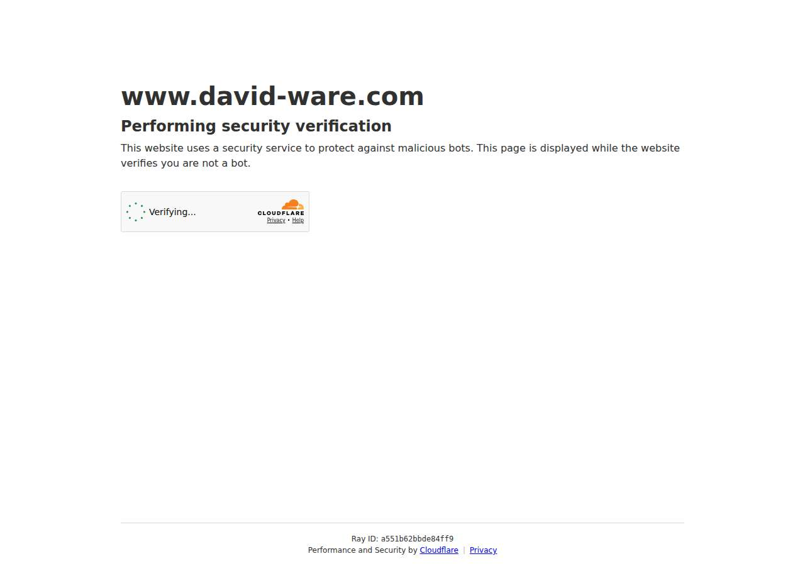

### browarddivorcelaw.com — dry\_run\_failed (dry run)

| | |
|---|---|
| Attempt ID | `e53dbb99-0b8e-41c0-8baf-aa9732a161d0` |
| Form URL | https://www.browarddivorcelaw.com/contact/ |
| Final URL | https://www.browarddivorcelaw.com/contact/ |
| Reserved | 2026-11-04 06:55:17 UTC |
| Submit attempted | — |
| Template | standard v2 |
| Confirmation text | none observed |
| Result / error | Reviewed form not found on page (site changed) |

Exact message:

~~~text
Subject: Helping customers find your business in AI search (AEO + GEO)

Hi there,

I'm Arun from Devs Arun. More and more customers now ask ChatGPT, Gemini, Perplexity or Google's AI Overviews questions like "who should I hire for this in my area?" before they call anyone. These tools answer from websites they can clearly understand, and they tend to recommend businesses whose pages answer real customer questions.

That is what AEO + GEO (Answer Engine and Generative Engine Optimization) is for. I improve your existing service pages so they clearly answer the questions your customers ask, add structured data that matches the page, and make the call, quote or enquiry step obvious. The benefit: your business gets a better chance of being mentioned or linked in AI answers, and visitors who arrive find it easy to contact you.

The AEO + GEO Starter is a one-time $199 (about ₹16,999, negotiable) for one website: a basic audit, 10 customer questions, improvements to two existing pages, relevant structured data and an action plan, with one revision round.

You can read the full details, send an enquiry or book online here:
https://devsarun.io/aeo-geo/

If this isn't relevant, just reply and I won't contact you again.

Best,
Arun
Devs Arun
itschool408@gmail.com · +91 7654534323
~~~

Submitted field values:

- \#nf-field-2: Arun
- \#nf-field-3: itschool408@gmail.com
- \#nf-field-4: +91 7654534323
- \#nf-field-10: Hi there, I'm Arun from Devs Arun. More and more customers now ask ChatGPT, Gemini, Perplexity or Google's AI Overviews 

**Inspected page** — `run-b6bce34c_attempt-e53dbb99_inspection_2026-11-04T06-55-20-705Z.jpg`

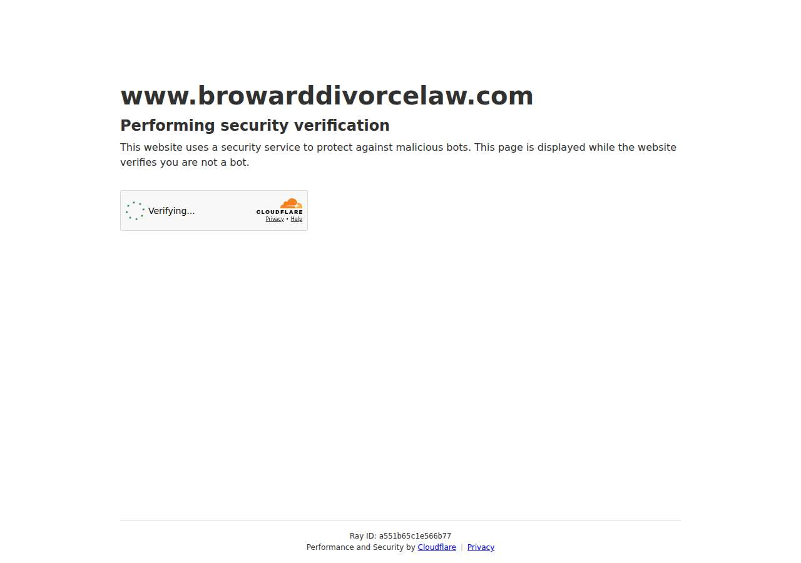

### servicioslegales.org — dry\_run\_failed (dry run)

| | |
|---|---|
| Attempt ID | `24ece3bf-84d4-41a3-af4b-e48c42e57fd0` |
| Form URL | https://www.servicioslegales.org/contact-2/ |
| Final URL | https://www.servicioslegales.org/contact-2/ |
| Reserved | 2026-11-04 06:55:25 UTC |
| Submit attempted | — |
| Template | standard v2 |
| Confirmation text | none observed |
| Result / error | Reviewed form not found on page (site changed) |

Exact message:

~~~text
Subject: Helping customers find your business in AI search (AEO + GEO)

Hi there,

I'm Arun from Devs Arun. More and more customers now ask ChatGPT, Gemini, Perplexity or Google's AI Overviews questions like "who should I hire for this in my area?" before they call anyone. These tools answer from websites they can clearly understand, and they tend to recommend businesses whose pages answer real customer questions.

That is what AEO + GEO (Answer Engine and Generative Engine Optimization) is for. I improve your existing service pages so they clearly answer the questions your customers ask, add structured data that matches the page, and make the call, quote or enquiry step obvious. The benefit: your business gets a better chance of being mentioned or linked in AI answers, and visitors who arrive find it easy to contact you.

The AEO + GEO Starter is a one-time $199 (about ₹16,999, negotiable) for one website: a basic audit, 10 customer questions, improvements to two existing pages, relevant structured data and an action plan, with one revision round.

You can read the full details, send an enquiry or book online here:
https://devsarun.io/aeo-geo/

If this isn't relevant, just reply and I won't contact you again.

Best,
Arun
Devs Arun
itschool408@gmail.com · +91 7654534323
~~~

Submitted field values:

- input\[name="your-name"\]: Arun
- input\[name="your-email"\]: itschool408@gmail.com
- textarea\[name="your-message"\]: Hi there, I'm Arun from Devs Arun. More and more customers now ask ChatGPT, Gemini, Perplexity or Google's AI Overviews 

**Inspected page** — `run-b6bce34c_attempt-24ece3bf_inspection_2026-11-04T06-55-28-084Z.jpg`

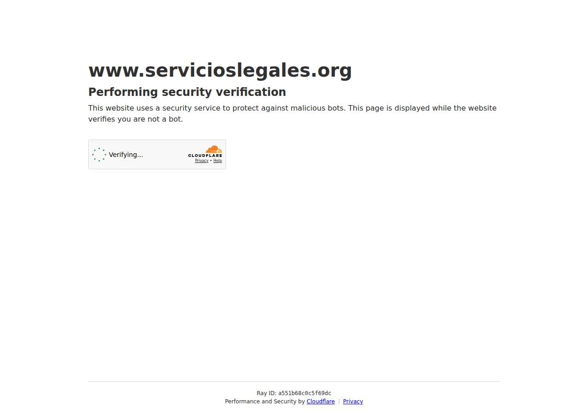

### coulterstax.com — dry\_run\_ok (dry run)

| | |
|---|---|
| Attempt ID | `47a0b7ee-3c9c-4f0b-b103-59af15dec5a7` |
| Form URL | https://www.coulterstax.com/form\_\_map |
| Final URL | https://www.coulterstax.com/form\_\_map |
| Reserved | 2026-11-04 06:55:33 UTC |
| Submit attempted | — |
| Template | standard v2 |
| Confirmation text | none observed |
| Result / error | Selectors verified; fields not typed (domain not in dry-run fill list); not submitted |

Exact message:

~~~text
Subject: Helping customers find your business in AI search (AEO + GEO)

Hi there,

I'm Arun from Devs Arun. More and more customers now ask ChatGPT, Gemini, Perplexity or Google's AI Overviews questions like "who should I hire for this in my area?" before they call anyone. These tools answer from websites they can clearly understand, and they tend to recommend businesses whose pages answer real customer questions.

That is what AEO + GEO (Answer Engine and Generative Engine Optimization) is for. I improve your existing service pages so they clearly answer the questions your customers ask, add structured data that matches the page, and make the call, quote or enquiry step obvious. The benefit: your business gets a better chance of being mentioned or linked in AI answers, and visitors who arrive find it easy to contact you.

The AEO + GEO Starter is a one-time $199 (about ₹16,999, negotiable) for one website: a basic audit, 10 customer questions, improvements to two existing pages, relevant structured data and an action plan, with one revision round.

You can read the full details, send an enquiry or book online here:
https://devsarun.io/aeo-geo/

If this isn't relevant, just reply and I won't contact you again.

Best,
Arun
Devs Arun
itschool408@gmail.com · +91 7654534323
~~~

Submitted field values:

- \#input\_comp-kf6uifpv: Arun
- \#input\_comp-kf6uifq7: itschool408@gmail.com
- \#input\_comp-kf6uifqc: Helping customers find your business in AI search (AEO + GEO)
- \#textarea\_comp-kf6uifqh: Hi there, I'm Arun from Devs Arun. More and more customers now ask ChatGPT, Gemini, Perplexity or Google's AI Overviews 

**Inspected page** — `run-b6bce34c_attempt-47a0b7ee_inspection_2026-11-04T06-55-35-474Z.jpg`

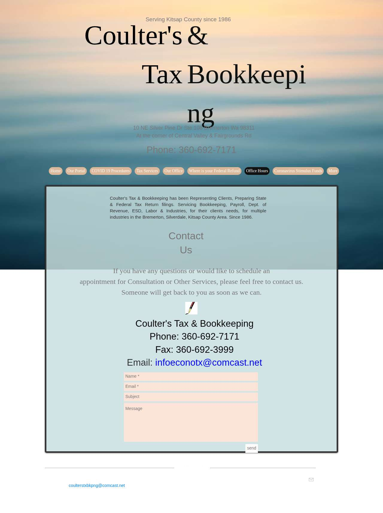

### randrtax.com — dry\_run\_ok (dry run)

| | |
|---|---|
| Attempt ID | `f7c9d0f5-a874-45df-aea8-78c3cae70967` |
| Form URL | https://www.rrthefirm.com/contact |
| Final URL | https://www.rrthefirm.com/contact |
| Reserved | 2026-11-04 06:55:40 UTC |
| Submit attempted | — |
| Template | standard v2 |
| Confirmation text | none observed |
| Result / error | Selectors verified; fields not typed (domain not in dry-run fill list); not submitted |

Exact message:

~~~text
Subject: Helping customers find your business in AI search (AEO + GEO)

Hi there,

I'm Arun from Devs Arun. More and more customers now ask ChatGPT, Gemini, Perplexity or Google's AI Overviews questions like "who should I hire for this in my area?" before they call anyone. These tools answer from websites they can clearly understand, and they tend to recommend businesses whose pages answer real customer questions.

That is what AEO + GEO (Answer Engine and Generative Engine Optimization) is for. I improve your existing service pages so they clearly answer the questions your customers ask, add structured data that matches the page, and make the call, quote or enquiry step obvious. The benefit: your business gets a better chance of being mentioned or linked in AI answers, and visitors who arrive find it easy to contact you.

The AEO + GEO Starter is a one-time $199 (about ₹16,999, negotiable) for one website: a basic audit, 10 customer questions, improvements to two existing pages, relevant structured data and an action plan, with one revision round.

You can read the full details, send an enquiry or book online here:
https://devsarun.io/aeo-geo/

If this isn't relevant, just reply and I won't contact you again.

Best,
Arun
Devs Arun
itschool408@gmail.com · +91 7654534323
~~~

Submitted field values:

- \#input\_comp-khfawktk: itschool408@gmail.com
- \#input\_comp-khfawktc1: Arun
- \#input\_comp-khfawktl3: +91 7654534323
- \#textarea\_comp-khfawku33: Hi there, I'm Arun from Devs Arun. More and more customers now ask ChatGPT, Gemini, Perplexity or Google's AI Overviews 

**Inspected page** — `run-b6bce34c_attempt-f7c9d0f5_inspection_2026-11-04T06-55-45-060Z.jpg`

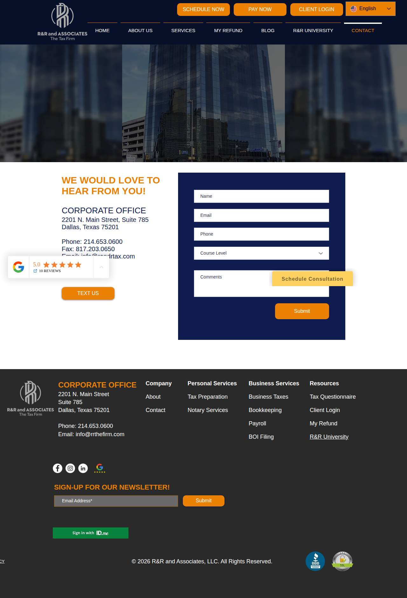

### shcpa.cpa — dry\_run\_ok (dry run)

| | |
|---|---|
| Attempt ID | `06d55556-7602-444e-a381-575a3f9c9384` |
| Form URL | https://www.shcpa.cpa/contact |
| Final URL | https://www.shcpa.cpa/contact |
| Reserved | 2026-11-04 06:55:50 UTC |
| Submit attempted | — |
| Template | standard v2 |
| Confirmation text | none observed |
| Result / error | Selectors verified; fields not typed (domain not in dry-run fill list); not submitted |

Exact message:

~~~text
Subject: Helping customers find your business in AI search (AEO + GEO)

Hi there,

I'm Arun from Devs Arun. More and more customers now ask ChatGPT, Gemini, Perplexity or Google's AI Overviews questions like "who should I hire for this in my area?" before they call anyone. These tools answer from websites they can clearly understand, and they tend to recommend businesses whose pages answer real customer questions.

That is what AEO + GEO (Answer Engine and Generative Engine Optimization) is for. I improve your existing service pages so they clearly answer the questions your customers ask, add structured data that matches the page, and make the call, quote or enquiry step obvious. The benefit: your business gets a better chance of being mentioned or linked in AI answers, and visitors who arrive find it easy to contact you.

The AEO + GEO Starter is a one-time $199 (about ₹16,999, negotiable) for one website: a basic audit, 10 customer questions, improvements to two existing pages, relevant structured data and an action plan, with one revision round.

You can read the full details, send an enquiry or book online here:
https://devsarun.io/aeo-geo/

If this isn't relevant, just reply and I won't contact you again.

Best,
Arun
Devs Arun
itschool408@gmail.com · +91 7654534323
~~~

Submitted field values:

- input\[name="Email"\]: itschool408@gmail.com
- textarea\[name="Message"\]: Hi there, I'm Arun from Devs Arun. More and more customers now ask ChatGPT, Gemini, Perplexity or Google's AI Overviews 

**Inspected page** — `run-b6bce34c_attempt-06d55556_inspection_2026-11-04T06-55-53-053Z.jpg`

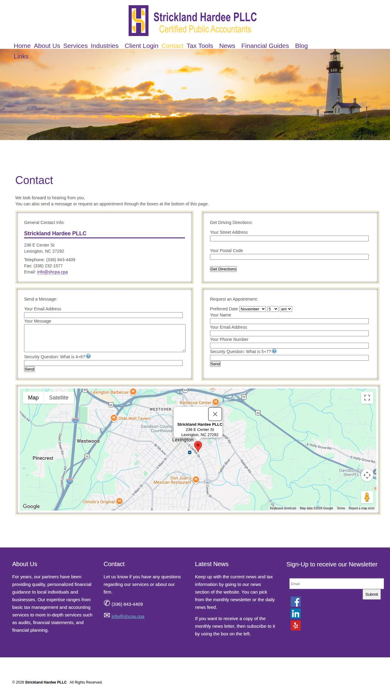

### stylianouaccounting.com — dry\_run\_ok (dry run)

| | |
|---|---|
| Attempt ID | `bb42a786-f93d-4c8d-98c4-ec0096387321` |
| Form URL | https://www.stylianouaccounting.com/contact/ |
| Final URL | https://www.stylianouaccounting.com/contact/ |
| Reserved | 2026-11-04 06:55:58 UTC |
| Submit attempted | — |
| Template | standard v2 |
| Confirmation text | none observed |
| Result / error | Selectors verified; fields not typed (domain not in dry-run fill list); not submitted |

Exact message:

~~~text
Subject: Helping customers find your business in AI search (AEO + GEO)

Hi there,

I'm Arun from Devs Arun. More and more customers now ask ChatGPT, Gemini, Perplexity or Google's AI Overviews questions like "who should I hire for this in my area?" before they call anyone. These tools answer from websites they can clearly understand, and they tend to recommend businesses whose pages answer real customer questions.

That is what AEO + GEO (Answer Engine and Generative Engine Optimization) is for. I improve your existing service pages so they clearly answer the questions your customers ask, add structured data that matches the page, and make the call, quote or enquiry step obvious. The benefit: your business gets a better chance of being mentioned or linked in AI answers, and visitors who arrive find it easy to contact you.

The AEO + GEO Starter is a one-time $199 (about ₹16,999, negotiable) for one website: a basic audit, 10 customer questions, improvements to two existing pages, relevant structured data and an action plan, with one revision round.

You can read the full details, send an enquiry or book online here:
https://devsarun.io/aeo-geo/

If this isn't relevant, just reply and I won't contact you again.

Best,
Arun
Devs Arun
itschool408@gmail.com · +91 7654534323
~~~

Submitted field values:

- \#email: itschool408@gmail.com
- \#fname: Arun
- \#message: Hi there, I'm Arun from Devs Arun. More and more customers now ask ChatGPT, Gemini, Perplexity or Google's AI Overviews 

**Inspected page** — `run-b6bce34c_attempt-bb42a786_inspection_2026-11-04T06-55-59-556Z.jpg`

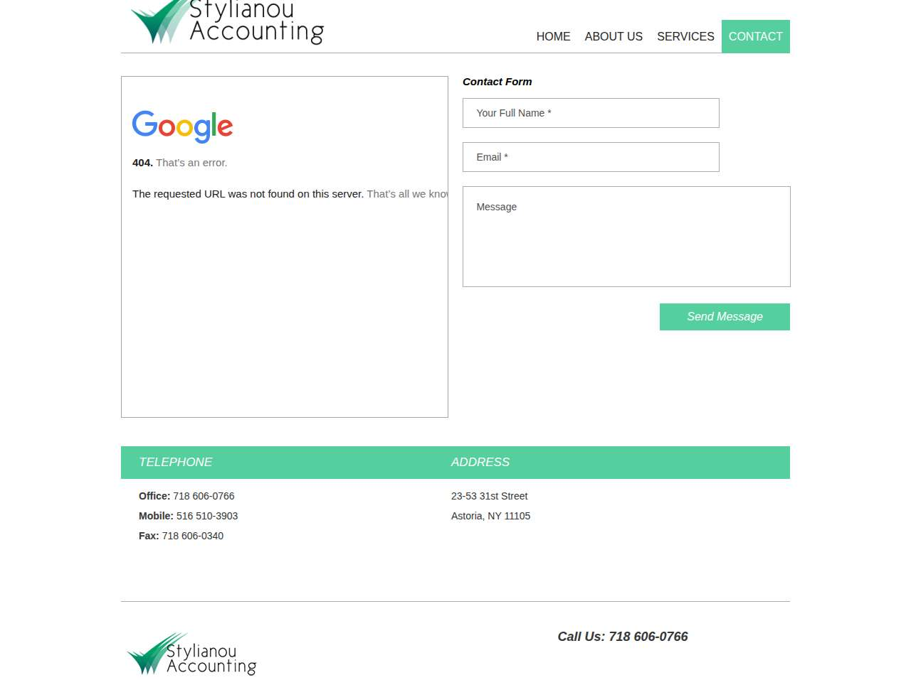

### finneyneill.com — dry\_run\_ok (dry run)

| | |
|---|---|
| Attempt ID | `f4bc9744-15fb-4d00-a8b2-718a617c3bda` |
| Form URL | https://www.finneyneill.com/contact-us |
| Final URL | https://www.finneyneill.com/contact-us |
| Reserved | 2026-11-04 06:56:04 UTC |
| Submit attempted | — |
| Template | standard v2 |
| Confirmation text | none observed |
| Result / error | Selectors verified; fields not typed (domain not in dry-run fill list); not submitted |

Exact message:

~~~text
Subject: Helping customers find your business in AI search (AEO + GEO)

Hi there,

I'm Arun from Devs Arun. More and more customers now ask ChatGPT, Gemini, Perplexity or Google's AI Overviews questions like "who should I hire for this in my area?" before they call anyone. These tools answer from websites they can clearly understand, and they tend to recommend businesses whose pages answer real customer questions.

That is what AEO + GEO (Answer Engine and Generative Engine Optimization) is for. I improve your existing service pages so they clearly answer the questions your customers ask, add structured data that matches the page, and make the call, quote or enquiry step obvious. The benefit: your business gets a better chance of being mentioned or linked in AI answers, and visitors who arrive find it easy to contact you.

The AEO + GEO Starter is a one-time $199 (about ₹16,999, negotiable) for one website: a basic audit, 10 customer questions, improvements to two existing pages, relevant structured data and an action plan, with one revision round.

You can read the full details, send an enquiry or book online here:
https://devsarun.io/aeo-geo/

If this isn't relevant, just reply and I won't contact you again.

Best,
Arun
Devs Arun
itschool408@gmail.com · +91 7654534323
~~~

Submitted field values:

- \#email: itschool408@gmail.com
- \#message: Hi there, I'm Arun from Devs Arun. More and more customers now ask ChatGPT, Gemini, Perplexity or Google's AI Overviews 
- \#first-name: Arun

**Inspected page** — `run-b6bce34c_attempt-f4bc9744_inspection_2026-11-04T06-56-06-150Z.jpg`

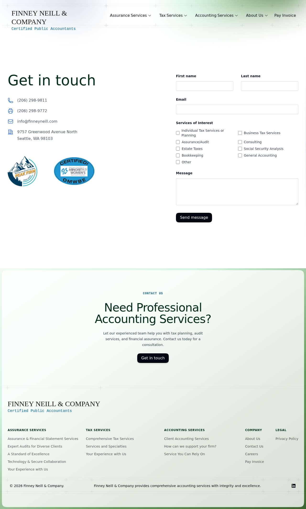

### asmgsolutions.com — dry\_run\_ok (dry run)

| | |
|---|---|
| Attempt ID | `b51acb20-3be2-470d-9b11-5c0d7875423a` |
| Form URL | https://asmgsolutions.com/contact-us.php |
| Final URL | https://asmgsolutions.com/contact-us.php |
| Reserved | 2026-11-04 06:56:11 UTC |
| Submit attempted | — |
| Template | standard v2 |
| Confirmation text | none observed |
| Result / error | Selectors verified; fields not typed (domain not in dry-run fill list); not submitted |

Exact message:

~~~text
Subject: Helping customers find your business in AI search (AEO + GEO)

Hi there,

I'm Arun from Devs Arun. More and more customers now ask ChatGPT, Gemini, Perplexity or Google's AI Overviews questions like "who should I hire for this in my area?" before they call anyone. These tools answer from websites they can clearly understand, and they tend to recommend businesses whose pages answer real customer questions.

That is what AEO + GEO (Answer Engine and Generative Engine Optimization) is for. I improve your existing service pages so they clearly answer the questions your customers ask, add structured data that matches the page, and make the call, quote or enquiry step obvious. The benefit: your business gets a better chance of being mentioned or linked in AI answers, and visitors who arrive find it easy to contact you.

The AEO + GEO Starter is a one-time $199 (about ₹16,999, negotiable) for one website: a basic audit, 10 customer questions, improvements to two existing pages, relevant structured data and an action plan, with one revision round.

You can read the full details, send an enquiry or book online here:
https://devsarun.io/aeo-geo/

If this isn't relevant, just reply and I won't contact you again.

Best,
Arun
Devs Arun
itschool408@gmail.com · +91 7654534323
~~~

Submitted field values:

- \#name: Arun
- \#email: itschool408@gmail.com
- \#phone: +91 7654534323
- \#subject: Helping customers find your business in AI search (AEO + GEO)
- \#comments: Hi there, I'm Arun from Devs Arun. More and more customers now ask ChatGPT, Gemini, Perplexity or Google's AI Overviews 

**Inspected page** — `run-b6bce34c_attempt-b51acb20_inspection_2026-11-04T06-56-26-471Z.jpg`

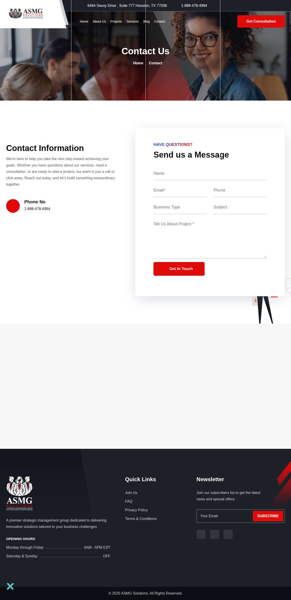

### whiteolivecpa.com — dry\_run\_ok (dry run)

| | |
|---|---|
| Attempt ID | `37d82efd-ee5c-4e4c-bfd2-bcd948138613` |
| Form URL | https://whiteolivecpa.com/contact/ |
| Final URL | https://whiteolivecpa.com/contact/ |
| Reserved | 2026-11-04 06:56:31 UTC |
| Submit attempted | — |
| Template | standard v2 |
| Confirmation text | none observed |
| Result / error | Selectors verified; fields not typed (domain not in dry-run fill list); not submitted |

Exact message:

~~~text
Subject: Helping customers find your business in AI search (AEO + GEO)

Hi there,

I'm Arun from Devs Arun. More and more customers now ask ChatGPT, Gemini, Perplexity or Google's AI Overviews questions like "who should I hire for this in my area?" before they call anyone. These tools answer from websites they can clearly understand, and they tend to recommend businesses whose pages answer real customer questions.

That is what AEO + GEO (Answer Engine and Generative Engine Optimization) is for. I improve your existing service pages so they clearly answer the questions your customers ask, add structured data that matches the page, and make the call, quote or enquiry step obvious. The benefit: your business gets a better chance of being mentioned or linked in AI answers, and visitors who arrive find it easy to contact you.

The AEO + GEO Starter is a one-time $199 (about ₹16,999, negotiable) for one website: a basic audit, 10 customer questions, improvements to two existing pages, relevant structured data and an action plan, with one revision round.

You can read the full details, send an enquiry or book online here:
https://devsarun.io/aeo-geo/

If this isn't relevant, just reply and I won't contact you again.

Best,
Arun
Devs Arun
itschool408@gmail.com · +91 7654534323
~~~

Submitted field values:

- \#ff\_1\_email: itschool408@gmail.com
- \#ff\_1\_message: Hi there, I'm Arun from Devs Arun. More and more customers now ask ChatGPT, Gemini, Perplexity or Google's AI Overviews 
- \#ff\_1\_numeric\_field: +91 7654534323
- \#ff\_1\_names\_first\_name\_: Arun

**Inspected page** — `run-b6bce34c_attempt-37d82efd_inspection_2026-11-04T06-56-33-111Z.jpg`

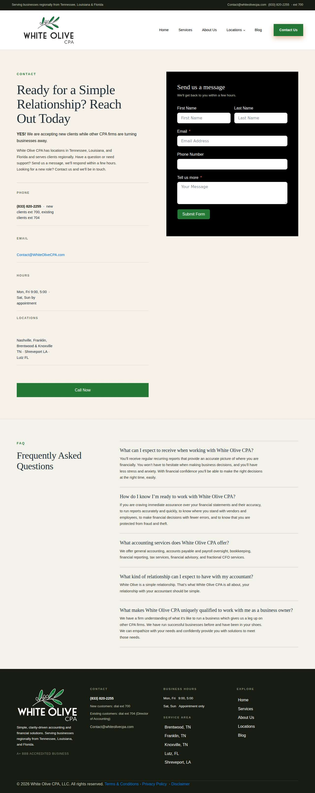

### mspc.cpa — dry\_run\_failed (dry run)

| | |
|---|---|
| Attempt ID | `35335a44-667b-46a1-af43-eec886d3c9cc` |
| Form URL | https://www.mspc.cpa/contact/ |
| Final URL | https://www.mspc.cpa/contact/ |
| Reserved | 2026-11-04 06:56:38 UTC |
| Submit attempted | — |
| Template | standard v2 |
| Confirmation text | none observed |
| Result / error | Mapped field "Full Name \*" not found uniquely |

Exact message:

~~~text
Subject: Helping customers find your business in AI search (AEO + GEO)

Hi there,

I'm Arun from Devs Arun. More and more customers now ask ChatGPT, Gemini, Perplexity or Google's AI Overviews questions like "who should I hire for this in my area?" before they call anyone. These tools answer from websites they can clearly understand, and they tend to recommend businesses whose pages answer real customer questions.

That is what AEO + GEO (Answer Engine and Generative Engine Optimization) is for. I improve your existing service pages so they clearly answer the questions your customers ask, add structured data that matches the page, and make the call, quote or enquiry step obvious. The benefit: your business gets a better chance of being mentioned or linked in AI answers, and visitors who arrive find it easy to contact you.

The AEO + GEO Starter is a one-time $199 (about ₹16,999, negotiable) for one website: a basic audit, 10 customer questions, improvements to two existing pages, relevant structured data and an action plan, with one revision round.

You can read the full details, send an enquiry or book online here:
https://devsarun.io/aeo-geo/

If this isn't relevant, just reply and I won't contact you again.

Best,
Arun
Devs Arun
itschool408@gmail.com · +91 7654534323
~~~

Submitted field values:

- \#forminator-field-name-1\_6aeaca2579f24: Arun
- \#forminator-field-text-1\_6aeaca2579f24: Devs Arun
- \#forminator-field-email-1\_6aeaca2579f24: itschool408@gmail.com
- \#forminator-field-phone-1\_6aeaca2579f24: +91 7654534323
- \#forminator-field-textarea-1\_6aeaca2579f24: Hi there, I'm Arun from Devs Arun. More and more customers now ask ChatGPT, Gemini, Perplexity or Google's AI Overviews 

**Inspected page** — `run-b6bce34c_attempt-35335a44_inspection_2026-11-04T06-56-39-866Z.jpg`

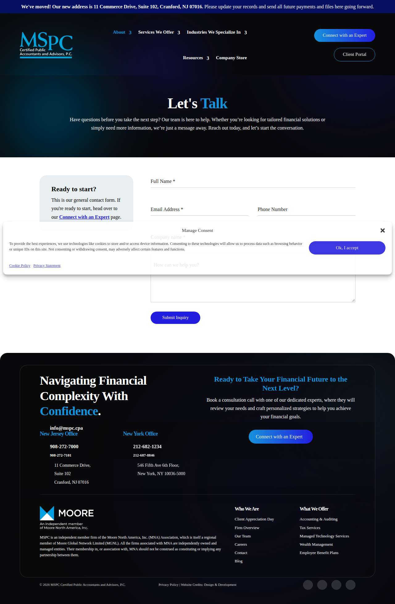

### damicoaccounting.com — dry\_run\_ok (dry run)

| | |
|---|---|
| Attempt ID | `6c061d03-46a3-4c30-8abc-9070b09c64ef` |
| Form URL | https://www.damicoaccounting.com/contact-us |
| Final URL | https://www.damicoaccounting.com/contact-us |
| Reserved | 2026-11-04 06:56:44 UTC |
| Submit attempted | — |
| Template | standard v2 |
| Confirmation text | none observed |
| Result / error | Selectors verified; fields not typed (domain not in dry-run fill list); not submitted |

Exact message:

~~~text
Subject: Helping customers find your business in AI search (AEO + GEO)

Hi there,

I'm Arun from Devs Arun. More and more customers now ask ChatGPT, Gemini, Perplexity or Google's AI Overviews questions like "who should I hire for this in my area?" before they call anyone. These tools answer from websites they can clearly understand, and they tend to recommend businesses whose pages answer real customer questions.

That is what AEO + GEO (Answer Engine and Generative Engine Optimization) is for. I improve your existing service pages so they clearly answer the questions your customers ask, add structured data that matches the page, and make the call, quote or enquiry step obvious. The benefit: your business gets a better chance of being mentioned or linked in AI answers, and visitors who arrive find it easy to contact you.

The AEO + GEO Starter is a one-time $199 (about ₹16,999, negotiable) for one website: a basic audit, 10 customer questions, improvements to two existing pages, relevant structured data and an action plan, with one revision round.

You can read the full details, send an enquiry or book online here:
https://devsarun.io/aeo-geo/

If this isn't relevant, just reply and I won't contact you again.

Best,
Arun
Devs Arun
itschool408@gmail.com · +91 7654534323
~~~

Submitted field values:

- \#input\_comp-jslo00cy: Arun
- \#input\_comp-jslo00cz: itschool408@gmail.com
- \#textarea\_comp-jslo00je: Hi there, I'm Arun from Devs Arun. More and more customers now ask ChatGPT, Gemini, Perplexity or Google's AI Overviews 

**Inspected page** — `run-b6bce34c_attempt-6c061d03_inspection_2026-11-04T06-56-47-826Z.jpg`

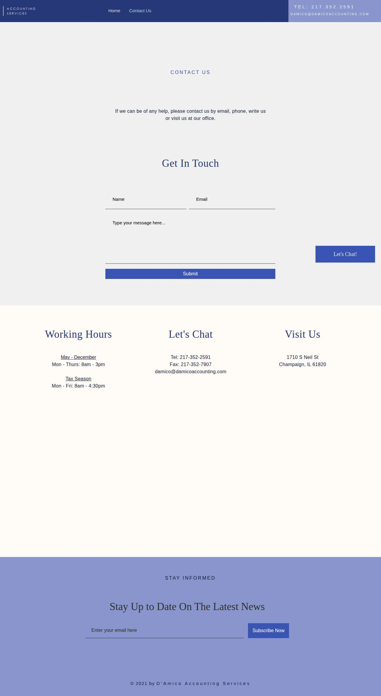

### accsoln.com — dry\_run\_ok (dry run)

| | |
|---|---|
| Attempt ID | `75670f0e-b1c9-4f7f-90d2-4d580c50ab62` |
| Form URL | https://www.accsoln.com/contact |
| Final URL | https://www.accsoln.com/contact |
| Reserved | 2026-11-04 06:56:52 UTC |
| Submit attempted | — |
| Template | standard v2 |
| Confirmation text | none observed |
| Result / error | Selectors verified; fields not typed (domain not in dry-run fill list); not submitted |

Exact message:

~~~text
Subject: Helping customers find your business in AI search (AEO + GEO)

Hi there,

I'm Arun from Devs Arun. More and more customers now ask ChatGPT, Gemini, Perplexity or Google's AI Overviews questions like "who should I hire for this in my area?" before they call anyone. These tools answer from websites they can clearly understand, and they tend to recommend businesses whose pages answer real customer questions.

That is what AEO + GEO (Answer Engine and Generative Engine Optimization) is for. I improve your existing service pages so they clearly answer the questions your customers ask, add structured data that matches the page, and make the call, quote or enquiry step obvious. The benefit: your business gets a better chance of being mentioned or linked in AI answers, and visitors who arrive find it easy to contact you.

The AEO + GEO Starter is a one-time $199 (about ₹16,999, negotiable) for one website: a basic audit, 10 customer questions, improvements to two existing pages, relevant structured data and an action plan, with one revision round.

You can read the full details, send an enquiry or book online here:
https://devsarun.io/aeo-geo/

If this isn't relevant, just reply and I won't contact you again.

Best,
Arun
Devs Arun
itschool408@gmail.com · +91 7654534323
~~~

Submitted field values:

- \#\\31 047967666: +91 7654534323
- \#\\31 069280574: Hi there, I'm Arun from Devs Arun. More and more customers now ask ChatGPT, Gemini, Perplexity or Google's AI Overviews 
- \#\\31 520949103: itschool408@gmail.com
- \#\\31 795222210: Arun

**Inspected page** — `run-b6bce34c_attempt-75670f0e_inspection_2026-11-04T06-56-55-302Z.jpg`

### rjw-cpa.com — dry\_run\_ok (dry run)

| | |
|---|---|
| Attempt ID | `bf83a1cd-0680-4ab4-93b0-73b61835ad9c` |
| Form URL | https://rjw-cpa.com/contact/ |
| Final URL | https://rjw-cpa.com/contact/ |
| Reserved | 2026-11-04 06:57:00 UTC |
| Submit attempted | — |
| Template | standard v2 |
| Confirmation text | none observed |
| Result / error | Selectors verified; fields not typed (domain not in dry-run fill list); not submitted |

Exact message:

~~~text
Subject: Helping customers find your business in AI search (AEO + GEO)

Hi there,

I'm Arun from Devs Arun. More and more customers now ask ChatGPT, Gemini, Perplexity or Google's AI Overviews questions like "who should I hire for this in my area?" before they call anyone. These tools answer from websites they can clearly understand, and they tend to recommend businesses whose pages answer real customer questions.

That is what AEO + GEO (Answer Engine and Generative Engine Optimization) is for. I improve your existing service pages so they clearly answer the questions your customers ask, add structured data that matches the page, and make the call, quote or enquiry step obvious. The benefit: your business gets a better chance of being mentioned or linked in AI answers, and visitors who arrive find it easy to contact you.

The AEO + GEO Starter is a one-time $199 (about ₹16,999, negotiable) for one website: a basic audit, 10 customer questions, improvements to two existing pages, relevant structured data and an action plan, with one revision round.

You can read the full details, send an enquiry or book online here:
https://devsarun.io/aeo-geo/

If this isn't relevant, just reply and I won't contact you again.

Best,
Arun
Devs Arun
itschool408@gmail.com · +91 7654534323
~~~

Submitted field values:

- input\[name="your-name"\]: Arun
- input\[name="your-email"\]: itschool408@gmail.com
- input\[name="your-subject"\]: Helping customers find your business in AI search (AEO + GEO)
- textarea\[name="your-message"\]: Hi there, I'm Arun from Devs Arun. More and more customers now ask ChatGPT, Gemini, Perplexity or Google's AI Overviews 

**Inspected page** — `run-b6bce34c_attempt-bf83a1cd_inspection_2026-11-04T06-57-02-506Z.jpg`

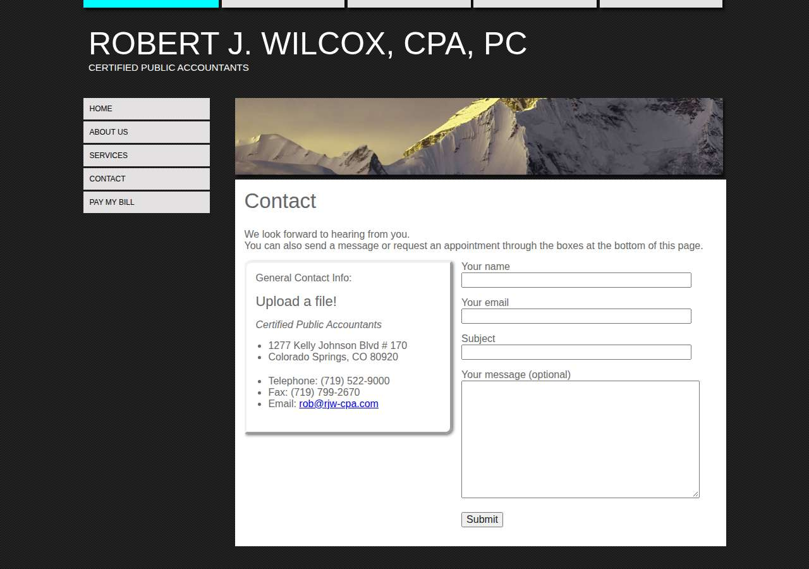

### uwscpa.com — dry\_run\_ok (dry run)

| | |
|---|---|
| Attempt ID | `9ba17b91-b725-4b32-b588-526c0c58169b` |
| Form URL | https://www.uwscpa.com/contact |
| Final URL | https://www.uwscpa.com/contact |
| Reserved | 2026-11-04 06:57:07 UTC |
| Submit attempted | — |
| Template | standard v2 |
| Confirmation text | none observed |
| Result / error | Selectors verified; fields not typed (domain not in dry-run fill list); not submitted |

Exact message:

~~~text
Subject: Helping customers find your business in AI search (AEO + GEO)

Hi there,

I'm Arun from Devs Arun. More and more customers now ask ChatGPT, Gemini, Perplexity or Google's AI Overviews questions like "who should I hire for this in my area?" before they call anyone. These tools answer from websites they can clearly understand, and they tend to recommend businesses whose pages answer real customer questions.

That is what AEO + GEO (Answer Engine and Generative Engine Optimization) is for. I improve your existing service pages so they clearly answer the questions your customers ask, add structured data that matches the page, and make the call, quote or enquiry step obvious. The benefit: your business gets a better chance of being mentioned or linked in AI answers, and visitors who arrive find it easy to contact you.

The AEO + GEO Starter is a one-time $199 (about ₹16,999, negotiable) for one website: a basic audit, 10 customer questions, improvements to two existing pages, relevant structured data and an action plan, with one revision round.

You can read the full details, send an enquiry or book online here:
https://devsarun.io/aeo-geo/

If this isn't relevant, just reply and I won't contact you again.

Best,
Arun
Devs Arun
itschool408@gmail.com · +91 7654534323
~~~

Submitted field values:

- input\[name="Email"\]: itschool408@gmail.com
- textarea\[name="Message"\]: Hi there, I'm Arun from Devs Arun. More and more customers now ask ChatGPT, Gemini, Perplexity or Google's AI Overviews 

**Inspected page** — `run-b6bce34c_attempt-9ba17b91_inspection_2026-11-04T06-57-10-209Z.jpg`

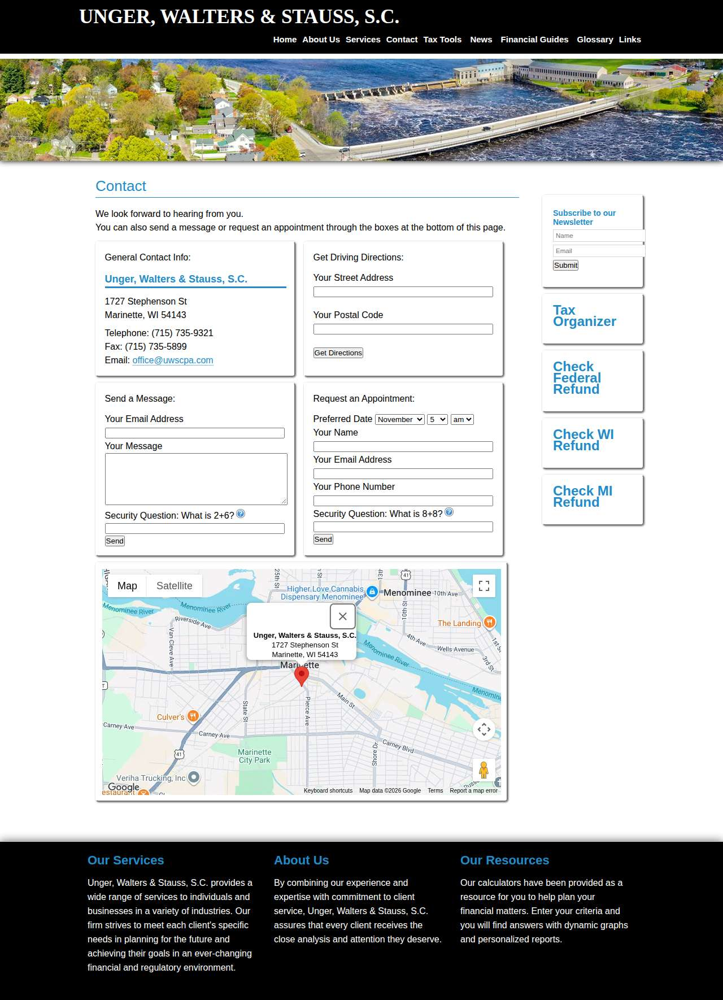

### yeagercpa.com — dry\_run\_failed (dry run)

| | |
|---|---|
| Attempt ID | `7cbcafbe-6d33-4dc3-93d4-46758b41bf61` |
| Form URL | https://yeagercpa.com/index.php/contact/ |
| Final URL | https://yeagercpa.com/index.php/contact/ |
| Reserved | 2026-11-04 06:57:15 UTC |
| Submit attempted | — |
| Template | standard v2 |
| Confirmation text | none observed |
| Result / error | Mapped field "First Name \*" not found uniquely |

Exact message:

~~~text
Subject: Helping customers find your business in AI search (AEO + GEO)

Hi there,

I'm Arun from Devs Arun. More and more customers now ask ChatGPT, Gemini, Perplexity or Google's AI Overviews questions like "who should I hire for this in my area?" before they call anyone. These tools answer from websites they can clearly understand, and they tend to recommend businesses whose pages answer real customer questions.

That is what AEO + GEO (Answer Engine and Generative Engine Optimization) is for. I improve your existing service pages so they clearly answer the questions your customers ask, add structured data that matches the page, and make the call, quote or enquiry step obvious. The benefit: your business gets a better chance of being mentioned or linked in AI answers, and visitors who arrive find it easy to contact you.

The AEO + GEO Starter is a one-time $199 (about ₹16,999, negotiable) for one website: a basic audit, 10 customer questions, improvements to two existing pages, relevant structured data and an action plan, with one revision round.

You can read the full details, send an enquiry or book online here:
https://devsarun.io/aeo-geo/

If this isn't relevant, just reply and I won't contact you again.

Best,
Arun
Devs Arun
itschool408@gmail.com · +91 7654534323
~~~

Submitted field values:

- \#forminator-field-name-1\_6ae3721887a46: Arun
- \#forminator-field-email-1\_6ae3721887a46: itschool408@gmail.com
- \#forminator-field-phone-1\_6ae3721887a46: +91 7654534323
- \#forminator-field-textarea-1\_6ae3721887a46: Hi there, I'm Arun from Devs Arun. More and more customers now ask ChatGPT, Gemini, Perplexity or Google's AI Overviews 

**Inspected page** — `run-b6bce34c_attempt-7cbcafbe_inspection_2026-11-04T06-57-21-311Z.jpg`

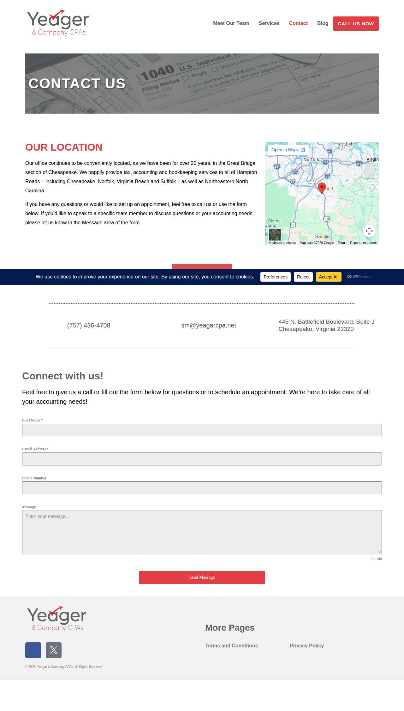

### bellobusinesssolutions.com — dry\_run\_ok (dry run)

| | |
|---|---|
| Attempt ID | `9085ff73-c30c-4647-bb25-1773881c7d66` |
| Form URL | https://www.bellobusinesssolutions.com/contact/ |
| Final URL | https://www.bellobusinesssolutions.com/contact/ |
| Reserved | 2026-11-04 06:57:26 UTC |
| Submit attempted | — |
| Template | standard v2 |
| Confirmation text | none observed |
| Result / error | Selectors verified; fields not typed (domain not in dry-run fill list); not submitted |

Exact message:

~~~text
Subject: Helping customers find your business in AI search (AEO + GEO)

Hi there,

I'm Arun from Devs Arun. More and more customers now ask ChatGPT, Gemini, Perplexity or Google's AI Overviews questions like "who should I hire for this in my area?" before they call anyone. These tools answer from websites they can clearly understand, and they tend to recommend businesses whose pages answer real customer questions.

That is what AEO + GEO (Answer Engine and Generative Engine Optimization) is for. I improve your existing service pages so they clearly answer the questions your customers ask, add structured data that matches the page, and make the call, quote or enquiry step obvious. The benefit: your business gets a better chance of being mentioned or linked in AI answers, and visitors who arrive find it easy to contact you.

The AEO + GEO Starter is a one-time $199 (about ₹16,999, negotiable) for one website: a basic audit, 10 customer questions, improvements to two existing pages, relevant structured data and an action plan, with one revision round.

You can read the full details, send an enquiry or book online here:
https://devsarun.io/aeo-geo/

If this isn't relevant, just reply and I won't contact you again.

Best,
Arun
Devs Arun
itschool408@gmail.com · +91 7654534323
~~~

Submitted field values:

- \#et\_pb\_contact\_email\_0: itschool408@gmail.com
- \#et\_pb\_contact\_message\_0: Hi there, I'm Arun from Devs Arun. More and more customers now ask ChatGPT, Gemini, Perplexity or Google's AI Overviews 
- \#et\_pb\_contact\_phone\_no\_0: +91 7654534323
- \#et\_pb\_contact\_first\_name\_0: Arun
- \#et\_pb\_contact\_company\_name\_0: Devs Arun

**Inspected page** — `run-b6bce34c_attempt-9085ff73_inspection_2026-11-04T06-57-27-886Z.jpg`

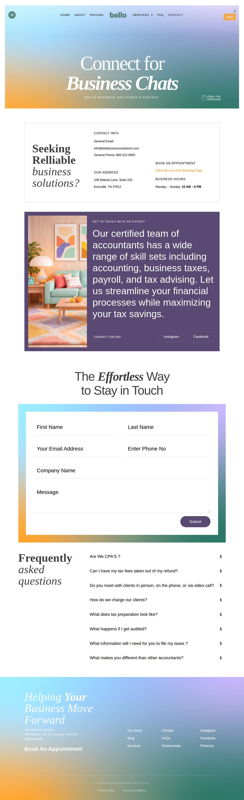

## Events (99)

| Time (UTC) | Event | Website | Details |
|---|---|---|---|
| 06:54:50 | run\_queued | — | dry\_run run requested by github:itsDevsArun |
| 06:54:50 | run\_dispatched | — | dispatch disabled (local test mode) |
| 06:54:53 | run\_started | — | Runner claimed dry\_run run |
| 06:54:54 | website\_selected | helixmechanical.com | Dry-run target helixmechanical.com |
| 06:54:54 | draft\_prepared | helixmechanical.com | Draft prepared with template standard v2 |
| 06:54:56 | page\_opened | helixmechanical.com | Opened form page |
| 06:54:56 | screenshot\_saved | helixmechanical.com | inspection screenshot saved (54 KB) |
| 06:54:56 | review\_required | helixmechanical.com | dry run failed: Mapped field "First Name \*" not found uniquely |
| 06:55:01 | website\_selected | knoxvilleelectrician.com | Dry-run target knoxvilleelectrician.com |
| 06:55:01 | draft\_prepared | knoxvilleelectrician.com | Draft prepared with template standard v2 |
| 06:55:05 | page\_opened | knoxvilleelectrician.com | Opened form page |
| 06:55:05 | screenshot\_saved | knoxvilleelectrician.com | inspection screenshot saved (137 KB) |
| 06:55:05 | review\_required | knoxvilleelectrician.com | dry run failed: Mapped field "Name" not found uniquely |
| 06:55:10 | website\_selected | david-ware.com | Dry-run target david-ware.com |
| 06:55:10 | draft\_prepared | david-ware.com | Draft prepared with template short v2 |
| 06:55:12 | page\_opened | david-ware.com | Opened form page |
| 06:55:12 | screenshot\_saved | david-ware.com | inspection screenshot saved (29 KB) |
| 06:55:12 | review\_required | david-ware.com | dry run failed: Reviewed form not found on page (site changed) |
| 06:55:17 | website\_selected | browarddivorcelaw.com | Dry-run target browarddivorcelaw.com |
| 06:55:17 | draft\_prepared | browarddivorcelaw.com | Draft prepared with template standard v2 |
| 06:55:20 | page\_opened | browarddivorcelaw.com | Opened form page |
| 06:55:20 | screenshot\_saved | browarddivorcelaw.com | inspection screenshot saved (31 KB) |
| 06:55:20 | review\_required | browarddivorcelaw.com | dry run failed: Reviewed form not found on page (site changed) |
| 06:55:25 | website\_selected | servicioslegales.org | Dry-run target servicioslegales.org |
| 06:55:25 | draft\_prepared | servicioslegales.org | Draft prepared with template standard v2 |
| 06:55:27 | page\_opened | servicioslegales.org | Opened form page |
| 06:55:28 | screenshot\_saved | servicioslegales.org | inspection screenshot saved (30 KB) |
| 06:55:28 | review\_required | servicioslegales.org | dry run failed: Reviewed form not found on page (site changed) |
| 06:55:33 | website\_selected | coulterstax.com | Dry-run target coulterstax.com |
| 06:55:33 | draft\_prepared | coulterstax.com | Draft prepared with template standard v2 |
| 06:55:35 | page\_opened | coulterstax.com | Opened form page |
| 06:55:35 | screenshot\_saved | coulterstax.com | inspection screenshot saved (94 KB) |
| 06:55:35 | dry\_run\_checked | coulterstax.com | dry run ok: Selectors verified; fields not typed (domain not in dry-run fill list); not submitted |
| 06:55:40 | website\_selected | randrtax.com | Dry-run target randrtax.com |
| 06:55:40 | draft\_prepared | randrtax.com | Draft prepared with template standard v2 |
| 06:55:44 | page\_opened | randrtax.com | Opened form page |
| 06:55:45 | screenshot\_saved | randrtax.com | inspection screenshot saved (125 KB) |
| 06:55:45 | dry\_run\_checked | randrtax.com | dry run ok: Selectors verified; fields not typed (domain not in dry-run fill list); not submitted |
| 06:55:50 | website\_selected | shcpa.cpa | Dry-run target shcpa.cpa |
| 06:55:50 | draft\_prepared | shcpa.cpa | Draft prepared with template standard v2 |
| 06:55:52 | page\_opened | shcpa.cpa | Opened form page |
| 06:55:53 | screenshot\_saved | shcpa.cpa | inspection screenshot saved (205 KB) |
| 06:55:53 | dry\_run\_checked | shcpa.cpa | dry run ok: Selectors verified; fields not typed (domain not in dry-run fill list); not submitted |
| 06:55:58 | website\_selected | stylianouaccounting.com | Dry-run target stylianouaccounting.com |
| 06:55:58 | draft\_prepared | stylianouaccounting.com | Draft prepared with template standard v2 |
| 06:55:59 | page\_opened | stylianouaccounting.com | Opened form page |
| 06:55:59 | screenshot\_saved | stylianouaccounting.com | inspection screenshot saved (41 KB) |
| 06:55:59 | dry\_run\_checked | stylianouaccounting.com | dry run ok: Selectors verified; fields not typed (domain not in dry-run fill list); not submitted |
| 06:56:04 | website\_selected | finneyneill.com | Dry-run target finneyneill.com |
| 06:56:04 | draft\_prepared | finneyneill.com | Draft prepared with template standard v2 |
| 06:56:05 | page\_opened | finneyneill.com | Opened form page |
| 06:56:06 | screenshot\_saved | finneyneill.com | inspection screenshot saved (117 KB) |
| 06:56:06 | dry\_run\_checked | finneyneill.com | dry run ok: Selectors verified; fields not typed (domain not in dry-run fill list); not submitted |
| 06:56:11 | website\_selected | asmgsolutions.com | Dry-run target asmgsolutions.com |
| 06:56:11 | draft\_prepared | asmgsolutions.com | Draft prepared with template standard v2 |
| 06:56:26 | page\_opened | asmgsolutions.com | Opened form page |
| 06:56:26 | screenshot\_saved | asmgsolutions.com | inspection screenshot saved (127 KB) |
| 06:56:26 | dry\_run\_checked | asmgsolutions.com | dry run ok: Selectors verified; fields not typed (domain not in dry-run fill list); not submitted |
| 06:56:31 | website\_selected | whiteolivecpa.com | Dry-run target whiteolivecpa.com |
| 06:56:31 | draft\_prepared | whiteolivecpa.com | Draft prepared with template standard v2 |
| 06:56:32 | page\_opened | whiteolivecpa.com | Opened form page |
| 06:56:33 | screenshot\_saved | whiteolivecpa.com | inspection screenshot saved (197 KB) |
| 06:56:33 | dry\_run\_checked | whiteolivecpa.com | dry run ok: Selectors verified; fields not typed (domain not in dry-run fill list); not submitted |
| 06:56:38 | website\_selected | mspc.cpa | Dry-run target mspc.cpa |
| 06:56:38 | draft\_prepared | mspc.cpa | Draft prepared with template standard v2 |
| 06:56:39 | page\_opened | mspc.cpa | Opened form page |
| 06:56:39 | screenshot\_saved | mspc.cpa | inspection screenshot saved (140 KB) |
| 06:56:39 | review\_required | mspc.cpa | dry run failed: Mapped field "Full Name \*" not found uniquely |
| 06:56:44 | website\_selected | damicoaccounting.com | Dry-run target damicoaccounting.com |
| 06:56:44 | draft\_prepared | damicoaccounting.com | Draft prepared with template standard v2 |
| 06:56:47 | page\_opened | damicoaccounting.com | Opened form page |
| 06:56:47 | screenshot\_saved | damicoaccounting.com | inspection screenshot saved (64 KB) |
| 06:56:47 | dry\_run\_checked | damicoaccounting.com | dry run ok: Selectors verified; fields not typed (domain not in dry-run fill list); not submitted |
| 06:56:52 | website\_selected | accsoln.com | Dry-run target accsoln.com |
| 06:56:52 | draft\_prepared | accsoln.com | Draft prepared with template standard v2 |
| 06:56:55 | page\_opened | accsoln.com | Opened form page |
| 06:56:55 | screenshot\_saved | accsoln.com | inspection screenshot saved (151 KB) |
| 06:56:55 | dry\_run\_checked | accsoln.com | dry run ok: Selectors verified; fields not typed (domain not in dry-run fill list); not submitted |
| 06:57:00 | website\_selected | rjw-cpa.com | Dry-run target rjw-cpa.com |
| 06:57:00 | draft\_prepared | rjw-cpa.com | Draft prepared with template standard v2 |
| 06:57:02 | page\_opened | rjw-cpa.com | Opened form page |
| 06:57:02 | screenshot\_saved | rjw-cpa.com | inspection screenshot saved (87 KB) |
| 06:57:02 | dry\_run\_checked | rjw-cpa.com | dry run ok: Selectors verified; fields not typed (domain not in dry-run fill list); not submitted |
| 06:57:07 | website\_selected | uwscpa.com | Dry-run target uwscpa.com |
| 06:57:07 | draft\_prepared | uwscpa.com | Draft prepared with template standard v2 |
| 06:57:10 | page\_opened | uwscpa.com | Opened form page |
| 06:57:10 | screenshot\_saved | uwscpa.com | inspection screenshot saved (225 KB) |
| 06:57:10 | dry\_run\_checked | uwscpa.com | dry run ok: Selectors verified; fields not typed (domain not in dry-run fill list); not submitted |
| 06:57:15 | website\_selected | yeagercpa.com | Dry-run target yeagercpa.com |
| 06:57:15 | draft\_prepared | yeagercpa.com | Draft prepared with template standard v2 |
| 06:57:21 | page\_opened | yeagercpa.com | Opened form page |
| 06:57:21 | screenshot\_saved | yeagercpa.com | inspection screenshot saved (154 KB) |
| 06:57:21 | review\_required | yeagercpa.com | dry run failed: Mapped field "First Name \*" not found uniquely |
| 06:57:26 | website\_selected | bellobusinesssolutions.com | Dry-run target bellobusinesssolutions.com |
| 06:57:26 | draft\_prepared | bellobusinesssolutions.com | Draft prepared with template standard v2 |
| 06:57:27 | page\_opened | bellobusinesssolutions.com | Opened form page |
| 06:57:27 | screenshot\_saved | bellobusinesssolutions.com | inspection screenshot saved (240 KB) |
| 06:57:27 | dry\_run\_checked | bellobusinesssolutions.com | dry run ok: Selectors verified; fields not typed (domain not in dry-run fill list); not submitted |
| 06:57:32 | run\_completed | — | Run completed (queue\_exhausted) |
