# Run 46c49b0e — live — completed

| | |
|---|---|
| Run ID | `46c49b0e-5aca-4c42-91da-0b4bbc9b50e1` |
| Requested by | github:itsDevsArun |
| Started | 2026-11-04 06:57:41 UTC |
| Finished | 2026-11-04 07:02:22 UTC |
| Finish reason | limit\_reached |
| GitHub Actions | https://github.com/itsDevsArun/aeo-geo/actions/runs/41763788389 |

CSV for this run: [runs/2026-11-04_live_46c49b0e.csv](2026-11-04_live_46c49b0e.csv)

## Attempts (11)

### clearchoiceplumbingllc.com — failed\_before\_submit (LIVE)

| | |
|---|---|
| Attempt ID | `d2f2fcdf-3c7c-4357-b4e5-d4002267c82d` |
| Form URL | https://clearchoiceplumbingllc.com/contact/ |
| Final URL | — |
| Reserved | 2026-11-04 06:57:43 UTC |
| Submit attempted | — |
| Template | standard v2 |
| Confirmation text | none observed |
| Result / error | locator.fill: Error: Cannot type text into input\[type=number\] |

Exact message:

~~~text
Subject: Helping customers find your business in AI search (AEO + GEO)

Hi there,

I'm Arun from Devs Arun. More and more customers now ask ChatGPT, Gemini, Perplexity or Google's AI Overviews questions like "who should I hire for this in my area?" before they call anyone. These tools answer from websites they can clearly understand, and they tend to recommend businesses whose pages answer real customer questions.

That is what AEO + GEO (Answer Engine and Generative Engine Optimization) is for. I improve your existing service pages so they clearly answer the questions your customers ask, add structured data that matches the page, and make the call, quote or enquiry step obvious. The benefit: your business gets a better chance of being mentioned or linked in AI answers, and visitors who arrive find it easy to contact you.

The AEO + GEO Starter is a one-time $199 (about ₹16,999, negotiable) for one website: a basic audit, 10 customer questions, improvements to two existing pages, relevant structured data and an action plan, with one revision round.

You can read the full details, send an enquiry or book online here:
https://devsarun.io/aeo-geo/

If this isn't relevant, just reply and I won't contact you again.

Best,
Arun
Devs Arun
itschool408@gmail.com · +91 7654534323
~~~

Submitted field values:

- \#wpforms-51-field\_1: Arun
- \#wpforms-51-field\_2: itschool408@gmail.com
- \#wpforms-51-field\_3: Hi there, I'm Arun from Devs Arun. More and more customers now ask ChatGPT, Gemini, Perplexity or Google's AI Overviews 
- \#wpforms-51-field\_5: +91 7654534323

**Inspected page** — `run-46c49b0e_attempt-d2f2fcdf_inspection_2026-11-04T06-57-44-744Z.jpg`

### bwnwincpainting.com — failed\_before\_submit (LIVE)

| | |
|---|---|
| Attempt ID | `c12e8650-0c38-4f9e-9838-b15969dbfe4a` |
| Form URL | https://www.bwnwincpainting.com/contact/ |
| Final URL | — |
| Reserved | 2026-11-04 06:57:49 UTC |
| Submit attempted | — |
| Template | standard v2 |
| Confirmation text | none observed |
| Result / error | locator.fill: Error: Cannot type text into input\[type=number\] |

Exact message:

~~~text
Subject: Helping customers find your business in AI search (AEO + GEO)

Hi there,

I'm Arun from Devs Arun. More and more customers now ask ChatGPT, Gemini, Perplexity or Google's AI Overviews questions like "who should I hire for this in my area?" before they call anyone. These tools answer from websites they can clearly understand, and they tend to recommend businesses whose pages answer real customer questions.

That is what AEO + GEO (Answer Engine and Generative Engine Optimization) is for. I improve your existing service pages so they clearly answer the questions your customers ask, add structured data that matches the page, and make the call, quote or enquiry step obvious. The benefit: your business gets a better chance of being mentioned or linked in AI answers, and visitors who arrive find it easy to contact you.

The AEO + GEO Starter is a one-time $199 (about ₹16,999, negotiable) for one website: a basic audit, 10 customer questions, improvements to two existing pages, relevant structured data and an action plan, with one revision round.

You can read the full details, send an enquiry or book online here:
https://devsarun.io/aeo-geo/

If this isn't relevant, just reply and I won't contact you again.

Best,
Arun
Devs Arun
itschool408@gmail.com · +91 7654534323
~~~

Submitted field values:

- \#name-1151: Arun
- \#email-1151: itschool408@gmail.com
- \#phone-1151: +91 7654534323
- \#message-1151: Hi there, I'm Arun from Devs Arun. More and more customers now ask ChatGPT, Gemini, Perplexity or Google's AI Overviews 

**Inspected page** — `run-46c49b0e_attempt-c12e8650_inspection_2026-11-04T06-57-51-991Z.jpg`

### absoluterestorepa.com — failed\_before\_submit (LIVE)

| | |
|---|---|
| Attempt ID | `7c13f42a-1804-49e9-98fd-f6c8fdc115ab` |
| Form URL | https://absoluterestorepa.com/contact-us/ |
| Final URL | — |
| Reserved | 2026-11-04 06:57:57 UTC |
| Submit attempted | — |
| Template | standard v2 |
| Confirmation text | none observed |
| Result / error | locator.fill: Error: Cannot type text into input\[type=number\] |

Exact message:

~~~text
Subject: Helping customers find your business in AI search (AEO + GEO)

Hi there,

I'm Arun from Devs Arun. More and more customers now ask ChatGPT, Gemini, Perplexity or Google's AI Overviews questions like "who should I hire for this in my area?" before they call anyone. These tools answer from websites they can clearly understand, and they tend to recommend businesses whose pages answer real customer questions.

That is what AEO + GEO (Answer Engine and Generative Engine Optimization) is for. I improve your existing service pages so they clearly answer the questions your customers ask, add structured data that matches the page, and make the call, quote or enquiry step obvious. The benefit: your business gets a better chance of being mentioned or linked in AI answers, and visitors who arrive find it easy to contact you.

The AEO + GEO Starter is a one-time $199 (about ₹16,999, negotiable) for one website: a basic audit, 10 customer questions, improvements to two existing pages, relevant structured data and an action plan, with one revision round.

You can read the full details, send an enquiry or book online here:
https://devsarun.io/aeo-geo/

If this isn't relevant, just reply and I won't contact you again.

Best,
Arun
Devs Arun
itschool408@gmail.com · +91 7654534323
~~~

Submitted field values:

- \#form-field-name: Arun
- \#form-field-message: Hi there, I'm Arun from Devs Arun. More and more customers now ask ChatGPT, Gemini, Perplexity or Google's AI Overviews 
- \#form-field-field\_ed02ec2: +91 7654534323
- \#content \> div \> div \> div:nth-of-type(2) \> div \> div:nth-of-type(1) \> div:nth-of-type(2) \> div \> form \> div \> div:nth-of-type(3) \> input: itschool408@gmail.com

**Inspected page** — `run-46c49b0e_attempt-7c13f42a_inspection_2026-11-04T06-57-59-813Z.jpg`

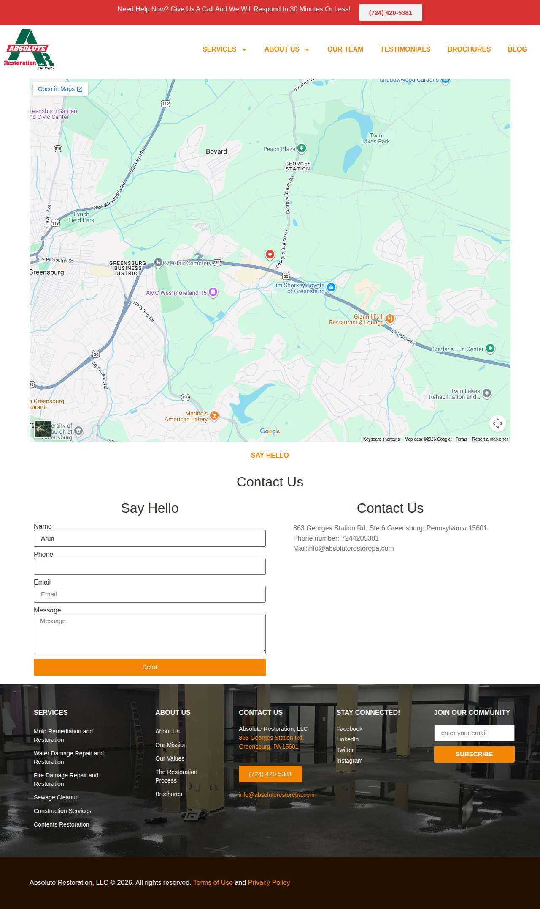

### masoudlawfirm.com — failed\_before\_submit (LIVE)

| | |
|---|---|
| Attempt ID | `31dffa5e-64d0-424b-ae79-960413848e84` |
| Form URL | https://masoudlawfirm.com/contact/ |
| Final URL | — |
| Reserved | 2026-11-04 06:58:04 UTC |
| Submit attempted | — |
| Template | standard v2 |
| Confirmation text | none observed |
| Result / error | locator.fill: Error: Cannot type text into input\[type=number\] |

Exact message:

~~~text
Subject: Helping customers find your business in AI search (AEO + GEO)

Hi there,

I'm Arun from Devs Arun. More and more customers now ask ChatGPT, Gemini, Perplexity or Google's AI Overviews questions like "who should I hire for this in my area?" before they call anyone. These tools answer from websites they can clearly understand, and they tend to recommend businesses whose pages answer real customer questions.

That is what AEO + GEO (Answer Engine and Generative Engine Optimization) is for. I improve your existing service pages so they clearly answer the questions your customers ask, add structured data that matches the page, and make the call, quote or enquiry step obvious. The benefit: your business gets a better chance of being mentioned or linked in AI answers, and visitors who arrive find it easy to contact you.

The AEO + GEO Starter is a one-time $199 (about ₹16,999, negotiable) for one website: a basic audit, 10 customer questions, improvements to two existing pages, relevant structured data and an action plan, with one revision round.

You can read the full details, send an enquiry or book online here:
https://devsarun.io/aeo-geo/

If this isn't relevant, just reply and I won't contact you again.

Best,
Arun
Devs Arun
itschool408@gmail.com · +91 7654534323
~~~

Submitted field values:

- \#form-field-name: Arun
- \#form-field-field\_3374379: Hi there, I'm Arun from Devs Arun. More and more customers now ask ChatGPT, Gemini, Perplexity or Google's AI Overviews 
- \#form-field-field\_7731784: +91 7654534323
- \#form-field-field\_8bd0f16: itschool408@gmail.com

**Inspected page** — `run-46c49b0e_attempt-31dffa5e_inspection_2026-11-04T06-58-09-164Z.jpg`

### randrtax.com — unclear (LIVE)

| | |
|---|---|
| Attempt ID | `1acdbc01-25e8-4aca-9665-01ee841bd409` |
| Form URL | https://www.rrthefirm.com/contact |
| Final URL | https://www.rrthefirm.com/contact |
| Reserved | 2026-11-04 06:58:14 UTC |
| Submit attempted | 2026-11-04 06:58:18 UTC |
| Template | standard v2 |
| Confirmation text | none observed |
| Result / error | No new success marker observed |

Exact message:

~~~text
Subject: Helping customers find your business in AI search (AEO + GEO)

Hi there,

I'm Arun from Devs Arun. More and more customers now ask ChatGPT, Gemini, Perplexity or Google's AI Overviews questions like "who should I hire for this in my area?" before they call anyone. These tools answer from websites they can clearly understand, and they tend to recommend businesses whose pages answer real customer questions.

That is what AEO + GEO (Answer Engine and Generative Engine Optimization) is for. I improve your existing service pages so they clearly answer the questions your customers ask, add structured data that matches the page, and make the call, quote or enquiry step obvious. The benefit: your business gets a better chance of being mentioned or linked in AI answers, and visitors who arrive find it easy to contact you.

The AEO + GEO Starter is a one-time $199 (about ₹16,999, negotiable) for one website: a basic audit, 10 customer questions, improvements to two existing pages, relevant structured data and an action plan, with one revision round.

You can read the full details, send an enquiry or book online here:
https://devsarun.io/aeo-geo/

If this isn't relevant, just reply and I won't contact you again.

Best,
Arun
Devs Arun
itschool408@gmail.com · +91 7654534323
~~~

Submitted field values:

- name \[name\]: Arun
- email \[email\]: itschool408@gmail.com
- phone \[phone\]: +91 7654534323
- Comments \[message\]: Hi there, I'm Arun from Devs Arun. More and more customers now ask ChatGPT, Gemini, Perplexity or Google's AI Overviews 

**Filled form (before submit)** — `run-46c49b0e_attempt-1acdbc01_filled_2026-11-04T06-58-18-521Z.jpg`

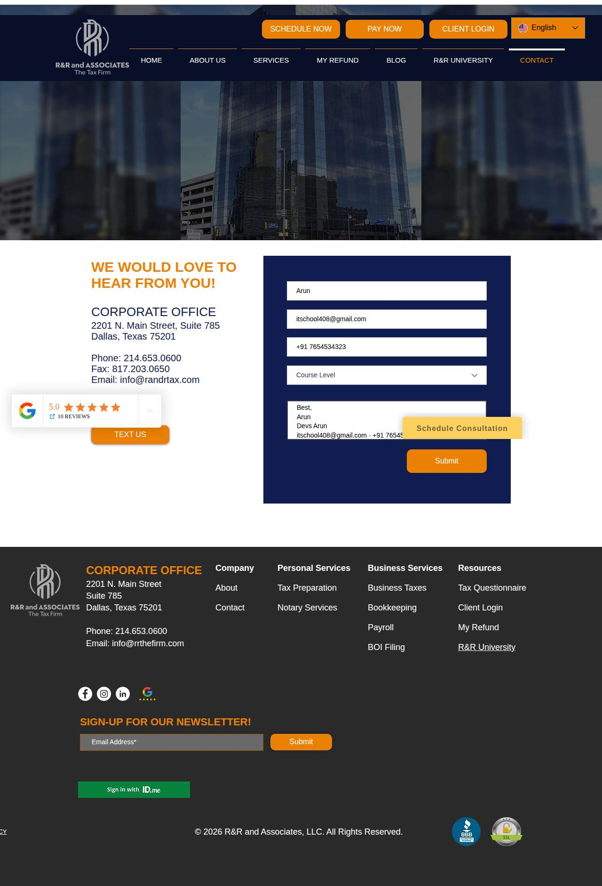

**After submit** — `run-46c49b0e_attempt-1acdbc01_post_attempt_2026-11-04T06-58-47-123Z.jpg`

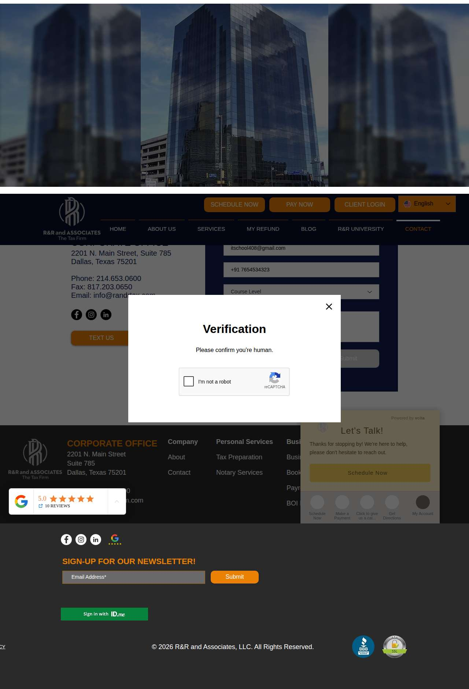

### asmgsolutions.com — confirmed (LIVE)

| | |
|---|---|
| Attempt ID | `b92101e3-22ae-4a6b-9cfa-6a915ac7bd4d` |
| Form URL | https://asmgsolutions.com/contact-us.php |
| Final URL | https://asmgsolutions.com/thankyou.php |
| Reserved | 2026-11-04 06:58:55 UTC |
| Submit attempted | 2026-11-04 06:59:13 UTC |
| Template | standard v2 |
| Confirmation text | vices Blog Contact Get Consultation Contact Us Home Contact THANK YOU\! Thank you for filling in your information. You have been successfully connected with us. We look f |
| Result / error | — |

Exact message:

~~~text
Subject: Helping customers find your business in AI search (AEO + GEO)

Hi there,

I'm Arun from Devs Arun. More and more customers now ask ChatGPT, Gemini, Perplexity or Google's AI Overviews questions like "who should I hire for this in my area?" before they call anyone. These tools answer from websites they can clearly understand, and they tend to recommend businesses whose pages answer real customer questions.

That is what AEO + GEO (Answer Engine and Generative Engine Optimization) is for. I improve your existing service pages so they clearly answer the questions your customers ask, add structured data that matches the page, and make the call, quote or enquiry step obvious. The benefit: your business gets a better chance of being mentioned or linked in AI answers, and visitors who arrive find it easy to contact you.

The AEO + GEO Starter is a one-time $199 (about ₹16,999, negotiable) for one website: a basic audit, 10 customer questions, improvements to two existing pages, relevant structured data and an action plan, with one revision round.

You can read the full details, send an enquiry or book online here:
https://devsarun.io/aeo-geo/

If this isn't relevant, just reply and I won't contact you again.

Best,
Arun
Devs Arun
itschool408@gmail.com · +91 7654534323
~~~

Submitted field values:

- name \[name\]: Arun
- email \[email\]: itschool408@gmail.com
- phone \[phone\]: +91 7654534323
- subject \[subject\]: Helping customers find your business in AI search (AEO + GEO)
- comments \[message\]: Hi there, I'm Arun from Devs Arun. More and more customers now ask ChatGPT, Gemini, Perplexity or Google's AI Overviews 

**Filled form (before submit)** — `run-46c49b0e_attempt-b92101e3_filled_2026-11-04T06-59-13-830Z.jpg`

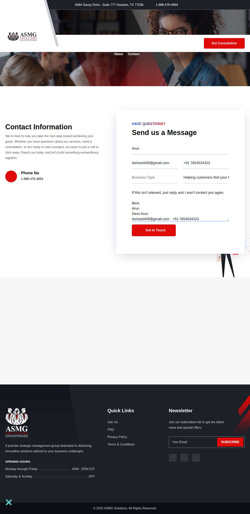

**After submit** — `run-46c49b0e_attempt-b92101e3_post_attempt_2026-11-04T06-59-24-647Z.jpg`

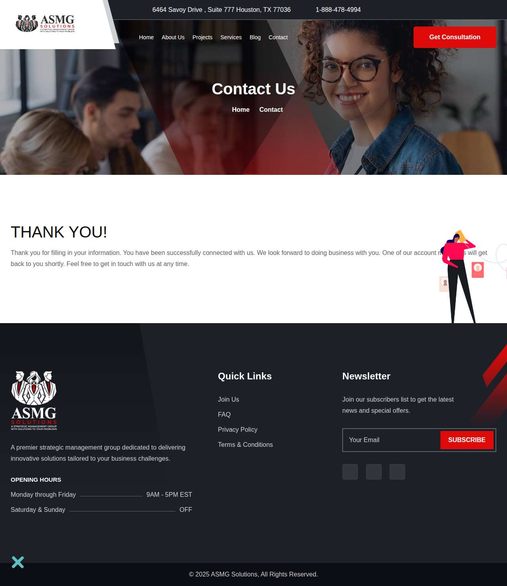

### damicoaccounting.com — unclear (LIVE)

| | |
|---|---|
| Attempt ID | `39ad9f15-baad-42a3-ae5f-eed57890f50e` |
| Form URL | https://www.damicoaccounting.com/contact-us |
| Final URL | https://www.damicoaccounting.com/contact-us |
| Reserved | 2026-11-04 06:59:32 UTC |
| Submit attempted | 2026-11-04 06:59:35 UTC |
| Template | standard v2 |
| Confirmation text | none observed |
| Result / error | No new success marker observed |

Exact message:

~~~text
Subject: Helping customers find your business in AI search (AEO + GEO)

Hi there,

I'm Arun from Devs Arun. More and more customers now ask ChatGPT, Gemini, Perplexity or Google's AI Overviews questions like "who should I hire for this in my area?" before they call anyone. These tools answer from websites they can clearly understand, and they tend to recommend businesses whose pages answer real customer questions.

That is what AEO + GEO (Answer Engine and Generative Engine Optimization) is for. I improve your existing service pages so they clearly answer the questions your customers ask, add structured data that matches the page, and make the call, quote or enquiry step obvious. The benefit: your business gets a better chance of being mentioned or linked in AI answers, and visitors who arrive find it easy to contact you.

The AEO + GEO Starter is a one-time $199 (about ₹16,999, negotiable) for one website: a basic audit, 10 customer questions, improvements to two existing pages, relevant structured data and an action plan, with one revision round.

You can read the full details, send an enquiry or book online here:
https://devsarun.io/aeo-geo/

If this isn't relevant, just reply and I won't contact you again.

Best,
Arun
Devs Arun
itschool408@gmail.com · +91 7654534323
~~~

Submitted field values:

- name \[name\]: Arun
- email \[email\]: itschool408@gmail.com
- Type your message here... \[message\]: Hi there, I'm Arun from Devs Arun. More and more customers now ask ChatGPT, Gemini, Perplexity or Google's AI Overviews 

**Filled form (before submit)** — `run-46c49b0e_attempt-39ad9f15_filled_2026-11-04T06-59-35-569Z.jpg`

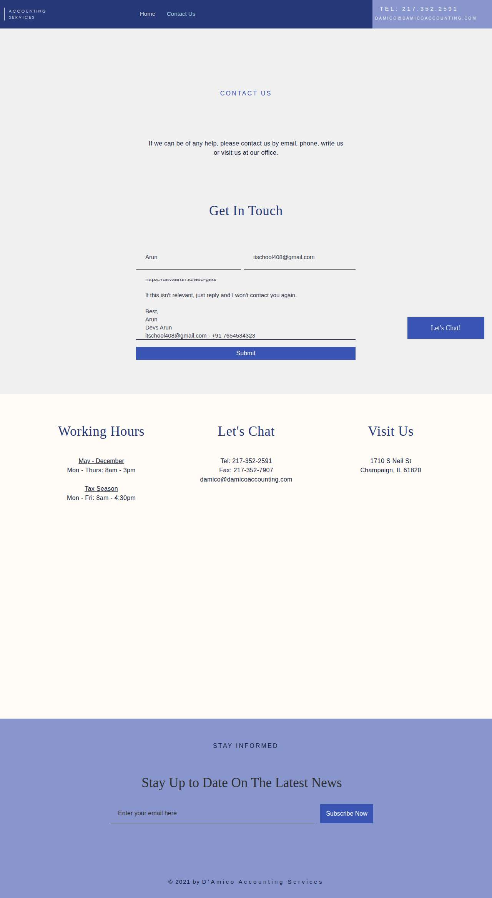

**After submit** — `run-46c49b0e_attempt-39ad9f15_post_attempt_2026-11-04T07-00-03-572Z.jpg`

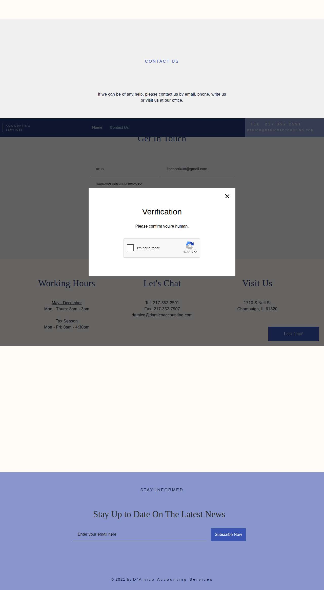

### rjw-cpa.com — confirmed (LIVE)

| | |
|---|---|
| Attempt ID | `19f4f090-9e37-4bfa-8b55-7cf54b035580` |
| Form URL | https://rjw-cpa.com/contact/ |
| Final URL | https://rjw-cpa.com/contact/ |
| Reserved | 2026-11-04 07:00:11 UTC |
| Submit attempted | 2026-11-04 07:00:14 UTC |
| Template | standard v2 |
| Confirmation text | : (719) 522-9000 Fax: (719) 799-2670 Email: rob@rjw-cpa.com Thank you for your message. It has been sent. Your name Your email Subject Your message (optional) |
| Result / error | — |

Exact message:

~~~text
Subject: Helping customers find your business in AI search (AEO + GEO)

Hi there,

I'm Arun from Devs Arun. More and more customers now ask ChatGPT, Gemini, Perplexity or Google's AI Overviews questions like "who should I hire for this in my area?" before they call anyone. These tools answer from websites they can clearly understand, and they tend to recommend businesses whose pages answer real customer questions.

That is what AEO + GEO (Answer Engine and Generative Engine Optimization) is for. I improve your existing service pages so they clearly answer the questions your customers ask, add structured data that matches the page, and make the call, quote or enquiry step obvious. The benefit: your business gets a better chance of being mentioned or linked in AI answers, and visitors who arrive find it easy to contact you.

The AEO + GEO Starter is a one-time $199 (about ₹16,999, negotiable) for one website: a basic audit, 10 customer questions, improvements to two existing pages, relevant structured data and an action plan, with one revision round.

You can read the full details, send an enquiry or book online here:
https://devsarun.io/aeo-geo/

If this isn't relevant, just reply and I won't contact you again.

Best,
Arun
Devs Arun
itschool408@gmail.com · +91 7654534323
~~~

Submitted field values:

- Your name \[name\]: Arun
- Subject \[subject\]: Helping customers find your business in AI search (AEO + GEO)
- Your email \[email\]: itschool408@gmail.com
- Your message (optional) \[message\]: Hi there, I'm Arun from Devs Arun. More and more customers now ask ChatGPT, Gemini, Perplexity or Google's AI Overviews 

**Filled form (before submit)** — `run-46c49b0e_attempt-19f4f090_filled_2026-11-04T07-00-14-080Z.jpg`

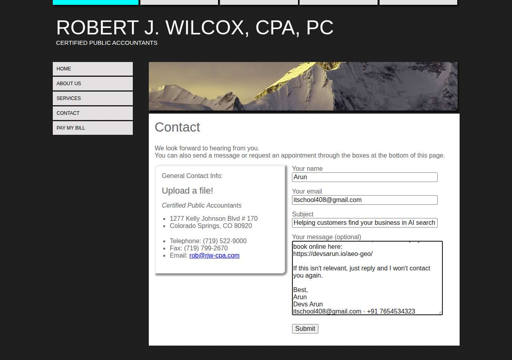

**After submit** — `run-46c49b0e_attempt-19f4f090_post_attempt_2026-11-04T07-00-18-229Z.jpg`

### uwscpa.com — unclear (LIVE)

| | |
|---|---|
| Attempt ID | `bc3fdd1b-870f-4503-aea8-1df4c208f6d8` |
| Form URL | https://www.uwscpa.com/contact |
| Final URL | https://www.uwscpa.com/contact |
| Reserved | 2026-11-04 07:00:26 UTC |
| Submit attempted | 2026-11-04 07:00:29 UTC |
| Template | standard v2 |
| Confirmation text | none observed |
| Result / error | No new success marker observed |

Exact message:

~~~text
Subject: Helping customers find your business in AI search (AEO + GEO)

Hi there,

I'm Arun from Devs Arun. More and more customers now ask ChatGPT, Gemini, Perplexity or Google's AI Overviews questions like "who should I hire for this in my area?" before they call anyone. These tools answer from websites they can clearly understand, and they tend to recommend businesses whose pages answer real customer questions.

That is what AEO + GEO (Answer Engine and Generative Engine Optimization) is for. I improve your existing service pages so they clearly answer the questions your customers ask, add structured data that matches the page, and make the call, quote or enquiry step obvious. The benefit: your business gets a better chance of being mentioned or linked in AI answers, and visitors who arrive find it easy to contact you.

The AEO + GEO Starter is a one-time $199 (about ₹16,999, negotiable) for one website: a basic audit, 10 customer questions, improvements to two existing pages, relevant structured data and an action plan, with one revision round.

You can read the full details, send an enquiry or book online here:
https://devsarun.io/aeo-geo/

If this isn't relevant, just reply and I won't contact you again.

Best,
Arun
Devs Arun
itschool408@gmail.com · +91 7654534323
~~~

Submitted field values:

- Email \[email\]: itschool408@gmail.com
- Message \[message\]: Hi there, I'm Arun from Devs Arun. More and more customers now ask ChatGPT, Gemini, Perplexity or Google's AI Overviews 

**Filled form (before submit)** — `run-46c49b0e_attempt-bc3fdd1b_filled_2026-11-04T07-00-29-014Z.jpg`

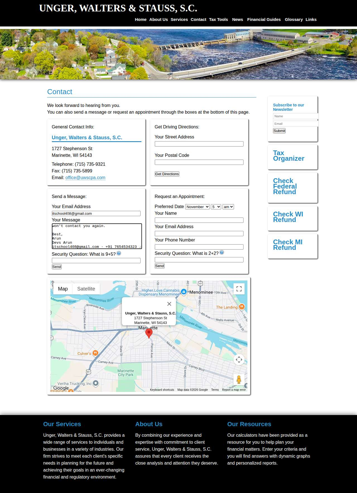

**After submit** — `run-46c49b0e_attempt-bc3fdd1b_post_attempt_2026-11-04T07-00-57-185Z.jpg`

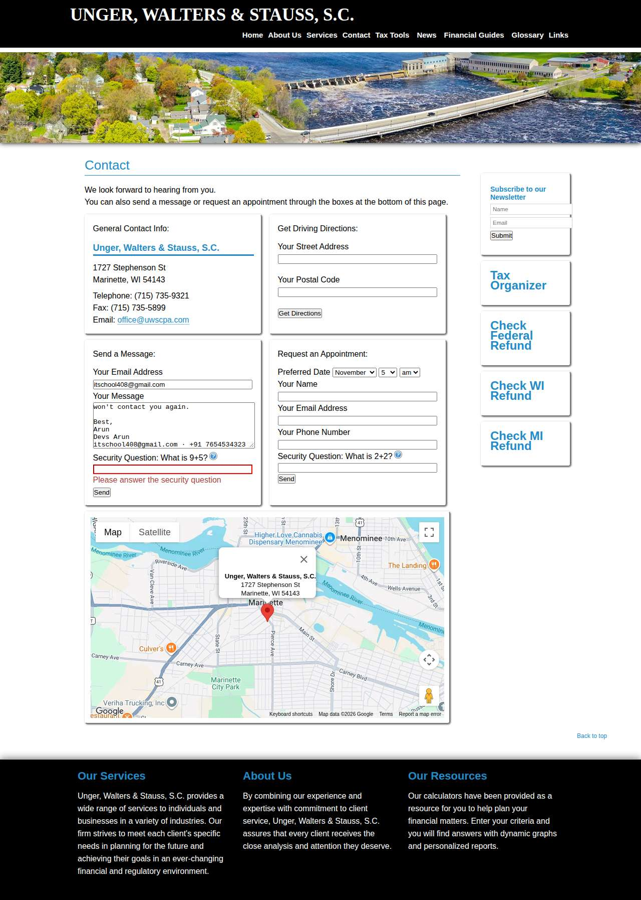

### shcpa.cpa — unclear (LIVE)

| | |
|---|---|
| Attempt ID | `db655e68-c9bc-4fde-bde5-55543f10f1b5` |
| Form URL | https://www.shcpa.cpa/contact |
| Final URL | https://www.shcpa.cpa/contact |
| Reserved | 2026-11-04 07:01:05 UTC |
| Submit attempted | 2026-11-04 07:01:08 UTC |
| Template | standard v2 |
| Confirmation text | none observed |
| Result / error | No new success marker observed |

Exact message:

~~~text
Subject: Helping customers find your business in AI search (AEO + GEO)

Hi there,

I'm Arun from Devs Arun. More and more customers now ask ChatGPT, Gemini, Perplexity or Google's AI Overviews questions like "who should I hire for this in my area?" before they call anyone. These tools answer from websites they can clearly understand, and they tend to recommend businesses whose pages answer real customer questions.

That is what AEO + GEO (Answer Engine and Generative Engine Optimization) is for. I improve your existing service pages so they clearly answer the questions your customers ask, add structured data that matches the page, and make the call, quote or enquiry step obvious. The benefit: your business gets a better chance of being mentioned or linked in AI answers, and visitors who arrive find it easy to contact you.

The AEO + GEO Starter is a one-time $199 (about ₹16,999, negotiable) for one website: a basic audit, 10 customer questions, improvements to two existing pages, relevant structured data and an action plan, with one revision round.

You can read the full details, send an enquiry or book online here:
https://devsarun.io/aeo-geo/

If this isn't relevant, just reply and I won't contact you again.

Best,
Arun
Devs Arun
itschool408@gmail.com · +91 7654534323
~~~

Submitted field values:

- Email \[email\]: itschool408@gmail.com
- Message \[message\]: Hi there, I'm Arun from Devs Arun. More and more customers now ask ChatGPT, Gemini, Perplexity or Google's AI Overviews 

**Filled form (before submit)** — `run-46c49b0e_attempt-db655e68_filled_2026-11-04T07-01-08-201Z.jpg`

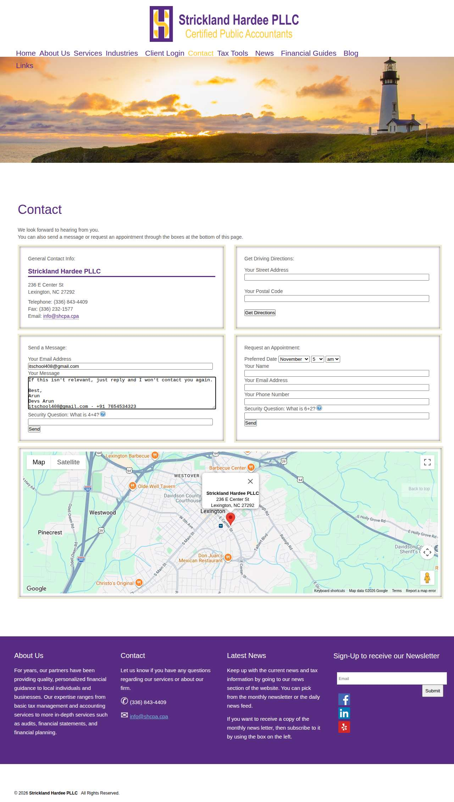

**After submit** — `run-46c49b0e_attempt-db655e68_post_attempt_2026-11-04T07-01-36-457Z.jpg`

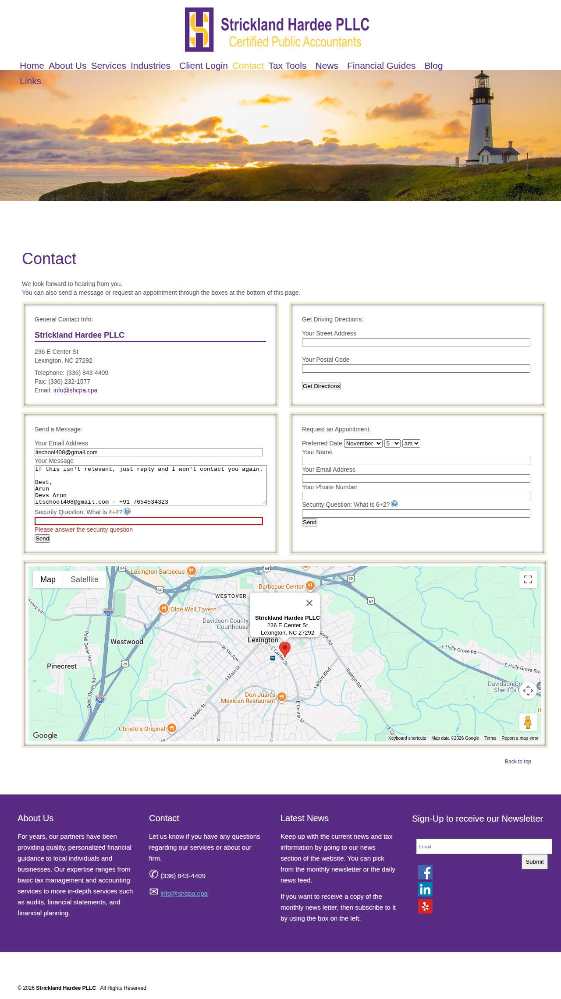

### bellobusinesssolutions.com — unclear (LIVE)

| | |
|---|---|
| Attempt ID | `c3951ad2-b6cd-4f1f-bf8c-b665869c1a1b` |
| Form URL | https://www.bellobusinesssolutions.com/contact/ |
| Final URL | https://www.bellobusinesssolutions.com/contact/ |
| Reserved | 2026-11-04 07:01:44 UTC |
| Submit attempted | 2026-11-04 07:01:46 UTC |
| Template | standard v2 |
| Confirmation text | none observed |
| Result / error | No new success marker observed |

Exact message:

~~~text
Subject: Helping customers find your business in AI search (AEO + GEO)

Hi there,

I'm Arun from Devs Arun. More and more customers now ask ChatGPT, Gemini, Perplexity or Google's AI Overviews questions like "who should I hire for this in my area?" before they call anyone. These tools answer from websites they can clearly understand, and they tend to recommend businesses whose pages answer real customer questions.

That is what AEO + GEO (Answer Engine and Generative Engine Optimization) is for. I improve your existing service pages so they clearly answer the questions your customers ask, add structured data that matches the page, and make the call, quote or enquiry step obvious. The benefit: your business gets a better chance of being mentioned or linked in AI answers, and visitors who arrive find it easy to contact you.

The AEO + GEO Starter is a one-time $199 (about ₹16,999, negotiable) for one website: a basic audit, 10 customer questions, improvements to two existing pages, relevant structured data and an action plan, with one revision round.

You can read the full details, send an enquiry or book online here:
https://devsarun.io/aeo-geo/

If this isn't relevant, just reply and I won't contact you again.

Best,
Arun
Devs Arun
itschool408@gmail.com · +91 7654534323
~~~

Submitted field values:

- Message \[message\]: Hi there, I'm Arun from Devs Arun. More and more customers now ask ChatGPT, Gemini, Perplexity or Google's AI Overviews 
- Company Name \[company\]: Devs Arun
- Enter Phone No \[phone\]: +91 7654534323
- First Name \[first\_name\]: Arun
- Your Email Address \[email\]: itschool408@gmail.com

**Filled form (before submit)** — `run-46c49b0e_attempt-c3951ad2_filled_2026-11-04T07-01-46-087Z.jpg`

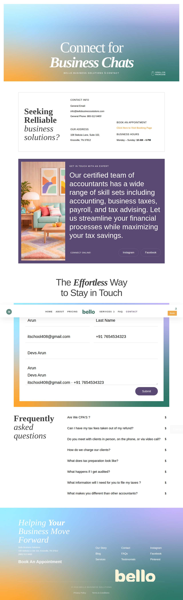

**After submit** — `run-46c49b0e_attempt-c3951ad2_post_attempt_2026-11-04T07-02-14-561Z.jpg`

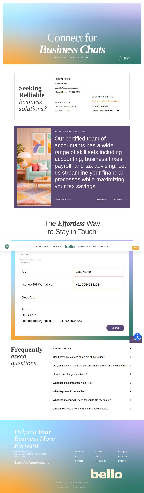

## Events (81)

| Time (UTC) | Event | Website | Details |
|---|---|---|---|
| 06:57:38 | run\_queued | — | live run requested by github:itsDevsArun |
| 06:57:38 | run\_dispatched | — | dispatch disabled (local test mode) |
| 06:57:41 | run\_started | — | Runner claimed live run |
| 06:57:43 | offer\_verified | — | Service page offer facts verified |
| 06:57:43 | website\_selected | clearchoiceplumbingllc.com | Live target clearchoiceplumbingllc.com |
| 06:57:43 | attempt\_reserved | clearchoiceplumbingllc.com | Submission attempt reserved with template standard v2 |
| 06:57:44 | page\_opened | clearchoiceplumbingllc.com | Opened form page |
| 06:57:44 | screenshot\_saved | clearchoiceplumbingllc.com | inspection screenshot saved (145 KB) |
| 06:57:44 | review\_required | clearchoiceplumbingllc.com | failed before submit: locator.fill: Error: Cannot type text into input\[type=number\] |
| 06:57:49 | website\_selected | bwnwincpainting.com | Live target bwnwincpainting.com |
| 06:57:49 | attempt\_reserved | bwnwincpainting.com | Submission attempt reserved with template standard v2 |
| 06:57:51 | page\_opened | bwnwincpainting.com | Opened form page |
| 06:57:51 | screenshot\_saved | bwnwincpainting.com | inspection screenshot saved (118 KB) |
| 06:57:51 | review\_required | bwnwincpainting.com | failed before submit: locator.fill: Error: Cannot type text into input\[type=number\] |
| 06:57:57 | website\_selected | absoluterestorepa.com | Live target absoluterestorepa.com |
| 06:57:57 | attempt\_reserved | absoluterestorepa.com | Submission attempt reserved with template standard v2 |
| 06:57:59 | page\_opened | absoluterestorepa.com | Opened form page |
| 06:57:59 | screenshot\_saved | absoluterestorepa.com | inspection screenshot saved (175 KB) |
| 06:57:59 | review\_required | absoluterestorepa.com | failed before submit: locator.fill: Error: Cannot type text into input\[type=number\] |
| 06:58:04 | website\_selected | masoudlawfirm.com | Live target masoudlawfirm.com |
| 06:58:04 | attempt\_reserved | masoudlawfirm.com | Submission attempt reserved with template standard v2 |
| 06:58:08 | page\_opened | masoudlawfirm.com | Opened form page |
| 06:58:09 | screenshot\_saved | masoudlawfirm.com | inspection screenshot saved (168 KB) |
| 06:58:09 | review\_required | masoudlawfirm.com | failed before submit: locator.fill: Error: Cannot type text into input\[type=number\] |
| 06:58:14 | website\_selected | randrtax.com | Live target randrtax.com |
| 06:58:14 | attempt\_reserved | randrtax.com | Submission attempt reserved with template standard v2 |
| 06:58:18 | page\_opened | randrtax.com | Opened form page |
| 06:58:18 | fields\_filled | randrtax.com | filled |
| 06:58:18 | screenshot\_saved | randrtax.com | filled screenshot saved (130 KB) |
| 06:58:18 | submit\_attempted | randrtax.com | submitting |
| 06:58:47 | screenshot\_saved | randrtax.com | post\_attempt screenshot saved (108 KB) |
| 06:58:47 | review\_required | randrtax.com | unclear: No new success marker observed |
| 06:58:55 | website\_selected | asmgsolutions.com | Live target asmgsolutions.com |
| 06:58:55 | attempt\_reserved | asmgsolutions.com | Submission attempt reserved with template standard v2 |
| 06:59:13 | page\_opened | asmgsolutions.com | Opened form page |
| 06:59:13 | fields\_filled | asmgsolutions.com | filled |
| 06:59:13 | screenshot\_saved | asmgsolutions.com | filled screenshot saved (129 KB) |
| 06:59:13 | submit\_attempted | asmgsolutions.com | submitting |
| 06:59:24 | screenshot\_saved | asmgsolutions.com | post\_attempt screenshot saved (98 KB) |
| 06:59:24 | confirmation\_observed | asmgsolutions.com | confirmed — "vices Blog Contact Get Consultation Contact Us Home Contact THANK YOU\! Thank you for filling in your information. You ha" |
| 06:59:32 | website\_selected | damicoaccounting.com | Live target damicoaccounting.com |
| 06:59:32 | attempt\_reserved | damicoaccounting.com | Submission attempt reserved with template standard v2 |
| 06:59:35 | page\_opened | damicoaccounting.com | Opened form page |
| 06:59:35 | fields\_filled | damicoaccounting.com | filled |
| 06:59:35 | screenshot\_saved | damicoaccounting.com | filled screenshot saved (70 KB) |
| 06:59:35 | submit\_attempted | damicoaccounting.com | submitting |
| 07:00:03 | screenshot\_saved | damicoaccounting.com | post\_attempt screenshot saved (60 KB) |
| 07:00:03 | review\_required | damicoaccounting.com | unclear: No new success marker observed |
| 07:00:11 | website\_selected | rjw-cpa.com | Live target rjw-cpa.com |
| 07:00:11 | attempt\_reserved | rjw-cpa.com | Submission attempt reserved with template standard v2 |
| 07:00:13 | page\_opened | rjw-cpa.com | Opened form page |
| 07:00:14 | fields\_filled | rjw-cpa.com | filled |
| 07:00:14 | screenshot\_saved | rjw-cpa.com | filled screenshot saved (99 KB) |
| 07:00:14 | submit\_attempted | rjw-cpa.com | submitting |
| 07:00:18 | screenshot\_saved | rjw-cpa.com | post\_attempt screenshot saved (87 KB) |
| 07:00:18 | confirmation\_observed | rjw-cpa.com | confirmed — ": (719) 522-9000 Fax: (719) 799-2670 Email: rob@rjw-cpa.com Thank you for your message. It has been sent. Your name Your" |
| 07:00:26 | website\_selected | uwscpa.com | Live target uwscpa.com |
| 07:00:26 | attempt\_reserved | uwscpa.com | Submission attempt reserved with template standard v2 |
| 07:00:28 | page\_opened | uwscpa.com | Opened form page |
| 07:00:28 | fields\_filled | uwscpa.com | filled |
| 07:00:29 | screenshot\_saved | uwscpa.com | filled screenshot saved (229 KB) |
| 07:00:29 | submit\_attempted | uwscpa.com | submitting |
| 07:00:57 | screenshot\_saved | uwscpa.com | post\_attempt screenshot saved (232 KB) |
| 07:00:57 | review\_required | uwscpa.com | unclear: No new success marker observed |
| 07:01:05 | website\_selected | shcpa.cpa | Live target shcpa.cpa |
| 07:01:05 | attempt\_reserved | shcpa.cpa | Submission attempt reserved with template standard v2 |
| 07:01:07 | page\_opened | shcpa.cpa | Opened form page |
| 07:01:08 | fields\_filled | shcpa.cpa | filled |
| 07:01:08 | screenshot\_saved | shcpa.cpa | filled screenshot saved (211 KB) |
| 07:01:08 | submit\_attempted | shcpa.cpa | submitting |
| 07:01:36 | screenshot\_saved | shcpa.cpa | post\_attempt screenshot saved (216 KB) |
| 07:01:36 | review\_required | shcpa.cpa | unclear: No new success marker observed |
| 07:01:44 | website\_selected | bellobusinesssolutions.com | Live target bellobusinesssolutions.com |
| 07:01:44 | attempt\_reserved | bellobusinesssolutions.com | Submission attempt reserved with template standard v2 |
| 07:01:45 | page\_opened | bellobusinesssolutions.com | Opened form page |
| 07:01:45 | fields\_filled | bellobusinesssolutions.com | filled |
| 07:01:46 | screenshot\_saved | bellobusinesssolutions.com | filled screenshot saved (250 KB) |
| 07:01:46 | submit\_attempted | bellobusinesssolutions.com | submitting |
| 07:02:14 | screenshot\_saved | bellobusinesssolutions.com | post\_attempt screenshot saved (258 KB) |
| 07:02:14 | review\_required | bellobusinesssolutions.com | unclear: No new success marker observed |
| 07:02:22 | run\_completed | — | Run completed (limit\_reached) |
