# Run 6f3ce812 — live — completed

| | |
|---|---|
| Run ID | `6f3ce812-1133-47db-8de8-d7f2ee94b726` |
| Requested by | github:itsDevsArun |
| Started | 2026-11-04 05:38:17 UTC |
| Finished | 2026-11-04 05:47:16 UTC |
| Finish reason | queue\_exhausted |
| GitHub Actions | https://github.com/itsDevsArun/aeo-geo/actions/runs/41763788389 |

CSV for this run: [runs/2026-11-04_live_6f3ce812.csv](2026-11-04_live_6f3ce812.csv)

## Attempts (21)

### clearchoiceplumbingllc.com — failed\_before\_submit (LIVE)

| | |
|---|---|
| Attempt ID | `8b9ef471-63b8-4576-a6d0-654abd0723e9` |
| Form URL | https://clearchoiceplumbingllc.com/contact/ |
| Final URL | — |
| Reserved | 2026-11-04 05:38:18 UTC |
| Submit attempted | — |
| Template | standard v2 |
| Confirmation text | none observed |
| Result / error | locator.fill: Error: Cannot type text into input\[type=number\] |

Exact message:

~~~text
Subject: Helping customers find your business in AI search (AEO + GEO)

Hi there,

I'm Arun from Devs Arun. More and more customers now ask ChatGPT, Gemini, Perplexity or Google's AI Overviews questions like "who should I hire for this in my area?" before they call anyone. These tools answer from websites they can clearly understand, and they tend to recommend businesses whose pages answer real customer questions.

That is what AEO + GEO (Answer Engine and Generative Engine Optimization) is for. I improve your existing service pages so they clearly answer the questions your customers ask, add structured data that matches the page, and make the call, quote or enquiry step obvious. The benefit: your business gets a better chance of being mentioned or linked in AI answers, and visitors who arrive find it easy to contact you.

The AEO + GEO Starter is a one-time $199 (about ₹16,999, negotiable) for one website: a basic audit, 10 customer questions, improvements to two existing pages, relevant structured data and an action plan, with one revision round.

You can read the full details, send an enquiry or book online here:
https://devsarun.io/aeo-geo/

If this isn't relevant, just reply and I won't contact you again.

Best,
Arun
Devs Arun
itschool408@gmail.com · +91 7654534323
~~~

Submitted field values:

- \#wpforms-51-field\_1: Arun
- \#wpforms-51-field\_2: itschool408@gmail.com
- \#wpforms-51-field\_3: Hi there, I'm Arun from Devs Arun. More and more customers now ask ChatGPT, Gemini, Perplexity or Google's AI Overviews 
- \#wpforms-51-field\_5: +91 7654534323

**Inspected page** — `run-6f3ce812_attempt-8b9ef471_inspection_2026-11-04T05-38-20-089Z.jpg`

### bwnwincpainting.com — failed\_before\_submit (LIVE)

| | |
|---|---|
| Attempt ID | `7ddad9c8-1f0a-4466-b35a-067ed289e5f1` |
| Form URL | https://www.bwnwincpainting.com/contact/ |
| Final URL | — |
| Reserved | 2026-11-04 05:38:25 UTC |
| Submit attempted | — |
| Template | standard v2 |
| Confirmation text | none observed |
| Result / error | locator.fill: Error: Cannot type text into input\[type=number\] |

Exact message:

~~~text
Subject: Helping customers find your business in AI search (AEO + GEO)

Hi there,

I'm Arun from Devs Arun. More and more customers now ask ChatGPT, Gemini, Perplexity or Google's AI Overviews questions like "who should I hire for this in my area?" before they call anyone. These tools answer from websites they can clearly understand, and they tend to recommend businesses whose pages answer real customer questions.

That is what AEO + GEO (Answer Engine and Generative Engine Optimization) is for. I improve your existing service pages so they clearly answer the questions your customers ask, add structured data that matches the page, and make the call, quote or enquiry step obvious. The benefit: your business gets a better chance of being mentioned or linked in AI answers, and visitors who arrive find it easy to contact you.

The AEO + GEO Starter is a one-time $199 (about ₹16,999, negotiable) for one website: a basic audit, 10 customer questions, improvements to two existing pages, relevant structured data and an action plan, with one revision round.

You can read the full details, send an enquiry or book online here:
https://devsarun.io/aeo-geo/

If this isn't relevant, just reply and I won't contact you again.

Best,
Arun
Devs Arun
itschool408@gmail.com · +91 7654534323
~~~

Submitted field values:

- \#name-1151: Arun
- \#email-1151: itschool408@gmail.com
- \#phone-1151: +91 7654534323
- \#message-1151: Hi there, I'm Arun from Devs Arun. More and more customers now ask ChatGPT, Gemini, Perplexity or Google's AI Overviews 

**Inspected page** — `run-6f3ce812_attempt-7ddad9c8_inspection_2026-11-04T05-38-27-266Z.jpg`

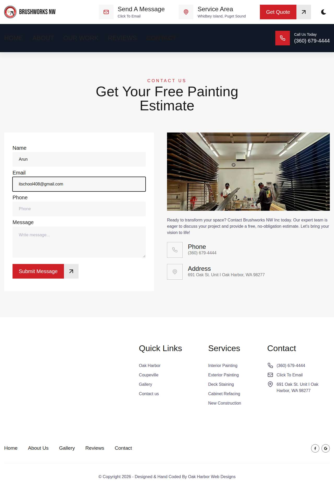

### absoluterestorepa.com — failed\_before\_submit (LIVE)

| | |
|---|---|
| Attempt ID | `04007e43-76ed-451e-85d1-7ec961178a1c` |
| Form URL | https://absoluterestorepa.com/contact-us/ |
| Final URL | — |
| Reserved | 2026-11-04 05:38:32 UTC |
| Submit attempted | — |
| Template | standard v2 |
| Confirmation text | none observed |
| Result / error | locator.fill: Error: Cannot type text into input\[type=number\] |

Exact message:

~~~text
Subject: Helping customers find your business in AI search (AEO + GEO)

Hi there,

I'm Arun from Devs Arun. More and more customers now ask ChatGPT, Gemini, Perplexity or Google's AI Overviews questions like "who should I hire for this in my area?" before they call anyone. These tools answer from websites they can clearly understand, and they tend to recommend businesses whose pages answer real customer questions.

That is what AEO + GEO (Answer Engine and Generative Engine Optimization) is for. I improve your existing service pages so they clearly answer the questions your customers ask, add structured data that matches the page, and make the call, quote or enquiry step obvious. The benefit: your business gets a better chance of being mentioned or linked in AI answers, and visitors who arrive find it easy to contact you.

The AEO + GEO Starter is a one-time $199 (about ₹16,999, negotiable) for one website: a basic audit, 10 customer questions, improvements to two existing pages, relevant structured data and an action plan, with one revision round.

You can read the full details, send an enquiry or book online here:
https://devsarun.io/aeo-geo/

If this isn't relevant, just reply and I won't contact you again.

Best,
Arun
Devs Arun
itschool408@gmail.com · +91 7654534323
~~~

Submitted field values:

- \#form-field-name: Arun
- \#form-field-message: Hi there, I'm Arun from Devs Arun. More and more customers now ask ChatGPT, Gemini, Perplexity or Google's AI Overviews 
- \#form-field-field\_ed02ec2: +91 7654534323
- \#content \> div \> div \> div:nth-of-type(2) \> div \> div:nth-of-type(1) \> div:nth-of-type(2) \> div \> form \> div \> div:nth-of-type(3) \> input: itschool408@gmail.com

**Inspected page** — `run-6f3ce812_attempt-04007e43_inspection_2026-11-04T05-38-35-122Z.jpg`

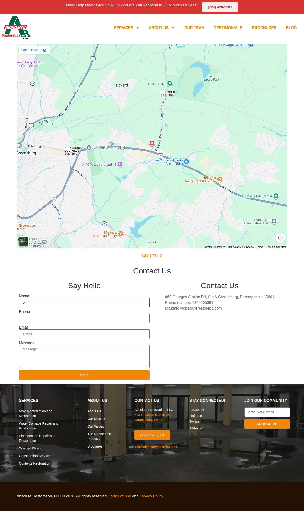

### masoudlawfirm.com — failed\_before\_submit (LIVE)

| | |
|---|---|
| Attempt ID | `bbf5bb3d-a74b-4e8b-9c18-f3758b8f7b79` |
| Form URL | https://masoudlawfirm.com/contact/ |
| Final URL | — |
| Reserved | 2026-11-04 05:38:40 UTC |
| Submit attempted | — |
| Template | standard v2 |
| Confirmation text | none observed |
| Result / error | locator.fill: Error: Cannot type text into input\[type=number\] |

Exact message:

~~~text
Subject: Helping customers find your business in AI search (AEO + GEO)

Hi there,

I'm Arun from Devs Arun. More and more customers now ask ChatGPT, Gemini, Perplexity or Google's AI Overviews questions like "who should I hire for this in my area?" before they call anyone. These tools answer from websites they can clearly understand, and they tend to recommend businesses whose pages answer real customer questions.

That is what AEO + GEO (Answer Engine and Generative Engine Optimization) is for. I improve your existing service pages so they clearly answer the questions your customers ask, add structured data that matches the page, and make the call, quote or enquiry step obvious. The benefit: your business gets a better chance of being mentioned or linked in AI answers, and visitors who arrive find it easy to contact you.

The AEO + GEO Starter is a one-time $199 (about ₹16,999, negotiable) for one website: a basic audit, 10 customer questions, improvements to two existing pages, relevant structured data and an action plan, with one revision round.

You can read the full details, send an enquiry or book online here:
https://devsarun.io/aeo-geo/

If this isn't relevant, just reply and I won't contact you again.

Best,
Arun
Devs Arun
itschool408@gmail.com · +91 7654534323
~~~

Submitted field values:

- \#form-field-name: Arun
- \#form-field-field\_3374379: Hi there, I'm Arun from Devs Arun. More and more customers now ask ChatGPT, Gemini, Perplexity or Google's AI Overviews 
- \#form-field-field\_7731784: +91 7654534323
- \#form-field-field\_8bd0f16: itschool408@gmail.com

**Inspected page** — `run-6f3ce812_attempt-bbf5bb3d_inspection_2026-11-04T05-38-42-700Z.jpg`

### accidentattorneysvermont.com — unclear (LIVE)

| | |
|---|---|
| Attempt ID | `42b522d3-e250-46c9-b223-ab63a8657bea` |
| Form URL | https://community.focuseddevelopment.com/contact-us/ |
| Final URL | https://community.focuseddevelopment.com/contact-us/ |
| Reserved | 2026-11-04 05:38:47 UTC |
| Submit attempted | 2026-11-04 05:38:54 UTC |
| Template | standard v2 |
| Confirmation text | none observed |
| Result / error | No new success marker observed |

Exact message:

~~~text
Subject: Helping customers find your business in AI search (AEO + GEO)

Hi there,

I'm Arun from Devs Arun. More and more customers now ask ChatGPT, Gemini, Perplexity or Google's AI Overviews questions like "who should I hire for this in my area?" before they call anyone. These tools answer from websites they can clearly understand, and they tend to recommend businesses whose pages answer real customer questions.

That is what AEO + GEO (Answer Engine and Generative Engine Optimization) is for. I improve your existing service pages so they clearly answer the questions your customers ask, add structured data that matches the page, and make the call, quote or enquiry step obvious. The benefit: your business gets a better chance of being mentioned or linked in AI answers, and visitors who arrive find it easy to contact you.

The AEO + GEO Starter is a one-time $199 (about ₹16,999, negotiable) for one website: a basic audit, 10 customer questions, improvements to two existing pages, relevant structured data and an action plan, with one revision round.

You can read the full details, send an enquiry or book online here:
https://devsarun.io/aeo-geo/

If this isn't relevant, just reply and I won't contact you again.

Best,
Arun
Devs Arun
itschool408@gmail.com · +91 7654534323
~~~

Submitted field values:

- Message: \[message\]: Hi there, I'm Arun from Devs Arun. More and more customers now ask ChatGPT, Gemini, Perplexity or Google's AI Overviews 
- Subject: \[subject\]: Helping customers find your business in AI search (AEO + GEO)
- Email Address: \[email\]: itschool408@gmail.com
- First Name: \[first\_name\]: Arun

**Filled form (before submit)** — `run-6f3ce812_attempt-42b522d3_filled_2026-11-04T05-38-54-263Z.jpg`

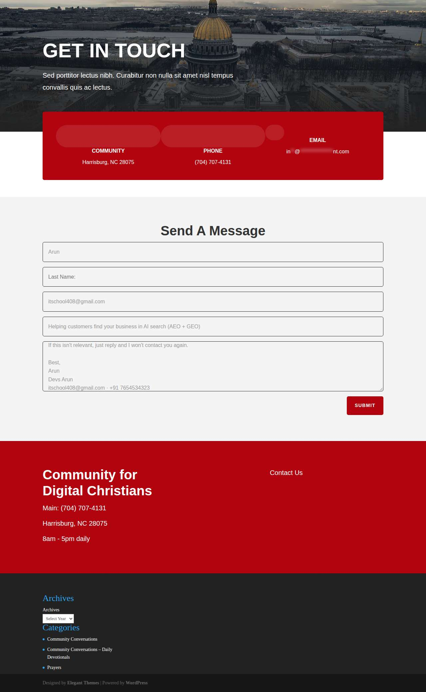

**After submit** — `run-6f3ce812_attempt-42b522d3_post_attempt_2026-11-04T05-39-30-550Z.jpg`

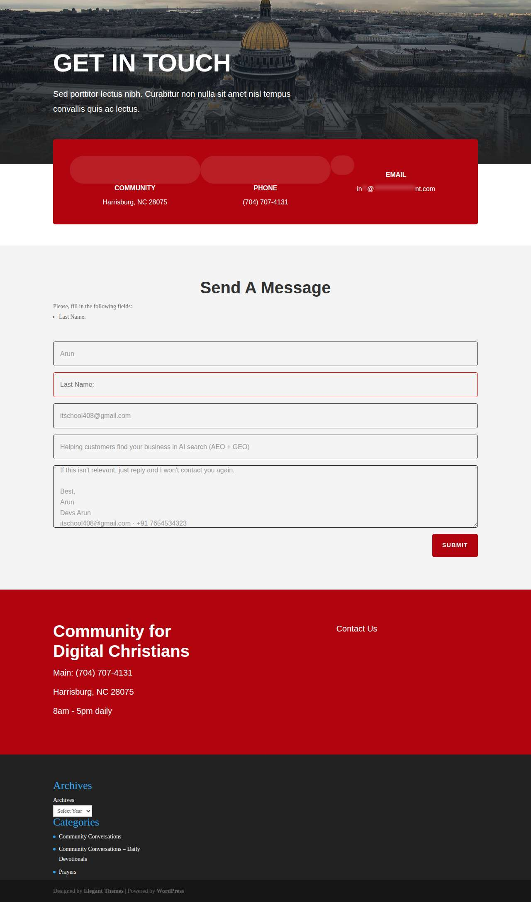

### etinarilaw.com — unclear (LIVE)

| | |
|---|---|
| Attempt ID | `18935c37-497f-4933-88a8-03a312e8b0a9` |
| Form URL | https://www.tinarilawfirm.com/ |
| Final URL | https://www.tinarilawfirm.com/ |
| Reserved | 2026-11-04 05:39:38 UTC |
| Submit attempted | 2026-11-04 05:39:40 UTC |
| Template | standard v2 |
| Confirmation text | none observed |
| Result / error | No new success marker observed |

Exact message:

~~~text
Subject: Helping customers find your business in AI search (AEO + GEO)

Hi there,

I'm Arun from Devs Arun. More and more customers now ask ChatGPT, Gemini, Perplexity or Google's AI Overviews questions like "who should I hire for this in my area?" before they call anyone. These tools answer from websites they can clearly understand, and they tend to recommend businesses whose pages answer real customer questions.

That is what AEO + GEO (Answer Engine and Generative Engine Optimization) is for. I improve your existing service pages so they clearly answer the questions your customers ask, add structured data that matches the page, and make the call, quote or enquiry step obvious. The benefit: your business gets a better chance of being mentioned or linked in AI answers, and visitors who arrive find it easy to contact you.

The AEO + GEO Starter is a one-time $199 (about ₹16,999, negotiable) for one website: a basic audit, 10 customer questions, improvements to two existing pages, relevant structured data and an action plan, with one revision round.

You can read the full details, send an enquiry or book online here:
https://devsarun.io/aeo-geo/

If this isn't relevant, just reply and I won't contact you again.

Best,
Arun
Devs Arun
itschool408@gmail.com · +91 7654534323
~~~

Submitted field values:

- name \[name\]: Arun
- email \[email\]: itschool408@gmail.com
- phone \[phone\]: +91 7654534323
- Tell us about your situation... \[message\]: Hi there, I'm Arun from Devs Arun. More and more customers now ask ChatGPT, Gemini, Perplexity or Google's AI Overviews 

**Filled form (before submit)** — `run-6f3ce812_attempt-18935c37_filled_2026-11-04T05-39-40-805Z.jpg`

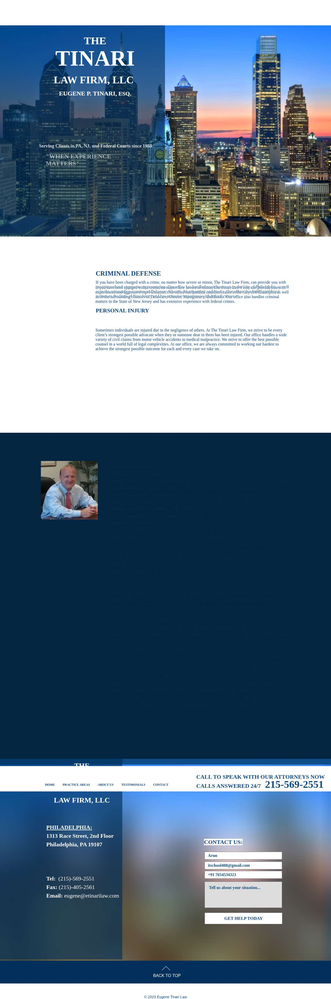

**After submit** — `run-6f3ce812_attempt-18935c37_post_attempt_2026-11-04T05-40-09-024Z.jpg`

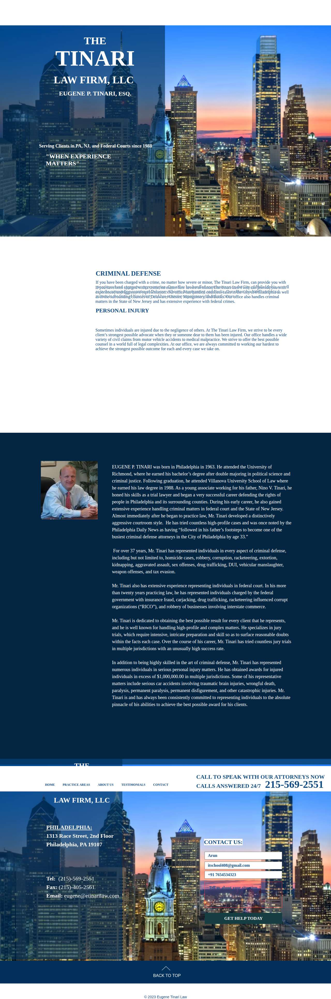

### thechesnuttlawfirm.com — unclear (LIVE)

| | |
|---|---|
| Attempt ID | `be654f62-0e6b-4800-8e59-7334322e4452` |
| Form URL | https://thechesnuttlawfirm.com/contact/ |
| Final URL | https://thechesnuttlawfirm.com/contact/ |
| Reserved | 2026-11-04 05:40:17 UTC |
| Submit attempted | 2026-11-04 05:40:21 UTC |
| Template | standard v2 |
| Confirmation text | none observed |
| Result / error | No new success marker observed |

Exact message:

~~~text
Subject: Helping customers find your business in AI search (AEO + GEO)

Hi there,

I'm Arun from Devs Arun. More and more customers now ask ChatGPT, Gemini, Perplexity or Google's AI Overviews questions like "who should I hire for this in my area?" before they call anyone. These tools answer from websites they can clearly understand, and they tend to recommend businesses whose pages answer real customer questions.

That is what AEO + GEO (Answer Engine and Generative Engine Optimization) is for. I improve your existing service pages so they clearly answer the questions your customers ask, add structured data that matches the page, and make the call, quote or enquiry step obvious. The benefit: your business gets a better chance of being mentioned or linked in AI answers, and visitors who arrive find it easy to contact you.

The AEO + GEO Starter is a one-time $199 (about ₹16,999, negotiable) for one website: a basic audit, 10 customer questions, improvements to two existing pages, relevant structured data and an action plan, with one revision round.

You can read the full details, send an enquiry or book online here:
https://devsarun.io/aeo-geo/

If this isn't relevant, just reply and I won't contact you again.

Best,
Arun
Devs Arun
itschool408@gmail.com · +91 7654534323
~~~

Submitted field values:

- Email \[email\]: itschool408@gmail.com
- Phone \[phone\]: +91 7654534323
- Full Name \[name\]: Arun
- How We Can Help You? \[message\]: Hi there, I'm Arun from Devs Arun. More and more customers now ask ChatGPT, Gemini, Perplexity or Google's AI Overviews 

**Filled form (before submit)** — `run-6f3ce812_attempt-be654f62_filled_2026-11-04T05-40-21-819Z.jpg`

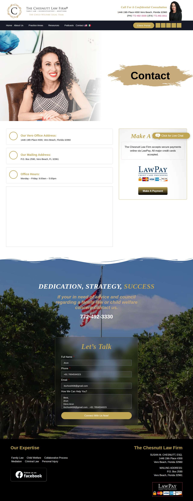

**After submit** — `run-6f3ce812_attempt-be654f62_post_attempt_2026-11-04T05-40-58-437Z.jpg`

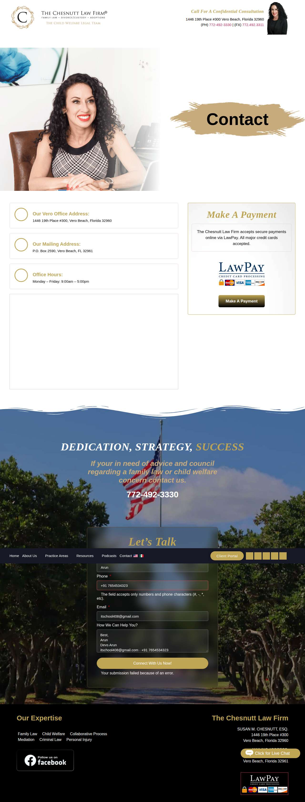

### shayandassociates.com — unclear (LIVE)

| | |
|---|---|
| Attempt ID | `e4cda5e8-b99d-49ad-8e28-b1a689a2cc63` |
| Form URL | https://www.shayandassociates.com/contact |
| Final URL | https://www.shayandassociates.com/contact |
| Reserved | 2026-11-04 05:41:06 UTC |
| Submit attempted | 2026-11-04 05:41:11 UTC |
| Template | standard v2 |
| Confirmation text | none observed |
| Result / error | No new success marker observed |

Exact message:

~~~text
Subject: Helping customers find your business in AI search (AEO + GEO)

Hi there,

I'm Arun from Devs Arun. More and more customers now ask ChatGPT, Gemini, Perplexity or Google's AI Overviews questions like "who should I hire for this in my area?" before they call anyone. These tools answer from websites they can clearly understand, and they tend to recommend businesses whose pages answer real customer questions.

That is what AEO + GEO (Answer Engine and Generative Engine Optimization) is for. I improve your existing service pages so they clearly answer the questions your customers ask, add structured data that matches the page, and make the call, quote or enquiry step obvious. The benefit: your business gets a better chance of being mentioned or linked in AI answers, and visitors who arrive find it easy to contact you.

The AEO + GEO Starter is a one-time $199 (about ₹16,999, negotiable) for one website: a basic audit, 10 customer questions, improvements to two existing pages, relevant structured data and an action plan, with one revision round.

You can read the full details, send an enquiry or book online here:
https://devsarun.io/aeo-geo/

If this isn't relevant, just reply and I won't contact you again.

Best,
Arun
Devs Arun
itschool408@gmail.com · +91 7654534323
~~~

Submitted field values:

- Email \[email\]: itschool408@gmail.com
- Message \[message\]: Hi there, I'm Arun from Devs Arun. More and more customers now ask ChatGPT, Gemini, Perplexity or Google's AI Overviews 
- First Name \[first\_name\]: Arun

**Filled form (before submit)** — `run-6f3ce812_attempt-e4cda5e8_filled_2026-11-04T05-41-11-016Z.jpg`

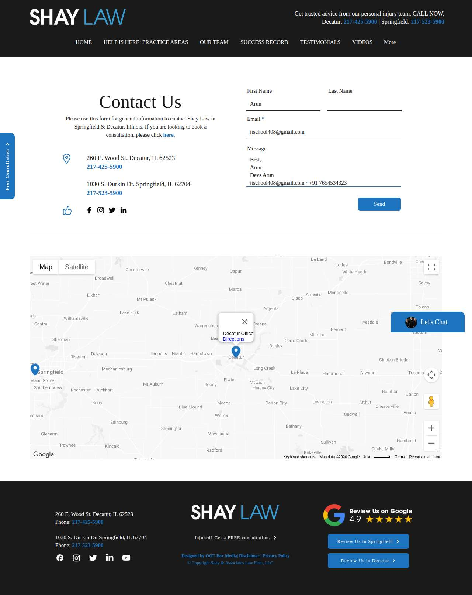

**After submit** — `run-6f3ce812_attempt-e4cda5e8_post_attempt_2026-11-04T05-41-47-303Z.jpg`

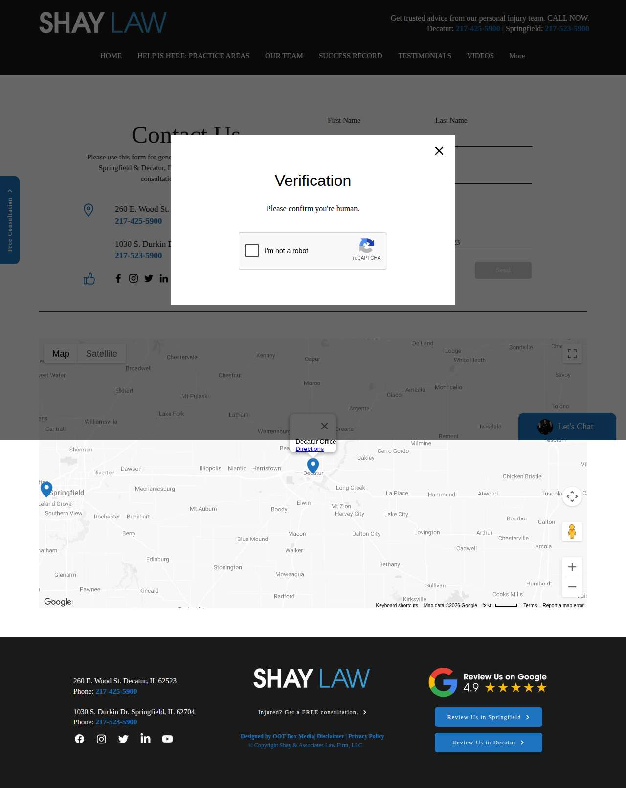

### thomasessexlaw.com — failed\_before\_submit (LIVE)

| | |
|---|---|
| Attempt ID | `cf0231e5-2da0-4cfa-9b3a-6ecba90e885e` |
| Form URL | https://www.thomasessexlaw.com/contact-us/ |
| Final URL | https://www.thomasessexlaw.com/contact-us/ |
| Reserved | 2026-11-04 05:41:55 UTC |
| Submit attempted | — |
| Template | standard v2 |
| Confirmation text | none observed |
| Result / error | Form validation would block sending: disclaimer\[0\]: Please check this box if you want to proceed. |

Exact message:

~~~text
Subject: Helping customers find your business in AI search (AEO + GEO)

Hi there,

I'm Arun from Devs Arun. More and more customers now ask ChatGPT, Gemini, Perplexity or Google's AI Overviews questions like "who should I hire for this in my area?" before they call anyone. These tools answer from websites they can clearly understand, and they tend to recommend businesses whose pages answer real customer questions.

That is what AEO + GEO (Answer Engine and Generative Engine Optimization) is for. I improve your existing service pages so they clearly answer the questions your customers ask, add structured data that matches the page, and make the call, quote or enquiry step obvious. The benefit: your business gets a better chance of being mentioned or linked in AI answers, and visitors who arrive find it easy to contact you.

The AEO + GEO Starter is a one-time $199 (about ₹16,999, negotiable) for one website: a basic audit, 10 customer questions, improvements to two existing pages, relevant structured data and an action plan, with one revision round.

You can read the full details, send an enquiry or book online here:
https://devsarun.io/aeo-geo/

If this isn't relevant, just reply and I won't contact you again.

Best,
Arun
Devs Arun
itschool408@gmail.com · +91 7654534323
~~~

Submitted field values:

- \#contactform-name: Arun
- \#contactform-email: itschool408@gmail.com
- \#contactform-phone: +91 7654534323
- \#contactform-reason: Hi there, I'm Arun from Devs Arun. More and more customers now ask ChatGPT, Gemini, Perplexity or Google's AI Overviews 
- \#contactform-company: Devs Arun

**Filled form (before submit)** — `run-6f3ce812_attempt-cf0231e5_filled_2026-11-04T05-41-56-733Z.jpg`

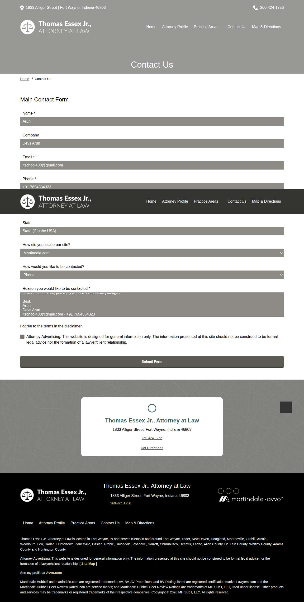

### cpawells.com — failed\_before\_submit (LIVE)

| | |
|---|---|
| Attempt ID | `619c0693-0798-46a9-91e4-a5a2d8fe631b` |
| Form URL | https://cpawells.com/contact-us/ |
| Final URL | https://cpawells.com/contact-us/ |
| Reserved | 2026-11-04 05:42:01 UTC |
| Submit attempted | — |
| Template | standard v2 |
| Confirmation text | none observed |
| Result / error | Field "Phone" did not accept the value |

Exact message:

~~~text
Subject: Helping customers find your business in AI search (AEO + GEO)

Hi there,

I'm Arun from Devs Arun. More and more customers now ask ChatGPT, Gemini, Perplexity or Google's AI Overviews questions like "who should I hire for this in my area?" before they call anyone. These tools answer from websites they can clearly understand, and they tend to recommend businesses whose pages answer real customer questions.

That is what AEO + GEO (Answer Engine and Generative Engine Optimization) is for. I improve your existing service pages so they clearly answer the questions your customers ask, add structured data that matches the page, and make the call, quote or enquiry step obvious. The benefit: your business gets a better chance of being mentioned or linked in AI answers, and visitors who arrive find it easy to contact you.

The AEO + GEO Starter is a one-time $199 (about ₹16,999, negotiable) for one website: a basic audit, 10 customer questions, improvements to two existing pages, relevant structured data and an action plan, with one revision round.

You can read the full details, send an enquiry or book online here:
https://devsarun.io/aeo-geo/

If this isn't relevant, just reply and I won't contact you again.

Best,
Arun
Devs Arun
itschool408@gmail.com · +91 7654534323
~~~

Submitted field values:

- \#input\_3\_2: +91 7654534323
- \#input\_3\_3: itschool408@gmail.com
- \#input\_3\_4: Hi there, I'm Arun from Devs Arun. More and more customers now ask ChatGPT, Gemini, Perplexity or Google's AI Overviews 
- \#input\_3\_5: Helping customers find your business in AI search (AEO + GEO)
- \#input\_3\_1\_3: Arun

**Filled form (before submit)** — `run-6f3ce812_attempt-619c0693_filled_2026-11-04T05-42-11-996Z.jpg`

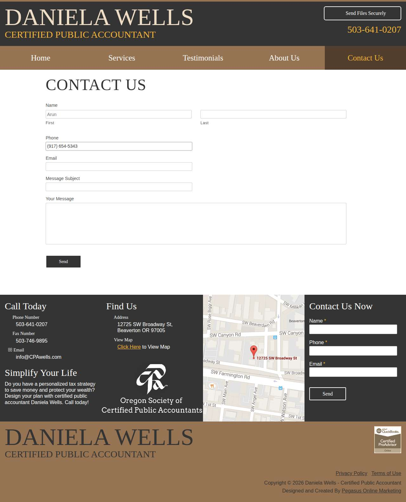

### howestax.com — unclear (LIVE)

| | |
|---|---|
| Attempt ID | `36afccf1-1443-4c48-98c0-3666fb92cb3e` |
| Form URL | https://www.howestax.com/contact-us |
| Final URL | https://www.howestax.com/contact-us |
| Reserved | 2026-11-04 05:42:17 UTC |
| Submit attempted | 2026-11-04 05:42:19 UTC |
| Template | standard v2 |
| Confirmation text | none observed |
| Result / error | No new success marker observed |

Exact message:

~~~text
Subject: Helping customers find your business in AI search (AEO + GEO)

Hi there,

I'm Arun from Devs Arun. More and more customers now ask ChatGPT, Gemini, Perplexity or Google's AI Overviews questions like "who should I hire for this in my area?" before they call anyone. These tools answer from websites they can clearly understand, and they tend to recommend businesses whose pages answer real customer questions.

That is what AEO + GEO (Answer Engine and Generative Engine Optimization) is for. I improve your existing service pages so they clearly answer the questions your customers ask, add structured data that matches the page, and make the call, quote or enquiry step obvious. The benefit: your business gets a better chance of being mentioned or linked in AI answers, and visitors who arrive find it easy to contact you.

The AEO + GEO Starter is a one-time $199 (about ₹16,999, negotiable) for one website: a basic audit, 10 customer questions, improvements to two existing pages, relevant structured data and an action plan, with one revision round.

You can read the full details, send an enquiry or book online here:
https://devsarun.io/aeo-geo/

If this isn't relevant, just reply and I won't contact you again.

Best,
Arun
Devs Arun
itschool408@gmail.com · +91 7654534323
~~~

Submitted field values:

- email \[email\]: itschool408@gmail.com
- name-\* \[name\]: Arun
- phone \[phone\]: +91 7654534323
- Message \* \[message\]: Hi there, I'm Arun from Devs Arun. More and more customers now ask ChatGPT, Gemini, Perplexity or Google's AI Overviews 

**Filled form (before submit)** — `run-6f3ce812_attempt-36afccf1_filled_2026-11-04T05-42-19-974Z.jpg`

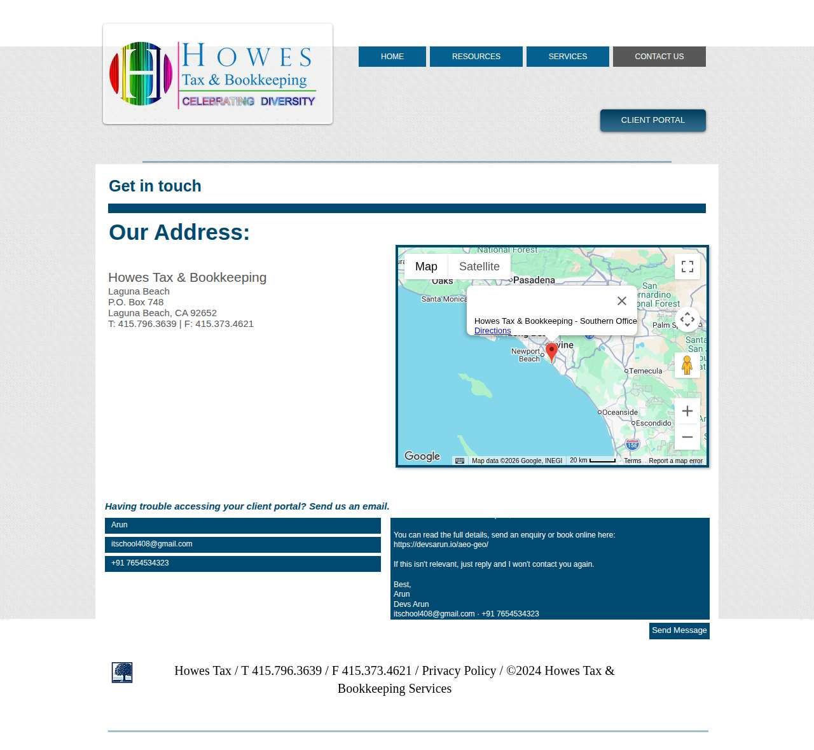

**After submit** — `run-6f3ce812_attempt-36afccf1_post_attempt_2026-11-04T05-42-48-327Z.jpg`

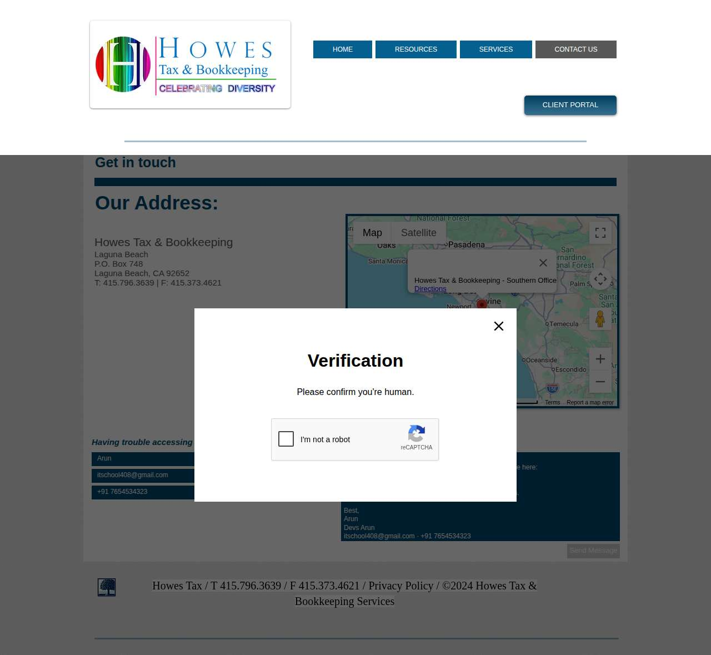

### asamoahcpa.com — unclear (LIVE)

| | |
|---|---|
| Attempt ID | `e8450ec9-f857-408c-bc4a-3f39275713f0` |
| Form URL | https://asamoacpa.com/contacts/index.html |
| Final URL | https://asamoacpa.com/contacts/index.html |
| Reserved | 2026-11-04 05:42:56 UTC |
| Submit attempted | 2026-11-04 05:42:58 UTC |
| Template | standard v2 |
| Confirmation text | none observed |
| Result / error | No new success marker observed |

Exact message:

~~~text
Subject: Helping customers find your business in AI search (AEO + GEO)

Hi there,

I'm Arun from Devs Arun. More and more customers now ask ChatGPT, Gemini, Perplexity or Google's AI Overviews questions like "who should I hire for this in my area?" before they call anyone. These tools answer from websites they can clearly understand, and they tend to recommend businesses whose pages answer real customer questions.

That is what AEO + GEO (Answer Engine and Generative Engine Optimization) is for. I improve your existing service pages so they clearly answer the questions your customers ask, add structured data that matches the page, and make the call, quote or enquiry step obvious. The benefit: your business gets a better chance of being mentioned or linked in AI answers, and visitors who arrive find it easy to contact you.

The AEO + GEO Starter is a one-time $199 (about ₹16,999, negotiable) for one website: a basic audit, 10 customer questions, improvements to two existing pages, relevant structured data and an action plan, with one revision round.

You can read the full details, send an enquiry or book online here:
https://devsarun.io/aeo-geo/

If this isn't relevant, just reply and I won't contact you again.

Best,
Arun
Devs Arun
itschool408@gmail.com · +91 7654534323
~~~

Submitted field values:

- tm\_pb\_contact\_name\_1 \[name\]: Arun
- tm\_pb\_contact\_email\_1 \[email\]: itschool408@gmail.com
- tm\_pb\_contact\_message\_1 \[message\]: Hi there, I'm Arun from Devs Arun. More and more customers now ask ChatGPT, Gemini, Perplexity or Google's AI Overviews 

**Filled form (before submit)** — `run-6f3ce812_attempt-e8450ec9_filled_2026-11-04T05-42-58-724Z.jpg`

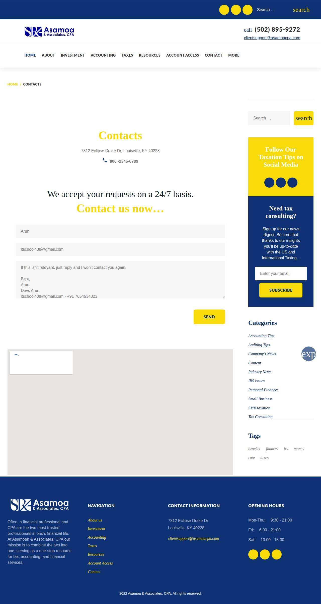

**After submit** — `run-6f3ce812_attempt-e8450ec9_post_attempt_2026-11-04T05-43-26-946Z.jpg`

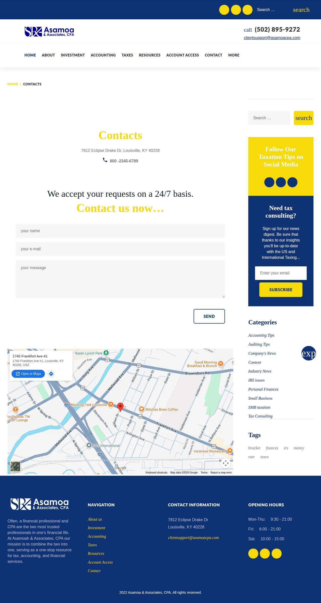

### irvinabrahamson.com — confirmed (LIVE)

| | |
|---|---|
| Attempt ID | `e02fa3ea-c6cd-4b8f-9f67-134e74494bdc` |
| Form URL | https://www.irvinabrahamson.com/contact |
| Final URL | https://www.irvinabrahamson.com/ |
| Reserved | 2026-11-04 05:43:35 UTC |
| Submit attempted | 2026-11-04 05:43:38 UTC |
| Template | standard v2 |
| Confirmation text | Services Resources Contact Client Login STATUS MESSAGE Your message has been sent. × Previous Slide ◀︎ Next Slide ▶︎ SERVING PALO ALTO AND THE LOCAL COMMUNITY FOR OVER 55 YEARS WE O |
| Result / error | — |

Exact message:

~~~text
Subject: Helping customers find your business in AI search (AEO + GEO)

Hi there,

I'm Arun from Devs Arun. More and more customers now ask ChatGPT, Gemini, Perplexity or Google's AI Overviews questions like "who should I hire for this in my area?" before they call anyone. These tools answer from websites they can clearly understand, and they tend to recommend businesses whose pages answer real customer questions.

That is what AEO + GEO (Answer Engine and Generative Engine Optimization) is for. I improve your existing service pages so they clearly answer the questions your customers ask, add structured data that matches the page, and make the call, quote or enquiry step obvious. The benefit: your business gets a better chance of being mentioned or linked in AI answers, and visitors who arrive find it easy to contact you.

The AEO + GEO Starter is a one-time $199 (about ₹16,999, negotiable) for one website: a basic audit, 10 customer questions, improvements to two existing pages, relevant structured data and an action plan, with one revision round.

You can read the full details, send an enquiry or book online here:
https://devsarun.io/aeo-geo/

If this isn't relevant, just reply and I won't contact you again.

Best,
Arun
Devs Arun
itschool408@gmail.com · +91 7654534323
~~~

Submitted field values:

- Your name This field is required. \[name\]: Arun
- Message This field is required. \[message\]: Hi there, I'm Arun from Devs Arun. More and more customers now ask ChatGPT, Gemini, Perplexity or Google's AI Overviews 
- Subject This field is required. \[subject\]: Helping customers find your business in AI search (AEO + GEO)
- Your email address This field is required. \[email\]: itschool408@gmail.com

**Filled form (before submit)** — `run-6f3ce812_attempt-e02fa3ea_filled_2026-11-04T05-43-38-438Z.jpg`

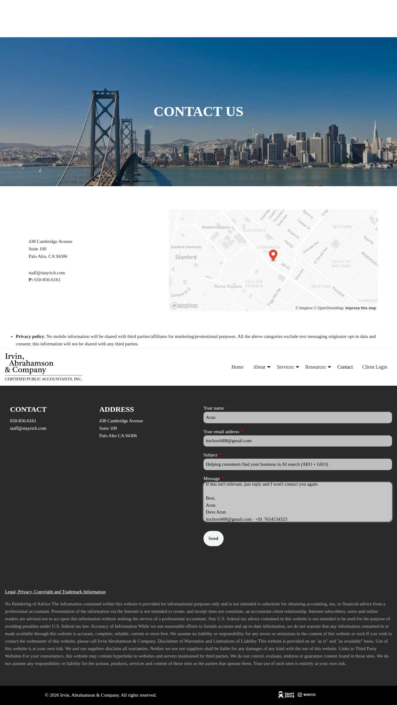

**After submit** — `run-6f3ce812_attempt-e02fa3ea_post_attempt_2026-11-04T05-43-44-563Z.jpg`

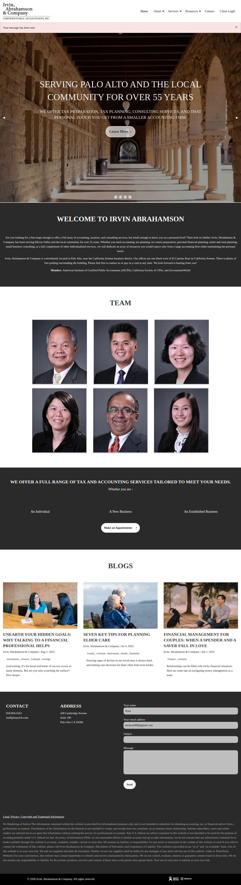

### pvttaxaccounting.com — unclear (LIVE)

| | |
|---|---|
| Attempt ID | `c2130f8f-7d50-463f-9c08-531c9e75d6fa` |
| Form URL | https://www.pvttaxaccounting.com/contact |
| Final URL | https://www.pvttaxaccounting.com/contact |
| Reserved | 2026-11-04 05:43:52 UTC |
| Submit attempted | 2026-11-04 05:43:55 UTC |
| Template | standard v2 |
| Confirmation text | none observed |
| Result / error | No new success marker observed |

Exact message:

~~~text
Subject: Helping customers find your business in AI search (AEO + GEO)

Hi there,

I'm Arun from Devs Arun. More and more customers now ask ChatGPT, Gemini, Perplexity or Google's AI Overviews questions like "who should I hire for this in my area?" before they call anyone. These tools answer from websites they can clearly understand, and they tend to recommend businesses whose pages answer real customer questions.

That is what AEO + GEO (Answer Engine and Generative Engine Optimization) is for. I improve your existing service pages so they clearly answer the questions your customers ask, add structured data that matches the page, and make the call, quote or enquiry step obvious. The benefit: your business gets a better chance of being mentioned or linked in AI answers, and visitors who arrive find it easy to contact you.

The AEO + GEO Starter is a one-time $199 (about ₹16,999, negotiable) for one website: a basic audit, 10 customer questions, improvements to two existing pages, relevant structured data and an action plan, with one revision round.

You can read the full details, send an enquiry or book online here:
https://devsarun.io/aeo-geo/

If this isn't relevant, just reply and I won't contact you again.

Best,
Arun
Devs Arun
itschool408@gmail.com · +91 7654534323
~~~

Submitted field values:

- Name \[name\]: Arun
- Email \[email\]: itschool408@gmail.com
- Phone \[phone\]: +91 7654534323
- Message \[message\]: Hi there, I'm Arun from Devs Arun. More and more customers now ask ChatGPT, Gemini, Perplexity or Google's AI Overviews 
- Subject \[subject\]: Helping customers find your business in AI search (AEO + GEO)

**Filled form (before submit)** — `run-6f3ce812_attempt-c2130f8f_filled_2026-11-04T05-43-55-428Z.jpg`

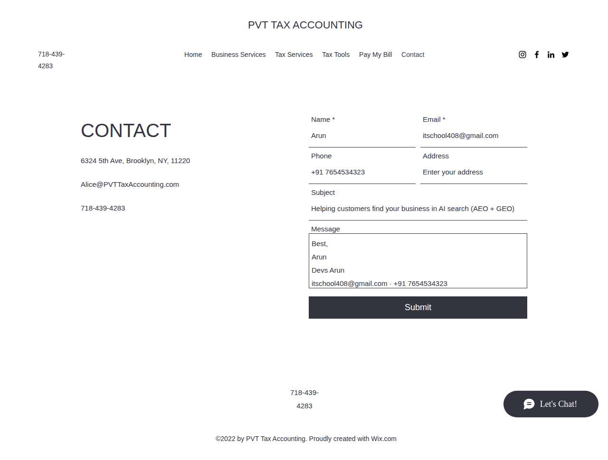

**After submit** — `run-6f3ce812_attempt-c2130f8f_post_attempt_2026-11-04T05-44-31-314Z.jpg`

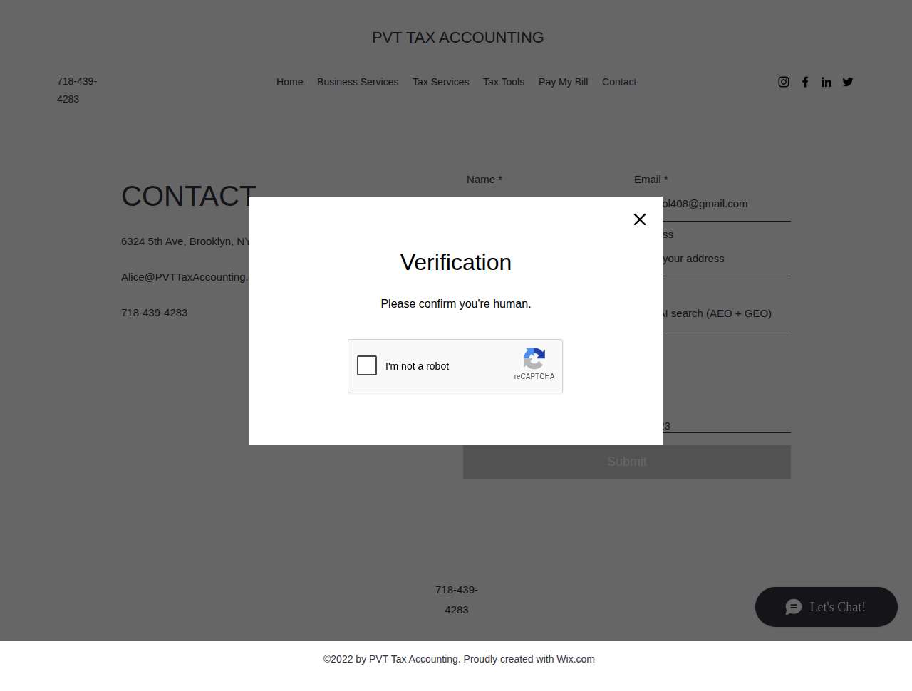

### kzcpas.com — confirmed (LIVE)

| | |
|---|---|
| Attempt ID | `7c02aa24-9241-4898-965a-15f069b43d4e` |
| Form URL | https://www.kzcpas.com/\#contact |
| Final URL | https://www.kzcpas.com/\#contact |
| Reserved | 2026-11-04 05:44:39 UTC |
| Submit attempted | 2026-11-04 05:44:42 UTC |
| Template | standard v2 |
| Confirmation text | lvd W. Syracuse, NY 13204 (315) 299-5247 Send us a message\! Thank you for your message. It has been sent. Your name Your email Subject Your message (optional) Thank you for your message. |
| Result / error | — |

Exact message:

~~~text
Subject: Helping customers find your business in AI search (AEO + GEO)

Hi there,

I'm Arun from Devs Arun. More and more customers now ask ChatGPT, Gemini, Perplexity or Google's AI Overviews questions like "who should I hire for this in my area?" before they call anyone. These tools answer from websites they can clearly understand, and they tend to recommend businesses whose pages answer real customer questions.

That is what AEO + GEO (Answer Engine and Generative Engine Optimization) is for. I improve your existing service pages so they clearly answer the questions your customers ask, add structured data that matches the page, and make the call, quote or enquiry step obvious. The benefit: your business gets a better chance of being mentioned or linked in AI answers, and visitors who arrive find it easy to contact you.

The AEO + GEO Starter is a one-time $199 (about ₹16,999, negotiable) for one website: a basic audit, 10 customer questions, improvements to two existing pages, relevant structured data and an action plan, with one revision round.

You can read the full details, send an enquiry or book online here:
https://devsarun.io/aeo-geo/

If this isn't relevant, just reply and I won't contact you again.

Best,
Arun
Devs Arun
itschool408@gmail.com · +91 7654534323
~~~

Submitted field values:

- Your name \[name\]: Arun
- Subject \[subject\]: Helping customers find your business in AI search (AEO + GEO)
- Your email \[email\]: itschool408@gmail.com
- Your message (optional) \[message\]: Hi there, I'm Arun from Devs Arun. More and more customers now ask ChatGPT, Gemini, Perplexity or Google's AI Overviews 

**Filled form (before submit)** — `run-6f3ce812_attempt-7c02aa24_filled_2026-11-04T05-44-42-575Z.jpg`

**After submit** — `run-6f3ce812_attempt-7c02aa24_post_attempt_2026-11-04T05-44-46-772Z.jpg`

### cpa-utah.com — error\_after\_submit (LIVE)

| | |
|---|---|
| Attempt ID | `d51d46a8-bd19-42c4-b6bd-ef3e39091c43` |
| Form URL | http://cpa-utah.com/contact-us/ |
| Final URL | http://cpa-utah.com/contact-us/ |
| Reserved | 2026-11-04 05:44:54 UTC |
| Submit attempted | 2026-11-04 05:44:57 UTC |
| Template | standard v2 |
| Confirmation text | ow and we will contact you shortly to discuss your project. Failed to send your message. Please try later or contact the administrator by another method. Failed to send your |
| Result / error | — |

Exact message:

~~~text
Subject: Helping customers find your business in AI search (AEO + GEO)

Hi there,

I'm Arun from Devs Arun. More and more customers now ask ChatGPT, Gemini, Perplexity or Google's AI Overviews questions like "who should I hire for this in my area?" before they call anyone. These tools answer from websites they can clearly understand, and they tend to recommend businesses whose pages answer real customer questions.

That is what AEO + GEO (Answer Engine and Generative Engine Optimization) is for. I improve your existing service pages so they clearly answer the questions your customers ask, add structured data that matches the page, and make the call, quote or enquiry step obvious. The benefit: your business gets a better chance of being mentioned or linked in AI answers, and visitors who arrive find it easy to contact you.

The AEO + GEO Starter is a one-time $199 (about ₹16,999, negotiable) for one website: a basic audit, 10 customer questions, improvements to two existing pages, relevant structured data and an action plan, with one revision round.

You can read the full details, send an enquiry or book online here:
https://devsarun.io/aeo-geo/

If this isn't relevant, just reply and I won't contact you again.

Best,
Arun
Devs Arun
itschool408@gmail.com · +91 7654534323
~~~

Submitted field values:

- your-email \[email\]: itschool408@gmail.com
- your-phone \[phone\]: +91 7654534323
- your-message \[message\]: Hi there, I'm Arun from Devs Arun. More and more customers now ask ChatGPT, Gemini, Perplexity or Google's AI Overviews 
- your-name \[first\_name\]: Arun
- your-subject \[subject\]: Helping customers find your business in AI search (AEO + GEO)

**Filled form (before submit)** — `run-6f3ce812_attempt-d51d46a8_filled_2026-11-04T05-44-57-283Z.jpg`

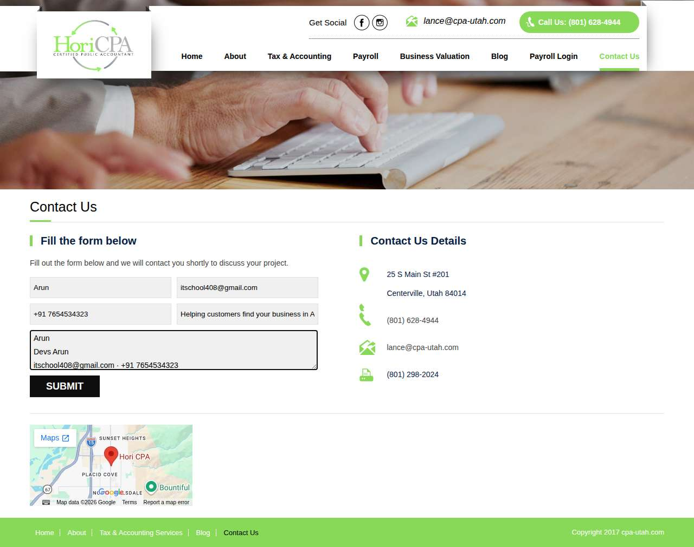

**After submit** — `run-6f3ce812_attempt-d51d46a8_post_attempt_2026-11-04T05-45-01-248Z.jpg`

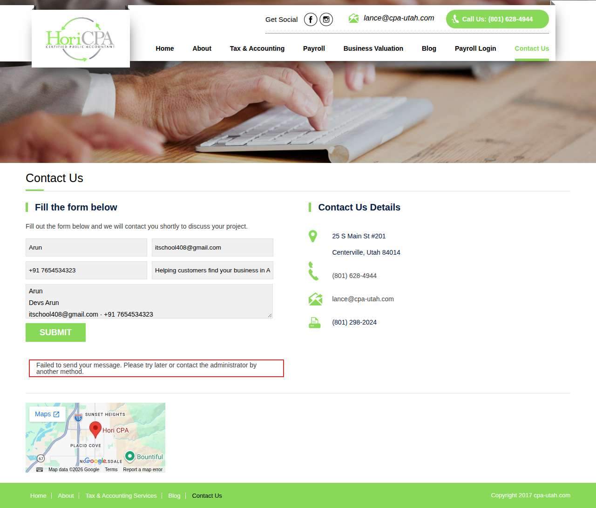

### cpanw.com — confirmed (LIVE)

| | |
|---|---|
| Attempt ID | `45c0c0e7-02b7-4047-997b-306506937737` |
| Form URL | https://www.cpanw.com/contact |
| Final URL | https://www.cpanw.com/ |
| Reserved | 2026-11-04 05:45:09 UTC |
| Submit attempted | 2026-11-04 05:45:11 UTC |
| Template | standard v2 |
| Confirmation text | OUR SERVICES OUR TEAM RESOURCES CONTACT Status message Your message has been sent. × Achieving success through insight, integrity, and collaboration. About Us We are a team of finan |
| Result / error | — |

Exact message:

~~~text
Subject: Helping customers find your business in AI search (AEO + GEO)

Hi there,

I'm Arun from Devs Arun. More and more customers now ask ChatGPT, Gemini, Perplexity or Google's AI Overviews questions like "who should I hire for this in my area?" before they call anyone. These tools answer from websites they can clearly understand, and they tend to recommend businesses whose pages answer real customer questions.

That is what AEO + GEO (Answer Engine and Generative Engine Optimization) is for. I improve your existing service pages so they clearly answer the questions your customers ask, add structured data that matches the page, and make the call, quote or enquiry step obvious. The benefit: your business gets a better chance of being mentioned or linked in AI answers, and visitors who arrive find it easy to contact you.

The AEO + GEO Starter is a one-time $199 (about ₹16,999, negotiable) for one website: a basic audit, 10 customer questions, improvements to two existing pages, relevant structured data and an action plan, with one revision round.

You can read the full details, send an enquiry or book online here:
https://devsarun.io/aeo-geo/

If this isn't relevant, just reply and I won't contact you again.

Best,
Arun
Devs Arun
itschool408@gmail.com · +91 7654534323
~~~

Submitted field values:

- Your name This field is required. \[name\]: Arun
- Message This field is required. \[message\]: Hi there, I'm Arun from Devs Arun. More and more customers now ask ChatGPT, Gemini, Perplexity or Google's AI Overviews 
- Subject This field is required. \[subject\]: Helping customers find your business in AI search (AEO + GEO)
- Your email address This field is required. \[email\]: itschool408@gmail.com

**Filled form (before submit)** — `run-6f3ce812_attempt-45c0c0e7_filled_2026-11-04T05-45-11-507Z.jpg`

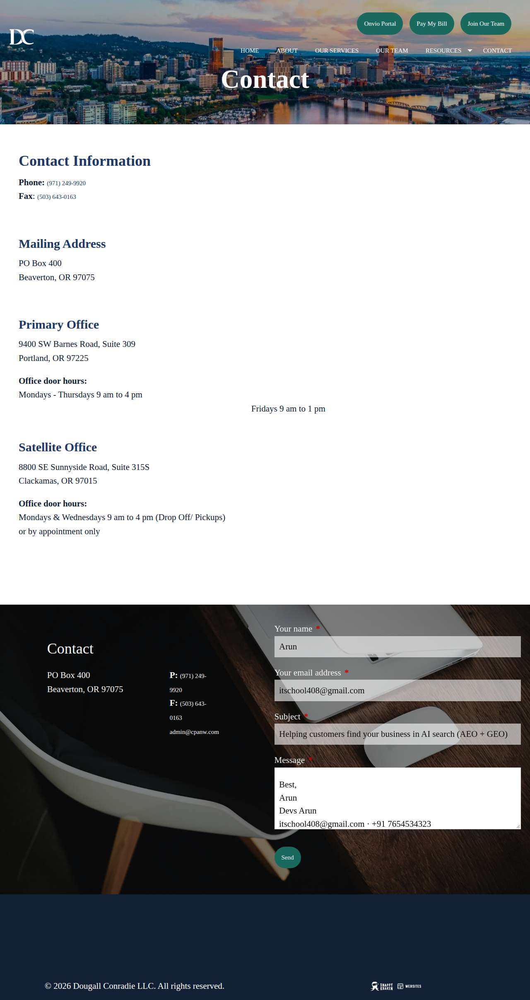

**After submit** — `run-6f3ce812_attempt-45c0c0e7_post_attempt_2026-11-04T05-45-17-765Z.jpg`

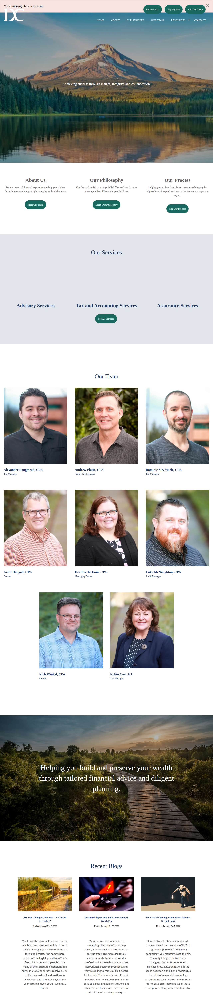

### fi-team.com — unclear (LIVE)

| | |
|---|---|
| Attempt ID | `0cf71011-249e-4a0e-bda9-0a80a4dba110` |
| Form URL | https://fi-team.com/contact |
| Final URL | https://fi-team.com/contact |
| Reserved | 2026-11-04 05:45:25 UTC |
| Submit attempted | 2026-11-04 05:45:28 UTC |
| Template | standard v2 |
| Confirmation text | none observed |
| Result / error | No new success marker observed |

Exact message:

~~~text
Subject: Helping customers find your business in AI search (AEO + GEO)

Hi there,

I'm Arun from Devs Arun. More and more customers now ask ChatGPT, Gemini, Perplexity or Google's AI Overviews questions like "who should I hire for this in my area?" before they call anyone. These tools answer from websites they can clearly understand, and they tend to recommend businesses whose pages answer real customer questions.

That is what AEO + GEO (Answer Engine and Generative Engine Optimization) is for. I improve your existing service pages so they clearly answer the questions your customers ask, add structured data that matches the page, and make the call, quote or enquiry step obvious. The benefit: your business gets a better chance of being mentioned or linked in AI answers, and visitors who arrive find it easy to contact you.

The AEO + GEO Starter is a one-time $199 (about ₹16,999, negotiable) for one website: a basic audit, 10 customer questions, improvements to two existing pages, relevant structured data and an action plan, with one revision round.

You can read the full details, send an enquiry or book online here:
https://devsarun.io/aeo-geo/

If this isn't relevant, just reply and I won't contact you again.

Best,
Arun
Devs Arun
itschool408@gmail.com · +91 7654534323
~~~

Submitted field values:

- NAME \[name\]: Arun
- EMAIL \[email\]: itschool408@gmail.com
- PHONE \[phone\]: +91 7654534323
- MESSAGE \[message\]: Hi there, I'm Arun from Devs Arun. More and more customers now ask ChatGPT, Gemini, Perplexity or Google's AI Overviews 

**Filled form (before submit)** — `run-6f3ce812_attempt-0cf71011_filled_2026-11-04T05-45-27-999Z.jpg`

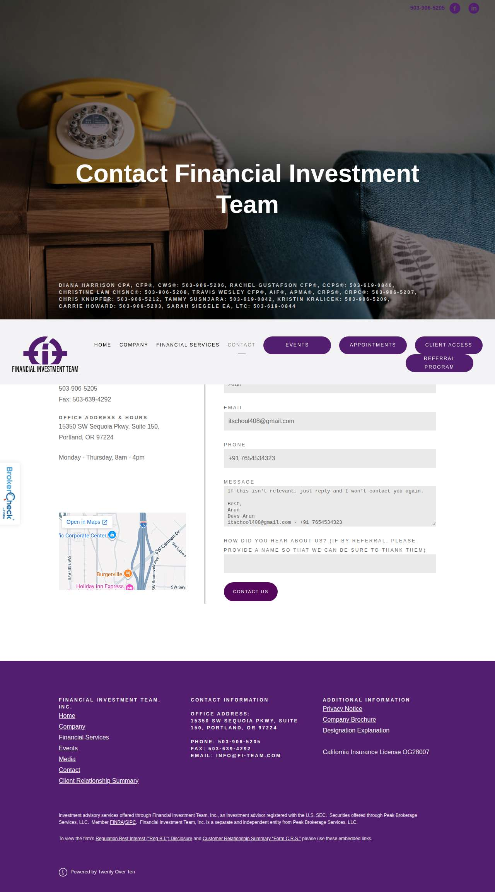

**After submit** — `run-6f3ce812_attempt-0cf71011_post_attempt_2026-11-04T05-45-56-136Z.jpg`

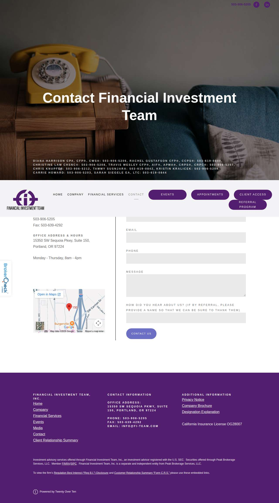

### besprofessionalservices.com — failed\_before\_submit (LIVE)

| | |
|---|---|
| Attempt ID | `3a56ce4e-0327-44db-ba93-348da99e6f6d` |
| Form URL | https://www.besps.com/ |
| Final URL | https://www.besps.com/ |
| Reserved | 2026-11-04 05:46:04 UTC |
| Submit attempted | — |
| Template | standard v2 |
| Confirmation text | none observed |
| Result / error | Form validation would block sending: : Please check this box if you want to proceed.; : Please check this box if you want to proceed. |

Exact message:

~~~text
Subject: Helping customers find your business in AI search (AEO + GEO)

Hi there,

I'm Arun from Devs Arun. More and more customers now ask ChatGPT, Gemini, Perplexity or Google's AI Overviews questions like "who should I hire for this in my area?" before they call anyone. These tools answer from websites they can clearly understand, and they tend to recommend businesses whose pages answer real customer questions.

That is what AEO + GEO (Answer Engine and Generative Engine Optimization) is for. I improve your existing service pages so they clearly answer the questions your customers ask, add structured data that matches the page, and make the call, quote or enquiry step obvious. The benefit: your business gets a better chance of being mentioned or linked in AI answers, and visitors who arrive find it easy to contact you.

The AEO + GEO Starter is a one-time $199 (about ₹16,999, negotiable) for one website: a basic audit, 10 customer questions, improvements to two existing pages, relevant structured data and an action plan, with one revision round.

You can read the full details, send an enquiry or book online here:
https://devsarun.io/aeo-geo/

If this isn't relevant, just reply and I won't contact you again.

Best,
Arun
Devs Arun
itschool408@gmail.com · +91 7654534323
~~~

Submitted field values:

- \#input\_comp-jkmdcbph: itschool408@gmail.com
- \#input\_comp-jkmdcbpi: +91 7654534323
- \#input\_comp-jkmdcbpm1: Arun
- \#textarea\_comp-jkmdcbpm: Hi there, I'm Arun from Devs Arun. More and more customers now ask ChatGPT, Gemini, Perplexity or Google's AI Overviews 

**Filled form (before submit)** — `run-6f3ce812_attempt-3a56ce4e_filled_2026-11-04T05-46-07-308Z.jpg`

### abletaxllc.com — unclear (LIVE)

| | |
|---|---|
| Attempt ID | `3aa1b34b-86e6-4dad-9a94-45f05cf5ab3f` |
| Form URL | https://www.abletaxllc.com/contact |
| Final URL | https://www.abletaxllc.com/contact |
| Reserved | 2026-11-04 05:46:12 UTC |
| Submit attempted | 2026-11-04 05:46:15 UTC |
| Template | standard v2 |
| Confirmation text | none observed |
| Result / error | No new success marker observed |

Exact message:

~~~text
Subject: Helping customers find your business in AI search (AEO + GEO)

Hi there,

I'm Arun from Devs Arun. More and more customers now ask ChatGPT, Gemini, Perplexity or Google's AI Overviews questions like "who should I hire for this in my area?" before they call anyone. These tools answer from websites they can clearly understand, and they tend to recommend businesses whose pages answer real customer questions.

That is what AEO + GEO (Answer Engine and Generative Engine Optimization) is for. I improve your existing service pages so they clearly answer the questions your customers ask, add structured data that matches the page, and make the call, quote or enquiry step obvious. The benefit: your business gets a better chance of being mentioned or linked in AI answers, and visitors who arrive find it easy to contact you.

The AEO + GEO Starter is a one-time $199 (about ₹16,999, negotiable) for one website: a basic audit, 10 customer questions, improvements to two existing pages, relevant structured data and an action plan, with one revision round.

You can read the full details, send an enquiry or book online here:
https://devsarun.io/aeo-geo/

If this isn't relevant, just reply and I won't contact you again.

Best,
Arun
Devs Arun
itschool408@gmail.com · +91 7654534323
~~~

Submitted field values:

- Email \[email\]: itschool408@gmail.com
- Message \[message\]: Hi there, I'm Arun from Devs Arun. More and more customers now ask ChatGPT, Gemini, Perplexity or Google's AI Overviews 

**Filled form (before submit)** — `run-6f3ce812_attempt-3aa1b34b_filled_2026-11-04T05-46-15-285Z.jpg`

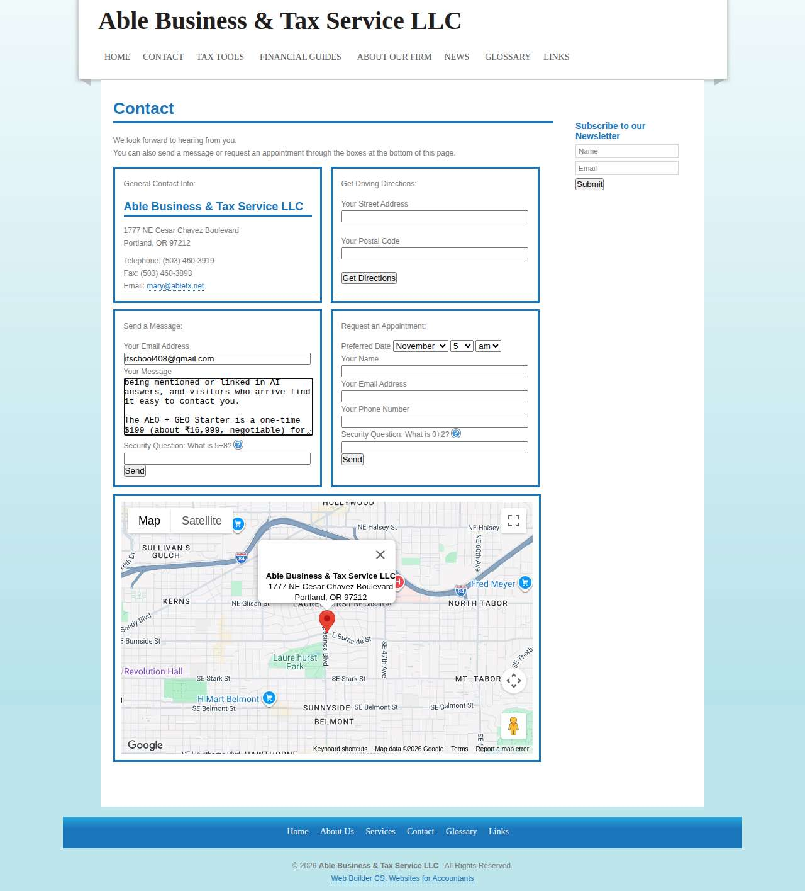

**After submit** — `run-6f3ce812_attempt-3aa1b34b_post_attempt_2026-11-04T05-46-43-585Z.jpg`

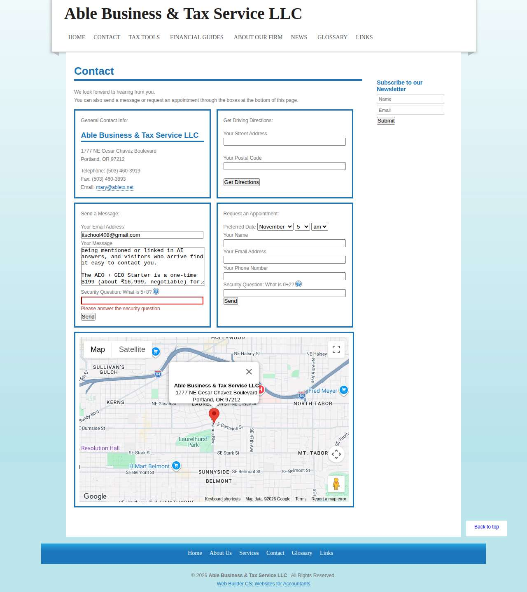

### loiaconofirm.com — error\_after\_submit (LIVE)

| | |
|---|---|
| Attempt ID | `0182b17a-a93b-4443-9ae1-2e56ccb39fee` |
| Form URL | https://www.loiaconofirm.com/rome-ny-location |
| Final URL | https://www.loiaconofirm.com/rome-ny-location |
| Reserved | 2026-11-04 05:46:51 UTC |
| Submit attempted | 2026-11-04 05:46:55 UTC |
| Template | standard v2 |
| Confirmation text | none observed |
| Result / error | Submit click error (outcome unknown, not retried): locator.click: Timeout 10000ms exceeded. |

Exact message:

~~~text
Subject: Helping customers find your business in AI search (AEO + GEO)

Hi there,

I'm Arun from Devs Arun. More and more customers now ask ChatGPT, Gemini, Perplexity or Google's AI Overviews questions like "who should I hire for this in my area?" before they call anyone. These tools answer from websites they can clearly understand, and they tend to recommend businesses whose pages answer real customer questions.

That is what AEO + GEO (Answer Engine and Generative Engine Optimization) is for. I improve your existing service pages so they clearly answer the questions your customers ask, add structured data that matches the page, and make the call, quote or enquiry step obvious. The benefit: your business gets a better chance of being mentioned or linked in AI answers, and visitors who arrive find it easy to contact you.

The AEO + GEO Starter is a one-time $199 (about ₹16,999, negotiable) for one website: a basic audit, 10 customer questions, improvements to two existing pages, relevant structured data and an action plan, with one revision round.

You can read the full details, send an enquiry or book online here:
https://devsarun.io/aeo-geo/

If this isn't relevant, just reply and I won't contact you again.

Best,
Arun
Devs Arun
itschool408@gmail.com · +91 7654534323
~~~

Submitted field values:

- Name: \[name\]: Arun
- Email: \[email\]: itschool408@gmail.com
- Phone: \[phone\]: +91 7654534323
- Message: \[message\]: Hi there, I'm Arun from Devs Arun. More and more customers now ask ChatGPT, Gemini, Perplexity or Google's AI Overviews 

**Filled form (before submit)** — `run-6f3ce812_attempt-0182b17a_filled_2026-11-04T05-46-55-211Z.jpg`

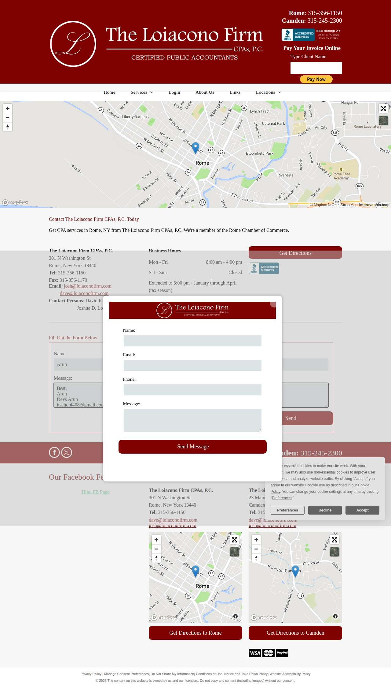

**After submit** — `run-6f3ce812_attempt-0182b17a_post_attempt_2026-11-04T05-47-08-283Z.jpg`

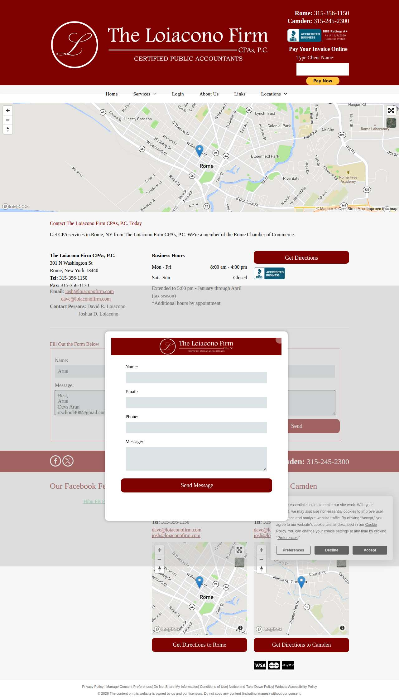

## Events (152)

| Time (UTC) | Event | Website | Details |
|---|---|---|---|
| 05:38:13 | run\_queued | — | live run requested by github:itsDevsArun |
| 05:38:13 | run\_dispatched | — | dispatch disabled (local test mode) |
| 05:38:17 | run\_started | — | Runner claimed live run |
| 05:38:18 | offer\_verified | — | Service page offer facts verified |
| 05:38:18 | website\_selected | clearchoiceplumbingllc.com | Live target clearchoiceplumbingllc.com |
| 05:38:18 | attempt\_reserved | clearchoiceplumbingllc.com | Submission attempt reserved with template standard v2 |
| 05:38:19 | page\_opened | clearchoiceplumbingllc.com | Opened form page |
| 05:38:20 | screenshot\_saved | clearchoiceplumbingllc.com | inspection screenshot saved (145 KB) |
| 05:38:20 | review\_required | clearchoiceplumbingllc.com | failed before submit: locator.fill: Error: Cannot type text into input\[type=number\] |
| 05:38:25 | website\_selected | bwnwincpainting.com | Live target bwnwincpainting.com |
| 05:38:25 | attempt\_reserved | bwnwincpainting.com | Submission attempt reserved with template standard v2 |
| 05:38:27 | page\_opened | bwnwincpainting.com | Opened form page |
| 05:38:27 | screenshot\_saved | bwnwincpainting.com | inspection screenshot saved (118 KB) |
| 05:38:27 | review\_required | bwnwincpainting.com | failed before submit: locator.fill: Error: Cannot type text into input\[type=number\] |
| 05:38:32 | website\_selected | absoluterestorepa.com | Live target absoluterestorepa.com |
| 05:38:32 | attempt\_reserved | absoluterestorepa.com | Submission attempt reserved with template standard v2 |
| 05:38:34 | page\_opened | absoluterestorepa.com | Opened form page |
| 05:38:35 | screenshot\_saved | absoluterestorepa.com | inspection screenshot saved (175 KB) |
| 05:38:35 | review\_required | absoluterestorepa.com | failed before submit: locator.fill: Error: Cannot type text into input\[type=number\] |
| 05:38:40 | website\_selected | masoudlawfirm.com | Live target masoudlawfirm.com |
| 05:38:40 | attempt\_reserved | masoudlawfirm.com | Submission attempt reserved with template standard v2 |
| 05:38:42 | page\_opened | masoudlawfirm.com | Opened form page |
| 05:38:42 | screenshot\_saved | masoudlawfirm.com | inspection screenshot saved (168 KB) |
| 05:38:42 | review\_required | masoudlawfirm.com | failed before submit: locator.fill: Error: Cannot type text into input\[type=number\] |
| 05:38:47 | website\_selected | accidentattorneysvermont.com | Live target accidentattorneysvermont.com |
| 05:38:47 | attempt\_reserved | accidentattorneysvermont.com | Submission attempt reserved with template standard v2 |
| 05:38:54 | page\_opened | accidentattorneysvermont.com | Opened form page |
| 05:38:54 | fields\_filled | accidentattorneysvermont.com | filled |
| 05:38:54 | screenshot\_saved | accidentattorneysvermont.com | filled screenshot saved (124 KB) |
| 05:38:54 | submit\_attempted | accidentattorneysvermont.com | submitting |
| 05:39:30 | screenshot\_saved | accidentattorneysvermont.com | post\_attempt screenshot saved (127 KB) |
| 05:39:30 | review\_required | accidentattorneysvermont.com | unclear: No new success marker observed |
| 05:39:38 | website\_selected | etinarilaw.com | Live target etinarilaw.com |
| 05:39:38 | attempt\_reserved | etinarilaw.com | Submission attempt reserved with template standard v2 |
| 05:39:40 | page\_opened | etinarilaw.com | Opened form page |
| 05:39:40 | fields\_filled | etinarilaw.com | filled |
| 05:39:40 | screenshot\_saved | etinarilaw.com | filled screenshot saved (252 KB) |
| 05:39:40 | submit\_attempted | etinarilaw.com | submitting |
| 05:40:09 | screenshot\_saved | etinarilaw.com | post\_attempt screenshot saved (450 KB) |
| 05:40:09 | review\_required | etinarilaw.com | unclear: No new success marker observed |
| 05:40:17 | website\_selected | thechesnuttlawfirm.com | Live target thechesnuttlawfirm.com |
| 05:40:17 | attempt\_reserved | thechesnuttlawfirm.com | Submission attempt reserved with template standard v2 |
| 05:40:21 | page\_opened | thechesnuttlawfirm.com | Opened form page |
| 05:40:21 | fields\_filled | thechesnuttlawfirm.com | filled |
| 05:40:21 | screenshot\_saved | thechesnuttlawfirm.com | filled screenshot saved (255 KB) |
| 05:40:21 | submit\_attempted | thechesnuttlawfirm.com | submitting |
| 05:40:58 | screenshot\_saved | thechesnuttlawfirm.com | post\_attempt screenshot saved (255 KB) |
| 05:40:58 | review\_required | thechesnuttlawfirm.com | unclear: No new success marker observed |
| 05:41:06 | website\_selected | shayandassociates.com | Live target shayandassociates.com |
| 05:41:06 | attempt\_reserved | shayandassociates.com | Submission attempt reserved with template standard v2 |
| 05:41:10 | page\_opened | shayandassociates.com | Opened form page |
| 05:41:10 | fields\_filled | shayandassociates.com | filled |
| 05:41:11 | screenshot\_saved | shayandassociates.com | filled screenshot saved (107 KB) |
| 05:41:11 | submit\_attempted | shayandassociates.com | submitting |
| 05:41:47 | screenshot\_saved | shayandassociates.com | post\_attempt screenshot saved (87 KB) |
| 05:41:47 | review\_required | shayandassociates.com | unclear: No new success marker observed |
| 05:41:55 | website\_selected | thomasessexlaw.com | Live target thomasessexlaw.com |
| 05:41:55 | attempt\_reserved | thomasessexlaw.com | Submission attempt reserved with template standard v2 |
| 05:41:56 | page\_opened | thomasessexlaw.com | Opened form page |
| 05:41:56 | screenshot\_saved | thomasessexlaw.com | filled screenshot saved (166 KB) |
| 05:41:56 | review\_required | thomasessexlaw.com | failed before submit: Form validation would block sending: disclaimer\[0\]: Please check this box if you want to proceed. |
| 05:42:01 | website\_selected | cpawells.com | Live target cpawells.com |
| 05:42:01 | attempt\_reserved | cpawells.com | Submission attempt reserved with template standard v2 |
| 05:42:11 | page\_opened | cpawells.com | Opened form page |
| 05:42:11 | screenshot\_saved | cpawells.com | filled screenshot saved (108 KB) |
| 05:42:12 | review\_required | cpawells.com | failed before submit: Field "Phone" did not accept the value |
| 05:42:17 | website\_selected | howestax.com | Live target howestax.com |
| 05:42:17 | attempt\_reserved | howestax.com | Submission attempt reserved with template standard v2 |
| 05:42:19 | page\_opened | howestax.com | Opened form page |
| 05:42:19 | fields\_filled | howestax.com | filled |
| 05:42:19 | screenshot\_saved | howestax.com | filled screenshot saved (100 KB) |
| 05:42:19 | submit\_attempted | howestax.com | submitting |
| 05:42:48 | screenshot\_saved | howestax.com | post\_attempt screenshot saved (67 KB) |
| 05:42:48 | review\_required | howestax.com | unclear: No new success marker observed |
| 05:42:56 | website\_selected | asamoahcpa.com | Live target asamoahcpa.com |
| 05:42:56 | attempt\_reserved | asamoahcpa.com | Submission attempt reserved with template standard v2 |
| 05:42:58 | page\_opened | asamoahcpa.com | Opened form page |
| 05:42:58 | fields\_filled | asamoahcpa.com | filled |
| 05:42:58 | screenshot\_saved | asamoahcpa.com | filled screenshot saved (127 KB) |
| 05:42:58 | submit\_attempted | asamoahcpa.com | submitting |
| 05:43:26 | screenshot\_saved | asamoahcpa.com | post\_attempt screenshot saved (174 KB) |
| 05:43:26 | review\_required | asamoahcpa.com | unclear: No new success marker observed |
| 05:43:35 | website\_selected | irvinabrahamson.com | Live target irvinabrahamson.com |
| 05:43:35 | attempt\_reserved | irvinabrahamson.com | Submission attempt reserved with template standard v2 |
| 05:43:38 | page\_opened | irvinabrahamson.com | Opened form page |
| 05:43:38 | fields\_filled | irvinabrahamson.com | filled |
| 05:43:38 | screenshot\_saved | irvinabrahamson.com | filled screenshot saved (156 KB) |
| 05:43:38 | submit\_attempted | irvinabrahamson.com | submitting |
| 05:43:44 | screenshot\_saved | irvinabrahamson.com | post\_attempt screenshot saved (385 KB) |
| 05:43:44 | confirmation\_observed | irvinabrahamson.com | confirmed — "Services Resources Contact Client Login STATUS MESSAGE Your message has been sent. × Previous Slide ◀︎ Next Slide ▶︎ SER" |
| 05:43:52 | website\_selected | pvttaxaccounting.com | Live target pvttaxaccounting.com |
| 05:43:52 | attempt\_reserved | pvttaxaccounting.com | Submission attempt reserved with template standard v2 |
| 05:43:55 | page\_opened | pvttaxaccounting.com | Opened form page |
| 05:43:55 | fields\_filled | pvttaxaccounting.com | filled |
| 05:43:55 | screenshot\_saved | pvttaxaccounting.com | filled screenshot saved (39 KB) |
| 05:43:55 | submit\_attempted | pvttaxaccounting.com | submitting |
| 05:44:31 | screenshot\_saved | pvttaxaccounting.com | post\_attempt screenshot saved (30 KB) |
| 05:44:31 | review\_required | pvttaxaccounting.com | unclear: No new success marker observed |
| 05:44:39 | website\_selected | kzcpas.com | Live target kzcpas.com |
| 05:44:39 | attempt\_reserved | kzcpas.com | Submission attempt reserved with template standard v2 |
| 05:44:42 | page\_opened | kzcpas.com | Opened form page |
| 05:44:42 | fields\_filled | kzcpas.com | filled |
| 05:44:42 | screenshot\_saved | kzcpas.com | filled screenshot saved (418 KB) |
| 05:44:42 | submit\_attempted | kzcpas.com | submitting |
| 05:44:46 | screenshot\_saved | kzcpas.com | post\_attempt screenshot saved (411 KB) |
| 05:44:46 | confirmation\_observed | kzcpas.com | confirmed — "lvd W. Syracuse, NY 13204 (315) 299-5247 Send us a message\! Thank you for your message. It has been sent. Your name Your" |
| 05:44:54 | website\_selected | cpa-utah.com | Live target cpa-utah.com |
| 05:44:54 | attempt\_reserved | cpa-utah.com | Submission attempt reserved with template standard v2 |
| 05:44:57 | page\_opened | cpa-utah.com | Opened form page |
| 05:44:57 | fields\_filled | cpa-utah.com | filled |
| 05:44:57 | screenshot\_saved | cpa-utah.com | filled screenshot saved (79 KB) |
| 05:44:57 | submit\_attempted | cpa-utah.com | submitting |
| 05:45:01 | screenshot\_saved | cpa-utah.com | post\_attempt screenshot saved (85 KB) |
| 05:45:01 | error | cpa-utah.com | error after submit — "ow and we will contact you shortly to discuss your project. Failed to send your message. Please try later or contact the" |
| 05:45:09 | website\_selected | cpanw.com | Live target cpanw.com |
| 05:45:09 | attempt\_reserved | cpanw.com | Submission attempt reserved with template standard v2 |
| 05:45:11 | page\_opened | cpanw.com | Opened form page |
| 05:45:11 | fields\_filled | cpanw.com | filled |
| 05:45:11 | screenshot\_saved | cpanw.com | filled screenshot saved (154 KB) |
| 05:45:11 | submit\_attempted | cpanw.com | submitting |
| 05:45:17 | screenshot\_saved | cpanw.com | post\_attempt screenshot saved (516 KB) |
| 05:45:17 | confirmation\_observed | cpanw.com | confirmed — "OUR SERVICES OUR TEAM RESOURCES CONTACT Status message Your message has been sent. × Achieving success through insight, " |
| 05:45:25 | website\_selected | fi-team.com | Live target fi-team.com |
| 05:45:25 | attempt\_reserved | fi-team.com | Submission attempt reserved with template standard v2 |
| 05:45:27 | page\_opened | fi-team.com | Opened form page |
| 05:45:27 | fields\_filled | fi-team.com | filled |
| 05:45:28 | screenshot\_saved | fi-team.com | filled screenshot saved (167 KB) |
| 05:45:28 | submit\_attempted | fi-team.com | submitting |
| 05:45:56 | screenshot\_saved | fi-team.com | post\_attempt screenshot saved (163 KB) |
| 05:45:56 | review\_required | fi-team.com | unclear: No new success marker observed |
| 05:46:04 | website\_selected | besprofessionalservices.com | Live target besprofessionalservices.com |
| 05:46:04 | attempt\_reserved | besprofessionalservices.com | Submission attempt reserved with template standard v2 |
| 05:46:06 | page\_opened | besprofessionalservices.com | Opened form page |
| 05:46:07 | screenshot\_saved | besprofessionalservices.com | filled screenshot saved (260 KB) |
| 05:46:07 | review\_required | besprofessionalservices.com | failed before submit: Form validation would block sending: : Please check this box if you want to proceed.; : Please check this box if you want to proceed. |
| 05:46:12 | website\_selected | abletaxllc.com | Live target abletaxllc.com |
| 05:46:12 | attempt\_reserved | abletaxllc.com | Submission attempt reserved with template standard v2 |
| 05:46:15 | page\_opened | abletaxllc.com | Opened form page |
| 05:46:15 | fields\_filled | abletaxllc.com | filled |
| 05:46:15 | screenshot\_saved | abletaxllc.com | filled screenshot saved (124 KB) |
| 05:46:15 | submit\_attempted | abletaxllc.com | submitting |
| 05:46:43 | screenshot\_saved | abletaxllc.com | post\_attempt screenshot saved (127 KB) |
| 05:46:43 | review\_required | abletaxllc.com | unclear: No new success marker observed |
| 05:46:51 | website\_selected | loiaconofirm.com | Live target loiaconofirm.com |
| 05:46:51 | attempt\_reserved | loiaconofirm.com | Submission attempt reserved with template standard v2 |
| 05:46:54 | page\_opened | loiaconofirm.com | Opened form page |
| 05:46:54 | fields\_filled | loiaconofirm.com | filled |
| 05:46:55 | screenshot\_saved | loiaconofirm.com | filled screenshot saved (190 KB) |
| 05:46:55 | submit\_attempted | loiaconofirm.com | submitting |
| 05:47:08 | screenshot\_saved | loiaconofirm.com | post\_attempt screenshot saved (186 KB) |
| 05:47:08 | error | loiaconofirm.com | error after submit: Submit click error (outcome unknown, not retried): locator.click: Timeout 10000ms exceeded. |
| 05:47:16 | run\_completed | — | Run completed (queue\_exhausted) |
