# Run a135bc35 — live — completed

| | |
|---|---|
| Run ID | `a135bc35-aeaf-4bcc-80d4-a71082ff0dfb` |
| Requested by | github:itsDevsArun |
| Started | 2026-11-04 04:56:20 UTC |
| Finished | 2026-11-04 05:02:43 UTC |
| Finish reason | queue\_exhausted |
| GitHub Actions | https://github.com/itsDevsArun/aeo-geo/actions/runs/41763788389 |

CSV for this run: [runs/2026-11-04_live_a135bc35.csv](2026-11-04_live_a135bc35.csv)

## Attempts (20)

### clearchoiceplumbingllc.com — failed\_before\_submit (LIVE)

| | |
|---|---|
| Attempt ID | `921713b5-78ff-49ea-a96c-7f606162d7e1` |
| Form URL | https://clearchoiceplumbingllc.com/contact/ |
| Final URL | — |
| Reserved | 2026-11-04 04:56:22 UTC |
| Submit attempted | — |
| Template | standard v2 |
| Confirmation text | none observed |
| Result / error | locator.fill: Error: Cannot type text into input\[type=number\] |

Exact message:

~~~text
Subject: Helping customers find your business in AI search (AEO + GEO)

Hi there,

I'm Arun from Devs Arun. More and more customers now ask ChatGPT, Gemini, Perplexity or Google's AI Overviews questions like "who should I hire for this in my area?" before they call anyone. These tools answer from websites they can clearly understand, and they tend to recommend businesses whose pages answer real customer questions.

That is what AEO + GEO (Answer Engine and Generative Engine Optimization) is for. I improve your existing service pages so they clearly answer the questions your customers ask, add structured data that matches the page, and make the call, quote or enquiry step obvious. The benefit: your business gets a better chance of being mentioned or linked in AI answers, and visitors who arrive find it easy to contact you.

The AEO + GEO Starter is a one-time $199 (about ₹16,999, negotiable) for one website: a basic audit, 10 customer questions, improvements to two existing pages, relevant structured data and an action plan, with one revision round.

You can read the full details, send an enquiry or book online here:
https://devsarun.io/aeo-geo/

If this isn't relevant, just reply and I won't contact you again.

Best,
Arun
Devs Arun
itschool408@gmail.com · +91 7654534323
~~~

Submitted field values:

- \#wpforms-51-field\_1: Arun
- \#wpforms-51-field\_2: itschool408@gmail.com
- \#wpforms-51-field\_3: Hi there, I'm Arun from Devs Arun. More and more customers now ask ChatGPT, Gemini, Perplexity or Google's AI Overviews 
- \#wpforms-51-field\_5: +91 7654534323

**Inspected page** — `run-a135bc35_attempt-921713b5_inspection_2026-11-04T04-56-23-974Z.jpg`

### bwnwincpainting.com — failed\_before\_submit (LIVE)

| | |
|---|---|
| Attempt ID | `07ffa7dc-3af3-4df7-9098-5daccb0449cd` |
| Form URL | https://www.bwnwincpainting.com/contact/ |
| Final URL | — |
| Reserved | 2026-11-04 04:56:29 UTC |
| Submit attempted | — |
| Template | standard v2 |
| Confirmation text | none observed |
| Result / error | locator.fill: Error: Cannot type text into input\[type=number\] |

Exact message:

~~~text
Subject: Helping customers find your business in AI search (AEO + GEO)

Hi there,

I'm Arun from Devs Arun. More and more customers now ask ChatGPT, Gemini, Perplexity or Google's AI Overviews questions like "who should I hire for this in my area?" before they call anyone. These tools answer from websites they can clearly understand, and they tend to recommend businesses whose pages answer real customer questions.

That is what AEO + GEO (Answer Engine and Generative Engine Optimization) is for. I improve your existing service pages so they clearly answer the questions your customers ask, add structured data that matches the page, and make the call, quote or enquiry step obvious. The benefit: your business gets a better chance of being mentioned or linked in AI answers, and visitors who arrive find it easy to contact you.

The AEO + GEO Starter is a one-time $199 (about ₹16,999, negotiable) for one website: a basic audit, 10 customer questions, improvements to two existing pages, relevant structured data and an action plan, with one revision round.

You can read the full details, send an enquiry or book online here:
https://devsarun.io/aeo-geo/

If this isn't relevant, just reply and I won't contact you again.

Best,
Arun
Devs Arun
itschool408@gmail.com · +91 7654534323
~~~

Submitted field values:

- \#name-1151: Arun
- \#email-1151: itschool408@gmail.com
- \#phone-1151: +91 7654534323
- \#message-1151: Hi there, I'm Arun from Devs Arun. More and more customers now ask ChatGPT, Gemini, Perplexity or Google's AI Overviews 

**Inspected page** — `run-a135bc35_attempt-07ffa7dc_inspection_2026-11-04T04-56-31-265Z.jpg`

### absoluterestorepa.com — failed\_before\_submit (LIVE)

| | |
|---|---|
| Attempt ID | `7f2cda73-0df5-4315-9190-30d3766bf366` |
| Form URL | https://absoluterestorepa.com/contact-us/ |
| Final URL | — |
| Reserved | 2026-11-04 04:56:36 UTC |
| Submit attempted | — |
| Template | standard v2 |
| Confirmation text | none observed |
| Result / error | locator.fill: Error: Cannot type text into input\[type=number\] |

Exact message:

~~~text
Subject: Helping customers find your business in AI search (AEO + GEO)

Hi there,

I'm Arun from Devs Arun. More and more customers now ask ChatGPT, Gemini, Perplexity or Google's AI Overviews questions like "who should I hire for this in my area?" before they call anyone. These tools answer from websites they can clearly understand, and they tend to recommend businesses whose pages answer real customer questions.

That is what AEO + GEO (Answer Engine and Generative Engine Optimization) is for. I improve your existing service pages so they clearly answer the questions your customers ask, add structured data that matches the page, and make the call, quote or enquiry step obvious. The benefit: your business gets a better chance of being mentioned or linked in AI answers, and visitors who arrive find it easy to contact you.

The AEO + GEO Starter is a one-time $199 (about ₹16,999, negotiable) for one website: a basic audit, 10 customer questions, improvements to two existing pages, relevant structured data and an action plan, with one revision round.

You can read the full details, send an enquiry or book online here:
https://devsarun.io/aeo-geo/

If this isn't relevant, just reply and I won't contact you again.

Best,
Arun
Devs Arun
itschool408@gmail.com · +91 7654534323
~~~

Submitted field values:

- \#form-field-name: Arun
- \#form-field-message: Hi there, I'm Arun from Devs Arun. More and more customers now ask ChatGPT, Gemini, Perplexity or Google's AI Overviews 
- \#form-field-field\_ed02ec2: +91 7654534323
- \#content \> div \> div \> div:nth-of-type(2) \> div \> div:nth-of-type(1) \> div:nth-of-type(2) \> div \> form \> div \> div:nth-of-type(3) \> input: itschool408@gmail.com

**Inspected page** — `run-a135bc35_attempt-7f2cda73_inspection_2026-11-04T04-56-39-055Z.jpg`

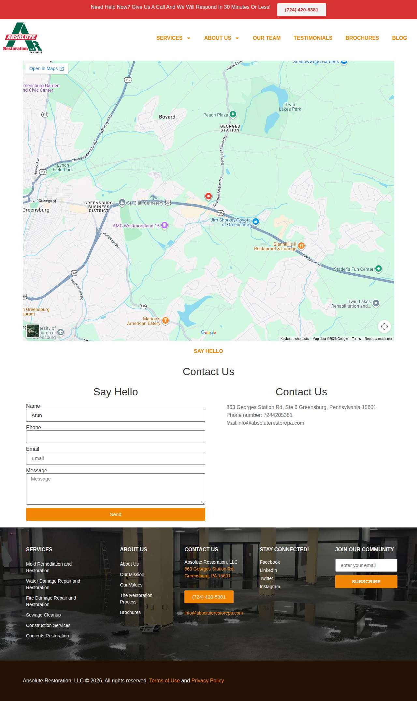

### masoudlawfirm.com — failed\_before\_submit (LIVE)

| | |
|---|---|
| Attempt ID | `198376ad-e7cb-474d-93cb-b6218f9fcd33` |
| Form URL | https://masoudlawfirm.com/contact/ |
| Final URL | — |
| Reserved | 2026-11-04 04:56:44 UTC |
| Submit attempted | — |
| Template | standard v2 |
| Confirmation text | none observed |
| Result / error | locator.fill: Error: Cannot type text into input\[type=number\] |

Exact message:

~~~text
Subject: Helping customers find your business in AI search (AEO + GEO)

Hi there,

I'm Arun from Devs Arun. More and more customers now ask ChatGPT, Gemini, Perplexity or Google's AI Overviews questions like "who should I hire for this in my area?" before they call anyone. These tools answer from websites they can clearly understand, and they tend to recommend businesses whose pages answer real customer questions.

That is what AEO + GEO (Answer Engine and Generative Engine Optimization) is for. I improve your existing service pages so they clearly answer the questions your customers ask, add structured data that matches the page, and make the call, quote or enquiry step obvious. The benefit: your business gets a better chance of being mentioned or linked in AI answers, and visitors who arrive find it easy to contact you.

The AEO + GEO Starter is a one-time $199 (about ₹16,999, negotiable) for one website: a basic audit, 10 customer questions, improvements to two existing pages, relevant structured data and an action plan, with one revision round.

You can read the full details, send an enquiry or book online here:
https://devsarun.io/aeo-geo/

If this isn't relevant, just reply and I won't contact you again.

Best,
Arun
Devs Arun
itschool408@gmail.com · +91 7654534323
~~~

Submitted field values:

- \#form-field-name: Arun
- \#form-field-field\_3374379: Hi there, I'm Arun from Devs Arun. More and more customers now ask ChatGPT, Gemini, Perplexity or Google's AI Overviews 
- \#form-field-field\_7731784: +91 7654534323
- \#form-field-field\_8bd0f16: itschool408@gmail.com

**Inspected page** — `run-a135bc35_attempt-198376ad_inspection_2026-11-04T04-56-46-034Z.jpg`

### suklawfirm.com — failed\_before\_submit (LIVE)

| | |
|---|---|
| Attempt ID | `236ec6a0-6618-4d47-b066-9397ecf134f0` |
| Form URL | https://www.suklawfirm.com/contact-us/ |
| Final URL | https://www.suklawfirm.com/contact-us/ |
| Reserved | 2026-11-04 04:56:51 UTC |
| Submit attempted | — |
| Template | standard v2 |
| Confirmation text | none observed |
| Result / error | Field "Phone\*" did not accept the value |

Exact message:

~~~text
Subject: Helping customers find your business in AI search (AEO + GEO)

Hi there,

I'm Arun from Devs Arun. More and more customers now ask ChatGPT, Gemini, Perplexity or Google's AI Overviews questions like "who should I hire for this in my area?" before they call anyone. These tools answer from websites they can clearly understand, and they tend to recommend businesses whose pages answer real customer questions.

That is what AEO + GEO (Answer Engine and Generative Engine Optimization) is for. I improve your existing service pages so they clearly answer the questions your customers ask, add structured data that matches the page, and make the call, quote or enquiry step obvious. The benefit: your business gets a better chance of being mentioned or linked in AI answers, and visitors who arrive find it easy to contact you.

The AEO + GEO Starter is a one-time $199 (about ₹16,999, negotiable) for one website: a basic audit, 10 customer questions, improvements to two existing pages, relevant structured data and an action plan, with one revision round.

You can read the full details, send an enquiry or book online here:
https://devsarun.io/aeo-geo/

If this isn't relevant, just reply and I won't contact you again.

Best,
Arun
Devs Arun
itschool408@gmail.com · +91 7654534323
~~~

Submitted field values:

- \#input\_1\_1: Arun
- \#input\_1\_2: +91 7654534323
- \#input\_1\_3: itschool408@gmail.com
- \#input\_1\_4: Hi there, I'm Arun from Devs Arun. More and more customers now ask ChatGPT, Gemini, Perplexity or Google's AI Overviews 

**Filled form (before submit)** — `run-a135bc35_attempt-236ec6a0_filled_2026-11-04T04-56-52-911Z.jpg`

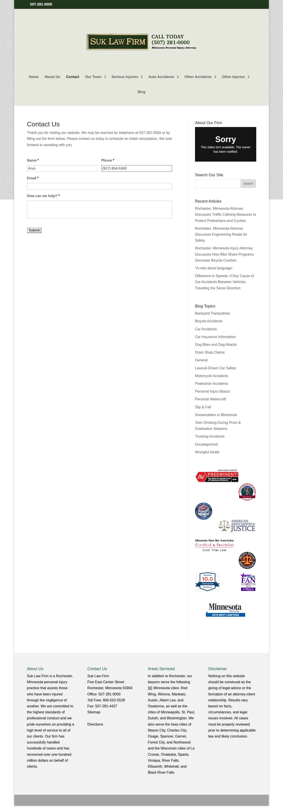

### familylawdelaware.com — failed\_before\_submit (LIVE)

| | |
|---|---|
| Attempt ID | `481ab86c-0974-42a7-b3a3-58d72ebdbc4c` |
| Form URL | https://www.familylawdelaware.com/contact/ |
| Final URL | https://www.familylawdelaware.com/contact/ |
| Reserved | 2026-11-04 04:56:57 UTC |
| Submit attempted | — |
| Template | standard v2 |
| Confirmation text | none observed |
| Result / error | Field "Phone" did not accept the value |

Exact message:

~~~text
Subject: Helping customers find your business in AI search (AEO + GEO)

Hi there,

I'm Arun from Devs Arun. More and more customers now ask ChatGPT, Gemini, Perplexity or Google's AI Overviews questions like "who should I hire for this in my area?" before they call anyone. These tools answer from websites they can clearly understand, and they tend to recommend businesses whose pages answer real customer questions.

That is what AEO + GEO (Answer Engine and Generative Engine Optimization) is for. I improve your existing service pages so they clearly answer the questions your customers ask, add structured data that matches the page, and make the call, quote or enquiry step obvious. The benefit: your business gets a better chance of being mentioned or linked in AI answers, and visitors who arrive find it easy to contact you.

The AEO + GEO Starter is a one-time $199 (about ₹16,999, negotiable) for one website: a basic audit, 10 customer questions, improvements to two existing pages, relevant structured data and an action plan, with one revision round.

You can read the full details, send an enquiry or book online here:
https://devsarun.io/aeo-geo/

If this isn't relevant, just reply and I won't contact you again.

Best,
Arun
Devs Arun
itschool408@gmail.com · +91 7654534323
~~~

Submitted field values:

- \#nf-field-2: Arun
- \#nf-field-3: itschool408@gmail.com
- \#nf-field-4: +91 7654534323
- \#nf-field-10: Hi there, I'm Arun from Devs Arun. More and more customers now ask ChatGPT, Gemini, Perplexity or Google's AI Overviews 

**Filled form (before submit)** — `run-a135bc35_attempt-481ab86c_filled_2026-11-04T04-57-00-131Z.jpg`

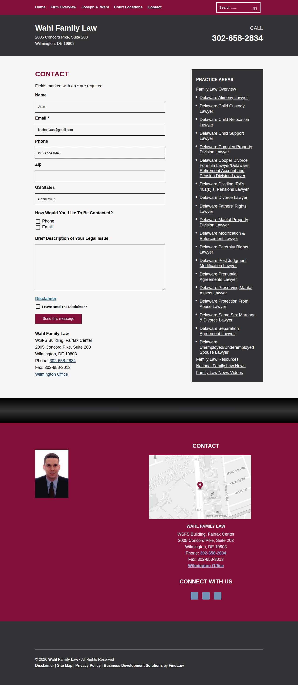

### langrock.com — confirmed (LIVE)

| | |
|---|---|
| Attempt ID | `b71e02d3-071f-4bdb-9f6e-2eedbf3f7f84` |
| Form URL | https://langrock.com/contact-us/ |
| Final URL | https://langrock.com/contact-us/ |
| Reserved | 2026-11-04 04:57:05 UTC |
| Submit attempted | 2026-11-04 04:57:06 UTC |
| Template | standard v2 |
| Confirmation text | elp. To learn more complete and submit the form below. Your message was sent successfully. Thanks. The material on this web site has been prepared by Langrock Sperry & Wool, LL |
| Result / error | — |

Exact message:

~~~text
Subject: Helping customers find your business in AI search (AEO + GEO)

Hi there,

I'm Arun from Devs Arun. More and more customers now ask ChatGPT, Gemini, Perplexity or Google's AI Overviews questions like "who should I hire for this in my area?" before they call anyone. These tools answer from websites they can clearly understand, and they tend to recommend businesses whose pages answer real customer questions.

That is what AEO + GEO (Answer Engine and Generative Engine Optimization) is for. I improve your existing service pages so they clearly answer the questions your customers ask, add structured data that matches the page, and make the call, quote or enquiry step obvious. The benefit: your business gets a better chance of being mentioned or linked in AI answers, and visitors who arrive find it easy to contact you.

The AEO + GEO Starter is a one-time $199 (about ₹16,999, negotiable) for one website: a basic audit, 10 customer questions, improvements to two existing pages, relevant structured data and an action plan, with one revision round.

You can read the full details, send an enquiry or book online here:
https://devsarun.io/aeo-geo/

If this isn't relevant, just reply and I won't contact you again.

Best,
Arun
Devs Arun
itschool408@gmail.com · +91 7654534323
~~~

Submitted field values:

- your-name \[name\]: Arun
- your-email \[email\]: itschool408@gmail.com
- your-message \[message\]: Hi there, I'm Arun from Devs Arun. More and more customers now ask ChatGPT, Gemini, Perplexity or Google's AI Overviews 

**Filled form (before submit)** — `run-a135bc35_attempt-b71e02d3_filled_2026-11-04T04-57-06-564Z.jpg`

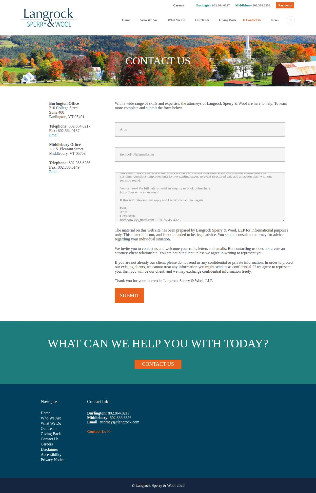

**After submit** — `run-a135bc35_attempt-b71e02d3_post_attempt_2026-11-04T04-57-12-080Z.jpg`

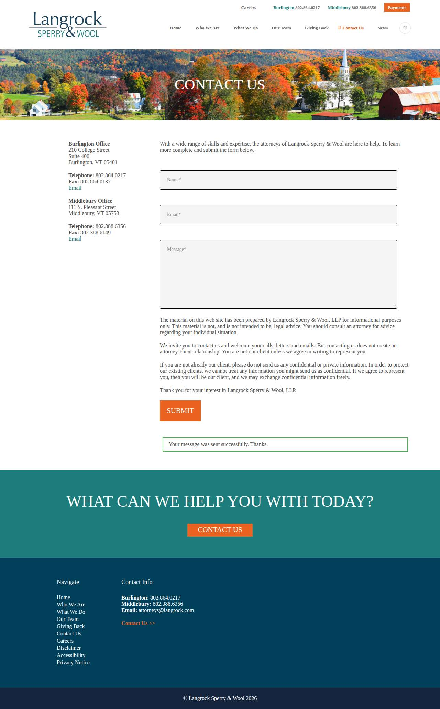

### kindleylawyers.com — confirmed (LIVE)

| | |
|---|---|
| Attempt ID | `0e0311ce-a0bb-4201-9c2a-6ecd385d7371` |
| Form URL | https://www.kindleylawyers.com/contact/ |
| Final URL | https://www.kindleylawyers.com/thank-you/ |
| Reserved | 2026-11-04 04:57:20 UTC |
| Submit attempted | 2026-11-04 04:57:24 UTC |
| Template | standard v2 |
| Confirmation text | CCIDENT $7.2 MILLION PRODUCT LIABILITY VEHICLE/BRAIN INJURY Thank You\! We will reply to your message as soon as possible. While you wait, here are some helpful resources |
| Result / error | — |

Exact message:

~~~text
Subject: Helping customers find your business in AI search (AEO + GEO)

Hi there,

I'm Arun from Devs Arun. More and more customers now ask ChatGPT, Gemini, Perplexity or Google's AI Overviews questions like "who should I hire for this in my area?" before they call anyone. These tools answer from websites they can clearly understand, and they tend to recommend businesses whose pages answer real customer questions.

That is what AEO + GEO (Answer Engine and Generative Engine Optimization) is for. I improve your existing service pages so they clearly answer the questions your customers ask, add structured data that matches the page, and make the call, quote or enquiry step obvious. The benefit: your business gets a better chance of being mentioned or linked in AI answers, and visitors who arrive find it easy to contact you.

The AEO + GEO Starter is a one-time $199 (about ₹16,999, negotiable) for one website: a basic audit, 10 customer questions, improvements to two existing pages, relevant structured data and an action plan, with one revision round.

You can read the full details, send an enquiry or book online here:
https://devsarun.io/aeo-geo/

If this isn't relevant, just reply and I won't contact you again.

Best,
Arun
Devs Arun
itschool408@gmail.com · +91 7654534323
~~~

Submitted field values:

- Name\* \[name\]: Arun
- Email\* \[email\]: itschool408@gmail.com
- Phone Number\* \[phone\]: +91 7654534323
- Tell us about your case \[message\]: Hi there, I'm Arun from Devs Arun. More and more customers now ask ChatGPT, Gemini, Perplexity or Google's AI Overviews 

**Filled form (before submit)** — `run-a135bc35_attempt-0e0311ce_filled_2026-11-04T04-57-24-452Z.jpg`

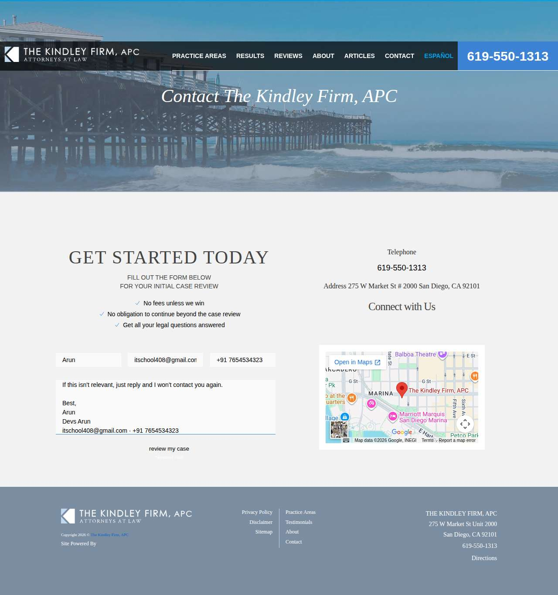

**After submit** — `run-a135bc35_attempt-0e0311ce_post_attempt_2026-11-04T04-57-32-318Z.jpg`

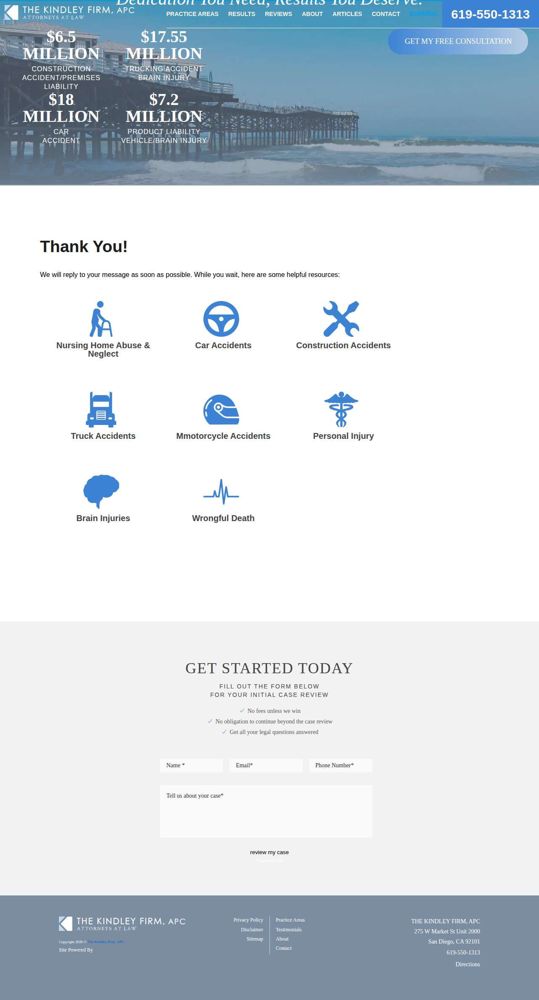

### guiradolaw.com — unclear (LIVE)

| | |
|---|---|
| Attempt ID | `c8cb5540-33ba-4cce-8689-db20c230896c` |
| Form URL | https://guiradolaw.com/contact/ |
| Final URL | https://guiradolaw.com/contact/ |
| Reserved | 2026-11-04 04:57:40 UTC |
| Submit attempted | 2026-11-04 04:57:42 UTC |
| Template | standard v2 |
| Confirmation text | none observed |
| Result / error | No new success marker observed |

Exact message:

~~~text
Subject: Helping customers find your business in AI search (AEO + GEO)

Hi there,

I'm Arun from Devs Arun. More and more customers now ask ChatGPT, Gemini, Perplexity or Google's AI Overviews questions like "who should I hire for this in my area?" before they call anyone. These tools answer from websites they can clearly understand, and they tend to recommend businesses whose pages answer real customer questions.

That is what AEO + GEO (Answer Engine and Generative Engine Optimization) is for. I improve your existing service pages so they clearly answer the questions your customers ask, add structured data that matches the page, and make the call, quote or enquiry step obvious. The benefit: your business gets a better chance of being mentioned or linked in AI answers, and visitors who arrive find it easy to contact you.

The AEO + GEO Starter is a one-time $199 (about ₹16,999, negotiable) for one website: a basic audit, 10 customer questions, improvements to two existing pages, relevant structured data and an action plan, with one revision round.

You can read the full details, send an enquiry or book online here:
https://devsarun.io/aeo-geo/

If this isn't relevant, just reply and I won't contact you again.

Best,
Arun
Devs Arun
itschool408@gmail.com · +91 7654534323
~~~

Submitted field values:

- Email \[email\]: itschool408@gmail.com
- Phone Number \[phone\]: +91 7654534323
- Your Message \[message\]: Hi there, I'm Arun from Devs Arun. More and more customers now ask ChatGPT, Gemini, Perplexity or Google's AI Overviews 
- First Name \[first\_name\]: Arun

**Filled form (before submit)** — `run-a135bc35_attempt-c8cb5540_filled_2026-11-04T04-57-42-521Z.jpg`

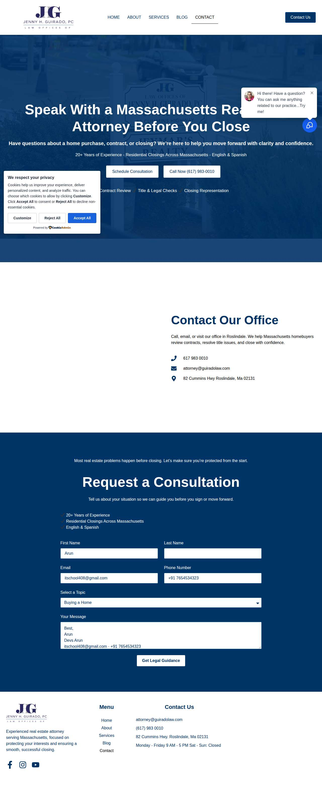

**After submit** — `run-a135bc35_attempt-c8cb5540_post_attempt_2026-11-04T04-58-14-669Z.jpg`

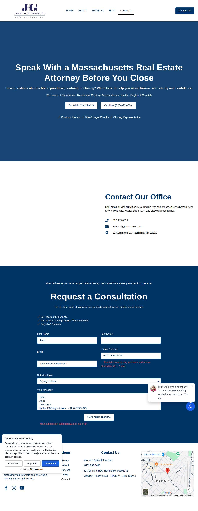

### militaryadvocate.com — confirmed (LIVE)

| | |
|---|---|
| Attempt ID | `a644d7e1-c901-45fe-aded-8f8883140ecb` |
| Form URL | https://militaryadvocate.com/contact/ |
| Final URL | https://militaryadvocate.com/contact/ |
| Reserved | 2026-11-04 04:58:22 UTC |
| Submit attempted | 2026-11-04 04:58:27 UTC |
| Template | standard v2 |
| Confirmation text | below form for a free, no obligation initial consultation. Thank you for your message. It has been sent. Thank you for your message. It has been sent. About Us FAQs Notable Cases Practi |
| Result / error | — |

Exact message:

~~~text
Subject: Helping customers find your business in AI search (AEO + GEO)

Hi there,

I'm Arun from Devs Arun. More and more customers now ask ChatGPT, Gemini, Perplexity or Google's AI Overviews questions like "who should I hire for this in my area?" before they call anyone. These tools answer from websites they can clearly understand, and they tend to recommend businesses whose pages answer real customer questions.

That is what AEO + GEO (Answer Engine and Generative Engine Optimization) is for. I improve your existing service pages so they clearly answer the questions your customers ask, add structured data that matches the page, and make the call, quote or enquiry step obvious. The benefit: your business gets a better chance of being mentioned or linked in AI answers, and visitors who arrive find it easy to contact you.

The AEO + GEO Starter is a one-time $199 (about ₹16,999, negotiable) for one website: a basic audit, 10 customer questions, improvements to two existing pages, relevant structured data and an action plan, with one revision round.

You can read the full details, send an enquiry or book online here:
https://devsarun.io/aeo-geo/

If this isn't relevant, just reply and I won't contact you again.

Best,
Arun
Devs Arun
itschool408@gmail.com · +91 7654534323
~~~

Submitted field values:

- Contact Phone \[phone\]: +91 7654534323
- Your Message \[message\]: Hi there, I'm Arun from Devs Arun. More and more customers now ask ChatGPT, Gemini, Perplexity or Google's AI Overviews 
- Email (required) \[email\]: itschool408@gmail.com
- Your Name (required) \[name\]: Arun

**Filled form (before submit)** — `run-a135bc35_attempt-a644d7e1_filled_2026-11-04T04-58-27-699Z.jpg`

**After submit** — `run-a135bc35_attempt-a644d7e1_post_attempt_2026-11-04T04-58-52-834Z.jpg`

### curthamiltonlaw.com — failed\_before\_submit (LIVE)

| | |
|---|---|
| Attempt ID | `188a6f3b-2403-4028-82c9-d198fc235f48` |
| Form URL | https://www.curthamiltonlaw.com/contact/ |
| Final URL | https://www.curthamiltonlaw.com/contact/ |
| Reserved | 2026-11-04 04:59:01 UTC |
| Submit attempted | — |
| Template | standard v2 |
| Confirmation text | none observed |
| Result / error | Field "Phone" did not accept the value |

Exact message:

~~~text
Subject: Helping customers find your business in AI search (AEO + GEO)

Hi there,

I'm Arun from Devs Arun. More and more customers now ask ChatGPT, Gemini, Perplexity or Google's AI Overviews questions like "who should I hire for this in my area?" before they call anyone. These tools answer from websites they can clearly understand, and they tend to recommend businesses whose pages answer real customer questions.

That is what AEO + GEO (Answer Engine and Generative Engine Optimization) is for. I improve your existing service pages so they clearly answer the questions your customers ask, add structured data that matches the page, and make the call, quote or enquiry step obvious. The benefit: your business gets a better chance of being mentioned or linked in AI answers, and visitors who arrive find it easy to contact you.

The AEO + GEO Starter is a one-time $199 (about ₹16,999, negotiable) for one website: a basic audit, 10 customer questions, improvements to two existing pages, relevant structured data and an action plan, with one revision round.

You can read the full details, send an enquiry or book online here:
https://devsarun.io/aeo-geo/

If this isn't relevant, just reply and I won't contact you again.

Best,
Arun
Devs Arun
itschool408@gmail.com · +91 7654534323
~~~

Submitted field values:

- \#nf-field-2: Arun
- \#nf-field-3: itschool408@gmail.com
- \#nf-field-4: +91 7654534323
- \#nf-field-10: Hi there, I'm Arun from Devs Arun. More and more customers now ask ChatGPT, Gemini, Perplexity or Google's AI Overviews 

**Filled form (before submit)** — `run-a135bc35_attempt-188a6f3b_filled_2026-11-04T04-59-03-263Z.jpg`

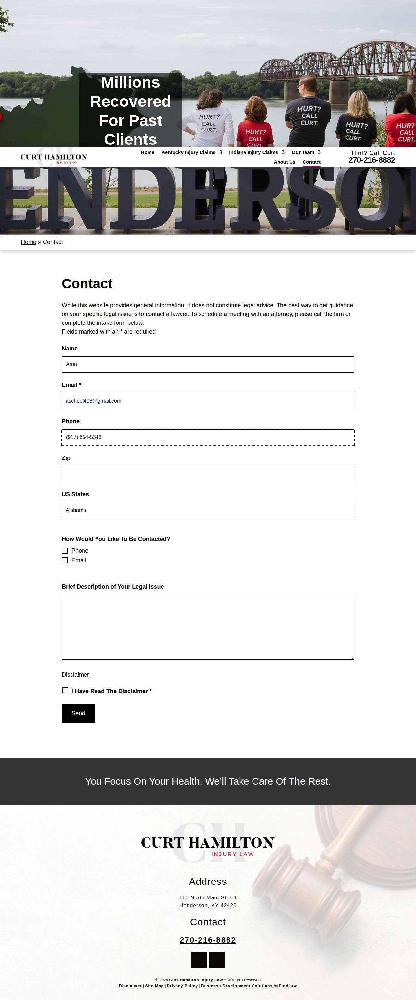

### personalinjurytimgill.com — error\_after\_submit (LIVE)

| | |
|---|---|
| Attempt ID | `1c485ee0-987a-491e-8cc6-ec9333dcc187` |
| Form URL | http://www.personalinjurytimgill.com/contact.html |
| Final URL | http://www.personalinjurytimgill.com/contact.html |
| Reserved | 2026-11-04 04:59:08 UTC |
| Submit attempted | 2026-11-04 04:59:11 UTC |
| Template | standard v2 |
| Confirmation text | , San Jose, CA 95113 Follow Name First Name\* Last Name is a required field. Last Name\* Email\* Phone Number\* Comments\* Law Offices of Timothy Gill a Professional Corporation H |
| Result / error | — |

Exact message:

~~~text
Subject: Helping customers find your business in AI search (AEO + GEO)

Hi there,

I'm Arun from Devs Arun. More and more customers now ask ChatGPT, Gemini, Perplexity or Google's AI Overviews questions like "who should I hire for this in my area?" before they call anyone. These tools answer from websites they can clearly understand, and they tend to recommend businesses whose pages answer real customer questions.

That is what AEO + GEO (Answer Engine and Generative Engine Optimization) is for. I improve your existing service pages so they clearly answer the questions your customers ask, add structured data that matches the page, and make the call, quote or enquiry step obvious. The benefit: your business gets a better chance of being mentioned or linked in AI answers, and visitors who arrive find it easy to contact you.

The AEO + GEO Starter is a one-time $199 (about ₹16,999, negotiable) for one website: a basic audit, 10 customer questions, improvements to two existing pages, relevant structured data and an action plan, with one revision round.

You can read the full details, send an enquiry or book online here:
https://devsarun.io/aeo-geo/

If this isn't relevant, just reply and I won't contact you again.

Best,
Arun
Devs Arun
itschool408@gmail.com · +91 7654534323
~~~

Submitted field values:

- Email\* \[email\]: itschool408@gmail.com
- Comments\* \[message\]: Hi there, I'm Arun from Devs Arun. More and more customers now ask ChatGPT, Gemini, Perplexity or Google's AI Overviews 
- Phone Number\* \[phone\]: +91 7654534323
- First Name\* \[first\_name\]: Arun

**Filled form (before submit)** — `run-a135bc35_attempt-1c485ee0_filled_2026-11-04T04-59-11-191Z.jpg`

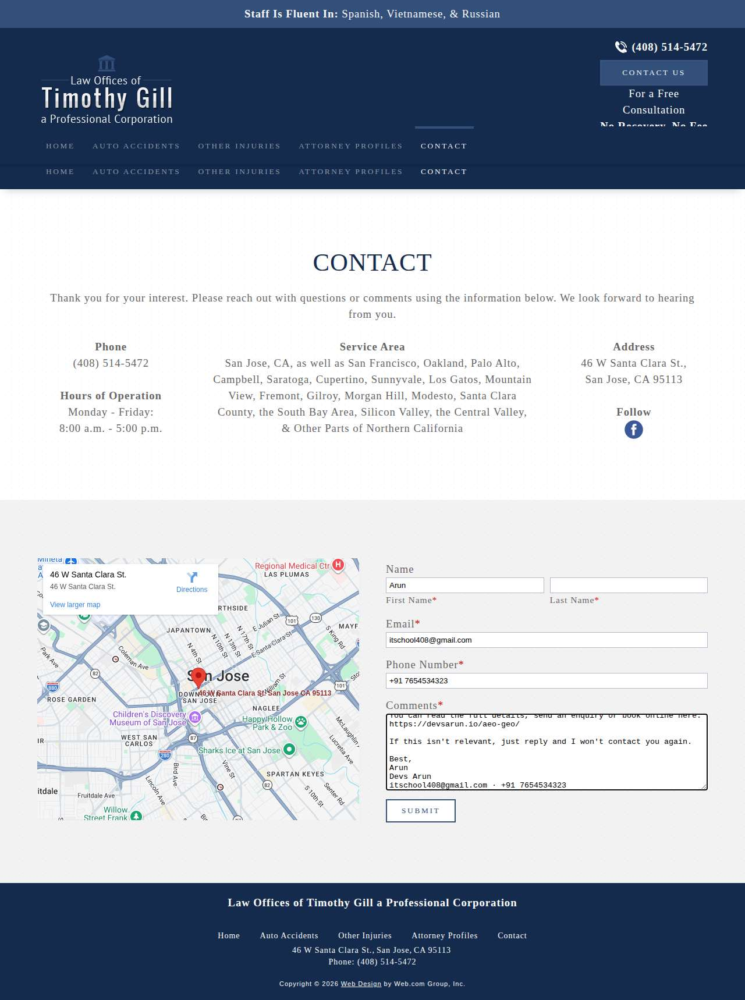

**After submit** — `run-a135bc35_attempt-1c485ee0_post_attempt_2026-11-04T04-59-14-570Z.jpg`

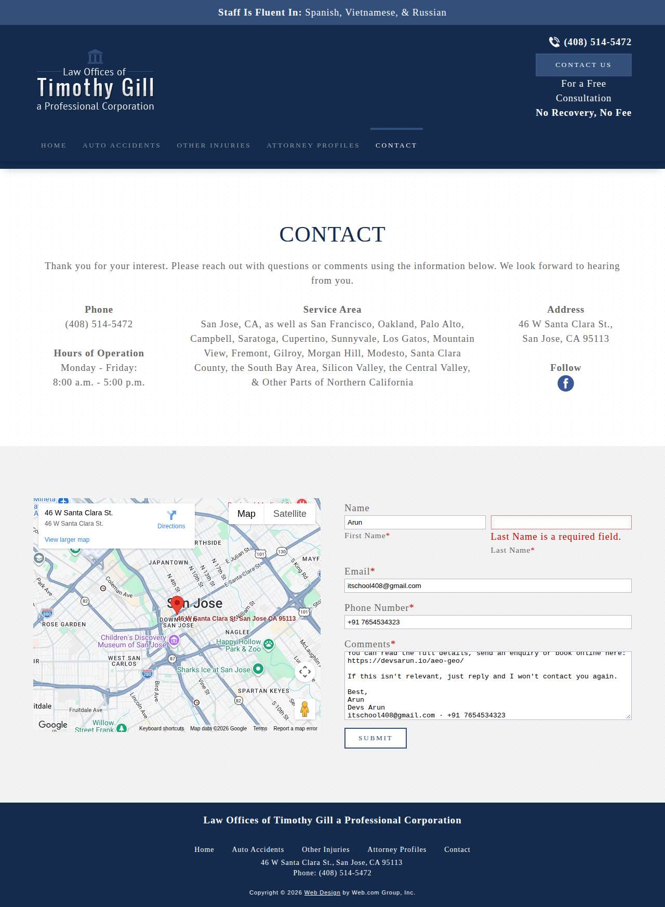

### ohiocompensationlawyer.com — confirmed (LIVE)

| | |
|---|---|
| Attempt ID | `29a96c40-35e1-45b2-89fb-fce941ea47f7` |
| Form URL | https://ohiocompensationlawyer.com/contact/ |
| Final URL | https://ohiocompensationlawyer.com/thank-you/ |
| Reserved | 2026-11-04 04:59:22 UTC |
| Submit attempted | 2026-11-04 04:59:25 UTC |
| Template | standard v2 |
| Confirmation text | & RESULTS ARTICLES VIDEOS BLOG CONTACT COLUMBUS, OH OFFICE THANK YOU Home / Thank You Purchase the 5th Edition of the Ohio Workers’ Compensation Treatise GET A FREE CON |
| Result / error | — |

Exact message:

~~~text
Subject: Helping customers find your business in AI search (AEO + GEO)

Hi there,

I'm Arun from Devs Arun. More and more customers now ask ChatGPT, Gemini, Perplexity or Google's AI Overviews questions like "who should I hire for this in my area?" before they call anyone. These tools answer from websites they can clearly understand, and they tend to recommend businesses whose pages answer real customer questions.

That is what AEO + GEO (Answer Engine and Generative Engine Optimization) is for. I improve your existing service pages so they clearly answer the questions your customers ask, add structured data that matches the page, and make the call, quote or enquiry step obvious. The benefit: your business gets a better chance of being mentioned or linked in AI answers, and visitors who arrive find it easy to contact you.

The AEO + GEO Starter is a one-time $199 (about ₹16,999, negotiable) for one website: a basic audit, 10 customer questions, improvements to two existing pages, relevant structured data and an action plan, with one revision round.

You can read the full details, send an enquiry or book online here:
https://devsarun.io/aeo-geo/

If this isn't relevant, just reply and I won't contact you again.

Best,
Arun
Devs Arun
itschool408@gmail.com · +91 7654534323
~~~

Submitted field values:

- Phone number \* \* \[phone\]: +91 7654534323
- E-Mail address \* \* \[email\]: itschool408@gmail.com
- First name \* \* \[first\_name\]: Arun
- Brief Description of Your Legal Issue \* \[message\]: Hi there, I'm Arun from Devs Arun. More and more customers now ask ChatGPT, Gemini, Perplexity or Google's AI Overviews 

**Filled form (before submit)** — `run-a135bc35_attempt-29a96c40_filled_2026-11-04T04-59-25-197Z.jpg`

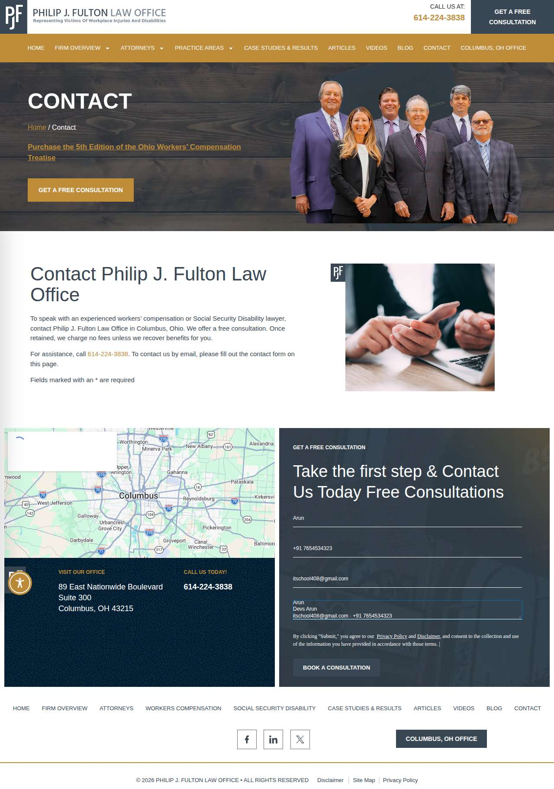

**After submit** — `run-a135bc35_attempt-29a96c40_post_attempt_2026-11-04T04-59-30-630Z.jpg`

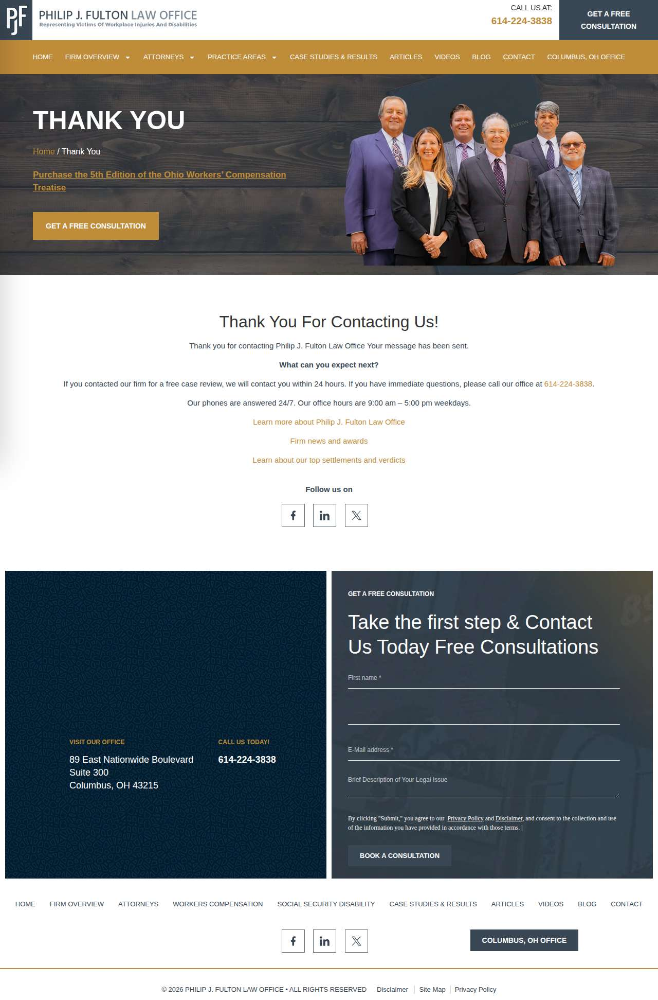

### bsmllp.com — failed\_before\_submit (LIVE)

| | |
|---|---|
| Attempt ID | `970d7a81-6ce4-49dd-89f8-0dbf3d7cf7b8` |
| Form URL | https://www.bsmllp.com/contact/ |
| Final URL | https://www.bsmllp.com/contact/ |
| Reserved | 2026-11-04 04:59:38 UTC |
| Submit attempted | — |
| Template | standard v2 |
| Confirmation text | none observed |
| Result / error | Reviewed form not found on page (site changed) |

Exact message:

~~~text
Subject: Helping customers find your business in AI search (AEO + GEO)

Hi there,

I'm Arun from Devs Arun. More and more customers now ask ChatGPT, Gemini, Perplexity or Google's AI Overviews questions like "who should I hire for this in my area?" before they call anyone. These tools answer from websites they can clearly understand, and they tend to recommend businesses whose pages answer real customer questions.

That is what AEO + GEO (Answer Engine and Generative Engine Optimization) is for. I improve your existing service pages so they clearly answer the questions your customers ask, add structured data that matches the page, and make the call, quote or enquiry step obvious. The benefit: your business gets a better chance of being mentioned or linked in AI answers, and visitors who arrive find it easy to contact you.

The AEO + GEO Starter is a one-time $199 (about ₹16,999, negotiable) for one website: a basic audit, 10 customer questions, improvements to two existing pages, relevant structured data and an action plan, with one revision round.

You can read the full details, send an enquiry or book online here:
https://devsarun.io/aeo-geo/

If this isn't relevant, just reply and I won't contact you again.

Best,
Arun
Devs Arun
itschool408@gmail.com · +91 7654534323
~~~

Submitted field values:

- \#nf-field-2: Arun
- \#nf-field-3: itschool408@gmail.com
- \#nf-field-4: +91 7654534323
- \#nf-field-10: Hi there, I'm Arun from Devs Arun. More and more customers now ask ChatGPT, Gemini, Perplexity or Google's AI Overviews 

**Inspected page** — `run-a135bc35_attempt-970d7a81_inspection_2026-11-04T04-59-39-419Z.jpg`

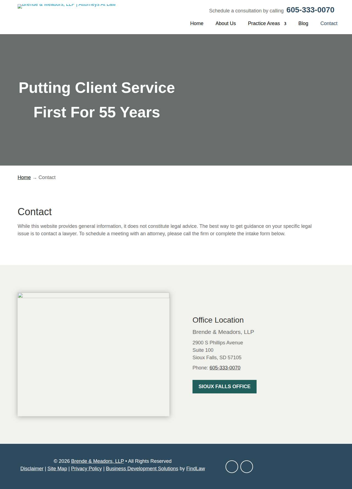

### ditruthanhmy.com — unclear (LIVE)

| | |
|---|---|
| Attempt ID | `1f4225ae-aa48-4c49-a9e8-4da991b22c74` |
| Form URL | http://www.ditruthanhmy.com/contact.html |
| Final URL | http://www.ditruthanhmy.com/contact.html |
| Reserved | 2026-11-04 04:59:44 UTC |
| Submit attempted | 2026-11-04 04:59:49 UTC |
| Template | standard v2 |
| Confirmation text | none observed |
| Result / error | No new success marker observed |

Exact message:

~~~text
Subject: Helping customers find your business in AI search (AEO + GEO)

Hi there,

I'm Arun from Devs Arun. More and more customers now ask ChatGPT, Gemini, Perplexity or Google's AI Overviews questions like "who should I hire for this in my area?" before they call anyone. These tools answer from websites they can clearly understand, and they tend to recommend businesses whose pages answer real customer questions.

That is what AEO + GEO (Answer Engine and Generative Engine Optimization) is for. I improve your existing service pages so they clearly answer the questions your customers ask, add structured data that matches the page, and make the call, quote or enquiry step obvious. The benefit: your business gets a better chance of being mentioned or linked in AI answers, and visitors who arrive find it easy to contact you.

The AEO + GEO Starter is a one-time $199 (about ₹16,999, negotiable) for one website: a basic audit, 10 customer questions, improvements to two existing pages, relevant structured data and an action plan, with one revision round.

You can read the full details, send an enquiry or book online here:
https://devsarun.io/aeo-geo/

If this isn't relevant, just reply and I won't contact you again.

Best,
Arun
Devs Arun
itschool408@gmail.com · +91 7654534323
~~~

Submitted field values:

- your\_name \[name\]: Arun
- content \[message\]: Hi there, I'm Arun from Devs Arun. More and more customers now ask ChatGPT, Gemini, Perplexity or Google's AI Overviews 
- your\_email \[email\]: itschool408@gmail.com
- your\_phone \[phone\]: +91 7654534323

**Filled form (before submit)** — `run-a135bc35_attempt-1f4225ae_filled_2026-11-04T04-59-49-933Z.jpg`

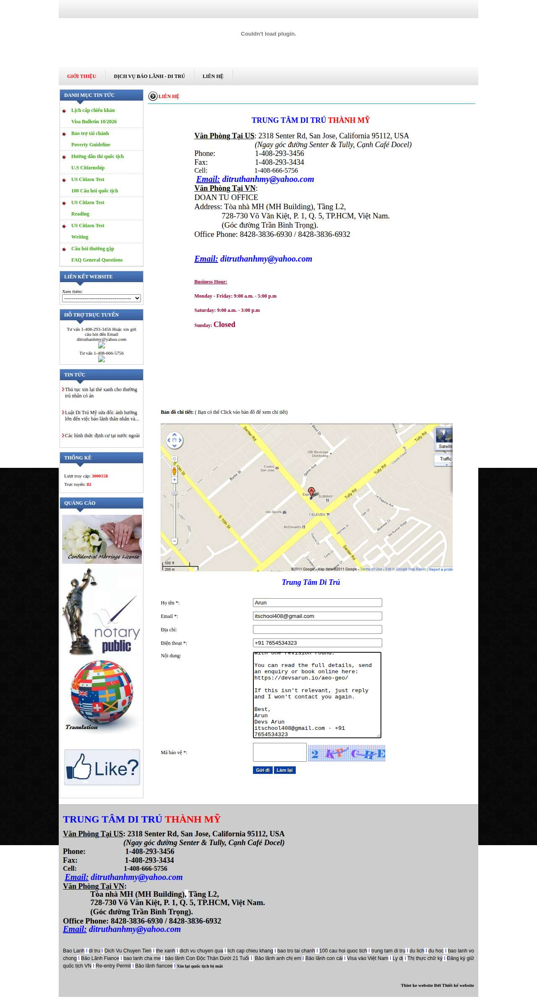

**After submit** — `run-a135bc35_attempt-1f4225ae_post_attempt_2026-11-04T05-00-22-820Z.jpg`

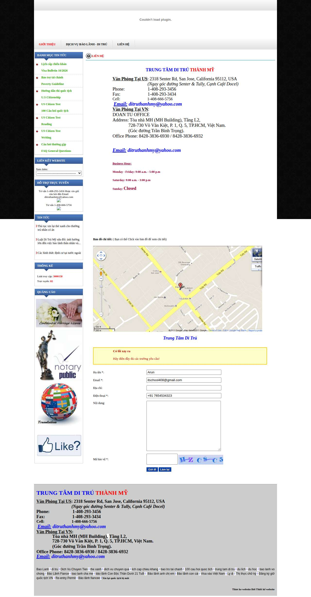

### rockfordbankruptcytoday.com — unclear (LIVE)

| | |
|---|---|
| Attempt ID | `ea59e345-1383-4495-b7b9-245fd5795c71` |
| Form URL | https://rockfordbankruptcytoday.com/contact/ |
| Final URL | https://rockfordbankruptcytoday.com/contact/ |
| Reserved | 2026-11-04 05:00:31 UTC |
| Submit attempted | 2026-11-04 05:00:32 UTC |
| Template | standard v2 |
| Confirmation text | none observed |
| Result / error | No new success marker observed |

Exact message:

~~~text
Subject: Helping customers find your business in AI search (AEO + GEO)

Hi there,

I'm Arun from Devs Arun. More and more customers now ask ChatGPT, Gemini, Perplexity or Google's AI Overviews questions like "who should I hire for this in my area?" before they call anyone. These tools answer from websites they can clearly understand, and they tend to recommend businesses whose pages answer real customer questions.

That is what AEO + GEO (Answer Engine and Generative Engine Optimization) is for. I improve your existing service pages so they clearly answer the questions your customers ask, add structured data that matches the page, and make the call, quote or enquiry step obvious. The benefit: your business gets a better chance of being mentioned or linked in AI answers, and visitors who arrive find it easy to contact you.

The AEO + GEO Starter is a one-time $199 (about ₹16,999, negotiable) for one website: a basic audit, 10 customer questions, improvements to two existing pages, relevant structured data and an action plan, with one revision round.

You can read the full details, send an enquiry or book online here:
https://devsarun.io/aeo-geo/

If this isn't relevant, just reply and I won't contact you again.

Best,
Arun
Devs Arun
itschool408@gmail.com · +91 7654534323
~~~

Submitted field values:

- Name: \[name\]: Arun
- Phone: \[phone\]: +91 7654534323
- Message: \[message\]: Hi there, I'm Arun from Devs Arun. More and more customers now ask ChatGPT, Gemini, Perplexity or Google's AI Overviews 
- Email Address \[email\]: itschool408@gmail.com

**Filled form (before submit)** — `run-a135bc35_attempt-ea59e345_filled_2026-11-04T05-00-32-406Z.jpg`

**After submit** — `run-a135bc35_attempt-ea59e345_post_attempt_2026-11-04T05-01-00-469Z.jpg`

### jianglawgroup.com — confirmed (LIVE)

| | |
|---|---|
| Attempt ID | `417448a0-d1af-4b20-b7d2-bc4f14dba8e4` |
| Form URL | https://www.jianglawgroup.com/contact-us/ |
| Final URL | https://www.jianglawgroup.com/contact-us/ |
| Reserved | 2026-11-04 05:01:08 UTC |
| Submit attempted | 2026-11-04 05:01:12 UTC |
| Template | standard v2 |
| Confirmation text | n your left. To Contact us, please fill out the form below: Thank you for your message. Our Attorneys will be in contact with you shortly. 271 North First Street, San Jose, CA 95113 Phon |
| Result / error | — |

Exact message:

~~~text
Subject: Helping customers find your business in AI search (AEO + GEO)

Hi there,

I'm Arun from Devs Arun. More and more customers now ask ChatGPT, Gemini, Perplexity or Google's AI Overviews questions like "who should I hire for this in my area?" before they call anyone. These tools answer from websites they can clearly understand, and they tend to recommend businesses whose pages answer real customer questions.

That is what AEO + GEO (Answer Engine and Generative Engine Optimization) is for. I improve your existing service pages so they clearly answer the questions your customers ask, add structured data that matches the page, and make the call, quote or enquiry step obvious. The benefit: your business gets a better chance of being mentioned or linked in AI answers, and visitors who arrive find it easy to contact you.

The AEO + GEO Starter is a one-time $199 (about ₹16,999, negotiable) for one website: a basic audit, 10 customer questions, improvements to two existing pages, relevant structured data and an action plan, with one revision round.

You can read the full details, send an enquiry or book online here:
https://devsarun.io/aeo-geo/

If this isn't relevant, just reply and I won't contact you again.

Best,
Arun
Devs Arun
itschool408@gmail.com · +91 7654534323
~~~

Submitted field values:

- tel-300 \[phone\]: +91 7654534323
- your-name \[name\]: Arun
- your-email \[email\]: itschool408@gmail.com
- your-message \[message\]: Hi there, I'm Arun from Devs Arun. More and more customers now ask ChatGPT, Gemini, Perplexity or Google's AI Overviews 

**Filled form (before submit)** — `run-a135bc35_attempt-417448a0_filled_2026-11-04T05-01-12-258Z.jpg`

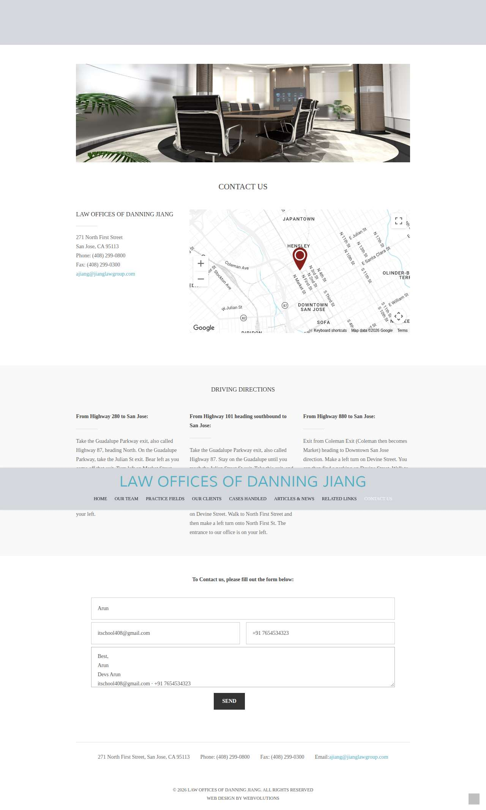

**After submit** — `run-a135bc35_attempt-417448a0_post_attempt_2026-11-04T05-01-24-292Z.jpg`

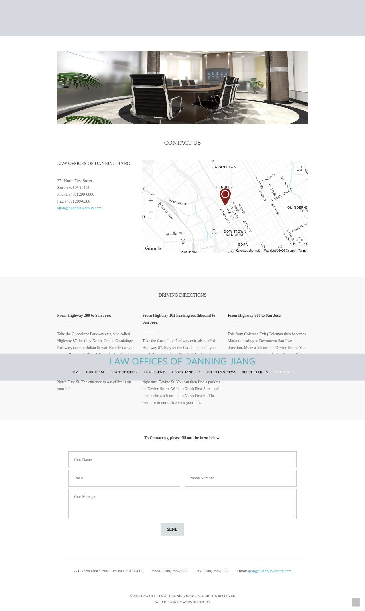

### davidthompsonasbestoslaw.com — error\_after\_submit (LIVE)

| | |
|---|---|
| Attempt ID | `530be235-cc20-44ef-b800-ab4ac44cc67b` |
| Form URL | https://www.davidthompsonasbestoslaw.com/contact |
| Final URL | https://www.davidthompsonasbestoslaw.com/contact |
| Reserved | 2026-11-04 05:01:32 UTC |
| Submit attempted | 2026-11-04 05:01:35 UTC |
| Template | standard v2 |
| Confirmation text | sed David C. Thompson, P.C. Contact Us First Name Last Name This field is required Email Phone Message 321 Kittson Ave Grand Forks, ND 58201 The information on this website is for ge |
| Result / error | — |

Exact message:

~~~text
Subject: Helping customers find your business in AI search (AEO + GEO)

Hi there,

I'm Arun from Devs Arun. More and more customers now ask ChatGPT, Gemini, Perplexity or Google's AI Overviews questions like "who should I hire for this in my area?" before they call anyone. These tools answer from websites they can clearly understand, and they tend to recommend businesses whose pages answer real customer questions.

That is what AEO + GEO (Answer Engine and Generative Engine Optimization) is for. I improve your existing service pages so they clearly answer the questions your customers ask, add structured data that matches the page, and make the call, quote or enquiry step obvious. The benefit: your business gets a better chance of being mentioned or linked in AI answers, and visitors who arrive find it easy to contact you.

The AEO + GEO Starter is a one-time $199 (about ₹16,999, negotiable) for one website: a basic audit, 10 customer questions, improvements to two existing pages, relevant structured data and an action plan, with one revision round.

You can read the full details, send an enquiry or book online here:
https://devsarun.io/aeo-geo/

If this isn't relevant, just reply and I won't contact you again.

Best,
Arun
Devs Arun
itschool408@gmail.com · +91 7654534323
~~~

Submitted field values:

- Email \[email\]: itschool408@gmail.com
- Phone \[phone\]: +91 7654534323
- Message \[message\]: Hi there, I'm Arun from Devs Arun. More and more customers now ask ChatGPT, Gemini, Perplexity or Google's AI Overviews 
- First Name \[first\_name\]: Arun

**Filled form (before submit)** — `run-a135bc35_attempt-530be235_filled_2026-11-04T05-01-35-009Z.jpg`

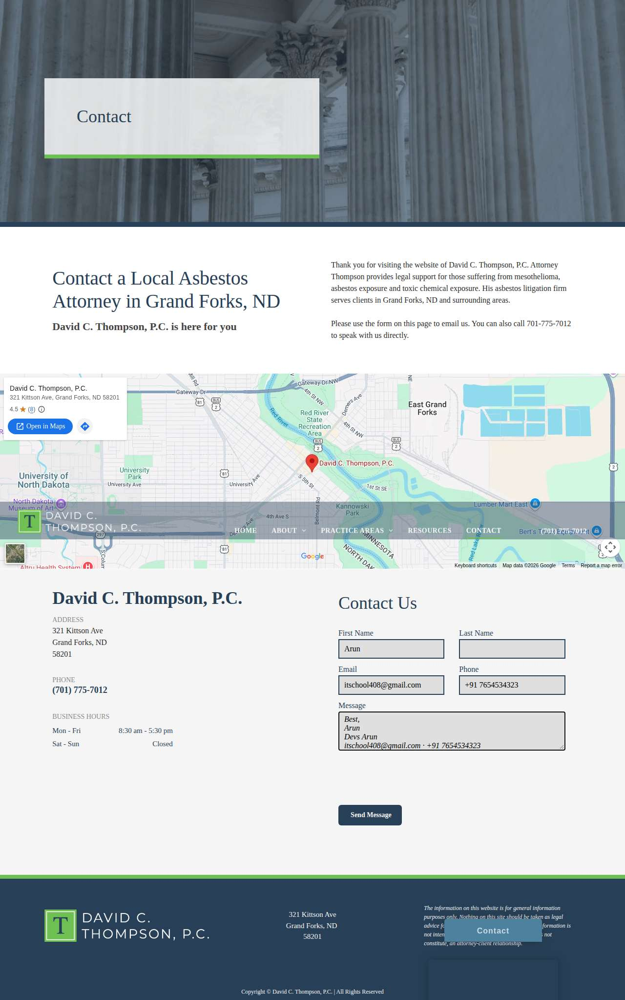

**After submit** — `run-a135bc35_attempt-530be235_post_attempt_2026-11-04T05-01-39-339Z.jpg`

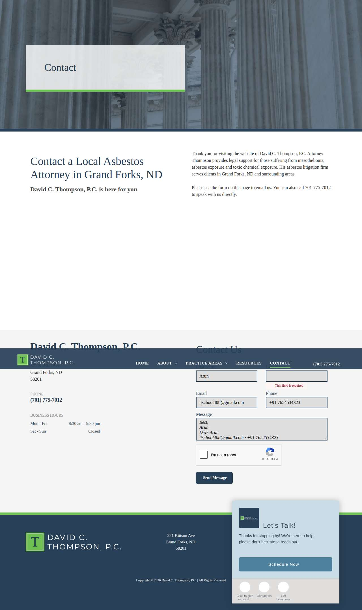

### tacoma-bankruptcy.com — confirmed (LIVE)

| | |
|---|---|
| Attempt ID | `60427428-0047-458f-a186-8957a93077b3` |
| Form URL | https://www.tacoma-bankruptcy.com/tacoma-bankruptcy-lawyers/ |
| Final URL | https://www.tacoma-bankruptcy.com/tacoma-bankruptcy-lawyers/ |
| Reserved | 2026-11-04 05:01:47 UTC |
| Submit attempted | 2026-11-04 05:01:48 UTC |
| Template | standard v2 |
| Confirmation text | r online, or by simply giving us a call. Send us a message: Thank you for your message. We will get in touch with you shortly Contact a bankruptcy attorney in Tacoma, WA. Our Tacoma bank |
| Result / error | — |

Exact message:

~~~text
Subject: Helping customers find your business in AI search (AEO + GEO)

Hi there,

I'm Arun from Devs Arun. More and more customers now ask ChatGPT, Gemini, Perplexity or Google's AI Overviews questions like "who should I hire for this in my area?" before they call anyone. These tools answer from websites they can clearly understand, and they tend to recommend businesses whose pages answer real customer questions.

That is what AEO + GEO (Answer Engine and Generative Engine Optimization) is for. I improve your existing service pages so they clearly answer the questions your customers ask, add structured data that matches the page, and make the call, quote or enquiry step obvious. The benefit: your business gets a better chance of being mentioned or linked in AI answers, and visitors who arrive find it easy to contact you.

The AEO + GEO Starter is a one-time $199 (about ₹16,999, negotiable) for one website: a basic audit, 10 customer questions, improvements to two existing pages, relevant structured data and an action plan, with one revision round.

You can read the full details, send an enquiry or book online here:
https://devsarun.io/aeo-geo/

If this isn't relevant, just reply and I won't contact you again.

Best,
Arun
Devs Arun
itschool408@gmail.com · +91 7654534323
~~~

Submitted field values:

- email \[email\]: itschool408@gmail.com
- phone \[phone\]: +91 7654534323
- description \[message\]: Hi there, I'm Arun from Devs Arun. More and more customers now ask ChatGPT, Gemini, Perplexity or Google's AI Overviews 
- names\[first\_name\] \[first\_name\]: Arun

**Filled form (before submit)** — `run-a135bc35_attempt-60427428_filled_2026-11-04T05-01-48-866Z.jpg`

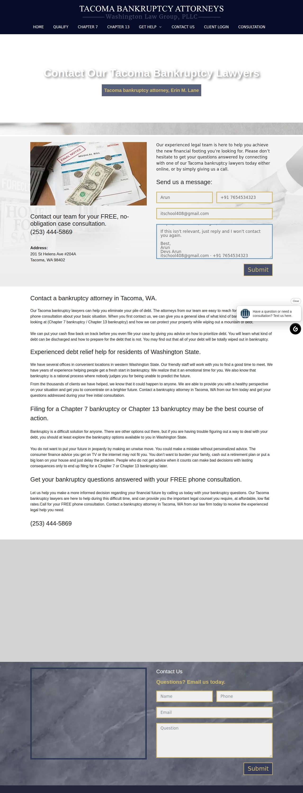

**After submit** — `run-a135bc35_attempt-60427428_post_attempt_2026-11-04T05-01-53-946Z.jpg`

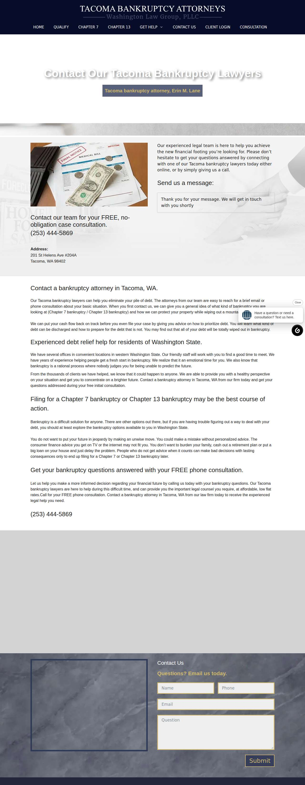

### hjs-law.com — unclear (LIVE)

| | |
|---|---|
| Attempt ID | `0a4e1904-290f-456f-b7ef-370a8ef451b8` |
| Form URL | https://hjsoffice.com/contact |
| Final URL | https://hjsoffice.com/contact? |
| Reserved | 2026-11-04 05:02:02 UTC |
| Submit attempted | 2026-11-04 05:02:05 UTC |
| Template | standard v2 |
| Confirmation text | none observed |
| Result / error | No new success marker observed |

Exact message:

~~~text
Subject: Helping customers find your business in AI search (AEO + GEO)

Hi there,

I'm Arun from Devs Arun. More and more customers now ask ChatGPT, Gemini, Perplexity or Google's AI Overviews questions like "who should I hire for this in my area?" before they call anyone. These tools answer from websites they can clearly understand, and they tend to recommend businesses whose pages answer real customer questions.

That is what AEO + GEO (Answer Engine and Generative Engine Optimization) is for. I improve your existing service pages so they clearly answer the questions your customers ask, add structured data that matches the page, and make the call, quote or enquiry step obvious. The benefit: your business gets a better chance of being mentioned or linked in AI answers, and visitors who arrive find it easy to contact you.

The AEO + GEO Starter is a one-time $199 (about ₹16,999, negotiable) for one website: a basic audit, 10 customer questions, improvements to two existing pages, relevant structured data and an action plan, with one revision round.

You can read the full details, send an enquiry or book online here:
https://devsarun.io/aeo-geo/

If this isn't relevant, just reply and I won't contact you again.

Best,
Arun
Devs Arun
itschool408@gmail.com · +91 7654534323
~~~

Submitted field values:

- Name\* \[name\]: Arun
- Phone \[phone\]: +91 7654534323
- Email\* \[email\]: itschool408@gmail.com
- Message \[message\]: Hi there, I'm Arun from Devs Arun. More and more customers now ask ChatGPT, Gemini, Perplexity or Google's AI Overviews 
- Subject \[subject\]: Helping customers find your business in AI search (AEO + GEO)

**Filled form (before submit)** — `run-a135bc35_attempt-0a4e1904_filled_2026-11-04T05-02-05-068Z.jpg`

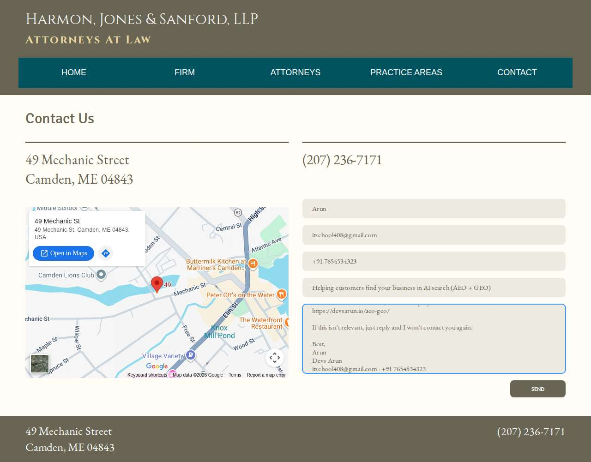

**After submit** — `run-a135bc35_attempt-0a4e1904_post_attempt_2026-11-04T05-02-35-798Z.jpg`

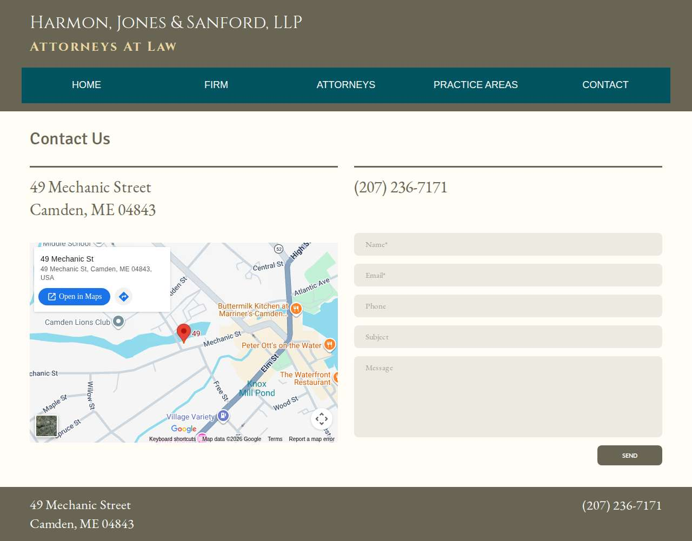

## Events (141)

| Time (UTC) | Event | Website | Details |
|---|---|---|---|
| 04:56:17 | run\_queued | — | live run requested by github:itsDevsArun |
| 04:56:17 | run\_dispatched | — | dispatch disabled (local test mode) |
| 04:56:20 | run\_started | — | Runner claimed live run |
| 04:56:22 | offer\_verified | — | Service page offer facts verified |
| 04:56:22 | website\_selected | clearchoiceplumbingllc.com | Live target clearchoiceplumbingllc.com |
| 04:56:22 | attempt\_reserved | clearchoiceplumbingllc.com | Submission attempt reserved with template standard v2 |
| 04:56:23 | page\_opened | clearchoiceplumbingllc.com | Opened form page |
| 04:56:23 | screenshot\_saved | clearchoiceplumbingllc.com | inspection screenshot saved (145 KB) |
| 04:56:23 | review\_required | clearchoiceplumbingllc.com | failed before submit: locator.fill: Error: Cannot type text into input\[type=number\] |
| 04:56:29 | website\_selected | bwnwincpainting.com | Live target bwnwincpainting.com |
| 04:56:29 | attempt\_reserved | bwnwincpainting.com | Submission attempt reserved with template standard v2 |
| 04:56:31 | page\_opened | bwnwincpainting.com | Opened form page |
| 04:56:31 | screenshot\_saved | bwnwincpainting.com | inspection screenshot saved (118 KB) |
| 04:56:31 | review\_required | bwnwincpainting.com | failed before submit: locator.fill: Error: Cannot type text into input\[type=number\] |
| 04:56:36 | website\_selected | absoluterestorepa.com | Live target absoluterestorepa.com |
| 04:56:36 | attempt\_reserved | absoluterestorepa.com | Submission attempt reserved with template standard v2 |
| 04:56:38 | page\_opened | absoluterestorepa.com | Opened form page |
| 04:56:39 | screenshot\_saved | absoluterestorepa.com | inspection screenshot saved (174 KB) |
| 04:56:39 | review\_required | absoluterestorepa.com | failed before submit: locator.fill: Error: Cannot type text into input\[type=number\] |
| 04:56:44 | website\_selected | masoudlawfirm.com | Live target masoudlawfirm.com |
| 04:56:44 | attempt\_reserved | masoudlawfirm.com | Submission attempt reserved with template standard v2 |
| 04:56:45 | page\_opened | masoudlawfirm.com | Opened form page |
| 04:56:46 | screenshot\_saved | masoudlawfirm.com | inspection screenshot saved (168 KB) |
| 04:56:46 | review\_required | masoudlawfirm.com | failed before submit: locator.fill: Error: Cannot type text into input\[type=number\] |
| 04:56:51 | website\_selected | suklawfirm.com | Live target suklawfirm.com |
| 04:56:51 | attempt\_reserved | suklawfirm.com | Submission attempt reserved with template standard v2 |
| 04:56:52 | page\_opened | suklawfirm.com | Opened form page |
| 04:56:52 | screenshot\_saved | suklawfirm.com | filled screenshot saved (213 KB) |
| 04:56:52 | review\_required | suklawfirm.com | failed before submit: Field "Phone\*" did not accept the value |
| 04:56:57 | website\_selected | familylawdelaware.com | Live target familylawdelaware.com |
| 04:56:57 | attempt\_reserved | familylawdelaware.com | Submission attempt reserved with template standard v2 |
| 04:56:59 | page\_opened | familylawdelaware.com | Opened form page |
| 04:57:00 | screenshot\_saved | familylawdelaware.com | filled screenshot saved (181 KB) |
| 04:57:00 | review\_required | familylawdelaware.com | failed before submit: Field "Phone" did not accept the value |
| 04:57:05 | website\_selected | langrock.com | Live target langrock.com |
| 04:57:05 | attempt\_reserved | langrock.com | Submission attempt reserved with template standard v2 |
| 04:57:06 | page\_opened | langrock.com | Opened form page |
| 04:57:06 | fields\_filled | langrock.com | filled |
| 04:57:06 | screenshot\_saved | langrock.com | filled screenshot saved (176 KB) |
| 04:57:06 | submit\_attempted | langrock.com | submitting |
| 04:57:12 | screenshot\_saved | langrock.com | post\_attempt screenshot saved (172 KB) |
| 04:57:12 | confirmation\_observed | langrock.com | confirmed — "elp. To learn more complete and submit the form below. Your message was sent successfully. Thanks. The material on this " |
| 04:57:20 | website\_selected | kindleylawyers.com | Live target kindleylawyers.com |
| 04:57:20 | attempt\_reserved | kindleylawyers.com | Submission attempt reserved with template standard v2 |
| 04:57:24 | page\_opened | kindleylawyers.com | Opened form page |
| 04:57:24 | fields\_filled | kindleylawyers.com | filled |
| 04:57:24 | screenshot\_saved | kindleylawyers.com | filled screenshot saved (102 KB) |
| 04:57:24 | submit\_attempted | kindleylawyers.com | submitting |
| 04:57:32 | screenshot\_saved | kindleylawyers.com | post\_attempt screenshot saved (124 KB) |
| 04:57:32 | confirmation\_observed | kindleylawyers.com | confirmed — "CCIDENT $7.2 MILLION PRODUCT LIABILITY VEHICLE/BRAIN INJURY Thank You\! We will reply to your message as soon as possible" |
| 04:57:40 | website\_selected | guiradolaw.com | Live target guiradolaw.com |
| 04:57:40 | attempt\_reserved | guiradolaw.com | Submission attempt reserved with template standard v2 |
| 04:57:42 | page\_opened | guiradolaw.com | Opened form page |
| 04:57:42 | fields\_filled | guiradolaw.com | filled |
| 04:57:42 | screenshot\_saved | guiradolaw.com | filled screenshot saved (202 KB) |
| 04:57:42 | submit\_attempted | guiradolaw.com | submitting |
| 04:58:14 | screenshot\_saved | guiradolaw.com | post\_attempt screenshot saved (202 KB) |
| 04:58:14 | review\_required | guiradolaw.com | unclear: No new success marker observed |
| 04:58:22 | website\_selected | militaryadvocate.com | Live target militaryadvocate.com |
| 04:58:22 | attempt\_reserved | militaryadvocate.com | Submission attempt reserved with template standard v2 |
| 04:58:27 | page\_opened | militaryadvocate.com | Opened form page |
| 04:58:27 | fields\_filled | militaryadvocate.com | filled |
| 04:58:27 | screenshot\_saved | militaryadvocate.com | filled screenshot saved (272 KB) |
| 04:58:27 | submit\_attempted | militaryadvocate.com | submitting |
| 04:58:52 | screenshot\_saved | militaryadvocate.com | post\_attempt screenshot saved (283 KB) |
| 04:58:52 | confirmation\_observed | militaryadvocate.com | confirmed — "below form for a free, no obligation initial consultation. Thank you for your message. It has been sent. Thank you for y" |
| 04:59:01 | website\_selected | curthamiltonlaw.com | Live target curthamiltonlaw.com |
| 04:59:01 | attempt\_reserved | curthamiltonlaw.com | Submission attempt reserved with template standard v2 |
| 04:59:02 | page\_opened | curthamiltonlaw.com | Opened form page |
| 04:59:03 | screenshot\_saved | curthamiltonlaw.com | filled screenshot saved (206 KB) |
| 04:59:03 | review\_required | curthamiltonlaw.com | failed before submit: Field "Phone" did not accept the value |
| 04:59:08 | website\_selected | personalinjurytimgill.com | Live target personalinjurytimgill.com |
| 04:59:08 | attempt\_reserved | personalinjurytimgill.com | Submission attempt reserved with template standard v2 |
| 04:59:10 | page\_opened | personalinjurytimgill.com | Opened form page |
| 04:59:11 | fields\_filled | personalinjurytimgill.com | filled |
| 04:59:11 | screenshot\_saved | personalinjurytimgill.com | filled screenshot saved (147 KB) |
| 04:59:11 | submit\_attempted | personalinjurytimgill.com | submitting |
| 04:59:14 | screenshot\_saved | personalinjurytimgill.com | post\_attempt screenshot saved (149 KB) |
| 04:59:14 | error | personalinjurytimgill.com | error after submit — ", San Jose, CA 95113 Follow Name First Name\* Last Name is a required field. Last Name\* Email\* Phone Number\* Comments\* La" |
| 04:59:22 | website\_selected | ohiocompensationlawyer.com | Live target ohiocompensationlawyer.com |
| 04:59:22 | attempt\_reserved | ohiocompensationlawyer.com | Submission attempt reserved with template standard v2 |
| 04:59:24 | page\_opened | ohiocompensationlawyer.com | Opened form page |
| 04:59:24 | fields\_filled | ohiocompensationlawyer.com | filled |
| 04:59:25 | screenshot\_saved | ohiocompensationlawyer.com | filled screenshot saved (194 KB) |
| 04:59:25 | submit\_attempted | ohiocompensationlawyer.com | submitting |
| 04:59:30 | screenshot\_saved | ohiocompensationlawyer.com | post\_attempt screenshot saved (175 KB) |
| 04:59:30 | confirmation\_observed | ohiocompensationlawyer.com | confirmed — "& RESULTS ARTICLES VIDEOS BLOG CONTACT COLUMBUS, OH OFFICE THANK YOU Home / Thank You Purchase the 5th Edition of the Oh" |
| 04:59:38 | website\_selected | bsmllp.com | Live target bsmllp.com |
| 04:59:38 | attempt\_reserved | bsmllp.com | Submission attempt reserved with template standard v2 |
| 04:59:39 | page\_opened | bsmllp.com | Opened form page |
| 04:59:39 | screenshot\_saved | bsmllp.com | inspection screenshot saved (74 KB) |
| 04:59:39 | review\_required | bsmllp.com | failed before submit: Reviewed form not found on page (site changed) |
| 04:59:44 | website\_selected | ditruthanhmy.com | Live target ditruthanhmy.com |
| 04:59:44 | attempt\_reserved | ditruthanhmy.com | Submission attempt reserved with template standard v2 |
| 04:59:49 | page\_opened | ditruthanhmy.com | Opened form page |
| 04:59:49 | fields\_filled | ditruthanhmy.com | filled |
| 04:59:49 | screenshot\_saved | ditruthanhmy.com | filled screenshot saved (211 KB) |
| 04:59:49 | submit\_attempted | ditruthanhmy.com | submitting |
| 05:00:22 | screenshot\_saved | ditruthanhmy.com | post\_attempt screenshot saved (204 KB) |
| 05:00:22 | review\_required | ditruthanhmy.com | unclear: No new success marker observed |
| 05:00:31 | website\_selected | rockfordbankruptcytoday.com | Live target rockfordbankruptcytoday.com |
| 05:00:31 | attempt\_reserved | rockfordbankruptcytoday.com | Submission attempt reserved with template standard v2 |
| 05:00:32 | page\_opened | rockfordbankruptcytoday.com | Opened form page |
| 05:00:32 | fields\_filled | rockfordbankruptcytoday.com | filled |
| 05:00:32 | screenshot\_saved | rockfordbankruptcytoday.com | filled screenshot saved (100 KB) |
| 05:00:32 | submit\_attempted | rockfordbankruptcytoday.com | submitting |
| 05:01:00 | screenshot\_saved | rockfordbankruptcytoday.com | post\_attempt screenshot saved (88 KB) |
| 05:01:00 | review\_required | rockfordbankruptcytoday.com | unclear: No new success marker observed |
| 05:01:08 | website\_selected | jianglawgroup.com | Live target jianglawgroup.com |
| 05:01:08 | attempt\_reserved | jianglawgroup.com | Submission attempt reserved with template standard v2 |
| 05:01:11 | page\_opened | jianglawgroup.com | Opened form page |
| 05:01:12 | fields\_filled | jianglawgroup.com | filled |
| 05:01:12 | screenshot\_saved | jianglawgroup.com | filled screenshot saved (125 KB) |
| 05:01:12 | submit\_attempted | jianglawgroup.com | submitting |
| 05:01:24 | screenshot\_saved | jianglawgroup.com | post\_attempt screenshot saved (120 KB) |
| 05:01:24 | confirmation\_observed | jianglawgroup.com | confirmed — "n your left. To Contact us, please fill out the form below: Thank you for your message. Our Attorneys will be in contact" |
| 05:01:32 | website\_selected | davidthompsonasbestoslaw.com | Live target davidthompsonasbestoslaw.com |
| 05:01:32 | attempt\_reserved | davidthompsonasbestoslaw.com | Submission attempt reserved with template standard v2 |
| 05:01:34 | page\_opened | davidthompsonasbestoslaw.com | Opened form page |
| 05:01:34 | fields\_filled | davidthompsonasbestoslaw.com | filled |
| 05:01:35 | screenshot\_saved | davidthompsonasbestoslaw.com | filled screenshot saved (164 KB) |
| 05:01:35 | submit\_attempted | davidthompsonasbestoslaw.com | submitting |
| 05:01:39 | screenshot\_saved | davidthompsonasbestoslaw.com | post\_attempt screenshot saved (120 KB) |
| 05:01:39 | error | davidthompsonasbestoslaw.com | error after submit — "sed David C. Thompson, P.C. Contact Us First Name Last Name This field is required Email Phone Message 321 Kittson Ave G" |
| 05:01:47 | website\_selected | tacoma-bankruptcy.com | Live target tacoma-bankruptcy.com |
| 05:01:47 | attempt\_reserved | tacoma-bankruptcy.com | Submission attempt reserved with template standard v2 |
| 05:01:48 | page\_opened | tacoma-bankruptcy.com | Opened form page |
| 05:01:48 | fields\_filled | tacoma-bankruptcy.com | filled |
| 05:01:48 | screenshot\_saved | tacoma-bankruptcy.com | filled screenshot saved (298 KB) |
| 05:01:48 | submit\_attempted | tacoma-bankruptcy.com | submitting |
| 05:01:53 | screenshot\_saved | tacoma-bankruptcy.com | post\_attempt screenshot saved (290 KB) |
| 05:01:53 | confirmation\_observed | tacoma-bankruptcy.com | confirmed — "r online, or by simply giving us a call. Send us a message: Thank you for your message. We will get in touch with you sh" |
| 05:02:02 | website\_selected | hjs-law.com | Live target hjs-law.com |
| 05:02:02 | attempt\_reserved | hjs-law.com | Submission attempt reserved with template standard v2 |
| 05:02:04 | page\_opened | hjs-law.com | Opened form page |
| 05:02:04 | fields\_filled | hjs-law.com | filled |
| 05:02:05 | screenshot\_saved | hjs-law.com | filled screenshot saved (74 KB) |
| 05:02:05 | submit\_attempted | hjs-law.com | submitting |
| 05:02:35 | screenshot\_saved | hjs-law.com | post\_attempt screenshot saved (66 KB) |
| 05:02:35 | review\_required | hjs-law.com | unclear: No new success marker observed |
| 05:02:43 | run\_completed | — | Run completed (queue\_exhausted) |
