# Run a3840ddd — live — completed

| | |
|---|---|
| Run ID | `a3840ddd-3bdd-43f7-beb4-c480b3c65a56` |
| Requested by | github:itsDevsArun |
| Started | 2026-11-04 06:16:56 UTC |
| Finished | 2026-11-04 06:23:32 UTC |
| Finish reason | queue\_exhausted |
| GitHub Actions | https://github.com/itsDevsArun/aeo-geo/actions/runs/41763788389 |

CSV for this run: [runs/2026-11-04_live_a3840ddd.csv](2026-11-04_live_a3840ddd.csv)

## Attempts (21)

### clearchoiceplumbingllc.com — failed\_before\_submit (LIVE)

| | |
|---|---|
| Attempt ID | `b2c1e696-d796-4815-b06f-ffa06a321997` |
| Form URL | https://clearchoiceplumbingllc.com/contact/ |
| Final URL | — |
| Reserved | 2026-11-04 06:16:57 UTC |
| Submit attempted | — |
| Template | standard v2 |
| Confirmation text | none observed |
| Result / error | locator.fill: Error: Cannot type text into input\[type=number\] |

Exact message:

~~~text
Subject: Helping customers find your business in AI search (AEO + GEO)

Hi there,

I'm Arun from Devs Arun. More and more customers now ask ChatGPT, Gemini, Perplexity or Google's AI Overviews questions like "who should I hire for this in my area?" before they call anyone. These tools answer from websites they can clearly understand, and they tend to recommend businesses whose pages answer real customer questions.

That is what AEO + GEO (Answer Engine and Generative Engine Optimization) is for. I improve your existing service pages so they clearly answer the questions your customers ask, add structured data that matches the page, and make the call, quote or enquiry step obvious. The benefit: your business gets a better chance of being mentioned or linked in AI answers, and visitors who arrive find it easy to contact you.

The AEO + GEO Starter is a one-time $199 (about ₹16,999, negotiable) for one website: a basic audit, 10 customer questions, improvements to two existing pages, relevant structured data and an action plan, with one revision round.

You can read the full details, send an enquiry or book online here:
https://devsarun.io/aeo-geo/

If this isn't relevant, just reply and I won't contact you again.

Best,
Arun
Devs Arun
itschool408@gmail.com · +91 7654534323
~~~

Submitted field values:

- \#wpforms-51-field\_1: Arun
- \#wpforms-51-field\_2: itschool408@gmail.com
- \#wpforms-51-field\_3: Hi there, I'm Arun from Devs Arun. More and more customers now ask ChatGPT, Gemini, Perplexity or Google's AI Overviews 
- \#wpforms-51-field\_5: +91 7654534323

**Inspected page** — `run-a3840ddd_attempt-b2c1e696_inspection_2026-11-04T06-16-59-664Z.jpg`

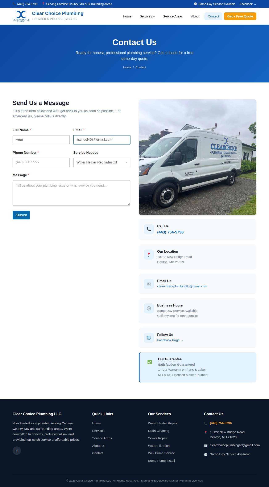

### bwnwincpainting.com — failed\_before\_submit (LIVE)

| | |
|---|---|
| Attempt ID | `30cd700c-f0aa-4505-aa38-83e21e00e98f` |
| Form URL | https://www.bwnwincpainting.com/contact/ |
| Final URL | — |
| Reserved | 2026-11-04 06:17:04 UTC |
| Submit attempted | — |
| Template | standard v2 |
| Confirmation text | none observed |
| Result / error | locator.fill: Error: Cannot type text into input\[type=number\] |

Exact message:

~~~text
Subject: Helping customers find your business in AI search (AEO + GEO)

Hi there,

I'm Arun from Devs Arun. More and more customers now ask ChatGPT, Gemini, Perplexity or Google's AI Overviews questions like "who should I hire for this in my area?" before they call anyone. These tools answer from websites they can clearly understand, and they tend to recommend businesses whose pages answer real customer questions.

That is what AEO + GEO (Answer Engine and Generative Engine Optimization) is for. I improve your existing service pages so they clearly answer the questions your customers ask, add structured data that matches the page, and make the call, quote or enquiry step obvious. The benefit: your business gets a better chance of being mentioned or linked in AI answers, and visitors who arrive find it easy to contact you.

The AEO + GEO Starter is a one-time $199 (about ₹16,999, negotiable) for one website: a basic audit, 10 customer questions, improvements to two existing pages, relevant structured data and an action plan, with one revision round.

You can read the full details, send an enquiry or book online here:
https://devsarun.io/aeo-geo/

If this isn't relevant, just reply and I won't contact you again.

Best,
Arun
Devs Arun
itschool408@gmail.com · +91 7654534323
~~~

Submitted field values:

- \#name-1151: Arun
- \#email-1151: itschool408@gmail.com
- \#phone-1151: +91 7654534323
- \#message-1151: Hi there, I'm Arun from Devs Arun. More and more customers now ask ChatGPT, Gemini, Perplexity or Google's AI Overviews 

**Inspected page** — `run-a3840ddd_attempt-30cd700c_inspection_2026-11-04T06-17-06-440Z.jpg`

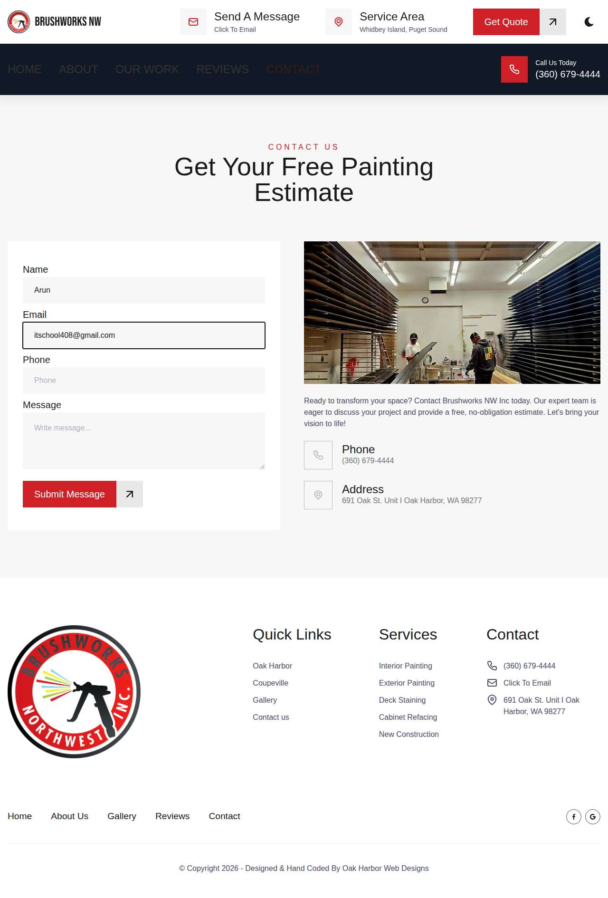

### absoluterestorepa.com — failed\_before\_submit (LIVE)

| | |
|---|---|
| Attempt ID | `971bc945-660c-4d9a-97e2-436d6c307924` |
| Form URL | https://absoluterestorepa.com/contact-us/ |
| Final URL | — |
| Reserved | 2026-11-04 06:17:11 UTC |
| Submit attempted | — |
| Template | standard v2 |
| Confirmation text | none observed |
| Result / error | locator.fill: Error: Cannot type text into input\[type=number\] |

Exact message:

~~~text
Subject: Helping customers find your business in AI search (AEO + GEO)

Hi there,

I'm Arun from Devs Arun. More and more customers now ask ChatGPT, Gemini, Perplexity or Google's AI Overviews questions like "who should I hire for this in my area?" before they call anyone. These tools answer from websites they can clearly understand, and they tend to recommend businesses whose pages answer real customer questions.

That is what AEO + GEO (Answer Engine and Generative Engine Optimization) is for. I improve your existing service pages so they clearly answer the questions your customers ask, add structured data that matches the page, and make the call, quote or enquiry step obvious. The benefit: your business gets a better chance of being mentioned or linked in AI answers, and visitors who arrive find it easy to contact you.

The AEO + GEO Starter is a one-time $199 (about ₹16,999, negotiable) for one website: a basic audit, 10 customer questions, improvements to two existing pages, relevant structured data and an action plan, with one revision round.

You can read the full details, send an enquiry or book online here:
https://devsarun.io/aeo-geo/

If this isn't relevant, just reply and I won't contact you again.

Best,
Arun
Devs Arun
itschool408@gmail.com · +91 7654534323
~~~

Submitted field values:

- \#form-field-name: Arun
- \#form-field-message: Hi there, I'm Arun from Devs Arun. More and more customers now ask ChatGPT, Gemini, Perplexity or Google's AI Overviews 
- \#form-field-field\_ed02ec2: +91 7654534323
- \#content \> div \> div \> div:nth-of-type(2) \> div \> div:nth-of-type(1) \> div:nth-of-type(2) \> div \> form \> div \> div:nth-of-type(3) \> input: itschool408@gmail.com

**Inspected page** — `run-a3840ddd_attempt-971bc945_inspection_2026-11-04T06-17-14-292Z.jpg`

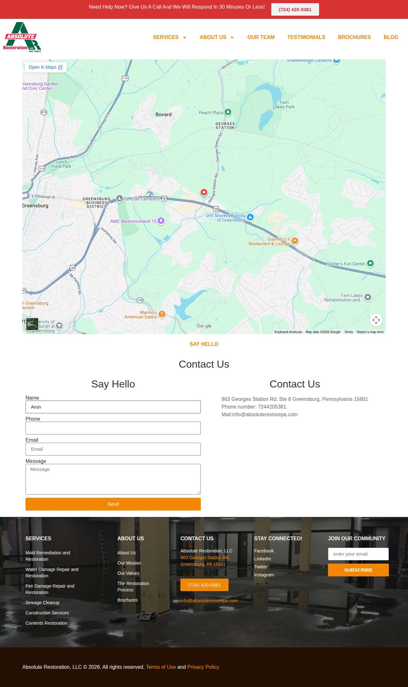

### masoudlawfirm.com — failed\_before\_submit (LIVE)

| | |
|---|---|
| Attempt ID | `a60e7a3d-fb1d-4335-b3f8-317c40789c49` |
| Form URL | https://masoudlawfirm.com/contact/ |
| Final URL | — |
| Reserved | 2026-11-04 06:17:19 UTC |
| Submit attempted | — |
| Template | standard v2 |
| Confirmation text | none observed |
| Result / error | locator.fill: Error: Cannot type text into input\[type=number\] |

Exact message:

~~~text
Subject: Helping customers find your business in AI search (AEO + GEO)

Hi there,

I'm Arun from Devs Arun. More and more customers now ask ChatGPT, Gemini, Perplexity or Google's AI Overviews questions like "who should I hire for this in my area?" before they call anyone. These tools answer from websites they can clearly understand, and they tend to recommend businesses whose pages answer real customer questions.

That is what AEO + GEO (Answer Engine and Generative Engine Optimization) is for. I improve your existing service pages so they clearly answer the questions your customers ask, add structured data that matches the page, and make the call, quote or enquiry step obvious. The benefit: your business gets a better chance of being mentioned or linked in AI answers, and visitors who arrive find it easy to contact you.

The AEO + GEO Starter is a one-time $199 (about ₹16,999, negotiable) for one website: a basic audit, 10 customer questions, improvements to two existing pages, relevant structured data and an action plan, with one revision round.

You can read the full details, send an enquiry or book online here:
https://devsarun.io/aeo-geo/

If this isn't relevant, just reply and I won't contact you again.

Best,
Arun
Devs Arun
itschool408@gmail.com · +91 7654534323
~~~

Submitted field values:

- \#form-field-name: Arun
- \#form-field-field\_3374379: Hi there, I'm Arun from Devs Arun. More and more customers now ask ChatGPT, Gemini, Perplexity or Google's AI Overviews 
- \#form-field-field\_7731784: +91 7654534323
- \#form-field-field\_8bd0f16: itschool408@gmail.com

**Inspected page** — `run-a3840ddd_attempt-a60e7a3d_inspection_2026-11-04T06-17-21-647Z.jpg`

### bbsccpa.com — failed\_before\_submit (LIVE)

| | |
|---|---|
| Attempt ID | `f787b3ea-394a-404e-af2b-37f02a2c9d37` |
| Form URL | https://www.bbsccpa.com/contact/ |
| Final URL | https://www.bbsccpa.com/contact/ |
| Reserved | 2026-11-04 06:17:26 UTC |
| Submit attempted | — |
| Template | standard v2 |
| Confirmation text | none observed |
| Result / error | Field "Phone" did not accept the value |

Exact message:

~~~text
Subject: Helping customers find your business in AI search (AEO + GEO)

Hi there,

I'm Arun from Devs Arun. More and more customers now ask ChatGPT, Gemini, Perplexity or Google's AI Overviews questions like "who should I hire for this in my area?" before they call anyone. These tools answer from websites they can clearly understand, and they tend to recommend businesses whose pages answer real customer questions.

That is what AEO + GEO (Answer Engine and Generative Engine Optimization) is for. I improve your existing service pages so they clearly answer the questions your customers ask, add structured data that matches the page, and make the call, quote or enquiry step obvious. The benefit: your business gets a better chance of being mentioned or linked in AI answers, and visitors who arrive find it easy to contact you.

The AEO + GEO Starter is a one-time $199 (about ₹16,999, negotiable) for one website: a basic audit, 10 customer questions, improvements to two existing pages, relevant structured data and an action plan, with one revision round.

You can read the full details, send an enquiry or book online here:
https://devsarun.io/aeo-geo/

If this isn't relevant, just reply and I won't contact you again.

Best,
Arun
Devs Arun
itschool408@gmail.com · +91 7654534323
~~~

Submitted field values:

- \#input\_1\_2: itschool408@gmail.com
- \#input\_1\_3: +91 7654534323
- \#input\_1\_4: Hi there, I'm Arun from Devs Arun. More and more customers now ask ChatGPT, Gemini, Perplexity or Google's AI Overviews 
- \#input\_1\_1\_3: Arun

**Filled form (before submit)** — `run-a3840ddd_attempt-f787b3ea_filled_2026-11-04T06-17-28-566Z.jpg`

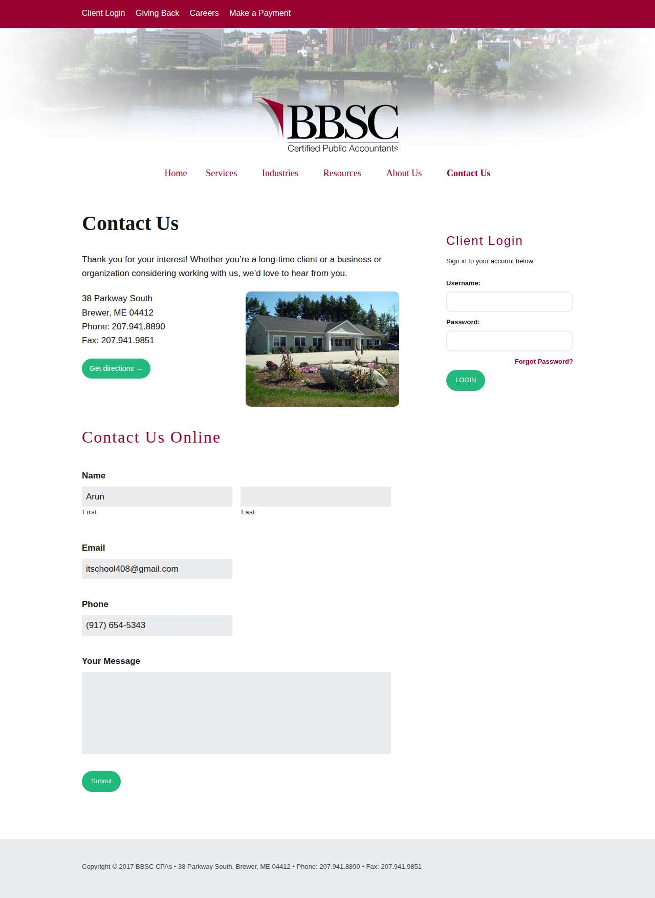

### redman-cpa.com — unclear (LIVE)

| | |
|---|---|
| Attempt ID | `8e4578a4-c6a4-4e6a-86c2-192abda715be` |
| Form URL | https://www.redman-cpa.com/contact |
| Final URL | https://www.redman-cpa.com/contact |
| Reserved | 2026-11-04 06:17:33 UTC |
| Submit attempted | 2026-11-04 06:17:36 UTC |
| Template | standard v2 |
| Confirmation text | none observed |
| Result / error | No new success marker observed |

Exact message:

~~~text
Subject: Helping customers find your business in AI search (AEO + GEO)

Hi there,

I'm Arun from Devs Arun. More and more customers now ask ChatGPT, Gemini, Perplexity or Google's AI Overviews questions like "who should I hire for this in my area?" before they call anyone. These tools answer from websites they can clearly understand, and they tend to recommend businesses whose pages answer real customer questions.

That is what AEO + GEO (Answer Engine and Generative Engine Optimization) is for. I improve your existing service pages so they clearly answer the questions your customers ask, add structured data that matches the page, and make the call, quote or enquiry step obvious. The benefit: your business gets a better chance of being mentioned or linked in AI answers, and visitors who arrive find it easy to contact you.

The AEO + GEO Starter is a one-time $199 (about ₹16,999, negotiable) for one website: a basic audit, 10 customer questions, improvements to two existing pages, relevant structured data and an action plan, with one revision round.

You can read the full details, send an enquiry or book online here:
https://devsarun.io/aeo-geo/

If this isn't relevant, just reply and I won't contact you again.

Best,
Arun
Devs Arun
itschool408@gmail.com · +91 7654534323
~~~

Submitted field values:

- Email \[email\]: itschool408@gmail.com
- Message \[message\]: Hi there, I'm Arun from Devs Arun. More and more customers now ask ChatGPT, Gemini, Perplexity or Google's AI Overviews 

**Filled form (before submit)** — `run-a3840ddd_attempt-8e4578a4_filled_2026-11-04T06-17-36-364Z.jpg`

**After submit** — `run-a3840ddd_attempt-8e4578a4_post_attempt_2026-11-04T06-18-04-715Z.jpg`

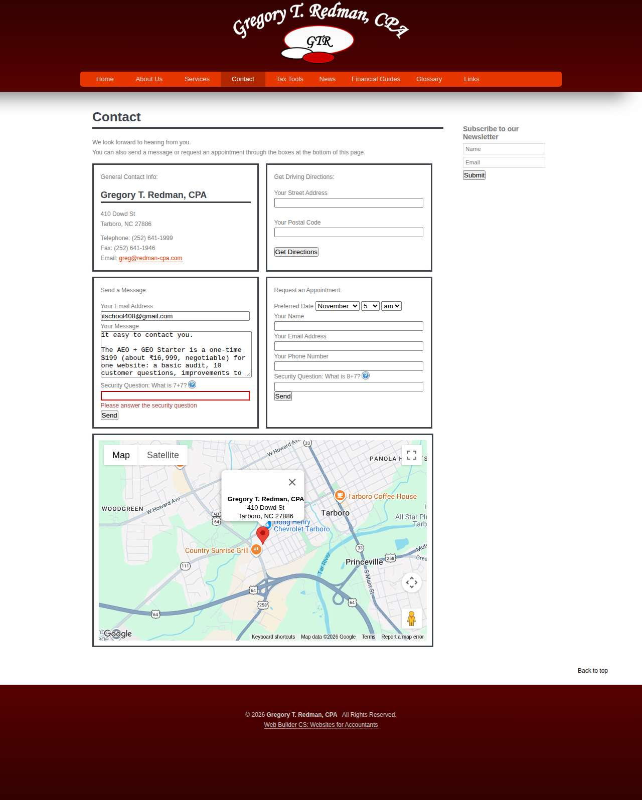

### libertaccounting.com — unclear (LIVE)

| | |
|---|---|
| Attempt ID | `dd4093d9-69eb-41f2-9a9b-5429c7503167` |
| Form URL | https://libertaccounting.com/contactos/ |
| Final URL | https://libertaccounting.com/contactos/ |
| Reserved | 2026-11-04 06:18:12 UTC |
| Submit attempted | 2026-11-04 06:18:14 UTC |
| Template | standard v2 |
| Confirmation text | none observed |
| Result / error | No new success marker observed |

Exact message:

~~~text
Subject: Helping customers find your business in AI search (AEO + GEO)

Hi there,

I'm Arun from Devs Arun. More and more customers now ask ChatGPT, Gemini, Perplexity or Google's AI Overviews questions like "who should I hire for this in my area?" before they call anyone. These tools answer from websites they can clearly understand, and they tend to recommend businesses whose pages answer real customer questions.

That is what AEO + GEO (Answer Engine and Generative Engine Optimization) is for. I improve your existing service pages so they clearly answer the questions your customers ask, add structured data that matches the page, and make the call, quote or enquiry step obvious. The benefit: your business gets a better chance of being mentioned or linked in AI answers, and visitors who arrive find it easy to contact you.

The AEO + GEO Starter is a one-time $199 (about ₹16,999, negotiable) for one website: a basic audit, 10 customer questions, improvements to two existing pages, relevant structured data and an action plan, with one revision round.

You can read the full details, send an enquiry or book online here:
https://devsarun.io/aeo-geo/

If this isn't relevant, just reply and I won't contact you again.

Best,
Arun
Devs Arun
itschool408@gmail.com · +91 7654534323
~~~

Submitted field values:

- Nombre \[name\]: Arun
- Mensaje \[message\]: Hi there, I'm Arun from Devs Arun. More and more customers now ask ChatGPT, Gemini, Perplexity or Google's AI Overviews 
- Teléfono \[phone\]: +91 7654534323
- Correo electrónico \[email\]: itschool408@gmail.com

**Filled form (before submit)** — `run-a3840ddd_attempt-dd4093d9_filled_2026-11-04T06-18-14-858Z.jpg`

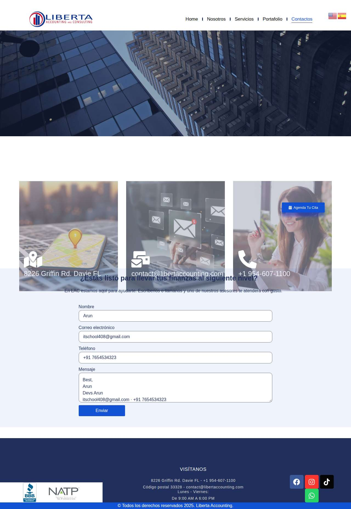

**After submit** — `run-a3840ddd_attempt-dd4093d9_post_attempt_2026-11-04T06-18-43-087Z.jpg`

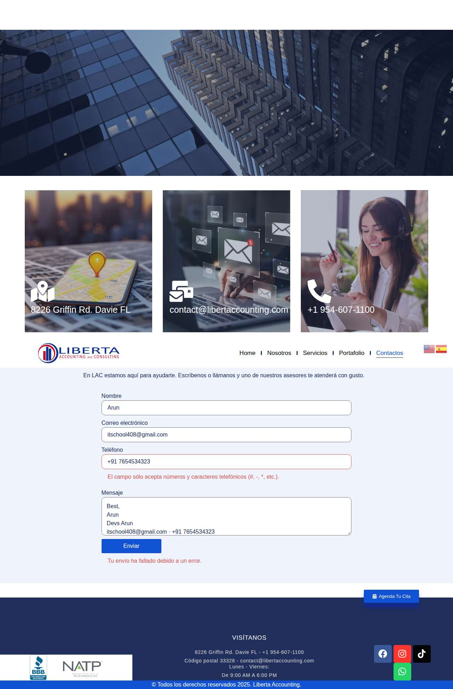

### rejaccounting.com — error\_after\_submit (LIVE)

| | |
|---|---|
| Attempt ID | `9a82374a-3333-4cad-9469-6dd002f678cc` |
| Form URL | http://www.rejaccounting.com/contact.html |
| Final URL | http://www.rejaccounting.com/contact.html |
| Reserved | 2026-11-04 06:18:51 UTC |
| Submit attempted | 2026-11-04 06:18:52 UTC |
| Template | standard v2 |
| Confirmation text | act Us Failed to query the server. Check the connection and try again. Email Us: Submit Contact Info: Phone +1 (734) 284-8833 Fax: (734) 284-7205 Email Use form above Ad |
| Result / error | — |

Exact message:

~~~text
Subject: Helping customers find your business in AI search (AEO + GEO)

Hi there,

I'm Arun from Devs Arun. More and more customers now ask ChatGPT, Gemini, Perplexity or Google's AI Overviews questions like "who should I hire for this in my area?" before they call anyone. These tools answer from websites they can clearly understand, and they tend to recommend businesses whose pages answer real customer questions.

That is what AEO + GEO (Answer Engine and Generative Engine Optimization) is for. I improve your existing service pages so they clearly answer the questions your customers ask, add structured data that matches the page, and make the call, quote or enquiry step obvious. The benefit: your business gets a better chance of being mentioned or linked in AI answers, and visitors who arrive find it easy to contact you.

The AEO + GEO Starter is a one-time $199 (about ₹16,999, negotiable) for one website: a basic audit, 10 customer questions, improvements to two existing pages, relevant structured data and an action plan, with one revision round.

You can read the full details, send an enquiry or book online here:
https://devsarun.io/aeo-geo/

If this isn't relevant, just reply and I won't contact you again.

Best,
Arun
Devs Arun
itschool408@gmail.com · +91 7654534323
~~~

Submitted field values:

- name \[name\]: Arun
- email \[email\]: itschool408@gmail.com
- phone \[phone\]: +91 7654534323
- message \[message\]: Hi there, I'm Arun from Devs Arun. More and more customers now ask ChatGPT, Gemini, Perplexity or Google's AI Overviews 

**Filled form (before submit)** — `run-a3840ddd_attempt-9a82374a_filled_2026-11-04T06-18-52-736Z.jpg`

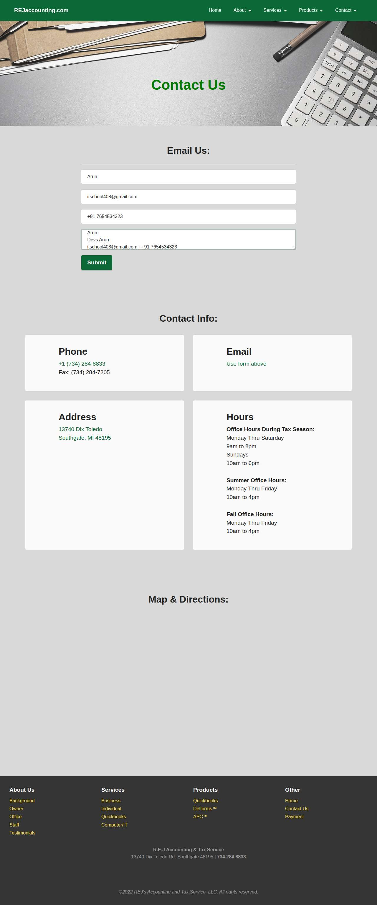

**After submit** — `run-a3840ddd_attempt-9a82374a_post_attempt_2026-11-04T06-18-56-904Z.jpg`

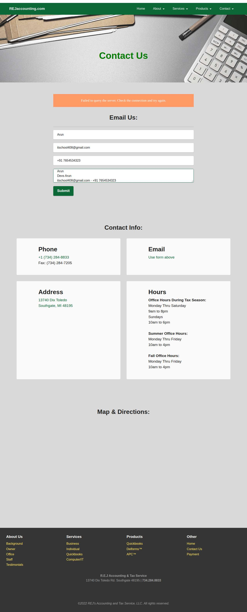

### cpabluffton.com — unclear (LIVE)

| | |
|---|---|
| Attempt ID | `f9e793b9-acd6-4604-9f44-06db05a922cb` |
| Form URL | https://www.cpabluffton.com/contact |
| Final URL | https://www.cpabluffton.com/contact |
| Reserved | 2026-11-04 06:19:04 UTC |
| Submit attempted | 2026-11-04 06:19:07 UTC |
| Template | standard v2 |
| Confirmation text | none observed |
| Result / error | No new success marker observed |

Exact message:

~~~text
Subject: Helping customers find your business in AI search (AEO + GEO)

Hi there,

I'm Arun from Devs Arun. More and more customers now ask ChatGPT, Gemini, Perplexity or Google's AI Overviews questions like "who should I hire for this in my area?" before they call anyone. These tools answer from websites they can clearly understand, and they tend to recommend businesses whose pages answer real customer questions.

That is what AEO + GEO (Answer Engine and Generative Engine Optimization) is for. I improve your existing service pages so they clearly answer the questions your customers ask, add structured data that matches the page, and make the call, quote or enquiry step obvious. The benefit: your business gets a better chance of being mentioned or linked in AI answers, and visitors who arrive find it easy to contact you.

The AEO + GEO Starter is a one-time $199 (about ₹16,999, negotiable) for one website: a basic audit, 10 customer questions, improvements to two existing pages, relevant structured data and an action plan, with one revision round.

You can read the full details, send an enquiry or book online here:
https://devsarun.io/aeo-geo/

If this isn't relevant, just reply and I won't contact you again.

Best,
Arun
Devs Arun
itschool408@gmail.com · +91 7654534323
~~~

Submitted field values:

- email \[email\]: itschool408@gmail.com
- name-\* \[name\]: Arun
- Message \[message\]: Hi there, I'm Arun from Devs Arun. More and more customers now ask ChatGPT, Gemini, Perplexity or Google's AI Overviews 
- subject \[subject\]: Helping customers find your business in AI search (AEO + GEO)

**Filled form (before submit)** — `run-a3840ddd_attempt-f9e793b9_filled_2026-11-04T06-19-07-671Z.jpg`

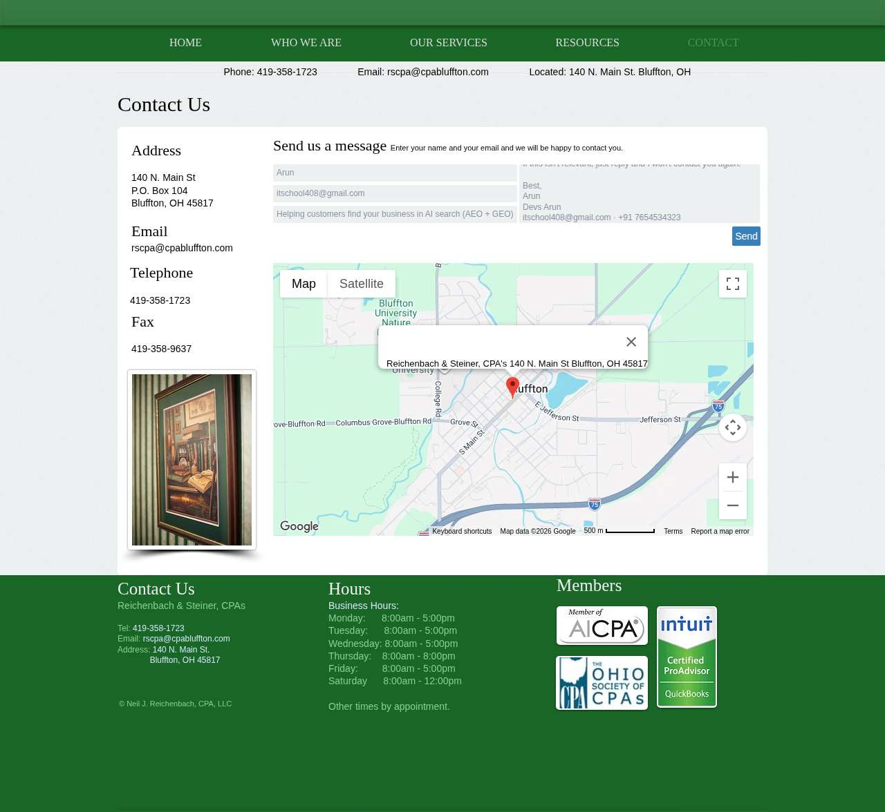

**After submit** — `run-a3840ddd_attempt-f9e793b9_post_attempt_2026-11-04T06-19-35-856Z.jpg`

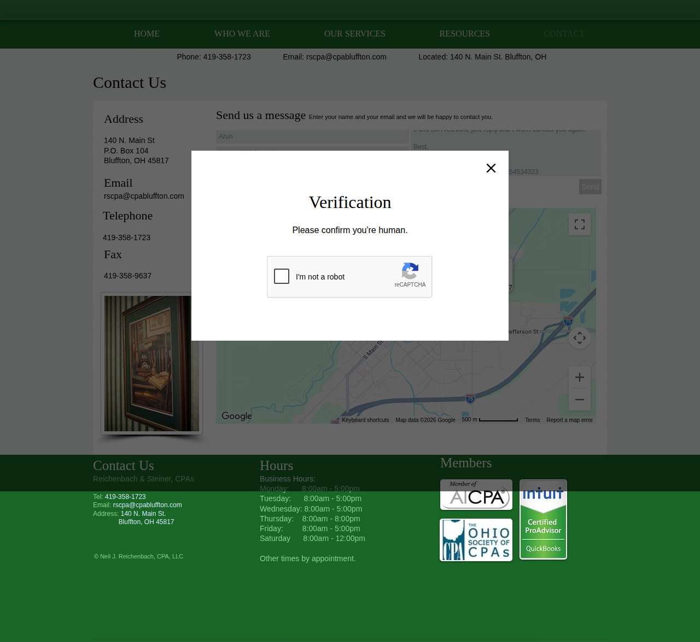

### flemingfundservices.com — error\_after\_submit (LIVE)

| | |
|---|---|
| Attempt ID | `c25980bf-758d-4765-86e9-e293de26da5a` |
| Form URL | https://www.flemingfundservices.com/contact/ |
| Final URL | https://www.flemingfundservices.com/contact/ |
| Reserved | 2026-11-04 06:19:44 UTC |
| Submit attempted | 2026-11-04 06:19:46 UTC |
| Template | standard v2 |
| Confirmation text | e to receive emails from us in the future?(Required) No Yes This field is required. SUBMIT Maryland Office 514 South Main Street, Suite A Bel Air, MD 21014 Phone: 410-803-9211 Fax: 4 |
| Result / error | — |

Exact message:

~~~text
Subject: Helping customers find your business in AI search (AEO + GEO)

Hi there,

I'm Arun from Devs Arun. More and more customers now ask ChatGPT, Gemini, Perplexity or Google's AI Overviews questions like "who should I hire for this in my area?" before they call anyone. These tools answer from websites they can clearly understand, and they tend to recommend businesses whose pages answer real customer questions.

That is what AEO + GEO (Answer Engine and Generative Engine Optimization) is for. I improve your existing service pages so they clearly answer the questions your customers ask, add structured data that matches the page, and make the call, quote or enquiry step obvious. The benefit: your business gets a better chance of being mentioned or linked in AI answers, and visitors who arrive find it easy to contact you.

The AEO + GEO Starter is a one-time $199 (about ₹16,999, negotiable) for one website: a basic audit, 10 customer questions, improvements to two existing pages, relevant structured data and an action plan, with one revision round.

You can read the full details, send an enquiry or book online here:
https://devsarun.io/aeo-geo/

If this isn't relevant, just reply and I won't contact you again.

Best,
Arun
Devs Arun
itschool408@gmail.com · +91 7654534323
~~~

Submitted field values:

- Phone \[phone\]: +91 7654534323
- Message \[message\]: Hi there, I'm Arun from Devs Arun. More and more customers now ask ChatGPT, Gemini, Perplexity or Google's AI Overviews 
- Name(Required) \[name\]: Arun
- Email(Required) \[email\]: itschool408@gmail.com

**Filled form (before submit)** — `run-a3840ddd_attempt-c25980bf_filled_2026-11-04T06-19-46-613Z.jpg`

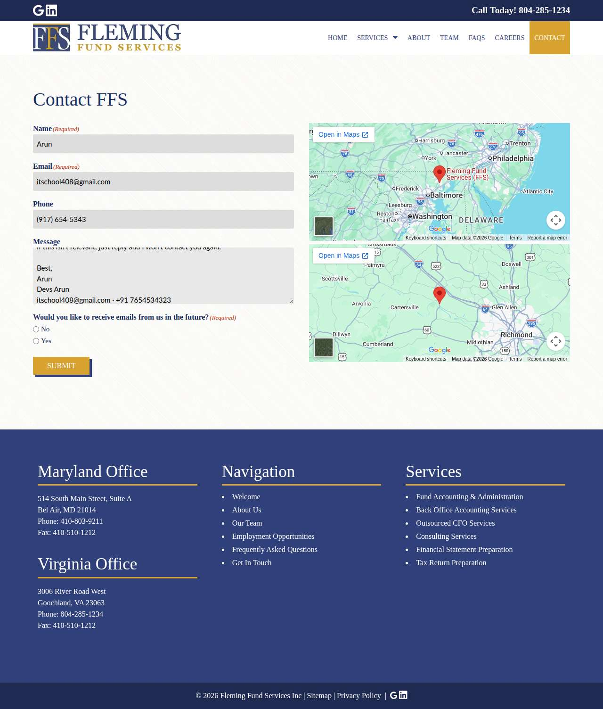

**After submit** — `run-a3840ddd_attempt-c25980bf_post_attempt_2026-11-04T06-19-53-145Z.jpg`

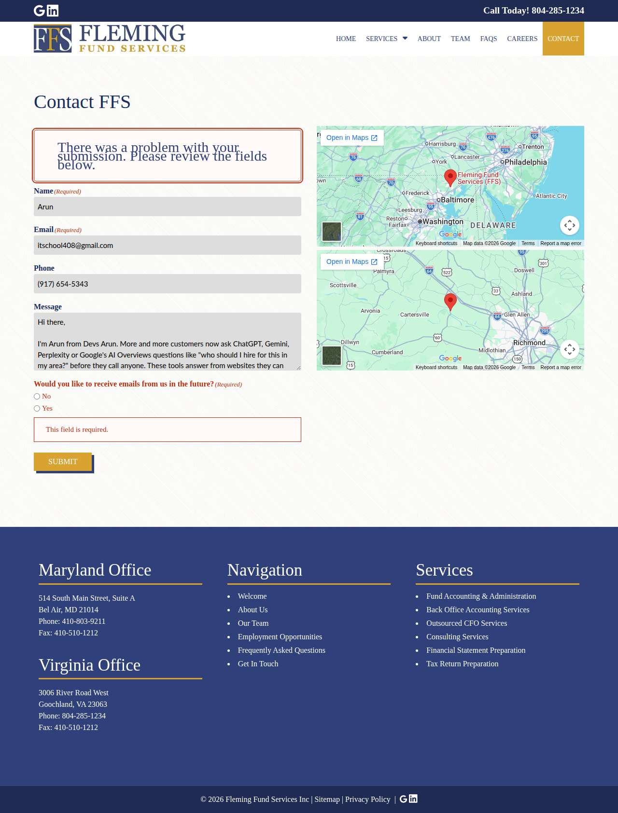

### speedcpas.com — confirmed (LIVE)

| | |
|---|---|
| Attempt ID | `9b08f6b8-5b55-49a4-9501-031142cbb5a2` |
| Form URL | https://hracpa.com/ |
| Final URL | https://hracpa.com/ |
| Reserved | 2026-11-04 06:20:01 UTC |
| Submit attempted | 2026-11-04 06:20:03 UTC |
| Template | standard v2 |
| Confirmation text | ervices Specialized Industries Accounting Software Training We Appreciate Your Patronage And Invite You To Communicate With Us Online Anytime, 24 Hours A Day, 7 Days A Week. APPO |
| Result / error | — |

Exact message:

~~~text
Subject: Helping customers find your business in AI search (AEO + GEO)

Hi there,

I'm Arun from Devs Arun. More and more customers now ask ChatGPT, Gemini, Perplexity or Google's AI Overviews questions like "who should I hire for this in my area?" before they call anyone. These tools answer from websites they can clearly understand, and they tend to recommend businesses whose pages answer real customer questions.

That is what AEO + GEO (Answer Engine and Generative Engine Optimization) is for. I improve your existing service pages so they clearly answer the questions your customers ask, add structured data that matches the page, and make the call, quote or enquiry step obvious. The benefit: your business gets a better chance of being mentioned or linked in AI answers, and visitors who arrive find it easy to contact you.

The AEO + GEO Starter is a one-time $199 (about ₹16,999, negotiable) for one website: a basic audit, 10 customer questions, improvements to two existing pages, relevant structured data and an action plan, with one revision round.

You can read the full details, send an enquiry or book online here:
https://devsarun.io/aeo-geo/

If this isn't relevant, just reply and I won't contact you again.

Best,
Arun
Devs Arun
itschool408@gmail.com · +91 7654534323
~~~

Submitted field values:

- email \[email\]: itschool408@gmail.com
- phone \[phone\]: +91 7654534323
- nf-field-8 \[message\]: Hi there, I'm Arun from Devs Arun. More and more customers now ask ChatGPT, Gemini, Perplexity or Google's AI Overviews 
- nf-field-5-textbox \[name\]: Arun

**Filled form (before submit)** — `run-a3840ddd_attempt-9b08f6b8_filled_2026-11-04T06-20-03-012Z.jpg`

**After submit** — `run-a3840ddd_attempt-9b08f6b8_post_attempt_2026-11-04T06-20-09-411Z.jpg`

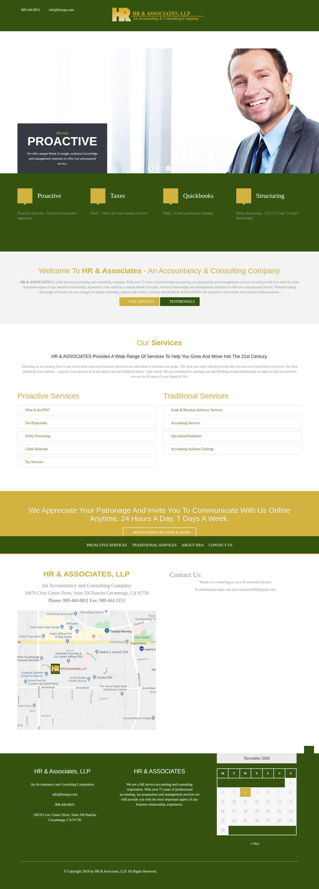

### brimcpas.com — confirmed (LIVE)

| | |
|---|---|
| Attempt ID | `dd80c0a8-0dc2-4dda-b0bd-427c2dec8375` |
| Form URL | http://brimcpas.com/contact/ |
| Final URL | http://brimcpas.com/contact/ |
| Reserved | 2026-11-04 06:20:17 UTC |
| Submit attempted | 2026-11-04 06:20:20 UTC |
| Template | standard v2 |
| Confirmation text | you as soon as we can. We look forward to hearing from you\! Thank you for your message. It has been sent. Your Name (required) Your Email (required) Subject Your Message \[recaptcha\] Loca |
| Result / error | — |

Exact message:

~~~text
Subject: Helping customers find your business in AI search (AEO + GEO)

Hi there,

I'm Arun from Devs Arun. More and more customers now ask ChatGPT, Gemini, Perplexity or Google's AI Overviews questions like "who should I hire for this in my area?" before they call anyone. These tools answer from websites they can clearly understand, and they tend to recommend businesses whose pages answer real customer questions.

That is what AEO + GEO (Answer Engine and Generative Engine Optimization) is for. I improve your existing service pages so they clearly answer the questions your customers ask, add structured data that matches the page, and make the call, quote or enquiry step obvious. The benefit: your business gets a better chance of being mentioned or linked in AI answers, and visitors who arrive find it easy to contact you.

The AEO + GEO Starter is a one-time $199 (about ₹16,999, negotiable) for one website: a basic audit, 10 customer questions, improvements to two existing pages, relevant structured data and an action plan, with one revision round.

You can read the full details, send an enquiry or book online here:
https://devsarun.io/aeo-geo/

If this isn't relevant, just reply and I won't contact you again.

Best,
Arun
Devs Arun
itschool408@gmail.com · +91 7654534323
~~~

Submitted field values:

- Subject \[subject\]: Helping customers find your business in AI search (AEO + GEO)
- Your Message \[message\]: Hi there, I'm Arun from Devs Arun. More and more customers now ask ChatGPT, Gemini, Perplexity or Google's AI Overviews 
- Your Name (required) \[name\]: Arun
- Your Email (required) \[email\]: itschool408@gmail.com

**Filled form (before submit)** — `run-a3840ddd_attempt-dd80c0a8_filled_2026-11-04T06-20-20-227Z.jpg`

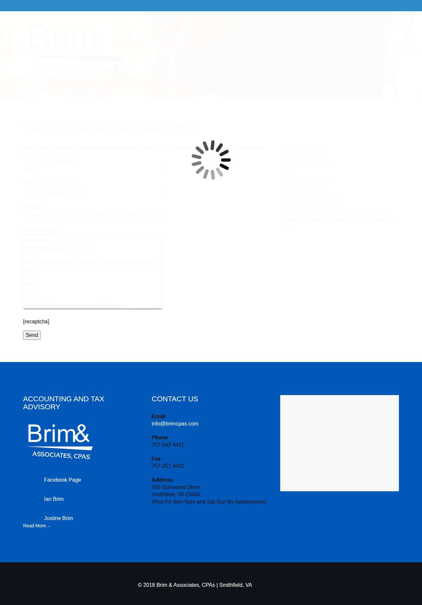

**After submit** — `run-a3840ddd_attempt-dd80c0a8_post_attempt_2026-11-04T06-20-32-397Z.jpg`

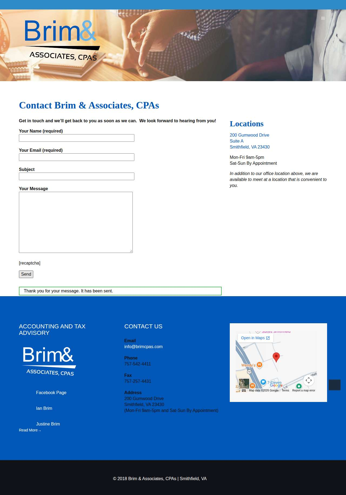

### joewrightcpa.com — confirmed (LIVE)

| | |
|---|---|
| Attempt ID | `f25e2c84-3d90-4445-97a9-06ecce2bc135` |
| Form URL | https://www.adaptfirst.com/contact/ |
| Final URL | https://www.adaptfirst.com/contact/ |
| Reserved | 2026-11-04 06:20:40 UTC |
| Submit attempted | 2026-11-04 06:20:42 UTC |
| Template | standard v2 |
| Confirmation text | ur teammates will contact you within 1 business day. SUBMIT Message Sent\! Balancing Money, Life & Wealth Our friendly experts are ready to help Schedule Appointment (opens |
| Result / error | — |

Exact message:

~~~text
Subject: Helping customers find your business in AI search (AEO + GEO)

Hi there,

I'm Arun from Devs Arun. More and more customers now ask ChatGPT, Gemini, Perplexity or Google's AI Overviews questions like "who should I hire for this in my area?" before they call anyone. These tools answer from websites they can clearly understand, and they tend to recommend businesses whose pages answer real customer questions.

That is what AEO + GEO (Answer Engine and Generative Engine Optimization) is for. I improve your existing service pages so they clearly answer the questions your customers ask, add structured data that matches the page, and make the call, quote or enquiry step obvious. The benefit: your business gets a better chance of being mentioned or linked in AI answers, and visitors who arrive find it easy to contact you.

The AEO + GEO Starter is a one-time $199 (about ₹16,999, negotiable) for one website: a basic audit, 10 customer questions, improvements to two existing pages, relevant structured data and an action plan, with one revision round.

You can read the full details, send an enquiry or book online here:
https://devsarun.io/aeo-geo/

If this isn't relevant, just reply and I won't contact you again.

Best,
Arun
Devs Arun
itschool408@gmail.com · +91 7654534323
~~~

Submitted field values:

- text \[name\]: Arun
- email \[email\]: itschool408@gmail.com
- text \[subject\]: Helping customers find your business in AI search (AEO + GEO)
- uabb-message \[message\]: Hi there, I'm Arun from Devs Arun. More and more customers now ask ChatGPT, Gemini, Perplexity or Google's AI Overviews 

**Filled form (before submit)** — `run-a3840ddd_attempt-f25e2c84_filled_2026-11-04T06-20-42-731Z.jpg`

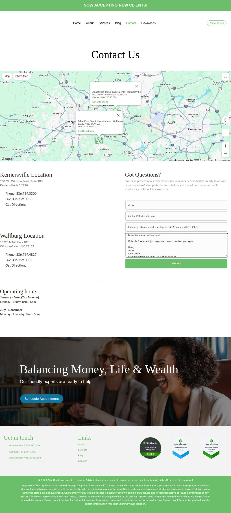

**After submit** — `run-a3840ddd_attempt-f25e2c84_post_attempt_2026-11-04T06-20-47-816Z.jpg`

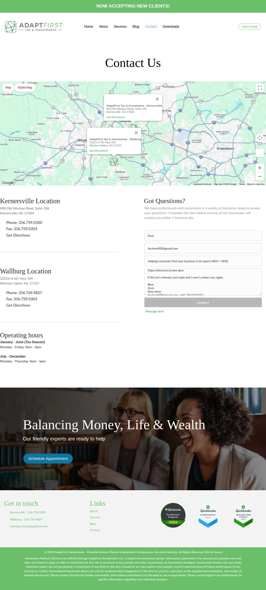

### advocatecpa.net — unclear (LIVE)

| | |
|---|---|
| Attempt ID | `e8a564e6-3ed1-41ae-b8c1-87d13a8785d5` |
| Form URL | https://www.advocatecpa.net/ |
| Final URL | chrome-error://chromewebdata/ |
| Reserved | 2026-11-04 06:20:55 UTC |
| Submit attempted | 2026-11-04 06:20:57 UTC |
| Template | standard v2 |
| Confirmation text | none observed |
| Result / error | No new success marker observed |

Exact message:

~~~text
Subject: Helping customers find your business in AI search (AEO + GEO)

Hi there,

I'm Arun from Devs Arun. More and more customers now ask ChatGPT, Gemini, Perplexity or Google's AI Overviews questions like "who should I hire for this in my area?" before they call anyone. These tools answer from websites they can clearly understand, and they tend to recommend businesses whose pages answer real customer questions.

That is what AEO + GEO (Answer Engine and Generative Engine Optimization) is for. I improve your existing service pages so they clearly answer the questions your customers ask, add structured data that matches the page, and make the call, quote or enquiry step obvious. The benefit: your business gets a better chance of being mentioned or linked in AI answers, and visitors who arrive find it easy to contact you.

The AEO + GEO Starter is a one-time $199 (about ₹16,999, negotiable) for one website: a basic audit, 10 customer questions, improvements to two existing pages, relevant structured data and an action plan, with one revision round.

You can read the full details, send an enquiry or book online here:
https://devsarun.io/aeo-geo/

If this isn't relevant, just reply and I won't contact you again.

Best,
Arun
Devs Arun
itschool408@gmail.com · +91 7654534323
~~~

Submitted field values:

- name \[name\]: Arun
- email \[email\]: itschool408@gmail.com
- comments \[message\]: Hi there, I'm Arun from Devs Arun. More and more customers now ask ChatGPT, Gemini, Perplexity or Google's AI Overviews 

**Filled form (before submit)** — `run-a3840ddd_attempt-e8a564e6_filled_2026-11-04T06-20-57-106Z.jpg`

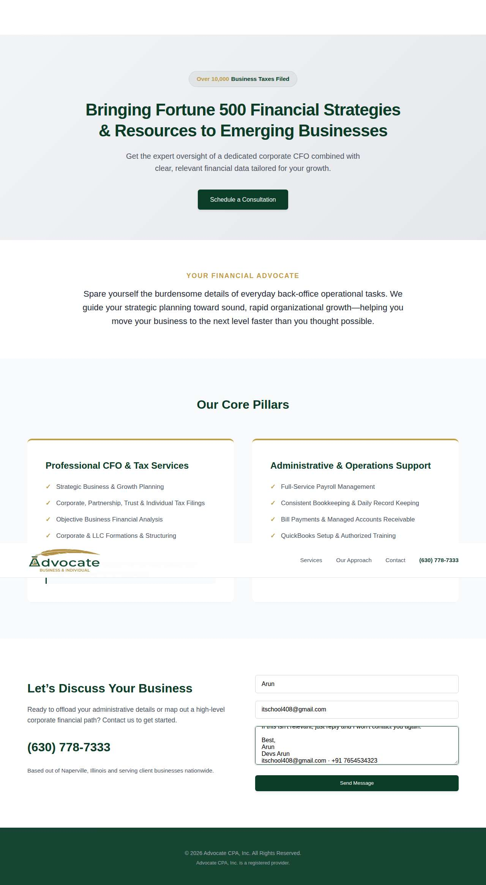

**After submit** — `run-a3840ddd_attempt-e8a564e6_post_attempt_2026-11-04T06-21-25-418Z.jpg`

### lba2.us — unclear (LIVE)

| | |
|---|---|
| Attempt ID | `fb77466c-4bac-44b7-a78f-6006d82272be` |
| Form URL | https://www.lba2.us/contact |
| Final URL | https://www.lba2.us/contact |
| Reserved | 2026-11-04 06:21:33 UTC |
| Submit attempted | 2026-11-04 06:21:35 UTC |
| Template | standard v2 |
| Confirmation text | none observed |
| Result / error | No new success marker observed |

Exact message:

~~~text
Subject: Helping customers find your business in AI search (AEO + GEO)

Hi there,

I'm Arun from Devs Arun. More and more customers now ask ChatGPT, Gemini, Perplexity or Google's AI Overviews questions like "who should I hire for this in my area?" before they call anyone. These tools answer from websites they can clearly understand, and they tend to recommend businesses whose pages answer real customer questions.

That is what AEO + GEO (Answer Engine and Generative Engine Optimization) is for. I improve your existing service pages so they clearly answer the questions your customers ask, add structured data that matches the page, and make the call, quote or enquiry step obvious. The benefit: your business gets a better chance of being mentioned or linked in AI answers, and visitors who arrive find it easy to contact you.

The AEO + GEO Starter is a one-time $199 (about ₹16,999, negotiable) for one website: a basic audit, 10 customer questions, improvements to two existing pages, relevant structured data and an action plan, with one revision round.

You can read the full details, send an enquiry or book online here:
https://devsarun.io/aeo-geo/

If this isn't relevant, just reply and I won't contact you again.

Best,
Arun
Devs Arun
itschool408@gmail.com · +91 7654534323
~~~

Submitted field values:

- Enter your name \[name\]: Arun
- Enter your email \[email\]: itschool408@gmail.com
- Enter your phone \[phone\]: +91 7654534323
- Enter your message \[message\]: Hi there, I'm Arun from Devs Arun. More and more customers now ask ChatGPT, Gemini, Perplexity or Google's AI Overviews 

**Filled form (before submit)** — `run-a3840ddd_attempt-fb77466c_filled_2026-11-04T06-21-35-612Z.jpg`

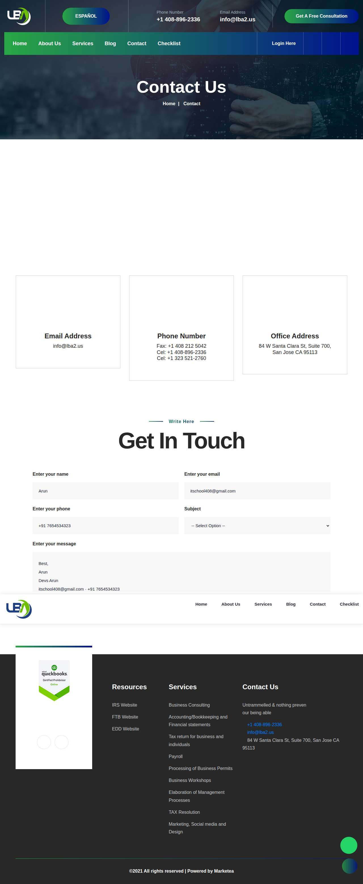

**After submit** — `run-a3840ddd_attempt-fb77466c_post_attempt_2026-11-04T06-22-05-651Z.jpg`

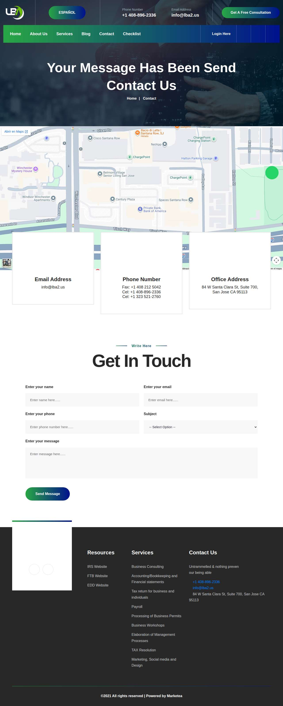

### taxsrvcsrgg.com — confirmed (LIVE)

| | |
|---|---|
| Attempt ID | `a2359591-182c-4ff5-9ced-887ca087b6e7` |
| Form URL | https://taxsrvcsrgg.com/contacts/ |
| Final URL | https://taxsrvcsrgg.com/contacts/ |
| Reserved | 2026-11-04 06:22:13 UTC |
| Submit attempted | 2026-11-04 06:22:17 UTC |
| Template | standard v2 |
| Confirmation text | -7 Houston, Texas 77092  E-mail: info@taxsrvcsrgg.com Your message was sent successfully SEND About This is our promises to you: Keeping your books in order and up-to-date is |
| Result / error | — |

Exact message:

~~~text
Subject: Helping customers find your business in AI search (AEO + GEO)

Hi there,

I'm Arun from Devs Arun. More and more customers now ask ChatGPT, Gemini, Perplexity or Google's AI Overviews questions like "who should I hire for this in my area?" before they call anyone. These tools answer from websites they can clearly understand, and they tend to recommend businesses whose pages answer real customer questions.

That is what AEO + GEO (Answer Engine and Generative Engine Optimization) is for. I improve your existing service pages so they clearly answer the questions your customers ask, add structured data that matches the page, and make the call, quote or enquiry step obvious. The benefit: your business gets a better chance of being mentioned or linked in AI answers, and visitors who arrive find it easy to contact you.

The AEO + GEO Starter is a one-time $199 (about ₹16,999, negotiable) for one website: a basic audit, 10 customer questions, improvements to two existing pages, relevant structured data and an action plan, with one revision round.

You can read the full details, send an enquiry or book online here:
https://devsarun.io/aeo-geo/

If this isn't relevant, just reply and I won't contact you again.

Best,
Arun
Devs Arun
itschool408@gmail.com · +91 7654534323
~~~

Submitted field values:

- Name \[name\]: Arun
- Company \[phone\]: +91 7654534323
- Message \[message\]: Hi there, I'm Arun from Devs Arun. More and more customers now ask ChatGPT, Gemini, Perplexity or Google's AI Overviews 
- Subject \[subject\]: Helping customers find your business in AI search (AEO + GEO)
- Your Email \[email\]: itschool408@gmail.com

**Filled form (before submit)** — `run-a3840ddd_attempt-a2359591_filled_2026-11-04T06-22-17-398Z.jpg`

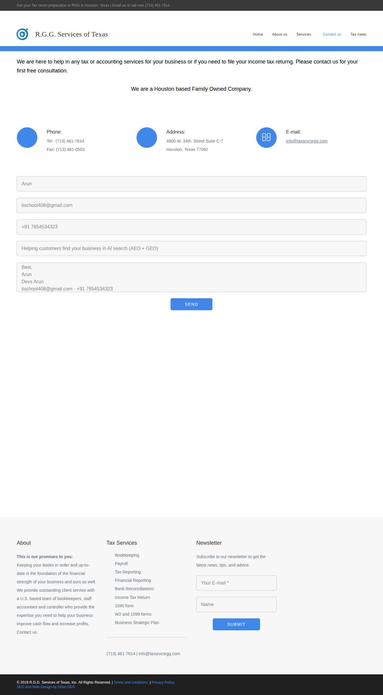

**After submit** — `run-a3840ddd_attempt-a2359591_post_attempt_2026-11-04T06-22-22-018Z.jpg`

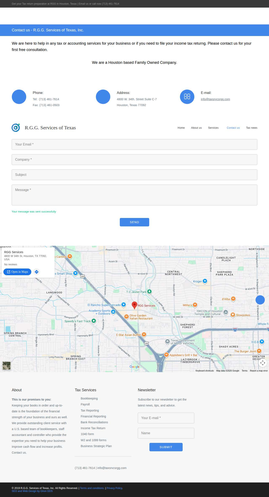

### bentoncountycpa.com — confirmed (LIVE)

| | |
|---|---|
| Attempt ID | `2e6a2aa7-b923-4c2d-b3ef-92e4b27a2f11` |
| Form URL | https://bentoncountycpa.com/contact/ |
| Final URL | https://bentoncountycpa.com/contact/ |
| Reserved | 2026-11-04 06:22:30 UTC |
| Submit attempted | 2026-11-04 06:22:32 UTC |
| Template | standard v2 |
| Confirmation text | ngs, AR 72718  Mon-Sat: 8am-5pm, Sun: Closed Form has been successfully submitted. Thank you. Designed by Relative Digital Marketing \| Dianna G Bashaw, CPA \| ALL RIGHTS RESERVED |
| Result / error | — |

Exact message:

~~~text
Subject: Helping customers find your business in AI search (AEO + GEO)

Hi there,

I'm Arun from Devs Arun. More and more customers now ask ChatGPT, Gemini, Perplexity or Google's AI Overviews questions like "who should I hire for this in my area?" before they call anyone. These tools answer from websites they can clearly understand, and they tend to recommend businesses whose pages answer real customer questions.

That is what AEO + GEO (Answer Engine and Generative Engine Optimization) is for. I improve your existing service pages so they clearly answer the questions your customers ask, add structured data that matches the page, and make the call, quote or enquiry step obvious. The benefit: your business gets a better chance of being mentioned or linked in AI answers, and visitors who arrive find it easy to contact you.

The AEO + GEO Starter is a one-time $199 (about ₹16,999, negotiable) for one website: a basic audit, 10 customer questions, improvements to two existing pages, relevant structured data and an action plan, with one revision round.

You can read the full details, send an enquiry or book online here:
https://devsarun.io/aeo-geo/

If this isn't relevant, just reply and I won't contact you again.

Best,
Arun
Devs Arun
itschool408@gmail.com · +91 7654534323
~~~

Submitted field values:

- Name \* \[name\]: Arun
- Subject \* \[subject\]: Helping customers find your business in AI search (AEO + GEO)
- Email Address \* \[email\]: itschool408@gmail.com
- Company Name \* \[company\]: Devs Arun
- Comments / Questions \* \[message\]: Hi there, I'm Arun from Devs Arun. More and more customers now ask ChatGPT, Gemini, Perplexity or Google's AI Overviews 

**Filled form (before submit)** — `run-a3840ddd_attempt-2e6a2aa7_filled_2026-11-04T06-22-32-776Z.jpg`

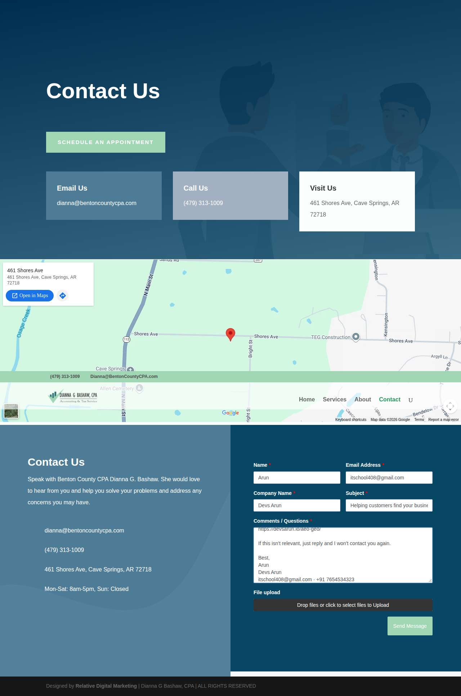

**After submit** — `run-a3840ddd_attempt-2e6a2aa7_post_attempt_2026-11-04T06-22-36-953Z.jpg`

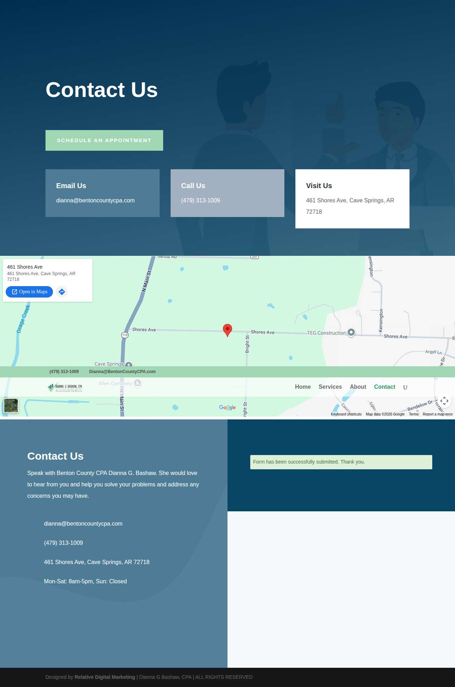

### yrlgroup.com — error\_after\_submit (LIVE)

| | |
|---|---|
| Attempt ID | `9e8bb421-1387-4222-a095-f6c2ef930859` |
| Form URL | https://yrlgroup.com/contact |
| Final URL | https://yrlgroup.com/contact |
| Reserved | 2026-11-04 06:22:44 UTC |
| Submit attempted | 2026-11-04 06:22:46 UTC |
| Template | standard v2 |
| Confirmation text | l Message Something went wrong sending your message. Please try again or call us. Send Message Springvale Office 636 Main Street, Springvale, ME 04083 john@yrlgroup.com |
| Result / error | — |

Exact message:

~~~text
Subject: Helping customers find your business in AI search (AEO + GEO)

Hi there,

I'm Arun from Devs Arun. More and more customers now ask ChatGPT, Gemini, Perplexity or Google's AI Overviews questions like "who should I hire for this in my area?" before they call anyone. These tools answer from websites they can clearly understand, and they tend to recommend businesses whose pages answer real customer questions.

That is what AEO + GEO (Answer Engine and Generative Engine Optimization) is for. I improve your existing service pages so they clearly answer the questions your customers ask, add structured data that matches the page, and make the call, quote or enquiry step obvious. The benefit: your business gets a better chance of being mentioned or linked in AI answers, and visitors who arrive find it easy to contact you.

The AEO + GEO Starter is a one-time $199 (about ₹16,999, negotiable) for one website: a basic audit, 10 customer questions, improvements to two existing pages, relevant structured data and an action plan, with one revision round.

You can read the full details, send an enquiry or book online here:
https://devsarun.io/aeo-geo/

If this isn't relevant, just reply and I won't contact you again.

Best,
Arun
Devs Arun
itschool408@gmail.com · +91 7654534323
~~~

Submitted field values:

- Your Name \[name\]: Arun
- Message \[message\]: Hi there, I'm Arun from Devs Arun. More and more customers now ask ChatGPT, Gemini, Perplexity or Google's AI Overviews 
- Your Email \[email\]: itschool408@gmail.com

**Filled form (before submit)** — `run-a3840ddd_attempt-9e8bb421_filled_2026-11-04T06-22-46-164Z.jpg`

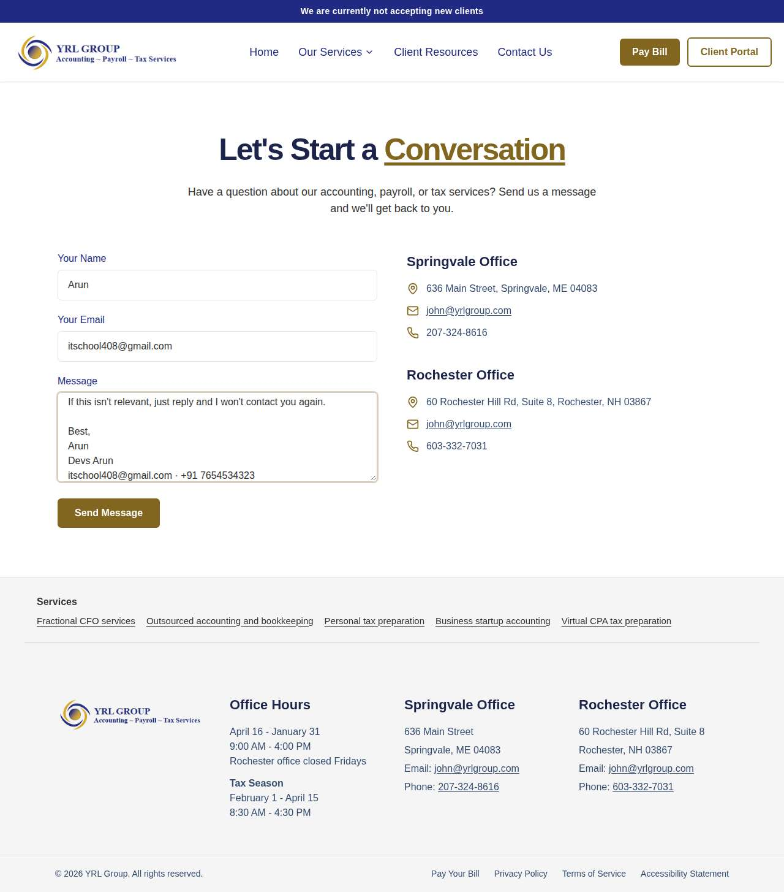

**After submit** — `run-a3840ddd_attempt-9e8bb421_post_attempt_2026-11-04T06-22-50-464Z.jpg`

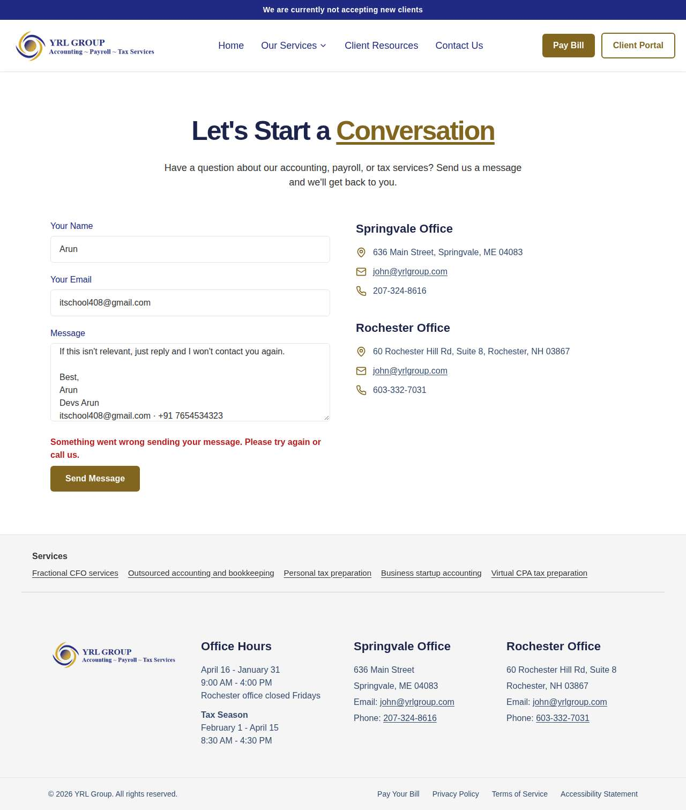

### thielenassociates.com — failed\_before\_submit (LIVE)

| | |
|---|---|
| Attempt ID | `f9e5d9e6-1f27-43da-af32-390a7d9c57d4` |
| Form URL | https://www.thielenassociates.com/request-a-consultation/ |
| Final URL | https://www.thielenassociates.com/request-a-consultation/ |
| Reserved | 2026-11-04 06:22:58 UTC |
| Submit attempted | — |
| Template | standard v2 |
| Confirmation text | none observed |
| Result / error | Message field altered the text (length limit?) |

Exact message:

~~~text
Subject: Helping customers find your business in AI search (AEO + GEO)

Hi there,

I'm Arun from Devs Arun. More and more customers now ask ChatGPT, Gemini, Perplexity or Google's AI Overviews questions like "who should I hire for this in my area?" before they call anyone. These tools answer from websites they can clearly understand, and they tend to recommend businesses whose pages answer real customer questions.

That is what AEO + GEO (Answer Engine and Generative Engine Optimization) is for. I improve your existing service pages so they clearly answer the questions your customers ask, add structured data that matches the page, and make the call, quote or enquiry step obvious. The benefit: your business gets a better chance of being mentioned or linked in AI answers, and visitors who arrive find it easy to contact you.

The AEO + GEO Starter is a one-time $199 (about ₹16,999, negotiable) for one website: a basic audit, 10 customer questions, improvements to two existing pages, relevant structured data and an action plan, with one revision round.

You can read the full details, send an enquiry or book online here:
https://devsarun.io/aeo-geo/

If this isn't relevant, just reply and I won't contact you again.

Best,
Arun
Devs Arun
itschool408@gmail.com · +91 7654534323
~~~

Submitted field values:

- \#UserForm\_Form\_38\_EditableTextField\_47cbd: +91 7654534323
- \#UserForm\_Form\_38\_EditableTextField\_7272f: Hi there, I'm Arun from Devs Arun. More and more customers now ask ChatGPT, Gemini, Perplexity or Google's AI Overviews 
- \#UserForm\_Form\_38\_EditableTextField\_be639: Devs Arun
- \#UserForm\_Form\_38\_EditableTextField\_df9f8: itschool408@gmail.com

**Filled form (before submit)** — `run-a3840ddd_attempt-f9e5d9e6_filled_2026-11-04T06-23-00-543Z.jpg`

### abkcorp.com — failed\_before\_submit (LIVE)

| | |
|---|---|
| Attempt ID | `8d2ffa7e-78bd-49d2-8a8c-3e054d050391` |
| Form URL | https://abkcorp.com/pages/contact-us |
| Final URL | https://abkcorp.com/pages/contact-us |
| Reserved | 2026-11-04 06:23:05 UTC |
| Submit attempted | — |
| Template | standard v2 |
| Confirmation text | none observed |
| Result / error | Form validation would block sending: contact\[phone\]: Please match the requested format. |

Exact message:

~~~text
Subject: Helping customers find your business in AI search (AEO + GEO)

Hi there,

I'm Arun from Devs Arun. More and more customers now ask ChatGPT, Gemini, Perplexity or Google's AI Overviews questions like "who should I hire for this in my area?" before they call anyone. These tools answer from websites they can clearly understand, and they tend to recommend businesses whose pages answer real customer questions.

That is what AEO + GEO (Answer Engine and Generative Engine Optimization) is for. I improve your existing service pages so they clearly answer the questions your customers ask, add structured data that matches the page, and make the call, quote or enquiry step obvious. The benefit: your business gets a better chance of being mentioned or linked in AI answers, and visitors who arrive find it easy to contact you.

The AEO + GEO Starter is a one-time $199 (about ₹16,999, negotiable) for one website: a basic audit, 10 customer questions, improvements to two existing pages, relevant structured data and an action plan, with one revision round.

You can read the full details, send an enquiry or book online here:
https://devsarun.io/aeo-geo/

If this isn't relevant, just reply and I won't contact you again.

Best,
Arun
Devs Arun
itschool408@gmail.com · +91 7654534323
~~~

Submitted field values:

- \#ContactForm-name: Arun
- \#ContactForm-email: itschool408@gmail.com
- \#ContactForm-phone: +91 7654534323
- \#ContactForm-message: Hi there, I'm Arun from Devs Arun. More and more customers now ask ChatGPT, Gemini, Perplexity or Google's AI Overviews 

**Filled form (before submit)** — `run-a3840ddd_attempt-8d2ffa7e_filled_2026-11-04T06-23-10-381Z.jpg`

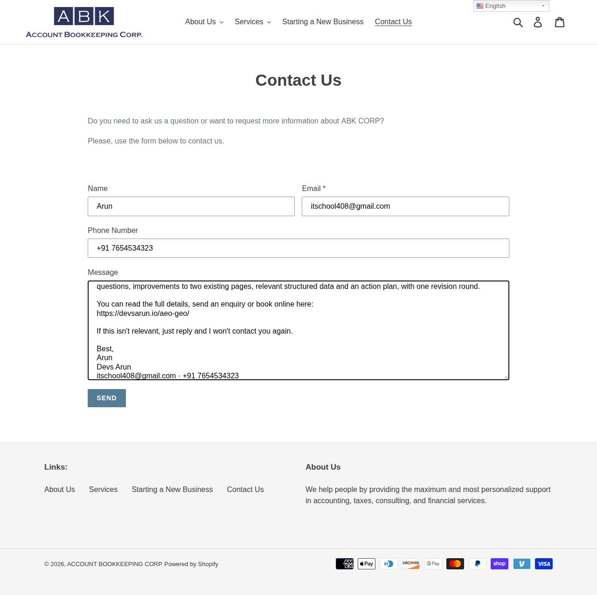

### bssf.com — confirmed (LIVE)

| | |
|---|---|
| Attempt ID | `0b75f98f-57e4-4f5a-8c2c-773777632597` |
| Form URL | https://www.brownplus.com/contact/ |
| Final URL | https://www.brownplus.com/thank-you-contact/ |
| Reserved | 2026-11-04 06:23:15 UTC |
| Submit attempted | 2026-11-04 06:23:17 UTC |
| Template | standard v2 |
| Confirmation text | TEAM INDUSTRIES SERVICES CLIENTS RESOURCES CAREERS CONTACT THANK YOU FOR CONTACTING US Home Thank You for Contacting Us Thank you for contacting Brown Plus\! We will review your contac |
| Result / error | — |

Exact message:

~~~text
Subject: Helping customers find your business in AI search (AEO + GEO)

Hi there,

I'm Arun from Devs Arun. More and more customers now ask ChatGPT, Gemini, Perplexity or Google's AI Overviews questions like "who should I hire for this in my area?" before they call anyone. These tools answer from websites they can clearly understand, and they tend to recommend businesses whose pages answer real customer questions.

That is what AEO + GEO (Answer Engine and Generative Engine Optimization) is for. I improve your existing service pages so they clearly answer the questions your customers ask, add structured data that matches the page, and make the call, quote or enquiry step obvious. The benefit: your business gets a better chance of being mentioned or linked in AI answers, and visitors who arrive find it easy to contact you.

The AEO + GEO Starter is a one-time $199 (about ₹16,999, negotiable) for one website: a basic audit, 10 customer questions, improvements to two existing pages, relevant structured data and an action plan, with one revision round.

You can read the full details, send an enquiry or book online here:
https://devsarun.io/aeo-geo/

If this isn't relevant, just reply and I won't contact you again.

Best,
Arun
Devs Arun
itschool408@gmail.com · +91 7654534323
~~~

Submitted field values:

- Full Name \[name\]: Arun
- Company \[company\]: Devs Arun
- Email\* required \[email\]: itschool408@gmail.com
- Phone\* required \[phone\]: +91 7654534323
- Message\* required \[message\]: Hi there, I'm Arun from Devs Arun. More and more customers now ask ChatGPT, Gemini, Perplexity or Google's AI Overviews 

**Filled form (before submit)** — `run-a3840ddd_attempt-0b75f98f_filled_2026-11-04T06-23-17-649Z.jpg`

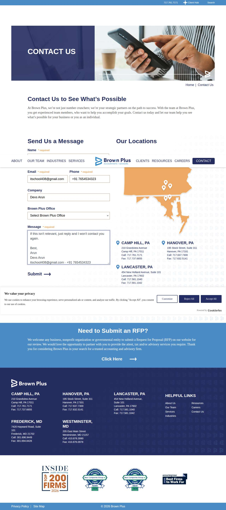

**After submit** — `run-a3840ddd_attempt-0b75f98f_post_attempt_2026-11-04T06-23-24-129Z.jpg`

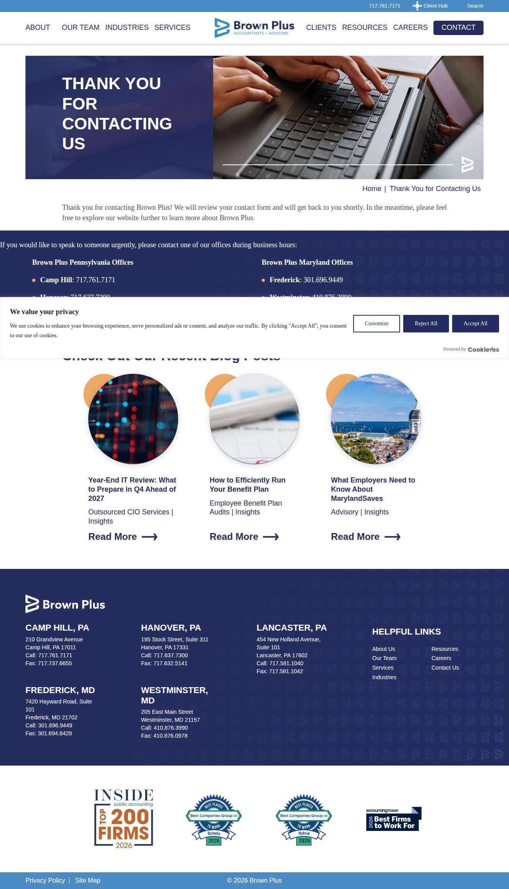

## Events (152)

| Time (UTC) | Event | Website | Details |
|---|---|---|---|
| 06:16:52 | run\_queued | — | live run requested by github:itsDevsArun |
| 06:16:52 | run\_dispatched | — | dispatch disabled (local test mode) |
| 06:16:56 | run\_started | — | Runner claimed live run |
| 06:16:57 | offer\_verified | — | Service page offer facts verified |
| 06:16:57 | website\_selected | clearchoiceplumbingllc.com | Live target clearchoiceplumbingllc.com |
| 06:16:57 | attempt\_reserved | clearchoiceplumbingllc.com | Submission attempt reserved with template standard v2 |
| 06:16:59 | page\_opened | clearchoiceplumbingllc.com | Opened form page |
| 06:16:59 | screenshot\_saved | clearchoiceplumbingllc.com | inspection screenshot saved (145 KB) |
| 06:16:59 | review\_required | clearchoiceplumbingllc.com | failed before submit: locator.fill: Error: Cannot type text into input\[type=number\] |
| 06:17:04 | website\_selected | bwnwincpainting.com | Live target bwnwincpainting.com |
| 06:17:04 | attempt\_reserved | bwnwincpainting.com | Submission attempt reserved with template standard v2 |
| 06:17:06 | page\_opened | bwnwincpainting.com | Opened form page |
| 06:17:06 | screenshot\_saved | bwnwincpainting.com | inspection screenshot saved (132 KB) |
| 06:17:06 | review\_required | bwnwincpainting.com | failed before submit: locator.fill: Error: Cannot type text into input\[type=number\] |
| 06:17:11 | website\_selected | absoluterestorepa.com | Live target absoluterestorepa.com |
| 06:17:11 | attempt\_reserved | absoluterestorepa.com | Submission attempt reserved with template standard v2 |
| 06:17:14 | page\_opened | absoluterestorepa.com | Opened form page |
| 06:17:14 | screenshot\_saved | absoluterestorepa.com | inspection screenshot saved (174 KB) |
| 06:17:14 | review\_required | absoluterestorepa.com | failed before submit: locator.fill: Error: Cannot type text into input\[type=number\] |
| 06:17:19 | website\_selected | masoudlawfirm.com | Live target masoudlawfirm.com |
| 06:17:19 | attempt\_reserved | masoudlawfirm.com | Submission attempt reserved with template standard v2 |
| 06:17:21 | page\_opened | masoudlawfirm.com | Opened form page |
| 06:17:21 | screenshot\_saved | masoudlawfirm.com | inspection screenshot saved (168 KB) |
| 06:17:21 | review\_required | masoudlawfirm.com | failed before submit: locator.fill: Error: Cannot type text into input\[type=number\] |
| 06:17:26 | website\_selected | bbsccpa.com | Live target bbsccpa.com |
| 06:17:26 | attempt\_reserved | bbsccpa.com | Submission attempt reserved with template standard v2 |
| 06:17:28 | page\_opened | bbsccpa.com | Opened form page |
| 06:17:28 | screenshot\_saved | bbsccpa.com | filled screenshot saved (92 KB) |
| 06:17:28 | review\_required | bbsccpa.com | failed before submit: Field "Phone" did not accept the value |
| 06:17:33 | website\_selected | redman-cpa.com | Live target redman-cpa.com |
| 06:17:33 | attempt\_reserved | redman-cpa.com | Submission attempt reserved with template standard v2 |
| 06:17:36 | page\_opened | redman-cpa.com | Opened form page |
| 06:17:36 | fields\_filled | redman-cpa.com | filled |
| 06:17:36 | screenshot\_saved | redman-cpa.com | filled screenshot saved (118 KB) |
| 06:17:36 | submit\_attempted | redman-cpa.com | submitting |
| 06:18:04 | screenshot\_saved | redman-cpa.com | post\_attempt screenshot saved (120 KB) |
| 06:18:04 | review\_required | redman-cpa.com | unclear: No new success marker observed |
| 06:18:12 | website\_selected | libertaccounting.com | Live target libertaccounting.com |
| 06:18:12 | attempt\_reserved | libertaccounting.com | Submission attempt reserved with template standard v2 |
| 06:18:14 | page\_opened | libertaccounting.com | Opened form page |
| 06:18:14 | fields\_filled | libertaccounting.com | filled |
| 06:18:14 | screenshot\_saved | libertaccounting.com | filled screenshot saved (132 KB) |
| 06:18:14 | submit\_attempted | libertaccounting.com | submitting |
| 06:18:43 | screenshot\_saved | libertaccounting.com | post\_attempt screenshot saved (149 KB) |
| 06:18:43 | review\_required | libertaccounting.com | unclear: No new success marker observed |
| 06:18:51 | website\_selected | rejaccounting.com | Live target rejaccounting.com |
| 06:18:51 | attempt\_reserved | rejaccounting.com | Submission attempt reserved with template standard v2 |
| 06:18:52 | page\_opened | rejaccounting.com | Opened form page |
| 06:18:52 | fields\_filled | rejaccounting.com | filled |
| 06:18:52 | screenshot\_saved | rejaccounting.com | filled screenshot saved (150 KB) |
| 06:18:52 | submit\_attempted | rejaccounting.com | submitting |
| 06:18:56 | screenshot\_saved | rejaccounting.com | post\_attempt screenshot saved (152 KB) |
| 06:18:56 | error | rejaccounting.com | error after submit — "act Us Failed to query the server. Check the connection and try again. Email Us: Submit Contact Info: Phone +1 (734) 284" |
| 06:19:04 | website\_selected | cpabluffton.com | Live target cpabluffton.com |
| 06:19:04 | attempt\_reserved | cpabluffton.com | Submission attempt reserved with template standard v2 |
| 06:19:07 | page\_opened | cpabluffton.com | Opened form page |
| 06:19:07 | fields\_filled | cpabluffton.com | filled |
| 06:19:07 | screenshot\_saved | cpabluffton.com | filled screenshot saved (97 KB) |
| 06:19:07 | submit\_attempted | cpabluffton.com | submitting |
| 06:19:35 | screenshot\_saved | cpabluffton.com | post\_attempt screenshot saved (65 KB) |
| 06:19:35 | review\_required | cpabluffton.com | unclear: No new success marker observed |
| 06:19:44 | website\_selected | flemingfundservices.com | Live target flemingfundservices.com |
| 06:19:44 | attempt\_reserved | flemingfundservices.com | Submission attempt reserved with template standard v2 |
| 06:19:46 | page\_opened | flemingfundservices.com | Opened form page |
| 06:19:46 | fields\_filled | flemingfundservices.com | filled |
| 06:19:46 | screenshot\_saved | flemingfundservices.com | filled screenshot saved (127 KB) |
| 06:19:46 | submit\_attempted | flemingfundservices.com | submitting |
| 06:19:53 | screenshot\_saved | flemingfundservices.com | post\_attempt screenshot saved (147 KB) |
| 06:19:53 | error | flemingfundservices.com | error after submit — "e to receive emails from us in the future?(Required) No Yes This field is required. SUBMIT Maryland Office 514 South Mai" |
| 06:20:01 | website\_selected | speedcpas.com | Live target speedcpas.com |
| 06:20:01 | attempt\_reserved | speedcpas.com | Submission attempt reserved with template standard v2 |
| 06:20:02 | page\_opened | speedcpas.com | Opened form page |
| 06:20:02 | fields\_filled | speedcpas.com | filled |
| 06:20:03 | screenshot\_saved | speedcpas.com | filled screenshot saved (233 KB) |
| 06:20:03 | submit\_attempted | speedcpas.com | submitting |
| 06:20:09 | screenshot\_saved | speedcpas.com | post\_attempt screenshot saved (217 KB) |
| 06:20:09 | confirmation\_observed | speedcpas.com | confirmed — "ervices Specialized Industries Accounting Software Training We Appreciate Your Patronage And Invite You To Communicate W" |
| 06:20:17 | website\_selected | brimcpas.com | Live target brimcpas.com |
| 06:20:17 | attempt\_reserved | brimcpas.com | Submission attempt reserved with template standard v2 |
| 06:20:19 | page\_opened | brimcpas.com | Opened form page |
| 06:20:20 | fields\_filled | brimcpas.com | filled |
| 06:20:20 | screenshot\_saved | brimcpas.com | filled screenshot saved (50 KB) |
| 06:20:20 | submit\_attempted | brimcpas.com | submitting |
| 06:20:32 | screenshot\_saved | brimcpas.com | post\_attempt screenshot saved (115 KB) |
| 06:20:32 | confirmation\_observed | brimcpas.com | confirmed — "you as soon as we can. We look forward to hearing from you\! Thank you for your message. It has been sent. Your Name (req" |
| 06:20:40 | website\_selected | joewrightcpa.com | Live target joewrightcpa.com |
| 06:20:40 | attempt\_reserved | joewrightcpa.com | Submission attempt reserved with template standard v2 |
| 06:20:42 | page\_opened | joewrightcpa.com | Opened form page |
| 06:20:42 | fields\_filled | joewrightcpa.com | filled |
| 06:20:42 | screenshot\_saved | joewrightcpa.com | filled screenshot saved (244 KB) |
| 06:20:42 | submit\_attempted | joewrightcpa.com | submitting |
| 06:20:47 | screenshot\_saved | joewrightcpa.com | post\_attempt screenshot saved (246 KB) |
| 06:20:47 | confirmation\_observed | joewrightcpa.com | confirmed — "ur teammates will contact you within 1 business day. SUBMIT Message Sent\! Balancing Money, Life & Wealth Our friendly ex" |
| 06:20:55 | website\_selected | advocatecpa.net | Live target advocatecpa.net |
| 06:20:55 | attempt\_reserved | advocatecpa.net | Submission attempt reserved with template standard v2 |
| 06:20:56 | page\_opened | advocatecpa.net | Opened form page |
| 06:20:57 | fields\_filled | advocatecpa.net | filled |
| 06:20:57 | screenshot\_saved | advocatecpa.net | filled screenshot saved (134 KB) |
| 06:20:57 | submit\_attempted | advocatecpa.net | submitting |
| 06:21:25 | screenshot\_saved | advocatecpa.net | post\_attempt screenshot saved (7 KB) |
| 06:21:25 | review\_required | advocatecpa.net | unclear: No new success marker observed |
| 06:21:33 | website\_selected | lba2.us | Live target lba2.us |
| 06:21:33 | attempt\_reserved | lba2.us | Submission attempt reserved with template standard v2 |
| 06:21:35 | page\_opened | lba2.us | Opened form page |
| 06:21:35 | fields\_filled | lba2.us | filled |
| 06:21:35 | screenshot\_saved | lba2.us | filled screenshot saved (132 KB) |
| 06:21:35 | submit\_attempted | lba2.us | submitting |
| 06:22:05 | screenshot\_saved | lba2.us | post\_attempt screenshot saved (178 KB) |
| 06:22:05 | review\_required | lba2.us | unclear: No new success marker observed |
| 06:22:13 | website\_selected | taxsrvcsrgg.com | Live target taxsrvcsrgg.com |
| 06:22:13 | attempt\_reserved | taxsrvcsrgg.com | Submission attempt reserved with template standard v2 |
| 06:22:17 | page\_opened | taxsrvcsrgg.com | Opened form page |
| 06:22:17 | fields\_filled | taxsrvcsrgg.com | filled |
| 06:22:17 | screenshot\_saved | taxsrvcsrgg.com | filled screenshot saved (95 KB) |
| 06:22:17 | submit\_attempted | taxsrvcsrgg.com | submitting |
| 06:22:22 | screenshot\_saved | taxsrvcsrgg.com | post\_attempt screenshot saved (190 KB) |
| 06:22:22 | confirmation\_observed | taxsrvcsrgg.com | confirmed — "-7 Houston, Texas 77092  E-mail: info@taxsrvcsrgg.com Your message was sent successfully SEND About This is our promise" |
| 06:22:30 | website\_selected | bentoncountycpa.com | Live target bentoncountycpa.com |
| 06:22:30 | attempt\_reserved | bentoncountycpa.com | Submission attempt reserved with template standard v2 |
| 06:22:32 | page\_opened | bentoncountycpa.com | Opened form page |
| 06:22:32 | fields\_filled | bentoncountycpa.com | filled |
| 06:22:32 | screenshot\_saved | bentoncountycpa.com | filled screenshot saved (103 KB) |
| 06:22:32 | submit\_attempted | bentoncountycpa.com | submitting |
| 06:22:36 | screenshot\_saved | bentoncountycpa.com | post\_attempt screenshot saved (87 KB) |
| 06:22:36 | confirmation\_observed | bentoncountycpa.com | confirmed — "ngs, AR 72718  Mon-Sat: 8am-5pm, Sun: Closed Form has been successfully submitted. Thank you. Designed by Relative Digi" |
| 06:22:44 | website\_selected | yrlgroup.com | Live target yrlgroup.com |
| 06:22:44 | attempt\_reserved | yrlgroup.com | Submission attempt reserved with template standard v2 |
| 06:22:45 | page\_opened | yrlgroup.com | Opened form page |
| 06:22:46 | fields\_filled | yrlgroup.com | filled |
| 06:22:46 | screenshot\_saved | yrlgroup.com | filled screenshot saved (99 KB) |
| 06:22:46 | submit\_attempted | yrlgroup.com | submitting |
| 06:22:50 | screenshot\_saved | yrlgroup.com | post\_attempt screenshot saved (103 KB) |
| 06:22:50 | error | yrlgroup.com | error after submit — "l Message Something went wrong sending your message. Please try again or call us. Send Message Springvale Office 636 Mai" |
| 06:22:58 | website\_selected | thielenassociates.com | Live target thielenassociates.com |
| 06:22:58 | attempt\_reserved | thielenassociates.com | Submission attempt reserved with template standard v2 |
| 06:23:00 | page\_opened | thielenassociates.com | Opened form page |
| 06:23:00 | screenshot\_saved | thielenassociates.com | filled screenshot saved (267 KB) |
| 06:23:00 | review\_required | thielenassociates.com | failed before submit: Message field altered the text (length limit?) |
| 06:23:05 | website\_selected | abkcorp.com | Live target abkcorp.com |
| 06:23:05 | attempt\_reserved | abkcorp.com | Submission attempt reserved with template standard v2 |
| 06:23:10 | page\_opened | abkcorp.com | Opened form page |
| 06:23:10 | screenshot\_saved | abkcorp.com | filled screenshot saved (71 KB) |
| 06:23:10 | review\_required | abkcorp.com | failed before submit: Form validation would block sending: contact\[phone\]: Please match the requested format. |
| 06:23:15 | website\_selected | bssf.com | Live target bssf.com |
| 06:23:15 | attempt\_reserved | bssf.com | Submission attempt reserved with template standard v2 |
| 06:23:17 | page\_opened | bssf.com | Opened form page |
| 06:23:17 | fields\_filled | bssf.com | filled |
| 06:23:17 | screenshot\_saved | bssf.com | filled screenshot saved (233 KB) |
| 06:23:17 | submit\_attempted | bssf.com | submitting |
| 06:23:24 | screenshot\_saved | bssf.com | post\_attempt screenshot saved (203 KB) |
| 06:23:24 | confirmation\_observed | bssf.com | confirmed — "TEAM INDUSTRIES SERVICES CLIENTS RESOURCES CAREERS CONTACT THANK YOU FOR CONTACTING US Home Thank You for Contacting Us " |
| 06:23:32 | run\_completed | — | Run completed (queue\_exhausted) |
