# Run a686e35b — live — completed

| | |
|---|---|
| Run ID | `a686e35b-7584-4837-8326-0cae0f411945` |
| Requested by | github:itsDevsArun |
| Started | 2026-11-04 12:14:56 UTC |
| Finished | 2026-11-04 12:20:19 UTC |
| Finish reason | queue\_exhausted |
| GitHub Actions | https://github.com/itsDevsArun/aeo-geo/actions/runs/41822946850 |

CSV for this run: [runs/2026-11-04_live_a686e35b.csv](2026-11-04_live_a686e35b.csv)

## Attempts (17)

### clearchoiceplumbingllc.com — failed\_before\_submit (LIVE)

| | |
|---|---|
| Attempt ID | `59b6200e-a015-4817-9f5e-31ab77f8a7b3` |
| Form URL | https://clearchoiceplumbingllc.com/contact/ |
| Final URL | — |
| Reserved | 2026-11-04 12:14:57 UTC |
| Submit attempted | — |
| Template | standard v2 |
| Confirmation text | none observed |
| Result / error | locator.fill: Error: Cannot type text into input\[type=number\] |

Exact message:

~~~text
Subject: Helping customers find your business in AI search (AEO + GEO)

Hi there,

I'm Arun from Devs Arun. More and more customers now ask ChatGPT, Gemini, Perplexity or Google's AI Overviews questions like "who should I hire for this in my area?" before they call anyone. These tools answer from websites they can clearly understand, and they tend to recommend businesses whose pages answer real customer questions.

That is what AEO + GEO (Answer Engine and Generative Engine Optimization) is for. I improve your existing service pages so they clearly answer the questions your customers ask, add structured data that matches the page, and make the call, quote or enquiry step obvious. The benefit: your business gets a better chance of being mentioned or linked in AI answers, and visitors who arrive find it easy to contact you.

The AEO + GEO Starter is a one-time $199 (about ₹16,999, negotiable) for one website: a basic audit, 10 customer questions, improvements to two existing pages, relevant structured data and an action plan, with one revision round.

You can read the full details, send an enquiry or book online here:
https://devsarun.io/aeo-geo/

If this isn't relevant, just reply and I won't contact you again.

Best,
Arun
Devs Arun
itschool408@gmail.com · +91 7654534323
~~~

Submitted field values:

- \#wpforms-51-field\_1: Arun
- \#wpforms-51-field\_2: itschool408@gmail.com
- \#wpforms-51-field\_3: Hi there, I'm Arun from Devs Arun. More and more customers now ask ChatGPT, Gemini, Perplexity or Google's AI Overviews 
- \#wpforms-51-field\_5: +91 7654534323

**Inspected page** — `run-a686e35b_attempt-59b6200e_inspection_2026-11-04T12-14-59-148Z.jpg`

### bwnwincpainting.com — failed\_before\_submit (LIVE)

| | |
|---|---|
| Attempt ID | `29fd6e3e-e1d8-4b83-8594-a094a971eca8` |
| Form URL | https://www.bwnwincpainting.com/contact/ |
| Final URL | — |
| Reserved | 2026-11-04 12:15:04 UTC |
| Submit attempted | — |
| Template | standard v2 |
| Confirmation text | none observed |
| Result / error | locator.fill: Error: Cannot type text into input\[type=number\] |

Exact message:

~~~text
Subject: Helping customers find your business in AI search (AEO + GEO)

Hi there,

I'm Arun from Devs Arun. More and more customers now ask ChatGPT, Gemini, Perplexity or Google's AI Overviews questions like "who should I hire for this in my area?" before they call anyone. These tools answer from websites they can clearly understand, and they tend to recommend businesses whose pages answer real customer questions.

That is what AEO + GEO (Answer Engine and Generative Engine Optimization) is for. I improve your existing service pages so they clearly answer the questions your customers ask, add structured data that matches the page, and make the call, quote or enquiry step obvious. The benefit: your business gets a better chance of being mentioned or linked in AI answers, and visitors who arrive find it easy to contact you.

The AEO + GEO Starter is a one-time $199 (about ₹16,999, negotiable) for one website: a basic audit, 10 customer questions, improvements to two existing pages, relevant structured data and an action plan, with one revision round.

You can read the full details, send an enquiry or book online here:
https://devsarun.io/aeo-geo/

If this isn't relevant, just reply and I won't contact you again.

Best,
Arun
Devs Arun
itschool408@gmail.com · +91 7654534323
~~~

Submitted field values:

- \#name-1151: Arun
- \#email-1151: itschool408@gmail.com
- \#phone-1151: +91 7654534323
- \#message-1151: Hi there, I'm Arun from Devs Arun. More and more customers now ask ChatGPT, Gemini, Perplexity or Google's AI Overviews 

**Inspected page** — `run-a686e35b_attempt-29fd6e3e_inspection_2026-11-04T12-15-06-368Z.jpg`

### absoluterestorepa.com — failed\_before\_submit (LIVE)

| | |
|---|---|
| Attempt ID | `0d6d8b96-2cda-4d32-9a13-44a3e30a509a` |
| Form URL | https://absoluterestorepa.com/contact-us/ |
| Final URL | — |
| Reserved | 2026-11-04 12:15:11 UTC |
| Submit attempted | — |
| Template | standard v2 |
| Confirmation text | none observed |
| Result / error | locator.fill: Error: Cannot type text into input\[type=number\] |

Exact message:

~~~text
Subject: Helping customers find your business in AI search (AEO + GEO)

Hi there,

I'm Arun from Devs Arun. More and more customers now ask ChatGPT, Gemini, Perplexity or Google's AI Overviews questions like "who should I hire for this in my area?" before they call anyone. These tools answer from websites they can clearly understand, and they tend to recommend businesses whose pages answer real customer questions.

That is what AEO + GEO (Answer Engine and Generative Engine Optimization) is for. I improve your existing service pages so they clearly answer the questions your customers ask, add structured data that matches the page, and make the call, quote or enquiry step obvious. The benefit: your business gets a better chance of being mentioned or linked in AI answers, and visitors who arrive find it easy to contact you.

The AEO + GEO Starter is a one-time $199 (about ₹16,999, negotiable) for one website: a basic audit, 10 customer questions, improvements to two existing pages, relevant structured data and an action plan, with one revision round.

You can read the full details, send an enquiry or book online here:
https://devsarun.io/aeo-geo/

If this isn't relevant, just reply and I won't contact you again.

Best,
Arun
Devs Arun
itschool408@gmail.com · +91 7654534323
~~~

Submitted field values:

- \#form-field-name: Arun
- \#form-field-message: Hi there, I'm Arun from Devs Arun. More and more customers now ask ChatGPT, Gemini, Perplexity or Google's AI Overviews 
- \#form-field-field\_ed02ec2: +91 7654534323
- \#content \> div \> div \> div:nth-of-type(2) \> div \> div:nth-of-type(1) \> div:nth-of-type(2) \> div \> form \> div \> div:nth-of-type(3) \> input: itschool408@gmail.com

**Inspected page** — `run-a686e35b_attempt-0d6d8b96_inspection_2026-11-04T12-15-14-210Z.jpg`

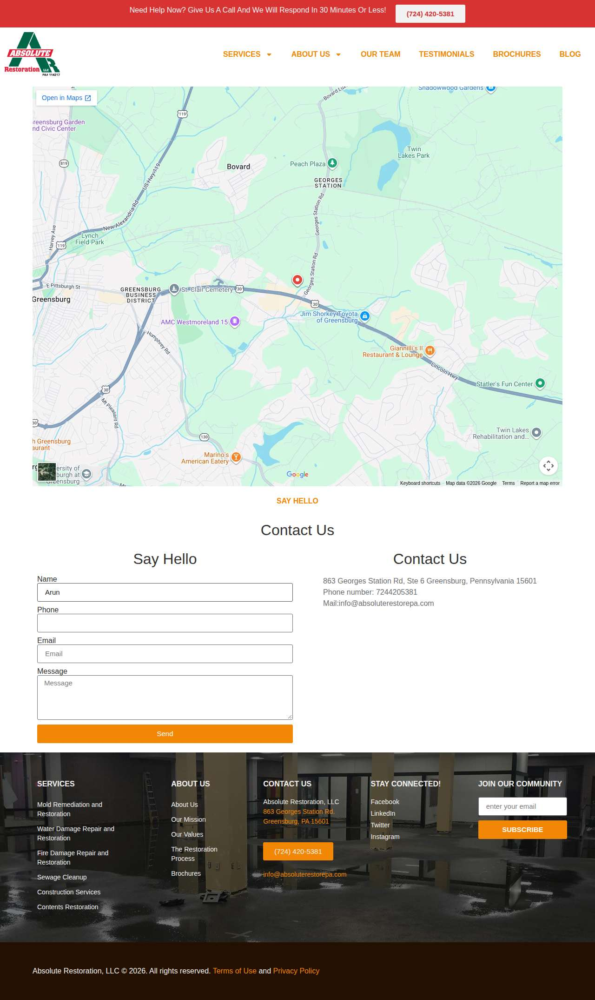

### masoudlawfirm.com — failed\_before\_submit (LIVE)

| | |
|---|---|
| Attempt ID | `057c5e0b-6903-446d-9cee-bc7c10c9ac0d` |
| Form URL | https://masoudlawfirm.com/contact/ |
| Final URL | — |
| Reserved | 2026-11-04 12:15:19 UTC |
| Submit attempted | — |
| Template | standard v2 |
| Confirmation text | none observed |
| Result / error | locator.fill: Error: Cannot type text into input\[type=number\] |

Exact message:

~~~text
Subject: Helping customers find your business in AI search (AEO + GEO)

Hi there,

I'm Arun from Devs Arun. More and more customers now ask ChatGPT, Gemini, Perplexity or Google's AI Overviews questions like "who should I hire for this in my area?" before they call anyone. These tools answer from websites they can clearly understand, and they tend to recommend businesses whose pages answer real customer questions.

That is what AEO + GEO (Answer Engine and Generative Engine Optimization) is for. I improve your existing service pages so they clearly answer the questions your customers ask, add structured data that matches the page, and make the call, quote or enquiry step obvious. The benefit: your business gets a better chance of being mentioned or linked in AI answers, and visitors who arrive find it easy to contact you.

The AEO + GEO Starter is a one-time $199 (about ₹16,999, negotiable) for one website: a basic audit, 10 customer questions, improvements to two existing pages, relevant structured data and an action plan, with one revision round.

You can read the full details, send an enquiry or book online here:
https://devsarun.io/aeo-geo/

If this isn't relevant, just reply and I won't contact you again.

Best,
Arun
Devs Arun
itschool408@gmail.com · +91 7654534323
~~~

Submitted field values:

- \#form-field-name: Arun
- \#form-field-field\_3374379: Hi there, I'm Arun from Devs Arun. More and more customers now ask ChatGPT, Gemini, Perplexity or Google's AI Overviews 
- \#form-field-field\_7731784: +91 7654534323
- \#form-field-field\_8bd0f16: itschool408@gmail.com

**Inspected page** — `run-a686e35b_attempt-057c5e0b_inspection_2026-11-04T12-15-23-642Z.jpg`

### david-ware.com — failed\_before\_submit (LIVE)

| | |
|---|---|
| Attempt ID | `868a7bda-380a-4751-af82-36b945622dda` |
| Form URL | https://www.david-ware.com/contact/ |
| Final URL | https://www.david-ware.com/contact/ |
| Reserved | 2026-11-04 12:15:28 UTC |
| Submit attempted | — |
| Template | short v2 |
| Confirmation text | none observed |
| Result / error | Reviewed form not found on page (site changed) |

Exact message:

~~~text
Subject: Helping customers find your business in AI search (AEO + GEO)

Hi there,

I'm Arun from Devs Arun. Customers increasingly ask ChatGPT, Gemini and Google's AI Overviews who to hire before they call anyone. AEO + GEO makes your existing service pages clear answers these tools can understand and cite, with an easy way to call or enquire, so your business has a better chance of being recommended.

The AEO + GEO Starter is a one-time $199 (about ₹16,999, negotiable) for one website.

Full details, enquiries and online booking:
https://devsarun.io/aeo-geo/

If this isn't relevant, just reply and I won't contact you again.

Best,
Arun, Devs Arun
itschool408@gmail.com
~~~

Submitted field values:

- \#nf-field-2: Arun
- \#nf-field-3: itschool408@gmail.com
- \#nf-field-4: +91 7654534323
- \#nf-field-10: Hi there, I'm Arun from Devs Arun. Customers increasingly ask ChatGPT, Gemini and Google's AI Overviews who to hire befo

**Inspected page** — `run-a686e35b_attempt-868a7bda_inspection_2026-11-04T12-15-30-422Z.jpg`

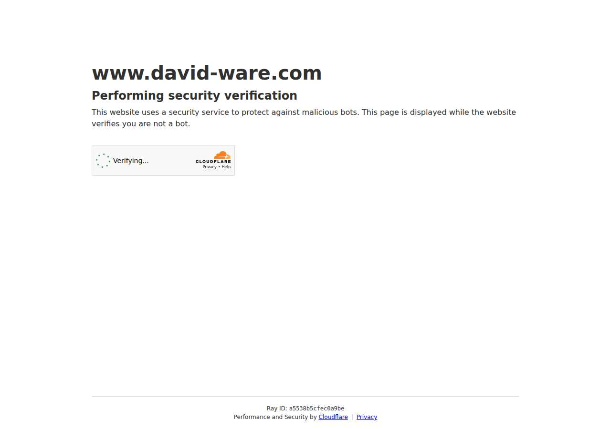

### browarddivorcelaw.com — failed\_before\_submit (LIVE)

| | |
|---|---|
| Attempt ID | `9bf26759-3c27-4cf0-840a-57bc169ef576` |
| Form URL | https://www.browarddivorcelaw.com/contact/ |
| Final URL | https://www.browarddivorcelaw.com/contact/ |
| Reserved | 2026-11-04 12:15:35 UTC |
| Submit attempted | — |
| Template | standard v2 |
| Confirmation text | none observed |
| Result / error | Field "Phone" did not accept the value |

Exact message:

~~~text
Subject: Helping customers find your business in AI search (AEO + GEO)

Hi there,

I'm Arun from Devs Arun. More and more customers now ask ChatGPT, Gemini, Perplexity or Google's AI Overviews questions like "who should I hire for this in my area?" before they call anyone. These tools answer from websites they can clearly understand, and they tend to recommend businesses whose pages answer real customer questions.

That is what AEO + GEO (Answer Engine and Generative Engine Optimization) is for. I improve your existing service pages so they clearly answer the questions your customers ask, add structured data that matches the page, and make the call, quote or enquiry step obvious. The benefit: your business gets a better chance of being mentioned or linked in AI answers, and visitors who arrive find it easy to contact you.

The AEO + GEO Starter is a one-time $199 (about ₹16,999, negotiable) for one website: a basic audit, 10 customer questions, improvements to two existing pages, relevant structured data and an action plan, with one revision round.

You can read the full details, send an enquiry or book online here:
https://devsarun.io/aeo-geo/

If this isn't relevant, just reply and I won't contact you again.

Best,
Arun
Devs Arun
itschool408@gmail.com · +91 7654534323
~~~

Submitted field values:

- \#nf-field-2: Arun
- \#nf-field-3: itschool408@gmail.com
- \#nf-field-4: +91 7654534323
- \#nf-field-10: Hi there, I'm Arun from Devs Arun. More and more customers now ask ChatGPT, Gemini, Perplexity or Google's AI Overviews 

**Filled form (before submit)** — `run-a686e35b_attempt-9bf26759_filled_2026-11-04T12-15-38-073Z.jpg`

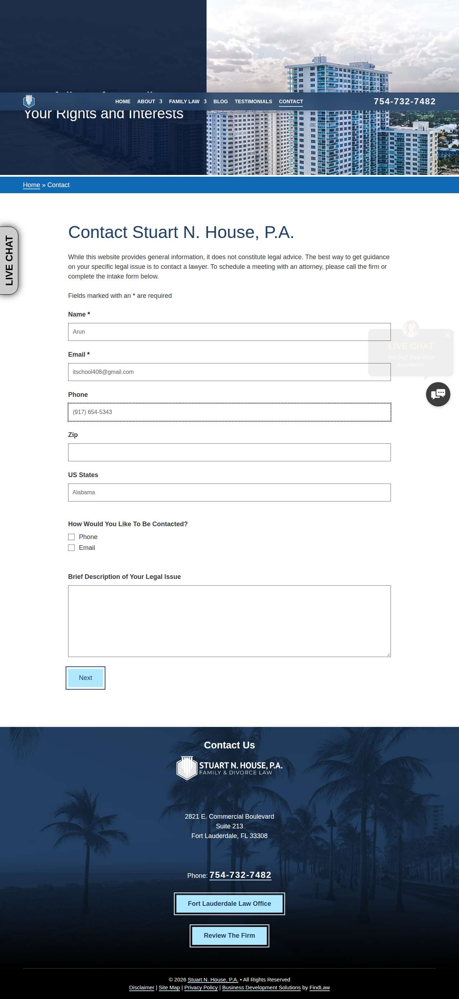

### coulterstax.com — unclear (LIVE)

| | |
|---|---|
| Attempt ID | `2a8790ab-3be7-4f9f-8ff0-da6e0414aa4a` |
| Form URL | https://www.coulterstax.com/form\_\_map |
| Final URL | https://www.coulterstax.com/form\_\_map |
| Reserved | 2026-11-04 12:15:43 UTC |
| Submit attempted | 2026-11-04 12:15:45 UTC |
| Template | standard v2 |
| Confirmation text | none observed |
| Result / error | No new success marker observed |

Exact message:

~~~text
Subject: Helping customers find your business in AI search (AEO + GEO)

Hi there,

I'm Arun from Devs Arun. More and more customers now ask ChatGPT, Gemini, Perplexity or Google's AI Overviews questions like "who should I hire for this in my area?" before they call anyone. These tools answer from websites they can clearly understand, and they tend to recommend businesses whose pages answer real customer questions.

That is what AEO + GEO (Answer Engine and Generative Engine Optimization) is for. I improve your existing service pages so they clearly answer the questions your customers ask, add structured data that matches the page, and make the call, quote or enquiry step obvious. The benefit: your business gets a better chance of being mentioned or linked in AI answers, and visitors who arrive find it easy to contact you.

The AEO + GEO Starter is a one-time $199 (about ₹16,999, negotiable) for one website: a basic audit, 10 customer questions, improvements to two existing pages, relevant structured data and an action plan, with one revision round.

You can read the full details, send an enquiry or book online here:
https://devsarun.io/aeo-geo/

If this isn't relevant, just reply and I won't contact you again.

Best,
Arun
Devs Arun
itschool408@gmail.com · +91 7654534323
~~~

Submitted field values:

- email \[email\]: itschool408@gmail.com
- name-\* \[name\]: Arun
- Message \[message\]: Hi there, I'm Arun from Devs Arun. More and more customers now ask ChatGPT, Gemini, Perplexity or Google's AI Overviews 
- subject \[subject\]: Helping customers find your business in AI search (AEO + GEO)

**Filled form (before submit)** — `run-a686e35b_attempt-2a8790ab_filled_2026-11-04T12-15-45-869Z.jpg`

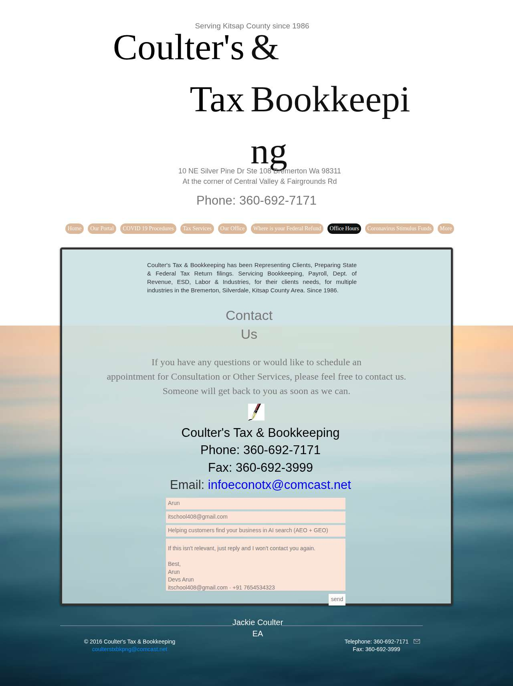

**After submit** — `run-a686e35b_attempt-2a8790ab_post_attempt_2026-11-04T12-16-14-470Z.jpg`

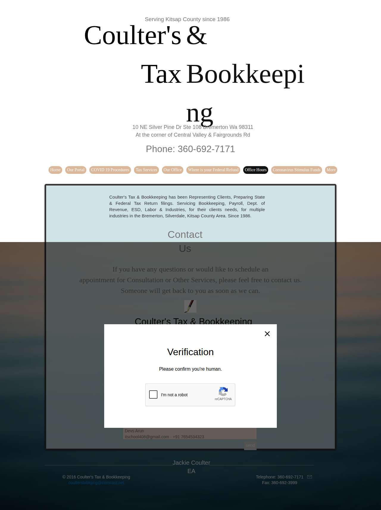

### stylianouaccounting.com — confirmed (LIVE)

| | |
|---|---|
| Attempt ID | `a4ca4e26-a40d-4ef0-9f8d-07a114e42672` |
| Form URL | https://www.stylianouaccounting.com/contact/ |
| Final URL | https://www.stylianouaccounting.com/contact/ |
| Reserved | 2026-11-04 12:16:22 UTC |
| Submit attempted | 2026-11-04 12:16:24 UTC |
| Template | standard v2 |
| Confirmation text | HOME ABOUT US SERVICES CONTACT Contact Form THANK YOU\! Your email was successfully sent. We will contact you as soon as possible. TELEPHONE ADDRESS Offic |
| Result / error | — |

Exact message:

~~~text
Subject: Helping customers find your business in AI search (AEO + GEO)

Hi there,

I'm Arun from Devs Arun. More and more customers now ask ChatGPT, Gemini, Perplexity or Google's AI Overviews questions like "who should I hire for this in my area?" before they call anyone. These tools answer from websites they can clearly understand, and they tend to recommend businesses whose pages answer real customer questions.

That is what AEO + GEO (Answer Engine and Generative Engine Optimization) is for. I improve your existing service pages so they clearly answer the questions your customers ask, add structured data that matches the page, and make the call, quote or enquiry step obvious. The benefit: your business gets a better chance of being mentioned or linked in AI answers, and visitors who arrive find it easy to contact you.

The AEO + GEO Starter is a one-time $199 (about ₹16,999, negotiable) for one website: a basic audit, 10 customer questions, improvements to two existing pages, relevant structured data and an action plan, with one revision round.

You can read the full details, send an enquiry or book online here:
https://devsarun.io/aeo-geo/

If this isn't relevant, just reply and I won't contact you again.

Best,
Arun
Devs Arun
itschool408@gmail.com · +91 7654534323
~~~

Submitted field values:

- email \[email\]: itschool408@gmail.com
- message \[message\]: Hi there, I'm Arun from Devs Arun. More and more customers now ask ChatGPT, Gemini, Perplexity or Google's AI Overviews 
- fname \[first\_name\]: Arun

**Filled form (before submit)** — `run-a686e35b_attempt-a4ca4e26_filled_2026-11-04T12-16-24-456Z.jpg`

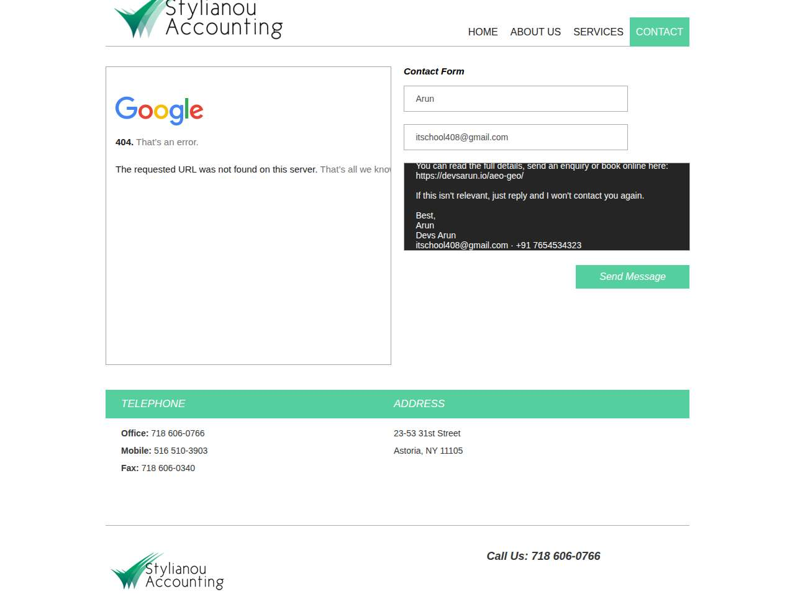

**After submit** — `run-a686e35b_attempt-a4ca4e26_post_attempt_2026-11-04T12-16-27-837Z.jpg`

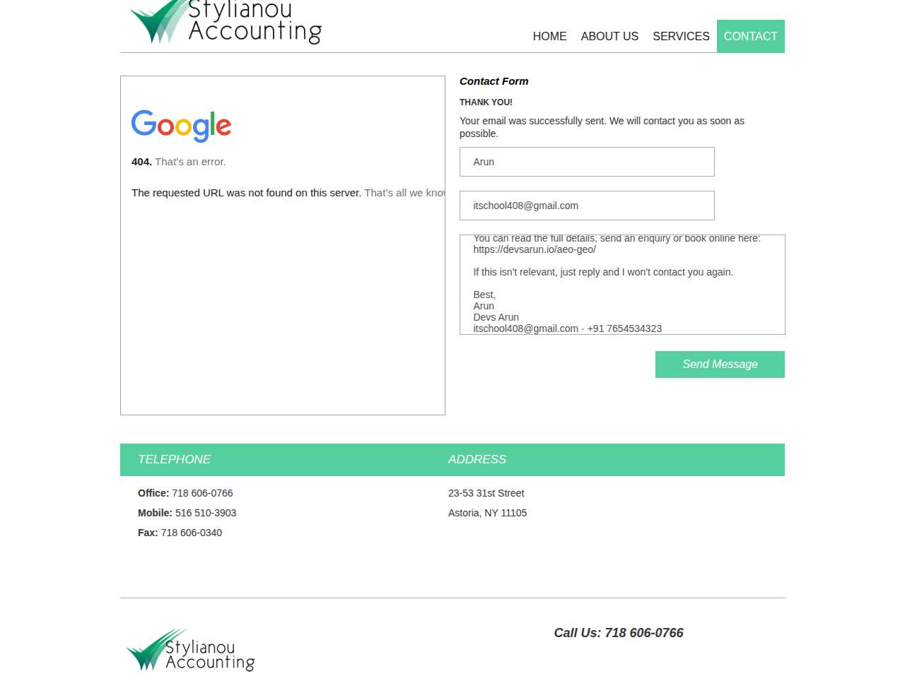

### finneyneill.com — confirmed (LIVE)

| | |
|---|---|
| Attempt ID | `bf2aac50-6a6f-4781-955e-4c88e146f6aa` |
| Form URL | https://www.finneyneill.com/contact-us |
| Final URL | https://www.finneyneill.com/contact-us |
| Reserved | 2026-11-04 12:16:35 UTC |
| Submit attempted | 2026-11-04 12:16:37 UTC |
| Template | standard v2 |
| Confirmation text | l.com Address 9757 Greenwood Avenue North Seattle, WA 98103 Thank You\! We have received your message and will get back to you soon. CONTACT US Need Professional Accounti |
| Result / error | — |

Exact message:

~~~text
Subject: Helping customers find your business in AI search (AEO + GEO)

Hi there,

I'm Arun from Devs Arun. More and more customers now ask ChatGPT, Gemini, Perplexity or Google's AI Overviews questions like "who should I hire for this in my area?" before they call anyone. These tools answer from websites they can clearly understand, and they tend to recommend businesses whose pages answer real customer questions.

That is what AEO + GEO (Answer Engine and Generative Engine Optimization) is for. I improve your existing service pages so they clearly answer the questions your customers ask, add structured data that matches the page, and make the call, quote or enquiry step obvious. The benefit: your business gets a better chance of being mentioned or linked in AI answers, and visitors who arrive find it easy to contact you.

The AEO + GEO Starter is a one-time $199 (about ₹16,999, negotiable) for one website: a basic audit, 10 customer questions, improvements to two existing pages, relevant structured data and an action plan, with one revision round.

You can read the full details, send an enquiry or book online here:
https://devsarun.io/aeo-geo/

If this isn't relevant, just reply and I won't contact you again.

Best,
Arun
Devs Arun
itschool408@gmail.com · +91 7654534323
~~~

Submitted field values:

- Email \[email\]: itschool408@gmail.com
- Message \[message\]: Hi there, I'm Arun from Devs Arun. More and more customers now ask ChatGPT, Gemini, Perplexity or Google's AI Overviews 
- First name \[first\_name\]: Arun

**Filled form (before submit)** — `run-a686e35b_attempt-bf2aac50_filled_2026-11-04T12-16-37-438Z.jpg`

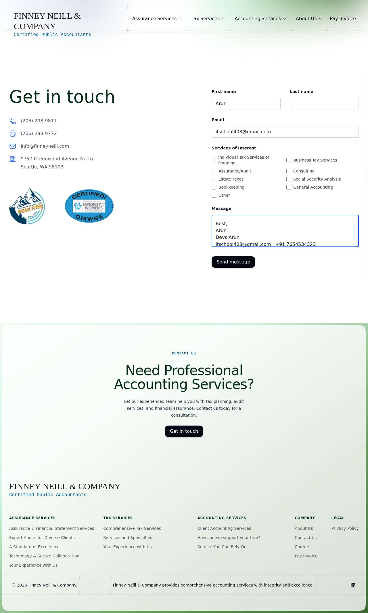

**After submit** — `run-a686e35b_attempt-bf2aac50_post_attempt_2026-11-04T12-16-41-445Z.jpg`

### accsoln.com — error\_after\_submit (LIVE)

| | |
|---|---|
| Attempt ID | `d12fbaf0-f495-43d2-964b-d75399bab237` |
| Form URL | https://www.accsoln.com/contact |
| Final URL | https://www.accsoln.com/contact |
| Reserved | 2026-11-04 12:16:49 UTC |
| Submit attempted | 2026-11-04 12:16:51 UTC |
| Template | standard v2 |
| Confirmation text | ours and weekends by appointment only. First Name Last Name This field is required Phone Email Message © Mapbox © OpenStreetMap Improve this map HOME ABOUT US TAX SERVICES & IRS/STAT |
| Result / error | — |

Exact message:

~~~text
Subject: Helping customers find your business in AI search (AEO + GEO)

Hi there,

I'm Arun from Devs Arun. More and more customers now ask ChatGPT, Gemini, Perplexity or Google's AI Overviews questions like "who should I hire for this in my area?" before they call anyone. These tools answer from websites they can clearly understand, and they tend to recommend businesses whose pages answer real customer questions.

That is what AEO + GEO (Answer Engine and Generative Engine Optimization) is for. I improve your existing service pages so they clearly answer the questions your customers ask, add structured data that matches the page, and make the call, quote or enquiry step obvious. The benefit: your business gets a better chance of being mentioned or linked in AI answers, and visitors who arrive find it easy to contact you.

The AEO + GEO Starter is a one-time $199 (about ₹16,999, negotiable) for one website: a basic audit, 10 customer questions, improvements to two existing pages, relevant structured data and an action plan, with one revision round.

You can read the full details, send an enquiry or book online here:
https://devsarun.io/aeo-geo/

If this isn't relevant, just reply and I won't contact you again.

Best,
Arun
Devs Arun
itschool408@gmail.com · +91 7654534323
~~~

Submitted field values:

- Email \[email\]: itschool408@gmail.com
- Phone \[phone\]: +91 7654534323
- Message \[message\]: Hi there, I'm Arun from Devs Arun. More and more customers now ask ChatGPT, Gemini, Perplexity or Google's AI Overviews 
- First Name \[first\_name\]: Arun

**Filled form (before submit)** — `run-a686e35b_attempt-d12fbaf0_filled_2026-11-04T12-16-51-918Z.jpg`

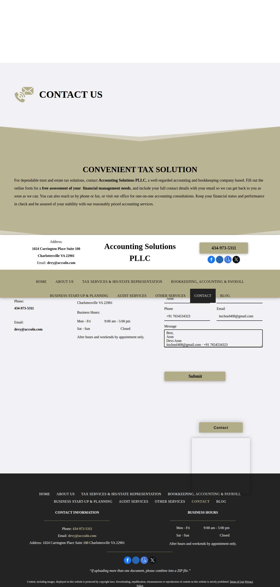

**After submit** — `run-a686e35b_attempt-d12fbaf0_post_attempt_2026-11-04T12-16-55-516Z.jpg`

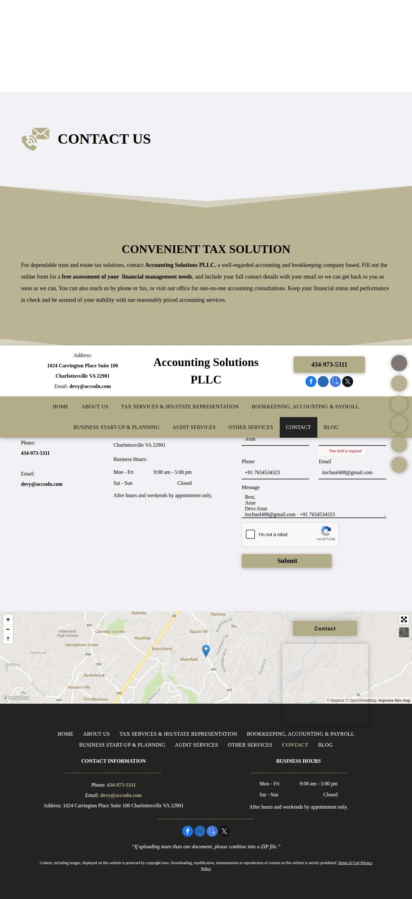

### whiteolivecpa.com — failed\_before\_submit (LIVE)

| | |
|---|---|
| Attempt ID | `0082e135-b36c-48ab-b699-07adc940fcb9` |
| Form URL | https://whiteolivecpa.com/contact/ |
| Final URL | — |
| Reserved | 2026-11-04 12:17:03 UTC |
| Submit attempted | — |
| Template | standard v2 |
| Confirmation text | none observed |
| Result / error | locator.fill: Error: Cannot type text into input\[type=number\] |

Exact message:

~~~text
Subject: Helping customers find your business in AI search (AEO + GEO)

Hi there,

I'm Arun from Devs Arun. More and more customers now ask ChatGPT, Gemini, Perplexity or Google's AI Overviews questions like "who should I hire for this in my area?" before they call anyone. These tools answer from websites they can clearly understand, and they tend to recommend businesses whose pages answer real customer questions.

That is what AEO + GEO (Answer Engine and Generative Engine Optimization) is for. I improve your existing service pages so they clearly answer the questions your customers ask, add structured data that matches the page, and make the call, quote or enquiry step obvious. The benefit: your business gets a better chance of being mentioned or linked in AI answers, and visitors who arrive find it easy to contact you.

The AEO + GEO Starter is a one-time $199 (about ₹16,999, negotiable) for one website: a basic audit, 10 customer questions, improvements to two existing pages, relevant structured data and an action plan, with one revision round.

You can read the full details, send an enquiry or book online here:
https://devsarun.io/aeo-geo/

If this isn't relevant, just reply and I won't contact you again.

Best,
Arun
Devs Arun
itschool408@gmail.com · +91 7654534323
~~~

Submitted field values:

- \#ff\_1\_email: itschool408@gmail.com
- \#ff\_1\_message: Hi there, I'm Arun from Devs Arun. More and more customers now ask ChatGPT, Gemini, Perplexity or Google's AI Overviews 
- \#ff\_1\_numeric\_field: +91 7654534323
- \#ff\_1\_names\_first\_name\_: Arun

**Inspected page** — `run-a686e35b_attempt-0082e135_inspection_2026-11-04T12-17-05-059Z.jpg`

### northsteppe.com — confirmed (LIVE)

| | |
|---|---|
| Attempt ID | `70e83b91-f960-4282-ae51-901d6f5b55fb` |
| Form URL | https://www.northsteppe.com/ |
| Final URL | https://www.northsteppe.com/ |
| Reserved | 2026-11-04 12:17:10 UTC |
| Submit attempted | 2026-11-04 12:17:12 UTC |
| Template | standard v2 |
| Confirmation text | Village Clintonville German Village Worthington CONTACT US Thank you for contacting us. We will get back to you as soon as possible. 1946 N High St, Columbus, OH 43201, United States |
| Result / error | — |

Exact message:

~~~text
Subject: Helping customers find your business in AI search (AEO + GEO)

Hi there,

I'm Arun from Devs Arun. More and more customers now ask ChatGPT, Gemini, Perplexity or Google's AI Overviews questions like "who should I hire for this in my area?" before they call anyone. These tools answer from websites they can clearly understand, and they tend to recommend businesses whose pages answer real customer questions.

That is what AEO + GEO (Answer Engine and Generative Engine Optimization) is for. I improve your existing service pages so they clearly answer the questions your customers ask, add structured data that matches the page, and make the call, quote or enquiry step obvious. The benefit: your business gets a better chance of being mentioned or linked in AI answers, and visitors who arrive find it easy to contact you.

The AEO + GEO Starter is a one-time $199 (about ₹16,999, negotiable) for one website: a basic audit, 10 customer questions, improvements to two existing pages, relevant structured data and an action plan, with one revision round.

You can read the full details, send an enquiry or book online here:
https://devsarun.io/aeo-geo/

If this isn't relevant, just reply and I won't contact you again.

Best,
Arun
Devs Arun
itschool408@gmail.com · +91 7654534323
~~~

Submitted field values:

- Name: \[name\]: Arun
- Email: \[email\]: itschool408@gmail.com
- Phone: \[phone\]: +91 7654534323
- Message: \[message\]: Hi there, I'm Arun from Devs Arun. More and more customers now ask ChatGPT, Gemini, Perplexity or Google's AI Overviews 

**Filled form (before submit)** — `run-a686e35b_attempt-70e83b91_filled_2026-11-04T12-17-12-449Z.jpg`

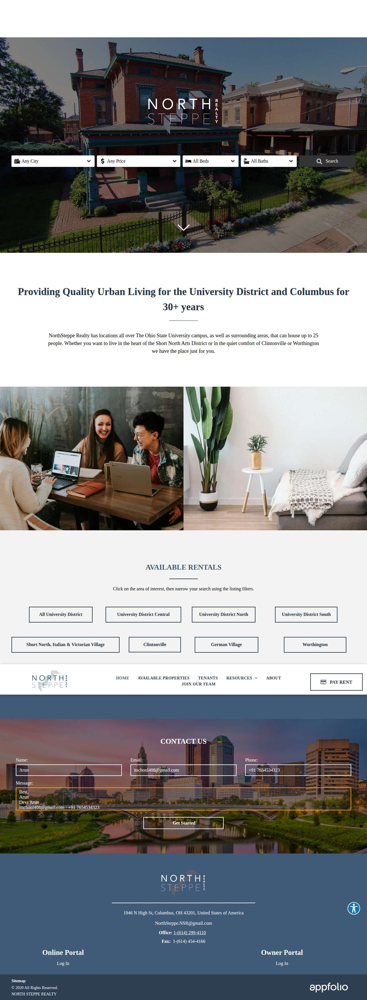

**After submit** — `run-a686e35b_attempt-70e83b91_post_attempt_2026-11-04T12-17-17-724Z.jpg`

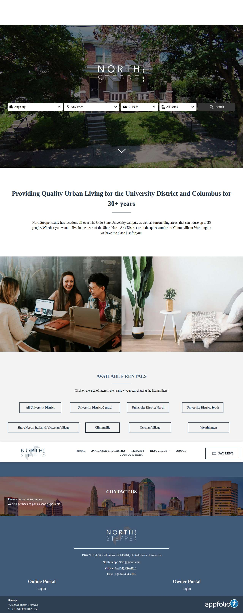

### celebrationrentalgroupllc.com — unclear (LIVE)

| | |
|---|---|
| Attempt ID | `4a7fdfb3-f5e6-47bc-9ef3-d29b0428b3ed` |
| Form URL | https://celebrationrentalgroupllc.com/contact-us/ |
| Final URL | https://celebrationrentalgroupllc.com/contact-us/ |
| Reserved | 2026-11-04 12:17:25 UTC |
| Submit attempted | 2026-11-04 12:17:30 UTC |
| Template | standard v2 |
| Confirmation text | none observed |
| Result / error | No new success marker observed |

Exact message:

~~~text
Subject: Helping customers find your business in AI search (AEO + GEO)

Hi there,

I'm Arun from Devs Arun. More and more customers now ask ChatGPT, Gemini, Perplexity or Google's AI Overviews questions like "who should I hire for this in my area?" before they call anyone. These tools answer from websites they can clearly understand, and they tend to recommend businesses whose pages answer real customer questions.

That is what AEO + GEO (Answer Engine and Generative Engine Optimization) is for. I improve your existing service pages so they clearly answer the questions your customers ask, add structured data that matches the page, and make the call, quote or enquiry step obvious. The benefit: your business gets a better chance of being mentioned or linked in AI answers, and visitors who arrive find it easy to contact you.

The AEO + GEO Starter is a one-time $199 (about ₹16,999, negotiable) for one website: a basic audit, 10 customer questions, improvements to two existing pages, relevant structured data and an action plan, with one revision round.

You can read the full details, send an enquiry or book online here:
https://devsarun.io/aeo-geo/

If this isn't relevant, just reply and I won't contact you again.

Best,
Arun
Devs Arun
itschool408@gmail.com · +91 7654534323
~~~

Submitted field values:

- Name \* \[name\]: Arun
- Phone \[phone\]: +91 7654534323
- Email \* \[email\]: itschool408@gmail.com
- Message \[message\]: Hi there, I'm Arun from Devs Arun. More and more customers now ask ChatGPT, Gemini, Perplexity or Google's AI Overviews 

**Filled form (before submit)** — `run-a686e35b_attempt-4a7fdfb3_filled_2026-11-04T12-17-30-110Z.jpg`

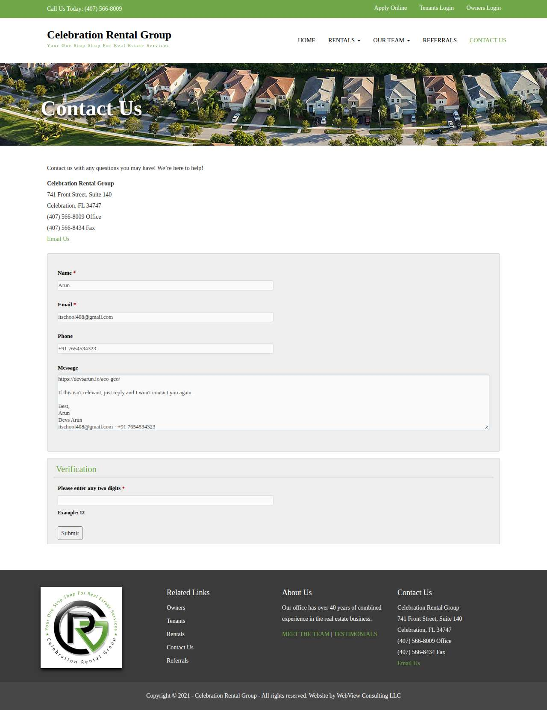

**After submit** — `run-a686e35b_attempt-4a7fdfb3_post_attempt_2026-11-04T12-18-06-251Z.jpg`

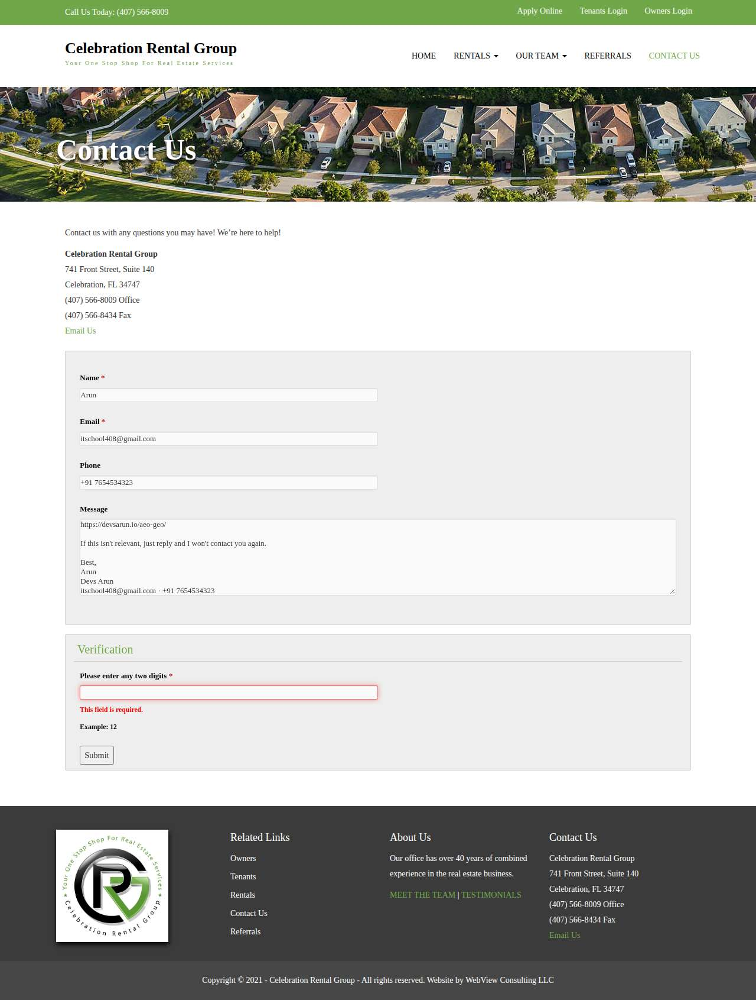

### pinnaclefalls.com — failed\_before\_submit (LIVE)

| | |
|---|---|
| Attempt ID | `8104ec7c-1ea7-4064-bfff-40a7b6afc784` |
| Form URL | https://www.pinnaclefalls.com/contact/ |
| Final URL | https://www.pinnaclefalls.com/contact/ |
| Reserved | 2026-11-04 12:18:14 UTC |
| Submit attempted | — |
| Template | standard v2 |
| Confirmation text | none observed |
| Result / error | Field "Phone" did not accept the value |

Exact message:

~~~text
Subject: Helping customers find your business in AI search (AEO + GEO)

Hi there,

I'm Arun from Devs Arun. More and more customers now ask ChatGPT, Gemini, Perplexity or Google's AI Overviews questions like "who should I hire for this in my area?" before they call anyone. These tools answer from websites they can clearly understand, and they tend to recommend businesses whose pages answer real customer questions.

That is what AEO + GEO (Answer Engine and Generative Engine Optimization) is for. I improve your existing service pages so they clearly answer the questions your customers ask, add structured data that matches the page, and make the call, quote or enquiry step obvious. The benefit: your business gets a better chance of being mentioned or linked in AI answers, and visitors who arrive find it easy to contact you.

The AEO + GEO Starter is a one-time $199 (about ₹16,999, negotiable) for one website: a basic audit, 10 customer questions, improvements to two existing pages, relevant structured data and an action plan, with one revision round.

You can read the full details, send an enquiry or book online here:
https://devsarun.io/aeo-geo/

If this isn't relevant, just reply and I won't contact you again.

Best,
Arun
Devs Arun
itschool408@gmail.com · +91 7654534323
~~~

Submitted field values:

- \#input\_1\_1: Arun
- \#input\_1\_2: itschool408@gmail.com
- \#input\_1\_3: +91 7654534323
- \#input\_1\_4: Hi there, I'm Arun from Devs Arun. More and more customers now ask ChatGPT, Gemini, Perplexity or Google's AI Overviews 

**Filled form (before submit)** — `run-a686e35b_attempt-8104ec7c_filled_2026-11-04T12-18-15-694Z.jpg`

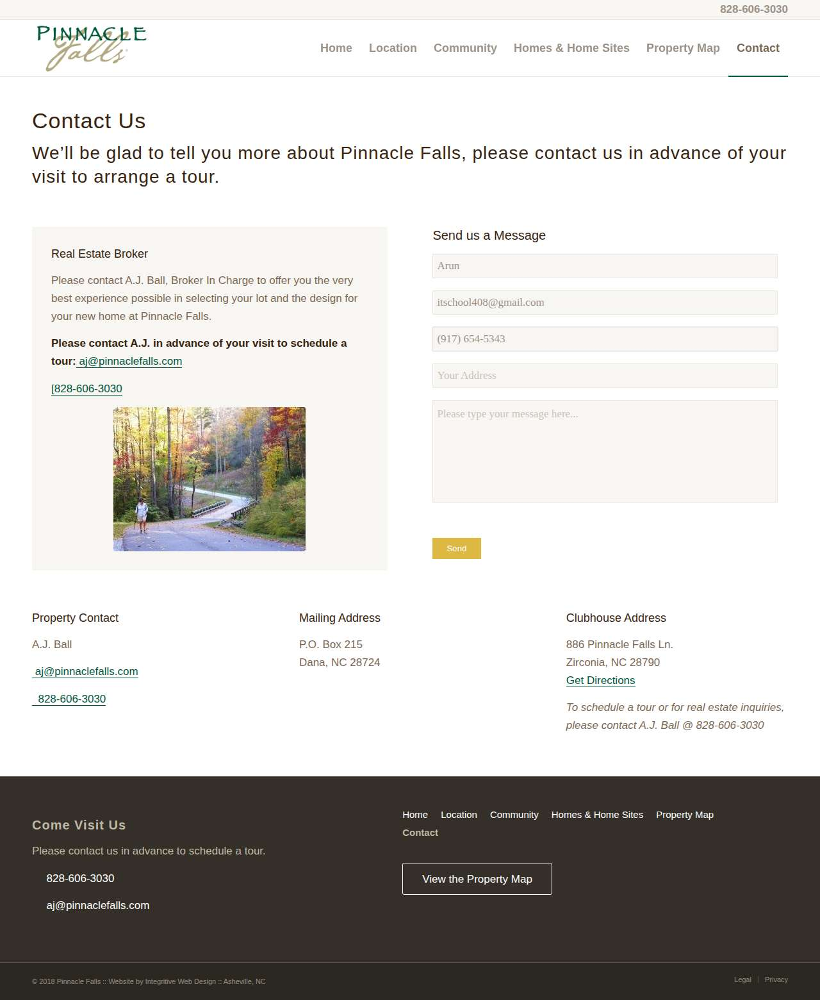

### lbcommercial.com — unclear (LIVE)

| | |
|---|---|
| Attempt ID | `2d042d43-fc40-484d-b3f2-9b003c88b997` |
| Form URL | https://www.lbcommercial.com/contacts |
| Final URL | https://www.lbcommercial.com/contacts |
| Reserved | 2026-11-04 12:18:20 UTC |
| Submit attempted | 2026-11-04 12:18:23 UTC |
| Template | standard v2 |
| Confirmation text | none observed |
| Result / error | No new success marker observed |

Exact message:

~~~text
Subject: Helping customers find your business in AI search (AEO + GEO)

Hi there,

I'm Arun from Devs Arun. More and more customers now ask ChatGPT, Gemini, Perplexity or Google's AI Overviews questions like "who should I hire for this in my area?" before they call anyone. These tools answer from websites they can clearly understand, and they tend to recommend businesses whose pages answer real customer questions.

That is what AEO + GEO (Answer Engine and Generative Engine Optimization) is for. I improve your existing service pages so they clearly answer the questions your customers ask, add structured data that matches the page, and make the call, quote or enquiry step obvious. The benefit: your business gets a better chance of being mentioned or linked in AI answers, and visitors who arrive find it easy to contact you.

The AEO + GEO Starter is a one-time $199 (about ₹16,999, negotiable) for one website: a basic audit, 10 customer questions, improvements to two existing pages, relevant structured data and an action plan, with one revision round.

You can read the full details, send an enquiry or book online here:
https://devsarun.io/aeo-geo/

If this isn't relevant, just reply and I won't contact you again.

Best,
Arun
Devs Arun
itschool408@gmail.com · +91 7654534323
~~~

Submitted field values:

- Your Name \[name\]: Arun
- Message \[message\]: Hi there, I'm Arun from Devs Arun. More and more customers now ask ChatGPT, Gemini, Perplexity or Google's AI Overviews 
- Your Email \[email\]: itschool408@gmail.com

**Filled form (before submit)** — `run-a686e35b_attempt-2d042d43_filled_2026-11-04T12-18-22-992Z.jpg`

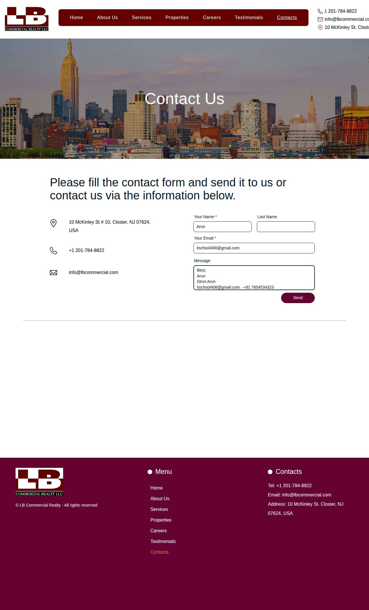

**After submit** — `run-a686e35b_attempt-2d042d43_post_attempt_2026-11-04T12-18-51-327Z.jpg`

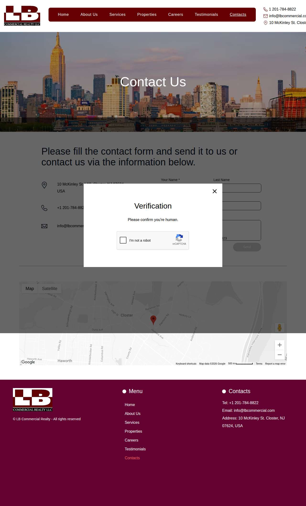

### 82realtygroup.com — unclear (LIVE)

| | |
|---|---|
| Attempt ID | `91e45648-08c5-4527-817c-91a99c2b639e` |
| Form URL | http://82realtygroup.com/index.html\#contact-section-container |
| Final URL | http://82realtygroup.com/index.html?name=Arun&email=itschool408%40gmail.com\#contact-section-container |
| Reserved | 2026-11-04 12:18:59 UTC |
| Submit attempted | 2026-11-04 12:19:01 UTC |
| Template | standard v2 |
| Confirmation text | none observed |
| Result / error | No new success marker observed |

Exact message:

~~~text
Subject: Helping customers find your business in AI search (AEO + GEO)

Hi there,

I'm Arun from Devs Arun. More and more customers now ask ChatGPT, Gemini, Perplexity or Google's AI Overviews questions like "who should I hire for this in my area?" before they call anyone. These tools answer from websites they can clearly understand, and they tend to recommend businesses whose pages answer real customer questions.

That is what AEO + GEO (Answer Engine and Generative Engine Optimization) is for. I improve your existing service pages so they clearly answer the questions your customers ask, add structured data that matches the page, and make the call, quote or enquiry step obvious. The benefit: your business gets a better chance of being mentioned or linked in AI answers, and visitors who arrive find it easy to contact you.

The AEO + GEO Starter is a one-time $199 (about ₹16,999, negotiable) for one website: a basic audit, 10 customer questions, improvements to two existing pages, relevant structured data and an action plan, with one revision round.

You can read the full details, send an enquiry or book online here:
https://devsarun.io/aeo-geo/

If this isn't relevant, just reply and I won't contact you again.

Best,
Arun
Devs Arun
itschool408@gmail.com · +91 7654534323
~~~

Submitted field values:

- name \[name\]: Arun
- email \[email\]: itschool408@gmail.com
- Enter your message \[message\]: Hi there, I'm Arun from Devs Arun. More and more customers now ask ChatGPT, Gemini, Perplexity or Google's AI Overviews 

**Filled form (before submit)** — `run-a686e35b_attempt-91e45648_filled_2026-11-04T12-19-01-817Z.jpg`

**After submit** — `run-a686e35b_attempt-91e45648_post_attempt_2026-11-04T12-19-31-908Z.jpg`

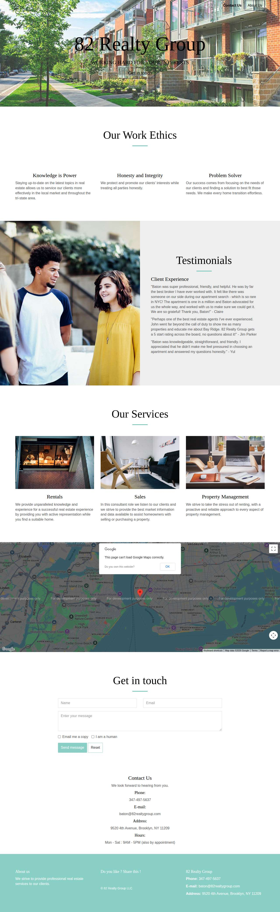

### ramsayrealty.com — unclear (LIVE)

| | |
|---|---|
| Attempt ID | `c474e39a-7575-4cd6-b68c-825fbf622573` |
| Form URL | https://www.ramsayrealty.com/ |
| Final URL | https://www.ramsayrealty.com/ |
| Reserved | 2026-11-04 12:19:40 UTC |
| Submit attempted | 2026-11-04 12:19:42 UTC |
| Template | standard v2 |
| Confirmation text | none observed |
| Result / error | No new success marker observed |

Exact message:

~~~text
Subject: Helping customers find your business in AI search (AEO + GEO)

Hi there,

I'm Arun from Devs Arun. More and more customers now ask ChatGPT, Gemini, Perplexity or Google's AI Overviews questions like "who should I hire for this in my area?" before they call anyone. These tools answer from websites they can clearly understand, and they tend to recommend businesses whose pages answer real customer questions.

That is what AEO + GEO (Answer Engine and Generative Engine Optimization) is for. I improve your existing service pages so they clearly answer the questions your customers ask, add structured data that matches the page, and make the call, quote or enquiry step obvious. The benefit: your business gets a better chance of being mentioned or linked in AI answers, and visitors who arrive find it easy to contact you.

The AEO + GEO Starter is a one-time $199 (about ₹16,999, negotiable) for one website: a basic audit, 10 customer questions, improvements to two existing pages, relevant structured data and an action plan, with one revision round.

You can read the full details, send an enquiry or book online here:
https://devsarun.io/aeo-geo/

If this isn't relevant, just reply and I won't contact you again.

Best,
Arun
Devs Arun
itschool408@gmail.com · +91 7654534323
~~~

Submitted field values:

- email \[email\]: itschool408@gmail.com
- Message \[message\]: Hi there, I'm Arun from Devs Arun. More and more customers now ask ChatGPT, Gemini, Perplexity or Google's AI Overviews 
- first-name \[first\_name\]: Arun

**Filled form (before submit)** — `run-a686e35b_attempt-c474e39a_filled_2026-11-04T12-19-42-904Z.jpg`

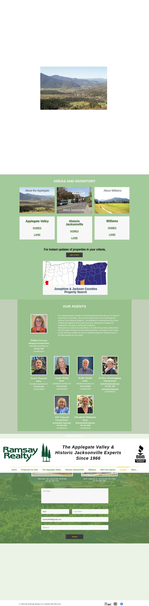

**After submit** — `run-a686e35b_attempt-c474e39a_post_attempt_2026-11-04T12-20-11-263Z.jpg`

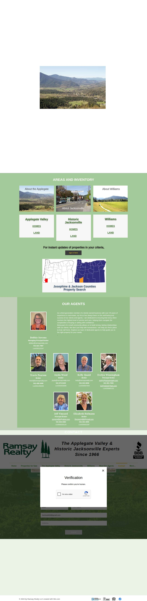

## Events (117)

| Time (UTC) | Event | Website | Details |
|---|---|---|---|
| 12:14:53 | run\_queued | — | live run requested by github:itsDevsArun |
| 12:14:53 | run\_dispatched | — | dispatch disabled (local test mode) |
| 12:14:56 | run\_started | — | Runner claimed live run |
| 12:14:57 | offer\_verified | — | Service page offer facts verified |
| 12:14:57 | website\_selected | clearchoiceplumbingllc.com | Live target clearchoiceplumbingllc.com |
| 12:14:57 | attempt\_reserved | clearchoiceplumbingllc.com | Submission attempt reserved with template standard v2 |
| 12:14:58 | page\_opened | clearchoiceplumbingllc.com | Opened form page |
| 12:14:59 | screenshot\_saved | clearchoiceplumbingllc.com | inspection screenshot saved (145 KB) |
| 12:14:59 | review\_required | clearchoiceplumbingllc.com | failed before submit: locator.fill: Error: Cannot type text into input\[type=number\] |
| 12:15:04 | website\_selected | bwnwincpainting.com | Live target bwnwincpainting.com |
| 12:15:04 | attempt\_reserved | bwnwincpainting.com | Submission attempt reserved with template standard v2 |
| 12:15:06 | page\_opened | bwnwincpainting.com | Opened form page |
| 12:15:06 | screenshot\_saved | bwnwincpainting.com | inspection screenshot saved (118 KB) |
| 12:15:06 | review\_required | bwnwincpainting.com | failed before submit: locator.fill: Error: Cannot type text into input\[type=number\] |
| 12:15:11 | website\_selected | absoluterestorepa.com | Live target absoluterestorepa.com |
| 12:15:11 | attempt\_reserved | absoluterestorepa.com | Submission attempt reserved with template standard v2 |
| 12:15:14 | page\_opened | absoluterestorepa.com | Opened form page |
| 12:15:14 | screenshot\_saved | absoluterestorepa.com | inspection screenshot saved (174 KB) |
| 12:15:14 | review\_required | absoluterestorepa.com | failed before submit: locator.fill: Error: Cannot type text into input\[type=number\] |
| 12:15:19 | website\_selected | masoudlawfirm.com | Live target masoudlawfirm.com |
| 12:15:19 | attempt\_reserved | masoudlawfirm.com | Submission attempt reserved with template standard v2 |
| 12:15:23 | page\_opened | masoudlawfirm.com | Opened form page |
| 12:15:23 | screenshot\_saved | masoudlawfirm.com | inspection screenshot saved (168 KB) |
| 12:15:23 | review\_required | masoudlawfirm.com | failed before submit: locator.fill: Error: Cannot type text into input\[type=number\] |
| 12:15:28 | website\_selected | david-ware.com | Live target david-ware.com |
| 12:15:28 | attempt\_reserved | david-ware.com | Submission attempt reserved with template short v2 |
| 12:15:30 | page\_opened | david-ware.com | Opened form page |
| 12:15:30 | screenshot\_saved | david-ware.com | inspection screenshot saved (29 KB) |
| 12:15:30 | review\_required | david-ware.com | failed before submit: Reviewed form not found on page (site changed) |
| 12:15:35 | website\_selected | browarddivorcelaw.com | Live target browarddivorcelaw.com |
| 12:15:35 | attempt\_reserved | browarddivorcelaw.com | Submission attempt reserved with template standard v2 |
| 12:15:37 | page\_opened | browarddivorcelaw.com | Opened form page |
| 12:15:38 | screenshot\_saved | browarddivorcelaw.com | filled screenshot saved (183 KB) |
| 12:15:38 | review\_required | browarddivorcelaw.com | failed before submit: Field "Phone" did not accept the value |
| 12:15:43 | website\_selected | coulterstax.com | Live target coulterstax.com |
| 12:15:43 | attempt\_reserved | coulterstax.com | Submission attempt reserved with template standard v2 |
| 12:15:45 | page\_opened | coulterstax.com | Opened form page |
| 12:15:45 | fields\_filled | coulterstax.com | filled |
| 12:15:45 | screenshot\_saved | coulterstax.com | filled screenshot saved (105 KB) |
| 12:15:45 | submit\_attempted | coulterstax.com | submitting |
| 12:16:14 | screenshot\_saved | coulterstax.com | post\_attempt screenshot saved (84 KB) |
| 12:16:14 | review\_required | coulterstax.com | unclear: No new success marker observed |
| 12:16:22 | website\_selected | stylianouaccounting.com | Live target stylianouaccounting.com |
| 12:16:22 | attempt\_reserved | stylianouaccounting.com | Submission attempt reserved with template standard v2 |
| 12:16:24 | page\_opened | stylianouaccounting.com | Opened form page |
| 12:16:24 | fields\_filled | stylianouaccounting.com | filled |
| 12:16:24 | screenshot\_saved | stylianouaccounting.com | filled screenshot saved (48 KB) |
| 12:16:24 | submit\_attempted | stylianouaccounting.com | submitting |
| 12:16:27 | screenshot\_saved | stylianouaccounting.com | post\_attempt screenshot saved (51 KB) |
| 12:16:27 | confirmation\_observed | stylianouaccounting.com | confirmed — "HOME ABOUT US SERVICES CONTACT Contact Form THANK YOU\! Your email was successfully sent. We will contact you as soon as " |
| 12:16:35 | website\_selected | finneyneill.com | Live target finneyneill.com |
| 12:16:35 | attempt\_reserved | finneyneill.com | Submission attempt reserved with template standard v2 |
| 12:16:37 | page\_opened | finneyneill.com | Opened form page |
| 12:16:37 | fields\_filled | finneyneill.com | filled |
| 12:16:37 | screenshot\_saved | finneyneill.com | filled screenshot saved (124 KB) |
| 12:16:37 | submit\_attempted | finneyneill.com | submitting |
| 12:16:41 | screenshot\_saved | finneyneill.com | post\_attempt screenshot saved (110 KB) |
| 12:16:41 | confirmation\_observed | finneyneill.com | confirmed — "l.com Address 9757 Greenwood Avenue North Seattle, WA 98103 Thank You\! We have received your message and will get back t" |
| 12:16:49 | website\_selected | accsoln.com | Live target accsoln.com |
| 12:16:49 | attempt\_reserved | accsoln.com | Submission attempt reserved with template standard v2 |
| 12:16:51 | page\_opened | accsoln.com | Opened form page |
| 12:16:51 | fields\_filled | accsoln.com | filled |
| 12:16:51 | screenshot\_saved | accsoln.com | filled screenshot saved (142 KB) |
| 12:16:51 | submit\_attempted | accsoln.com | submitting |
| 12:16:55 | screenshot\_saved | accsoln.com | post\_attempt screenshot saved (173 KB) |
| 12:16:55 | error | accsoln.com | error after submit — "ours and weekends by appointment only. First Name Last Name This field is required Phone Email Message © Mapbox © OpenSt" |
| 12:17:03 | website\_selected | whiteolivecpa.com | Live target whiteolivecpa.com |
| 12:17:03 | attempt\_reserved | whiteolivecpa.com | Submission attempt reserved with template standard v2 |
| 12:17:04 | page\_opened | whiteolivecpa.com | Opened form page |
| 12:17:05 | screenshot\_saved | whiteolivecpa.com | inspection screenshot saved (197 KB) |
| 12:17:05 | review\_required | whiteolivecpa.com | failed before submit: locator.fill: Error: Cannot type text into input\[type=number\] |
| 12:17:10 | website\_selected | northsteppe.com | Live target northsteppe.com |
| 12:17:10 | attempt\_reserved | northsteppe.com | Submission attempt reserved with template standard v2 |
| 12:17:12 | page\_opened | northsteppe.com | Opened form page |
| 12:17:12 | fields\_filled | northsteppe.com | filled |
| 12:17:12 | screenshot\_saved | northsteppe.com | filled screenshot saved (306 KB) |
| 12:17:12 | submit\_attempted | northsteppe.com | submitting |
| 12:17:17 | screenshot\_saved | northsteppe.com | post\_attempt screenshot saved (293 KB) |
| 12:17:17 | confirmation\_observed | northsteppe.com | confirmed — "Village Clintonville German Village Worthington CONTACT US Thank you for contacting us. We will get back to you as soon " |
| 12:17:25 | website\_selected | celebrationrentalgroupllc.com | Live target celebrationrentalgroupllc.com |
| 12:17:25 | attempt\_reserved | celebrationrentalgroupllc.com | Submission attempt reserved with template standard v2 |
| 12:17:29 | page\_opened | celebrationrentalgroupllc.com | Opened form page |
| 12:17:30 | fields\_filled | celebrationrentalgroupllc.com | filled |
| 12:17:30 | screenshot\_saved | celebrationrentalgroupllc.com | filled screenshot saved (138 KB) |
| 12:17:30 | submit\_attempted | celebrationrentalgroupllc.com | submitting |
| 12:18:06 | screenshot\_saved | celebrationrentalgroupllc.com | post\_attempt screenshot saved (139 KB) |
| 12:18:06 | review\_required | celebrationrentalgroupllc.com | unclear: No new success marker observed |
| 12:18:14 | website\_selected | pinnaclefalls.com | Live target pinnaclefalls.com |
| 12:18:14 | attempt\_reserved | pinnaclefalls.com | Submission attempt reserved with template standard v2 |
| 12:18:15 | page\_opened | pinnaclefalls.com | Opened form page |
| 12:18:15 | screenshot\_saved | pinnaclefalls.com | filled screenshot saved (100 KB) |
| 12:18:15 | review\_required | pinnaclefalls.com | failed before submit: Field "Phone" did not accept the value |
| 12:18:20 | website\_selected | lbcommercial.com | Live target lbcommercial.com |
| 12:18:20 | attempt\_reserved | lbcommercial.com | Submission attempt reserved with template standard v2 |
| 12:18:22 | page\_opened | lbcommercial.com | Opened form page |
| 12:18:22 | fields\_filled | lbcommercial.com | filled |
| 12:18:22 | screenshot\_saved | lbcommercial.com | filled screenshot saved (129 KB) |
| 12:18:23 | submit\_attempted | lbcommercial.com | submitting |
| 12:18:51 | screenshot\_saved | lbcommercial.com | post\_attempt screenshot saved (125 KB) |
| 12:18:51 | review\_required | lbcommercial.com | unclear: No new success marker observed |
| 12:18:59 | website\_selected | 82realtygroup.com | Live target 82realtygroup.com |
| 12:18:59 | attempt\_reserved | 82realtygroup.com | Submission attempt reserved with template standard v2 |
| 12:19:01 | page\_opened | 82realtygroup.com | Opened form page |
| 12:19:01 | fields\_filled | 82realtygroup.com | filled |
| 12:19:01 | screenshot\_saved | 82realtygroup.com | filled screenshot saved (393 KB) |
| 12:19:01 | submit\_attempted | 82realtygroup.com | submitting |
| 12:19:31 | screenshot\_saved | 82realtygroup.com | post\_attempt screenshot saved (389 KB) |
| 12:19:31 | review\_required | 82realtygroup.com | unclear: No new success marker observed |
| 12:19:40 | website\_selected | ramsayrealty.com | Live target ramsayrealty.com |
| 12:19:40 | attempt\_reserved | ramsayrealty.com | Submission attempt reserved with template standard v2 |
| 12:19:42 | page\_opened | ramsayrealty.com | Opened form page |
| 12:19:42 | fields\_filled | ramsayrealty.com | filled |
| 12:19:42 | screenshot\_saved | ramsayrealty.com | filled screenshot saved (309 KB) |
| 12:19:42 | submit\_attempted | ramsayrealty.com | submitting |
| 12:20:11 | screenshot\_saved | ramsayrealty.com | post\_attempt screenshot saved (274 KB) |
| 12:20:11 | review\_required | ramsayrealty.com | unclear: No new success marker observed |
| 12:20:19 | run\_completed | — | Run completed (queue\_exhausted) |
