# Run dbeacf2a — live — completed

| | |
|---|---|
| Run ID | `dbeacf2a-9107-4888-8113-e5770b1da763` |
| Requested by | github:itsDevsArun |
| Started | 2026-11-04 03:37:30 UTC |
| Finished | 2026-11-04 03:43:26 UTC |
| Finish reason | queue\_exhausted |
| GitHub Actions | https://github.com/itsDevsArun/aeo-geo/actions/runs/41763788389 |

CSV for this run: [runs/2026-11-04_live_dbeacf2a.csv](2026-11-04_live_dbeacf2a.csv)

## Attempts (19)

### clearchoiceplumbingllc.com — failed\_before\_submit (LIVE)

| | |
|---|---|
| Attempt ID | `f6b87377-346a-4c3d-9a56-146154ac7c4d` |
| Form URL | https://clearchoiceplumbingllc.com/contact/ |
| Final URL | — |
| Reserved | 2026-11-04 03:37:31 UTC |
| Submit attempted | — |
| Template | standard v2 |
| Confirmation text | none observed |
| Result / error | locator.fill: Error: Cannot type text into input\[type=number\] |

Exact message:

~~~text
Subject: Helping customers find your business in AI search (AEO + GEO)

Hi there,

I'm Arun from Devs Arun. More and more customers now ask ChatGPT, Gemini, Perplexity or Google's AI Overviews questions like "who should I hire for this in my area?" before they call anyone. These tools answer from websites they can clearly understand, and they tend to recommend businesses whose pages answer real customer questions.

That is what AEO + GEO (Answer Engine and Generative Engine Optimization) is for. I improve your existing service pages so they clearly answer the questions your customers ask, add structured data that matches the page, and make the call, quote or enquiry step obvious. The benefit: your business gets a better chance of being mentioned or linked in AI answers, and visitors who arrive find it easy to contact you.

The AEO + GEO Starter is a one-time $199 (about ₹16,999, negotiable) for one website: a basic audit, 10 customer questions, improvements to two existing pages, relevant structured data and an action plan, with one revision round.

You can read the full details, send an enquiry or book online here:
https://devsarun.io/aeo-geo/

If this isn't relevant, just reply and I won't contact you again.

Best,
Arun
Devs Arun
itschool408@gmail.com · +91 7654534323
~~~

Submitted field values:

- \#wpforms-51-field\_1: Arun
- \#wpforms-51-field\_2: itschool408@gmail.com
- \#wpforms-51-field\_3: Hi there, I'm Arun from Devs Arun. More and more customers now ask ChatGPT, Gemini, Perplexity or Google's AI Overviews 
- \#wpforms-51-field\_5: +91 7654534323

**Inspected page** — `run-dbeacf2a_attempt-f6b87377_inspection_2026-11-04T03-37-33-429Z.jpg`

### bwnwincpainting.com — failed\_before\_submit (LIVE)

| | |
|---|---|
| Attempt ID | `fd55a39c-38b8-4899-914d-32a8afa94601` |
| Form URL | https://www.bwnwincpainting.com/contact/ |
| Final URL | — |
| Reserved | 2026-11-04 03:37:38 UTC |
| Submit attempted | — |
| Template | standard v2 |
| Confirmation text | none observed |
| Result / error | locator.fill: Error: Cannot type text into input\[type=number\] |

Exact message:

~~~text
Subject: Helping customers find your business in AI search (AEO + GEO)

Hi there,

I'm Arun from Devs Arun. More and more customers now ask ChatGPT, Gemini, Perplexity or Google's AI Overviews questions like "who should I hire for this in my area?" before they call anyone. These tools answer from websites they can clearly understand, and they tend to recommend businesses whose pages answer real customer questions.

That is what AEO + GEO (Answer Engine and Generative Engine Optimization) is for. I improve your existing service pages so they clearly answer the questions your customers ask, add structured data that matches the page, and make the call, quote or enquiry step obvious. The benefit: your business gets a better chance of being mentioned or linked in AI answers, and visitors who arrive find it easy to contact you.

The AEO + GEO Starter is a one-time $199 (about ₹16,999, negotiable) for one website: a basic audit, 10 customer questions, improvements to two existing pages, relevant structured data and an action plan, with one revision round.

You can read the full details, send an enquiry or book online here:
https://devsarun.io/aeo-geo/

If this isn't relevant, just reply and I won't contact you again.

Best,
Arun
Devs Arun
itschool408@gmail.com · +91 7654534323
~~~

Submitted field values:

- \#name-1151: Arun
- \#email-1151: itschool408@gmail.com
- \#phone-1151: +91 7654534323
- \#message-1151: Hi there, I'm Arun from Devs Arun. More and more customers now ask ChatGPT, Gemini, Perplexity or Google's AI Overviews 

**Inspected page** — `run-dbeacf2a_attempt-fd55a39c_inspection_2026-11-04T03-37-40-758Z.jpg`

### absoluterestorepa.com — failed\_before\_submit (LIVE)

| | |
|---|---|
| Attempt ID | `36f77dcc-8ccc-44b7-8785-1c7c2d44f136` |
| Form URL | https://absoluterestorepa.com/contact-us/ |
| Final URL | — |
| Reserved | 2026-11-04 03:37:45 UTC |
| Submit attempted | — |
| Template | standard v2 |
| Confirmation text | none observed |
| Result / error | locator.fill: Error: Cannot type text into input\[type=number\] |

Exact message:

~~~text
Subject: Helping customers find your business in AI search (AEO + GEO)

Hi there,

I'm Arun from Devs Arun. More and more customers now ask ChatGPT, Gemini, Perplexity or Google's AI Overviews questions like "who should I hire for this in my area?" before they call anyone. These tools answer from websites they can clearly understand, and they tend to recommend businesses whose pages answer real customer questions.

That is what AEO + GEO (Answer Engine and Generative Engine Optimization) is for. I improve your existing service pages so they clearly answer the questions your customers ask, add structured data that matches the page, and make the call, quote or enquiry step obvious. The benefit: your business gets a better chance of being mentioned or linked in AI answers, and visitors who arrive find it easy to contact you.

The AEO + GEO Starter is a one-time $199 (about ₹16,999, negotiable) for one website: a basic audit, 10 customer questions, improvements to two existing pages, relevant structured data and an action plan, with one revision round.

You can read the full details, send an enquiry or book online here:
https://devsarun.io/aeo-geo/

If this isn't relevant, just reply and I won't contact you again.

Best,
Arun
Devs Arun
itschool408@gmail.com · +91 7654534323
~~~

Submitted field values:

- \#form-field-name: Arun
- \#form-field-message: Hi there, I'm Arun from Devs Arun. More and more customers now ask ChatGPT, Gemini, Perplexity or Google's AI Overviews 
- \#form-field-field\_ed02ec2: +91 7654534323
- \#content \> div \> div \> div:nth-of-type(2) \> div \> div:nth-of-type(1) \> div:nth-of-type(2) \> div \> form \> div \> div:nth-of-type(3) \> input: itschool408@gmail.com

**Inspected page** — `run-dbeacf2a_attempt-36f77dcc_inspection_2026-11-04T03-37-48-680Z.jpg`

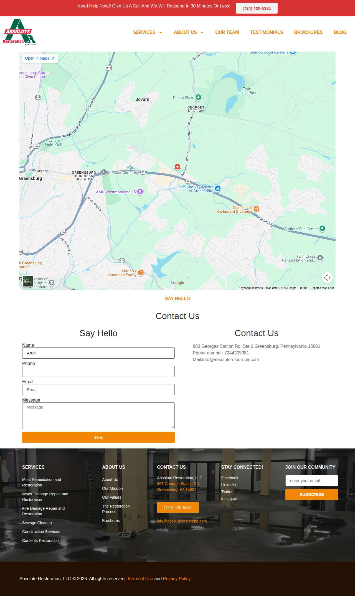

### flytmoving.com — confirmed (LIVE)

| | |
|---|---|
| Attempt ID | `88ce887b-9af3-47cb-bf8c-6d9006bf5a72` |
| Form URL | https://flytmoving.com/contact/ |
| Final URL | https://flytmoving.com/contact/?sent=1\#contact |
| Reserved | 2026-11-04 03:37:53 UTC |
| Submit attempted | 2026-11-04 03:37:55 UTC |
| Template | standard v2 |
| Confirmation text | r will get right back to you. BOOK YOUR MOVE (571) 619-2687 Thanks, we got it. A FLYT coordinator will be in touch shortly. Need us sooner? Call (571) 619-2687. SEND |
| Result / error | — |

Exact message:

~~~text
Subject: Helping customers find your business in AI search (AEO + GEO)

Hi there,

I'm Arun from Devs Arun. More and more customers now ask ChatGPT, Gemini, Perplexity or Google's AI Overviews questions like "who should I hire for this in my area?" before they call anyone. These tools answer from websites they can clearly understand, and they tend to recommend businesses whose pages answer real customer questions.

That is what AEO + GEO (Answer Engine and Generative Engine Optimization) is for. I improve your existing service pages so they clearly answer the questions your customers ask, add structured data that matches the page, and make the call, quote or enquiry step obvious. The benefit: your business gets a better chance of being mentioned or linked in AI answers, and visitors who arrive find it easy to contact you.

The AEO + GEO Starter is a one-time $199 (about ₹16,999, negotiable) for one website: a basic audit, 10 customer questions, improvements to two existing pages, relevant structured data and an action plan, with one revision round.

You can read the full details, send an enquiry or book online here:
https://devsarun.io/aeo-geo/

If this isn't relevant, just reply and I won't contact you again.

Best,
Arun
Devs Arun
itschool408@gmail.com · +91 7654534323
~~~

Submitted field values:

- Name\* \[name\]: Arun
- Email\* \[email\]: itschool408@gmail.com
- Phone\* \[phone\]: +91 7654534323
- How can we help?\* \[message\]: Hi there, I'm Arun from Devs Arun. More and more customers now ask ChatGPT, Gemini, Perplexity or Google's AI Overviews 

**Filled form (before submit)** — `run-dbeacf2a_attempt-88ce887b_filled_2026-11-04T03-37-55-902Z.jpg`

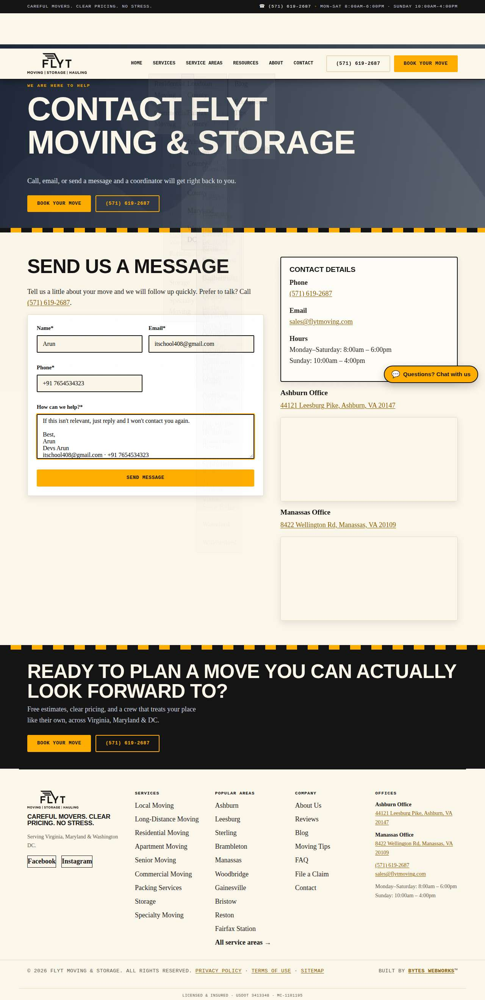

**After submit** — `run-dbeacf2a_attempt-88ce887b_post_attempt_2026-11-04T03-38-06-606Z.jpg`

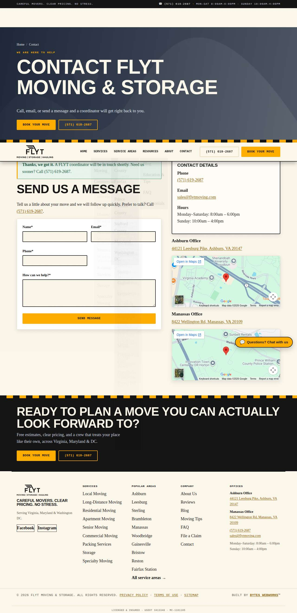

### moveauto.com — confirmed (LIVE)

| | |
|---|---|
| Attempt ID | `31379741-594d-4991-a37f-105268a8db02` |
| Form URL | https://moveauto.com/contact/ |
| Final URL | https://moveauto.com/contact/ |
| Reserved | 2026-11-04 03:38:14 UTC |
| Submit attempted | 2026-11-04 03:38:16 UTC |
| Template | standard v2 |
| Confirmation text | ame Phone number Email Your Message Submit Leave this blank Thank you. We received your message and will be in touch. Email Transport Updates and Questions cs@moveauto.c |
| Result / error | — |

Exact message:

~~~text
Subject: Helping customers find your business in AI search (AEO + GEO)

Hi there,

I'm Arun from Devs Arun. More and more customers now ask ChatGPT, Gemini, Perplexity or Google's AI Overviews questions like "who should I hire for this in my area?" before they call anyone. These tools answer from websites they can clearly understand, and they tend to recommend businesses whose pages answer real customer questions.

That is what AEO + GEO (Answer Engine and Generative Engine Optimization) is for. I improve your existing service pages so they clearly answer the questions your customers ask, add structured data that matches the page, and make the call, quote or enquiry step obvious. The benefit: your business gets a better chance of being mentioned or linked in AI answers, and visitors who arrive find it easy to contact you.

The AEO + GEO Starter is a one-time $199 (about ₹16,999, negotiable) for one website: a basic audit, 10 customer questions, improvements to two existing pages, relevant structured data and an action plan, with one revision round.

You can read the full details, send an enquiry or book online here:
https://devsarun.io/aeo-geo/

If this isn't relevant, just reply and I won't contact you again.

Best,
Arun
Devs Arun
itschool408@gmail.com · +91 7654534323
~~~

Submitted field values:

- Name \[name\]: Arun
- Email \[email\]: itschool408@gmail.com
- Phone number \[phone\]: +91 7654534323
- Your Message \[message\]: Hi there, I'm Arun from Devs Arun. More and more customers now ask ChatGPT, Gemini, Perplexity or Google's AI Overviews 

**Filled form (before submit)** — `run-dbeacf2a_attempt-31379741_filled_2026-11-04T03-38-16-784Z.jpg`

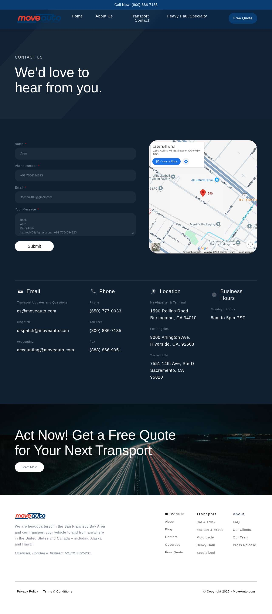

**After submit** — `run-dbeacf2a_attempt-31379741_post_attempt_2026-11-04T03-38-20-749Z.jpg`

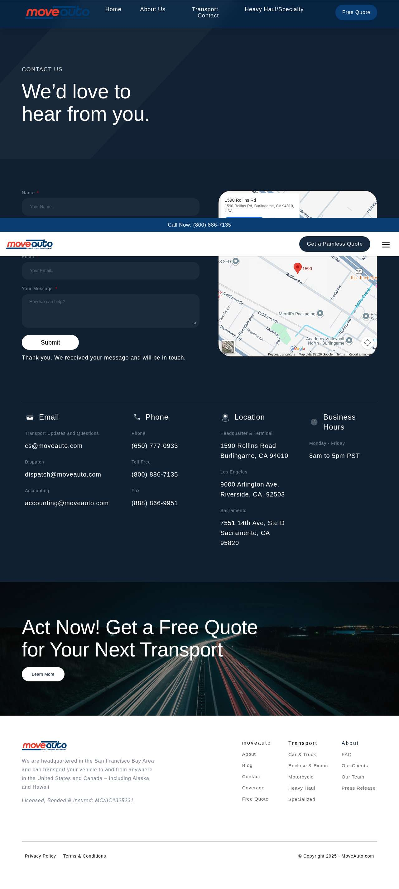

### bookonemove.com — confirmed (LIVE)

| | |
|---|---|
| Attempt ID | `74c3b881-a0a6-4c7f-a6a2-4fab5108febc` |
| Form URL | https://www.bookonemove.com/contact/ |
| Final URL | https://www.bookonemove.com/contact/ |
| Reserved | 2026-11-04 03:38:28 UTC |
| Submit attempted | 2026-11-04 03:38:30 UTC |
| Template | standard v2 |
| Confirmation text | Thank you\! Your form submission has been received. Back to our site |
| Result / error | — |

Exact message:

~~~text
Subject: Helping customers find your business in AI search (AEO + GEO)

Hi there,

I'm Arun from Devs Arun. More and more customers now ask ChatGPT, Gemini, Perplexity or Google's AI Overviews questions like "who should I hire for this in my area?" before they call anyone. These tools answer from websites they can clearly understand, and they tend to recommend businesses whose pages answer real customer questions.

That is what AEO + GEO (Answer Engine and Generative Engine Optimization) is for. I improve your existing service pages so they clearly answer the questions your customers ask, add structured data that matches the page, and make the call, quote or enquiry step obvious. The benefit: your business gets a better chance of being mentioned or linked in AI answers, and visitors who arrive find it easy to contact you.

The AEO + GEO Starter is a one-time $199 (about ₹16,999, negotiable) for one website: a basic audit, 10 customer questions, improvements to two existing pages, relevant structured data and an action plan, with one revision round.

You can read the full details, send an enquiry or book online here:
https://devsarun.io/aeo-geo/

If this isn't relevant, just reply and I won't contact you again.

Best,
Arun
Devs Arun
itschool408@gmail.com · +91 7654534323
~~~

Submitted field values:

- Name \* \[name\]: Arun
- Email \* \[email\]: itschool408@gmail.com
- Phone \* \[phone\]: +91 7654534323
- Message \* \[message\]: Hi there, I'm Arun from Devs Arun. More and more customers now ask ChatGPT, Gemini, Perplexity or Google's AI Overviews 

**Filled form (before submit)** — `run-dbeacf2a_attempt-74c3b881_filled_2026-11-04T03-38-30-007Z.jpg`

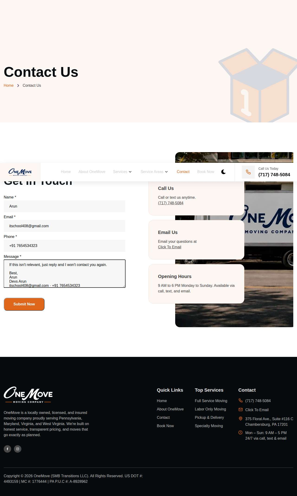

**After submit** — `run-dbeacf2a_attempt-74c3b881_post_attempt_2026-11-04T03-38-33-360Z.jpg`

### alphamovingutah.com — confirmed (LIVE)

| | |
|---|---|
| Attempt ID | `ad5ddf36-3f10-49fd-ac92-b344c7679bcb` |
| Form URL | https://alphamovingutah.com/contact |
| Final URL | https://alphamovingutah.com/contact |
| Reserved | 2026-11-04 03:38:41 UTC |
| Submit attempted | 2026-11-04 03:38:42 UTC |
| Template | standard v2 |
| Confirmation text | hipping & Receiving: 9:00 AM – 3:30 PM USDOT NUMBER 2196060 MESSAGE RECEIVED\! Thank you for reaching out. We'll be in touch shortly — or call us now at (801) 621-4899. Prefer t |
| Result / error | — |

Exact message:

~~~text
Subject: Helping customers find your business in AI search (AEO + GEO)

Hi there,

I'm Arun from Devs Arun. More and more customers now ask ChatGPT, Gemini, Perplexity or Google's AI Overviews questions like "who should I hire for this in my area?" before they call anyone. These tools answer from websites they can clearly understand, and they tend to recommend businesses whose pages answer real customer questions.

That is what AEO + GEO (Answer Engine and Generative Engine Optimization) is for. I improve your existing service pages so they clearly answer the questions your customers ask, add structured data that matches the page, and make the call, quote or enquiry step obvious. The benefit: your business gets a better chance of being mentioned or linked in AI answers, and visitors who arrive find it easy to contact you.

The AEO + GEO Starter is a one-time $199 (about ₹16,999, negotiable) for one website: a basic audit, 10 customer questions, improvements to two existing pages, relevant structured data and an action plan, with one revision round.

You can read the full details, send an enquiry or book online here:
https://devsarun.io/aeo-geo/

If this isn't relevant, just reply and I won't contact you again.

Best,
Arun
Devs Arun
itschool408@gmail.com · +91 7654534323
~~~

Submitted field values:

- EMAIL \[email\]: itschool408@gmail.com
- NAME \* \[name\]: Arun
- PHONE \[phone\]: +91 7654534323
- MESSAGE \* \[message\]: Hi there, I'm Arun from Devs Arun. More and more customers now ask ChatGPT, Gemini, Perplexity or Google's AI Overviews 

**Filled form (before submit)** — `run-dbeacf2a_attempt-ad5ddf36_filled_2026-11-04T03-38-42-861Z.jpg`

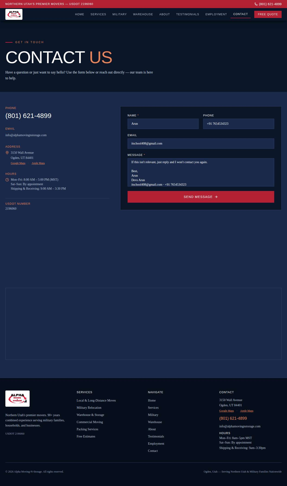

**After submit** — `run-dbeacf2a_attempt-ad5ddf36_post_attempt_2026-11-04T03-38-46-610Z.jpg`

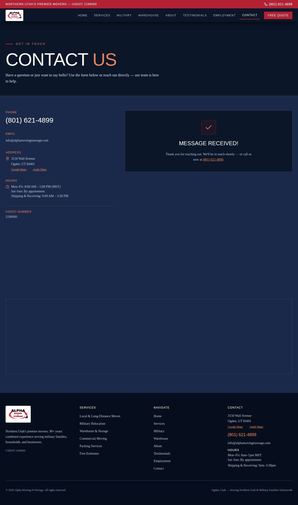

### thompsonsmoving.net — unclear (LIVE)

| | |
|---|---|
| Attempt ID | `430cbb4c-56aa-4d75-a7e6-df4a5b7ae592` |
| Form URL | https://www.thompsonsmoving.net/contact/4493840 |
| Final URL | https://www.thompsonsmoving.net/contact/4493840 |
| Reserved | 2026-11-04 03:38:54 UTC |
| Submit attempted | 2026-11-04 03:38:56 UTC |
| Template | standard v2 |
| Confirmation text | none observed |
| Result / error | No new success marker observed |

Exact message:

~~~text
Subject: Helping customers find your business in AI search (AEO + GEO)

Hi there,

I'm Arun from Devs Arun. More and more customers now ask ChatGPT, Gemini, Perplexity or Google's AI Overviews questions like "who should I hire for this in my area?" before they call anyone. These tools answer from websites they can clearly understand, and they tend to recommend businesses whose pages answer real customer questions.

That is what AEO + GEO (Answer Engine and Generative Engine Optimization) is for. I improve your existing service pages so they clearly answer the questions your customers ask, add structured data that matches the page, and make the call, quote or enquiry step obvious. The benefit: your business gets a better chance of being mentioned or linked in AI answers, and visitors who arrive find it easy to contact you.

The AEO + GEO Starter is a one-time $199 (about ₹16,999, negotiable) for one website: a basic audit, 10 customer questions, improvements to two existing pages, relevant structured data and an action plan, with one revision round.

You can read the full details, send an enquiry or book online here:
https://devsarun.io/aeo-geo/

If this isn't relevant, just reply and I won't contact you again.

Best,
Arun
Devs Arun
itschool408@gmail.com · +91 7654534323
~~~

Submitted field values:

- Name\* \[name\]: Arun
- Phone \[phone\]: +91 7654534323
- Email\* \[email\]: itschool408@gmail.com
- Message \[message\]: Hi there, I'm Arun from Devs Arun. More and more customers now ask ChatGPT, Gemini, Perplexity or Google's AI Overviews 

**Filled form (before submit)** — `run-dbeacf2a_attempt-430cbb4c_filled_2026-11-04T03-38-55-940Z.jpg`

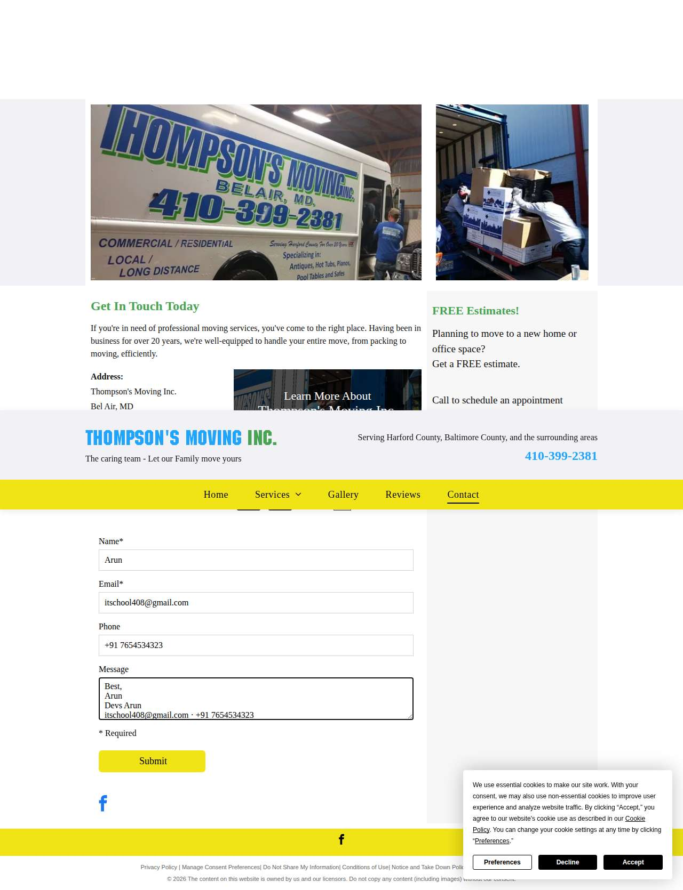

**After submit** — `run-dbeacf2a_attempt-430cbb4c_post_attempt_2026-11-04T03-39-25-770Z.jpg`

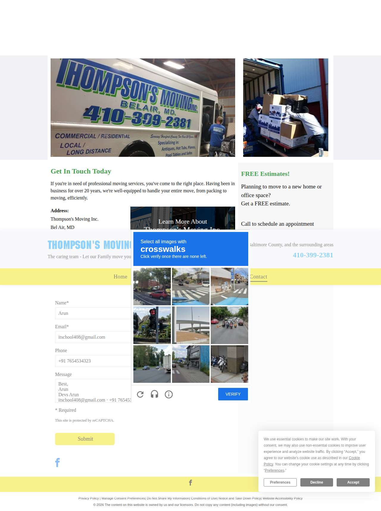

### raysmovers.com — unclear (LIVE)

| | |
|---|---|
| Attempt ID | `aa79a422-de41-4ca9-a363-4ace9d4233a1` |
| Form URL | https://www.raysmovers.com/contact |
| Final URL | https://www.raysmovers.com/home |
| Reserved | 2026-11-04 03:39:33 UTC |
| Submit attempted | 2026-11-04 03:39:36 UTC |
| Template | standard v2 |
| Confirmation text | none observed |
| Result / error | No new success marker observed |

Exact message:

~~~text
Subject: Helping customers find your business in AI search (AEO + GEO)

Hi there,

I'm Arun from Devs Arun. More and more customers now ask ChatGPT, Gemini, Perplexity or Google's AI Overviews questions like "who should I hire for this in my area?" before they call anyone. These tools answer from websites they can clearly understand, and they tend to recommend businesses whose pages answer real customer questions.

That is what AEO + GEO (Answer Engine and Generative Engine Optimization) is for. I improve your existing service pages so they clearly answer the questions your customers ask, add structured data that matches the page, and make the call, quote or enquiry step obvious. The benefit: your business gets a better chance of being mentioned or linked in AI answers, and visitors who arrive find it easy to contact you.

The AEO + GEO Starter is a one-time $199 (about ₹16,999, negotiable) for one website: a basic audit, 10 customer questions, improvements to two existing pages, relevant structured data and an action plan, with one revision round.

You can read the full details, send an enquiry or book online here:
https://devsarun.io/aeo-geo/

If this isn't relevant, just reply and I won't contact you again.

Best,
Arun
Devs Arun
itschool408@gmail.com · +91 7654534323
~~~

Submitted field values:

- Email \[email\]: itschool408@gmail.com
- Message \[message\]: Hi there, I'm Arun from Devs Arun. More and more customers now ask ChatGPT, Gemini, Perplexity or Google's AI Overviews 
- First Name \[first\_name\]: Arun

**Filled form (before submit)** — `run-dbeacf2a_attempt-aa79a422_filled_2026-11-04T03-39-36-226Z.jpg`

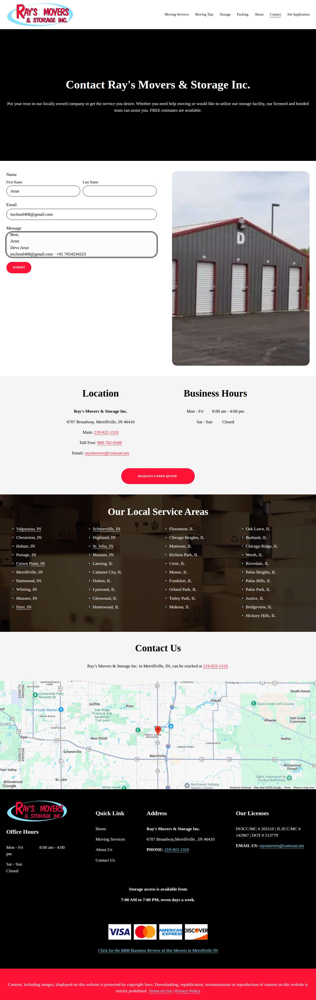

**After submit** — `run-dbeacf2a_attempt-aa79a422_post_attempt_2026-11-04T03-40-04-524Z.jpg`

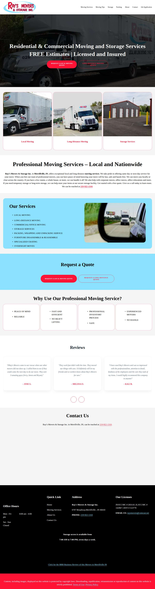

### legendmovers4youfl.com — confirmed (LIVE)

| | |
|---|---|
| Attempt ID | `d45e8b80-7dbc-462d-aeb4-7d3bbe49997b` |
| Form URL | https://legendmovers4youfl.com/contact-us/ |
| Final URL | https://legendmovers4youfl.com/thank-you/ |
| Reserved | 2026-11-04 03:40:12 UTC |
| Submit attempted | 2026-11-04 03:40:13 UTC |
| Template | standard v2 |
| Confirmation text | ork Resources FAQ Contact Get a free quote REQUEST RECEIVED THANK YOU, ARUN\! WE’VE RECEIVED YOUR MESSAGE. Your message is on its way to our team. We'll get back to you s |
| Result / error | — |

Exact message:

~~~text
Subject: Helping customers find your business in AI search (AEO + GEO)

Hi there,

I'm Arun from Devs Arun. More and more customers now ask ChatGPT, Gemini, Perplexity or Google's AI Overviews questions like "who should I hire for this in my area?" before they call anyone. These tools answer from websites they can clearly understand, and they tend to recommend businesses whose pages answer real customer questions.

That is what AEO + GEO (Answer Engine and Generative Engine Optimization) is for. I improve your existing service pages so they clearly answer the questions your customers ask, add structured data that matches the page, and make the call, quote or enquiry step obvious. The benefit: your business gets a better chance of being mentioned or linked in AI answers, and visitors who arrive find it easy to contact you.

The AEO + GEO Starter is a one-time $199 (about ₹16,999, negotiable) for one website: a basic audit, 10 customer questions, improvements to two existing pages, relevant structured data and an action plan, with one revision round.

You can read the full details, send an enquiry or book online here:
https://devsarun.io/aeo-geo/

If this isn't relevant, just reply and I won't contact you again.

Best,
Arun
Devs Arun
itschool408@gmail.com · +91 7654534323
~~~

Submitted field values:

- Name \[name\]: Arun
- Phone \[phone\]: +91 7654534323
- Email (optional) \[email\]: itschool408@gmail.com
- How can we help? \[message\]: Hi there, I'm Arun from Devs Arun. More and more customers now ask ChatGPT, Gemini, Perplexity or Google's AI Overviews 

**Filled form (before submit)** — `run-dbeacf2a_attempt-d45e8b80_filled_2026-11-04T03-40-13-494Z.jpg`

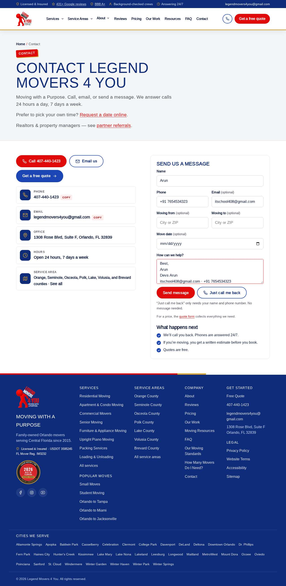

**After submit** — `run-dbeacf2a_attempt-d45e8b80_post_attempt_2026-11-04T03-40-20-842Z.jpg`

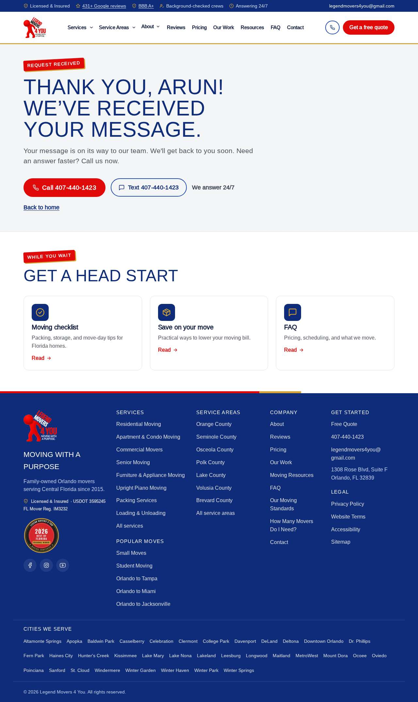

### golambertteam.com — failed\_before\_submit (LIVE)

| | |
|---|---|
| Attempt ID | `0de29912-f398-4ad6-b1d5-e238ac01713a` |
| Form URL | https://opelika.golambertteam.com/contact-us |
| Final URL | https://opelika.golambertteam.com/contact-us |
| Reserved | 2026-11-04 03:40:28 UTC |
| Submit attempted | — |
| Template | standard v2 |
| Confirmation text | none observed |
| Result / error | Field "Phone Number" did not accept the value |

Exact message:

~~~text
Subject: Helping customers find your business in AI search (AEO + GEO)

Hi there,

I'm Arun from Devs Arun. More and more customers now ask ChatGPT, Gemini, Perplexity or Google's AI Overviews questions like "who should I hire for this in my area?" before they call anyone. These tools answer from websites they can clearly understand, and they tend to recommend businesses whose pages answer real customer questions.

That is what AEO + GEO (Answer Engine and Generative Engine Optimization) is for. I improve your existing service pages so they clearly answer the questions your customers ask, add structured data that matches the page, and make the call, quote or enquiry step obvious. The benefit: your business gets a better chance of being mentioned or linked in AI answers, and visitors who arrive find it easy to contact you.

The AEO + GEO Starter is a one-time $199 (about ₹16,999, negotiable) for one website: a basic audit, 10 customer questions, improvements to two existing pages, relevant structured data and an action plan, with one revision round.

You can read the full details, send an enquiry or book online here:
https://devsarun.io/aeo-geo/

If this isn't relevant, just reply and I won't contact you again.

Best,
Arun
Devs Arun
itschool408@gmail.com · +91 7654534323
~~~

Submitted field values:

- \#form-0-f-67: Arun
- \#form-0-f-69: itschool408@gmail.com
- \#form-0-f-70: +91 7654534323
- \#form-0-f-71: Hi there, I'm Arun from Devs Arun. More and more customers now ask ChatGPT, Gemini, Perplexity or Google's AI Overviews 

**Filled form (before submit)** — `run-dbeacf2a_attempt-0de29912_filled_2026-11-04T03-40-31-206Z.jpg`

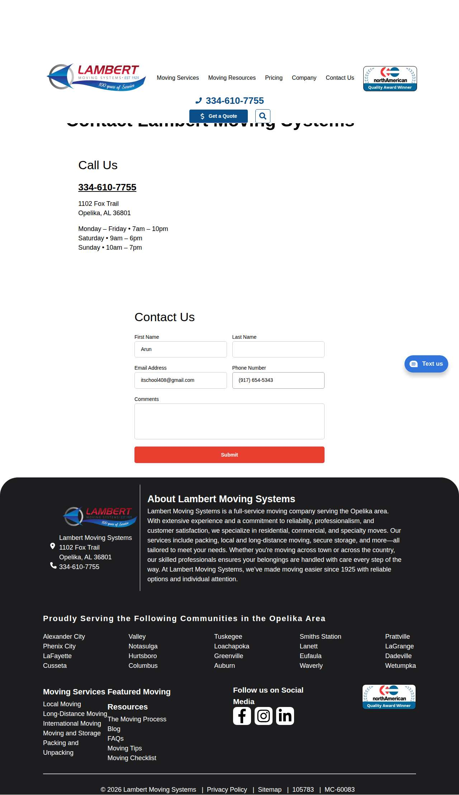

### bravo-moving.com — confirmed (LIVE)

| | |
|---|---|
| Attempt ID | `809824ab-1094-400a-a48a-914b0a659c4e` |
| Form URL | https://bravo-moving.com/contact/ |
| Final URL | https://bravo-moving.com/thank-you/ |
| Reserved | 2026-11-04 03:40:36 UTC |
| Submit attempted | 2026-11-04 03:40:42 UTC |
| Template | standard v2 |
| Confirmation text | Us Reviews Services Locations Media Room Contact FREE QUOTE THANK YOU Thank you for contacting us. Someone will reach out to you shortly. Services LOCAL MOVING LONG DIST |
| Result / error | — |

Exact message:

~~~text
Subject: Helping customers find your business in AI search (AEO + GEO)

Hi there,

I'm Arun from Devs Arun. More and more customers now ask ChatGPT, Gemini, Perplexity or Google's AI Overviews questions like "who should I hire for this in my area?" before they call anyone. These tools answer from websites they can clearly understand, and they tend to recommend businesses whose pages answer real customer questions.

That is what AEO + GEO (Answer Engine and Generative Engine Optimization) is for. I improve your existing service pages so they clearly answer the questions your customers ask, add structured data that matches the page, and make the call, quote or enquiry step obvious. The benefit: your business gets a better chance of being mentioned or linked in AI answers, and visitors who arrive find it easy to contact you.

The AEO + GEO Starter is a one-time $199 (about ₹16,999, negotiable) for one website: a basic audit, 10 customer questions, improvements to two existing pages, relevant structured data and an action plan, with one revision round.

You can read the full details, send an enquiry or book online here:
https://devsarun.io/aeo-geo/

If this isn't relevant, just reply and I won't contact you again.

Best,
Arun
Devs Arun
itschool408@gmail.com · +91 7654534323
~~~

Submitted field values:

- Subject \* \[subject\]: Helping customers find your business in AI search (AEO + GEO)
- Your Email \* \[email\]: itschool408@gmail.com
- Your Message \* \[message\]: Hi there, I'm Arun from Devs Arun. More and more customers now ask ChatGPT, Gemini, Perplexity or Google's AI Overviews 
- Your Name \* \[first\_name\]: Arun

**Filled form (before submit)** — `run-dbeacf2a_attempt-809824ab_filled_2026-11-04T03-40-42-059Z.jpg`

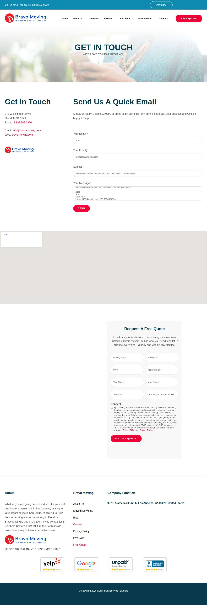

**After submit** — `run-dbeacf2a_attempt-809824ab_post_attempt_2026-11-04T03-40-53-240Z.jpg`

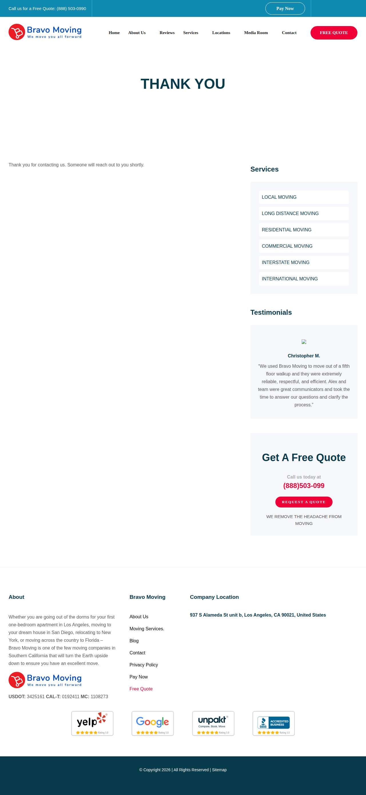

### waterdamagecheyenne.com — unclear (LIVE)

| | |
|---|---|
| Attempt ID | `6351c121-50a0-488b-8f21-d62c393d1f03` |
| Form URL | https://waterdamagecheyenne.com/contact/ |
| Final URL | chrome-error://chromewebdata/ |
| Reserved | 2026-11-04 03:41:00 UTC |
| Submit attempted | 2026-11-04 03:41:01 UTC |
| Template | standard v2 |
| Confirmation text | none observed |
| Result / error | No new success marker observed |

Exact message:

~~~text
Subject: Helping customers find your business in AI search (AEO + GEO)

Hi there,

I'm Arun from Devs Arun. More and more customers now ask ChatGPT, Gemini, Perplexity or Google's AI Overviews questions like "who should I hire for this in my area?" before they call anyone. These tools answer from websites they can clearly understand, and they tend to recommend businesses whose pages answer real customer questions.

That is what AEO + GEO (Answer Engine and Generative Engine Optimization) is for. I improve your existing service pages so they clearly answer the questions your customers ask, add structured data that matches the page, and make the call, quote or enquiry step obvious. The benefit: your business gets a better chance of being mentioned or linked in AI answers, and visitors who arrive find it easy to contact you.

The AEO + GEO Starter is a one-time $199 (about ₹16,999, negotiable) for one website: a basic audit, 10 customer questions, improvements to two existing pages, relevant structured data and an action plan, with one revision round.

You can read the full details, send an enquiry or book online here:
https://devsarun.io/aeo-geo/

If this isn't relevant, just reply and I won't contact you again.

Best,
Arun
Devs Arun
itschool408@gmail.com · +91 7654534323
~~~

Submitted field values:

- Name \[name\]: Arun
- Email \[email\]: itschool408@gmail.com
- Phone \[phone\]: +91 7654534323
- Tell us what happened \[message\]: Hi there, I'm Arun from Devs Arun. More and more customers now ask ChatGPT, Gemini, Perplexity or Google's AI Overviews 

**Filled form (before submit)** — `run-dbeacf2a_attempt-6351c121_filled_2026-11-04T03-41-01-980Z.jpg`

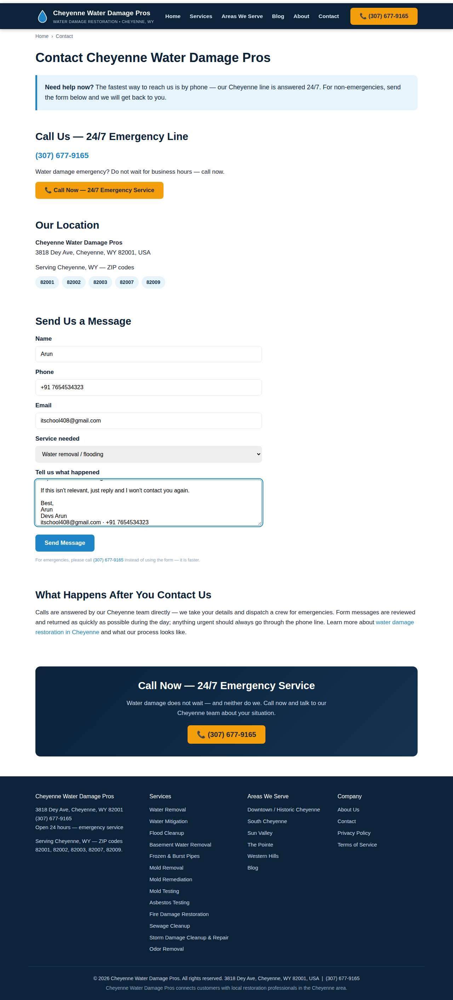

**After submit** — `run-dbeacf2a_attempt-6351c121_post_attempt_2026-11-04T03-41-29-869Z.jpg`

### cowboymoving.com — unclear (LIVE)

| | |
|---|---|
| Attempt ID | `88c05179-a35c-416f-b7c6-d6c1ac3136da` |
| Form URL | https://www.cowboymoving.com/contact |
| Final URL | https://www.cowboymoving.com/contact |
| Reserved | 2026-11-04 03:41:37 UTC |
| Submit attempted | 2026-11-04 03:41:42 UTC |
| Template | standard v2 |
| Confirmation text | none observed |
| Result / error | No new success marker observed |

Exact message:

~~~text
Subject: Helping customers find your business in AI search (AEO + GEO)

Hi there,

I'm Arun from Devs Arun. More and more customers now ask ChatGPT, Gemini, Perplexity or Google's AI Overviews questions like "who should I hire for this in my area?" before they call anyone. These tools answer from websites they can clearly understand, and they tend to recommend businesses whose pages answer real customer questions.

That is what AEO + GEO (Answer Engine and Generative Engine Optimization) is for. I improve your existing service pages so they clearly answer the questions your customers ask, add structured data that matches the page, and make the call, quote or enquiry step obvious. The benefit: your business gets a better chance of being mentioned or linked in AI answers, and visitors who arrive find it easy to contact you.

The AEO + GEO Starter is a one-time $199 (about ₹16,999, negotiable) for one website: a basic audit, 10 customer questions, improvements to two existing pages, relevant structured data and an action plan, with one revision round.

You can read the full details, send an enquiry or book online here:
https://devsarun.io/aeo-geo/

If this isn't relevant, just reply and I won't contact you again.

Best,
Arun
Devs Arun
itschool408@gmail.com · +91 7654534323
~~~

Submitted field values:

- Email \[email\]: itschool408@gmail.com
- Phone \[phone\]: +91 7654534323
- First name \[first\_name\]: Arun
- Leave us a message... \[message\]: Hi there, I'm Arun from Devs Arun. More and more customers now ask ChatGPT, Gemini, Perplexity or Google's AI Overviews 

**Filled form (before submit)** — `run-dbeacf2a_attempt-88c05179_filled_2026-11-04T03-41-42-183Z.jpg`

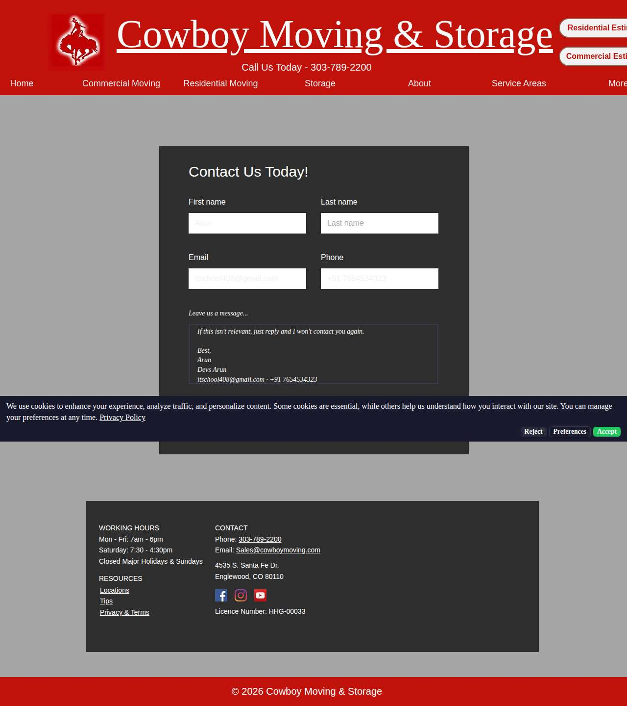

**After submit** — `run-dbeacf2a_attempt-88c05179_post_attempt_2026-11-04T03-42-18-117Z.jpg`

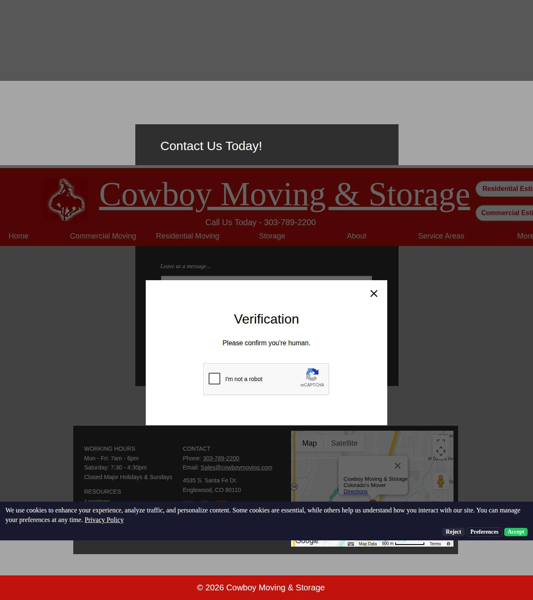

### got2move.com — failed\_before\_submit (LIVE)

| | |
|---|---|
| Attempt ID | `04c4e783-31de-440a-b143-69a92105b5b0` |
| Form URL | https://got2move.com/contact/ |
| Final URL | https://got2move.com/contact/ |
| Reserved | 2026-11-04 03:42:25 UTC |
| Submit attempted | — |
| Template | standard v2 |
| Confirmation text | none observed |
| Result / error | Field "\* Phone number" did not accept the value |

Exact message:

~~~text
Subject: Helping customers find your business in AI search (AEO + GEO)

Hi there,

I'm Arun from Devs Arun. More and more customers now ask ChatGPT, Gemini, Perplexity or Google's AI Overviews questions like "who should I hire for this in my area?" before they call anyone. These tools answer from websites they can clearly understand, and they tend to recommend businesses whose pages answer real customer questions.

That is what AEO + GEO (Answer Engine and Generative Engine Optimization) is for. I improve your existing service pages so they clearly answer the questions your customers ask, add structured data that matches the page, and make the call, quote or enquiry step obvious. The benefit: your business gets a better chance of being mentioned or linked in AI answers, and visitors who arrive find it easy to contact you.

The AEO + GEO Starter is a one-time $199 (about ₹16,999, negotiable) for one website: a basic audit, 10 customer questions, improvements to two existing pages, relevant structured data and an action plan, with one revision round.

You can read the full details, send an enquiry or book online here:
https://devsarun.io/aeo-geo/

If this isn't relevant, just reply and I won't contact you again.

Best,
Arun
Devs Arun
itschool408@gmail.com · +91 7654534323
~~~

Submitted field values:

- \#form-header-9-name: Arun
- \#form-header-9-email: itschool408@gmail.com
- \#form-header-9-phone: +91 7654534323
- \#form-header-9-comment: Hi there, I'm Arun from Devs Arun. More and more customers now ask ChatGPT, Gemini, Perplexity or Google's AI Overviews 

**Filled form (before submit)** — `run-dbeacf2a_attempt-04c4e783_filled_2026-11-04T03-42-28-220Z.jpg`

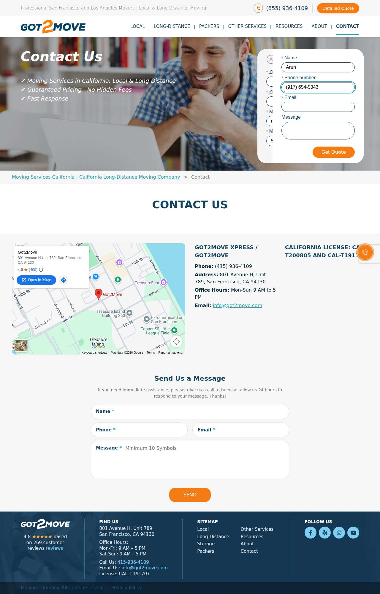

### undergrads.com — failed\_before\_submit (LIVE)

| | |
|---|---|
| Attempt ID | `92600e7a-050b-4a43-b6b0-15a2c3e1ffee` |
| Form URL | https://undergrads.com/contact/ |
| Final URL | https://undergrads.com/contact/ |
| Reserved | 2026-11-04 03:42:33 UTC |
| Submit attempted | — |
| Template | standard v2 |
| Confirmation text | none observed |
| Result / error | Field "Phone (optional)" did not accept the value |

Exact message:

~~~text
Subject: Helping customers find your business in AI search (AEO + GEO)

Hi there,

I'm Arun from Devs Arun. More and more customers now ask ChatGPT, Gemini, Perplexity or Google's AI Overviews questions like "who should I hire for this in my area?" before they call anyone. These tools answer from websites they can clearly understand, and they tend to recommend businesses whose pages answer real customer questions.

That is what AEO + GEO (Answer Engine and Generative Engine Optimization) is for. I improve your existing service pages so they clearly answer the questions your customers ask, add structured data that matches the page, and make the call, quote or enquiry step obvious. The benefit: your business gets a better chance of being mentioned or linked in AI answers, and visitors who arrive find it easy to contact you.

The AEO + GEO Starter is a one-time $199 (about ₹16,999, negotiable) for one website: a basic audit, 10 customer questions, improvements to two existing pages, relevant structured data and an action plan, with one revision round.

You can read the full details, send an enquiry or book online here:
https://devsarun.io/aeo-geo/

If this isn't relevant, just reply and I won't contact you again.

Best,
Arun
Devs Arun
itschool408@gmail.com · +91 7654534323
~~~

Submitted field values:

- \#main-content \> div \> section:nth-of-type(3) \> div \> div \> div:nth-of-type(2) \> form \> div:nth-of-type(2) \> input: itschool408@gmail.com
- \#main-content \> div \> section:nth-of-type(3) \> div \> div \> div:nth-of-type(2) \> form \> div:nth-of-type(3) \> input: +91 7654534323
- \#main-content \> div \> section:nth-of-type(3) \> div \> div \> div:nth-of-type(2) \> form \> div:nth-of-type(4) \> textarea: Hi there, I'm Arun from Devs Arun. More and more customers now ask ChatGPT, Gemini, Perplexity or Google's AI Overviews 
- \#main-content \> div \> section:nth-of-type(3) \> div \> div \> div:nth-of-type(2) \> form \> div:nth-of-type(1) \> div:nth-of-type(1) \> input: Arun

**Filled form (before submit)** — `run-dbeacf2a_attempt-92600e7a_filled_2026-11-04T03-42-35-906Z.jpg`

### cactusvalleymoving.com — error\_after\_submit (LIVE)

| | |
|---|---|
| Attempt ID | `3b55ad3d-a1e0-4032-a66e-c19b058a0044` |
| Form URL | https://cactusvalleymoving.com/contact/ |
| Final URL | https://cactusvalleymoving.com/contact/ |
| Reserved | 2026-11-04 03:42:40 UTC |
| Submit attempted | 2026-11-04 03:42:41 UTC |
| Template | standard v2 |
| Confirmation text | CONTACT One or more fields have an error. Please check and try again. Please fill out this field. Please fill out this field. Please fill out this field. Please fill ou |
| Result / error | — |

Exact message:

~~~text
Subject: Helping customers find your business in AI search (AEO + GEO)

Hi there,

I'm Arun from Devs Arun. More and more customers now ask ChatGPT, Gemini, Perplexity or Google's AI Overviews questions like "who should I hire for this in my area?" before they call anyone. These tools answer from websites they can clearly understand, and they tend to recommend businesses whose pages answer real customer questions.

That is what AEO + GEO (Answer Engine and Generative Engine Optimization) is for. I improve your existing service pages so they clearly answer the questions your customers ask, add structured data that matches the page, and make the call, quote or enquiry step obvious. The benefit: your business gets a better chance of being mentioned or linked in AI answers, and visitors who arrive find it easy to contact you.

The AEO + GEO Starter is a one-time $199 (about ₹16,999, negotiable) for one website: a basic audit, 10 customer questions, improvements to two existing pages, relevant structured data and an action plan, with one revision round.

You can read the full details, send an enquiry or book online here:
https://devsarun.io/aeo-geo/

If this isn't relevant, just reply and I won't contact you again.

Best,
Arun
Devs Arun
itschool408@gmail.com · +91 7654534323
~~~

Submitted field values:

- Name \[name\]: Arun
- Phone \[phone\]: +91 7654534323
- Email Address \[email\]: itschool408@gmail.com
- Your Message \[message\]: Hi there, I'm Arun from Devs Arun. More and more customers now ask ChatGPT, Gemini, Perplexity or Google's AI Overviews 

**Filled form (before submit)** — `run-dbeacf2a_attempt-3b55ad3d_filled_2026-11-04T03-42-41-943Z.jpg`

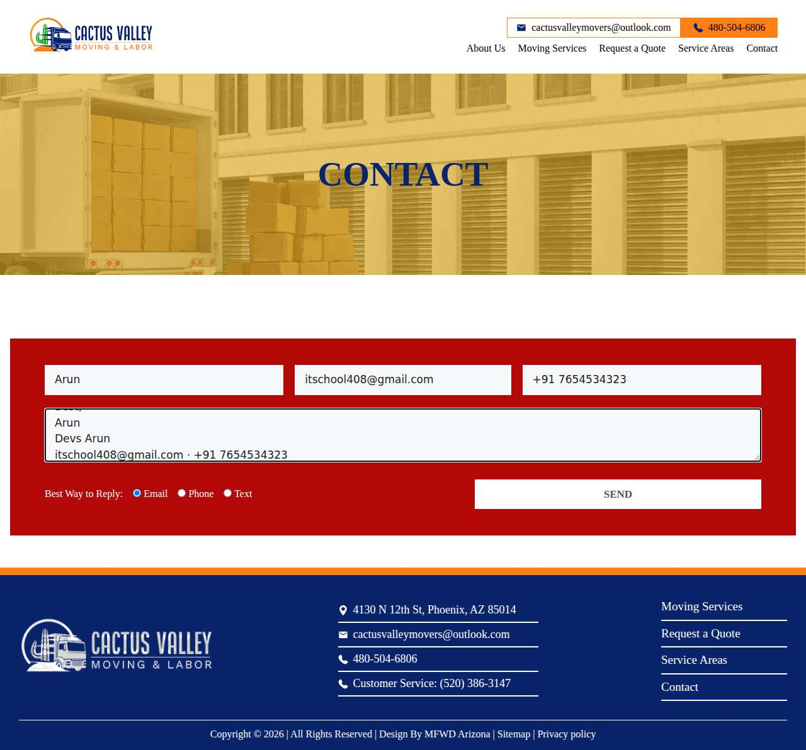

**After submit** — `run-dbeacf2a_attempt-3b55ad3d_post_attempt_2026-11-04T03-42-46-030Z.jpg`

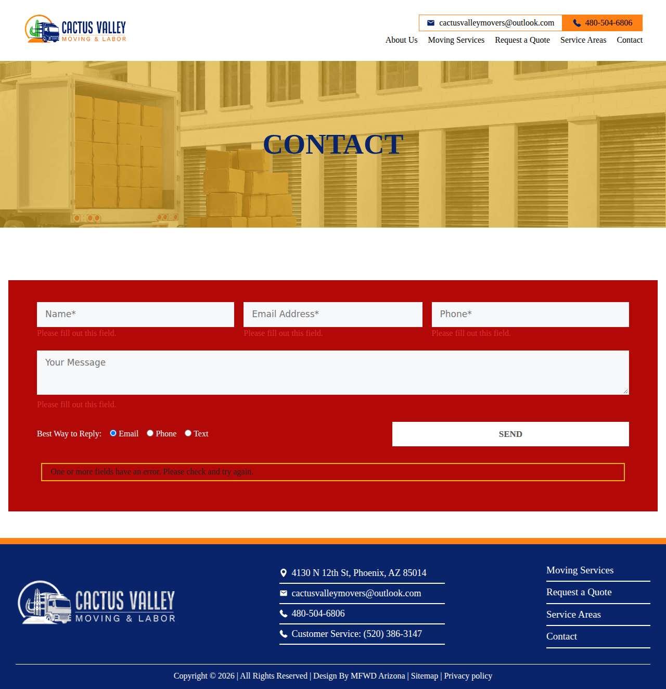

### shamrockmovingstorage.com — confirmed (LIVE)

| | |
|---|---|
| Attempt ID | `992752ce-435e-4ef3-9092-1ee1ef4227da` |
| Form URL | https://shamrockmovingstorage.com/contact/ |
| Final URL | https://shamrockmovingstorage.com/contact/ |
| Reserved | 2026-11-04 03:42:53 UTC |
| Submit attempted | 2026-11-04 03:42:57 UTC |
| Template | standard v2 |
| Confirmation text | -1777 Have any questions or ideas? Feel free to contact us\! Thank you for your message. It has been sent. Thank you for your message. It has been sent. Shamrock Moving & Storage, Inc. 25 |
| Result / error | — |

Exact message:

~~~text
Subject: Helping customers find your business in AI search (AEO + GEO)

Hi there,

I'm Arun from Devs Arun. More and more customers now ask ChatGPT, Gemini, Perplexity or Google's AI Overviews questions like "who should I hire for this in my area?" before they call anyone. These tools answer from websites they can clearly understand, and they tend to recommend businesses whose pages answer real customer questions.

That is what AEO + GEO (Answer Engine and Generative Engine Optimization) is for. I improve your existing service pages so they clearly answer the questions your customers ask, add structured data that matches the page, and make the call, quote or enquiry step obvious. The benefit: your business gets a better chance of being mentioned or linked in AI answers, and visitors who arrive find it easy to contact you.

The AEO + GEO Starter is a one-time $199 (about ₹16,999, negotiable) for one website: a basic audit, 10 customer questions, improvements to two existing pages, relevant structured data and an action plan, with one revision round.

You can read the full details, send an enquiry or book online here:
https://devsarun.io/aeo-geo/

If this isn't relevant, just reply and I won't contact you again.

Best,
Arun
Devs Arun
itschool408@gmail.com · +91 7654534323
~~~

Submitted field values:

- tel-940 \[phone\]: +91 7654534323
- your-name \[name\]: Arun
- your-email \[email\]: itschool408@gmail.com
- your-message \[message\]: Hi there, I'm Arun from Devs Arun. More and more customers now ask ChatGPT, Gemini, Perplexity or Google's AI Overviews 

**Filled form (before submit)** — `run-dbeacf2a_attempt-992752ce_filled_2026-11-04T03-42-57-098Z.jpg`

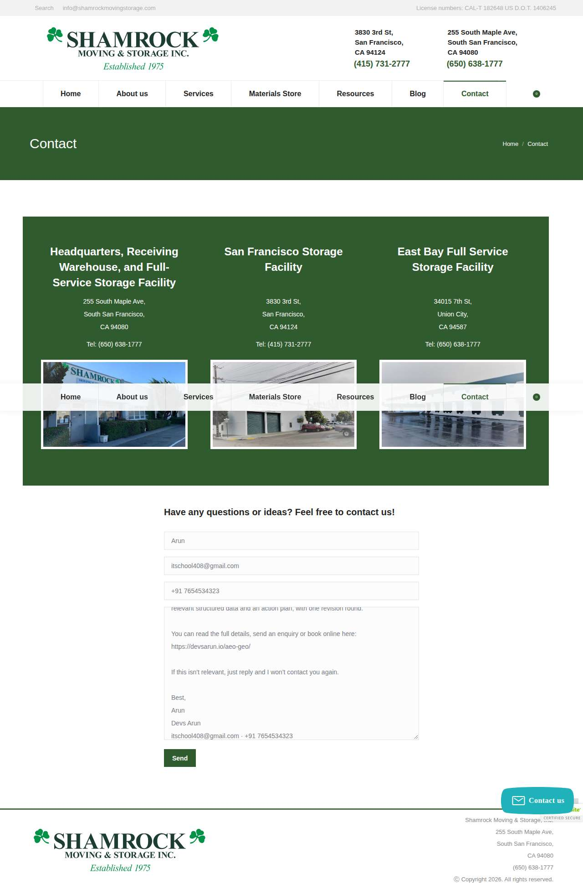

**After submit** — `run-dbeacf2a_attempt-992752ce_post_attempt_2026-11-04T03-43-04-049Z.jpg`

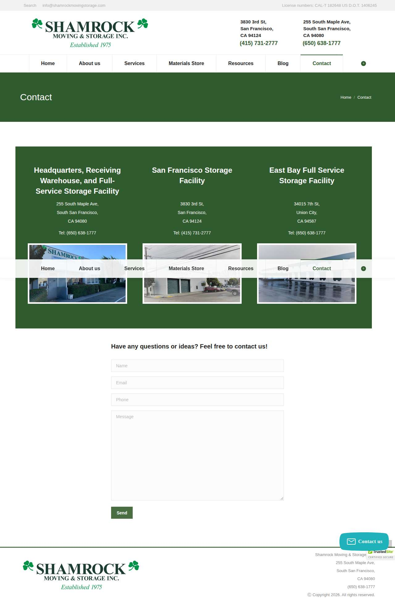

### patrickmoorelaw.com — confirmed (LIVE)

| | |
|---|---|
| Attempt ID | `4314abd8-115d-4d5a-a2de-4147c6075f22` |
| Form URL | https://www.patrickmoorelaw.com/contact-us/ |
| Final URL | https://www.patrickmoorelaw.com/leads/send\_inquiry/ |
| Reserved | 2026-11-04 03:43:11 UTC |
| Submit attempted | 2026-11-04 03:43:14 UTC |
| Template | standard v2 |
| Confirmation text | AREAS CONTACT US Committed to Your Success CONTACT US TODAY Your inquiry has been sent Go To Homepage Contact Us Fill out this form or give us a call to begin. Name Phone (optional) Emai |
| Result / error | — |

Exact message:

~~~text
Subject: Helping customers find your business in AI search (AEO + GEO)

Hi there,

I'm Arun from Devs Arun. More and more customers now ask ChatGPT, Gemini, Perplexity or Google's AI Overviews questions like "who should I hire for this in my area?" before they call anyone. These tools answer from websites they can clearly understand, and they tend to recommend businesses whose pages answer real customer questions.

That is what AEO + GEO (Answer Engine and Generative Engine Optimization) is for. I improve your existing service pages so they clearly answer the questions your customers ask, add structured data that matches the page, and make the call, quote or enquiry step obvious. The benefit: your business gets a better chance of being mentioned or linked in AI answers, and visitors who arrive find it easy to contact you.

The AEO + GEO Starter is a one-time $199 (about ₹16,999, negotiable) for one website: a basic audit, 10 customer questions, improvements to two existing pages, relevant structured data and an action plan, with one revision round.

You can read the full details, send an enquiry or book online here:
https://devsarun.io/aeo-geo/

If this isn't relevant, just reply and I won't contact you again.

Best,
Arun
Devs Arun
itschool408@gmail.com · +91 7654534323
~~~

Submitted field values:

- Name \[name\]: Arun
- Email \[email\]: itschool408@gmail.com
- Phone (optional) \[phone\]: +91 7654534323
- Tell us about your case \[message\]: Hi there, I'm Arun from Devs Arun. More and more customers now ask ChatGPT, Gemini, Perplexity or Google's AI Overviews 

**Filled form (before submit)** — `run-dbeacf2a_attempt-4314abd8_filled_2026-11-04T03-43-14-081Z.jpg`

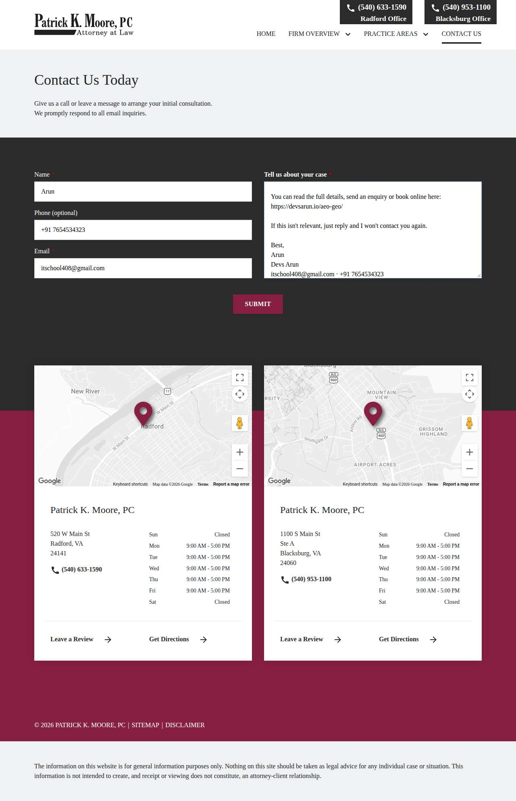

**After submit** — `run-dbeacf2a_attempt-4314abd8_post_attempt_2026-11-04T03-43-18-720Z.jpg`

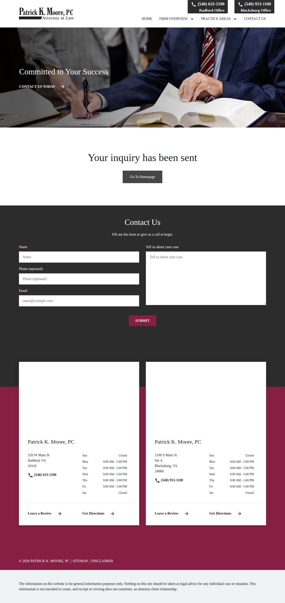

## Events (139)

| Time (UTC) | Event | Website | Details |
|---|---|---|---|
| 03:37:27 | run\_queued | — | live run requested by github:itsDevsArun |
| 03:37:27 | run\_dispatched | — | dispatch disabled (local test mode) |
| 03:37:30 | run\_started | — | Runner claimed live run |
| 03:37:31 | offer\_verified | — | Service page offer facts verified |
| 03:37:31 | website\_selected | clearchoiceplumbingllc.com | Live target clearchoiceplumbingllc.com |
| 03:37:31 | attempt\_reserved | clearchoiceplumbingllc.com | Submission attempt reserved with template standard v2 |
| 03:37:33 | page\_opened | clearchoiceplumbingllc.com | Opened form page |
| 03:37:33 | screenshot\_saved | clearchoiceplumbingllc.com | inspection screenshot saved (145 KB) |
| 03:37:33 | review\_required | clearchoiceplumbingllc.com | failed before submit: locator.fill: Error: Cannot type text into input\[type=number\] |
| 03:37:38 | website\_selected | bwnwincpainting.com | Live target bwnwincpainting.com |
| 03:37:38 | attempt\_reserved | bwnwincpainting.com | Submission attempt reserved with template standard v2 |
| 03:37:40 | page\_opened | bwnwincpainting.com | Opened form page |
| 03:37:40 | screenshot\_saved | bwnwincpainting.com | inspection screenshot saved (118 KB) |
| 03:37:40 | review\_required | bwnwincpainting.com | failed before submit: locator.fill: Error: Cannot type text into input\[type=number\] |
| 03:37:45 | website\_selected | absoluterestorepa.com | Live target absoluterestorepa.com |
| 03:37:45 | attempt\_reserved | absoluterestorepa.com | Submission attempt reserved with template standard v2 |
| 03:37:48 | page\_opened | absoluterestorepa.com | Opened form page |
| 03:37:48 | screenshot\_saved | absoluterestorepa.com | inspection screenshot saved (174 KB) |
| 03:37:48 | review\_required | absoluterestorepa.com | failed before submit: locator.fill: Error: Cannot type text into input\[type=number\] |
| 03:37:53 | website\_selected | flytmoving.com | Live target flytmoving.com |
| 03:37:53 | attempt\_reserved | flytmoving.com | Submission attempt reserved with template standard v2 |
| 03:37:55 | page\_opened | flytmoving.com | Opened form page |
| 03:37:55 | fields\_filled | flytmoving.com | filled |
| 03:37:55 | screenshot\_saved | flytmoving.com | filled screenshot saved (201 KB) |
| 03:37:55 | submit\_attempted | flytmoving.com | submitting |
| 03:38:06 | screenshot\_saved | flytmoving.com | post\_attempt screenshot saved (225 KB) |
| 03:38:06 | confirmation\_observed | flytmoving.com | confirmed — "r will get right back to you. BOOK YOUR MOVE (571) 619-2687 Thanks, we got it. A FLYT coordinator will be in touch short" |
| 03:38:14 | website\_selected | moveauto.com | Live target moveauto.com |
| 03:38:14 | attempt\_reserved | moveauto.com | Submission attempt reserved with template standard v2 |
| 03:38:16 | page\_opened | moveauto.com | Opened form page |
| 03:38:16 | fields\_filled | moveauto.com | filled |
| 03:38:16 | screenshot\_saved | moveauto.com | filled screenshot saved (173 KB) |
| 03:38:16 | submit\_attempted | moveauto.com | submitting |
| 03:38:20 | screenshot\_saved | moveauto.com | post\_attempt screenshot saved (176 KB) |
| 03:38:20 | confirmation\_observed | moveauto.com | confirmed — "ame Phone number Email Your Message Submit Leave this blank Thank you. We received your message and will be in touch. Em" |
| 03:38:28 | website\_selected | bookonemove.com | Live target bookonemove.com |
| 03:38:28 | attempt\_reserved | bookonemove.com | Submission attempt reserved with template standard v2 |
| 03:38:29 | page\_opened | bookonemove.com | Opened form page |
| 03:38:29 | fields\_filled | bookonemove.com | filled |
| 03:38:30 | screenshot\_saved | bookonemove.com | filled screenshot saved (120 KB) |
| 03:38:30 | submit\_attempted | bookonemove.com | submitting |
| 03:38:33 | screenshot\_saved | bookonemove.com | post\_attempt screenshot saved (13 KB) |
| 03:38:33 | confirmation\_observed | bookonemove.com | confirmed — "Thank you\! Your form submission has been received. Back to our site" |
| 03:38:41 | website\_selected | alphamovingutah.com | Live target alphamovingutah.com |
| 03:38:41 | attempt\_reserved | alphamovingutah.com | Submission attempt reserved with template standard v2 |
| 03:38:42 | page\_opened | alphamovingutah.com | Opened form page |
| 03:38:42 | fields\_filled | alphamovingutah.com | filled |
| 03:38:42 | screenshot\_saved | alphamovingutah.com | filled screenshot saved (99 KB) |
| 03:38:42 | submit\_attempted | alphamovingutah.com | submitting |
| 03:38:46 | screenshot\_saved | alphamovingutah.com | post\_attempt screenshot saved (91 KB) |
| 03:38:46 | confirmation\_observed | alphamovingutah.com | confirmed — "hipping & Receiving: 9:00 AM – 3:30 PM USDOT NUMBER 2196060 MESSAGE RECEIVED\! Thank you for reaching out. We'll be in to" |
| 03:38:54 | website\_selected | thompsonsmoving.net | Live target thompsonsmoving.net |
| 03:38:54 | attempt\_reserved | thompsonsmoving.net | Submission attempt reserved with template standard v2 |
| 03:38:55 | page\_opened | thompsonsmoving.net | Opened form page |
| 03:38:55 | fields\_filled | thompsonsmoving.net | filled |
| 03:38:55 | screenshot\_saved | thompsonsmoving.net | filled screenshot saved (136 KB) |
| 03:38:56 | submit\_attempted | thompsonsmoving.net | submitting |
| 03:39:25 | screenshot\_saved | thompsonsmoving.net | post\_attempt screenshot saved (148 KB) |
| 03:39:25 | review\_required | thompsonsmoving.net | unclear: No new success marker observed |
| 03:39:33 | website\_selected | raysmovers.com | Live target raysmovers.com |
| 03:39:33 | attempt\_reserved | raysmovers.com | Submission attempt reserved with template standard v2 |
| 03:39:35 | page\_opened | raysmovers.com | Opened form page |
| 03:39:35 | fields\_filled | raysmovers.com | filled |
| 03:39:36 | screenshot\_saved | raysmovers.com | filled screenshot saved (280 KB) |
| 03:39:36 | submit\_attempted | raysmovers.com | submitting |
| 03:40:04 | screenshot\_saved | raysmovers.com | post\_attempt screenshot saved (347 KB) |
| 03:40:04 | review\_required | raysmovers.com | unclear: No new success marker observed |
| 03:40:12 | website\_selected | legendmovers4youfl.com | Live target legendmovers4youfl.com |
| 03:40:12 | attempt\_reserved | legendmovers4youfl.com | Submission attempt reserved with template standard v2 |
| 03:40:13 | page\_opened | legendmovers4youfl.com | Opened form page |
| 03:40:13 | fields\_filled | legendmovers4youfl.com | filled |
| 03:40:13 | screenshot\_saved | legendmovers4youfl.com | filled screenshot saved (211 KB) |
| 03:40:13 | submit\_attempted | legendmovers4youfl.com | submitting |
| 03:40:20 | screenshot\_saved | legendmovers4youfl.com | post\_attempt screenshot saved (170 KB) |
| 03:40:20 | confirmation\_observed | legendmovers4youfl.com | confirmed — "ork Resources FAQ Contact Get a free quote REQUEST RECEIVED THANK YOU, ARUN\! WE’VE RECEIVED YOUR MESSAGE. Your message i" |
| 03:40:28 | website\_selected | golambertteam.com | Live target golambertteam.com |
| 03:40:28 | attempt\_reserved | golambertteam.com | Submission attempt reserved with template standard v2 |
| 03:40:30 | page\_opened | golambertteam.com | Opened form page |
| 03:40:31 | screenshot\_saved | golambertteam.com | filled screenshot saved (157 KB) |
| 03:40:31 | review\_required | golambertteam.com | failed before submit: Field "Phone Number" did not accept the value |
| 03:40:36 | website\_selected | bravo-moving.com | Live target bravo-moving.com |
| 03:40:36 | attempt\_reserved | bravo-moving.com | Submission attempt reserved with template standard v2 |
| 03:40:41 | page\_opened | bravo-moving.com | Opened form page |
| 03:40:41 | fields\_filled | bravo-moving.com | filled |
| 03:40:42 | screenshot\_saved | bravo-moving.com | filled screenshot saved (185 KB) |
| 03:40:42 | submit\_attempted | bravo-moving.com | submitting |
| 03:40:53 | screenshot\_saved | bravo-moving.com | post\_attempt screenshot saved (122 KB) |
| 03:40:53 | confirmation\_observed | bravo-moving.com | confirmed — "Us Reviews Services Locations Media Room Contact FREE QUOTE THANK YOU Thank you for contacting us. Someone will reach ou" |
| 03:41:00 | website\_selected | waterdamagecheyenne.com | Live target waterdamagecheyenne.com |
| 03:41:00 | attempt\_reserved | waterdamagecheyenne.com | Submission attempt reserved with template standard v2 |
| 03:41:01 | page\_opened | waterdamagecheyenne.com | Opened form page |
| 03:41:01 | fields\_filled | waterdamagecheyenne.com | filled |
| 03:41:01 | screenshot\_saved | waterdamagecheyenne.com | filled screenshot saved (176 KB) |
| 03:41:01 | submit\_attempted | waterdamagecheyenne.com | submitting |
| 03:41:29 | screenshot\_saved | waterdamagecheyenne.com | post\_attempt screenshot saved (7 KB) |
| 03:41:29 | review\_required | waterdamagecheyenne.com | unclear: No new success marker observed |
| 03:41:37 | website\_selected | cowboymoving.com | Live target cowboymoving.com |
| 03:41:37 | attempt\_reserved | cowboymoving.com | Submission attempt reserved with template standard v2 |
| 03:41:41 | page\_opened | cowboymoving.com | Opened form page |
| 03:41:42 | fields\_filled | cowboymoving.com | filled |
| 03:41:42 | screenshot\_saved | cowboymoving.com | filled screenshot saved (89 KB) |
| 03:41:42 | submit\_attempted | cowboymoving.com | submitting |
| 03:42:18 | screenshot\_saved | cowboymoving.com | post\_attempt screenshot saved (76 KB) |
| 03:42:18 | review\_required | cowboymoving.com | unclear: No new success marker observed |
| 03:42:25 | website\_selected | got2move.com | Live target got2move.com |
| 03:42:25 | attempt\_reserved | got2move.com | Submission attempt reserved with template standard v2 |
| 03:42:27 | page\_opened | got2move.com | Opened form page |
| 03:42:28 | screenshot\_saved | got2move.com | filled screenshot saved (162 KB) |
| 03:42:28 | review\_required | got2move.com | failed before submit: Field "\* Phone number" did not accept the value |
| 03:42:33 | website\_selected | undergrads.com | Live target undergrads.com |
| 03:42:33 | attempt\_reserved | undergrads.com | Submission attempt reserved with template standard v2 |
| 03:42:35 | page\_opened | undergrads.com | Opened form page |
| 03:42:35 | screenshot\_saved | undergrads.com | filled screenshot saved (389 KB) |
| 03:42:35 | review\_required | undergrads.com | failed before submit: Field "Phone (optional)" did not accept the value |
| 03:42:40 | website\_selected | cactusvalleymoving.com | Live target cactusvalleymoving.com |
| 03:42:40 | attempt\_reserved | cactusvalleymoving.com | Submission attempt reserved with template standard v2 |
| 03:42:41 | page\_opened | cactusvalleymoving.com | Opened form page |
| 03:42:41 | fields\_filled | cactusvalleymoving.com | filled |
| 03:42:41 | screenshot\_saved | cactusvalleymoving.com | filled screenshot saved (105 KB) |
| 03:42:41 | submit\_attempted | cactusvalleymoving.com | submitting |
| 03:42:46 | screenshot\_saved | cactusvalleymoving.com | post\_attempt screenshot saved (108 KB) |
| 03:42:46 | error | cactusvalleymoving.com | error after submit — "CONTACT One or more fields have an error. Please check and try again. Please fill out this field. Please fill out this f" |
| 03:42:53 | website\_selected | shamrockmovingstorage.com | Live target shamrockmovingstorage.com |
| 03:42:53 | attempt\_reserved | shamrockmovingstorage.com | Submission attempt reserved with template standard v2 |
| 03:42:56 | page\_opened | shamrockmovingstorage.com | Opened form page |
| 03:42:56 | fields\_filled | shamrockmovingstorage.com | filled |
| 03:42:57 | screenshot\_saved | shamrockmovingstorage.com | filled screenshot saved (128 KB) |
| 03:42:57 | submit\_attempted | shamrockmovingstorage.com | submitting |
| 03:43:04 | screenshot\_saved | shamrockmovingstorage.com | post\_attempt screenshot saved (119 KB) |
| 03:43:04 | confirmation\_observed | shamrockmovingstorage.com | confirmed — "-1777 Have any questions or ideas? Feel free to contact us\! Thank you for your message. It has been sent. Thank you for " |
| 03:43:11 | website\_selected | patrickmoorelaw.com | Live target patrickmoorelaw.com |
| 03:43:11 | attempt\_reserved | patrickmoorelaw.com | Submission attempt reserved with template standard v2 |
| 03:43:13 | page\_opened | patrickmoorelaw.com | Opened form page |
| 03:43:13 | fields\_filled | patrickmoorelaw.com | filled |
| 03:43:14 | screenshot\_saved | patrickmoorelaw.com | filled screenshot saved (137 KB) |
| 03:43:14 | submit\_attempted | patrickmoorelaw.com | submitting |
| 03:43:18 | screenshot\_saved | patrickmoorelaw.com | post\_attempt screenshot saved (138 KB) |
| 03:43:18 | confirmation\_observed | patrickmoorelaw.com | confirmed — "AREAS CONTACT US Committed to Your Success CONTACT US TODAY Your inquiry has been sent Go To Homepage Contact Us Fill ou" |
| 03:43:26 | run\_completed | — | Run completed (queue\_exhausted) |
