# Run e9eec5c6 — live — completed

| | |
|---|---|
| Run ID | `e9eec5c6-4e70-4894-8e3e-e1855e8333a1` |
| Requested by | github:itsDevsArun |
| Started | 2026-11-04 04:18:58 UTC |
| Finished | 2026-11-04 04:26:46 UTC |
| Finish reason | queue\_exhausted |
| GitHub Actions | https://github.com/itsDevsArun/aeo-geo/actions/runs/41763788389 |

CSV for this run: [runs/2026-11-04_live_e9eec5c6.csv](2026-11-04_live_e9eec5c6.csv)

## Attempts (23)

### clearchoiceplumbingllc.com — failed\_before\_submit (LIVE)

| | |
|---|---|
| Attempt ID | `70923a1e-e1fb-4e2c-aa78-d67f8cfa784c` |
| Form URL | https://clearchoiceplumbingllc.com/contact/ |
| Final URL | — |
| Reserved | 2026-11-04 04:18:59 UTC |
| Submit attempted | — |
| Template | standard v2 |
| Confirmation text | none observed |
| Result / error | locator.fill: Error: Cannot type text into input\[type=number\] |

Exact message:

~~~text
Subject: Helping customers find your business in AI search (AEO + GEO)

Hi there,

I'm Arun from Devs Arun. More and more customers now ask ChatGPT, Gemini, Perplexity or Google's AI Overviews questions like "who should I hire for this in my area?" before they call anyone. These tools answer from websites they can clearly understand, and they tend to recommend businesses whose pages answer real customer questions.

That is what AEO + GEO (Answer Engine and Generative Engine Optimization) is for. I improve your existing service pages so they clearly answer the questions your customers ask, add structured data that matches the page, and make the call, quote or enquiry step obvious. The benefit: your business gets a better chance of being mentioned or linked in AI answers, and visitors who arrive find it easy to contact you.

The AEO + GEO Starter is a one-time $199 (about ₹16,999, negotiable) for one website: a basic audit, 10 customer questions, improvements to two existing pages, relevant structured data and an action plan, with one revision round.

You can read the full details, send an enquiry or book online here:
https://devsarun.io/aeo-geo/

If this isn't relevant, just reply and I won't contact you again.

Best,
Arun
Devs Arun
itschool408@gmail.com · +91 7654534323
~~~

Submitted field values:

- \#wpforms-51-field\_1: Arun
- \#wpforms-51-field\_2: itschool408@gmail.com
- \#wpforms-51-field\_3: Hi there, I'm Arun from Devs Arun. More and more customers now ask ChatGPT, Gemini, Perplexity or Google's AI Overviews 
- \#wpforms-51-field\_5: +91 7654534323

**Inspected page** — `run-e9eec5c6_attempt-70923a1e_inspection_2026-11-04T04-19-01-097Z.jpg`

### bwnwincpainting.com — failed\_before\_submit (LIVE)

| | |
|---|---|
| Attempt ID | `f5133f54-7ac0-4e09-a888-010e3fc00158` |
| Form URL | https://www.bwnwincpainting.com/contact/ |
| Final URL | — |
| Reserved | 2026-11-04 04:19:06 UTC |
| Submit attempted | — |
| Template | standard v2 |
| Confirmation text | none observed |
| Result / error | locator.fill: Error: Cannot type text into input\[type=number\] |

Exact message:

~~~text
Subject: Helping customers find your business in AI search (AEO + GEO)

Hi there,

I'm Arun from Devs Arun. More and more customers now ask ChatGPT, Gemini, Perplexity or Google's AI Overviews questions like "who should I hire for this in my area?" before they call anyone. These tools answer from websites they can clearly understand, and they tend to recommend businesses whose pages answer real customer questions.

That is what AEO + GEO (Answer Engine and Generative Engine Optimization) is for. I improve your existing service pages so they clearly answer the questions your customers ask, add structured data that matches the page, and make the call, quote or enquiry step obvious. The benefit: your business gets a better chance of being mentioned or linked in AI answers, and visitors who arrive find it easy to contact you.

The AEO + GEO Starter is a one-time $199 (about ₹16,999, negotiable) for one website: a basic audit, 10 customer questions, improvements to two existing pages, relevant structured data and an action plan, with one revision round.

You can read the full details, send an enquiry or book online here:
https://devsarun.io/aeo-geo/

If this isn't relevant, just reply and I won't contact you again.

Best,
Arun
Devs Arun
itschool408@gmail.com · +91 7654534323
~~~

Submitted field values:

- \#name-1151: Arun
- \#email-1151: itschool408@gmail.com
- \#phone-1151: +91 7654534323
- \#message-1151: Hi there, I'm Arun from Devs Arun. More and more customers now ask ChatGPT, Gemini, Perplexity or Google's AI Overviews 

**Inspected page** — `run-e9eec5c6_attempt-f5133f54_inspection_2026-11-04T04-19-08-324Z.jpg`

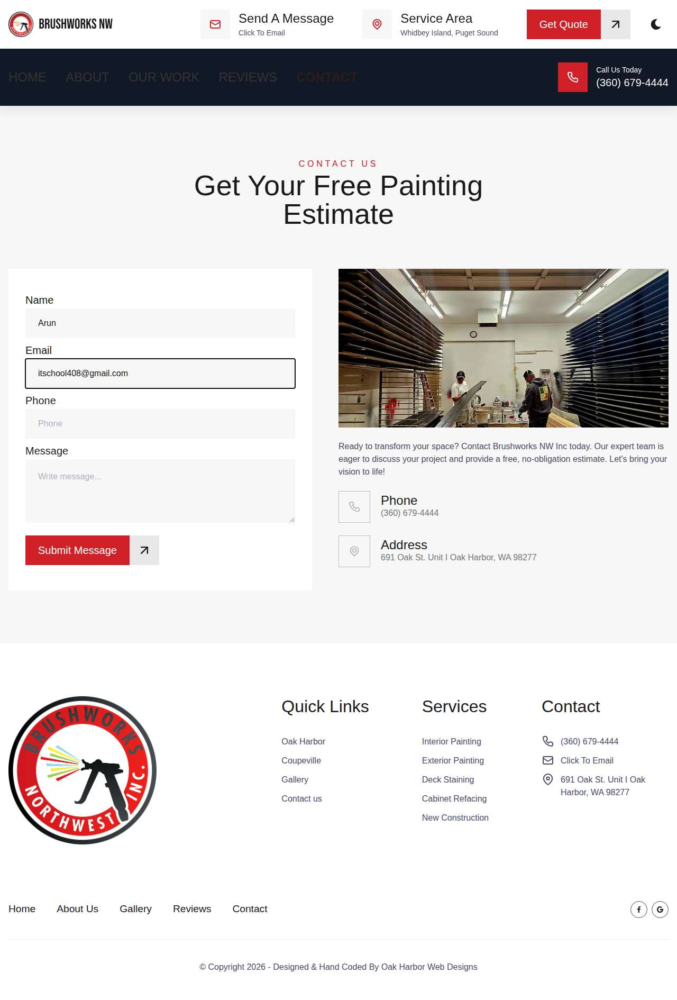

### absoluterestorepa.com — failed\_before\_submit (LIVE)

| | |
|---|---|
| Attempt ID | `55d96080-3441-4776-982e-12e9873ec991` |
| Form URL | https://absoluterestorepa.com/contact-us/ |
| Final URL | — |
| Reserved | 2026-11-04 04:19:13 UTC |
| Submit attempted | — |
| Template | standard v2 |
| Confirmation text | none observed |
| Result / error | locator.fill: Error: Cannot type text into input\[type=number\] |

Exact message:

~~~text
Subject: Helping customers find your business in AI search (AEO + GEO)

Hi there,

I'm Arun from Devs Arun. More and more customers now ask ChatGPT, Gemini, Perplexity or Google's AI Overviews questions like "who should I hire for this in my area?" before they call anyone. These tools answer from websites they can clearly understand, and they tend to recommend businesses whose pages answer real customer questions.

That is what AEO + GEO (Answer Engine and Generative Engine Optimization) is for. I improve your existing service pages so they clearly answer the questions your customers ask, add structured data that matches the page, and make the call, quote or enquiry step obvious. The benefit: your business gets a better chance of being mentioned or linked in AI answers, and visitors who arrive find it easy to contact you.

The AEO + GEO Starter is a one-time $199 (about ₹16,999, negotiable) for one website: a basic audit, 10 customer questions, improvements to two existing pages, relevant structured data and an action plan, with one revision round.

You can read the full details, send an enquiry or book online here:
https://devsarun.io/aeo-geo/

If this isn't relevant, just reply and I won't contact you again.

Best,
Arun
Devs Arun
itschool408@gmail.com · +91 7654534323
~~~

Submitted field values:

- \#form-field-name: Arun
- \#form-field-message: Hi there, I'm Arun from Devs Arun. More and more customers now ask ChatGPT, Gemini, Perplexity or Google's AI Overviews 
- \#form-field-field\_ed02ec2: +91 7654534323
- \#content \> div \> div \> div:nth-of-type(2) \> div \> div:nth-of-type(1) \> div:nth-of-type(2) \> div \> form \> div \> div:nth-of-type(3) \> input: itschool408@gmail.com

**Inspected page** — `run-e9eec5c6_attempt-55d96080_inspection_2026-11-04T04-19-16-095Z.jpg`

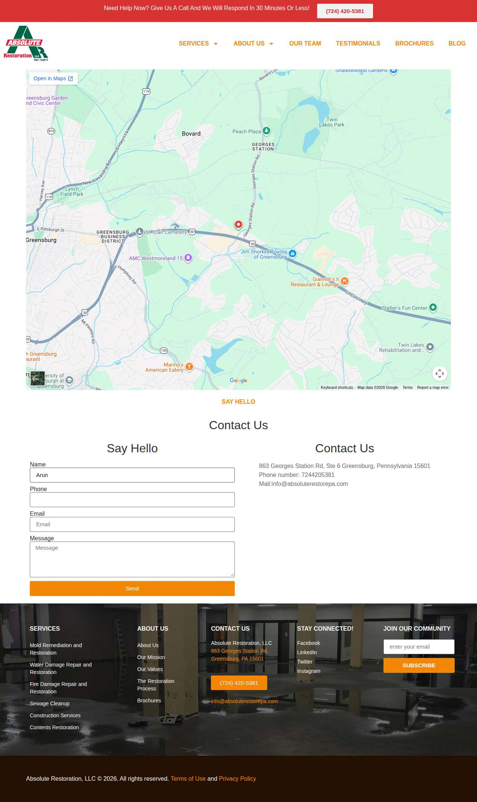

### masoudlawfirm.com — failed\_before\_submit (LIVE)

| | |
|---|---|
| Attempt ID | `df761a76-2f77-4bd6-b3ff-73ae2ddf9ab0` |
| Form URL | https://masoudlawfirm.com/contact/ |
| Final URL | — |
| Reserved | 2026-11-04 04:19:21 UTC |
| Submit attempted | — |
| Template | standard v2 |
| Confirmation text | none observed |
| Result / error | locator.fill: Error: Cannot type text into input\[type=number\] |

Exact message:

~~~text
Subject: Helping customers find your business in AI search (AEO + GEO)

Hi there,

I'm Arun from Devs Arun. More and more customers now ask ChatGPT, Gemini, Perplexity or Google's AI Overviews questions like "who should I hire for this in my area?" before they call anyone. These tools answer from websites they can clearly understand, and they tend to recommend businesses whose pages answer real customer questions.

That is what AEO + GEO (Answer Engine and Generative Engine Optimization) is for. I improve your existing service pages so they clearly answer the questions your customers ask, add structured data that matches the page, and make the call, quote or enquiry step obvious. The benefit: your business gets a better chance of being mentioned or linked in AI answers, and visitors who arrive find it easy to contact you.

The AEO + GEO Starter is a one-time $199 (about ₹16,999, negotiable) for one website: a basic audit, 10 customer questions, improvements to two existing pages, relevant structured data and an action plan, with one revision round.

You can read the full details, send an enquiry or book online here:
https://devsarun.io/aeo-geo/

If this isn't relevant, just reply and I won't contact you again.

Best,
Arun
Devs Arun
itschool408@gmail.com · +91 7654534323
~~~

Submitted field values:

- \#form-field-name: Arun
- \#form-field-field\_3374379: Hi there, I'm Arun from Devs Arun. More and more customers now ask ChatGPT, Gemini, Perplexity or Google's AI Overviews 
- \#form-field-field\_7731784: +91 7654534323
- \#form-field-field\_8bd0f16: itschool408@gmail.com

**Inspected page** — `run-e9eec5c6_attempt-df761a76_inspection_2026-11-04T04-19-23-178Z.jpg`

### maltezoslaw.com — unclear (LIVE)

| | |
|---|---|
| Attempt ID | `39120e44-fd98-4fca-932f-53df19685067` |
| Form URL | https://maltezoslaw.com/contact |
| Final URL | https://maltezoslaw.com/contact |
| Reserved | 2026-11-04 04:19:28 UTC |
| Submit attempted | 2026-11-04 04:19:30 UTC |
| Template | standard v2 |
| Confirmation text | none observed |
| Result / error | No new success marker observed |

Exact message:

~~~text
Subject: Helping customers find your business in AI search (AEO + GEO)

Hi there,

I'm Arun from Devs Arun. More and more customers now ask ChatGPT, Gemini, Perplexity or Google's AI Overviews questions like "who should I hire for this in my area?" before they call anyone. These tools answer from websites they can clearly understand, and they tend to recommend businesses whose pages answer real customer questions.

That is what AEO + GEO (Answer Engine and Generative Engine Optimization) is for. I improve your existing service pages so they clearly answer the questions your customers ask, add structured data that matches the page, and make the call, quote or enquiry step obvious. The benefit: your business gets a better chance of being mentioned or linked in AI answers, and visitors who arrive find it easy to contact you.

The AEO + GEO Starter is a one-time $199 (about ₹16,999, negotiable) for one website: a basic audit, 10 customer questions, improvements to two existing pages, relevant structured data and an action plan, with one revision round.

You can read the full details, send an enquiry or book online here:
https://devsarun.io/aeo-geo/

If this isn't relevant, just reply and I won't contact you again.

Best,
Arun
Devs Arun
itschool408@gmail.com · +91 7654534323
~~~

Submitted field values:

- Email \* \[email\]: itschool408@gmail.com
- Phone \* \[phone\]: +91 7654534323
- Full Name \* \[name\]: Arun
- Message \* \[message\]: Hi there, I'm Arun from Devs Arun. More and more customers now ask ChatGPT, Gemini, Perplexity or Google's AI Overviews 

**Filled form (before submit)** — `run-e9eec5c6_attempt-39120e44_filled_2026-11-04T04-19-30-185Z.jpg`

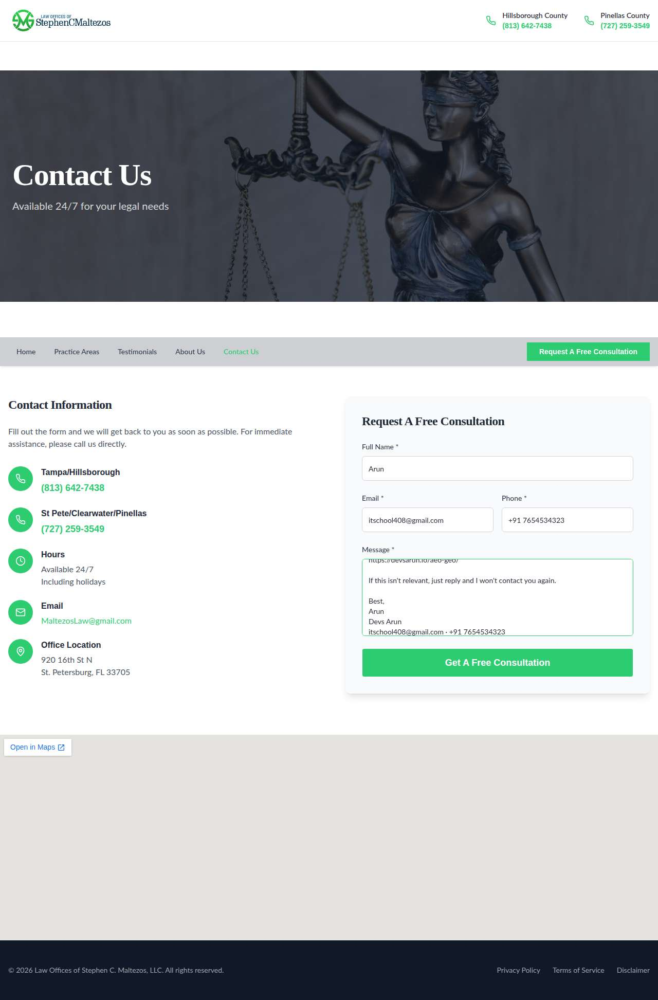

**After submit** — `run-e9eec5c6_attempt-39120e44_post_attempt_2026-11-04T04-19-58-471Z.jpg`

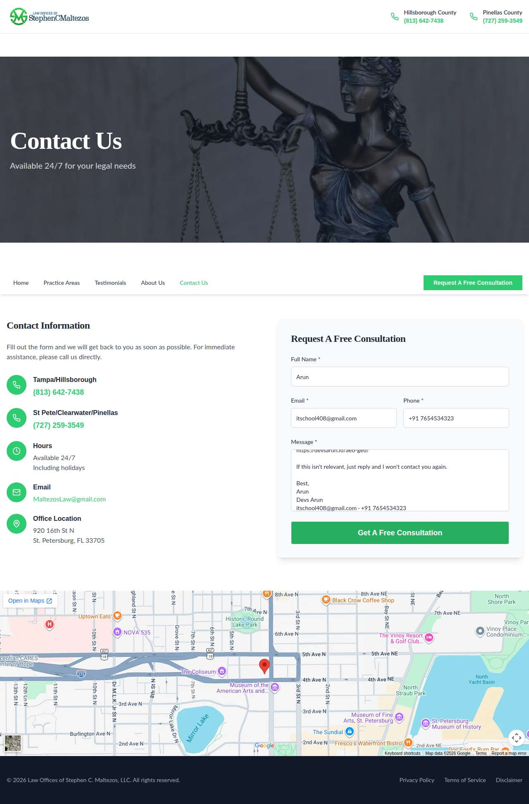

### lexingtondefense.com — unclear (LIVE)

| | |
|---|---|
| Attempt ID | `015c05fe-b232-46e7-bbed-c6c9f17c4f0a` |
| Form URL | https://www.lexingtondefense.com/contact-us/ |
| Final URL | https://www.lexingtondefense.com/contact-us/\#wpcf7-f61-o1 |
| Reserved | 2026-11-04 04:20:06 UTC |
| Submit attempted | 2026-11-04 04:20:08 UTC |
| Template | standard v2 |
| Confirmation text | none observed |
| Result / error | No new success marker observed |

Exact message:

~~~text
Subject: Helping customers find your business in AI search (AEO + GEO)

Hi there,

I'm Arun from Devs Arun. More and more customers now ask ChatGPT, Gemini, Perplexity or Google's AI Overviews questions like "who should I hire for this in my area?" before they call anyone. These tools answer from websites they can clearly understand, and they tend to recommend businesses whose pages answer real customer questions.

That is what AEO + GEO (Answer Engine and Generative Engine Optimization) is for. I improve your existing service pages so they clearly answer the questions your customers ask, add structured data that matches the page, and make the call, quote or enquiry step obvious. The benefit: your business gets a better chance of being mentioned or linked in AI answers, and visitors who arrive find it easy to contact you.

The AEO + GEO Starter is a one-time $199 (about ₹16,999, negotiable) for one website: a basic audit, 10 customer questions, improvements to two existing pages, relevant structured data and an action plan, with one revision round.

You can read the full details, send an enquiry or book online here:
https://devsarun.io/aeo-geo/

If this isn't relevant, just reply and I won't contact you again.

Best,
Arun
Devs Arun
itschool408@gmail.com · +91 7654534323
~~~

Submitted field values:

- Phone \[phone\]: +91 7654534323
- Message \[message\]: Hi there, I'm Arun from Devs Arun. More and more customers now ask ChatGPT, Gemini, Perplexity or Google's AI Overviews 
- Email (required) \[email\]: itschool408@gmail.com
- Your Name (required) \[name\]: Arun

**Filled form (before submit)** — `run-e9eec5c6_attempt-015c05fe_filled_2026-11-04T04-20-08-578Z.jpg`

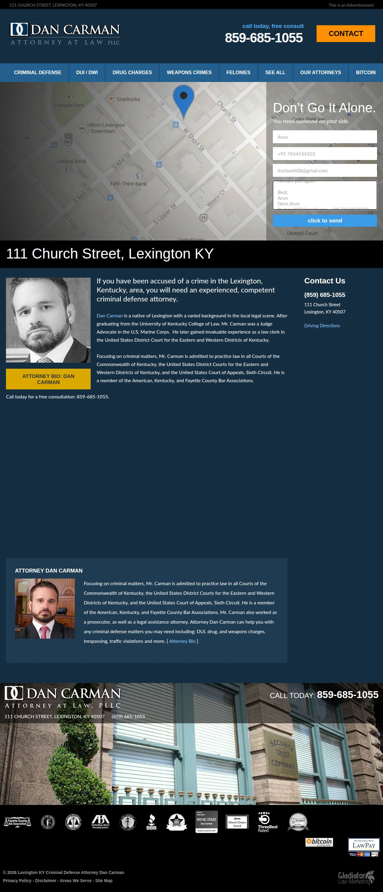

**After submit** — `run-e9eec5c6_attempt-015c05fe_post_attempt_2026-11-04T04-20-42-950Z.jpg`

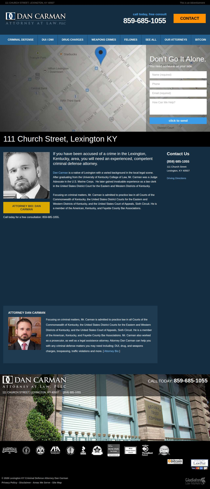

### wicklaw.com — failed\_before\_submit (LIVE)

| | |
|---|---|
| Attempt ID | `db5864de-15ba-4a15-a9a2-eca5f4d42e44` |
| Form URL | https://www.wicklaw.com/contact |
| Final URL | https://www.wicklaw.com/contact |
| Reserved | 2026-11-04 04:20:50 UTC |
| Submit attempted | — |
| Template | standard v2 |
| Confirmation text | none observed |
| Result / error | Form validation would block sending: Privacy-Policy: Please check this box if you want to proceed. |

Exact message:

~~~text
Subject: Helping customers find your business in AI search (AEO + GEO)

Hi there,

I'm Arun from Devs Arun. More and more customers now ask ChatGPT, Gemini, Perplexity or Google's AI Overviews questions like "who should I hire for this in my area?" before they call anyone. These tools answer from websites they can clearly understand, and they tend to recommend businesses whose pages answer real customer questions.

That is what AEO + GEO (Answer Engine and Generative Engine Optimization) is for. I improve your existing service pages so they clearly answer the questions your customers ask, add structured data that matches the page, and make the call, quote or enquiry step obvious. The benefit: your business gets a better chance of being mentioned or linked in AI answers, and visitors who arrive find it easy to contact you.

The AEO + GEO Starter is a one-time $199 (about ₹16,999, negotiable) for one website: a basic audit, 10 customer questions, improvements to two existing pages, relevant structured data and an action plan, with one revision round.

You can read the full details, send an enquiry or book online here:
https://devsarun.io/aeo-geo/

If this isn't relevant, just reply and I won't contact you again.

Best,
Arun
Devs Arun
itschool408@gmail.com · +91 7654534323
~~~

Submitted field values:

- \#Name: Arun
- \#Email: itschool408@gmail.com
- \#Phone: +91 7654534323
- \#Message: Hi there, I'm Arun from Devs Arun. More and more customers now ask ChatGPT, Gemini, Perplexity or Google's AI Overviews 

**Filled form (before submit)** — `run-e9eec5c6_attempt-db5864de_filled_2026-11-04T04-20-51-986Z.jpg`

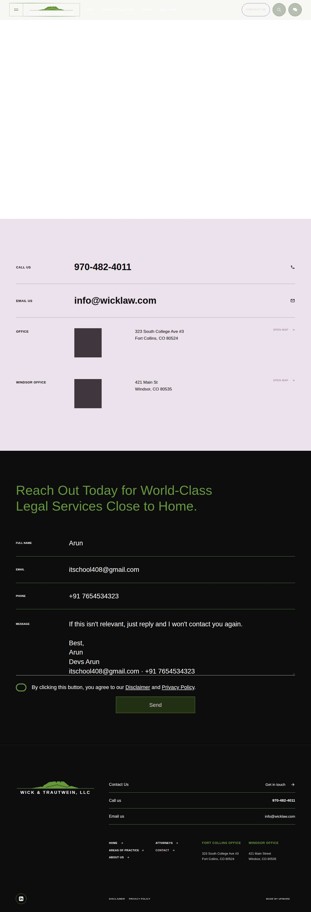

### lawnj.net — failed\_before\_submit (LIVE)

| | |
|---|---|
| Attempt ID | `689a2987-916f-44c9-a0d3-2e01047c426a` |
| Form URL | https://lawnj.net/contact/ |
| Final URL | https://lawnj.net/contact/ |
| Reserved | 2026-11-04 04:20:57 UTC |
| Submit attempted | — |
| Template | standard v2 |
| Confirmation text | none observed |
| Result / error | Field "Phone\*" did not accept the value |

Exact message:

~~~text
Subject: Helping customers find your business in AI search (AEO + GEO)

Hi there,

I'm Arun from Devs Arun. More and more customers now ask ChatGPT, Gemini, Perplexity or Google's AI Overviews questions like "who should I hire for this in my area?" before they call anyone. These tools answer from websites they can clearly understand, and they tend to recommend businesses whose pages answer real customer questions.

That is what AEO + GEO (Answer Engine and Generative Engine Optimization) is for. I improve your existing service pages so they clearly answer the questions your customers ask, add structured data that matches the page, and make the call, quote or enquiry step obvious. The benefit: your business gets a better chance of being mentioned or linked in AI answers, and visitors who arrive find it easy to contact you.

The AEO + GEO Starter is a one-time $199 (about ₹16,999, negotiable) for one website: a basic audit, 10 customer questions, improvements to two existing pages, relevant structured data and an action plan, with one revision round.

You can read the full details, send an enquiry or book online here:
https://devsarun.io/aeo-geo/

If this isn't relevant, just reply and I won't contact you again.

Best,
Arun
Devs Arun
itschool408@gmail.com · +91 7654534323
~~~

Submitted field values:

- \#input\_4\_1: Arun
- \#input\_4\_2: itschool408@gmail.com
- \#input\_4\_3: +91 7654534323
- \#input\_4\_4: Hi there, I'm Arun from Devs Arun. More and more customers now ask ChatGPT, Gemini, Perplexity or Google's AI Overviews 

**Filled form (before submit)** — `run-e9eec5c6_attempt-689a2987_filled_2026-11-04T04-20-59-062Z.jpg`

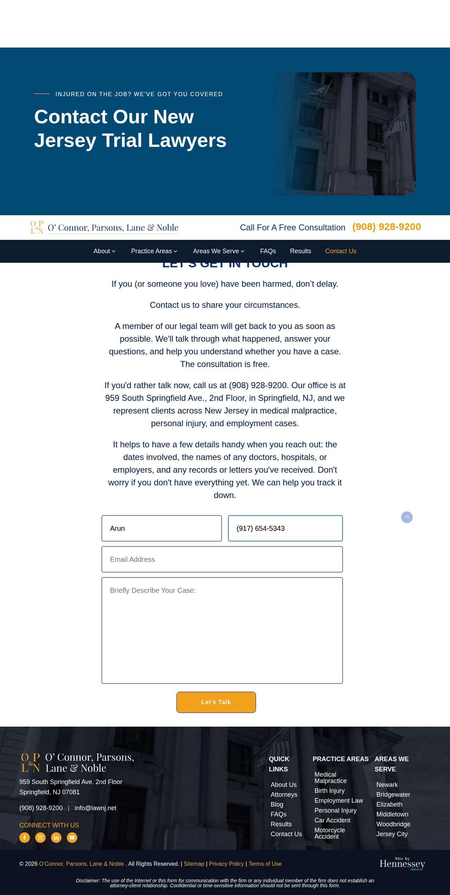

### robertreeveslaw.com — failed\_before\_submit (LIVE)

| | |
|---|---|
| Attempt ID | `cb498b94-3476-49f2-a210-8913609408d9` |
| Form URL | https://www.robertreeveslaw.com/contact-us/ |
| Final URL | https://www.robertreeveslaw.com/contact-us/ |
| Reserved | 2026-11-04 04:21:04 UTC |
| Submit attempted | — |
| Template | standard v2 |
| Confirmation text | none observed |
| Result / error | Field "input\_3" did not accept the value |

Exact message:

~~~text
Subject: Helping customers find your business in AI search (AEO + GEO)

Hi there,

I'm Arun from Devs Arun. More and more customers now ask ChatGPT, Gemini, Perplexity or Google's AI Overviews questions like "who should I hire for this in my area?" before they call anyone. These tools answer from websites they can clearly understand, and they tend to recommend businesses whose pages answer real customer questions.

That is what AEO + GEO (Answer Engine and Generative Engine Optimization) is for. I improve your existing service pages so they clearly answer the questions your customers ask, add structured data that matches the page, and make the call, quote or enquiry step obvious. The benefit: your business gets a better chance of being mentioned or linked in AI answers, and visitors who arrive find it easy to contact you.

The AEO + GEO Starter is a one-time $199 (about ₹16,999, negotiable) for one website: a basic audit, 10 customer questions, improvements to two existing pages, relevant structured data and an action plan, with one revision round.

You can read the full details, send an enquiry or book online here:
https://devsarun.io/aeo-geo/

If this isn't relevant, just reply and I won't contact you again.

Best,
Arun
Devs Arun
itschool408@gmail.com · +91 7654534323
~~~

Submitted field values:

- \#input\_1\_1: Arun
- \#input\_1\_2: Hi there, I'm Arun from Devs Arun. More and more customers now ask ChatGPT, Gemini, Perplexity or Google's AI Overviews 
- \#input\_1\_3: +91 7654534323
- \#input\_1\_4: itschool408@gmail.com

**Filled form (before submit)** — `run-e9eec5c6_attempt-cb498b94_filled_2026-11-04T04-21-07-699Z.jpg`

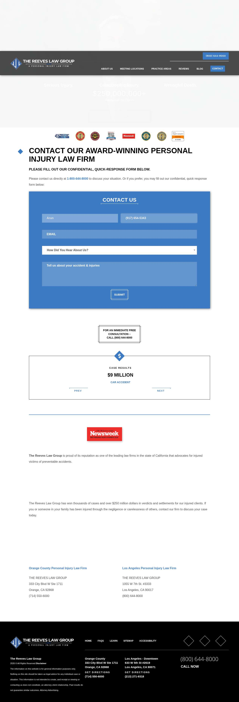

### mmrvt.com — confirmed (LIVE)

| | |
|---|---|
| Attempt ID | `08296349-ea0a-409d-8a79-f752926a6b40` |
| Form URL | https://www.mmrvt.com/?page\_id=29 |
| Final URL | https://www.mmrvt.com/?page\_id=29 |
| Reserved | 2026-11-04 04:21:12 UTC |
| Submit attempted | 2026-11-04 04:21:14 UTC |
| Template | standard v2 |
| Confirmation text | AR FROM YOU. GET IN TOUCH AND LET’S START THE CONVERSATION. Thanks for contacting us\! We will get in touch with you shortly. MMR, LLC I 45 Court Street Montpelier, VT 05602 I 802.22 |
| Result / error | — |

Exact message:

~~~text
Subject: Helping customers find your business in AI search (AEO + GEO)

Hi there,

I'm Arun from Devs Arun. More and more customers now ask ChatGPT, Gemini, Perplexity or Google's AI Overviews questions like "who should I hire for this in my area?" before they call anyone. These tools answer from websites they can clearly understand, and they tend to recommend businesses whose pages answer real customer questions.

That is what AEO + GEO (Answer Engine and Generative Engine Optimization) is for. I improve your existing service pages so they clearly answer the questions your customers ask, add structured data that matches the page, and make the call, quote or enquiry step obvious. The benefit: your business gets a better chance of being mentioned or linked in AI answers, and visitors who arrive find it easy to contact you.

The AEO + GEO Starter is a one-time $199 (about ₹16,999, negotiable) for one website: a basic audit, 10 customer questions, improvements to two existing pages, relevant structured data and an action plan, with one revision round.

You can read the full details, send an enquiry or book online here:
https://devsarun.io/aeo-geo/

If this isn't relevant, just reply and I won't contact you again.

Best,
Arun
Devs Arun
itschool408@gmail.com · +91 7654534323
~~~

Submitted field values:

- Name\* \[name\]: Arun
- Email\* \[email\]: itschool408@gmail.com
- Message\* \[message\]: Hi there, I'm Arun from Devs Arun. More and more customers now ask ChatGPT, Gemini, Perplexity or Google's AI Overviews 
- Subject\* \[subject\]: Helping customers find your business in AI search (AEO + GEO)

**Filled form (before submit)** — `run-e9eec5c6_attempt-08296349_filled_2026-11-04T04-21-14-363Z.jpg`

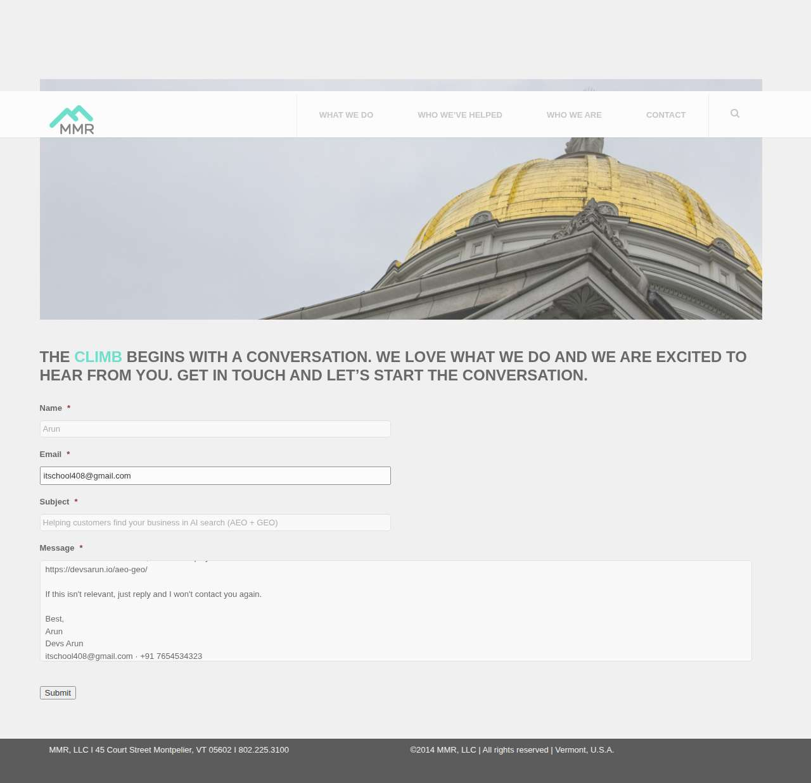

**After submit** — `run-e9eec5c6_attempt-08296349_post_attempt_2026-11-04T04-21-20-966Z.jpg`

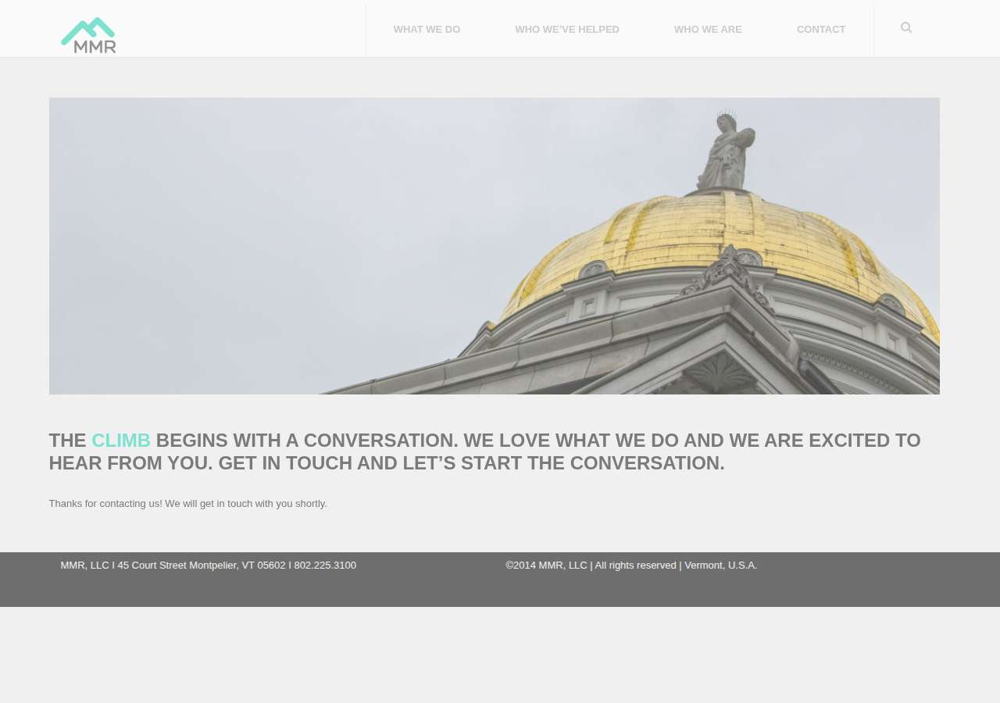

### atkinsonlawyers.com — confirmed (LIVE)

| | |
|---|---|
| Attempt ID | `3ba77185-3125-40d4-bbe2-44a978d64edb` |
| Form URL | https://www.atkinsonlawyers.com/contact-us/ |
| Final URL | https://www.atkinsonlawyers.com/leads/send\_inquiry/ |
| Reserved | 2026-11-04 04:21:28 UTC |
| Submit attempted | 2026-11-04 04:21:31 UTC |
| Template | standard v2 |
| Confirmation text | RESOURCES CONTACT US Protect. Preserve. Rebuild. LET'S TALK THANK YOU Your inquiry has been sent. LET'S TALK Fill out this form to let us know how we can help. Name Phon |
| Result / error | — |

Exact message:

~~~text
Subject: Helping customers find your business in AI search (AEO + GEO)

Hi there,

I'm Arun from Devs Arun. More and more customers now ask ChatGPT, Gemini, Perplexity or Google's AI Overviews questions like "who should I hire for this in my area?" before they call anyone. These tools answer from websites they can clearly understand, and they tend to recommend businesses whose pages answer real customer questions.

That is what AEO + GEO (Answer Engine and Generative Engine Optimization) is for. I improve your existing service pages so they clearly answer the questions your customers ask, add structured data that matches the page, and make the call, quote or enquiry step obvious. The benefit: your business gets a better chance of being mentioned or linked in AI answers, and visitors who arrive find it easy to contact you.

The AEO + GEO Starter is a one-time $199 (about ₹16,999, negotiable) for one website: a basic audit, 10 customer questions, improvements to two existing pages, relevant structured data and an action plan, with one revision round.

You can read the full details, send an enquiry or book online here:
https://devsarun.io/aeo-geo/

If this isn't relevant, just reply and I won't contact you again.

Best,
Arun
Devs Arun
itschool408@gmail.com · +91 7654534323
~~~

Submitted field values:

- Name \[name\]: Arun
- Email \[email\]: itschool408@gmail.com
- Phone (optional) \[phone\]: +91 7654534323
- Tell us about your case \[message\]: Hi there, I'm Arun from Devs Arun. More and more customers now ask ChatGPT, Gemini, Perplexity or Google's AI Overviews 

**Filled form (before submit)** — `run-e9eec5c6_attempt-3ba77185_filled_2026-11-04T04-21-31-372Z.jpg`

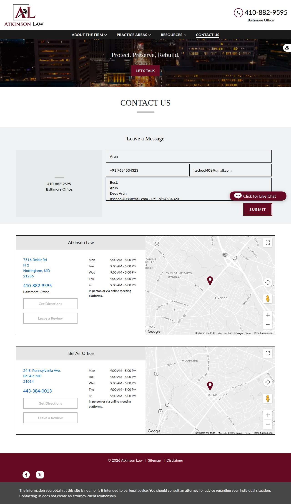

**After submit** — `run-e9eec5c6_attempt-3ba77185_post_attempt_2026-11-04T04-21-35-611Z.jpg`

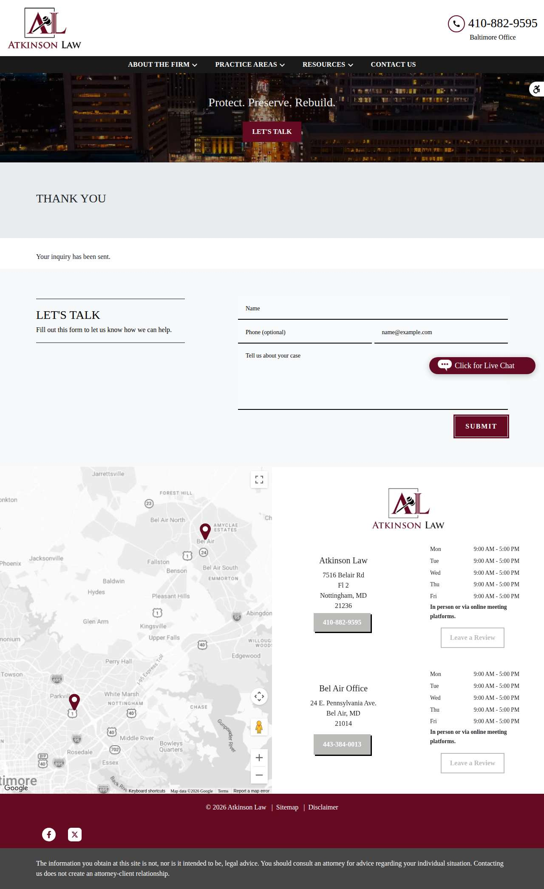

### barbierilawoffice.com — error\_after\_submit (LIVE)

| | |
|---|---|
| Attempt ID | `a857f8df-dd1d-45f9-938c-388b45d453f6` |
| Form URL | https://www.barbierilawoffice.com/contact |
| Final URL | https://www.barbierilawoffice.com/contact |
| Reserved | 2026-11-04 04:21:43 UTC |
| Submit attempted | 2026-11-04 04:21:46 UTC |
| Template | standard v2 |
| Confirmation text | none observed |
| Result / error | Submit click error (outcome unknown, not retried): locator.click: Timeout 10000ms exceeded. |

Exact message:

~~~text
Subject: Helping customers find your business in AI search (AEO + GEO)

Hi there,

I'm Arun from Devs Arun. More and more customers now ask ChatGPT, Gemini, Perplexity or Google's AI Overviews questions like "who should I hire for this in my area?" before they call anyone. These tools answer from websites they can clearly understand, and they tend to recommend businesses whose pages answer real customer questions.

That is what AEO + GEO (Answer Engine and Generative Engine Optimization) is for. I improve your existing service pages so they clearly answer the questions your customers ask, add structured data that matches the page, and make the call, quote or enquiry step obvious. The benefit: your business gets a better chance of being mentioned or linked in AI answers, and visitors who arrive find it easy to contact you.

The AEO + GEO Starter is a one-time $199 (about ₹16,999, negotiable) for one website: a basic audit, 10 customer questions, improvements to two existing pages, relevant structured data and an action plan, with one revision round.

You can read the full details, send an enquiry or book online here:
https://devsarun.io/aeo-geo/

If this isn't relevant, just reply and I won't contact you again.

Best,
Arun
Devs Arun
itschool408@gmail.com · +91 7654534323
~~~

Submitted field values:

- Email: \[email\]: itschool408@gmail.com
- Phone: \[phone\]: +91 7654534323
- Full Name: \[name\]: Arun
- Comments: \[message\]: Hi there, I'm Arun from Devs Arun. More and more customers now ask ChatGPT, Gemini, Perplexity or Google's AI Overviews 

**Filled form (before submit)** — `run-e9eec5c6_attempt-a857f8df_filled_2026-11-04T04-21-46-166Z.jpg`

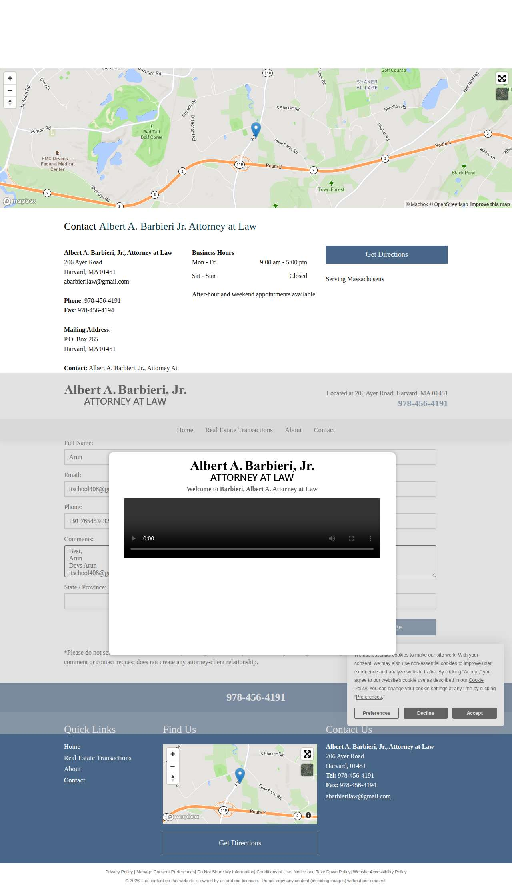

**After submit** — `run-e9eec5c6_attempt-a857f8df_post_attempt_2026-11-04T04-21-59-602Z.jpg`

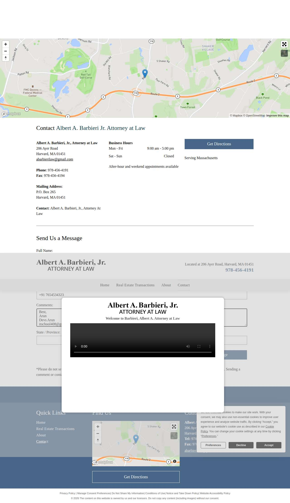

### rutledgelawcenter.com — unclear (LIVE)

| | |
|---|---|
| Attempt ID | `19ecae9b-360e-4917-9a4c-4326aab69dae` |
| Form URL | https://www.rutledgelawcenter.com/contact |
| Final URL | https://www.rutledgelawcenter.com/contact |
| Reserved | 2026-11-04 04:22:08 UTC |
| Submit attempted | 2026-11-04 04:22:12 UTC |
| Template | standard v2 |
| Confirmation text | none observed |
| Result / error | No new success marker observed |

Exact message:

~~~text
Subject: Helping customers find your business in AI search (AEO + GEO)

Hi there,

I'm Arun from Devs Arun. More and more customers now ask ChatGPT, Gemini, Perplexity or Google's AI Overviews questions like "who should I hire for this in my area?" before they call anyone. These tools answer from websites they can clearly understand, and they tend to recommend businesses whose pages answer real customer questions.

That is what AEO + GEO (Answer Engine and Generative Engine Optimization) is for. I improve your existing service pages so they clearly answer the questions your customers ask, add structured data that matches the page, and make the call, quote or enquiry step obvious. The benefit: your business gets a better chance of being mentioned or linked in AI answers, and visitors who arrive find it easy to contact you.

The AEO + GEO Starter is a one-time $199 (about ₹16,999, negotiable) for one website: a basic audit, 10 customer questions, improvements to two existing pages, relevant structured data and an action plan, with one revision round.

You can read the full details, send an enquiry or book online here:
https://devsarun.io/aeo-geo/

If this isn't relevant, just reply and I won't contact you again.

Best,
Arun
Devs Arun
itschool408@gmail.com · +91 7654534323
~~~

Submitted field values:

- Name \[name\]: Arun
- Email \[email\]: itschool408@gmail.com
- Phone \[phone\]: +91 7654534323
- Message \[message\]: Hi there, I'm Arun from Devs Arun. More and more customers now ask ChatGPT, Gemini, Perplexity or Google's AI Overviews 

**Filled form (before submit)** — `run-e9eec5c6_attempt-19ecae9b_filled_2026-11-04T04-22-12-055Z.jpg`

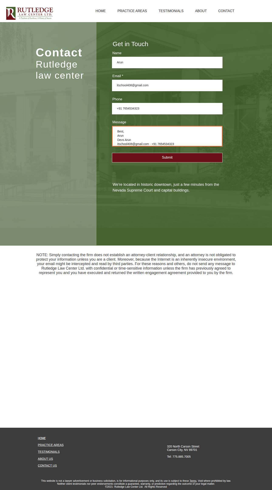

**After submit** — `run-e9eec5c6_attempt-19ecae9b_post_attempt_2026-11-04T04-22-40-156Z.jpg`

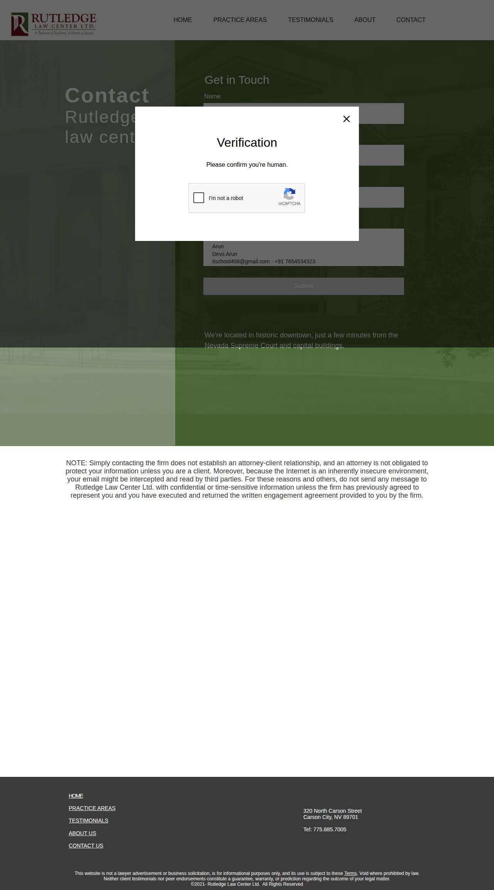

### drdale.net — confirmed (LIVE)

| | |
|---|---|
| Attempt ID | `40406793-144a-46c3-bd81-06392d0761f9` |
| Form URL | https://www.drdale.net/contact |
| Final URL | https://www.drdale.net/contact |
| Reserved | 2026-11-04 04:22:48 UTC |
| Submit attempted | 2026-11-04 04:22:49 UTC |
| Template | standard v2 |
| Confirmation text | CONVERSATION START THE CONVERSATION START THE CONVERSATION Thank you\! Your message has been received. QUICK LINKS info@drdale.net 678-856-7246 FOLLOW US @drdalechiro @d |
| Result / error | — |

Exact message:

~~~text
Subject: Helping customers find your business in AI search (AEO + GEO)

Hi there,

I'm Arun from Devs Arun. More and more customers now ask ChatGPT, Gemini, Perplexity or Google's AI Overviews questions like "who should I hire for this in my area?" before they call anyone. These tools answer from websites they can clearly understand, and they tend to recommend businesses whose pages answer real customer questions.

That is what AEO + GEO (Answer Engine and Generative Engine Optimization) is for. I improve your existing service pages so they clearly answer the questions your customers ask, add structured data that matches the page, and make the call, quote or enquiry step obvious. The benefit: your business gets a better chance of being mentioned or linked in AI answers, and visitors who arrive find it easy to contact you.

The AEO + GEO Starter is a one-time $199 (about ₹16,999, negotiable) for one website: a basic audit, 10 customer questions, improvements to two existing pages, relevant structured data and an action plan, with one revision round.

You can read the full details, send an enquiry or book online here:
https://devsarun.io/aeo-geo/

If this isn't relevant, just reply and I won't contact you again.

Best,
Arun
Devs Arun
itschool408@gmail.com · +91 7654534323
~~~

Submitted field values:

- MESSAGE \[message\]: Hi there, I'm Arun from Devs Arun. More and more customers now ask ChatGPT, Gemini, Perplexity or Google's AI Overviews 
- NAME \[first\_name\]: Arun
- EMAIL ADDRESS \[email\]: itschool408@gmail.com

**Filled form (before submit)** — `run-e9eec5c6_attempt-40406793_filled_2026-11-04T04-22-49-636Z.jpg`

**After submit** — `run-e9eec5c6_attempt-40406793_post_attempt_2026-11-04T04-22-53-667Z.jpg`

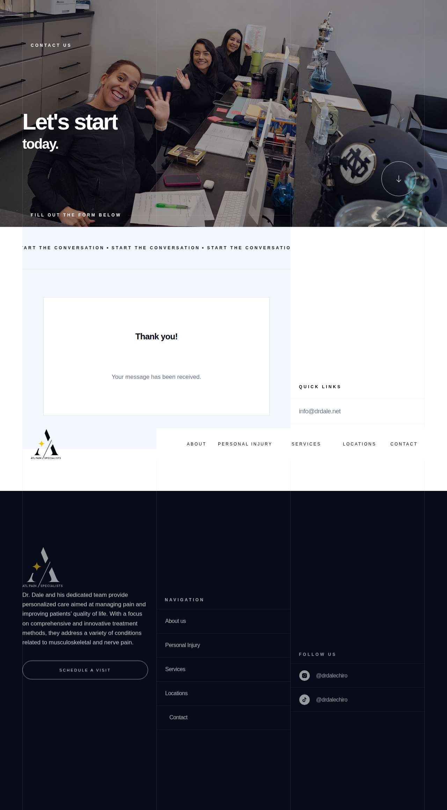

### leevanhorn.com — unclear (LIVE)

| | |
|---|---|
| Attempt ID | `3b5027f6-21f4-4f6b-86cb-b372f12763c6` |
| Form URL | https://www.vanhornlawoffice.net/ |
| Final URL | https://www.vanhornlawoffice.net/ |
| Reserved | 2026-11-04 04:23:01 UTC |
| Submit attempted | 2026-11-04 04:23:03 UTC |
| Template | standard v2 |
| Confirmation text | none observed |
| Result / error | No new success marker observed |

Exact message:

~~~text
Subject: Helping customers find your business in AI search (AEO + GEO)

Hi there,

I'm Arun from Devs Arun. More and more customers now ask ChatGPT, Gemini, Perplexity or Google's AI Overviews questions like "who should I hire for this in my area?" before they call anyone. These tools answer from websites they can clearly understand, and they tend to recommend businesses whose pages answer real customer questions.

That is what AEO + GEO (Answer Engine and Generative Engine Optimization) is for. I improve your existing service pages so they clearly answer the questions your customers ask, add structured data that matches the page, and make the call, quote or enquiry step obvious. The benefit: your business gets a better chance of being mentioned or linked in AI answers, and visitors who arrive find it easy to contact you.

The AEO + GEO Starter is a one-time $199 (about ₹16,999, negotiable) for one website: a basic audit, 10 customer questions, improvements to two existing pages, relevant structured data and an action plan, with one revision round.

You can read the full details, send an enquiry or book online here:
https://devsarun.io/aeo-geo/

If this isn't relevant, just reply and I won't contact you again.

Best,
Arun
Devs Arun
itschool408@gmail.com · +91 7654534323
~~~

Submitted field values:

- name \[name\]: Arun
- email \[email\]: itschool408@gmail.com
- subject \[subject\]: Helping customers find your business in AI search (AEO + GEO)
- Type your message here... \[message\]: Hi there, I'm Arun from Devs Arun. More and more customers now ask ChatGPT, Gemini, Perplexity or Google's AI Overviews 

**Filled form (before submit)** — `run-e9eec5c6_attempt-3b5027f6_filled_2026-11-04T04-23-03-913Z.jpg`

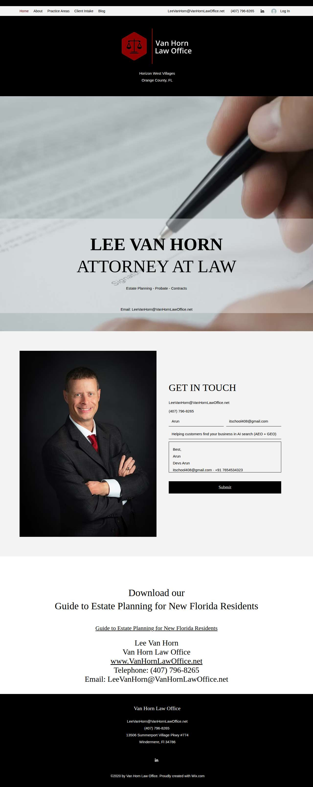

**After submit** — `run-e9eec5c6_attempt-3b5027f6_post_attempt_2026-11-04T04-23-31-926Z.jpg`

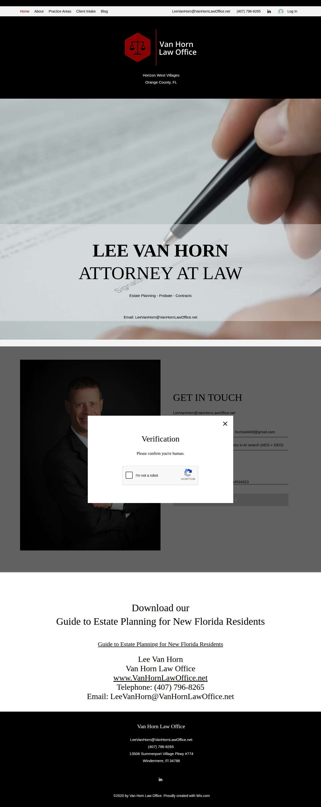

### fishertalwar.com — failed\_before\_submit (LIVE)

| | |
|---|---|
| Attempt ID | `4a39a799-2512-4612-89b8-e0c7815fe425` |
| Form URL | https://www.fishertalwar.com/contact-us/ |
| Final URL | https://www.fishertalwar.com/contact-us/ |
| Reserved | 2026-11-04 04:23:39 UTC |
| Submit attempted | — |
| Template | standard v2 |
| Confirmation text | none observed |
| Result / error | Field "Phone" did not accept the value |

Exact message:

~~~text
Subject: Helping customers find your business in AI search (AEO + GEO)

Hi there,

I'm Arun from Devs Arun. More and more customers now ask ChatGPT, Gemini, Perplexity or Google's AI Overviews questions like "who should I hire for this in my area?" before they call anyone. These tools answer from websites they can clearly understand, and they tend to recommend businesses whose pages answer real customer questions.

That is what AEO + GEO (Answer Engine and Generative Engine Optimization) is for. I improve your existing service pages so they clearly answer the questions your customers ask, add structured data that matches the page, and make the call, quote or enquiry step obvious. The benefit: your business gets a better chance of being mentioned or linked in AI answers, and visitors who arrive find it easy to contact you.

The AEO + GEO Starter is a one-time $199 (about ₹16,999, negotiable) for one website: a basic audit, 10 customer questions, improvements to two existing pages, relevant structured data and an action plan, with one revision round.

You can read the full details, send an enquiry or book online here:
https://devsarun.io/aeo-geo/

If this isn't relevant, just reply and I won't contact you again.

Best,
Arun
Devs Arun
itschool408@gmail.com · +91 7654534323
~~~

Submitted field values:

- \#input\_10\_1: Arun
- \#input\_10\_3: itschool408@gmail.com
- \#input\_10\_4: +91 7654534323
- \#input\_10\_5: Hi there, I'm Arun from Devs Arun. More and more customers now ask ChatGPT, Gemini, Perplexity or Google's AI Overviews 

**Filled form (before submit)** — `run-e9eec5c6_attempt-4a39a799_filled_2026-11-04T04-23-43-548Z.jpg`

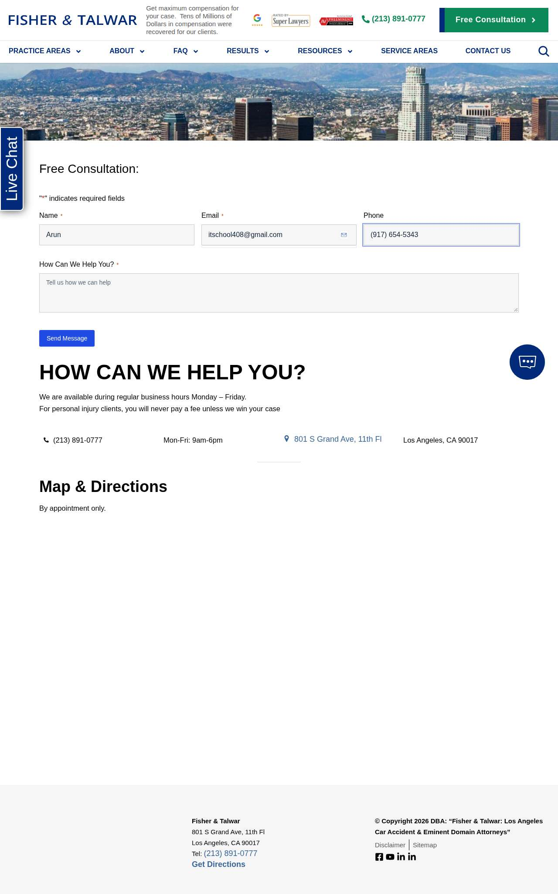

### hkwllp.com — error\_after\_submit (LIVE)

| | |
|---|---|
| Attempt ID | `2d9f66cd-cef7-43d4-8fe2-578154047129` |
| Form URL | https://hkwllp.com/contact-us/ |
| Final URL | https://hkwllp.com/contact-us/ |
| Reserved | 2026-11-04 04:23:48 UTC |
| Submit attempted | 2026-11-04 04:23:51 UTC |
| Template | standard v2 |
| Confirmation text | none observed |
| Result / error | Submit click error (outcome unknown, not retried): locator.click: Timeout 10000ms exceeded. |

Exact message:

~~~text
Subject: Helping customers find your business in AI search (AEO + GEO)

Hi there,

I'm Arun from Devs Arun. More and more customers now ask ChatGPT, Gemini, Perplexity or Google's AI Overviews questions like "who should I hire for this in my area?" before they call anyone. These tools answer from websites they can clearly understand, and they tend to recommend businesses whose pages answer real customer questions.

That is what AEO + GEO (Answer Engine and Generative Engine Optimization) is for. I improve your existing service pages so they clearly answer the questions your customers ask, add structured data that matches the page, and make the call, quote or enquiry step obvious. The benefit: your business gets a better chance of being mentioned or linked in AI answers, and visitors who arrive find it easy to contact you.

The AEO + GEO Starter is a one-time $199 (about ₹16,999, negotiable) for one website: a basic audit, 10 customer questions, improvements to two existing pages, relevant structured data and an action plan, with one revision round.

You can read the full details, send an enquiry or book online here:
https://devsarun.io/aeo-geo/

If this isn't relevant, just reply and I won't contact you again.

Best,
Arun
Devs Arun
itschool408@gmail.com · +91 7654534323
~~~

Submitted field values:

- Name\*: \[name\]: Arun
- Email\*: \[email\]: itschool408@gmail.com
- Phone\*: \[phone\]: +91 7654534323
- Your Message: \[message\]: Hi there, I'm Arun from Devs Arun. More and more customers now ask ChatGPT, Gemini, Perplexity or Google's AI Overviews 

**Filled form (before submit)** — `run-e9eec5c6_attempt-2d9f66cd_filled_2026-11-04T04-23-51-329Z.jpg`

**After submit** — `run-e9eec5c6_attempt-2d9f66cd_post_attempt_2026-11-04T04-24-04-380Z.jpg`

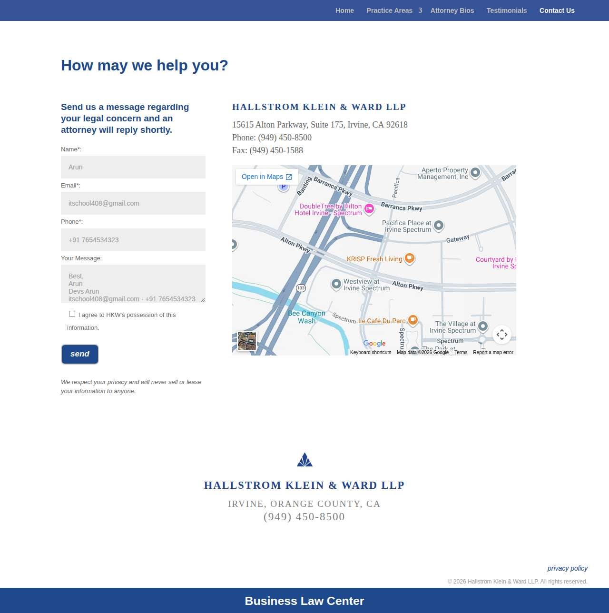

### hamtinilaw.com — unclear (LIVE)

| | |
|---|---|
| Attempt ID | `ff536fa8-27df-4fb9-9129-dc82c231e82c` |
| Form URL | https://www.hamtinilaw.com/contact |
| Final URL | https://www.hamtinilaw.com/contact |
| Reserved | 2026-11-04 04:24:12 UTC |
| Submit attempted | 2026-11-04 04:24:15 UTC |
| Template | standard v2 |
| Confirmation text | none observed |
| Result / error | No new success marker observed |

Exact message:

~~~text
Subject: Helping customers find your business in AI search (AEO + GEO)

Hi there,

I'm Arun from Devs Arun. More and more customers now ask ChatGPT, Gemini, Perplexity or Google's AI Overviews questions like "who should I hire for this in my area?" before they call anyone. These tools answer from websites they can clearly understand, and they tend to recommend businesses whose pages answer real customer questions.

That is what AEO + GEO (Answer Engine and Generative Engine Optimization) is for. I improve your existing service pages so they clearly answer the questions your customers ask, add structured data that matches the page, and make the call, quote or enquiry step obvious. The benefit: your business gets a better chance of being mentioned or linked in AI answers, and visitors who arrive find it easy to contact you.

The AEO + GEO Starter is a one-time $199 (about ₹16,999, negotiable) for one website: a basic audit, 10 customer questions, improvements to two existing pages, relevant structured data and an action plan, with one revision round.

You can read the full details, send an enquiry or book online here:
https://devsarun.io/aeo-geo/

If this isn't relevant, just reply and I won't contact you again.

Best,
Arun
Devs Arun
itschool408@gmail.com · +91 7654534323
~~~

Submitted field values:

- name \[name\]: Arun
- email \[email\]: itschool408@gmail.com
- phone \[phone\]: +91 7654534323
- Type your message here... \[message\]: Hi there, I'm Arun from Devs Arun. More and more customers now ask ChatGPT, Gemini, Perplexity or Google's AI Overviews 

**Filled form (before submit)** — `run-e9eec5c6_attempt-ff536fa8_filled_2026-11-04T04-24-15-452Z.jpg`

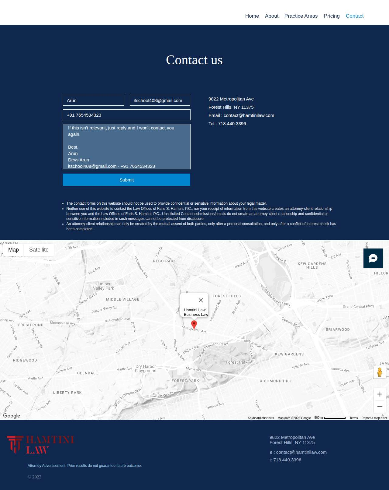

**After submit** — `run-e9eec5c6_attempt-ff536fa8_post_attempt_2026-11-04T04-24-51-336Z.jpg`

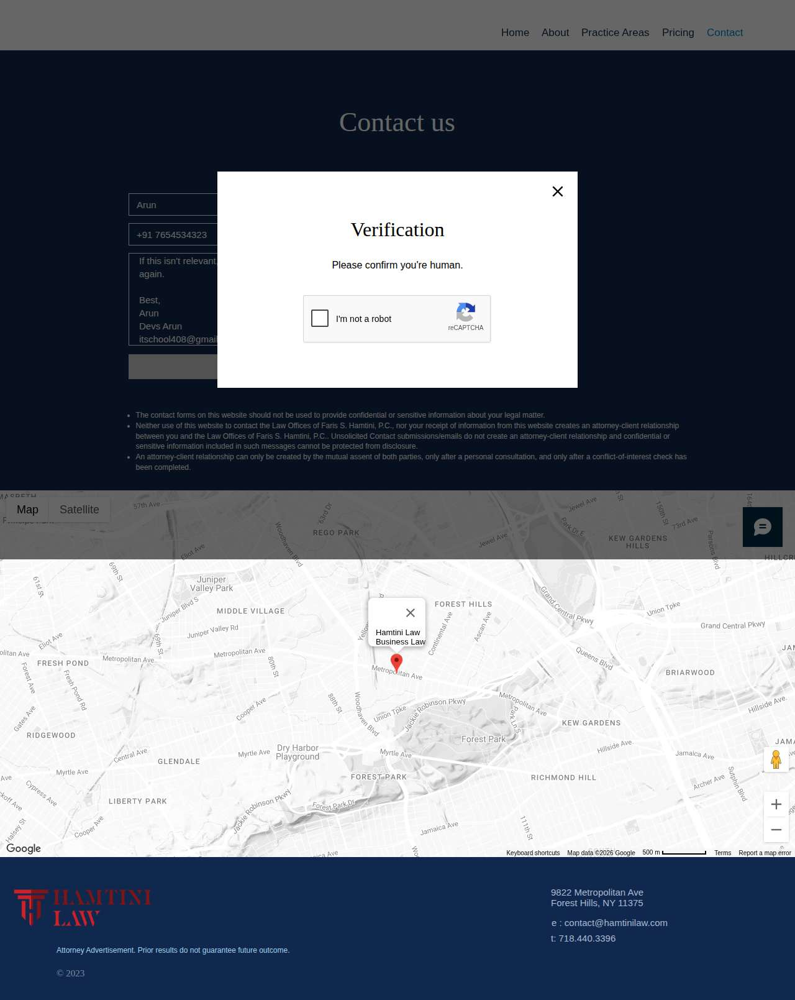

### wolflawcolorado.com — unclear (LIVE)

| | |
|---|---|
| Attempt ID | `c42813d7-0c13-4dc9-a96a-98892ca96ecb` |
| Form URL | https://wolflawcolorado.com/contact-us/ |
| Final URL | https://wolflawcolorado.com/contact-us/ |
| Reserved | 2026-11-04 04:24:59 UTC |
| Submit attempted | 2026-11-04 04:25:00 UTC |
| Template | standard v2 |
| Confirmation text | none observed |
| Result / error | No new success marker observed |

Exact message:

~~~text
Subject: Helping customers find your business in AI search (AEO + GEO)

Hi there,

I'm Arun from Devs Arun. More and more customers now ask ChatGPT, Gemini, Perplexity or Google's AI Overviews questions like "who should I hire for this in my area?" before they call anyone. These tools answer from websites they can clearly understand, and they tend to recommend businesses whose pages answer real customer questions.

That is what AEO + GEO (Answer Engine and Generative Engine Optimization) is for. I improve your existing service pages so they clearly answer the questions your customers ask, add structured data that matches the page, and make the call, quote or enquiry step obvious. The benefit: your business gets a better chance of being mentioned or linked in AI answers, and visitors who arrive find it easy to contact you.

The AEO + GEO Starter is a one-time $199 (about ₹16,999, negotiable) for one website: a basic audit, 10 customer questions, improvements to two existing pages, relevant structured data and an action plan, with one revision round.

You can read the full details, send an enquiry or book online here:
https://devsarun.io/aeo-geo/

If this isn't relevant, just reply and I won't contact you again.

Best,
Arun
Devs Arun
itschool408@gmail.com · +91 7654534323
~~~

Submitted field values:

- Name\* \[name\]: Arun
- Email\* \[email\]: itschool408@gmail.com
- Phone\* \[phone\]: +91 7654534323
- Message\* \[message\]: Hi there, I'm Arun from Devs Arun. More and more customers now ask ChatGPT, Gemini, Perplexity or Google's AI Overviews 

**Filled form (before submit)** — `run-e9eec5c6_attempt-c42813d7_filled_2026-11-04T04-25-00-572Z.jpg`

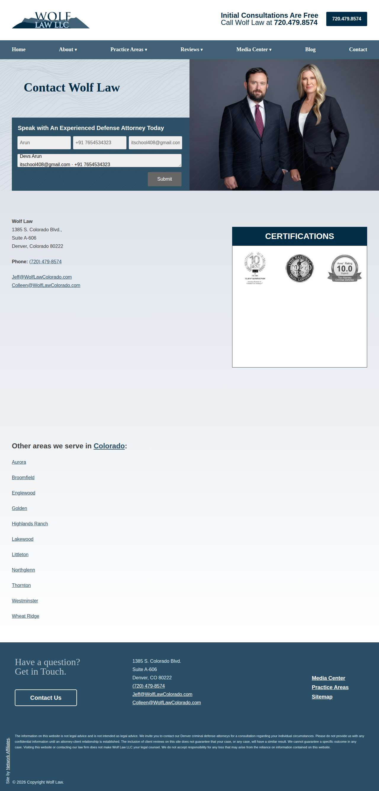

**After submit** — `run-e9eec5c6_attempt-c42813d7_post_attempt_2026-11-04T04-25-30-376Z.jpg`

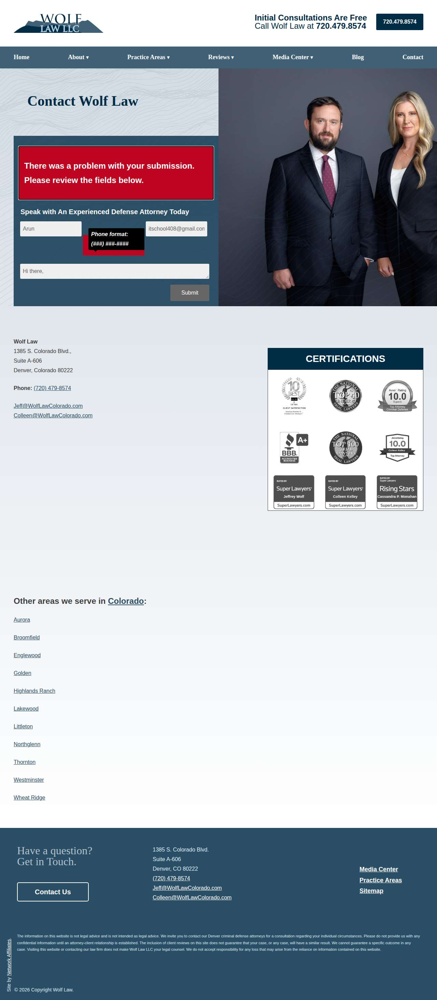

### helbert-allemang.com — error\_after\_submit (LIVE)

| | |
|---|---|
| Attempt ID | `5c4de03f-1b40-4bdf-a65e-b0762701c20f` |
| Form URL | https://www.helbert-allemang.com/contact |
| Final URL | https://www.helbert-allemang.com/contact |
| Reserved | 2026-11-04 04:25:38 UTC |
| Submit attempted | 2026-11-04 04:25:41 UTC |
| Template | standard v2 |
| Confirmation text | none observed |
| Result / error | Submit click error (outcome unknown, not retried): locator.click: Timeout 10000ms exceeded. |

Exact message:

~~~text
Subject: Helping customers find your business in AI search (AEO + GEO)

Hi there,

I'm Arun from Devs Arun. More and more customers now ask ChatGPT, Gemini, Perplexity or Google's AI Overviews questions like "who should I hire for this in my area?" before they call anyone. These tools answer from websites they can clearly understand, and they tend to recommend businesses whose pages answer real customer questions.

That is what AEO + GEO (Answer Engine and Generative Engine Optimization) is for. I improve your existing service pages so they clearly answer the questions your customers ask, add structured data that matches the page, and make the call, quote or enquiry step obvious. The benefit: your business gets a better chance of being mentioned or linked in AI answers, and visitors who arrive find it easy to contact you.

The AEO + GEO Starter is a one-time $199 (about ₹16,999, negotiable) for one website: a basic audit, 10 customer questions, improvements to two existing pages, relevant structured data and an action plan, with one revision round.

You can read the full details, send an enquiry or book online here:
https://devsarun.io/aeo-geo/

If this isn't relevant, just reply and I won't contact you again.

Best,
Arun
Devs Arun
itschool408@gmail.com · +91 7654534323
~~~

Submitted field values:

- Email: \[email\]: itschool408@gmail.com
- Phone: \[phone\]: +91 7654534323
- First Name: \[first\_name\]: Arun
- Area of Your Concern: \[message\]: Hi there, I'm Arun from Devs Arun. More and more customers now ask ChatGPT, Gemini, Perplexity or Google's AI Overviews 

**Filled form (before submit)** — `run-e9eec5c6_attempt-5c4de03f_filled_2026-11-04T04-25-41-559Z.jpg`

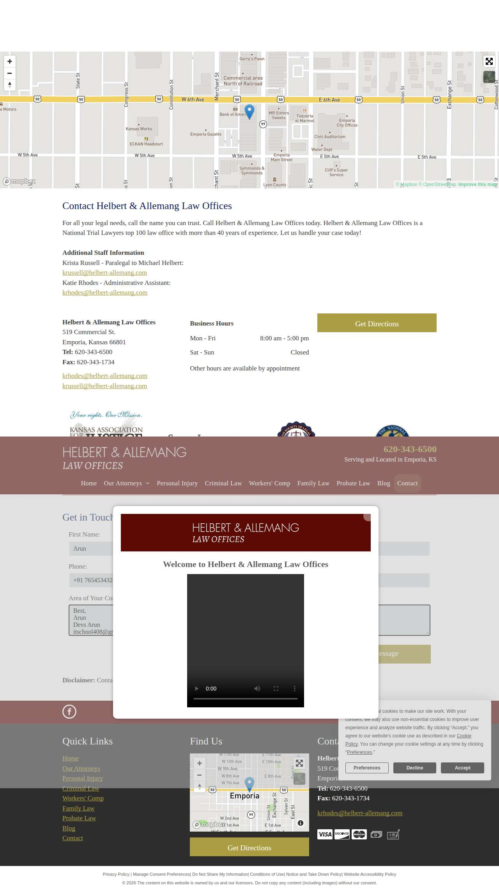

**After submit** — `run-e9eec5c6_attempt-5c4de03f_post_attempt_2026-11-04T04-25-54-445Z.jpg`

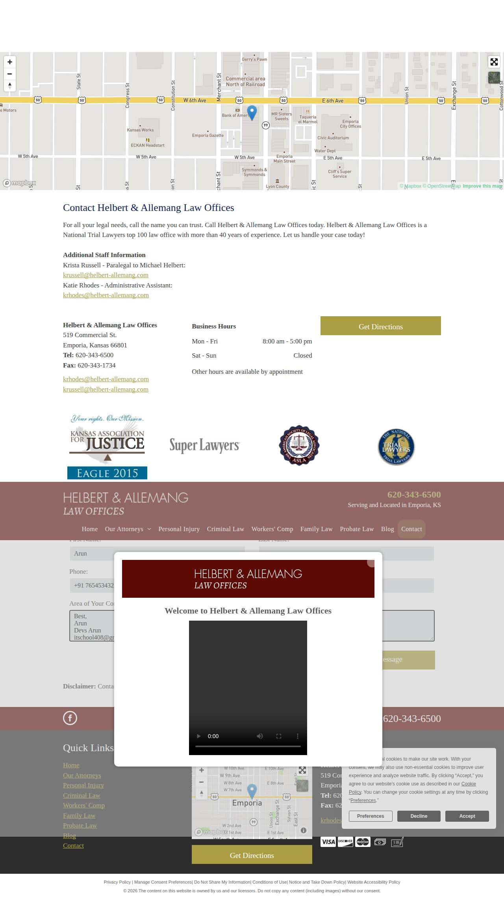

### injuryclaimnyclaw.com — confirmed (LIVE)

| | |
|---|---|
| Attempt ID | `3d709718-56e7-4602-bc92-44cea722395f` |
| Form URL | https://www.injuryclaimnyclaw.com/contact-us/ |
| Final URL | https://www.injuryclaimnyclaw.com/contact-us/ |
| Reserved | 2026-11-04 04:26:02 UTC |
| Submit attempted | 2026-11-04 04:26:03 UTC |
| Template | standard v2 |
| Confirmation text | CT US Contact Us Home Contact Us Get Your Free Consultation Thanks for contacting us\! We will get in touch with you shortly. Meet Our Attorneys David Resnick FOUNDING ATTORNEY Phili |
| Result / error | — |

Exact message:

~~~text
Subject: Helping customers find your business in AI search (AEO + GEO)

Hi there,

I'm Arun from Devs Arun. More and more customers now ask ChatGPT, Gemini, Perplexity or Google's AI Overviews questions like "who should I hire for this in my area?" before they call anyone. These tools answer from websites they can clearly understand, and they tend to recommend businesses whose pages answer real customer questions.

That is what AEO + GEO (Answer Engine and Generative Engine Optimization) is for. I improve your existing service pages so they clearly answer the questions your customers ask, add structured data that matches the page, and make the call, quote or enquiry step obvious. The benefit: your business gets a better chance of being mentioned or linked in AI answers, and visitors who arrive find it easy to contact you.

The AEO + GEO Starter is a one-time $199 (about ₹16,999, negotiable) for one website: a basic audit, 10 customer questions, improvements to two existing pages, relevant structured data and an action plan, with one revision round.

You can read the full details, send an enquiry or book online here:
https://devsarun.io/aeo-geo/

If this isn't relevant, just reply and I won't contact you again.

Best,
Arun
Devs Arun
itschool408@gmail.com · +91 7654534323
~~~

Submitted field values:

- Name\* \[name\]: Arun
- Email\* \[email\]: itschool408@gmail.com
- Phone\* \[phone\]: +91 7654534323
- How can we help you? \[message\]: Hi there, I'm Arun from Devs Arun. More and more customers now ask ChatGPT, Gemini, Perplexity or Google's AI Overviews 

**Filled form (before submit)** — `run-e9eec5c6_attempt-3d709718_filled_2026-11-04T04-26-03-765Z.jpg`

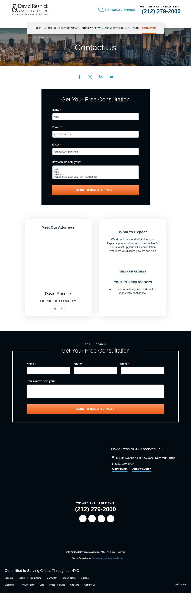

**After submit** — `run-e9eec5c6_attempt-3d709718_post_attempt_2026-11-04T04-26-07-678Z.jpg`

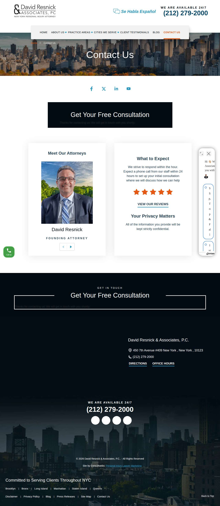

### kenwilsonlaw.com — confirmed (LIVE)

| | |
|---|---|
| Attempt ID | `e3541425-053d-4272-a144-3dc7666f65ba` |
| Form URL | https://www.kenwilsonlaw.com/contact/ |
| Final URL | https://www.kenwilsonlaw.com/contact/ |
| Reserved | 2026-11-04 04:26:15 UTC |
| Submit attempted | 2026-11-04 04:26:19 UTC |
| Template | standard v2 |
| Confirmation text | Name Your Email Court file number or citation Message Send Submission successful CALL US 24/7 Need Representation from Experienced Lawyers? Schedule an Appointment Today\! (320) 202 |
| Result / error | — |

Exact message:

~~~text
Subject: Helping customers find your business in AI search (AEO + GEO)

Hi there,

I'm Arun from Devs Arun. More and more customers now ask ChatGPT, Gemini, Perplexity or Google's AI Overviews questions like "who should I hire for this in my area?" before they call anyone. These tools answer from websites they can clearly understand, and they tend to recommend businesses whose pages answer real customer questions.

That is what AEO + GEO (Answer Engine and Generative Engine Optimization) is for. I improve your existing service pages so they clearly answer the questions your customers ask, add structured data that matches the page, and make the call, quote or enquiry step obvious. The benefit: your business gets a better chance of being mentioned or linked in AI answers, and visitors who arrive find it easy to contact you.

The AEO + GEO Starter is a one-time $199 (about ₹16,999, negotiable) for one website: a basic audit, 10 customer questions, improvements to two existing pages, relevant structured data and an action plan, with one revision round.

You can read the full details, send an enquiry or book online here:
https://devsarun.io/aeo-geo/

If this isn't relevant, just reply and I won't contact you again.

Best,
Arun
Devs Arun
itschool408@gmail.com · +91 7654534323
~~~

Submitted field values:

- Your Name \[name\]: Arun
- Message \[message\]: Hi there, I'm Arun from Devs Arun. More and more customers now ask ChatGPT, Gemini, Perplexity or Google's AI Overviews 
- Your Email \[email\]: itschool408@gmail.com

**Filled form (before submit)** — `run-e9eec5c6_attempt-e3541425_filled_2026-11-04T04-26-19-647Z.jpg`

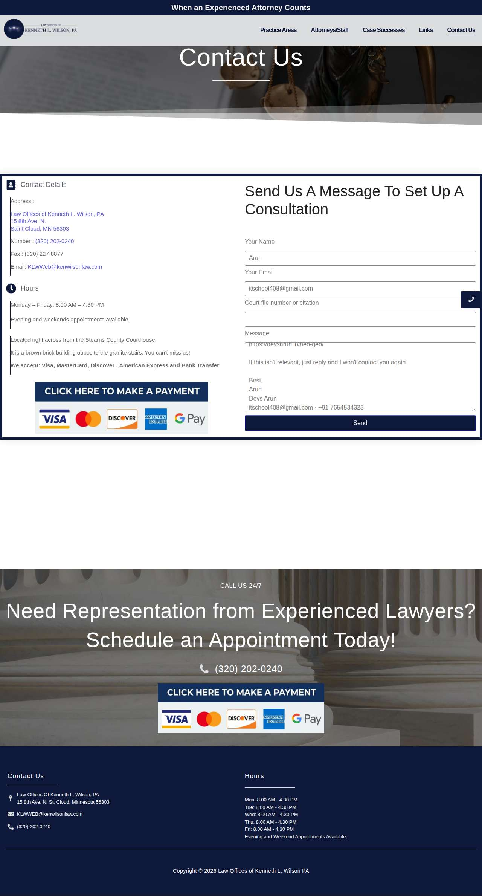

**After submit** — `run-e9eec5c6_attempt-e3541425_post_attempt_2026-11-04T04-26-25-782Z.jpg`

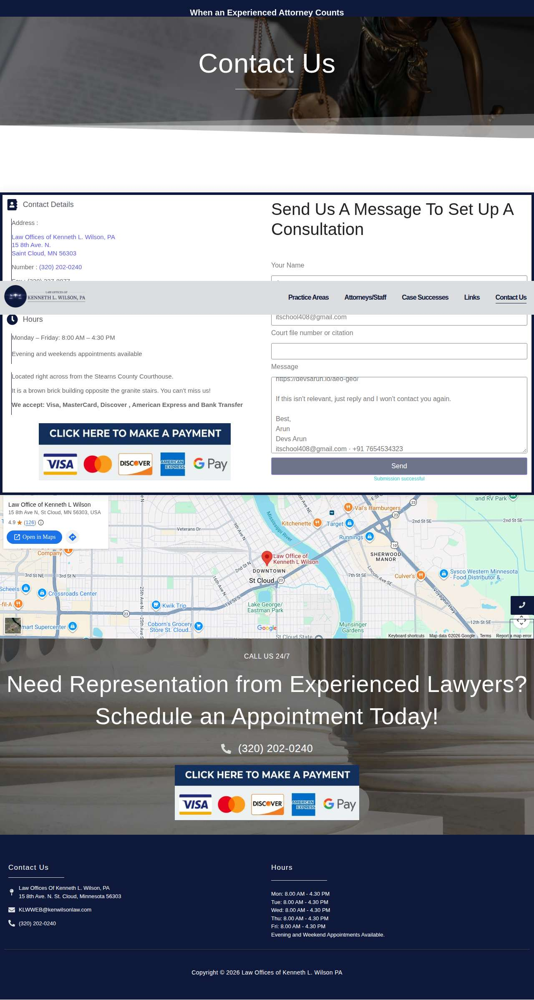

### hatchlawfirm.com — confirmed (LIVE)

| | |
|---|---|
| Attempt ID | `0083e540-0927-49ec-99ff-3e067a0163ca` |
| Form URL | https://www.hatchlawfirm.com/contact |
| Final URL | https://www.hatchlawfirm.com/contact |
| Reserved | 2026-11-04 04:26:33 UTC |
| Submit attempted | 2026-11-04 04:26:35 UTC |
| Template | standard v2 |
| Confirmation text | below and Andrew will be in touch within one business day. Message Received Thank you for reaching out. Andrew will review your message and respond within one business day. Se |
| Result / error | — |

Exact message:

~~~text
Subject: Helping customers find your business in AI search (AEO + GEO)

Hi there,

I'm Arun from Devs Arun. More and more customers now ask ChatGPT, Gemini, Perplexity or Google's AI Overviews questions like "who should I hire for this in my area?" before they call anyone. These tools answer from websites they can clearly understand, and they tend to recommend businesses whose pages answer real customer questions.

That is what AEO + GEO (Answer Engine and Generative Engine Optimization) is for. I improve your existing service pages so they clearly answer the questions your customers ask, add structured data that matches the page, and make the call, quote or enquiry step obvious. The benefit: your business gets a better chance of being mentioned or linked in AI answers, and visitors who arrive find it easy to contact you.

The AEO + GEO Starter is a one-time $199 (about ₹16,999, negotiable) for one website: a basic audit, 10 customer questions, improvements to two existing pages, relevant structured data and an action plan, with one revision round.

You can read the full details, send an enquiry or book online here:
https://devsarun.io/aeo-geo/

If this isn't relevant, just reply and I won't contact you again.

Best,
Arun
Devs Arun
itschool408@gmail.com · +91 7654534323
~~~

Submitted field values:

- FULL NAME \* \[name\]: Arun
- PHONE NUMBER \[phone\]: +91 7654534323
- EMAIL ADDRESS \* \[email\]: itschool408@gmail.com
- HOW CAN WE HELP? \* \[message\]: Hi there, I'm Arun from Devs Arun. More and more customers now ask ChatGPT, Gemini, Perplexity or Google's AI Overviews 

**Filled form (before submit)** — `run-e9eec5c6_attempt-0083e540_filled_2026-11-04T04-26-35-433Z.jpg`

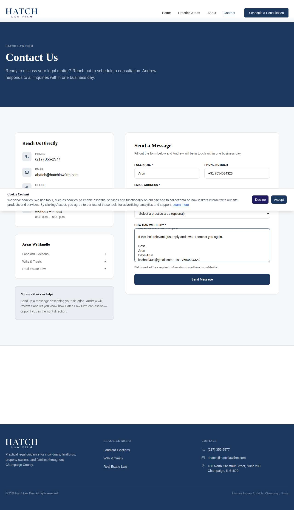

**After submit** — `run-e9eec5c6_attempt-0083e540_post_attempt_2026-11-04T04-26-39-210Z.jpg`

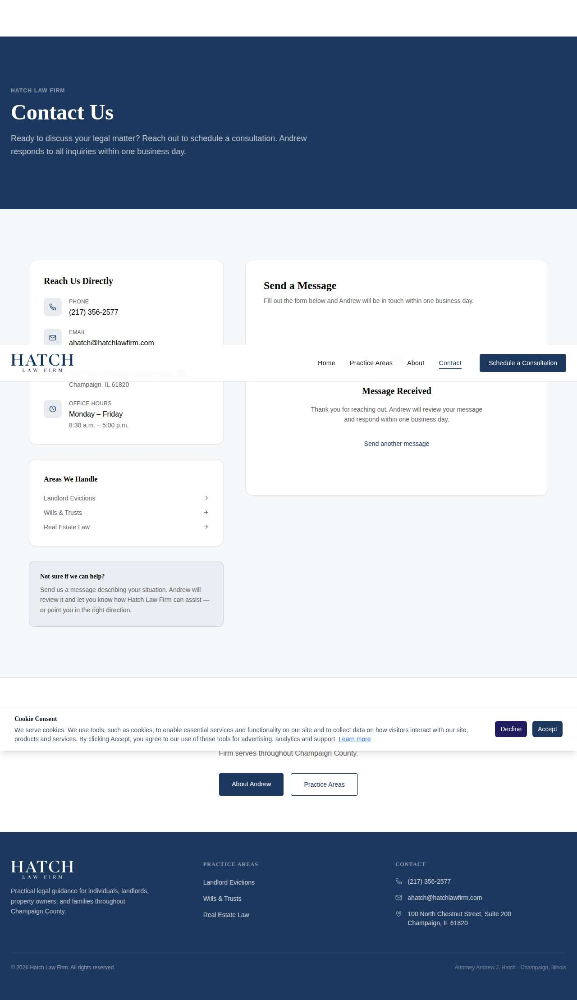

## Events (165)

| Time (UTC) | Event | Website | Details |
|---|---|---|---|
| 04:18:54 | run\_queued | — | live run requested by github:itsDevsArun |
| 04:18:54 | run\_dispatched | — | dispatch disabled (local test mode) |
| 04:18:58 | run\_started | — | Runner claimed live run |
| 04:18:59 | offer\_verified | — | Service page offer facts verified |
| 04:18:59 | website\_selected | clearchoiceplumbingllc.com | Live target clearchoiceplumbingllc.com |
| 04:18:59 | attempt\_reserved | clearchoiceplumbingllc.com | Submission attempt reserved with template standard v2 |
| 04:19:00 | page\_opened | clearchoiceplumbingllc.com | Opened form page |
| 04:19:01 | screenshot\_saved | clearchoiceplumbingllc.com | inspection screenshot saved (145 KB) |
| 04:19:01 | review\_required | clearchoiceplumbingllc.com | failed before submit: locator.fill: Error: Cannot type text into input\[type=number\] |
| 04:19:06 | website\_selected | bwnwincpainting.com | Live target bwnwincpainting.com |
| 04:19:06 | attempt\_reserved | bwnwincpainting.com | Submission attempt reserved with template standard v2 |
| 04:19:08 | page\_opened | bwnwincpainting.com | Opened form page |
| 04:19:08 | screenshot\_saved | bwnwincpainting.com | inspection screenshot saved (132 KB) |
| 04:19:08 | review\_required | bwnwincpainting.com | failed before submit: locator.fill: Error: Cannot type text into input\[type=number\] |
| 04:19:13 | website\_selected | absoluterestorepa.com | Live target absoluterestorepa.com |
| 04:19:13 | attempt\_reserved | absoluterestorepa.com | Submission attempt reserved with template standard v2 |
| 04:19:15 | page\_opened | absoluterestorepa.com | Opened form page |
| 04:19:16 | screenshot\_saved | absoluterestorepa.com | inspection screenshot saved (175 KB) |
| 04:19:16 | review\_required | absoluterestorepa.com | failed before submit: locator.fill: Error: Cannot type text into input\[type=number\] |
| 04:19:21 | website\_selected | masoudlawfirm.com | Live target masoudlawfirm.com |
| 04:19:21 | attempt\_reserved | masoudlawfirm.com | Submission attempt reserved with template standard v2 |
| 04:19:22 | page\_opened | masoudlawfirm.com | Opened form page |
| 04:19:23 | screenshot\_saved | masoudlawfirm.com | inspection screenshot saved (169 KB) |
| 04:19:23 | review\_required | masoudlawfirm.com | failed before submit: locator.fill: Error: Cannot type text into input\[type=number\] |
| 04:19:28 | website\_selected | maltezoslaw.com | Live target maltezoslaw.com |
| 04:19:28 | attempt\_reserved | maltezoslaw.com | Submission attempt reserved with template standard v2 |
| 04:19:29 | page\_opened | maltezoslaw.com | Opened form page |
| 04:19:30 | fields\_filled | maltezoslaw.com | filled |
| 04:19:30 | screenshot\_saved | maltezoslaw.com | filled screenshot saved (96 KB) |
| 04:19:30 | submit\_attempted | maltezoslaw.com | submitting |
| 04:19:58 | screenshot\_saved | maltezoslaw.com | post\_attempt screenshot saved (151 KB) |
| 04:19:58 | review\_required | maltezoslaw.com | unclear: No new success marker observed |
| 04:20:06 | website\_selected | lexingtondefense.com | Live target lexingtondefense.com |
| 04:20:06 | attempt\_reserved | lexingtondefense.com | Submission attempt reserved with template standard v2 |
| 04:20:08 | page\_opened | lexingtondefense.com | Opened form page |
| 04:20:08 | fields\_filled | lexingtondefense.com | filled |
| 04:20:08 | screenshot\_saved | lexingtondefense.com | filled screenshot saved (305 KB) |
| 04:20:08 | submit\_attempted | lexingtondefense.com | submitting |
| 04:20:42 | screenshot\_saved | lexingtondefense.com | post\_attempt screenshot saved (308 KB) |
| 04:20:42 | review\_required | lexingtondefense.com | unclear: No new success marker observed |
| 04:20:50 | website\_selected | wicklaw.com | Live target wicklaw.com |
| 04:20:50 | attempt\_reserved | wicklaw.com | Submission attempt reserved with template standard v2 |
| 04:20:51 | page\_opened | wicklaw.com | Opened form page |
| 04:20:51 | screenshot\_saved | wicklaw.com | filled screenshot saved (122 KB) |
| 04:20:51 | review\_required | wicklaw.com | failed before submit: Form validation would block sending: Privacy-Policy: Please check this box if you want to proceed. |
| 04:20:57 | website\_selected | lawnj.net | Live target lawnj.net |
| 04:20:57 | attempt\_reserved | lawnj.net | Submission attempt reserved with template standard v2 |
| 04:20:58 | page\_opened | lawnj.net | Opened form page |
| 04:20:59 | screenshot\_saved | lawnj.net | filled screenshot saved (205 KB) |
| 04:20:59 | review\_required | lawnj.net | failed before submit: Field "Phone\*" did not accept the value |
| 04:21:04 | website\_selected | robertreeveslaw.com | Live target robertreeveslaw.com |
| 04:21:04 | attempt\_reserved | robertreeveslaw.com | Submission attempt reserved with template standard v2 |
| 04:21:07 | page\_opened | robertreeveslaw.com | Opened form page |
| 04:21:07 | screenshot\_saved | robertreeveslaw.com | filled screenshot saved (184 KB) |
| 04:21:07 | review\_required | robertreeveslaw.com | failed before submit: Field "input\_3" did not accept the value |
| 04:21:12 | website\_selected | mmrvt.com | Live target mmrvt.com |
| 04:21:12 | attempt\_reserved | mmrvt.com | Submission attempt reserved with template standard v2 |
| 04:21:14 | page\_opened | mmrvt.com | Opened form page |
| 04:21:14 | fields\_filled | mmrvt.com | filled |
| 04:21:14 | screenshot\_saved | mmrvt.com | filled screenshot saved (66 KB) |
| 04:21:14 | submit\_attempted | mmrvt.com | submitting |
| 04:21:20 | screenshot\_saved | mmrvt.com | post\_attempt screenshot saved (50 KB) |
| 04:21:20 | confirmation\_observed | mmrvt.com | confirmed — "AR FROM YOU. GET IN TOUCH AND LET’S START THE CONVERSATION. Thanks for contacting us\! We will get in touch with you shor" |
| 04:21:28 | website\_selected | atkinsonlawyers.com | Live target atkinsonlawyers.com |
| 04:21:28 | attempt\_reserved | atkinsonlawyers.com | Submission attempt reserved with template standard v2 |
| 04:21:31 | page\_opened | atkinsonlawyers.com | Opened form page |
| 04:21:31 | fields\_filled | atkinsonlawyers.com | filled |
| 04:21:31 | screenshot\_saved | atkinsonlawyers.com | filled screenshot saved (168 KB) |
| 04:21:31 | submit\_attempted | atkinsonlawyers.com | submitting |
| 04:21:35 | screenshot\_saved | atkinsonlawyers.com | post\_attempt screenshot saved (137 KB) |
| 04:21:35 | confirmation\_observed | atkinsonlawyers.com | confirmed — "RESOURCES CONTACT US Protect. Preserve. Rebuild. LET'S TALK THANK YOU Your inquiry has been sent. LET'S TALK Fill out th" |
| 04:21:43 | website\_selected | barbierilawoffice.com | Live target barbierilawoffice.com |
| 04:21:43 | attempt\_reserved | barbierilawoffice.com | Submission attempt reserved with template standard v2 |
| 04:21:45 | page\_opened | barbierilawoffice.com | Opened form page |
| 04:21:45 | fields\_filled | barbierilawoffice.com | filled |
| 04:21:46 | screenshot\_saved | barbierilawoffice.com | filled screenshot saved (148 KB) |
| 04:21:46 | submit\_attempted | barbierilawoffice.com | submitting |
| 04:21:59 | screenshot\_saved | barbierilawoffice.com | post\_attempt screenshot saved (139 KB) |
| 04:21:59 | error | barbierilawoffice.com | error after submit: Submit click error (outcome unknown, not retried): locator.click: Timeout 10000ms exceeded. |
| 04:22:08 | website\_selected | rutledgelawcenter.com | Live target rutledgelawcenter.com |
| 04:22:08 | attempt\_reserved | rutledgelawcenter.com | Submission attempt reserved with template standard v2 |
| 04:22:11 | page\_opened | rutledgelawcenter.com | Opened form page |
| 04:22:11 | fields\_filled | rutledgelawcenter.com | filled |
| 04:22:12 | screenshot\_saved | rutledgelawcenter.com | filled screenshot saved (120 KB) |
| 04:22:12 | submit\_attempted | rutledgelawcenter.com | submitting |
| 04:22:40 | screenshot\_saved | rutledgelawcenter.com | post\_attempt screenshot saved (102 KB) |
| 04:22:40 | review\_required | rutledgelawcenter.com | unclear: No new success marker observed |
| 04:22:48 | website\_selected | drdale.net | Live target drdale.net |
| 04:22:48 | attempt\_reserved | drdale.net | Submission attempt reserved with template standard v2 |
| 04:22:49 | page\_opened | drdale.net | Opened form page |
| 04:22:49 | fields\_filled | drdale.net | filled |
| 04:22:49 | screenshot\_saved | drdale.net | filled screenshot saved (79 KB) |
| 04:22:49 | submit\_attempted | drdale.net | submitting |
| 04:22:53 | screenshot\_saved | drdale.net | post\_attempt screenshot saved (122 KB) |
| 04:22:53 | confirmation\_observed | drdale.net | confirmed — "CONVERSATION START THE CONVERSATION START THE CONVERSATION Thank you\! Your message has been received. QUICK LINKS info@d" |
| 04:23:01 | website\_selected | leevanhorn.com | Live target leevanhorn.com |
| 04:23:01 | attempt\_reserved | leevanhorn.com | Submission attempt reserved with template standard v2 |
| 04:23:03 | page\_opened | leevanhorn.com | Opened form page |
| 04:23:03 | fields\_filled | leevanhorn.com | filled |
| 04:23:03 | screenshot\_saved | leevanhorn.com | filled screenshot saved (159 KB) |
| 04:23:03 | submit\_attempted | leevanhorn.com | submitting |
| 04:23:31 | screenshot\_saved | leevanhorn.com | post\_attempt screenshot saved (145 KB) |
| 04:23:31 | review\_required | leevanhorn.com | unclear: No new success marker observed |
| 04:23:39 | website\_selected | fishertalwar.com | Live target fishertalwar.com |
| 04:23:39 | attempt\_reserved | fishertalwar.com | Submission attempt reserved with template standard v2 |
| 04:23:43 | page\_opened | fishertalwar.com | Opened form page |
| 04:23:43 | screenshot\_saved | fishertalwar.com | filled screenshot saved (134 KB) |
| 04:23:43 | review\_required | fishertalwar.com | failed before submit: Field "Phone" did not accept the value |
| 04:23:48 | website\_selected | hkwllp.com | Live target hkwllp.com |
| 04:23:48 | attempt\_reserved | hkwllp.com | Submission attempt reserved with template standard v2 |
| 04:23:51 | page\_opened | hkwllp.com | Opened form page |
| 04:23:51 | fields\_filled | hkwllp.com | filled |
| 04:23:51 | screenshot\_saved | hkwllp.com | filled screenshot saved (84 KB) |
| 04:23:51 | submit\_attempted | hkwllp.com | submitting |
| 04:24:04 | screenshot\_saved | hkwllp.com | post\_attempt screenshot saved (84 KB) |
| 04:24:04 | error | hkwllp.com | error after submit: Submit click error (outcome unknown, not retried): locator.click: Timeout 10000ms exceeded. |
| 04:24:12 | website\_selected | hamtinilaw.com | Live target hamtinilaw.com |
| 04:24:12 | attempt\_reserved | hamtinilaw.com | Submission attempt reserved with template standard v2 |
| 04:24:15 | page\_opened | hamtinilaw.com | Opened form page |
| 04:24:15 | fields\_filled | hamtinilaw.com | filled |
| 04:24:15 | screenshot\_saved | hamtinilaw.com | filled screenshot saved (131 KB) |
| 04:24:15 | submit\_attempted | hamtinilaw.com | submitting |
| 04:24:51 | screenshot\_saved | hamtinilaw.com | post\_attempt screenshot saved (107 KB) |
| 04:24:51 | review\_required | hamtinilaw.com | unclear: No new success marker observed |
| 04:24:59 | website\_selected | wolflawcolorado.com | Live target wolflawcolorado.com |
| 04:24:59 | attempt\_reserved | wolflawcolorado.com | Submission attempt reserved with template standard v2 |
| 04:25:00 | page\_opened | wolflawcolorado.com | Opened form page |
| 04:25:00 | fields\_filled | wolflawcolorado.com | filled |
| 04:25:00 | screenshot\_saved | wolflawcolorado.com | filled screenshot saved (136 KB) |
| 04:25:00 | submit\_attempted | wolflawcolorado.com | submitting |
| 04:25:30 | screenshot\_saved | wolflawcolorado.com | post\_attempt screenshot saved (168 KB) |
| 04:25:30 | review\_required | wolflawcolorado.com | unclear: No new success marker observed |
| 04:25:38 | website\_selected | helbert-allemang.com | Live target helbert-allemang.com |
| 04:25:38 | attempt\_reserved | helbert-allemang.com | Submission attempt reserved with template standard v2 |
| 04:25:41 | page\_opened | helbert-allemang.com | Opened form page |
| 04:25:41 | fields\_filled | helbert-allemang.com | filled |
| 04:25:41 | screenshot\_saved | helbert-allemang.com | filled screenshot saved (167 KB) |
| 04:25:41 | submit\_attempted | helbert-allemang.com | submitting |
| 04:25:54 | screenshot\_saved | helbert-allemang.com | post\_attempt screenshot saved (169 KB) |
| 04:25:54 | error | helbert-allemang.com | error after submit: Submit click error (outcome unknown, not retried): locator.click: Timeout 10000ms exceeded. |
| 04:26:02 | website\_selected | injuryclaimnyclaw.com | Live target injuryclaimnyclaw.com |
| 04:26:02 | attempt\_reserved | injuryclaimnyclaw.com | Submission attempt reserved with template standard v2 |
| 04:26:03 | page\_opened | injuryclaimnyclaw.com | Opened form page |
| 04:26:03 | fields\_filled | injuryclaimnyclaw.com | filled |
| 04:26:03 | screenshot\_saved | injuryclaimnyclaw.com | filled screenshot saved (214 KB) |
| 04:26:03 | submit\_attempted | injuryclaimnyclaw.com | submitting |
| 04:26:07 | screenshot\_saved | injuryclaimnyclaw.com | post\_attempt screenshot saved (218 KB) |
| 04:26:07 | confirmation\_observed | injuryclaimnyclaw.com | confirmed — "CT US Contact Us Home Contact Us Get Your Free Consultation Thanks for contacting us\! We will get in touch with you shor" |
| 04:26:15 | website\_selected | kenwilsonlaw.com | Live target kenwilsonlaw.com |
| 04:26:15 | attempt\_reserved | kenwilsonlaw.com | Submission attempt reserved with template standard v2 |
| 04:26:19 | page\_opened | kenwilsonlaw.com | Opened form page |
| 04:26:19 | fields\_filled | kenwilsonlaw.com | filled |
| 04:26:19 | screenshot\_saved | kenwilsonlaw.com | filled screenshot saved (170 KB) |
| 04:26:19 | submit\_attempted | kenwilsonlaw.com | submitting |
| 04:26:25 | screenshot\_saved | kenwilsonlaw.com | post\_attempt screenshot saved (227 KB) |
| 04:26:25 | confirmation\_observed | kenwilsonlaw.com | confirmed — "Name Your Email Court file number or citation Message Send Submission successful CALL US 24/7 Need Representation from E" |
| 04:26:33 | website\_selected | hatchlawfirm.com | Live target hatchlawfirm.com |
| 04:26:33 | attempt\_reserved | hatchlawfirm.com | Submission attempt reserved with template standard v2 |
| 04:26:35 | page\_opened | hatchlawfirm.com | Opened form page |
| 04:26:35 | fields\_filled | hatchlawfirm.com | filled |
| 04:26:35 | screenshot\_saved | hatchlawfirm.com | filled screenshot saved (111 KB) |
| 04:26:35 | submit\_attempted | hatchlawfirm.com | submitting |
| 04:26:39 | screenshot\_saved | hatchlawfirm.com | post\_attempt screenshot saved (101 KB) |
| 04:26:39 | confirmation\_observed | hatchlawfirm.com | confirmed — "below and Andrew will be in touch within one business day. Message Received Thank you for reaching out. Andrew will revi" |
| 04:26:46 | run\_completed | — | Run completed (queue\_exhausted) |
