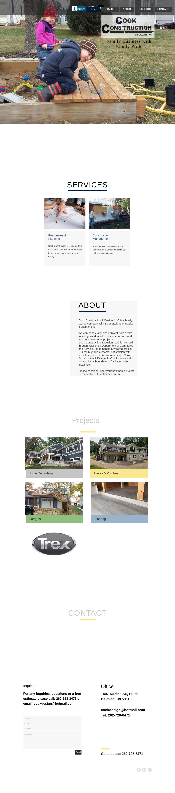
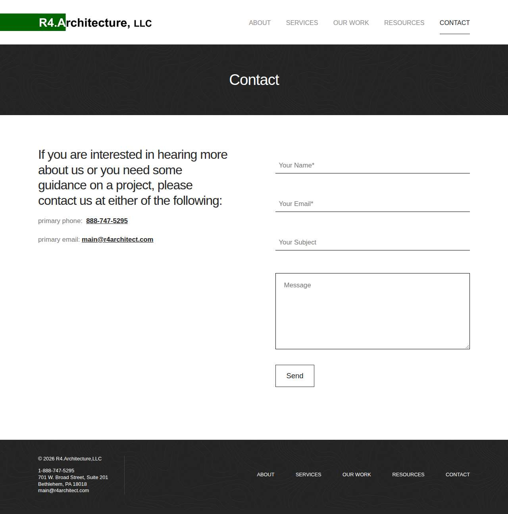
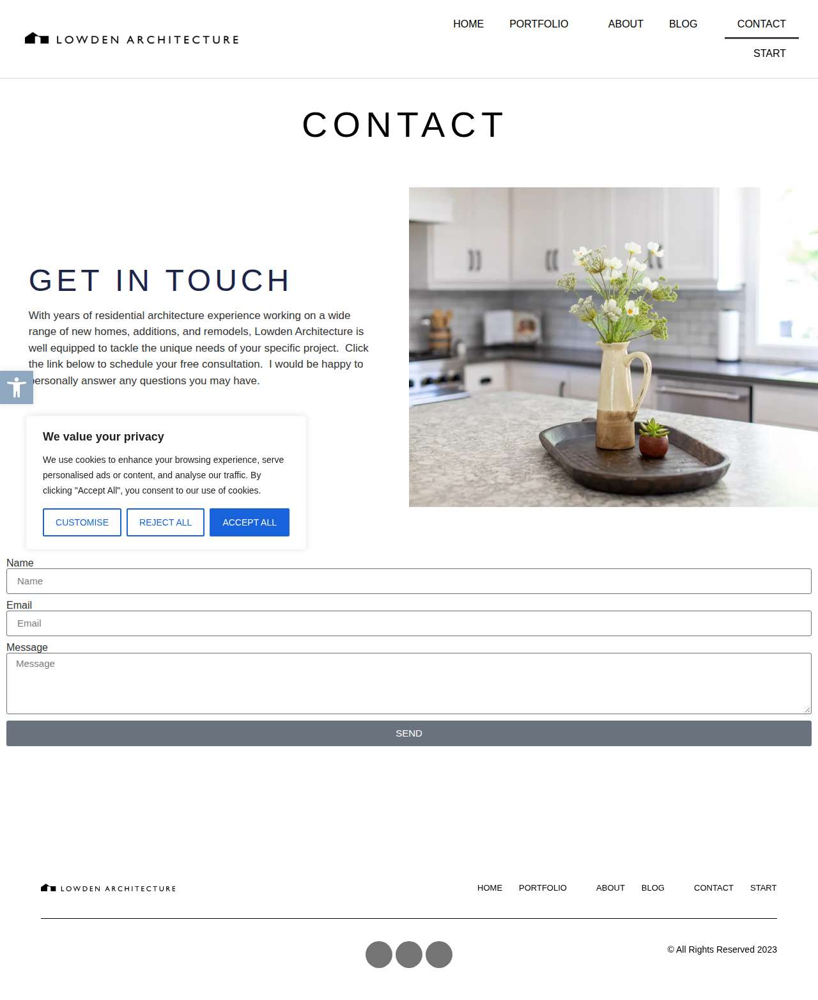
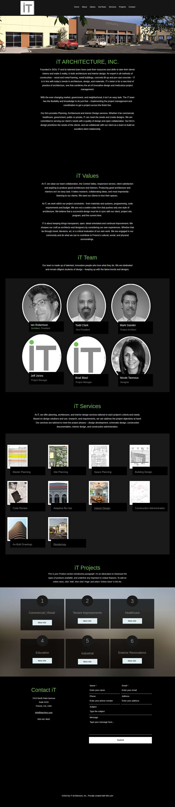
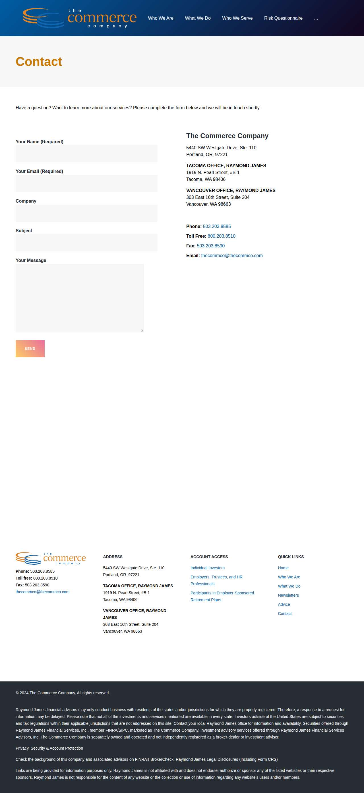
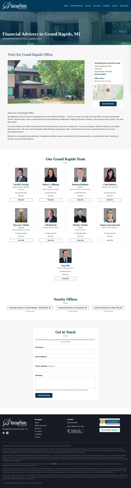
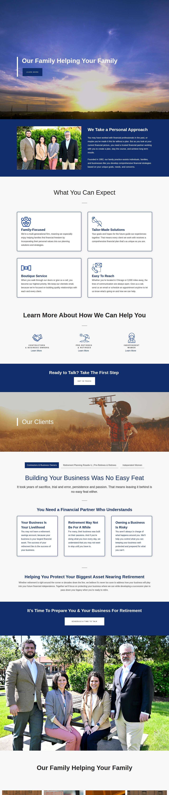
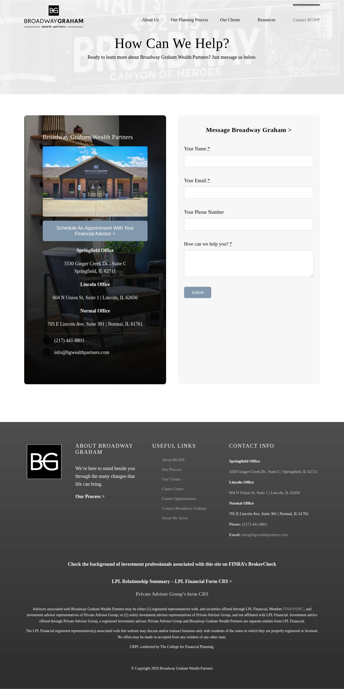
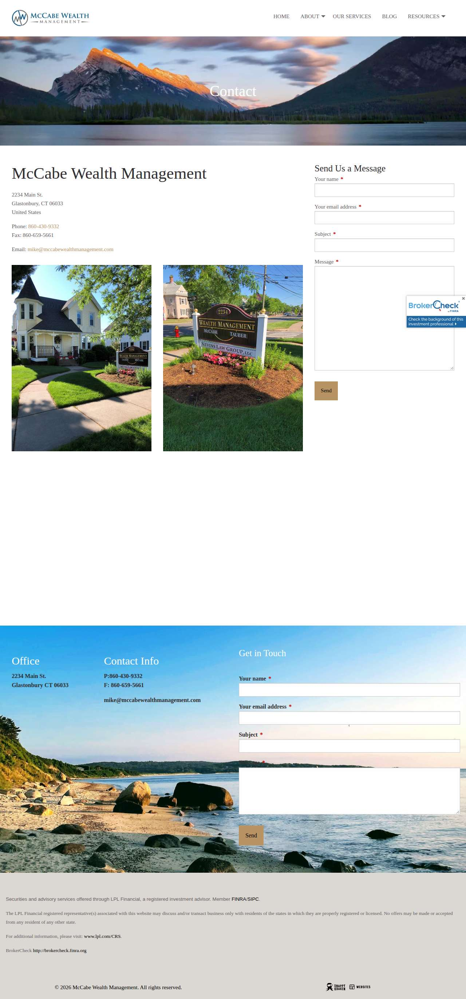

# Run d9f5b7fa — dry\_run — completed

| | |
|---|---|
| Run ID | `d9f5b7fa-c29a-45d7-bbe6-8554f1aff8bf` |
| Requested by | github:itsDevsArun |
| Started | 2026-11-05 05:24:01 UTC |
| Finished | 2026-11-05 05:25:59 UTC |
| Finish reason | queue\_exhausted |
| GitHub Actions | https://github.com/itsDevsArun/aeo-geo/actions/runs/41950876497 |

CSV for this run: [runs/2026-11-05_dry_run_d9f5b7fa.csv](2026-11-05_dry_run_d9f5b7fa.csv)

## Attempts (16)

### helixmechanical.com — dry\_run\_failed (dry run)

| | |
|---|---|
| Attempt ID | `b492bd3a-14db-4ebf-adce-850052b15f8b` |
| Form URL | https://helixmechanical.com/contact/ |
| Final URL | https://helixmechanical.com/contact/ |
| Reserved | 2026-11-05 05:24:01 UTC |
| Submit attempted | — |
| Template | standard v2 |
| Confirmation text | none observed |
| Result / error | Mapped field "First Name \*" not found uniquely |

Exact message:

~~~text
Subject: Helping customers find your business in AI search (AEO + GEO)

Hi there,

I'm Arun from Devs Arun. More and more customers now ask ChatGPT, Gemini, Perplexity or Google's AI Overviews questions like "who should I hire for this in my area?" before they call anyone. These tools answer from websites they can clearly understand, and they tend to recommend businesses whose pages answer real customer questions.

That is what AEO + GEO (Answer Engine and Generative Engine Optimization) is for. I improve your existing service pages so they clearly answer the questions your customers ask, add structured data that matches the page, and make the call, quote or enquiry step obvious. The benefit: your business gets a better chance of being mentioned or linked in AI answers, and visitors who arrive find it easy to contact you.

The AEO + GEO Starter is a one-time $199 (about ₹16,999, negotiable) for one website: a basic audit, 10 customer questions, improvements to two existing pages, relevant structured data and an action plan, with one revision round.

You can read the full details, send an enquiry or book online here:
https://devsarun.io/aeo-geo/

If this isn't relevant, just reply and I won't contact you again.

Best,
Arun
Devs Arun
itschool408@gmail.com · +91 7654534323
~~~

Submitted field values:

- \#forminator-field-name-1\_6ae7ff023fd3c: Arun
- \#forminator-field-email-1\_6ae7ff023fd3c: itschool408@gmail.com
- \#forminator-field-phone-1\_6ae7ff023fd3c: +91 7654534323
- \#forminator-field-textarea-1\_6ae7ff023fd3c: Hi there, I'm Arun from Devs Arun. More and more customers now ask ChatGPT, Gemini, Perplexity or Google's AI Overviews 

**Inspected page** — `run-d9f5b7fa_attempt-b492bd3a_inspection_2026-11-05T05-24-03-519Z.jpg`

### knoxvilleelectrician.com — dry\_run\_failed (dry run)

| | |
|---|---|
| Attempt ID | `60f14a55-d5cb-4069-a4d4-c467fd73b044` |
| Form URL | https://knoxvilleelectrician.com/contact-us/ |
| Final URL | https://knoxvilleelectrician.com/contact-us/ |
| Reserved | 2026-11-05 05:24:08 UTC |
| Submit attempted | — |
| Template | standard v2 |
| Confirmation text | none observed |
| Result / error | Mapped field "Name" not found uniquely |

Exact message:

~~~text
Subject: Helping customers find your business in AI search (AEO + GEO)

Hi there,

I'm Arun from Devs Arun. More and more customers now ask ChatGPT, Gemini, Perplexity or Google's AI Overviews questions like "who should I hire for this in my area?" before they call anyone. These tools answer from websites they can clearly understand, and they tend to recommend businesses whose pages answer real customer questions.

That is what AEO + GEO (Answer Engine and Generative Engine Optimization) is for. I improve your existing service pages so they clearly answer the questions your customers ask, add structured data that matches the page, and make the call, quote or enquiry step obvious. The benefit: your business gets a better chance of being mentioned or linked in AI answers, and visitors who arrive find it easy to contact you.

The AEO + GEO Starter is a one-time $199 (about ₹16,999, negotiable) for one website: a basic audit, 10 customer questions, improvements to two existing pages, relevant structured data and an action plan, with one revision round.

You can read the full details, send an enquiry or book online here:
https://devsarun.io/aeo-geo/

If this isn't relevant, just reply and I won't contact you again.

Best,
Arun
Devs Arun
itschool408@gmail.com · +91 7654534323
~~~

Submitted field values:

- \#form-field-1b7221: itschool408@gmail.com
- \#form-field-2fa3ac: +91 7654534323
- \#form-field-96f51f: Arun
- \#form-field-fed9d8: Hi there, I'm Arun from Devs Arun. More and more customers now ask ChatGPT, Gemini, Perplexity or Google's AI Overviews 

**Inspected page** — `run-d9f5b7fa_attempt-60f14a55_inspection_2026-11-05T05-24-12-373Z.jpg`

### mspc.cpa — dry\_run\_failed (dry run)

| | |
|---|---|
| Attempt ID | `6a214cd1-23ad-45fb-97f4-3fe25e4b1c28` |
| Form URL | https://www.mspc.cpa/contact/ |
| Final URL | https://www.mspc.cpa/contact/ |
| Reserved | 2026-11-05 05:24:17 UTC |
| Submit attempted | — |
| Template | standard v2 |
| Confirmation text | none observed |
| Result / error | Mapped field "Full Name \*" not found uniquely |

Exact message:

~~~text
Subject: Helping customers find your business in AI search (AEO + GEO)

Hi there,

I'm Arun from Devs Arun. More and more customers now ask ChatGPT, Gemini, Perplexity or Google's AI Overviews questions like "who should I hire for this in my area?" before they call anyone. These tools answer from websites they can clearly understand, and they tend to recommend businesses whose pages answer real customer questions.

That is what AEO + GEO (Answer Engine and Generative Engine Optimization) is for. I improve your existing service pages so they clearly answer the questions your customers ask, add structured data that matches the page, and make the call, quote or enquiry step obvious. The benefit: your business gets a better chance of being mentioned or linked in AI answers, and visitors who arrive find it easy to contact you.

The AEO + GEO Starter is a one-time $199 (about ₹16,999, negotiable) for one website: a basic audit, 10 customer questions, improvements to two existing pages, relevant structured data and an action plan, with one revision round.

You can read the full details, send an enquiry or book online here:
https://devsarun.io/aeo-geo/

If this isn't relevant, just reply and I won't contact you again.

Best,
Arun
Devs Arun
itschool408@gmail.com · +91 7654534323
~~~

Submitted field values:

- \#forminator-field-name-1\_6aeaca2579f24: Arun
- \#forminator-field-text-1\_6aeaca2579f24: Devs Arun
- \#forminator-field-email-1\_6aeaca2579f24: itschool408@gmail.com
- \#forminator-field-phone-1\_6aeaca2579f24: +91 7654534323
- \#forminator-field-textarea-1\_6aeaca2579f24: Hi there, I'm Arun from Devs Arun. More and more customers now ask ChatGPT, Gemini, Perplexity or Google's AI Overviews 

**Inspected page** — `run-d9f5b7fa_attempt-6a214cd1_inspection_2026-11-05T05-24-20-870Z.jpg`

### cookconstructionwi.com — dry\_run\_ok (dry run)

| | |
|---|---|
| Attempt ID | `e5ffbcda-e623-4f51-ad00-7c8a70f8bb3e` |
| Form URL | https://www.cookconstructionwi.com/ |
| Final URL | https://www.cookconstructionwi.com/ |
| Reserved | 2026-11-05 05:24:25 UTC |
| Submit attempted | — |
| Template | standard v2 |
| Confirmation text | none observed |
| Result / error | Selectors verified; fields not typed (domain not in dry-run fill list); not submitted |

Exact message:

~~~text
Subject: Helping customers find your business in AI search (AEO + GEO)

Hi there,

I'm Arun from Devs Arun. More and more customers now ask ChatGPT, Gemini, Perplexity or Google's AI Overviews questions like "who should I hire for this in my area?" before they call anyone. These tools answer from websites they can clearly understand, and they tend to recommend businesses whose pages answer real customer questions.

That is what AEO + GEO (Answer Engine and Generative Engine Optimization) is for. I improve your existing service pages so they clearly answer the questions your customers ask, add structured data that matches the page, and make the call, quote or enquiry step obvious. The benefit: your business gets a better chance of being mentioned or linked in AI answers, and visitors who arrive find it easy to contact you.

The AEO + GEO Starter is a one-time $199 (about ₹16,999, negotiable) for one website: a basic audit, 10 customer questions, improvements to two existing pages, relevant structured data and an action plan, with one revision round.

You can read the full details, send an enquiry or book online here:
https://devsarun.io/aeo-geo/

If this isn't relevant, just reply and I won't contact you again.

Best,
Arun
Devs Arun
itschool408@gmail.com · +91 7654534323
~~~

Submitted field values:

- \#input\_comp-kf50wmzq: Arun
- \#input\_comp-kf50wn04: itschool408@gmail.com
- \#input\_comp-kf50wn0b: Helping customers find your business in AI search (AEO + GEO)
- \#textarea\_comp-kf50wn0i: Hi there, I'm Arun from Devs Arun. More and more customers now ask ChatGPT, Gemini, Perplexity or Google's AI Overviews 

**Inspected page** — `run-d9f5b7fa_attempt-e5ffbcda_inspection_2026-11-05T05-24-28-000Z.jpg`

### r4architect.com — dry\_run\_ok (dry run)

| | |
|---|---|
| Attempt ID | `4715195d-f78f-4317-976a-f0b71e9a3e70` |
| Form URL | http://r4architect.com/contact/ |
| Final URL | http://r4architect.com/contact/ |
| Reserved | 2026-11-05 05:24:33 UTC |
| Submit attempted | — |
| Template | standard v2 |
| Confirmation text | none observed |
| Result / error | Selectors verified; fields not typed (domain not in dry-run fill list); not submitted |

Exact message:

~~~text
Subject: Helping customers find your business in AI search (AEO + GEO)

Hi there,

I'm Arun from Devs Arun. More and more customers now ask ChatGPT, Gemini, Perplexity or Google's AI Overviews questions like "who should I hire for this in my area?" before they call anyone. These tools answer from websites they can clearly understand, and they tend to recommend businesses whose pages answer real customer questions.

That is what AEO + GEO (Answer Engine and Generative Engine Optimization) is for. I improve your existing service pages so they clearly answer the questions your customers ask, add structured data that matches the page, and make the call, quote or enquiry step obvious. The benefit: your business gets a better chance of being mentioned or linked in AI answers, and visitors who arrive find it easy to contact you.

The AEO + GEO Starter is a one-time $199 (about ₹16,999, negotiable) for one website: a basic audit, 10 customer questions, improvements to two existing pages, relevant structured data and an action plan, with one revision round.

You can read the full details, send an enquiry or book online here:
https://devsarun.io/aeo-geo/

If this isn't relevant, just reply and I won't contact you again.

Best,
Arun
Devs Arun
itschool408@gmail.com · +91 7654534323
~~~

Submitted field values:

- input\[name="your-name"\]: Arun
- input\[name="your-email"\]: itschool408@gmail.com
- input\[name="your-subject"\]: Helping customers find your business in AI search (AEO + GEO)
- textarea\[name="your-message"\]: Hi there, I'm Arun from Devs Arun. More and more customers now ask ChatGPT, Gemini, Perplexity or Google's AI Overviews 

**Inspected page** — `run-d9f5b7fa_attempt-4715195d_inspection_2026-11-05T05-24-34-270Z.jpg`

### budddesignllc.com — dry\_run\_ok (dry run)

| | |
|---|---|
| Attempt ID | `a1d55502-7cb6-462f-86a7-061a0c9e2515` |
| Form URL | https://www.budddesignllc.com/ |
| Final URL | https://www.budddesignllc.com/ |
| Reserved | 2026-11-05 05:24:39 UTC |
| Submit attempted | — |
| Template | standard v2 |
| Confirmation text | none observed |
| Result / error | Selectors verified; fields not typed (domain not in dry-run fill list); not submitted |

Exact message:

~~~text
Subject: Helping customers find your business in AI search (AEO + GEO)

Hi there,

I'm Arun from Devs Arun. More and more customers now ask ChatGPT, Gemini, Perplexity or Google's AI Overviews questions like "who should I hire for this in my area?" before they call anyone. These tools answer from websites they can clearly understand, and they tend to recommend businesses whose pages answer real customer questions.

That is what AEO + GEO (Answer Engine and Generative Engine Optimization) is for. I improve your existing service pages so they clearly answer the questions your customers ask, add structured data that matches the page, and make the call, quote or enquiry step obvious. The benefit: your business gets a better chance of being mentioned or linked in AI answers, and visitors who arrive find it easy to contact you.

The AEO + GEO Starter is a one-time $199 (about ₹16,999, negotiable) for one website: a basic audit, 10 customer questions, improvements to two existing pages, relevant structured data and an action plan, with one revision round.

You can read the full details, send an enquiry or book online here:
https://devsarun.io/aeo-geo/

If this isn't relevant, just reply and I won't contact you again.

Best,
Arun
Devs Arun
itschool408@gmail.com · +91 7654534323
~~~

Submitted field values:

- \#input\_comp-m2sqx9iv: itschool408@gmail.com
- \#input\_comp-m2sqx9ih3: Arun
- \#textarea\_comp-m2sqx9ix2: Hi there, I'm Arun from Devs Arun. More and more customers now ask ChatGPT, Gemini, Perplexity or Google's AI Overviews 

**Inspected page** — `run-d9f5b7fa_attempt-a1d55502_inspection_2026-11-05T05-24-42-748Z.jpg`

### ywrising.com — dry\_run\_ok (dry run)

| | |
|---|---|
| Attempt ID | `bdc9eb11-92f4-4b39-9a55-c8740c82a68d` |
| Form URL | https://www.ywrising.com/contact |
| Final URL | https://www.ywrising.com/contact |
| Reserved | 2026-11-05 05:24:47 UTC |
| Submit attempted | — |
| Template | standard v2 |
| Confirmation text | none observed |
| Result / error | Selectors verified; fields not typed (domain not in dry-run fill list); not submitted |

Exact message:

~~~text
Subject: Helping customers find your business in AI search (AEO + GEO)

Hi there,

I'm Arun from Devs Arun. More and more customers now ask ChatGPT, Gemini, Perplexity or Google's AI Overviews questions like "who should I hire for this in my area?" before they call anyone. These tools answer from websites they can clearly understand, and they tend to recommend businesses whose pages answer real customer questions.

That is what AEO + GEO (Answer Engine and Generative Engine Optimization) is for. I improve your existing service pages so they clearly answer the questions your customers ask, add structured data that matches the page, and make the call, quote or enquiry step obvious. The benefit: your business gets a better chance of being mentioned or linked in AI answers, and visitors who arrive find it easy to contact you.

The AEO + GEO Starter is a one-time $199 (about ₹16,999, negotiable) for one website: a basic audit, 10 customer questions, improvements to two existing pages, relevant structured data and an action plan, with one revision round.

You can read the full details, send an enquiry or book online here:
https://devsarun.io/aeo-geo/

If this isn't relevant, just reply and I won't contact you again.

Best,
Arun
Devs Arun
itschool408@gmail.com · +91 7654534323
~~~

Submitted field values:

- \#input\_comp-l0bbys8b: Arun
- \#input\_comp-l0bbys8p: itschool408@gmail.com
- \#input\_comp-l0bbys8v: Helping customers find your business in AI search (AEO + GEO)
- \#textarea\_comp-l0bbys8z: Hi there, I'm Arun from Devs Arun. More and more customers now ask ChatGPT, Gemini, Perplexity or Google's AI Overviews 

**Inspected page** — `run-d9f5b7fa_attempt-bdc9eb11_inspection_2026-11-05T05-24-49-869Z.jpg`

### myvintagehomes.com — dry\_run\_ok (dry run)

| | |
|---|---|
| Attempt ID | `328abb43-4a48-4cd7-af60-fbf7e4479c0b` |
| Form URL | https://www.myvintagehomes.com/contact |
| Final URL | https://www.myvintagehomes.com/contact |
| Reserved | 2026-11-05 05:24:54 UTC |
| Submit attempted | — |
| Template | standard v2 |
| Confirmation text | none observed |
| Result / error | Selectors verified; fields not typed (domain not in dry-run fill list); not submitted |

Exact message:

~~~text
Subject: Helping customers find your business in AI search (AEO + GEO)

Hi there,

I'm Arun from Devs Arun. More and more customers now ask ChatGPT, Gemini, Perplexity or Google's AI Overviews questions like "who should I hire for this in my area?" before they call anyone. These tools answer from websites they can clearly understand, and they tend to recommend businesses whose pages answer real customer questions.

That is what AEO + GEO (Answer Engine and Generative Engine Optimization) is for. I improve your existing service pages so they clearly answer the questions your customers ask, add structured data that matches the page, and make the call, quote or enquiry step obvious. The benefit: your business gets a better chance of being mentioned or linked in AI answers, and visitors who arrive find it easy to contact you.

The AEO + GEO Starter is a one-time $199 (about ₹16,999, negotiable) for one website: a basic audit, 10 customer questions, improvements to two existing pages, relevant structured data and an action plan, with one revision round.

You can read the full details, send an enquiry or book online here:
https://devsarun.io/aeo-geo/

If this isn't relevant, just reply and I won't contact you again.

Best,
Arun
Devs Arun
itschool408@gmail.com · +91 7654534323
~~~

Submitted field values:

- \#input\_comp-kieniuzd: Arun
- \#input\_comp-kieniuzp: itschool408@gmail.com
- \#input\_comp-kieniuzs: +91 7654534323
- \#textarea\_comp-kieniuzw: Hi there, I'm Arun from Devs Arun. More and more customers now ask ChatGPT, Gemini, Perplexity or Google's AI Overviews 

**Inspected page** — `run-d9f5b7fa_attempt-328abb43_inspection_2026-11-05T05-24-56-870Z.jpg`

### lowdenarchitecture.com — dry\_run\_ok (dry run)

| | |
|---|---|
| Attempt ID | `10aba9ac-12d1-439b-a7e3-1b76347f582c` |
| Form URL | https://lowdenarchitecture.com/contact/ |
| Final URL | https://lowdenarchitecture.com/contact/ |
| Reserved | 2026-11-05 05:25:02 UTC |
| Submit attempted | — |
| Template | standard v2 |
| Confirmation text | none observed |
| Result / error | Selectors verified; fields not typed (domain not in dry-run fill list); not submitted |

Exact message:

~~~text
Subject: Helping customers find your business in AI search (AEO + GEO)

Hi there,

I'm Arun from Devs Arun. More and more customers now ask ChatGPT, Gemini, Perplexity or Google's AI Overviews questions like "who should I hire for this in my area?" before they call anyone. These tools answer from websites they can clearly understand, and they tend to recommend businesses whose pages answer real customer questions.

That is what AEO + GEO (Answer Engine and Generative Engine Optimization) is for. I improve your existing service pages so they clearly answer the questions your customers ask, add structured data that matches the page, and make the call, quote or enquiry step obvious. The benefit: your business gets a better chance of being mentioned or linked in AI answers, and visitors who arrive find it easy to contact you.

The AEO + GEO Starter is a one-time $199 (about ₹16,999, negotiable) for one website: a basic audit, 10 customer questions, improvements to two existing pages, relevant structured data and an action plan, with one revision round.

You can read the full details, send an enquiry or book online here:
https://devsarun.io/aeo-geo/

If this isn't relevant, just reply and I won't contact you again.

Best,
Arun
Devs Arun
itschool408@gmail.com · +91 7654534323
~~~

Submitted field values:

- \#form-field-name: Arun
- \#form-field-email: itschool408@gmail.com
- \#form-field-message: Hi there, I'm Arun from Devs Arun. More and more customers now ask ChatGPT, Gemini, Perplexity or Google's AI Overviews 

**Inspected page** — `run-d9f5b7fa_attempt-10aba9ac_inspection_2026-11-05T05-25-04-323Z.jpg`

### itarchinc.com — dry\_run\_ok (dry run)

| | |
|---|---|
| Attempt ID | `d2476962-0cdd-4e19-9fa7-52d36df11aaa` |
| Form URL | https://www.itarchinc.com/ |
| Final URL | https://www.itarchinc.com/ |
| Reserved | 2026-11-05 05:25:09 UTC |
| Submit attempted | — |
| Template | standard v2 |
| Confirmation text | none observed |
| Result / error | Selectors verified; fields not typed (domain not in dry-run fill list); not submitted |

Exact message:

~~~text
Subject: Helping customers find your business in AI search (AEO + GEO)

Hi there,

I'm Arun from Devs Arun. More and more customers now ask ChatGPT, Gemini, Perplexity or Google's AI Overviews questions like "who should I hire for this in my area?" before they call anyone. These tools answer from websites they can clearly understand, and they tend to recommend businesses whose pages answer real customer questions.

That is what AEO + GEO (Answer Engine and Generative Engine Optimization) is for. I improve your existing service pages so they clearly answer the questions your customers ask, add structured data that matches the page, and make the call, quote or enquiry step obvious. The benefit: your business gets a better chance of being mentioned or linked in AI answers, and visitors who arrive find it easy to contact you.

The AEO + GEO Starter is a one-time $199 (about ₹16,999, negotiable) for one website: a basic audit, 10 customer questions, improvements to two existing pages, relevant structured data and an action plan, with one revision round.

You can read the full details, send an enquiry or book online here:
https://devsarun.io/aeo-geo/

If this isn't relevant, just reply and I won't contact you again.

Best,
Arun
Devs Arun
itschool408@gmail.com · +91 7654534323
~~~

Submitted field values:

- \#input\_comp-ll1jw087: Arun
- \#input\_comp-ll1jw08c4: itschool408@gmail.com
- \#input\_comp-ll1jw08e1: +91 7654534323
- \#input\_comp-ll1jw08g4: Helping customers find your business in AI search (AEO + GEO)
- \#textarea\_comp-ll1jw08h4: Hi there, I'm Arun from Devs Arun. More and more customers now ask ChatGPT, Gemini, Perplexity or Google's AI Overviews 

**Inspected page** — `run-d9f5b7fa_attempt-d2476962_inspection_2026-11-05T05-25-12-162Z.jpg`

### thecommco.com — dry\_run\_ok (dry run)

| | |
|---|---|
| Attempt ID | `1bd9fe19-279f-4fde-b6ca-69a8c44814c8` |
| Form URL | https://thecommco.com/contact/ |
| Final URL | https://thecommco.com/contact/ |
| Reserved | 2026-11-05 05:25:17 UTC |
| Submit attempted | — |
| Template | standard v2 |
| Confirmation text | none observed |
| Result / error | Selectors verified; fields not typed (domain not in dry-run fill list); not submitted |

Exact message:

~~~text
Subject: Helping customers find your business in AI search (AEO + GEO)

Hi there,

I'm Arun from Devs Arun. More and more customers now ask ChatGPT, Gemini, Perplexity or Google's AI Overviews questions like "who should I hire for this in my area?" before they call anyone. These tools answer from websites they can clearly understand, and they tend to recommend businesses whose pages answer real customer questions.

That is what AEO + GEO (Answer Engine and Generative Engine Optimization) is for. I improve your existing service pages so they clearly answer the questions your customers ask, add structured data that matches the page, and make the call, quote or enquiry step obvious. The benefit: your business gets a better chance of being mentioned or linked in AI answers, and visitors who arrive find it easy to contact you.

The AEO + GEO Starter is a one-time $199 (about ₹16,999, negotiable) for one website: a basic audit, 10 customer questions, improvements to two existing pages, relevant structured data and an action plan, with one revision round.

You can read the full details, send an enquiry or book online here:
https://devsarun.io/aeo-geo/

If this isn't relevant, just reply and I won't contact you again.

Best,
Arun
Devs Arun
itschool408@gmail.com · +91 7654534323
~~~

Submitted field values:

- input\[name="your-name"\]: Arun
- input\[name="your-email"\]: itschool408@gmail.com
- input\[name="your-company"\]: Devs Arun
- input\[name="your-subject"\]: Helping customers find your business in AI search (AEO + GEO)
- textarea\[name="your-message"\]: Hi there, I'm Arun from Devs Arun. More and more customers now ask ChatGPT, Gemini, Perplexity or Google's AI Overviews 

**Inspected page** — `run-d9f5b7fa_attempt-1bd9fe19_inspection_2026-11-05T05-25-18-826Z.jpg`

### vpfgroup.com — dry\_run\_ok (dry run)

| | |
|---|---|
| Attempt ID | `f864c8dd-e41e-4368-a3a8-d40406787c45` |
| Form URL | https://www.vpfgroup.com/grand-rapids/ |
| Final URL | https://www.vpfgroup.com/grand-rapids/ |
| Reserved | 2026-11-05 05:25:23 UTC |
| Submit attempted | — |
| Template | standard v2 |
| Confirmation text | none observed |
| Result / error | Selectors verified; fields not typed (domain not in dry-run fill list); not submitted |

Exact message:

~~~text
Subject: Helping customers find your business in AI search (AEO + GEO)

Hi there,

I'm Arun from Devs Arun. More and more customers now ask ChatGPT, Gemini, Perplexity or Google's AI Overviews questions like "who should I hire for this in my area?" before they call anyone. These tools answer from websites they can clearly understand, and they tend to recommend businesses whose pages answer real customer questions.

That is what AEO + GEO (Answer Engine and Generative Engine Optimization) is for. I improve your existing service pages so they clearly answer the questions your customers ask, add structured data that matches the page, and make the call, quote or enquiry step obvious. The benefit: your business gets a better chance of being mentioned or linked in AI answers, and visitors who arrive find it easy to contact you.

The AEO + GEO Starter is a one-time $199 (about ₹16,999, negotiable) for one website: a basic audit, 10 customer questions, improvements to two existing pages, relevant structured data and an action plan, with one revision round.

You can read the full details, send an enquiry or book online here:
https://devsarun.io/aeo-geo/

If this isn't relevant, just reply and I won't contact you again.

Best,
Arun
Devs Arun
itschool408@gmail.com · +91 7654534323
~~~

Submitted field values:

- \#name-grand-rapids: Arun
- \#email-grand-rapids: itschool408@gmail.com
- \#phone-grand-rapids: +91 7654534323
- \#message-grand-rapids: Hi there, I'm Arun from Devs Arun. More and more customers now ask ChatGPT, Gemini, Perplexity or Google's AI Overviews 

**Inspected page** — `run-d9f5b7fa_attempt-f864c8dd_inspection_2026-11-05T05-25-25-614Z.jpg`

### camargoltd.com — dry\_run\_ok (dry run)

| | |
|---|---|
| Attempt ID | `a3fd2619-1297-45d1-8b47-267c6c256161` |
| Form URL | http://camargoltd.com/contact-us/ |
| Final URL | http://camargoltd.com/contact-us/ |
| Reserved | 2026-11-05 05:25:30 UTC |
| Submit attempted | — |
| Template | standard v2 |
| Confirmation text | none observed |
| Result / error | Selectors verified; fields not typed (domain not in dry-run fill list); not submitted |

Exact message:

~~~text
Subject: Helping customers find your business in AI search (AEO + GEO)

Hi there,

I'm Arun from Devs Arun. More and more customers now ask ChatGPT, Gemini, Perplexity or Google's AI Overviews questions like "who should I hire for this in my area?" before they call anyone. These tools answer from websites they can clearly understand, and they tend to recommend businesses whose pages answer real customer questions.

That is what AEO + GEO (Answer Engine and Generative Engine Optimization) is for. I improve your existing service pages so they clearly answer the questions your customers ask, add structured data that matches the page, and make the call, quote or enquiry step obvious. The benefit: your business gets a better chance of being mentioned or linked in AI answers, and visitors who arrive find it easy to contact you.

The AEO + GEO Starter is a one-time $199 (about ₹16,999, negotiable) for one website: a basic audit, 10 customer questions, improvements to two existing pages, relevant structured data and an action plan, with one revision round.

You can read the full details, send an enquiry or book online here:
https://devsarun.io/aeo-geo/

If this isn't relevant, just reply and I won't contact you again.

Best,
Arun
Devs Arun
itschool408@gmail.com · +91 7654534323
~~~

Submitted field values:

- input\[name="tel-613"\]: +91 7654534323
- input\[name="your-name"\]: Arun
- input\[name="your-email"\]: itschool408@gmail.com
- input\[name="your-subject"\]: Helping customers find your business in AI search (AEO + GEO)
- textarea\[name="your-message"\]: Hi there, I'm Arun from Devs Arun. More and more customers now ask ChatGPT, Gemini, Perplexity or Google's AI Overviews 

**Inspected page** — `run-d9f5b7fa_attempt-a3fd2619_inspection_2026-11-05T05-25-32-464Z.jpg`

### jpcannata.com — dry\_run\_ok (dry run)

| | |
|---|---|
| Attempt ID | `fd7e63b3-4a01-4a83-a216-a7285457e60c` |
| Form URL | https://cannataandcompany.com/contact-us |
| Final URL | https://cannataandcompany.com/contact-us |
| Reserved | 2026-11-05 05:25:37 UTC |
| Submit attempted | — |
| Template | standard v2 |
| Confirmation text | none observed |
| Result / error | Selectors verified; fields not typed (domain not in dry-run fill list); not submitted |

Exact message:

~~~text
Subject: Helping customers find your business in AI search (AEO + GEO)

Hi there,

I'm Arun from Devs Arun. More and more customers now ask ChatGPT, Gemini, Perplexity or Google's AI Overviews questions like "who should I hire for this in my area?" before they call anyone. These tools answer from websites they can clearly understand, and they tend to recommend businesses whose pages answer real customer questions.

That is what AEO + GEO (Answer Engine and Generative Engine Optimization) is for. I improve your existing service pages so they clearly answer the questions your customers ask, add structured data that matches the page, and make the call, quote or enquiry step obvious. The benefit: your business gets a better chance of being mentioned or linked in AI answers, and visitors who arrive find it easy to contact you.

The AEO + GEO Starter is a one-time $199 (about ₹16,999, negotiable) for one website: a basic audit, 10 customer questions, improvements to two existing pages, relevant structured data and an action plan, with one revision round.

You can read the full details, send an enquiry or book online here:
https://devsarun.io/aeo-geo/

If this isn't relevant, just reply and I won't contact you again.

Best,
Arun
Devs Arun
itschool408@gmail.com · +91 7654534323
~~~

Submitted field values:

- input\[name="contact\[name\]"\]: Arun
- input\[name="contact\[phone\]"\]: +91 7654534323
- textarea\[name="contact\[message\]"\]: Hi there, I'm Arun from Devs Arun. More and more customers now ask ChatGPT, Gemini, Perplexity or Google's AI Overviews 
- \#section-contact-us \> div:nth-of-type(2) \> div \> div \> div \> div:nth-of-type(1) \> form \> div \> div:nth-of-type(2) \> input: itschool408@gmail.com

**Inspected page** — `run-d9f5b7fa_attempt-fd7e63b3_inspection_2026-11-05T05-25-40-373Z.jpg`

### bgwealthpartners.com — dry\_run\_ok (dry run)

| | |
|---|---|
| Attempt ID | `3f365e24-45d8-4244-a0f6-00ab9bd2b608` |
| Form URL | https://bgwealthpartners.com/contact/ |
| Final URL | https://bgwealthpartners.com/contact/ |
| Reserved | 2026-11-05 05:25:45 UTC |
| Submit attempted | — |
| Template | standard v2 |
| Confirmation text | none observed |
| Result / error | Selectors verified; fields not typed (domain not in dry-run fill list); not submitted |

Exact message:

~~~text
Subject: Helping customers find your business in AI search (AEO + GEO)

Hi there,

I'm Arun from Devs Arun. More and more customers now ask ChatGPT, Gemini, Perplexity or Google's AI Overviews questions like "who should I hire for this in my area?" before they call anyone. These tools answer from websites they can clearly understand, and they tend to recommend businesses whose pages answer real customer questions.

That is what AEO + GEO (Answer Engine and Generative Engine Optimization) is for. I improve your existing service pages so they clearly answer the questions your customers ask, add structured data that matches the page, and make the call, quote or enquiry step obvious. The benefit: your business gets a better chance of being mentioned or linked in AI answers, and visitors who arrive find it easy to contact you.

The AEO + GEO Starter is a one-time $199 (about ₹16,999, negotiable) for one website: a basic audit, 10 customer questions, improvements to two existing pages, relevant structured data and an action plan, with one revision round.

You can read the full details, send an enquiry or book online here:
https://devsarun.io/aeo-geo/

If this isn't relevant, just reply and I won't contact you again.

Best,
Arun
Devs Arun
itschool408@gmail.com · +91 7654534323
~~~

Submitted field values:

- \#name: Arun
- \#phone: +91 7654534323
- \#message: Hi there, I'm Arun from Devs Arun. More and more customers now ask ChatGPT, Gemini, Perplexity or Google's AI Overviews 
- \#email\_address: itschool408@gmail.com

**Inspected page** — `run-d9f5b7fa_attempt-3f365e24_inspection_2026-11-05T05-25-47-017Z.jpg`

### mccabewealthmanagement.com — dry\_run\_ok (dry run)

| | |
|---|---|
| Attempt ID | `07215088-cddc-4584-ab3f-c909d2b630d6` |
| Form URL | https://www.mccabewealthmanagement.com/contact |
| Final URL | https://www.mccabewealthmanagement.com/contact |
| Reserved | 2026-11-05 05:25:52 UTC |
| Submit attempted | — |
| Template | standard v2 |
| Confirmation text | none observed |
| Result / error | Selectors verified; fields not typed (domain not in dry-run fill list); not submitted |

Exact message:

~~~text
Subject: Helping customers find your business in AI search (AEO + GEO)

Hi there,

I'm Arun from Devs Arun. More and more customers now ask ChatGPT, Gemini, Perplexity or Google's AI Overviews questions like "who should I hire for this in my area?" before they call anyone. These tools answer from websites they can clearly understand, and they tend to recommend businesses whose pages answer real customer questions.

That is what AEO + GEO (Answer Engine and Generative Engine Optimization) is for. I improve your existing service pages so they clearly answer the questions your customers ask, add structured data that matches the page, and make the call, quote or enquiry step obvious. The benefit: your business gets a better chance of being mentioned or linked in AI answers, and visitors who arrive find it easy to contact you.

The AEO + GEO Starter is a one-time $199 (about ₹16,999, negotiable) for one website: a basic audit, 10 customer questions, improvements to two existing pages, relevant structured data and an action plan, with one revision round.

You can read the full details, send an enquiry or book online here:
https://devsarun.io/aeo-geo/

If this isn't relevant, just reply and I won't contact you again.

Best,
Arun
Devs Arun
itschool408@gmail.com · +91 7654534323
~~~

Submitted field values:

- main \> div \> div \> div \> aside \> div \> section \> div:nth-of-type(2) \> form \> div:nth-of-type(3) \> div \> input: Helping customers find your business in AI search (AEO + GEO)
- main \> div \> div \> div \> aside \> div \> section \> div:nth-of-type(2) \> form \> div:nth-of-type(4) \> div \> textarea: Hi there, I'm Arun from Devs Arun. More and more customers now ask ChatGPT, Gemini, Perplexity or Google's AI Overviews 
- div:nth-of-type(1) \> main \> div \> div \> div \> aside \> div \> section \> div:nth-of-type(2) \> form \> div:nth-of-type(1) \> input: Arun
- div:nth-of-type(1) \> main \> div \> div \> div \> aside \> div \> section \> div:nth-of-type(2) \> form \> div:nth-of-type(2) \> input: itschool408@gmail.com

**Inspected page** — `run-d9f5b7fa_attempt-07215088_inspection_2026-11-05T05-25-54-194Z.jpg`

## Events (84)

| Time (UTC) | Event | Website | Details |
|---|---|---|---|
| 05:23:57 | run\_queued | — | dry\_run run requested by github:itsDevsArun |
| 05:23:57 | run\_dispatched | — | dispatch disabled (local test mode) |
| 05:24:01 | run\_started | — | Runner claimed dry\_run run |
| 05:24:01 | website\_selected | helixmechanical.com | Dry-run target helixmechanical.com |
| 05:24:01 | draft\_prepared | helixmechanical.com | Draft prepared with template standard v2 |
| 05:24:03 | page\_opened | helixmechanical.com | Opened form page |
| 05:24:03 | screenshot\_saved | helixmechanical.com | inspection screenshot saved (54 KB) |
| 05:24:03 | review\_required | helixmechanical.com | dry run failed: Mapped field "First Name \*" not found uniquely |
| 05:24:08 | website\_selected | knoxvilleelectrician.com | Dry-run target knoxvilleelectrician.com |
| 05:24:08 | draft\_prepared | knoxvilleelectrician.com | Draft prepared with template standard v2 |
| 05:24:12 | page\_opened | knoxvilleelectrician.com | Opened form page |
| 05:24:12 | screenshot\_saved | knoxvilleelectrician.com | inspection screenshot saved (137 KB) |
| 05:24:12 | review\_required | knoxvilleelectrician.com | dry run failed: Mapped field "Name" not found uniquely |
| 05:24:17 | website\_selected | mspc.cpa | Dry-run target mspc.cpa |
| 05:24:17 | draft\_prepared | mspc.cpa | Draft prepared with template standard v2 |
| 05:24:20 | page\_opened | mspc.cpa | Opened form page |
| 05:24:20 | screenshot\_saved | mspc.cpa | inspection screenshot saved (162 KB) |
| 05:24:20 | review\_required | mspc.cpa | dry run failed: Mapped field "Full Name \*" not found uniquely |
| 05:24:25 | website\_selected | cookconstructionwi.com | Dry-run target cookconstructionwi.com |
| 05:24:25 | draft\_prepared | cookconstructionwi.com | Draft prepared with template standard v2 |
| 05:24:27 | page\_opened | cookconstructionwi.com | Opened form page |
| 05:24:28 | screenshot\_saved | cookconstructionwi.com | inspection screenshot saved (435 KB) |
| 05:24:28 | dry\_run\_checked | cookconstructionwi.com | dry run ok: Selectors verified; fields not typed (domain not in dry-run fill list); not submitted |
| 05:24:33 | website\_selected | r4architect.com | Dry-run target r4architect.com |
| 05:24:33 | draft\_prepared | r4architect.com | Draft prepared with template standard v2 |
| 05:24:34 | page\_opened | r4architect.com | Opened form page |
| 05:24:34 | screenshot\_saved | r4architect.com | inspection screenshot saved (57 KB) |
| 05:24:34 | dry\_run\_checked | r4architect.com | dry run ok: Selectors verified; fields not typed (domain not in dry-run fill list); not submitted |
| 05:24:39 | website\_selected | budddesignllc.com | Dry-run target budddesignllc.com |
| 05:24:39 | draft\_prepared | budddesignllc.com | Draft prepared with template standard v2 |
| 05:24:42 | page\_opened | budddesignllc.com | Opened form page |
| 05:24:42 | screenshot\_saved | budddesignllc.com | inspection screenshot saved (619 KB) |
| 05:24:42 | dry\_run\_checked | budddesignllc.com | dry run ok: Selectors verified; fields not typed (domain not in dry-run fill list); not submitted |
| 05:24:47 | website\_selected | ywrising.com | Dry-run target ywrising.com |
| 05:24:47 | draft\_prepared | ywrising.com | Draft prepared with template standard v2 |
| 05:24:49 | page\_opened | ywrising.com | Opened form page |
| 05:24:49 | screenshot\_saved | ywrising.com | inspection screenshot saved (58 KB) |
| 05:24:49 | dry\_run\_checked | ywrising.com | dry run ok: Selectors verified; fields not typed (domain not in dry-run fill list); not submitted |
| 05:24:55 | website\_selected | myvintagehomes.com | Dry-run target myvintagehomes.com |
| 05:24:55 | draft\_prepared | myvintagehomes.com | Draft prepared with template standard v2 |
| 05:24:56 | page\_opened | myvintagehomes.com | Opened form page |
| 05:24:56 | screenshot\_saved | myvintagehomes.com | inspection screenshot saved (103 KB) |
| 05:24:56 | dry\_run\_checked | myvintagehomes.com | dry run ok: Selectors verified; fields not typed (domain not in dry-run fill list); not submitted |
| 05:25:02 | website\_selected | lowdenarchitecture.com | Dry-run target lowdenarchitecture.com |
| 05:25:02 | draft\_prepared | lowdenarchitecture.com | Draft prepared with template standard v2 |
| 05:25:04 | page\_opened | lowdenarchitecture.com | Opened form page |
| 05:25:04 | screenshot\_saved | lowdenarchitecture.com | inspection screenshot saved (102 KB) |
| 05:25:04 | dry\_run\_checked | lowdenarchitecture.com | dry run ok: Selectors verified; fields not typed (domain not in dry-run fill list); not submitted |
| 05:25:09 | website\_selected | itarchinc.com | Dry-run target itarchinc.com |
| 05:25:09 | draft\_prepared | itarchinc.com | Draft prepared with template standard v2 |
| 05:25:11 | page\_opened | itarchinc.com | Opened form page |
| 05:25:12 | screenshot\_saved | itarchinc.com | inspection screenshot saved (439 KB) |
| 05:25:12 | dry\_run\_checked | itarchinc.com | dry run ok: Selectors verified; fields not typed (domain not in dry-run fill list); not submitted |
| 05:25:17 | website\_selected | thecommco.com | Dry-run target thecommco.com |
| 05:25:17 | draft\_prepared | thecommco.com | Draft prepared with template standard v2 |
| 05:25:18 | page\_opened | thecommco.com | Opened form page |
| 05:25:18 | screenshot\_saved | thecommco.com | inspection screenshot saved (162 KB) |
| 05:25:18 | dry\_run\_checked | thecommco.com | dry run ok: Selectors verified; fields not typed (domain not in dry-run fill list); not submitted |
| 05:25:23 | website\_selected | vpfgroup.com | Dry-run target vpfgroup.com |
| 05:25:23 | draft\_prepared | vpfgroup.com | Draft prepared with template standard v2 |
| 05:25:25 | page\_opened | vpfgroup.com | Opened form page |
| 05:25:25 | screenshot\_saved | vpfgroup.com | inspection screenshot saved (388 KB) |
| 05:25:25 | dry\_run\_checked | vpfgroup.com | dry run ok: Selectors verified; fields not typed (domain not in dry-run fill list); not submitted |
| 05:25:30 | website\_selected | camargoltd.com | Dry-run target camargoltd.com |
| 05:25:30 | draft\_prepared | camargoltd.com | Draft prepared with template standard v2 |
| 05:25:32 | page\_opened | camargoltd.com | Opened form page |
| 05:25:32 | screenshot\_saved | camargoltd.com | inspection screenshot saved (71 KB) |
| 05:25:32 | dry\_run\_checked | camargoltd.com | dry run ok: Selectors verified; fields not typed (domain not in dry-run fill list); not submitted |
| 05:25:37 | website\_selected | jpcannata.com | Dry-run target jpcannata.com |
| 05:25:37 | draft\_prepared | jpcannata.com | Draft prepared with template standard v2 |
| 05:25:40 | page\_opened | jpcannata.com | Opened form page |
| 05:25:40 | screenshot\_saved | jpcannata.com | inspection screenshot saved (582 KB) |
| 05:25:40 | dry\_run\_checked | jpcannata.com | dry run ok: Selectors verified; fields not typed (domain not in dry-run fill list); not submitted |
| 05:25:45 | website\_selected | bgwealthpartners.com | Dry-run target bgwealthpartners.com |
| 05:25:45 | draft\_prepared | bgwealthpartners.com | Draft prepared with template standard v2 |
| 05:25:46 | page\_opened | bgwealthpartners.com | Opened form page |
| 05:25:47 | screenshot\_saved | bgwealthpartners.com | inspection screenshot saved (164 KB) |
| 05:25:47 | dry\_run\_checked | bgwealthpartners.com | dry run ok: Selectors verified; fields not typed (domain not in dry-run fill list); not submitted |
| 05:25:52 | website\_selected | mccabewealthmanagement.com | Dry-run target mccabewealthmanagement.com |
| 05:25:52 | draft\_prepared | mccabewealthmanagement.com | Draft prepared with template standard v2 |
| 05:25:54 | page\_opened | mccabewealthmanagement.com | Opened form page |
| 05:25:54 | screenshot\_saved | mccabewealthmanagement.com | inspection screenshot saved (244 KB) |
| 05:25:54 | dry\_run\_checked | mccabewealthmanagement.com | dry run ok: Selectors verified; fields not typed (domain not in dry-run fill list); not submitted |
| 05:25:59 | run\_completed | — | Run completed (queue\_exhausted) |
