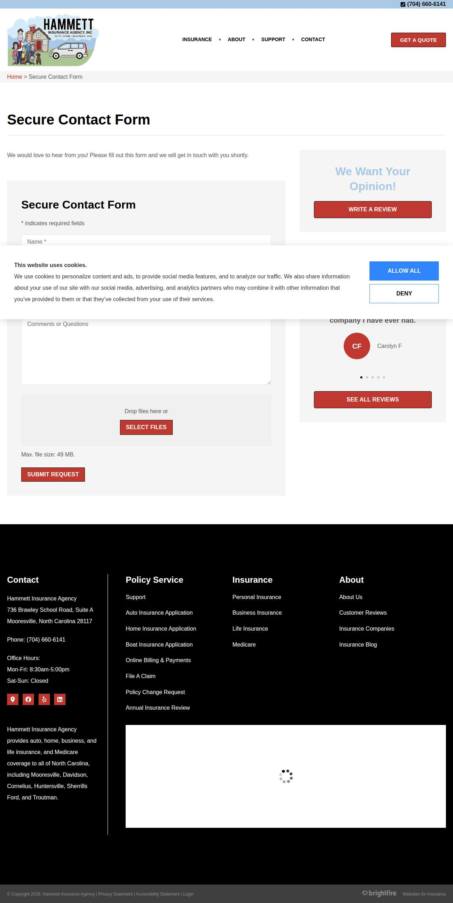
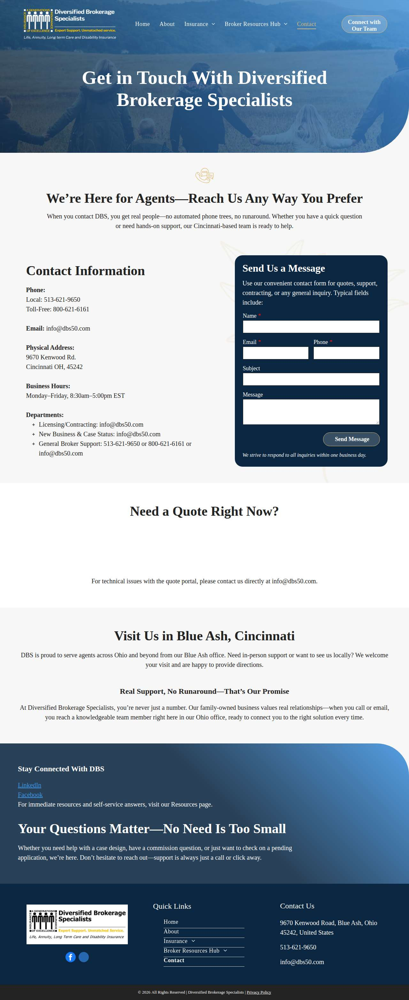
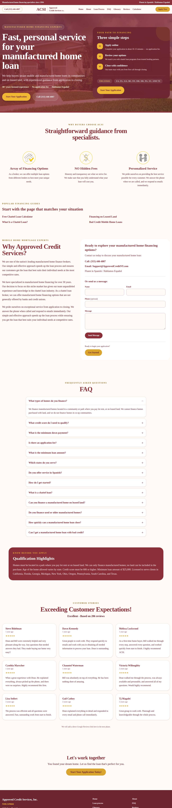
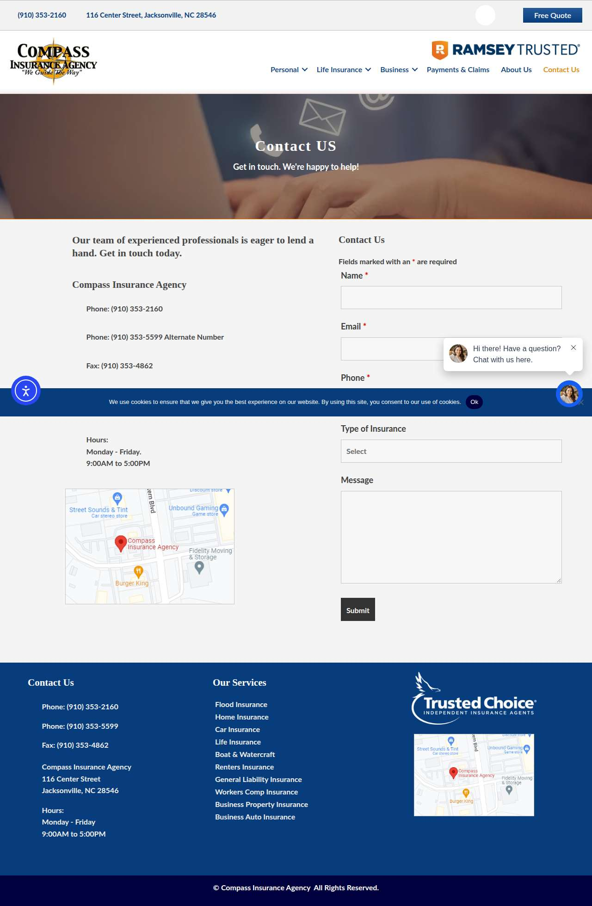
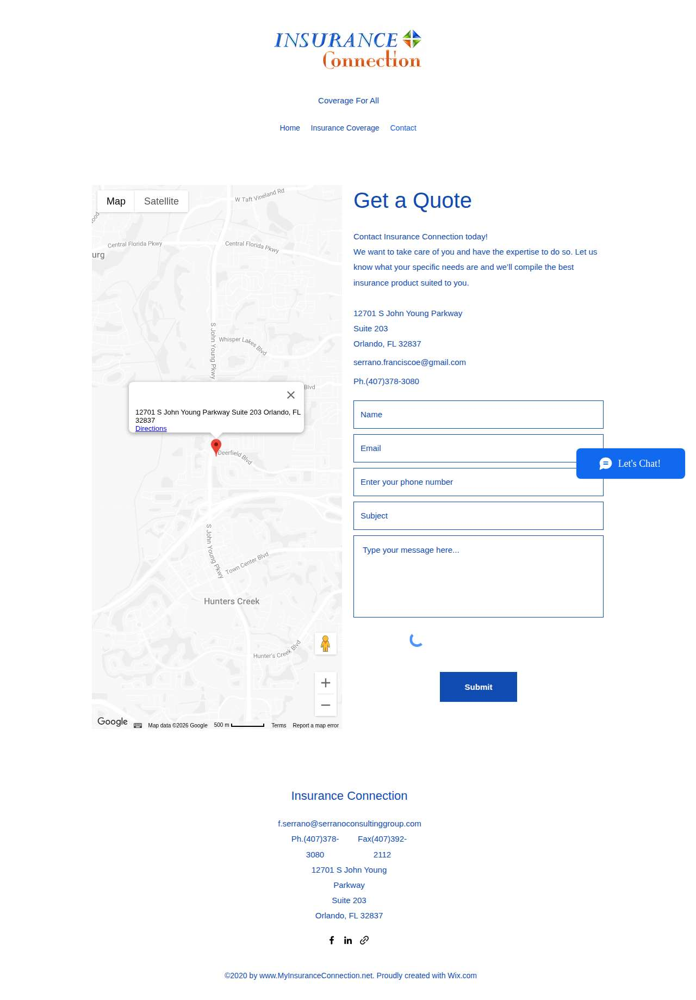
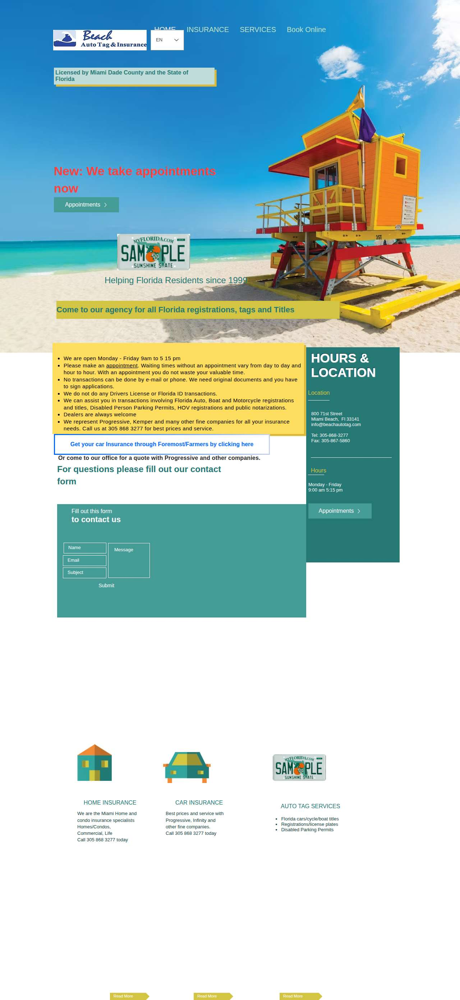
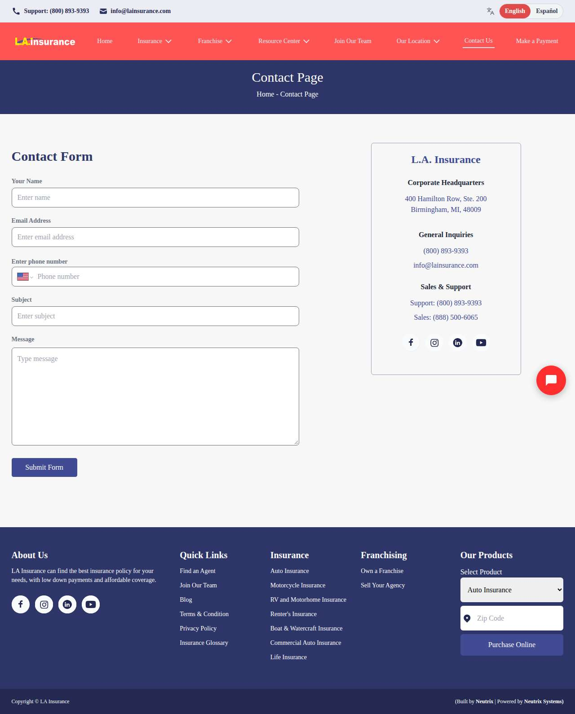
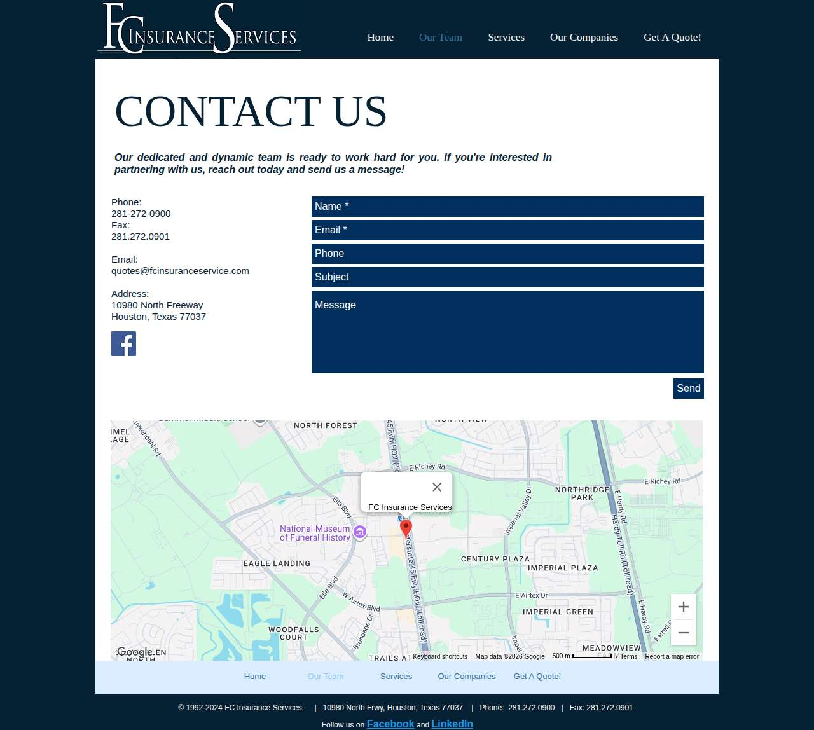
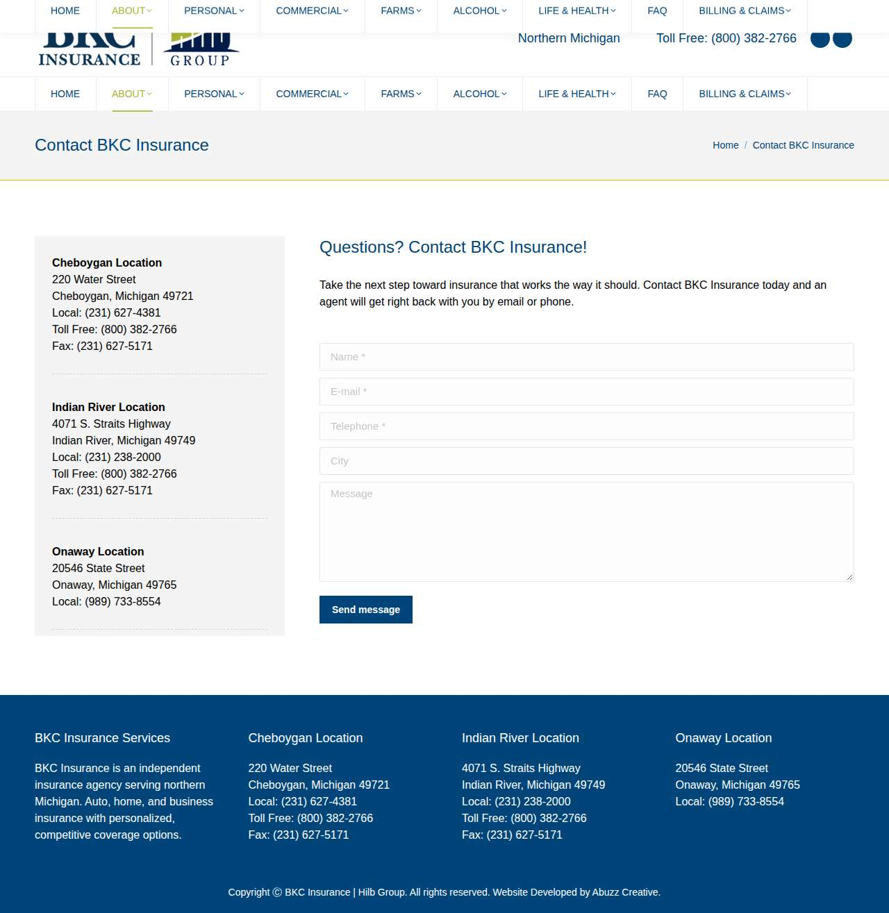
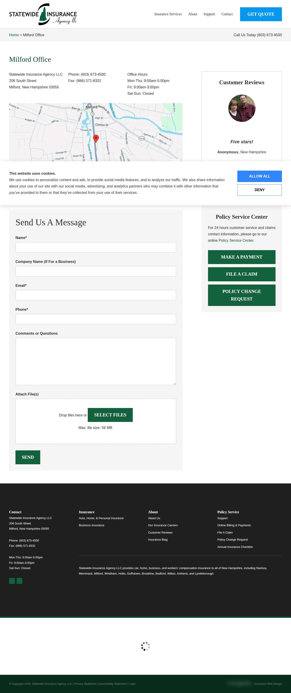

# Run f88d9dba — dry\_run — completed

| | |
|---|---|
| Run ID | `f88d9dba-6459-4671-b374-a9435d52c3e9` |
| Requested by | github:itsDevsArun |
| Started | 2026-11-05 03:34:39 UTC |
| Finished | 2026-11-05 03:36:39 UTC |
| Finish reason | queue\_exhausted |
| GitHub Actions | https://github.com/itsDevsArun/aeo-geo/actions/runs/41950876497 |

CSV for this run: [runs/2026-11-05_dry_run_f88d9dba.csv](2026-11-05_dry_run_f88d9dba.csv)

## Attempts (15)

### helixmechanical.com — dry\_run\_failed (dry run)

| | |
|---|---|
| Attempt ID | `c74760f6-3006-4a67-9622-d22f7ab6dc7e` |
| Form URL | https://helixmechanical.com/contact/ |
| Final URL | https://helixmechanical.com/contact/ |
| Reserved | 2026-11-05 03:34:40 UTC |
| Submit attempted | — |
| Template | standard v2 |
| Confirmation text | none observed |
| Result / error | Mapped field "First Name \*" not found uniquely |

Exact message:

~~~text
Subject: Helping customers find your business in AI search (AEO + GEO)

Hi there,

I'm Arun from Devs Arun. More and more customers now ask ChatGPT, Gemini, Perplexity or Google's AI Overviews questions like "who should I hire for this in my area?" before they call anyone. These tools answer from websites they can clearly understand, and they tend to recommend businesses whose pages answer real customer questions.

That is what AEO + GEO (Answer Engine and Generative Engine Optimization) is for. I improve your existing service pages so they clearly answer the questions your customers ask, add structured data that matches the page, and make the call, quote or enquiry step obvious. The benefit: your business gets a better chance of being mentioned or linked in AI answers, and visitors who arrive find it easy to contact you.

The AEO + GEO Starter is a one-time $199 (about ₹16,999, negotiable) for one website: a basic audit, 10 customer questions, improvements to two existing pages, relevant structured data and an action plan, with one revision round.

You can read the full details, send an enquiry or book online here:
https://devsarun.io/aeo-geo/

If this isn't relevant, just reply and I won't contact you again.

Best,
Arun
Devs Arun
itschool408@gmail.com · +91 7654534323
~~~

Submitted field values:

- \#forminator-field-name-1\_6ae7ff023fd3c: Arun
- \#forminator-field-email-1\_6ae7ff023fd3c: itschool408@gmail.com
- \#forminator-field-phone-1\_6ae7ff023fd3c: +91 7654534323
- \#forminator-field-textarea-1\_6ae7ff023fd3c: Hi there, I'm Arun from Devs Arun. More and more customers now ask ChatGPT, Gemini, Perplexity or Google's AI Overviews 

**Inspected page** — `run-f88d9dba_attempt-c74760f6_inspection_2026-11-05T03-34-42-298Z.jpg`

### knoxvilleelectrician.com — dry\_run\_failed (dry run)

| | |
|---|---|
| Attempt ID | `3d68afe9-97da-45e8-9687-be0bc67d3ecf` |
| Form URL | https://knoxvilleelectrician.com/contact-us/ |
| Final URL | https://knoxvilleelectrician.com/contact-us/ |
| Reserved | 2026-11-05 03:34:47 UTC |
| Submit attempted | — |
| Template | standard v2 |
| Confirmation text | none observed |
| Result / error | Mapped field "Name" not found uniquely |

Exact message:

~~~text
Subject: Helping customers find your business in AI search (AEO + GEO)

Hi there,

I'm Arun from Devs Arun. More and more customers now ask ChatGPT, Gemini, Perplexity or Google's AI Overviews questions like "who should I hire for this in my area?" before they call anyone. These tools answer from websites they can clearly understand, and they tend to recommend businesses whose pages answer real customer questions.

That is what AEO + GEO (Answer Engine and Generative Engine Optimization) is for. I improve your existing service pages so they clearly answer the questions your customers ask, add structured data that matches the page, and make the call, quote or enquiry step obvious. The benefit: your business gets a better chance of being mentioned or linked in AI answers, and visitors who arrive find it easy to contact you.

The AEO + GEO Starter is a one-time $199 (about ₹16,999, negotiable) for one website: a basic audit, 10 customer questions, improvements to two existing pages, relevant structured data and an action plan, with one revision round.

You can read the full details, send an enquiry or book online here:
https://devsarun.io/aeo-geo/

If this isn't relevant, just reply and I won't contact you again.

Best,
Arun
Devs Arun
itschool408@gmail.com · +91 7654534323
~~~

Submitted field values:

- \#form-field-1b7221: itschool408@gmail.com
- \#form-field-2fa3ac: +91 7654534323
- \#form-field-96f51f: Arun
- \#form-field-fed9d8: Hi there, I'm Arun from Devs Arun. More and more customers now ask ChatGPT, Gemini, Perplexity or Google's AI Overviews 

**Inspected page** — `run-f88d9dba_attempt-3d68afe9_inspection_2026-11-05T03-34-51-096Z.jpg`

### mspc.cpa — dry\_run\_failed (dry run)

| | |
|---|---|
| Attempt ID | `26d44f2c-87ed-4d33-bd38-c82d15f39ecf` |
| Form URL | https://www.mspc.cpa/contact/ |
| Final URL | https://www.mspc.cpa/contact/ |
| Reserved | 2026-11-05 03:34:56 UTC |
| Submit attempted | — |
| Template | standard v2 |
| Confirmation text | none observed |
| Result / error | Mapped field "Full Name \*" not found uniquely |

Exact message:

~~~text
Subject: Helping customers find your business in AI search (AEO + GEO)

Hi there,

I'm Arun from Devs Arun. More and more customers now ask ChatGPT, Gemini, Perplexity or Google's AI Overviews questions like "who should I hire for this in my area?" before they call anyone. These tools answer from websites they can clearly understand, and they tend to recommend businesses whose pages answer real customer questions.

That is what AEO + GEO (Answer Engine and Generative Engine Optimization) is for. I improve your existing service pages so they clearly answer the questions your customers ask, add structured data that matches the page, and make the call, quote or enquiry step obvious. The benefit: your business gets a better chance of being mentioned or linked in AI answers, and visitors who arrive find it easy to contact you.

The AEO + GEO Starter is a one-time $199 (about ₹16,999, negotiable) for one website: a basic audit, 10 customer questions, improvements to two existing pages, relevant structured data and an action plan, with one revision round.

You can read the full details, send an enquiry or book online here:
https://devsarun.io/aeo-geo/

If this isn't relevant, just reply and I won't contact you again.

Best,
Arun
Devs Arun
itschool408@gmail.com · +91 7654534323
~~~

Submitted field values:

- \#forminator-field-name-1\_6aeaca2579f24: Arun
- \#forminator-field-text-1\_6aeaca2579f24: Devs Arun
- \#forminator-field-email-1\_6aeaca2579f24: itschool408@gmail.com
- \#forminator-field-phone-1\_6aeaca2579f24: +91 7654534323
- \#forminator-field-textarea-1\_6aeaca2579f24: Hi there, I'm Arun from Devs Arun. More and more customers now ask ChatGPT, Gemini, Perplexity or Google's AI Overviews 

**Inspected page** — `run-f88d9dba_attempt-26d44f2c_inspection_2026-11-05T03-35-00-249Z.jpg`

### hammettinsuranceagency.com — dry\_run\_ok (dry run)

| | |
|---|---|
| Attempt ID | `4b3e5aaf-25f7-47ef-b42e-8830e91712ba` |
| Form URL | https://www.hammettinsuranceagency.com/secure-contact-form/ |
| Final URL | https://www.hammettinsuranceagency.com/secure-contact-form/ |
| Reserved | 2026-11-05 03:35:05 UTC |
| Submit attempted | — |
| Template | standard v2 |
| Confirmation text | none observed |
| Result / error | Selectors verified; fields not typed (domain not in dry-run fill list); not submitted |

Exact message:

~~~text
Subject: Helping customers find your business in AI search (AEO + GEO)

Hi there,

I'm Arun from Devs Arun. More and more customers now ask ChatGPT, Gemini, Perplexity or Google's AI Overviews questions like "who should I hire for this in my area?" before they call anyone. These tools answer from websites they can clearly understand, and they tend to recommend businesses whose pages answer real customer questions.

That is what AEO + GEO (Answer Engine and Generative Engine Optimization) is for. I improve your existing service pages so they clearly answer the questions your customers ask, add structured data that matches the page, and make the call, quote or enquiry step obvious. The benefit: your business gets a better chance of being mentioned or linked in AI answers, and visitors who arrive find it easy to contact you.

The AEO + GEO Starter is a one-time $199 (about ₹16,999, negotiable) for one website: a basic audit, 10 customer questions, improvements to two existing pages, relevant structured data and an action plan, with one revision round.

You can read the full details, send an enquiry or book online here:
https://devsarun.io/aeo-geo/

If this isn't relevant, just reply and I won't contact you again.

Best,
Arun
Devs Arun
itschool408@gmail.com · +91 7654534323
~~~

Submitted field values:

- \#input\_11\_1: Arun
- \#input\_11\_2: Devs Arun
- \#input\_11\_4: +91 7654534323
- \#input\_11\_5: itschool408@gmail.com
- \#input\_11\_6: Hi there, I'm Arun from Devs Arun. More and more customers now ask ChatGPT, Gemini, Perplexity or Google's AI Overviews 

**Inspected page** — `run-f88d9dba_attempt-4b3e5aaf_inspection_2026-11-05T03-35-07-171Z.jpg`

### dbs50.com — dry\_run\_ok (dry run)

| | |
|---|---|
| Attempt ID | `5490a2a3-ee65-4c87-9b14-270a8b567103` |
| Form URL | https://www.dbs50.com/contact |
| Final URL | https://www.dbs50.com/contact |
| Reserved | 2026-11-05 03:35:12 UTC |
| Submit attempted | — |
| Template | standard v2 |
| Confirmation text | none observed |
| Result / error | Selectors verified; fields not typed (domain not in dry-run fill list); not submitted |

Exact message:

~~~text
Subject: Helping customers find your business in AI search (AEO + GEO)

Hi there,

I'm Arun from Devs Arun. More and more customers now ask ChatGPT, Gemini, Perplexity or Google's AI Overviews questions like "who should I hire for this in my area?" before they call anyone. These tools answer from websites they can clearly understand, and they tend to recommend businesses whose pages answer real customer questions.

That is what AEO + GEO (Answer Engine and Generative Engine Optimization) is for. I improve your existing service pages so they clearly answer the questions your customers ask, add structured data that matches the page, and make the call, quote or enquiry step obvious. The benefit: your business gets a better chance of being mentioned or linked in AI answers, and visitors who arrive find it easy to contact you.

The AEO + GEO Starter is a one-time $199 (about ₹16,999, negotiable) for one website: a basic audit, 10 customer questions, improvements to two existing pages, relevant structured data and an action plan, with one revision round.

You can read the full details, send an enquiry or book online here:
https://devsarun.io/aeo-geo/

If this isn't relevant, just reply and I won't contact you again.

Best,
Arun
Devs Arun
itschool408@gmail.com · +91 7654534323
~~~

Submitted field values:

- \#\\31 329982503: +91 7654534323
- \#\\31 407951134: Hi there, I'm Arun from Devs Arun. More and more customers now ask ChatGPT, Gemini, Perplexity or Google's AI Overviews 
- \#\\31 838978531: itschool408@gmail.com
- \#\\31 907938274: Arun
- \#\\31 953263777: Helping customers find your business in AI search (AEO + GEO)

**Inspected page** — `run-f88d9dba_attempt-5490a2a3_inspection_2026-11-05T03-35-13-783Z.jpg`

### approvedcreditny.com — dry\_run\_ok (dry run)

| | |
|---|---|
| Attempt ID | `2170a670-39f1-4f61-a76a-287f06038225` |
| Form URL | https://approvedcreditny.com/ |
| Final URL | https://approvedcreditny.com/ |
| Reserved | 2026-11-05 03:35:18 UTC |
| Submit attempted | — |
| Template | standard v2 |
| Confirmation text | none observed |
| Result / error | Selectors verified; fields not typed (domain not in dry-run fill list); not submitted |

Exact message:

~~~text
Subject: Helping customers find your business in AI search (AEO + GEO)

Hi there,

I'm Arun from Devs Arun. More and more customers now ask ChatGPT, Gemini, Perplexity or Google's AI Overviews questions like "who should I hire for this in my area?" before they call anyone. These tools answer from websites they can clearly understand, and they tend to recommend businesses whose pages answer real customer questions.

That is what AEO + GEO (Answer Engine and Generative Engine Optimization) is for. I improve your existing service pages so they clearly answer the questions your customers ask, add structured data that matches the page, and make the call, quote or enquiry step obvious. The benefit: your business gets a better chance of being mentioned or linked in AI answers, and visitors who arrive find it easy to contact you.

The AEO + GEO Starter is a one-time $199 (about ₹16,999, negotiable) for one website: a basic audit, 10 customer questions, improvements to two existing pages, relevant structured data and an action plan, with one revision round.

You can read the full details, send an enquiry or book online here:
https://devsarun.io/aeo-geo/

If this isn't relevant, just reply and I won't contact you again.

Best,
Arun
Devs Arun
itschool408@gmail.com · +91 7654534323
~~~

Submitted field values:

- \#contact-name: Arun
- \#contact-email: itschool408@gmail.com
- \#contact-phone: +91 7654534323
- \#contact-message: Hi there, I'm Arun from Devs Arun. More and more customers now ask ChatGPT, Gemini, Perplexity or Google's AI Overviews 

**Inspected page** — `run-f88d9dba_attempt-2170a670_inspection_2026-11-05T03-35-21-707Z.jpg`

### cia220.com — dry\_run\_ok (dry run)

| | |
|---|---|
| Attempt ID | `36d1c96a-ef24-4233-85d0-45b967ad5c55` |
| Form URL | https://cia220.com/contact-us/ |
| Final URL | https://cia220.com/contact-us/ |
| Reserved | 2026-11-05 03:35:26 UTC |
| Submit attempted | — |
| Template | standard v2 |
| Confirmation text | none observed |
| Result / error | Selectors verified; fields not typed (domain not in dry-run fill list); not submitted |

Exact message:

~~~text
Subject: Helping customers find your business in AI search (AEO + GEO)

Hi there,

I'm Arun from Devs Arun. More and more customers now ask ChatGPT, Gemini, Perplexity or Google's AI Overviews questions like "who should I hire for this in my area?" before they call anyone. These tools answer from websites they can clearly understand, and they tend to recommend businesses whose pages answer real customer questions.

That is what AEO + GEO (Answer Engine and Generative Engine Optimization) is for. I improve your existing service pages so they clearly answer the questions your customers ask, add structured data that matches the page, and make the call, quote or enquiry step obvious. The benefit: your business gets a better chance of being mentioned or linked in AI answers, and visitors who arrive find it easy to contact you.

The AEO + GEO Starter is a one-time $199 (about ₹16,999, negotiable) for one website: a basic audit, 10 customer questions, improvements to two existing pages, relevant structured data and an action plan, with one revision round.

You can read the full details, send an enquiry or book online here:
https://devsarun.io/aeo-geo/

If this isn't relevant, just reply and I won't contact you again.

Best,
Arun
Devs Arun
itschool408@gmail.com · +91 7654534323
~~~

Submitted field values:

- \#nf-field-1: Arun
- \#nf-field-2: itschool408@gmail.com
- \#nf-field-3: Hi there, I'm Arun from Devs Arun. More and more customers now ask ChatGPT, Gemini, Perplexity or Google's AI Overviews 
- \#nf-field-109: +91 7654534323

**Inspected page** — `run-f88d9dba_attempt-36d1c96a_inspection_2026-11-05T03-35-28-896Z.jpg`

### myinsuranceconnection.net — dry\_run\_ok (dry run)

| | |
|---|---|
| Attempt ID | `af9445dd-5885-46c8-ae64-0e82ed73992d` |
| Form URL | https://www.myinsuranceconnection.net/contact |
| Final URL | https://www.myinsuranceconnection.net/contact |
| Reserved | 2026-11-05 03:35:33 UTC |
| Submit attempted | — |
| Template | standard v2 |
| Confirmation text | none observed |
| Result / error | Selectors verified; fields not typed (domain not in dry-run fill list); not submitted |

Exact message:

~~~text
Subject: Helping customers find your business in AI search (AEO + GEO)

Hi there,

I'm Arun from Devs Arun. More and more customers now ask ChatGPT, Gemini, Perplexity or Google's AI Overviews questions like "who should I hire for this in my area?" before they call anyone. These tools answer from websites they can clearly understand, and they tend to recommend businesses whose pages answer real customer questions.

That is what AEO + GEO (Answer Engine and Generative Engine Optimization) is for. I improve your existing service pages so they clearly answer the questions your customers ask, add structured data that matches the page, and make the call, quote or enquiry step obvious. The benefit: your business gets a better chance of being mentioned or linked in AI answers, and visitors who arrive find it easy to contact you.

The AEO + GEO Starter is a one-time $199 (about ₹16,999, negotiable) for one website: a basic audit, 10 customer questions, improvements to two existing pages, relevant structured data and an action plan, with one revision round.

You can read the full details, send an enquiry or book online here:
https://devsarun.io/aeo-geo/

If this isn't relevant, just reply and I won't contact you again.

Best,
Arun
Devs Arun
itschool408@gmail.com · +91 7654534323
~~~

Submitted field values:

- \#input\_comp-kg9p6nju: Arun
- \#input\_comp-kg9p6nk1: itschool408@gmail.com
- \#input\_comp-kgcie1rt: +91 7654534323
- \#input\_comp-kg9p6nk51: Helping customers find your business in AI search (AEO + GEO)
- \#textarea\_comp-kg9p6nk91: Hi there, I'm Arun from Devs Arun. More and more customers now ask ChatGPT, Gemini, Perplexity or Google's AI Overviews 

**Inspected page** — `run-f88d9dba_attempt-af9445dd_inspection_2026-11-05T03-35-36-856Z.jpg`

### beachautotag.com — dry\_run\_ok (dry run)

| | |
|---|---|
| Attempt ID | `37cdd31d-dcec-4989-80dd-e1ccfce81b91` |
| Form URL | https://www.beachautotag.com/ |
| Final URL | https://www.beachautotag.com/ |
| Reserved | 2026-11-05 03:35:41 UTC |
| Submit attempted | — |
| Template | standard v2 |
| Confirmation text | none observed |
| Result / error | Selectors verified; fields not typed (domain not in dry-run fill list); not submitted |

Exact message:

~~~text
Subject: Helping customers find your business in AI search (AEO + GEO)

Hi there,

I'm Arun from Devs Arun. More and more customers now ask ChatGPT, Gemini, Perplexity or Google's AI Overviews questions like "who should I hire for this in my area?" before they call anyone. These tools answer from websites they can clearly understand, and they tend to recommend businesses whose pages answer real customer questions.

That is what AEO + GEO (Answer Engine and Generative Engine Optimization) is for. I improve your existing service pages so they clearly answer the questions your customers ask, add structured data that matches the page, and make the call, quote or enquiry step obvious. The benefit: your business gets a better chance of being mentioned or linked in AI answers, and visitors who arrive find it easy to contact you.

The AEO + GEO Starter is a one-time $199 (about ₹16,999, negotiable) for one website: a basic audit, 10 customer questions, improvements to two existing pages, relevant structured data and an action plan, with one revision round.

You can read the full details, send an enquiry or book online here:
https://devsarun.io/aeo-geo/

If this isn't relevant, just reply and I won't contact you again.

Best,
Arun
Devs Arun
itschool408@gmail.com · +91 7654534323
~~~

Submitted field values:

- \#input\_comp-jxbwyi45: Arun
- \#input\_comp-jxbwyi4e: itschool408@gmail.com
- \#input\_comp-jxbwyi4m: Helping customers find your business in AI search (AEO + GEO)
- \#textarea\_comp-jxbwyi4s: Hi there, I'm Arun from Devs Arun. More and more customers now ask ChatGPT, Gemini, Perplexity or Google's AI Overviews 

**Inspected page** — `run-f88d9dba_attempt-37cdd31d_inspection_2026-11-05T03-35-44-389Z.jpg`

### lainsurance.com — dry\_run\_ok (dry run)

| | |
|---|---|
| Attempt ID | `42b6a8b3-f770-4df2-ae4d-3f097326df1f` |
| Form URL | https://lainsurance.com/contact |
| Final URL | https://lainsurance.com/contact |
| Reserved | 2026-11-05 03:35:49 UTC |
| Submit attempted | — |
| Template | standard v2 |
| Confirmation text | none observed |
| Result / error | Selectors verified; fields not typed (domain not in dry-run fill list); not submitted |

Exact message:

~~~text
Subject: Helping customers find your business in AI search (AEO + GEO)

Hi there,

I'm Arun from Devs Arun. More and more customers now ask ChatGPT, Gemini, Perplexity or Google's AI Overviews questions like "who should I hire for this in my area?" before they call anyone. These tools answer from websites they can clearly understand, and they tend to recommend businesses whose pages answer real customer questions.

That is what AEO + GEO (Answer Engine and Generative Engine Optimization) is for. I improve your existing service pages so they clearly answer the questions your customers ask, add structured data that matches the page, and make the call, quote or enquiry step obvious. The benefit: your business gets a better chance of being mentioned or linked in AI answers, and visitors who arrive find it easy to contact you.

The AEO + GEO Starter is a one-time $199 (about ₹16,999, negotiable) for one website: a basic audit, 10 customer questions, improvements to two existing pages, relevant structured data and an action plan, with one revision round.

You can read the full details, send an enquiry or book online here:
https://devsarun.io/aeo-geo/

If this isn't relevant, just reply and I won't contact you again.

Best,
Arun
Devs Arun
itschool408@gmail.com · +91 7654534323
~~~

Submitted field values:

- input\[name="name"\]: Arun
- input\[name="email"\]: itschool408@gmail.com
- input\[name="subject"\]: Helping customers find your business in AI search (AEO + GEO)
- textarea\[name="message"\]: Hi there, I'm Arun from Devs Arun. More and more customers now ask ChatGPT, Gemini, Perplexity or Google's AI Overviews 
- main \> div \> div:nth-of-type(2) \> div \> div \> div:nth-of-type(1) \> form \> div:nth-of-type(3) \> div \> input: +91 7654534323

**Inspected page** — `run-f88d9dba_attempt-42b6a8b3_inspection_2026-11-05T03-35-54-218Z.jpg`

### southcentralinsurance.com — dry\_run\_ok (dry run)

| | |
|---|---|
| Attempt ID | `70927f95-b385-4126-a769-1f9b04f79f49` |
| Form URL | https://www.scentralinsurance.com/contact-us |
| Final URL | https://www.scentralinsurance.com/contact-us |
| Reserved | 2026-11-05 03:35:59 UTC |
| Submit attempted | — |
| Template | standard v2 |
| Confirmation text | none observed |
| Result / error | Selectors verified; fields not typed (domain not in dry-run fill list); not submitted |

Exact message:

~~~text
Subject: Helping customers find your business in AI search (AEO + GEO)

Hi there,

I'm Arun from Devs Arun. More and more customers now ask ChatGPT, Gemini, Perplexity or Google's AI Overviews questions like "who should I hire for this in my area?" before they call anyone. These tools answer from websites they can clearly understand, and they tend to recommend businesses whose pages answer real customer questions.

That is what AEO + GEO (Answer Engine and Generative Engine Optimization) is for. I improve your existing service pages so they clearly answer the questions your customers ask, add structured data that matches the page, and make the call, quote or enquiry step obvious. The benefit: your business gets a better chance of being mentioned or linked in AI answers, and visitors who arrive find it easy to contact you.

The AEO + GEO Starter is a one-time $199 (about ₹16,999, negotiable) for one website: a basic audit, 10 customer questions, improvements to two existing pages, relevant structured data and an action plan, with one revision round.

You can read the full details, send an enquiry or book online here:
https://devsarun.io/aeo-geo/

If this isn't relevant, just reply and I won't contact you again.

Best,
Arun
Devs Arun
itschool408@gmail.com · +91 7654534323
~~~

Submitted field values:

- \#input\_comp-l02mznl6: itschool408@gmail.com
- \#input\_comp-l02mznlh: Helping customers find your business in AI search (AEO + GEO)
- \#input\_comp-lh6tgt6q: +91 7654534323
- \#textarea\_comp-l02mznll: Hi there, I'm Arun from Devs Arun. More and more customers now ask ChatGPT, Gemini, Perplexity or Google's AI Overviews 

**Inspected page** — `run-f88d9dba_attempt-70927f95_inspection_2026-11-05T03-36-03-770Z.jpg`

### fcinservices.com — dry\_run\_ok (dry run)

| | |
|---|---|
| Attempt ID | `34a0468e-0755-4f7e-928f-68e126e62eeb` |
| Form URL | https://www.fcinservices.com/contact-us |
| Final URL | https://www.fcinservices.com/contact-us |
| Reserved | 2026-11-05 03:36:08 UTC |
| Submit attempted | — |
| Template | standard v2 |
| Confirmation text | none observed |
| Result / error | Selectors verified; fields not typed (domain not in dry-run fill list); not submitted |

Exact message:

~~~text
Subject: Helping customers find your business in AI search (AEO + GEO)

Hi there,

I'm Arun from Devs Arun. More and more customers now ask ChatGPT, Gemini, Perplexity or Google's AI Overviews questions like "who should I hire for this in my area?" before they call anyone. These tools answer from websites they can clearly understand, and they tend to recommend businesses whose pages answer real customer questions.

That is what AEO + GEO (Answer Engine and Generative Engine Optimization) is for. I improve your existing service pages so they clearly answer the questions your customers ask, add structured data that matches the page, and make the call, quote or enquiry step obvious. The benefit: your business gets a better chance of being mentioned or linked in AI answers, and visitors who arrive find it easy to contact you.

The AEO + GEO Starter is a one-time $199 (about ₹16,999, negotiable) for one website: a basic audit, 10 customer questions, improvements to two existing pages, relevant structured data and an action plan, with one revision round.

You can read the full details, send an enquiry or book online here:
https://devsarun.io/aeo-geo/

If this isn't relevant, just reply and I won't contact you again.

Best,
Arun
Devs Arun
itschool408@gmail.com · +91 7654534323
~~~

Submitted field values:

- \#input\_comp-kf6mh52m: Arun
- \#input\_comp-kf6mh52z: itschool408@gmail.com
- \#input\_comp-kf6mh53a: +91 7654534323
- \#input\_comp-kf6mh53e: Helping customers find your business in AI search (AEO + GEO)
- \#textarea\_comp-kf6mh53j: Hi there, I'm Arun from Devs Arun. More and more customers now ask ChatGPT, Gemini, Perplexity or Google's AI Overviews 

**Inspected page** — `run-f88d9dba_attempt-34a0468e_inspection_2026-11-05T03-36-10-961Z.jpg`

### burns-eustice.com — dry\_run\_ok (dry run)

| | |
|---|---|
| Attempt ID | `fffe2736-bc48-43d2-8a01-daaf195a9731` |
| Form URL | https://www.hilbgroup.com/media-inquiries/ |
| Final URL | https://www.hilbgroup.com/media-inquiries/ |
| Reserved | 2026-11-05 03:36:15 UTC |
| Submit attempted | — |
| Template | standard v2 |
| Confirmation text | none observed |
| Result / error | Selectors verified; fields not typed (domain not in dry-run fill list); not submitted |

Exact message:

~~~text
Subject: Helping customers find your business in AI search (AEO + GEO)

Hi there,

I'm Arun from Devs Arun. More and more customers now ask ChatGPT, Gemini, Perplexity or Google's AI Overviews questions like "who should I hire for this in my area?" before they call anyone. These tools answer from websites they can clearly understand, and they tend to recommend businesses whose pages answer real customer questions.

That is what AEO + GEO (Answer Engine and Generative Engine Optimization) is for. I improve your existing service pages so they clearly answer the questions your customers ask, add structured data that matches the page, and make the call, quote or enquiry step obvious. The benefit: your business gets a better chance of being mentioned or linked in AI answers, and visitors who arrive find it easy to contact you.

The AEO + GEO Starter is a one-time $199 (about ₹16,999, negotiable) for one website: a basic audit, 10 customer questions, improvements to two existing pages, relevant structured data and an action plan, with one revision round.

You can read the full details, send an enquiry or book online here:
https://devsarun.io/aeo-geo/

If this isn't relevant, just reply and I won't contact you again.

Best,
Arun
Devs Arun
itschool408@gmail.com · +91 7654534323
~~~

Submitted field values:

- \#input\_9\_1: Arun
- \#input\_9\_2: itschool408@gmail.com
- \#input\_9\_3: Helping customers find your business in AI search (AEO + GEO)
- \#input\_9\_4: Hi there, I'm Arun from Devs Arun. More and more customers now ask ChatGPT, Gemini, Perplexity or Google's AI Overviews 

**Inspected page** — `run-f88d9dba_attempt-fffe2736_inspection_2026-11-05T03-36-18-281Z.jpg`

### bkcinsurance.com — dry\_run\_ok (dry run)

| | |
|---|---|
| Attempt ID | `b04b0e2d-1031-416f-8360-29c57189d6ec` |
| Form URL | https://bkcinsurance.com/contact/ |
| Final URL | https://bkcinsurance.com/contact/ |
| Reserved | 2026-11-05 03:36:23 UTC |
| Submit attempted | — |
| Template | standard v2 |
| Confirmation text | none observed |
| Result / error | Selectors verified; fields not typed (domain not in dry-run fill list); not submitted |

Exact message:

~~~text
Subject: Helping customers find your business in AI search (AEO + GEO)

Hi there,

I'm Arun from Devs Arun. More and more customers now ask ChatGPT, Gemini, Perplexity or Google's AI Overviews questions like "who should I hire for this in my area?" before they call anyone. These tools answer from websites they can clearly understand, and they tend to recommend businesses whose pages answer real customer questions.

That is what AEO + GEO (Answer Engine and Generative Engine Optimization) is for. I improve your existing service pages so they clearly answer the questions your customers ask, add structured data that matches the page, and make the call, quote or enquiry step obvious. The benefit: your business gets a better chance of being mentioned or linked in AI answers, and visitors who arrive find it easy to contact you.

The AEO + GEO Starter is a one-time $199 (about ₹16,999, negotiable) for one website: a basic audit, 10 customer questions, improvements to two existing pages, relevant structured data and an action plan, with one revision round.

You can read the full details, send an enquiry or book online here:
https://devsarun.io/aeo-geo/

If this isn't relevant, just reply and I won't contact you again.

Best,
Arun
Devs Arun
itschool408@gmail.com · +91 7654534323
~~~

Submitted field values:

- input\[name="name"\]: Arun
- input\[name="email"\]: itschool408@gmail.com
- input\[name="telephone"\]: +91 7654534323
- textarea\[name="message"\]: Hi there, I'm Arun from Devs Arun. More and more customers now ask ChatGPT, Gemini, Perplexity or Google's AI Overviews 

**Inspected page** — `run-f88d9dba_attempt-b04b0e2d_inspection_2026-11-05T03-36-26-864Z.jpg`

### statewideinsurancenh.com — dry\_run\_ok (dry run)

| | |
|---|---|
| Attempt ID | `2640bc22-0d94-429b-a32d-337581a8e4d1` |
| Form URL | https://www.statewideinsurancenh.com/locations/milford-new-hampshire/ |
| Final URL | https://www.statewideinsurancenh.com/locations/milford-new-hampshire/ |
| Reserved | 2026-11-05 03:36:31 UTC |
| Submit attempted | — |
| Template | standard v2 |
| Confirmation text | none observed |
| Result / error | Selectors verified; fields not typed (domain not in dry-run fill list); not submitted |

Exact message:

~~~text
Subject: Helping customers find your business in AI search (AEO + GEO)

Hi there,

I'm Arun from Devs Arun. More and more customers now ask ChatGPT, Gemini, Perplexity or Google's AI Overviews questions like "who should I hire for this in my area?" before they call anyone. These tools answer from websites they can clearly understand, and they tend to recommend businesses whose pages answer real customer questions.

That is what AEO + GEO (Answer Engine and Generative Engine Optimization) is for. I improve your existing service pages so they clearly answer the questions your customers ask, add structured data that matches the page, and make the call, quote or enquiry step obvious. The benefit: your business gets a better chance of being mentioned or linked in AI answers, and visitors who arrive find it easy to contact you.

The AEO + GEO Starter is a one-time $199 (about ₹16,999, negotiable) for one website: a basic audit, 10 customer questions, improvements to two existing pages, relevant structured data and an action plan, with one revision round.

You can read the full details, send an enquiry or book online here:
https://devsarun.io/aeo-geo/

If this isn't relevant, just reply and I won't contact you again.

Best,
Arun
Devs Arun
itschool408@gmail.com · +91 7654534323
~~~

Submitted field values:

- \#input\_83\_1: Arun
- \#input\_83\_2: Devs Arun
- \#input\_83\_4: +91 7654534323
- \#input\_83\_5: itschool408@gmail.com
- \#input\_83\_6: Hi there, I'm Arun from Devs Arun. More and more customers now ask ChatGPT, Gemini, Perplexity or Google's AI Overviews 

**Inspected page** — `run-f88d9dba_attempt-2640bc22_inspection_2026-11-05T03-36-34-792Z.jpg`

## Events (79)

| Time (UTC) | Event | Website | Details |
|---|---|---|---|
| 03:34:36 | run\_queued | — | dry\_run run requested by github:itsDevsArun |
| 03:34:36 | run\_dispatched | — | dispatch disabled (local test mode) |
| 03:34:39 | run\_started | — | Runner claimed dry\_run run |
| 03:34:40 | website\_selected | helixmechanical.com | Dry-run target helixmechanical.com |
| 03:34:40 | draft\_prepared | helixmechanical.com | Draft prepared with template standard v2 |
| 03:34:42 | page\_opened | helixmechanical.com | Opened form page |
| 03:34:42 | screenshot\_saved | helixmechanical.com | inspection screenshot saved (54 KB) |
| 03:34:42 | review\_required | helixmechanical.com | dry run failed: Mapped field "First Name \*" not found uniquely |
| 03:34:47 | website\_selected | knoxvilleelectrician.com | Dry-run target knoxvilleelectrician.com |
| 03:34:47 | draft\_prepared | knoxvilleelectrician.com | Draft prepared with template standard v2 |
| 03:34:50 | page\_opened | knoxvilleelectrician.com | Opened form page |
| 03:34:51 | screenshot\_saved | knoxvilleelectrician.com | inspection screenshot saved (137 KB) |
| 03:34:51 | review\_required | knoxvilleelectrician.com | dry run failed: Mapped field "Name" not found uniquely |
| 03:34:56 | website\_selected | mspc.cpa | Dry-run target mspc.cpa |
| 03:34:56 | draft\_prepared | mspc.cpa | Draft prepared with template standard v2 |
| 03:35:00 | page\_opened | mspc.cpa | Opened form page |
| 03:35:00 | screenshot\_saved | mspc.cpa | inspection screenshot saved (162 KB) |
| 03:35:00 | review\_required | mspc.cpa | dry run failed: Mapped field "Full Name \*" not found uniquely |
| 03:35:05 | website\_selected | hammettinsuranceagency.com | Dry-run target hammettinsuranceagency.com |
| 03:35:05 | draft\_prepared | hammettinsuranceagency.com | Draft prepared with template standard v2 |
| 03:35:06 | page\_opened | hammettinsuranceagency.com | Opened form page |
| 03:35:07 | screenshot\_saved | hammettinsuranceagency.com | inspection screenshot saved (147 KB) |
| 03:35:07 | dry\_run\_checked | hammettinsuranceagency.com | dry run ok: Selectors verified; fields not typed (domain not in dry-run fill list); not submitted |
| 03:35:12 | website\_selected | dbs50.com | Dry-run target dbs50.com |
| 03:35:12 | draft\_prepared | dbs50.com | Draft prepared with template standard v2 |
| 03:35:13 | page\_opened | dbs50.com | Opened form page |
| 03:35:13 | screenshot\_saved | dbs50.com | inspection screenshot saved (242 KB) |
| 03:35:13 | dry\_run\_checked | dbs50.com | dry run ok: Selectors verified; fields not typed (domain not in dry-run fill list); not submitted |
| 03:35:18 | website\_selected | approvedcreditny.com | Dry-run target approvedcreditny.com |
| 03:35:18 | draft\_prepared | approvedcreditny.com | Draft prepared with template standard v2 |
| 03:35:21 | page\_opened | approvedcreditny.com | Opened form page |
| 03:35:21 | screenshot\_saved | approvedcreditny.com | inspection screenshot saved (445 KB) |
| 03:35:21 | dry\_run\_checked | approvedcreditny.com | dry run ok: Selectors verified; fields not typed (domain not in dry-run fill list); not submitted |
| 03:35:26 | website\_selected | cia220.com | Dry-run target cia220.com |
| 03:35:26 | draft\_prepared | cia220.com | Draft prepared with template standard v2 |
| 03:35:28 | page\_opened | cia220.com | Opened form page |
| 03:35:28 | screenshot\_saved | cia220.com | inspection screenshot saved (129 KB) |
| 03:35:28 | dry\_run\_checked | cia220.com | dry run ok: Selectors verified; fields not typed (domain not in dry-run fill list); not submitted |
| 03:35:33 | website\_selected | myinsuranceconnection.net | Dry-run target myinsuranceconnection.net |
| 03:35:33 | draft\_prepared | myinsuranceconnection.net | Draft prepared with template standard v2 |
| 03:35:36 | page\_opened | myinsuranceconnection.net | Opened form page |
| 03:35:36 | screenshot\_saved | myinsuranceconnection.net | inspection screenshot saved (85 KB) |
| 03:35:36 | dry\_run\_checked | myinsuranceconnection.net | dry run ok: Selectors verified; fields not typed (domain not in dry-run fill list); not submitted |
| 03:35:41 | website\_selected | beachautotag.com | Dry-run target beachautotag.com |
| 03:35:41 | draft\_prepared | beachautotag.com | Draft prepared with template standard v2 |
| 03:35:44 | page\_opened | beachautotag.com | Opened form page |
| 03:35:44 | screenshot\_saved | beachautotag.com | inspection screenshot saved (195 KB) |
| 03:35:44 | dry\_run\_checked | beachautotag.com | dry run ok: Selectors verified; fields not typed (domain not in dry-run fill list); not submitted |
| 03:35:49 | website\_selected | lainsurance.com | Dry-run target lainsurance.com |
| 03:35:49 | draft\_prepared | lainsurance.com | Draft prepared with template standard v2 |
| 03:35:54 | page\_opened | lainsurance.com | Opened form page |
| 03:35:54 | screenshot\_saved | lainsurance.com | inspection screenshot saved (86 KB) |
| 03:35:54 | dry\_run\_checked | lainsurance.com | dry run ok: Selectors verified; fields not typed (domain not in dry-run fill list); not submitted |
| 03:35:59 | website\_selected | southcentralinsurance.com | Dry-run target southcentralinsurance.com |
| 03:35:59 | draft\_prepared | southcentralinsurance.com | Draft prepared with template standard v2 |
| 03:36:03 | page\_opened | southcentralinsurance.com | Opened form page |
| 03:36:03 | screenshot\_saved | southcentralinsurance.com | inspection screenshot saved (91 KB) |
| 03:36:03 | dry\_run\_checked | southcentralinsurance.com | dry run ok: Selectors verified; fields not typed (domain not in dry-run fill list); not submitted |
| 03:36:08 | website\_selected | fcinservices.com | Dry-run target fcinservices.com |
| 03:36:08 | draft\_prepared | fcinservices.com | Draft prepared with template standard v2 |
| 03:36:10 | page\_opened | fcinservices.com | Opened form page |
| 03:36:10 | screenshot\_saved | fcinservices.com | inspection screenshot saved (103 KB) |
| 03:36:10 | dry\_run\_checked | fcinservices.com | dry run ok: Selectors verified; fields not typed (domain not in dry-run fill list); not submitted |
| 03:36:15 | website\_selected | burns-eustice.com | Dry-run target burns-eustice.com |
| 03:36:15 | draft\_prepared | burns-eustice.com | Draft prepared with template standard v2 |
| 03:36:18 | page\_opened | burns-eustice.com | Opened form page |
| 03:36:18 | screenshot\_saved | burns-eustice.com | inspection screenshot saved (52 KB) |
| 03:36:18 | dry\_run\_checked | burns-eustice.com | dry run ok: Selectors verified; fields not typed (domain not in dry-run fill list); not submitted |
| 03:36:23 | website\_selected | bkcinsurance.com | Dry-run target bkcinsurance.com |
| 03:36:23 | draft\_prepared | bkcinsurance.com | Draft prepared with template standard v2 |
| 03:36:26 | page\_opened | bkcinsurance.com | Opened form page |
| 03:36:26 | screenshot\_saved | bkcinsurance.com | inspection screenshot saved (107 KB) |
| 03:36:26 | dry\_run\_checked | bkcinsurance.com | dry run ok: Selectors verified; fields not typed (domain not in dry-run fill list); not submitted |
| 03:36:31 | website\_selected | statewideinsurancenh.com | Dry-run target statewideinsurancenh.com |
| 03:36:31 | draft\_prepared | statewideinsurancenh.com | Draft prepared with template standard v2 |
| 03:36:34 | page\_opened | statewideinsurancenh.com | Opened form page |
| 03:36:34 | screenshot\_saved | statewideinsurancenh.com | inspection screenshot saved (171 KB) |
| 03:36:34 | dry\_run\_checked | statewideinsurancenh.com | dry run ok: Selectors verified; fields not typed (domain not in dry-run fill list); not submitted |
| 03:36:39 | run\_completed | — | Run completed (queue\_exhausted) |
