# Run 21a144da — live — completed

| | |
|---|---|
| Run ID | `21a144da-434f-4e54-86cf-1a1c861986c7` |
| Requested by | github:itsDevsArun |
| Started | 2026-11-05 03:36:47 UTC |
| Finished | 2026-11-05 03:41:38 UTC |
| Finish reason | queue\_exhausted |
| GitHub Actions | https://github.com/itsDevsArun/aeo-geo/actions/runs/41950876497 |

CSV for this run: [runs/2026-11-05_live_21a144da.csv](2026-11-05_live_21a144da.csv)

## Attempts (17)

### clearchoiceplumbingllc.com — failed\_before\_submit (LIVE)

| | |
|---|---|
| Attempt ID | `7107fbfc-df21-4017-b17f-aa714197ebc1` |
| Form URL | https://clearchoiceplumbingllc.com/contact/ |
| Final URL | — |
| Reserved | 2026-11-05 03:36:49 UTC |
| Submit attempted | — |
| Template | standard v2 |
| Confirmation text | none observed |
| Result / error | locator.fill: Error: Cannot type text into input\[type=number\] |

Exact message:

~~~text
Subject: Helping customers find your business in AI search (AEO + GEO)

Hi there,

I'm Arun from Devs Arun. More and more customers now ask ChatGPT, Gemini, Perplexity or Google's AI Overviews questions like "who should I hire for this in my area?" before they call anyone. These tools answer from websites they can clearly understand, and they tend to recommend businesses whose pages answer real customer questions.

That is what AEO + GEO (Answer Engine and Generative Engine Optimization) is for. I improve your existing service pages so they clearly answer the questions your customers ask, add structured data that matches the page, and make the call, quote or enquiry step obvious. The benefit: your business gets a better chance of being mentioned or linked in AI answers, and visitors who arrive find it easy to contact you.

The AEO + GEO Starter is a one-time $199 (about ₹16,999, negotiable) for one website: a basic audit, 10 customer questions, improvements to two existing pages, relevant structured data and an action plan, with one revision round.

You can read the full details, send an enquiry or book online here:
https://devsarun.io/aeo-geo/

If this isn't relevant, just reply and I won't contact you again.

Best,
Arun
Devs Arun
itschool408@gmail.com · +91 7654534323
~~~

Submitted field values:

- \#wpforms-51-field\_1: Arun
- \#wpforms-51-field\_2: itschool408@gmail.com
- \#wpforms-51-field\_3: Hi there, I'm Arun from Devs Arun. More and more customers now ask ChatGPT, Gemini, Perplexity or Google's AI Overviews 
- \#wpforms-51-field\_5: +91 7654534323

**Inspected page** — `run-21a144da_attempt-7107fbfc_inspection_2026-11-05T03-36-50-601Z.jpg`

### bwnwincpainting.com — failed\_before\_submit (LIVE)

| | |
|---|---|
| Attempt ID | `41067556-082c-4bed-9451-9dd07b067356` |
| Form URL | https://www.bwnwincpainting.com/contact/ |
| Final URL | — |
| Reserved | 2026-11-05 03:36:55 UTC |
| Submit attempted | — |
| Template | standard v2 |
| Confirmation text | none observed |
| Result / error | locator.fill: Error: Cannot type text into input\[type=number\] |

Exact message:

~~~text
Subject: Helping customers find your business in AI search (AEO + GEO)

Hi there,

I'm Arun from Devs Arun. More and more customers now ask ChatGPT, Gemini, Perplexity or Google's AI Overviews questions like "who should I hire for this in my area?" before they call anyone. These tools answer from websites they can clearly understand, and they tend to recommend businesses whose pages answer real customer questions.

That is what AEO + GEO (Answer Engine and Generative Engine Optimization) is for. I improve your existing service pages so they clearly answer the questions your customers ask, add structured data that matches the page, and make the call, quote or enquiry step obvious. The benefit: your business gets a better chance of being mentioned or linked in AI answers, and visitors who arrive find it easy to contact you.

The AEO + GEO Starter is a one-time $199 (about ₹16,999, negotiable) for one website: a basic audit, 10 customer questions, improvements to two existing pages, relevant structured data and an action plan, with one revision round.

You can read the full details, send an enquiry or book online here:
https://devsarun.io/aeo-geo/

If this isn't relevant, just reply and I won't contact you again.

Best,
Arun
Devs Arun
itschool408@gmail.com · +91 7654534323
~~~

Submitted field values:

- \#name-1151: Arun
- \#email-1151: itschool408@gmail.com
- \#phone-1151: +91 7654534323
- \#message-1151: Hi there, I'm Arun from Devs Arun. More and more customers now ask ChatGPT, Gemini, Perplexity or Google's AI Overviews 

**Inspected page** — `run-21a144da_attempt-41067556_inspection_2026-11-05T03-36-57-794Z.jpg`

### absoluterestorepa.com — failed\_before\_submit (LIVE)

| | |
|---|---|
| Attempt ID | `e2c6021b-284d-4dd2-b213-aaa490026307` |
| Form URL | https://absoluterestorepa.com/contact-us/ |
| Final URL | — |
| Reserved | 2026-11-05 03:37:02 UTC |
| Submit attempted | — |
| Template | standard v2 |
| Confirmation text | none observed |
| Result / error | locator.fill: Error: Cannot type text into input\[type=number\] |

Exact message:

~~~text
Subject: Helping customers find your business in AI search (AEO + GEO)

Hi there,

I'm Arun from Devs Arun. More and more customers now ask ChatGPT, Gemini, Perplexity or Google's AI Overviews questions like "who should I hire for this in my area?" before they call anyone. These tools answer from websites they can clearly understand, and they tend to recommend businesses whose pages answer real customer questions.

That is what AEO + GEO (Answer Engine and Generative Engine Optimization) is for. I improve your existing service pages so they clearly answer the questions your customers ask, add structured data that matches the page, and make the call, quote or enquiry step obvious. The benefit: your business gets a better chance of being mentioned or linked in AI answers, and visitors who arrive find it easy to contact you.

The AEO + GEO Starter is a one-time $199 (about ₹16,999, negotiable) for one website: a basic audit, 10 customer questions, improvements to two existing pages, relevant structured data and an action plan, with one revision round.

You can read the full details, send an enquiry or book online here:
https://devsarun.io/aeo-geo/

If this isn't relevant, just reply and I won't contact you again.

Best,
Arun
Devs Arun
itschool408@gmail.com · +91 7654534323
~~~

Submitted field values:

- \#form-field-name: Arun
- \#form-field-message: Hi there, I'm Arun from Devs Arun. More and more customers now ask ChatGPT, Gemini, Perplexity or Google's AI Overviews 
- \#form-field-field\_ed02ec2: +91 7654534323
- \#content \> div \> div \> div:nth-of-type(2) \> div \> div:nth-of-type(1) \> div:nth-of-type(2) \> div \> form \> div \> div:nth-of-type(3) \> input: itschool408@gmail.com

**Inspected page** — `run-21a144da_attempt-e2c6021b_inspection_2026-11-05T03-37-05-595Z.jpg`

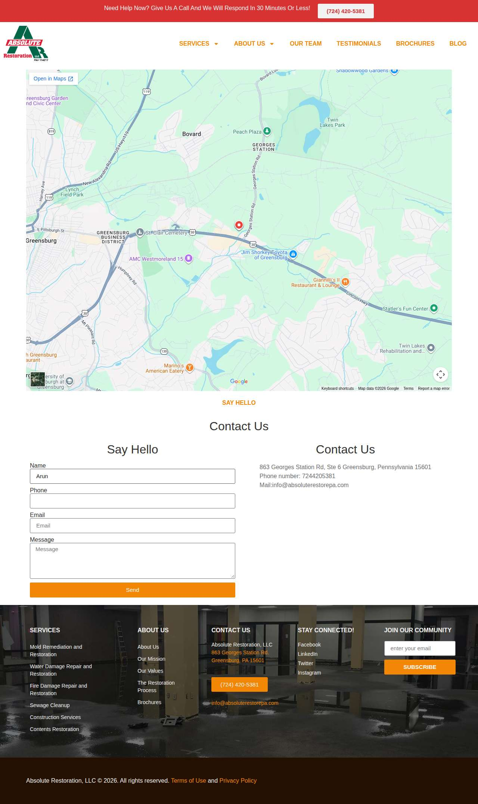

### masoudlawfirm.com — failed\_before\_submit (LIVE)

| | |
|---|---|
| Attempt ID | `7472c972-dd67-42a1-8608-8431d3bc4412` |
| Form URL | https://masoudlawfirm.com/contact/ |
| Final URL | — |
| Reserved | 2026-11-05 03:37:10 UTC |
| Submit attempted | — |
| Template | standard v2 |
| Confirmation text | none observed |
| Result / error | locator.fill: Error: Cannot type text into input\[type=number\] |

Exact message:

~~~text
Subject: Helping customers find your business in AI search (AEO + GEO)

Hi there,

I'm Arun from Devs Arun. More and more customers now ask ChatGPT, Gemini, Perplexity or Google's AI Overviews questions like "who should I hire for this in my area?" before they call anyone. These tools answer from websites they can clearly understand, and they tend to recommend businesses whose pages answer real customer questions.

That is what AEO + GEO (Answer Engine and Generative Engine Optimization) is for. I improve your existing service pages so they clearly answer the questions your customers ask, add structured data that matches the page, and make the call, quote or enquiry step obvious. The benefit: your business gets a better chance of being mentioned or linked in AI answers, and visitors who arrive find it easy to contact you.

The AEO + GEO Starter is a one-time $199 (about ₹16,999, negotiable) for one website: a basic audit, 10 customer questions, improvements to two existing pages, relevant structured data and an action plan, with one revision round.

You can read the full details, send an enquiry or book online here:
https://devsarun.io/aeo-geo/

If this isn't relevant, just reply and I won't contact you again.

Best,
Arun
Devs Arun
itschool408@gmail.com · +91 7654534323
~~~

Submitted field values:

- \#form-field-name: Arun
- \#form-field-field\_3374379: Hi there, I'm Arun from Devs Arun. More and more customers now ask ChatGPT, Gemini, Perplexity or Google's AI Overviews 
- \#form-field-field\_7731784: +91 7654534323
- \#form-field-field\_8bd0f16: itschool408@gmail.com

**Inspected page** — `run-21a144da_attempt-7472c972_inspection_2026-11-05T03-37-14-291Z.jpg`

### whiteolivecpa.com — failed\_before\_submit (LIVE)

| | |
|---|---|
| Attempt ID | `ac4f2c65-a247-4e32-8358-43f6da7c7068` |
| Form URL | https://whiteolivecpa.com/contact/ |
| Final URL | — |
| Reserved | 2026-11-05 03:37:19 UTC |
| Submit attempted | — |
| Template | standard v2 |
| Confirmation text | none observed |
| Result / error | locator.fill: Error: Cannot type text into input\[type=number\] |

Exact message:

~~~text
Subject: Helping customers find your business in AI search (AEO + GEO)

Hi there,

I'm Arun from Devs Arun. More and more customers now ask ChatGPT, Gemini, Perplexity or Google's AI Overviews questions like "who should I hire for this in my area?" before they call anyone. These tools answer from websites they can clearly understand, and they tend to recommend businesses whose pages answer real customer questions.

That is what AEO + GEO (Answer Engine and Generative Engine Optimization) is for. I improve your existing service pages so they clearly answer the questions your customers ask, add structured data that matches the page, and make the call, quote or enquiry step obvious. The benefit: your business gets a better chance of being mentioned or linked in AI answers, and visitors who arrive find it easy to contact you.

The AEO + GEO Starter is a one-time $199 (about ₹16,999, negotiable) for one website: a basic audit, 10 customer questions, improvements to two existing pages, relevant structured data and an action plan, with one revision round.

You can read the full details, send an enquiry or book online here:
https://devsarun.io/aeo-geo/

If this isn't relevant, just reply and I won't contact you again.

Best,
Arun
Devs Arun
itschool408@gmail.com · +91 7654534323
~~~

Submitted field values:

- \#ff\_1\_email: itschool408@gmail.com
- \#ff\_1\_message: Hi there, I'm Arun from Devs Arun. More and more customers now ask ChatGPT, Gemini, Perplexity or Google's AI Overviews 
- \#ff\_1\_numeric\_field: +91 7654534323
- \#ff\_1\_names\_first\_name\_: Arun

**Inspected page** — `run-21a144da_attempt-ac4f2c65_inspection_2026-11-05T03-37-20-813Z.jpg`

### hammettinsuranceagency.com — failed\_before\_submit (LIVE)

| | |
|---|---|
| Attempt ID | `ad8af1f8-9241-4332-8ea0-8fc38752ad7e` |
| Form URL | https://www.hammettinsuranceagency.com/secure-contact-form/ |
| Final URL | https://www.hammettinsuranceagency.com/secure-contact-form/ |
| Reserved | 2026-11-05 03:37:25 UTC |
| Submit attempted | — |
| Template | standard v2 |
| Confirmation text | none observed |
| Result / error | Field "Phone\*" did not accept the value |

Exact message:

~~~text
Subject: Helping customers find your business in AI search (AEO + GEO)

Hi there,

I'm Arun from Devs Arun. More and more customers now ask ChatGPT, Gemini, Perplexity or Google's AI Overviews questions like "who should I hire for this in my area?" before they call anyone. These tools answer from websites they can clearly understand, and they tend to recommend businesses whose pages answer real customer questions.

That is what AEO + GEO (Answer Engine and Generative Engine Optimization) is for. I improve your existing service pages so they clearly answer the questions your customers ask, add structured data that matches the page, and make the call, quote or enquiry step obvious. The benefit: your business gets a better chance of being mentioned or linked in AI answers, and visitors who arrive find it easy to contact you.

The AEO + GEO Starter is a one-time $199 (about ₹16,999, negotiable) for one website: a basic audit, 10 customer questions, improvements to two existing pages, relevant structured data and an action plan, with one revision round.

You can read the full details, send an enquiry or book online here:
https://devsarun.io/aeo-geo/

If this isn't relevant, just reply and I won't contact you again.

Best,
Arun
Devs Arun
itschool408@gmail.com · +91 7654534323
~~~

Submitted field values:

- \#input\_11\_1: Arun
- \#input\_11\_2: Devs Arun
- \#input\_11\_4: +91 7654534323
- \#input\_11\_5: itschool408@gmail.com
- \#input\_11\_6: Hi there, I'm Arun from Devs Arun. More and more customers now ask ChatGPT, Gemini, Perplexity or Google's AI Overviews 

**Filled form (before submit)** — `run-21a144da_attempt-ad8af1f8_filled_2026-11-05T03-37-27-501Z.jpg`

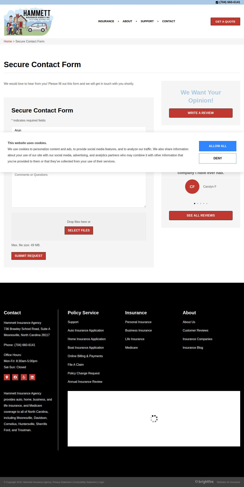

### approvedcreditny.com — confirmed (LIVE)

| | |
|---|---|
| Attempt ID | `f94c8c74-1a53-4cdd-9b7a-b79bd03d97b5` |
| Form URL | https://approvedcreditny.com/ |
| Final URL | https://approvedcreditny.com/ |
| Reserved | 2026-11-05 03:37:32 UTC |
| Submit attempted | 2026-11-05 03:37:34 UTC |
| Template | standard v2 |
| Confirmation text | Fluent in Spanish / Hablamos Español Or send us a message: Thank you for reaching out. We received your message and will respond as soon as possible. For immediate help, call (315) 446- |
| Result / error | — |

Exact message:

~~~text
Subject: Helping customers find your business in AI search (AEO + GEO)

Hi there,

I'm Arun from Devs Arun. More and more customers now ask ChatGPT, Gemini, Perplexity or Google's AI Overviews questions like "who should I hire for this in my area?" before they call anyone. These tools answer from websites they can clearly understand, and they tend to recommend businesses whose pages answer real customer questions.

That is what AEO + GEO (Answer Engine and Generative Engine Optimization) is for. I improve your existing service pages so they clearly answer the questions your customers ask, add structured data that matches the page, and make the call, quote or enquiry step obvious. The benefit: your business gets a better chance of being mentioned or linked in AI answers, and visitors who arrive find it easy to contact you.

The AEO + GEO Starter is a one-time $199 (about ₹16,999, negotiable) for one website: a basic audit, 10 customer questions, improvements to two existing pages, relevant structured data and an action plan, with one revision round.

You can read the full details, send an enquiry or book online here:
https://devsarun.io/aeo-geo/

If this isn't relevant, just reply and I won't contact you again.

Best,
Arun
Devs Arun
itschool408@gmail.com · +91 7654534323
~~~

Submitted field values:

- Name \[name\]: Arun
- Email \[email\]: itschool408@gmail.com
- Message \[message\]: Hi there, I'm Arun from Devs Arun. More and more customers now ask ChatGPT, Gemini, Perplexity or Google's AI Overviews 
- Phone (optional) \[phone\]: +91 7654534323

**Filled form (before submit)** — `run-21a144da_attempt-f94c8c74_filled_2026-11-05T03-37-34-353Z.jpg`

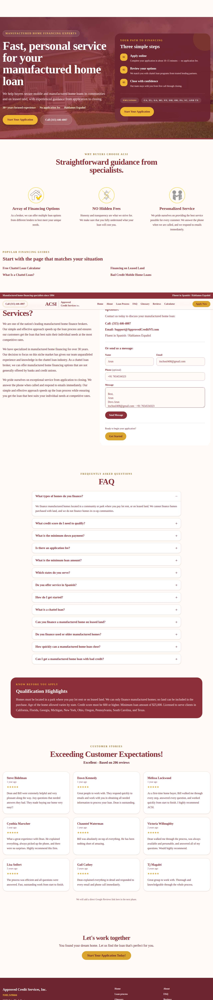

**After submit** — `run-21a144da_attempt-f94c8c74_post_attempt_2026-11-05T03-37-39-099Z.jpg`

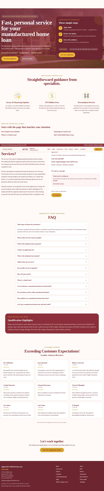

### dbs50.com — unclear (LIVE)

| | |
|---|---|
| Attempt ID | `d58c579f-0ca4-45e4-af1b-50d0edc74aa9` |
| Form URL | https://www.dbs50.com/contact |
| Final URL | https://www.dbs50.com/contact |
| Reserved | 2026-11-05 03:37:47 UTC |
| Submit attempted | 2026-11-05 03:37:49 UTC |
| Template | standard v2 |
| Confirmation text | none observed |
| Result / error | No new success marker observed |

Exact message:

~~~text
Subject: Helping customers find your business in AI search (AEO + GEO)

Hi there,

I'm Arun from Devs Arun. More and more customers now ask ChatGPT, Gemini, Perplexity or Google's AI Overviews questions like "who should I hire for this in my area?" before they call anyone. These tools answer from websites they can clearly understand, and they tend to recommend businesses whose pages answer real customer questions.

That is what AEO + GEO (Answer Engine and Generative Engine Optimization) is for. I improve your existing service pages so they clearly answer the questions your customers ask, add structured data that matches the page, and make the call, quote or enquiry step obvious. The benefit: your business gets a better chance of being mentioned or linked in AI answers, and visitors who arrive find it easy to contact you.

The AEO + GEO Starter is a one-time $199 (about ₹16,999, negotiable) for one website: a basic audit, 10 customer questions, improvements to two existing pages, relevant structured data and an action plan, with one revision round.

You can read the full details, send an enquiry or book online here:
https://devsarun.io/aeo-geo/

If this isn't relevant, just reply and I won't contact you again.

Best,
Arun
Devs Arun
itschool408@gmail.com · +91 7654534323
~~~

Submitted field values:

- Name \[name\]: Arun
- Email \[email\]: itschool408@gmail.com
- Phone \[phone\]: +91 7654534323
- Message \[message\]: Hi there, I'm Arun from Devs Arun. More and more customers now ask ChatGPT, Gemini, Perplexity or Google's AI Overviews 
- Subject \[subject\]: Helping customers find your business in AI search (AEO + GEO)

**Filled form (before submit)** — `run-21a144da_attempt-d58c579f_filled_2026-11-05T03-37-49-063Z.jpg`

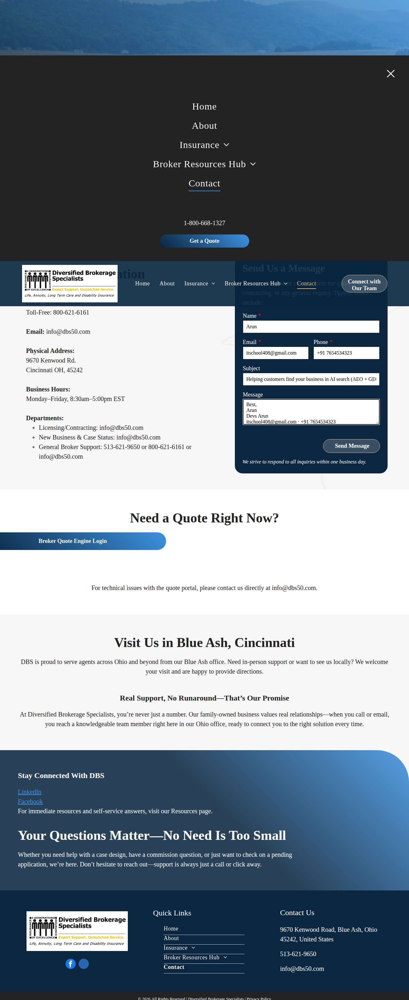

**After submit** — `run-21a144da_attempt-d58c579f_post_attempt_2026-11-05T03-38-18-859Z.jpg`

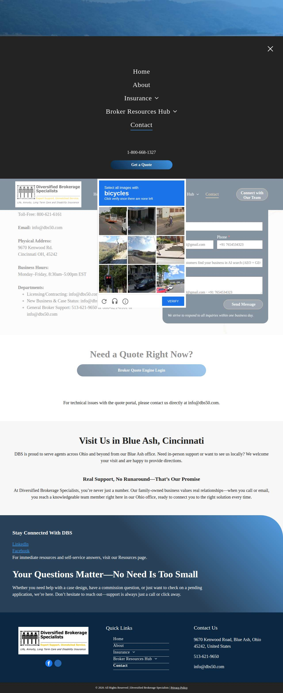

### cia220.com — confirmed (LIVE)

| | |
|---|---|
| Attempt ID | `6ef975ad-b00e-4b88-9370-25b133495590` |
| Form URL | https://cia220.com/contact-us/ |
| Final URL | https://cia220.com/contact-us/ |
| Reserved | 2026-11-05 03:38:27 UTC |
| Submit attempted | 2026-11-05 03:38:29 UTC |
| Template | standard v2 |
| Confirmation text | Hours: Monday - Friday. 9:00AM to 5:00PM (opens in new tab) Thank you for reaching out to us\! We look forward to speaking with you. One of our agents will contact you shortly. Contact Us |
| Result / error | — |

Exact message:

~~~text
Subject: Helping customers find your business in AI search (AEO + GEO)

Hi there,

I'm Arun from Devs Arun. More and more customers now ask ChatGPT, Gemini, Perplexity or Google's AI Overviews questions like "who should I hire for this in my area?" before they call anyone. These tools answer from websites they can clearly understand, and they tend to recommend businesses whose pages answer real customer questions.

That is what AEO + GEO (Answer Engine and Generative Engine Optimization) is for. I improve your existing service pages so they clearly answer the questions your customers ask, add structured data that matches the page, and make the call, quote or enquiry step obvious. The benefit: your business gets a better chance of being mentioned or linked in AI answers, and visitors who arrive find it easy to contact you.

The AEO + GEO Starter is a one-time $199 (about ₹16,999, negotiable) for one website: a basic audit, 10 customer questions, improvements to two existing pages, relevant structured data and an action plan, with one revision round.

You can read the full details, send an enquiry or book online here:
https://devsarun.io/aeo-geo/

If this isn't relevant, just reply and I won't contact you again.

Best,
Arun
Devs Arun
itschool408@gmail.com · +91 7654534323
~~~

Submitted field values:

- Name \* \[name\]: Arun
- Email \* \[email\]: itschool408@gmail.com
- Phone \* \[phone\]: +91 7654534323
- Message \[message\]: Hi there, I'm Arun from Devs Arun. More and more customers now ask ChatGPT, Gemini, Perplexity or Google's AI Overviews 

**Filled form (before submit)** — `run-21a144da_attempt-6ef975ad_filled_2026-11-05T03-38-29-238Z.jpg`

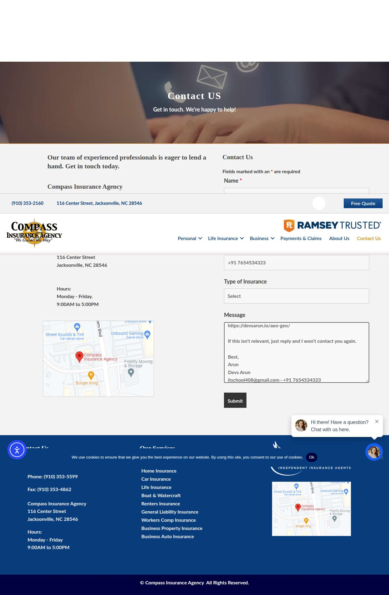

**After submit** — `run-21a144da_attempt-6ef975ad_post_attempt_2026-11-05T03-38-33-520Z.jpg`

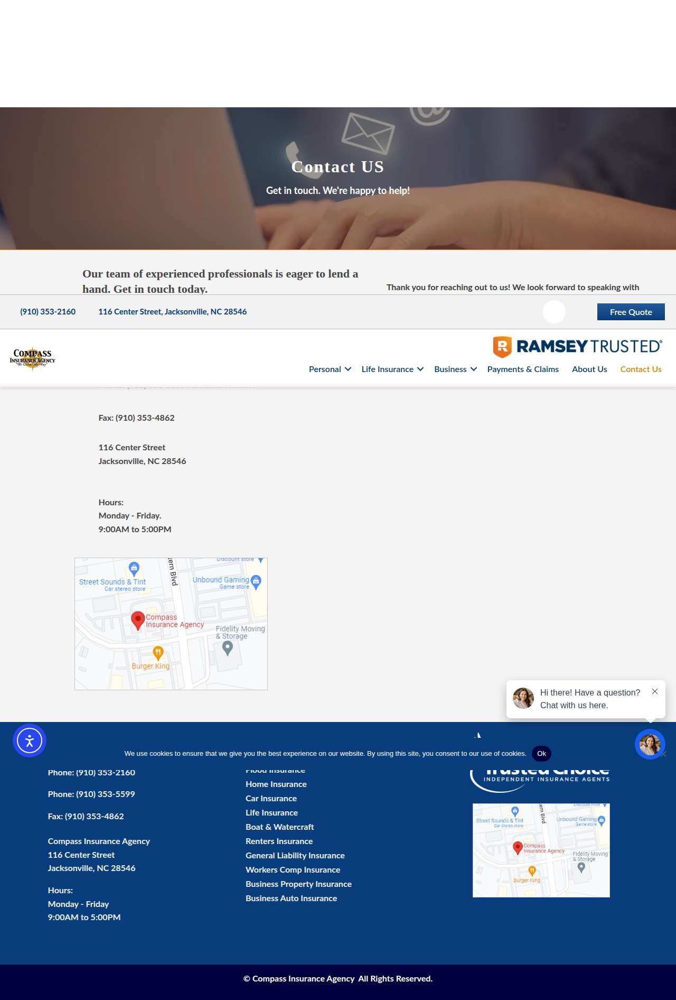

### myinsuranceconnection.net — failed\_before\_submit (LIVE)

| | |
|---|---|
| Attempt ID | `2be95c4d-90ac-4038-a363-a0265351c5d7` |
| Form URL | https://www.myinsuranceconnection.net/contact |
| Final URL | https://www.myinsuranceconnection.net/contact |
| Reserved | 2026-11-05 03:38:41 UTC |
| Submit attempted | — |
| Template | standard v2 |
| Confirmation text | none observed |
| Result / error | Form validation would block sending: : Please check this box if you want to proceed. |

Exact message:

~~~text
Subject: Helping customers find your business in AI search (AEO + GEO)

Hi there,

I'm Arun from Devs Arun. More and more customers now ask ChatGPT, Gemini, Perplexity or Google's AI Overviews questions like "who should I hire for this in my area?" before they call anyone. These tools answer from websites they can clearly understand, and they tend to recommend businesses whose pages answer real customer questions.

That is what AEO + GEO (Answer Engine and Generative Engine Optimization) is for. I improve your existing service pages so they clearly answer the questions your customers ask, add structured data that matches the page, and make the call, quote or enquiry step obvious. The benefit: your business gets a better chance of being mentioned or linked in AI answers, and visitors who arrive find it easy to contact you.

The AEO + GEO Starter is a one-time $199 (about ₹16,999, negotiable) for one website: a basic audit, 10 customer questions, improvements to two existing pages, relevant structured data and an action plan, with one revision round.

You can read the full details, send an enquiry or book online here:
https://devsarun.io/aeo-geo/

If this isn't relevant, just reply and I won't contact you again.

Best,
Arun
Devs Arun
itschool408@gmail.com · +91 7654534323
~~~

Submitted field values:

- \#input\_comp-kg9p6nju: Arun
- \#input\_comp-kg9p6nk1: itschool408@gmail.com
- \#input\_comp-kgcie1rt: +91 7654534323
- \#input\_comp-kg9p6nk51: Helping customers find your business in AI search (AEO + GEO)
- \#textarea\_comp-kg9p6nk91: Hi there, I'm Arun from Devs Arun. More and more customers now ask ChatGPT, Gemini, Perplexity or Google's AI Overviews 

**Filled form (before submit)** — `run-21a144da_attempt-2be95c4d_filled_2026-11-05T03-38-44-461Z.jpg`

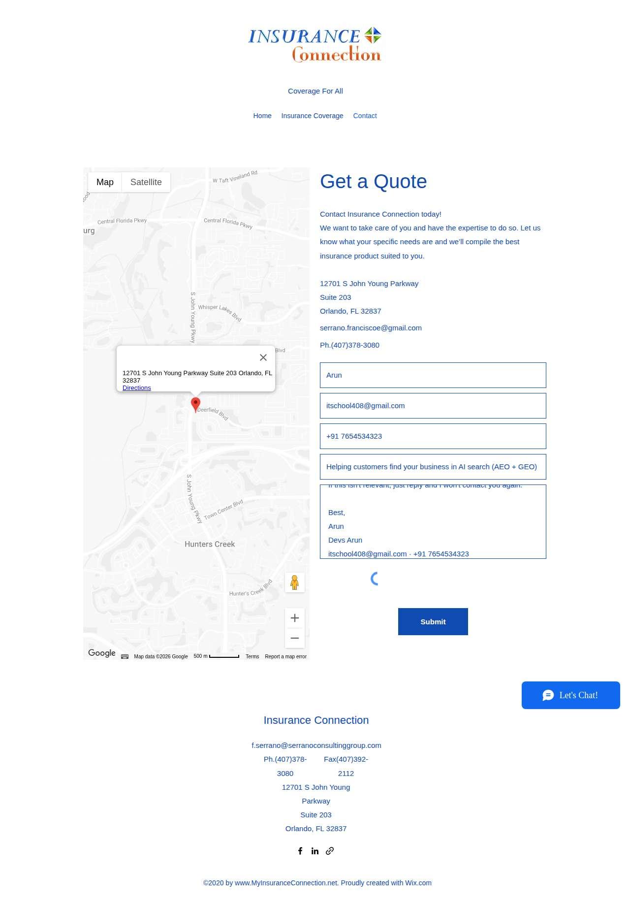

### beachautotag.com — unclear (LIVE)

| | |
|---|---|
| Attempt ID | `3bc610b7-8266-4bed-91c4-2f33a2d69a80` |
| Form URL | https://www.beachautotag.com/ |
| Final URL | https://www.beachautotag.com/ |
| Reserved | 2026-11-05 03:38:49 UTC |
| Submit attempted | 2026-11-05 03:38:51 UTC |
| Template | standard v2 |
| Confirmation text | none observed |
| Result / error | No new success marker observed |

Exact message:

~~~text
Subject: Helping customers find your business in AI search (AEO + GEO)

Hi there,

I'm Arun from Devs Arun. More and more customers now ask ChatGPT, Gemini, Perplexity or Google's AI Overviews questions like "who should I hire for this in my area?" before they call anyone. These tools answer from websites they can clearly understand, and they tend to recommend businesses whose pages answer real customer questions.

That is what AEO + GEO (Answer Engine and Generative Engine Optimization) is for. I improve your existing service pages so they clearly answer the questions your customers ask, add structured data that matches the page, and make the call, quote or enquiry step obvious. The benefit: your business gets a better chance of being mentioned or linked in AI answers, and visitors who arrive find it easy to contact you.

The AEO + GEO Starter is a one-time $199 (about ₹16,999, negotiable) for one website: a basic audit, 10 customer questions, improvements to two existing pages, relevant structured data and an action plan, with one revision round.

You can read the full details, send an enquiry or book online here:
https://devsarun.io/aeo-geo/

If this isn't relevant, just reply and I won't contact you again.

Best,
Arun
Devs Arun
itschool408@gmail.com · +91 7654534323
~~~

Submitted field values:

- name \[name\]: Arun
- email \[email\]: itschool408@gmail.com
- Message \[message\]: Hi there, I'm Arun from Devs Arun. More and more customers now ask ChatGPT, Gemini, Perplexity or Google's AI Overviews 
- subject \[subject\]: Helping customers find your business in AI search (AEO + GEO)

**Filled form (before submit)** — `run-21a144da_attempt-3bc610b7_filled_2026-11-05T03-38-51-918Z.jpg`

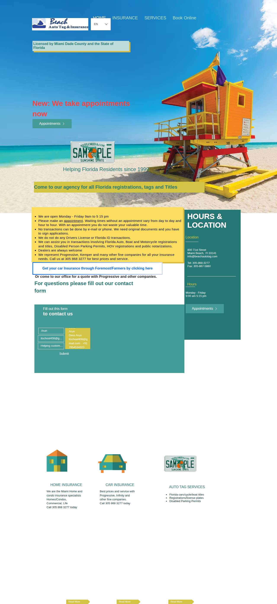

**After submit** — `run-21a144da_attempt-3bc610b7_post_attempt_2026-11-05T03-39-20-547Z.jpg`

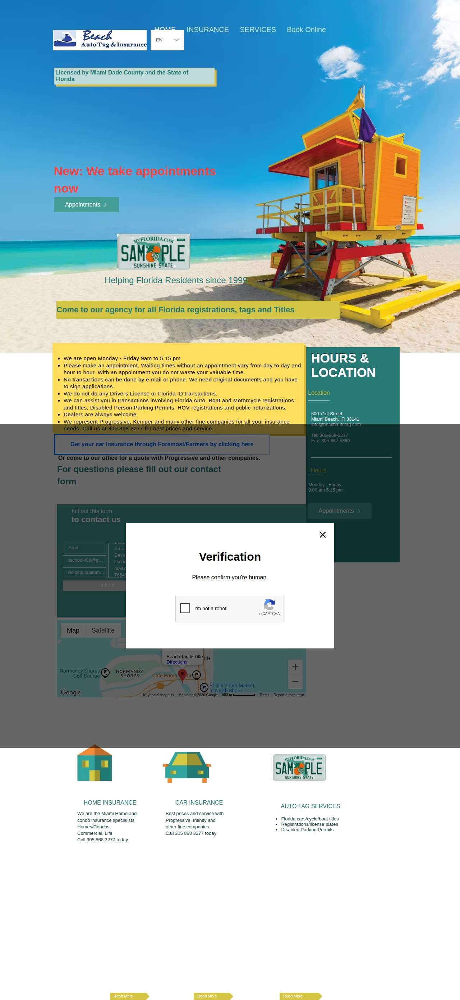

### southcentralinsurance.com — failed\_before\_submit (LIVE)

| | |
|---|---|
| Attempt ID | `be804780-b916-4f7b-a915-b20948b138c0` |
| Form URL | https://www.scentralinsurance.com/contact-us |
| Final URL | https://www.scentralinsurance.com/contact-us |
| Reserved | 2026-11-05 03:39:28 UTC |
| Submit attempted | — |
| Template | standard v2 |
| Confirmation text | none observed |
| Result / error | Form validation would block sending: phone: Please enter between 4 to 17 digits. You can include hyphens (-) or start with a (+), e.g., 555-123-4567 or +(222)987654321. |

Exact message:

~~~text
Subject: Helping customers find your business in AI search (AEO + GEO)

Hi there,

I'm Arun from Devs Arun. More and more customers now ask ChatGPT, Gemini, Perplexity or Google's AI Overviews questions like "who should I hire for this in my area?" before they call anyone. These tools answer from websites they can clearly understand, and they tend to recommend businesses whose pages answer real customer questions.

That is what AEO + GEO (Answer Engine and Generative Engine Optimization) is for. I improve your existing service pages so they clearly answer the questions your customers ask, add structured data that matches the page, and make the call, quote or enquiry step obvious. The benefit: your business gets a better chance of being mentioned or linked in AI answers, and visitors who arrive find it easy to contact you.

The AEO + GEO Starter is a one-time $199 (about ₹16,999, negotiable) for one website: a basic audit, 10 customer questions, improvements to two existing pages, relevant structured data and an action plan, with one revision round.

You can read the full details, send an enquiry or book online here:
https://devsarun.io/aeo-geo/

If this isn't relevant, just reply and I won't contact you again.

Best,
Arun
Devs Arun
itschool408@gmail.com · +91 7654534323
~~~

Submitted field values:

- \#input\_comp-l02mznl6: itschool408@gmail.com
- \#input\_comp-l02mznlh: Helping customers find your business in AI search (AEO + GEO)
- \#input\_comp-lh6tgt6q: +91 7654534323
- \#textarea\_comp-l02mznll: Hi there, I'm Arun from Devs Arun. More and more customers now ask ChatGPT, Gemini, Perplexity or Google's AI Overviews 

**Filled form (before submit)** — `run-21a144da_attempt-be804780_filled_2026-11-05T03-39-33-270Z.jpg`

### burns-eustice.com — unclear (LIVE)

| | |
|---|---|
| Attempt ID | `01d9ae7c-0c4d-4777-9ecd-5cbef4497041` |
| Form URL | https://www.hilbgroup.com/media-inquiries/ |
| Final URL | https://www.hilbgroup.com/media-inquiries/ |
| Reserved | 2026-11-05 03:39:38 UTC |
| Submit attempted | 2026-11-05 03:39:40 UTC |
| Template | standard v2 |
| Confirmation text | none observed |
| Result / error | No new success marker observed |

Exact message:

~~~text
Subject: Helping customers find your business in AI search (AEO + GEO)

Hi there,

I'm Arun from Devs Arun. More and more customers now ask ChatGPT, Gemini, Perplexity or Google's AI Overviews questions like "who should I hire for this in my area?" before they call anyone. These tools answer from websites they can clearly understand, and they tend to recommend businesses whose pages answer real customer questions.

That is what AEO + GEO (Answer Engine and Generative Engine Optimization) is for. I improve your existing service pages so they clearly answer the questions your customers ask, add structured data that matches the page, and make the call, quote or enquiry step obvious. The benefit: your business gets a better chance of being mentioned or linked in AI answers, and visitors who arrive find it easy to contact you.

The AEO + GEO Starter is a one-time $199 (about ₹16,999, negotiable) for one website: a basic audit, 10 customer questions, improvements to two existing pages, relevant structured data and an action plan, with one revision round.

You can read the full details, send an enquiry or book online here:
https://devsarun.io/aeo-geo/

If this isn't relevant, just reply and I won't contact you again.

Best,
Arun
Devs Arun
itschool408@gmail.com · +91 7654534323
~~~

Submitted field values:

- Subject \[subject\]: Helping customers find your business in AI search (AEO + GEO)
- Your Message \[message\]: Hi there, I'm Arun from Devs Arun. More and more customers now ask ChatGPT, Gemini, Perplexity or Google's AI Overviews 
- Your Name(Required) \[name\]: Arun
- Your Email(Required) \[email\]: itschool408@gmail.com

**Filled form (before submit)** — `run-21a144da_attempt-01d9ae7c_filled_2026-11-05T03-39-40-624Z.jpg`

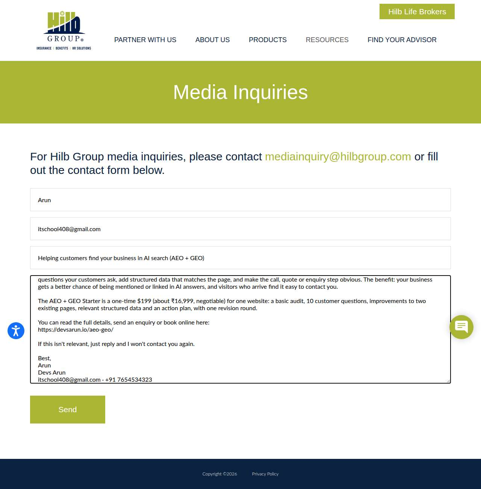

**After submit** — `run-21a144da_attempt-01d9ae7c_post_attempt_2026-11-05T03-40-08-943Z.jpg`

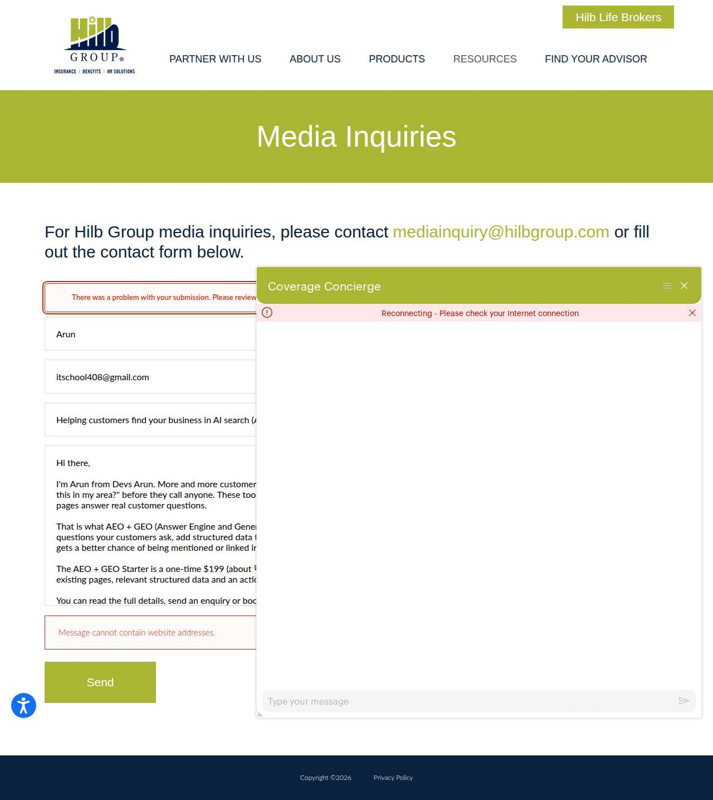

### bkcinsurance.com — error\_after\_submit (LIVE)

| | |
|---|---|
| Attempt ID | `0c1ee477-f8c7-4eca-ae71-68634a4d44f6` |
| Form URL | https://bkcinsurance.com/contact/ |
| Final URL | https://bkcinsurance.com/contact/ |
| Reserved | 2026-11-05 03:40:17 UTC |
| Submit attempted | 2026-11-05 03:40:19 UTC |
| Template | standard v2 |
| Confirmation text | none observed |
| Result / error | Submit click error (outcome unknown, not retried): locator.click: Timeout 10000ms exceeded. |

Exact message:

~~~text
Subject: Helping customers find your business in AI search (AEO + GEO)

Hi there,

I'm Arun from Devs Arun. More and more customers now ask ChatGPT, Gemini, Perplexity or Google's AI Overviews questions like "who should I hire for this in my area?" before they call anyone. These tools answer from websites they can clearly understand, and they tend to recommend businesses whose pages answer real customer questions.

That is what AEO + GEO (Answer Engine and Generative Engine Optimization) is for. I improve your existing service pages so they clearly answer the questions your customers ask, add structured data that matches the page, and make the call, quote or enquiry step obvious. The benefit: your business gets a better chance of being mentioned or linked in AI answers, and visitors who arrive find it easy to contact you.

The AEO + GEO Starter is a one-time $199 (about ₹16,999, negotiable) for one website: a basic audit, 10 customer questions, improvements to two existing pages, relevant structured data and an action plan, with one revision round.

You can read the full details, send an enquiry or book online here:
https://devsarun.io/aeo-geo/

If this isn't relevant, just reply and I won't contact you again.

Best,
Arun
Devs Arun
itschool408@gmail.com · +91 7654534323
~~~

Submitted field values:

- Name \* \[name\]: Arun
- E-mail \* \[email\]: itschool408@gmail.com
- Message \[message\]: Hi there, I'm Arun from Devs Arun. More and more customers now ask ChatGPT, Gemini, Perplexity or Google's AI Overviews 
- Telephone \* \[phone\]: +91 7654534323

**Filled form (before submit)** — `run-21a144da_attempt-0c1ee477_filled_2026-11-05T03-40-19-739Z.jpg`

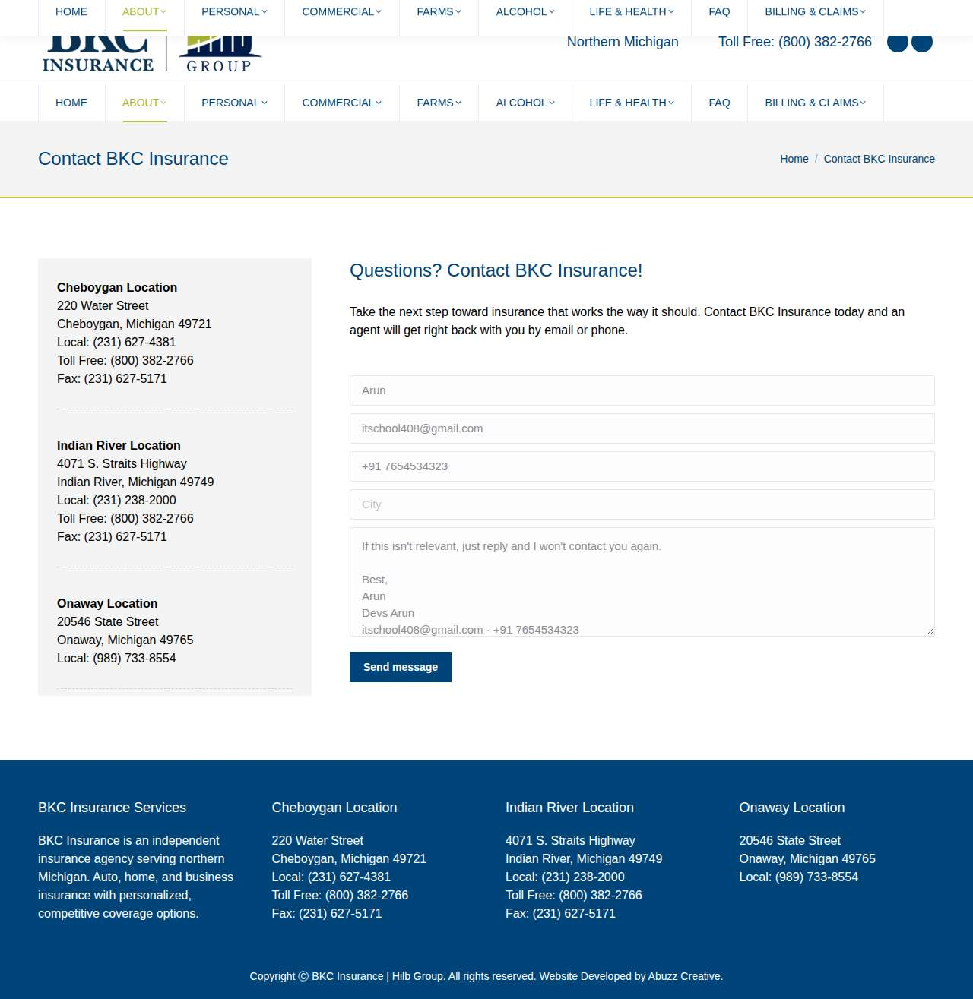

**After submit** — `run-21a144da_attempt-0c1ee477_post_attempt_2026-11-05T03-40-32-904Z.jpg`

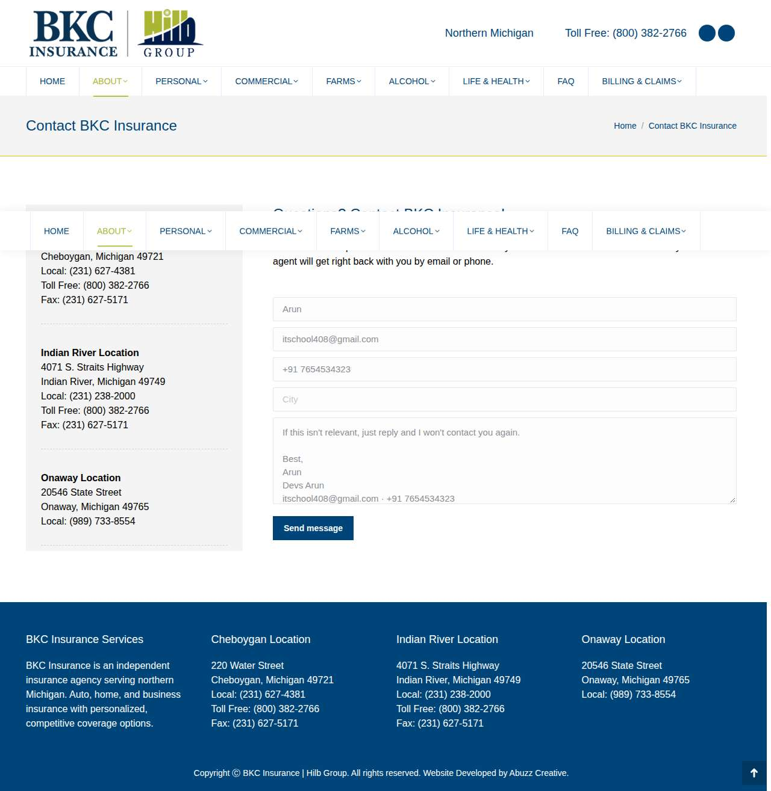

### statewideinsurancenh.com — failed\_before\_submit (LIVE)

| | |
|---|---|
| Attempt ID | `96949e9c-afd6-49b2-b532-dc9fa01ac2db` |
| Form URL | https://www.statewideinsurancenh.com/locations/milford-new-hampshire/ |
| Final URL | https://www.statewideinsurancenh.com/locations/milford-new-hampshire/ |
| Reserved | 2026-11-05 03:40:41 UTC |
| Submit attempted | — |
| Template | standard v2 |
| Confirmation text | none observed |
| Result / error | Field "Phone\*" did not accept the value |

Exact message:

~~~text
Subject: Helping customers find your business in AI search (AEO + GEO)

Hi there,

I'm Arun from Devs Arun. More and more customers now ask ChatGPT, Gemini, Perplexity or Google's AI Overviews questions like "who should I hire for this in my area?" before they call anyone. These tools answer from websites they can clearly understand, and they tend to recommend businesses whose pages answer real customer questions.

That is what AEO + GEO (Answer Engine and Generative Engine Optimization) is for. I improve your existing service pages so they clearly answer the questions your customers ask, add structured data that matches the page, and make the call, quote or enquiry step obvious. The benefit: your business gets a better chance of being mentioned or linked in AI answers, and visitors who arrive find it easy to contact you.

The AEO + GEO Starter is a one-time $199 (about ₹16,999, negotiable) for one website: a basic audit, 10 customer questions, improvements to two existing pages, relevant structured data and an action plan, with one revision round.

You can read the full details, send an enquiry or book online here:
https://devsarun.io/aeo-geo/

If this isn't relevant, just reply and I won't contact you again.

Best,
Arun
Devs Arun
itschool408@gmail.com · +91 7654534323
~~~

Submitted field values:

- \#input\_83\_1: Arun
- \#input\_83\_2: Devs Arun
- \#input\_83\_4: +91 7654534323
- \#input\_83\_5: itschool408@gmail.com
- \#input\_83\_6: Hi there, I'm Arun from Devs Arun. More and more customers now ask ChatGPT, Gemini, Perplexity or Google's AI Overviews 

**Filled form (before submit)** — `run-21a144da_attempt-96949e9c_filled_2026-11-05T03-40-44-115Z.jpg`

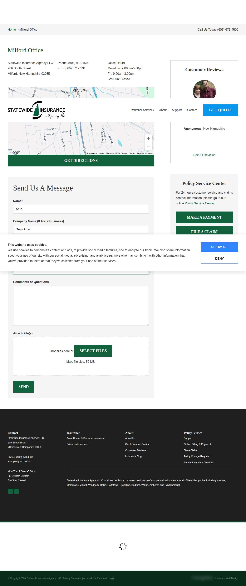

### lainsurance.com — failed\_before\_submit (LIVE)

| | |
|---|---|
| Attempt ID | `53d4a4bf-9260-4e4e-b1eb-2c27cf990385` |
| Form URL | https://lainsurance.com/contact |
| Final URL | https://lainsurance.com/contact |
| Reserved | 2026-11-05 03:40:49 UTC |
| Submit attempted | — |
| Template | standard v2 |
| Confirmation text | none observed |
| Result / error | Field "Phone number" did not accept the value |

Exact message:

~~~text
Subject: Helping customers find your business in AI search (AEO + GEO)

Hi there,

I'm Arun from Devs Arun. More and more customers now ask ChatGPT, Gemini, Perplexity or Google's AI Overviews questions like "who should I hire for this in my area?" before they call anyone. These tools answer from websites they can clearly understand, and they tend to recommend businesses whose pages answer real customer questions.

That is what AEO + GEO (Answer Engine and Generative Engine Optimization) is for. I improve your existing service pages so they clearly answer the questions your customers ask, add structured data that matches the page, and make the call, quote or enquiry step obvious. The benefit: your business gets a better chance of being mentioned or linked in AI answers, and visitors who arrive find it easy to contact you.

The AEO + GEO Starter is a one-time $199 (about ₹16,999, negotiable) for one website: a basic audit, 10 customer questions, improvements to two existing pages, relevant structured data and an action plan, with one revision round.

You can read the full details, send an enquiry or book online here:
https://devsarun.io/aeo-geo/

If this isn't relevant, just reply and I won't contact you again.

Best,
Arun
Devs Arun
itschool408@gmail.com · +91 7654534323
~~~

Submitted field values:

- input\[name="name"\]: Arun
- input\[name="email"\]: itschool408@gmail.com
- input\[name="subject"\]: Helping customers find your business in AI search (AEO + GEO)
- textarea\[name="message"\]: Hi there, I'm Arun from Devs Arun. More and more customers now ask ChatGPT, Gemini, Perplexity or Google's AI Overviews 
- main \> div \> div:nth-of-type(2) \> div \> div \> div:nth-of-type(1) \> form \> div:nth-of-type(3) \> div \> input: +91 7654534323

**Filled form (before submit)** — `run-21a144da_attempt-53d4a4bf_filled_2026-11-05T03-40-54-257Z.jpg`

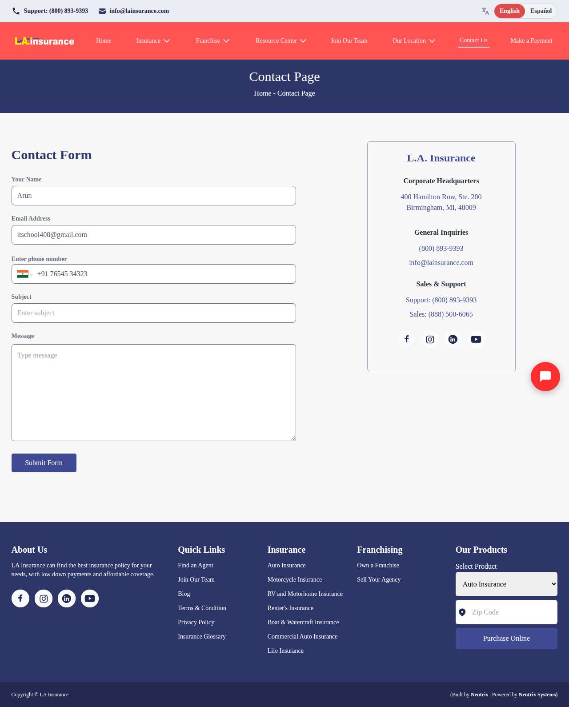

### fcinservices.com — unclear (LIVE)

| | |
|---|---|
| Attempt ID | `faec50f8-d58c-411b-83aa-2659642618ea` |
| Form URL | https://www.fcinservices.com/contact-us |
| Final URL | https://www.fcinservices.com/contact-us |
| Reserved | 2026-11-05 03:40:59 UTC |
| Submit attempted | 2026-11-05 03:41:01 UTC |
| Template | standard v2 |
| Confirmation text | none observed |
| Result / error | No new success marker observed |

Exact message:

~~~text
Subject: Helping customers find your business in AI search (AEO + GEO)

Hi there,

I'm Arun from Devs Arun. More and more customers now ask ChatGPT, Gemini, Perplexity or Google's AI Overviews questions like "who should I hire for this in my area?" before they call anyone. These tools answer from websites they can clearly understand, and they tend to recommend businesses whose pages answer real customer questions.

That is what AEO + GEO (Answer Engine and Generative Engine Optimization) is for. I improve your existing service pages so they clearly answer the questions your customers ask, add structured data that matches the page, and make the call, quote or enquiry step obvious. The benefit: your business gets a better chance of being mentioned or linked in AI answers, and visitors who arrive find it easy to contact you.

The AEO + GEO Starter is a one-time $199 (about ₹16,999, negotiable) for one website: a basic audit, 10 customer questions, improvements to two existing pages, relevant structured data and an action plan, with one revision round.

You can read the full details, send an enquiry or book online here:
https://devsarun.io/aeo-geo/

If this isn't relevant, just reply and I won't contact you again.

Best,
Arun
Devs Arun
itschool408@gmail.com · +91 7654534323
~~~

Submitted field values:

- email \[email\]: itschool408@gmail.com
- name-\* \[name\]: Arun
- phone \[phone\]: +91 7654534323
- Message \[message\]: Hi there, I'm Arun from Devs Arun. More and more customers now ask ChatGPT, Gemini, Perplexity or Google's AI Overviews 
- subject \[subject\]: Helping customers find your business in AI search (AEO + GEO)

**Filled form (before submit)** — `run-21a144da_attempt-faec50f8_filled_2026-11-05T03-41-01-826Z.jpg`

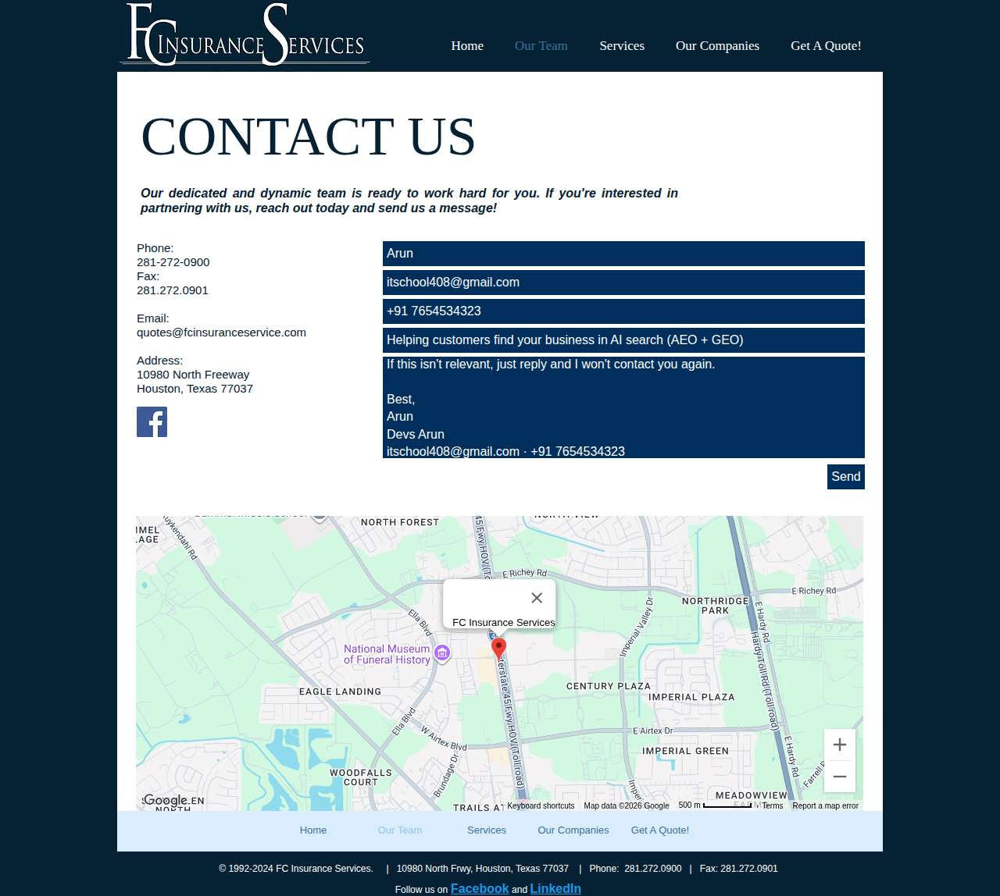

**After submit** — `run-21a144da_attempt-faec50f8_post_attempt_2026-11-05T03-41-30-450Z.jpg`

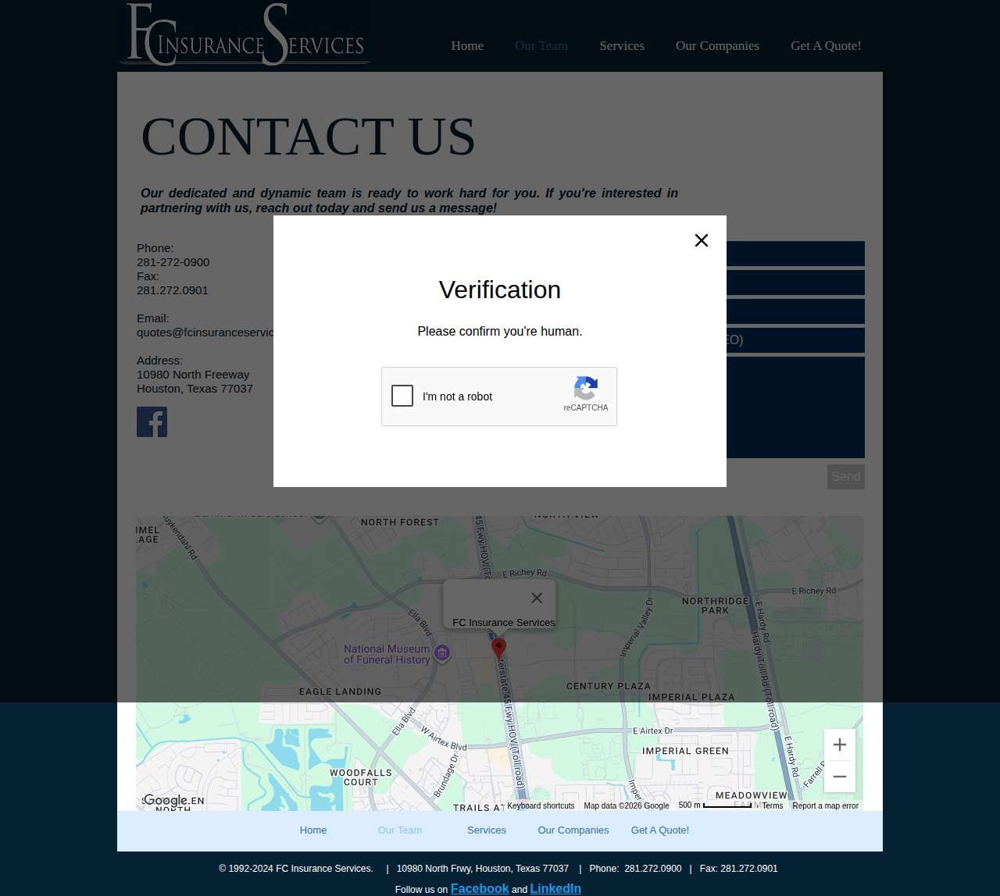

## Events (111)

| Time (UTC) | Event | Website | Details |
|---|---|---|---|
| 03:36:44 | run\_queued | — | live run requested by github:itsDevsArun |
| 03:36:44 | run\_dispatched | — | dispatch disabled (local test mode) |
| 03:36:47 | run\_started | — | Runner claimed live run |
| 03:36:49 | offer\_verified | — | Service page offer facts verified |
| 03:36:49 | website\_selected | clearchoiceplumbingllc.com | Live target clearchoiceplumbingllc.com |
| 03:36:49 | attempt\_reserved | clearchoiceplumbingllc.com | Submission attempt reserved with template standard v2 |
| 03:36:50 | page\_opened | clearchoiceplumbingllc.com | Opened form page |
| 03:36:50 | screenshot\_saved | clearchoiceplumbingllc.com | inspection screenshot saved (145 KB) |
| 03:36:50 | review\_required | clearchoiceplumbingllc.com | failed before submit: locator.fill: Error: Cannot type text into input\[type=number\] |
| 03:36:55 | website\_selected | bwnwincpainting.com | Live target bwnwincpainting.com |
| 03:36:55 | attempt\_reserved | bwnwincpainting.com | Submission attempt reserved with template standard v2 |
| 03:36:57 | page\_opened | bwnwincpainting.com | Opened form page |
| 03:36:57 | screenshot\_saved | bwnwincpainting.com | inspection screenshot saved (118 KB) |
| 03:36:57 | review\_required | bwnwincpainting.com | failed before submit: locator.fill: Error: Cannot type text into input\[type=number\] |
| 03:37:02 | website\_selected | absoluterestorepa.com | Live target absoluterestorepa.com |
| 03:37:02 | attempt\_reserved | absoluterestorepa.com | Submission attempt reserved with template standard v2 |
| 03:37:05 | page\_opened | absoluterestorepa.com | Opened form page |
| 03:37:05 | screenshot\_saved | absoluterestorepa.com | inspection screenshot saved (174 KB) |
| 03:37:05 | review\_required | absoluterestorepa.com | failed before submit: locator.fill: Error: Cannot type text into input\[type=number\] |
| 03:37:10 | website\_selected | masoudlawfirm.com | Live target masoudlawfirm.com |
| 03:37:10 | attempt\_reserved | masoudlawfirm.com | Submission attempt reserved with template standard v2 |
| 03:37:13 | page\_opened | masoudlawfirm.com | Opened form page |
| 03:37:14 | screenshot\_saved | masoudlawfirm.com | inspection screenshot saved (168 KB) |
| 03:37:14 | review\_required | masoudlawfirm.com | failed before submit: locator.fill: Error: Cannot type text into input\[type=number\] |
| 03:37:19 | website\_selected | whiteolivecpa.com | Live target whiteolivecpa.com |
| 03:37:19 | attempt\_reserved | whiteolivecpa.com | Submission attempt reserved with template standard v2 |
| 03:37:20 | page\_opened | whiteolivecpa.com | Opened form page |
| 03:37:20 | screenshot\_saved | whiteolivecpa.com | inspection screenshot saved (197 KB) |
| 03:37:20 | review\_required | whiteolivecpa.com | failed before submit: locator.fill: Error: Cannot type text into input\[type=number\] |
| 03:37:25 | website\_selected | hammettinsuranceagency.com | Live target hammettinsuranceagency.com |
| 03:37:25 | attempt\_reserved | hammettinsuranceagency.com | Submission attempt reserved with template standard v2 |
| 03:37:27 | page\_opened | hammettinsuranceagency.com | Opened form page |
| 03:37:27 | screenshot\_saved | hammettinsuranceagency.com | filled screenshot saved (147 KB) |
| 03:37:27 | review\_required | hammettinsuranceagency.com | failed before submit: Field "Phone\*" did not accept the value |
| 03:37:32 | website\_selected | approvedcreditny.com | Live target approvedcreditny.com |
| 03:37:32 | attempt\_reserved | approvedcreditny.com | Submission attempt reserved with template standard v2 |
| 03:37:34 | page\_opened | approvedcreditny.com | Opened form page |
| 03:37:34 | fields\_filled | approvedcreditny.com | filled |
| 03:37:34 | screenshot\_saved | approvedcreditny.com | filled screenshot saved (441 KB) |
| 03:37:34 | submit\_attempted | approvedcreditny.com | submitting |
| 03:37:39 | screenshot\_saved | approvedcreditny.com | post\_attempt screenshot saved (447 KB) |
| 03:37:39 | confirmation\_observed | approvedcreditny.com | confirmed — "Fluent in Spanish / Hablamos Español Or send us a message: Thank you for reaching out. We received your message and will" |
| 03:37:47 | website\_selected | dbs50.com | Live target dbs50.com |
| 03:37:47 | attempt\_reserved | dbs50.com | Submission attempt reserved with template standard v2 |
| 03:37:48 | page\_opened | dbs50.com | Opened form page |
| 03:37:48 | fields\_filled | dbs50.com | filled |
| 03:37:49 | screenshot\_saved | dbs50.com | filled screenshot saved (209 KB) |
| 03:37:49 | submit\_attempted | dbs50.com | submitting |
| 03:38:18 | screenshot\_saved | dbs50.com | post\_attempt screenshot saved (209 KB) |
| 03:38:18 | review\_required | dbs50.com | unclear: No new success marker observed |
| 03:38:27 | website\_selected | cia220.com | Live target cia220.com |
| 03:38:27 | attempt\_reserved | cia220.com | Submission attempt reserved with template standard v2 |
| 03:38:29 | page\_opened | cia220.com | Opened form page |
| 03:38:29 | fields\_filled | cia220.com | filled |
| 03:38:29 | screenshot\_saved | cia220.com | filled screenshot saved (125 KB) |
| 03:38:29 | submit\_attempted | cia220.com | submitting |
| 03:38:33 | screenshot\_saved | cia220.com | post\_attempt screenshot saved (110 KB) |
| 03:38:33 | confirmation\_observed | cia220.com | confirmed — "Hours: Monday - Friday. 9:00AM to 5:00PM (opens in new tab) Thank you for reaching out to us\! We look forward to speakin" |
| 03:38:41 | website\_selected | myinsuranceconnection.net | Live target myinsuranceconnection.net |
| 03:38:41 | attempt\_reserved | myinsuranceconnection.net | Submission attempt reserved with template standard v2 |
| 03:38:44 | page\_opened | myinsuranceconnection.net | Opened form page |
| 03:38:44 | screenshot\_saved | myinsuranceconnection.net | filled screenshot saved (92 KB) |
| 03:38:44 | review\_required | myinsuranceconnection.net | failed before submit: Form validation would block sending: : Please check this box if you want to proceed. |
| 03:38:49 | website\_selected | beachautotag.com | Live target beachautotag.com |
| 03:38:49 | attempt\_reserved | beachautotag.com | Submission attempt reserved with template standard v2 |
| 03:38:51 | page\_opened | beachautotag.com | Opened form page |
| 03:38:51 | fields\_filled | beachautotag.com | filled |
| 03:38:51 | screenshot\_saved | beachautotag.com | filled screenshot saved (196 KB) |
| 03:38:51 | submit\_attempted | beachautotag.com | submitting |
| 03:39:20 | screenshot\_saved | beachautotag.com | post\_attempt screenshot saved (201 KB) |
| 03:39:20 | review\_required | beachautotag.com | unclear: No new success marker observed |
| 03:39:28 | website\_selected | southcentralinsurance.com | Live target southcentralinsurance.com |
| 03:39:28 | attempt\_reserved | southcentralinsurance.com | Submission attempt reserved with template standard v2 |
| 03:39:33 | page\_opened | southcentralinsurance.com | Opened form page |
| 03:39:33 | screenshot\_saved | southcentralinsurance.com | filled screenshot saved (96 KB) |
| 03:39:33 | review\_required | southcentralinsurance.com | failed before submit: Form validation would block sending: phone: Please enter between 4 to 17 digits. You can include hyphens (-) or start with a (+), e.g., 555-123-4567 or +(222)987654321. |
| 03:39:38 | website\_selected | burns-eustice.com | Live target burns-eustice.com |
| 03:39:38 | attempt\_reserved | burns-eustice.com | Submission attempt reserved with template standard v2 |
| 03:39:40 | page\_opened | burns-eustice.com | Opened form page |
| 03:39:40 | fields\_filled | burns-eustice.com | filled |
| 03:39:40 | screenshot\_saved | burns-eustice.com | filled screenshot saved (91 KB) |
| 03:39:40 | submit\_attempted | burns-eustice.com | submitting |
| 03:40:08 | screenshot\_saved | burns-eustice.com | post\_attempt screenshot saved (90 KB) |
| 03:40:08 | review\_required | burns-eustice.com | unclear: No new success marker observed |
| 03:40:17 | website\_selected | bkcinsurance.com | Live target bkcinsurance.com |
| 03:40:17 | attempt\_reserved | bkcinsurance.com | Submission attempt reserved with template standard v2 |
| 03:40:19 | page\_opened | bkcinsurance.com | Opened form page |
| 03:40:19 | fields\_filled | bkcinsurance.com | filled |
| 03:40:19 | screenshot\_saved | bkcinsurance.com | filled screenshot saved (112 KB) |
| 03:40:19 | submit\_attempted | bkcinsurance.com | submitting |
| 03:40:32 | screenshot\_saved | bkcinsurance.com | post\_attempt screenshot saved (105 KB) |
| 03:40:32 | error | bkcinsurance.com | error after submit: Submit click error (outcome unknown, not retried): locator.click: Timeout 10000ms exceeded. |
| 03:40:41 | website\_selected | statewideinsurancenh.com | Live target statewideinsurancenh.com |
| 03:40:41 | attempt\_reserved | statewideinsurancenh.com | Submission attempt reserved with template standard v2 |
| 03:40:43 | page\_opened | statewideinsurancenh.com | Opened form page |
| 03:40:44 | screenshot\_saved | statewideinsurancenh.com | filled screenshot saved (165 KB) |
| 03:40:44 | review\_required | statewideinsurancenh.com | failed before submit: Field "Phone\*" did not accept the value |
| 03:40:49 | website\_selected | lainsurance.com | Live target lainsurance.com |
| 03:40:49 | attempt\_reserved | lainsurance.com | Submission attempt reserved with template standard v2 |
| 03:40:54 | page\_opened | lainsurance.com | Opened form page |
| 03:40:54 | screenshot\_saved | lainsurance.com | filled screenshot saved (87 KB) |
| 03:40:54 | review\_required | lainsurance.com | failed before submit: Field "Phone number" did not accept the value |
| 03:40:59 | website\_selected | fcinservices.com | Live target fcinservices.com |
| 03:40:59 | attempt\_reserved | fcinservices.com | Submission attempt reserved with template standard v2 |
| 03:41:01 | page\_opened | fcinservices.com | Opened form page |
| 03:41:01 | fields\_filled | fcinservices.com | filled |
| 03:41:01 | screenshot\_saved | fcinservices.com | filled screenshot saved (111 KB) |
| 03:41:01 | submit\_attempted | fcinservices.com | submitting |
| 03:41:30 | screenshot\_saved | fcinservices.com | post\_attempt screenshot saved (78 KB) |
| 03:41:30 | review\_required | fcinservices.com | unclear: No new success marker observed |
| 03:41:38 | run\_completed | — | Run completed (queue\_exhausted) |
