# Run 87949dfc — live — completed

| | |
|---|---|
| Run ID | `87949dfc-55be-499d-b025-b65e6826de23` |
| Requested by | github:itsDevsArun |
| Started | 2026-11-05 03:00:48 UTC |
| Finished | 2026-11-05 03:04:42 UTC |
| Finish reason | queue\_exhausted |
| GitHub Actions | https://github.com/itsDevsArun/aeo-geo/actions/runs/41950876497 |

CSV for this run: [runs/2026-11-05_live_87949dfc.csv](2026-11-05_live_87949dfc.csv)

## Attempts (13)

### clearchoiceplumbingllc.com — failed\_before\_submit (LIVE)

| | |
|---|---|
| Attempt ID | `0e9bce03-df1f-4091-89b5-c4aabe62d450` |
| Form URL | https://clearchoiceplumbingllc.com/contact/ |
| Final URL | — |
| Reserved | 2026-11-05 03:00:49 UTC |
| Submit attempted | — |
| Template | standard v2 |
| Confirmation text | none observed |
| Result / error | locator.fill: Error: Cannot type text into input\[type=number\] |

Exact message:

~~~text
Subject: Helping customers find your business in AI search (AEO + GEO)

Hi there,

I'm Arun from Devs Arun. More and more customers now ask ChatGPT, Gemini, Perplexity or Google's AI Overviews questions like "who should I hire for this in my area?" before they call anyone. These tools answer from websites they can clearly understand, and they tend to recommend businesses whose pages answer real customer questions.

That is what AEO + GEO (Answer Engine and Generative Engine Optimization) is for. I improve your existing service pages so they clearly answer the questions your customers ask, add structured data that matches the page, and make the call, quote or enquiry step obvious. The benefit: your business gets a better chance of being mentioned or linked in AI answers, and visitors who arrive find it easy to contact you.

The AEO + GEO Starter is a one-time $199 (about ₹16,999, negotiable) for one website: a basic audit, 10 customer questions, improvements to two existing pages, relevant structured data and an action plan, with one revision round.

You can read the full details, send an enquiry or book online here:
https://devsarun.io/aeo-geo/

If this isn't relevant, just reply and I won't contact you again.

Best,
Arun
Devs Arun
itschool408@gmail.com · +91 7654534323
~~~

Submitted field values:

- \#wpforms-51-field\_1: Arun
- \#wpforms-51-field\_2: itschool408@gmail.com
- \#wpforms-51-field\_3: Hi there, I'm Arun from Devs Arun. More and more customers now ask ChatGPT, Gemini, Perplexity or Google's AI Overviews 
- \#wpforms-51-field\_5: +91 7654534323

**Inspected page** — `run-87949dfc_attempt-0e9bce03_inspection_2026-11-05T03-00-51-367Z.jpg`

### bwnwincpainting.com — failed\_before\_submit (LIVE)

| | |
|---|---|
| Attempt ID | `06d211e3-2642-46b6-9920-cad7490ad5e5` |
| Form URL | https://www.bwnwincpainting.com/contact/ |
| Final URL | — |
| Reserved | 2026-11-05 03:00:56 UTC |
| Submit attempted | — |
| Template | standard v2 |
| Confirmation text | none observed |
| Result / error | locator.fill: Error: Cannot type text into input\[type=number\] |

Exact message:

~~~text
Subject: Helping customers find your business in AI search (AEO + GEO)

Hi there,

I'm Arun from Devs Arun. More and more customers now ask ChatGPT, Gemini, Perplexity or Google's AI Overviews questions like "who should I hire for this in my area?" before they call anyone. These tools answer from websites they can clearly understand, and they tend to recommend businesses whose pages answer real customer questions.

That is what AEO + GEO (Answer Engine and Generative Engine Optimization) is for. I improve your existing service pages so they clearly answer the questions your customers ask, add structured data that matches the page, and make the call, quote or enquiry step obvious. The benefit: your business gets a better chance of being mentioned or linked in AI answers, and visitors who arrive find it easy to contact you.

The AEO + GEO Starter is a one-time $199 (about ₹16,999, negotiable) for one website: a basic audit, 10 customer questions, improvements to two existing pages, relevant structured data and an action plan, with one revision round.

You can read the full details, send an enquiry or book online here:
https://devsarun.io/aeo-geo/

If this isn't relevant, just reply and I won't contact you again.

Best,
Arun
Devs Arun
itschool408@gmail.com · +91 7654534323
~~~

Submitted field values:

- \#name-1151: Arun
- \#email-1151: itschool408@gmail.com
- \#phone-1151: +91 7654534323
- \#message-1151: Hi there, I'm Arun from Devs Arun. More and more customers now ask ChatGPT, Gemini, Perplexity or Google's AI Overviews 

**Inspected page** — `run-87949dfc_attempt-06d211e3_inspection_2026-11-05T03-00-58-478Z.jpg`

### absoluterestorepa.com — failed\_before\_submit (LIVE)

| | |
|---|---|
| Attempt ID | `bbf0a131-0041-4f3f-878e-aacbcae93cc5` |
| Form URL | https://absoluterestorepa.com/contact-us/ |
| Final URL | — |
| Reserved | 2026-11-05 03:01:03 UTC |
| Submit attempted | — |
| Template | standard v2 |
| Confirmation text | none observed |
| Result / error | locator.fill: Error: Cannot type text into input\[type=number\] |

Exact message:

~~~text
Subject: Helping customers find your business in AI search (AEO + GEO)

Hi there,

I'm Arun from Devs Arun. More and more customers now ask ChatGPT, Gemini, Perplexity or Google's AI Overviews questions like "who should I hire for this in my area?" before they call anyone. These tools answer from websites they can clearly understand, and they tend to recommend businesses whose pages answer real customer questions.

That is what AEO + GEO (Answer Engine and Generative Engine Optimization) is for. I improve your existing service pages so they clearly answer the questions your customers ask, add structured data that matches the page, and make the call, quote or enquiry step obvious. The benefit: your business gets a better chance of being mentioned or linked in AI answers, and visitors who arrive find it easy to contact you.

The AEO + GEO Starter is a one-time $199 (about ₹16,999, negotiable) for one website: a basic audit, 10 customer questions, improvements to two existing pages, relevant structured data and an action plan, with one revision round.

You can read the full details, send an enquiry or book online here:
https://devsarun.io/aeo-geo/

If this isn't relevant, just reply and I won't contact you again.

Best,
Arun
Devs Arun
itschool408@gmail.com · +91 7654534323
~~~

Submitted field values:

- \#form-field-name: Arun
- \#form-field-message: Hi there, I'm Arun from Devs Arun. More and more customers now ask ChatGPT, Gemini, Perplexity or Google's AI Overviews 
- \#form-field-field\_ed02ec2: +91 7654534323
- \#content \> div \> div \> div:nth-of-type(2) \> div \> div:nth-of-type(1) \> div:nth-of-type(2) \> div \> form \> div \> div:nth-of-type(3) \> input: itschool408@gmail.com

**Inspected page** — `run-87949dfc_attempt-bbf0a131_inspection_2026-11-05T03-01-08-446Z.jpg`

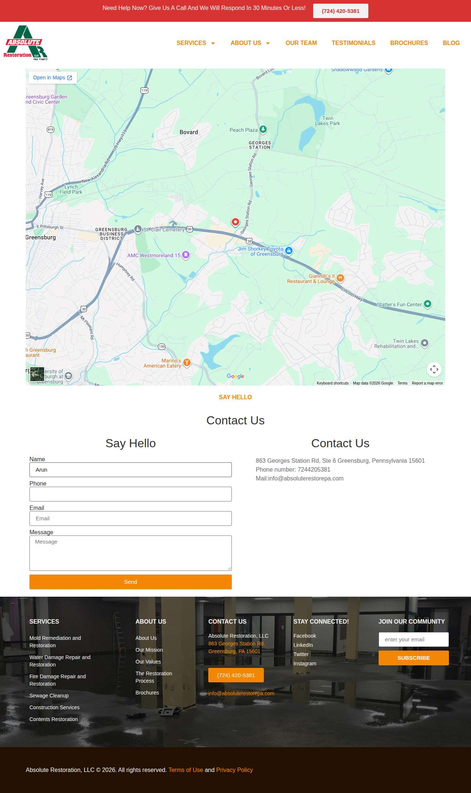

### masoudlawfirm.com — failed\_before\_submit (LIVE)

| | |
|---|---|
| Attempt ID | `5cdb5414-d588-4f96-907e-22337a5dacd5` |
| Form URL | https://masoudlawfirm.com/contact/ |
| Final URL | — |
| Reserved | 2026-11-05 03:01:13 UTC |
| Submit attempted | — |
| Template | standard v2 |
| Confirmation text | none observed |
| Result / error | locator.fill: Error: Cannot type text into input\[type=number\] |

Exact message:

~~~text
Subject: Helping customers find your business in AI search (AEO + GEO)

Hi there,

I'm Arun from Devs Arun. More and more customers now ask ChatGPT, Gemini, Perplexity or Google's AI Overviews questions like "who should I hire for this in my area?" before they call anyone. These tools answer from websites they can clearly understand, and they tend to recommend businesses whose pages answer real customer questions.

That is what AEO + GEO (Answer Engine and Generative Engine Optimization) is for. I improve your existing service pages so they clearly answer the questions your customers ask, add structured data that matches the page, and make the call, quote or enquiry step obvious. The benefit: your business gets a better chance of being mentioned or linked in AI answers, and visitors who arrive find it easy to contact you.

The AEO + GEO Starter is a one-time $199 (about ₹16,999, negotiable) for one website: a basic audit, 10 customer questions, improvements to two existing pages, relevant structured data and an action plan, with one revision round.

You can read the full details, send an enquiry or book online here:
https://devsarun.io/aeo-geo/

If this isn't relevant, just reply and I won't contact you again.

Best,
Arun
Devs Arun
itschool408@gmail.com · +91 7654534323
~~~

Submitted field values:

- \#form-field-name: Arun
- \#form-field-field\_3374379: Hi there, I'm Arun from Devs Arun. More and more customers now ask ChatGPT, Gemini, Perplexity or Google's AI Overviews 
- \#form-field-field\_7731784: +91 7654534323
- \#form-field-field\_8bd0f16: itschool408@gmail.com

**Inspected page** — `run-87949dfc_attempt-5cdb5414_inspection_2026-11-05T03-01-15-289Z.jpg`

### whiteolivecpa.com — failed\_before\_submit (LIVE)

| | |
|---|---|
| Attempt ID | `c9a3dc40-760a-4722-a246-bada4d32f9ff` |
| Form URL | https://whiteolivecpa.com/contact/ |
| Final URL | — |
| Reserved | 2026-11-05 03:01:20 UTC |
| Submit attempted | — |
| Template | standard v2 |
| Confirmation text | none observed |
| Result / error | locator.fill: Error: Cannot type text into input\[type=number\] |

Exact message:

~~~text
Subject: Helping customers find your business in AI search (AEO + GEO)

Hi there,

I'm Arun from Devs Arun. More and more customers now ask ChatGPT, Gemini, Perplexity or Google's AI Overviews questions like "who should I hire for this in my area?" before they call anyone. These tools answer from websites they can clearly understand, and they tend to recommend businesses whose pages answer real customer questions.

That is what AEO + GEO (Answer Engine and Generative Engine Optimization) is for. I improve your existing service pages so they clearly answer the questions your customers ask, add structured data that matches the page, and make the call, quote or enquiry step obvious. The benefit: your business gets a better chance of being mentioned or linked in AI answers, and visitors who arrive find it easy to contact you.

The AEO + GEO Starter is a one-time $199 (about ₹16,999, negotiable) for one website: a basic audit, 10 customer questions, improvements to two existing pages, relevant structured data and an action plan, with one revision round.

You can read the full details, send an enquiry or book online here:
https://devsarun.io/aeo-geo/

If this isn't relevant, just reply and I won't contact you again.

Best,
Arun
Devs Arun
itschool408@gmail.com · +91 7654534323
~~~

Submitted field values:

- \#ff\_1\_email: itschool408@gmail.com
- \#ff\_1\_message: Hi there, I'm Arun from Devs Arun. More and more customers now ask ChatGPT, Gemini, Perplexity or Google's AI Overviews 
- \#ff\_1\_numeric\_field: +91 7654534323
- \#ff\_1\_names\_first\_name\_: Arun

**Inspected page** — `run-87949dfc_attempt-c9a3dc40_inspection_2026-11-05T03-01-21-832Z.jpg`

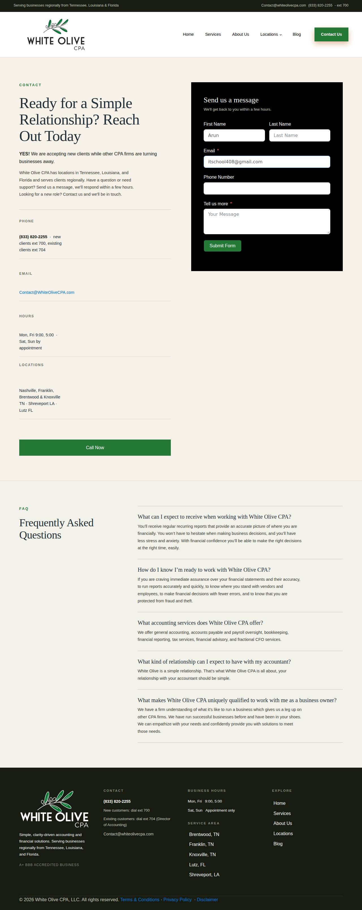

### westbrookeplace.com — unclear (LIVE)

| | |
|---|---|
| Attempt ID | `9dc7178b-8bb9-4ee6-9534-e8298d2c388d` |
| Form URL | https://www.westbrookeplace.com/contact |
| Final URL | https://www.westbrookeplace.com/contact |
| Reserved | 2026-11-05 03:01:26 UTC |
| Submit attempted | 2026-11-05 03:01:30 UTC |
| Template | standard v2 |
| Confirmation text | none observed |
| Result / error | No new success marker observed |

Exact message:

~~~text
Subject: Helping customers find your business in AI search (AEO + GEO)

Hi there,

I'm Arun from Devs Arun. More and more customers now ask ChatGPT, Gemini, Perplexity or Google's AI Overviews questions like "who should I hire for this in my area?" before they call anyone. These tools answer from websites they can clearly understand, and they tend to recommend businesses whose pages answer real customer questions.

That is what AEO + GEO (Answer Engine and Generative Engine Optimization) is for. I improve your existing service pages so they clearly answer the questions your customers ask, add structured data that matches the page, and make the call, quote or enquiry step obvious. The benefit: your business gets a better chance of being mentioned or linked in AI answers, and visitors who arrive find it easy to contact you.

The AEO + GEO Starter is a one-time $199 (about ₹16,999, negotiable) for one website: a basic audit, 10 customer questions, improvements to two existing pages, relevant structured data and an action plan, with one revision round.

You can read the full details, send an enquiry or book online here:
https://devsarun.io/aeo-geo/

If this isn't relevant, just reply and I won't contact you again.

Best,
Arun
Devs Arun
itschool408@gmail.com · +91 7654534323
~~~

Submitted field values:

- name \[name\]: Arun
- email \[email\]: itschool408@gmail.com
- phone \[phone\]: +91 7654534323
- message \[message\]: Hi there, I'm Arun from Devs Arun. More and more customers now ask ChatGPT, Gemini, Perplexity or Google's AI Overviews 

**Filled form (before submit)** — `run-87949dfc_attempt-9dc7178b_filled_2026-11-05T03-01-30-514Z.jpg`

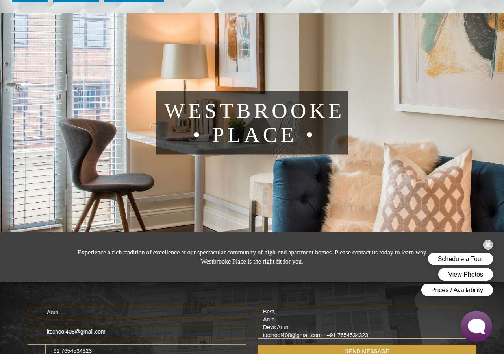

**After submit** — `run-87949dfc_attempt-9dc7178b_post_attempt_2026-11-05T03-01-59-300Z.jpg`

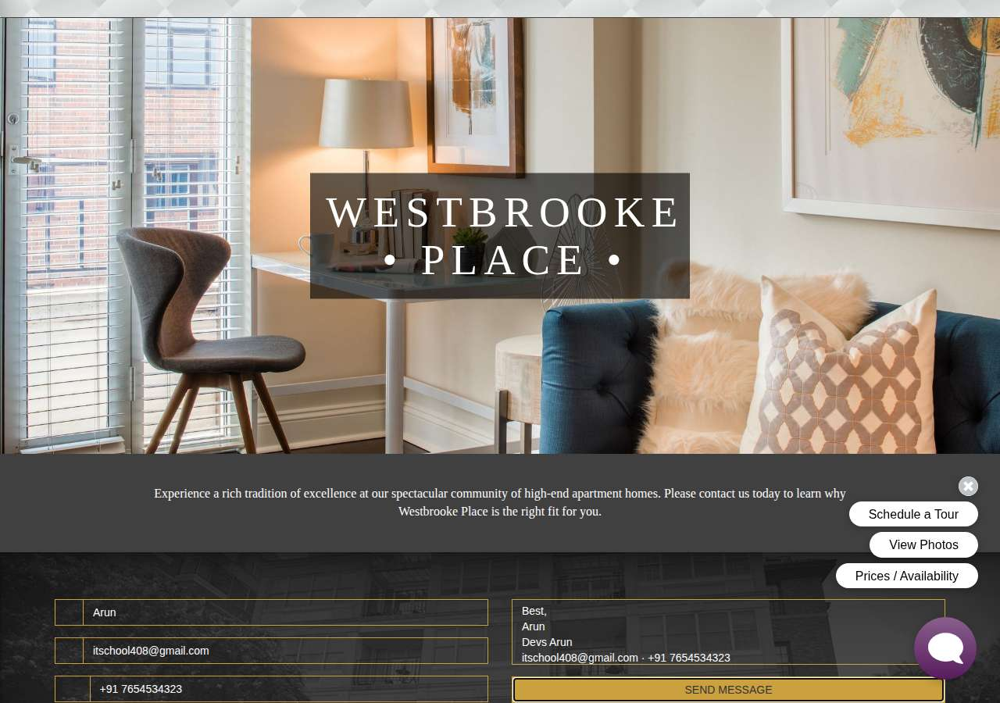

### grandlivingrealty.net — confirmed (LIVE)

| | |
|---|---|
| Attempt ID | `7758a4a4-f21d-40c0-a99c-d7756fcaf0f5` |
| Form URL | https://grandlivingrealty.net/contact/ |
| Final URL | https://grandlivingrealty.net/contact/ |
| Reserved | 2026-11-05 03:02:07 UTC |
| Submit attempted | 2026-11-05 03:02:10 UTC |
| Template | standard v2 |
| Confirmation text | EFERRED TITLE INVESTMENT LIVE BEACH CAM CONTACT WRITE TO US Thank you for your message. It has been sent. Thank you for your message. It has been sent. If, then—for there were “ifs” stil |
| Result / error | — |

Exact message:

~~~text
Subject: Helping customers find your business in AI search (AEO + GEO)

Hi there,

I'm Arun from Devs Arun. More and more customers now ask ChatGPT, Gemini, Perplexity or Google's AI Overviews questions like "who should I hire for this in my area?" before they call anyone. These tools answer from websites they can clearly understand, and they tend to recommend businesses whose pages answer real customer questions.

That is what AEO + GEO (Answer Engine and Generative Engine Optimization) is for. I improve your existing service pages so they clearly answer the questions your customers ask, add structured data that matches the page, and make the call, quote or enquiry step obvious. The benefit: your business gets a better chance of being mentioned or linked in AI answers, and visitors who arrive find it easy to contact you.

The AEO + GEO Starter is a one-time $199 (about ₹16,999, negotiable) for one website: a basic audit, 10 customer questions, improvements to two existing pages, relevant structured data and an action plan, with one revision round.

You can read the full details, send an enquiry or book online here:
https://devsarun.io/aeo-geo/

If this isn't relevant, just reply and I won't contact you again.

Best,
Arun
Devs Arun
itschool408@gmail.com · +91 7654534323
~~~

Submitted field values:

- your-name \[name\]: Arun
- your-email \[email\]: itschool408@gmail.com
- your-message \[message\]: Hi there, I'm Arun from Devs Arun. More and more customers now ask ChatGPT, Gemini, Perplexity or Google's AI Overviews 
- your-subject \[subject\]: Helping customers find your business in AI search (AEO + GEO)

**Filled form (before submit)** — `run-87949dfc_attempt-7758a4a4_filled_2026-11-05T03-02-10-112Z.jpg`

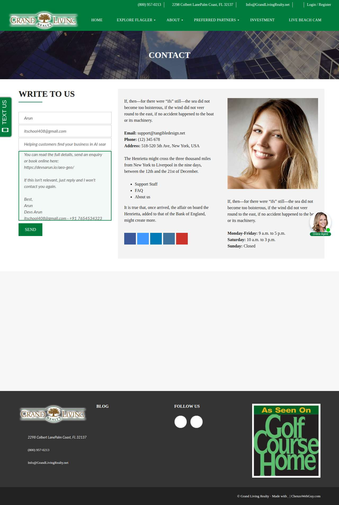

**After submit** — `run-87949dfc_attempt-7758a4a4_post_attempt_2026-11-05T03-02-22-379Z.jpg`

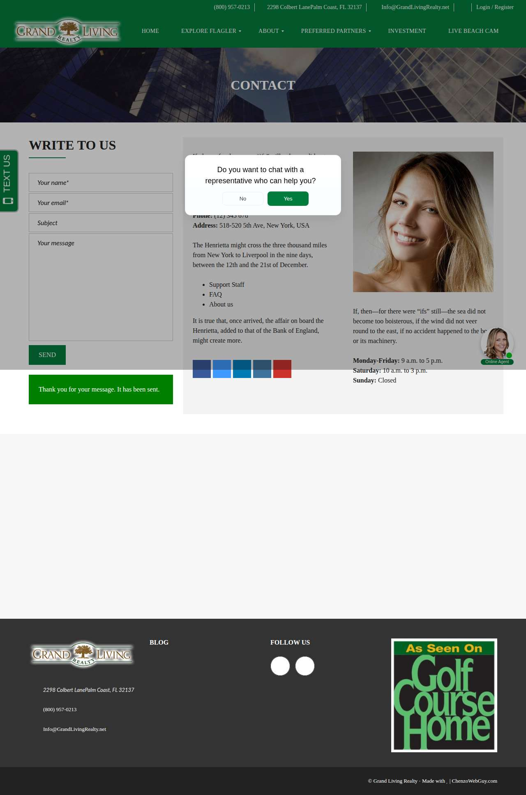

### wemertgrouprealty.com — failed\_before\_submit (LIVE)

| | |
|---|---|
| Attempt ID | `bfb67373-b2ae-43f1-99a1-66a6c999c77c` |
| Form URL | https://wemertgrouprealty.com/contact/ |
| Final URL | https://wemertgrouprealty.com/contact/ |
| Reserved | 2026-11-05 03:02:30 UTC |
| Submit attempted | — |
| Template | standard v2 |
| Confirmation text | none observed |
| Result / error | Field "Your Phone\*" did not accept the value |

Exact message:

~~~text
Subject: Helping customers find your business in AI search (AEO + GEO)

Hi there,

I'm Arun from Devs Arun. More and more customers now ask ChatGPT, Gemini, Perplexity or Google's AI Overviews questions like "who should I hire for this in my area?" before they call anyone. These tools answer from websites they can clearly understand, and they tend to recommend businesses whose pages answer real customer questions.

That is what AEO + GEO (Answer Engine and Generative Engine Optimization) is for. I improve your existing service pages so they clearly answer the questions your customers ask, add structured data that matches the page, and make the call, quote or enquiry step obvious. The benefit: your business gets a better chance of being mentioned or linked in AI answers, and visitors who arrive find it easy to contact you.

The AEO + GEO Starter is a one-time $199 (about ₹16,999, negotiable) for one website: a basic audit, 10 customer questions, improvements to two existing pages, relevant structured data and an action plan, with one revision round.

You can read the full details, send an enquiry or book online here:
https://devsarun.io/aeo-geo/

If this isn't relevant, just reply and I won't contact you again.

Best,
Arun
Devs Arun
itschool408@gmail.com · +91 7654534323
~~~

Submitted field values:

- \#input\_4\_3: itschool408@gmail.com
- \#input\_4\_4: +91 7654534323
- \#input\_4\_6: Hi there, I'm Arun from Devs Arun. More and more customers now ask ChatGPT, Gemini, Perplexity or Google's AI Overviews 
- \#input\_4\_8: Other
- \#input\_4\_1\_3: Arun

**Filled form (before submit)** — `run-87949dfc_attempt-bfb67373_filled_2026-11-05T03-02-32-688Z.jpg`

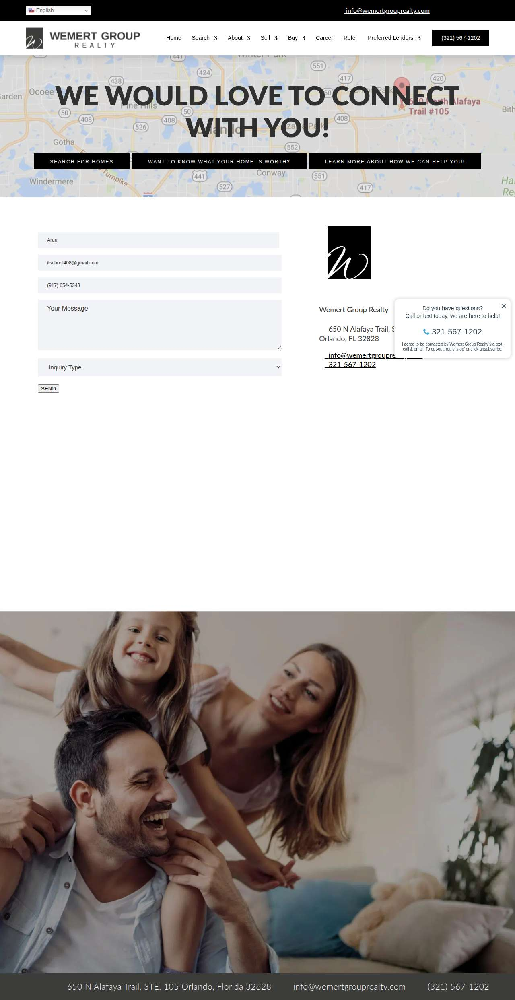

### trueinsuranceinc.com — confirmed (LIVE)

| | |
|---|---|
| Attempt ID | `7c1ef8a8-e543-468c-9413-f4e9a2c973e4` |
| Form URL | http://trueinsuranceinc.com/ |
| Final URL | http://trueinsuranceinc.com/ |
| Reserved | 2026-11-05 03:02:37 UTC |
| Submit attempted | 2026-11-05 03:02:38 UTC |
| Template | standard v2 |
| Confirmation text | ompletely satisfied and remain a life-long, loyal customer. Thank you for trusting in True... We're here for YOU\! 24/7 assistance Local Agents Always Available Same Day |
| Result / error | — |

Exact message:

~~~text
Subject: Helping customers find your business in AI search (AEO + GEO)

Hi there,

I'm Arun from Devs Arun. More and more customers now ask ChatGPT, Gemini, Perplexity or Google's AI Overviews questions like "who should I hire for this in my area?" before they call anyone. These tools answer from websites they can clearly understand, and they tend to recommend businesses whose pages answer real customer questions.

That is what AEO + GEO (Answer Engine and Generative Engine Optimization) is for. I improve your existing service pages so they clearly answer the questions your customers ask, add structured data that matches the page, and make the call, quote or enquiry step obvious. The benefit: your business gets a better chance of being mentioned or linked in AI answers, and visitors who arrive find it easy to contact you.

The AEO + GEO Starter is a one-time $199 (about ₹16,999, negotiable) for one website: a basic audit, 10 customer questions, improvements to two existing pages, relevant structured data and an action plan, with one revision round.

You can read the full details, send an enquiry or book online here:
https://devsarun.io/aeo-geo/

If this isn't relevant, just reply and I won't contact you again.

Best,
Arun
Devs Arun
itschool408@gmail.com · +91 7654534323
~~~

Submitted field values:

- name \[name\]: Arun
- email \[email\]: itschool408@gmail.com
- phone \[phone\]: +91 7654534323
- message \[message\]: Hi there, I'm Arun from Devs Arun. More and more customers now ask ChatGPT, Gemini, Perplexity or Google's AI Overviews 
- insurance\_type \[fixed\]: Other

**Filled form (before submit)** — `run-87949dfc_attempt-7c1ef8a8_filled_2026-11-05T03-02-38-965Z.jpg`

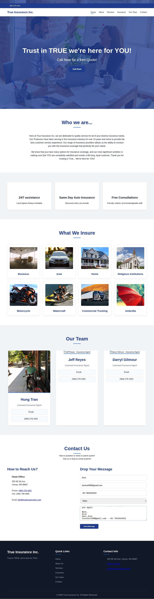

**After submit** — `run-87949dfc_attempt-7c1ef8a8_post_attempt_2026-11-05T03-02-44-593Z.jpg`

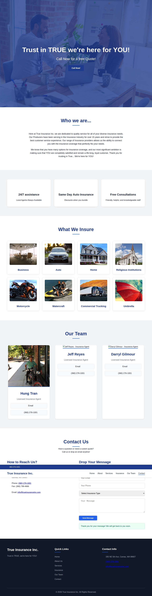

### northerntitle.net — confirmed (LIVE)

| | |
|---|---|
| Attempt ID | `0145a824-c9cb-41d6-86bb-68cff4e5e6e0` |
| Form URL | https://www.northerntitle.net/contact |
| Final URL | https://www.northerntitle.net/thank-you |
| Reserved | 2026-11-05 03:02:52 UTC |
| Submit attempted | 2026-11-05 03:02:54 UTC |
| Template | standard v2 |
| Confirmation text | Redirected to /thank-you |
| Result / error | — |

Exact message:

~~~text
Subject: Helping customers find your business in AI search (AEO + GEO)

Hi there,

I'm Arun from Devs Arun. More and more customers now ask ChatGPT, Gemini, Perplexity or Google's AI Overviews questions like "who should I hire for this in my area?" before they call anyone. These tools answer from websites they can clearly understand, and they tend to recommend businesses whose pages answer real customer questions.

That is what AEO + GEO (Answer Engine and Generative Engine Optimization) is for. I improve your existing service pages so they clearly answer the questions your customers ask, add structured data that matches the page, and make the call, quote or enquiry step obvious. The benefit: your business gets a better chance of being mentioned or linked in AI answers, and visitors who arrive find it easy to contact you.

The AEO + GEO Starter is a one-time $199 (about ₹16,999, negotiable) for one website: a basic audit, 10 customer questions, improvements to two existing pages, relevant structured data and an action plan, with one revision round.

You can read the full details, send an enquiry or book online here:
https://devsarun.io/aeo-geo/

If this isn't relevant, just reply and I won't contact you again.

Best,
Arun
Devs Arun
itschool408@gmail.com · +91 7654534323
~~~

Submitted field values:

- Name \[name\]: Arun
- Email \[email\]: itschool408@gmail.com
- Phone \[phone\]: +91 7654534323
- message \[message\]: Hi there, I'm Arun from Devs Arun. More and more customers now ask ChatGPT, Gemini, Perplexity or Google's AI Overviews 

**Filled form (before submit)** — `run-87949dfc_attempt-0145a824_filled_2026-11-05T03-02-54-088Z.jpg`

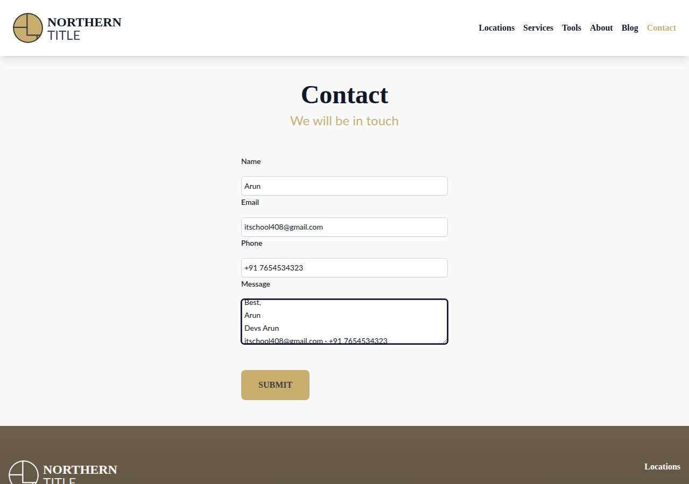

**After submit** — `run-87949dfc_attempt-0145a824_post_attempt_2026-11-05T03-02-58-320Z.jpg`

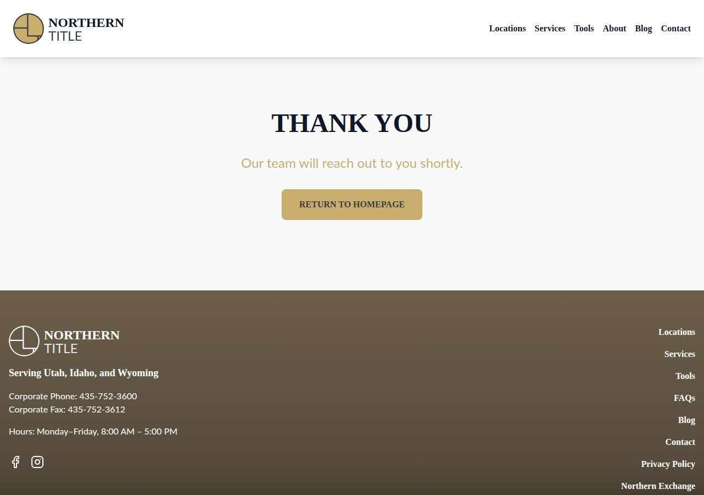

### thepaulagency.com — unclear (LIVE)

| | |
|---|---|
| Attempt ID | `10348c7d-d417-4a6f-b447-0b87399017d2` |
| Form URL | https://www.thepaulagency.com/contact |
| Final URL | https://www.thepaulagency.com/contact |
| Reserved | 2026-11-05 03:03:06 UTC |
| Submit attempted | 2026-11-05 03:03:09 UTC |
| Template | standard v2 |
| Confirmation text | none observed |
| Result / error | No new success marker observed |

Exact message:

~~~text
Subject: Helping customers find your business in AI search (AEO + GEO)

Hi there,

I'm Arun from Devs Arun. More and more customers now ask ChatGPT, Gemini, Perplexity or Google's AI Overviews questions like "who should I hire for this in my area?" before they call anyone. These tools answer from websites they can clearly understand, and they tend to recommend businesses whose pages answer real customer questions.

That is what AEO + GEO (Answer Engine and Generative Engine Optimization) is for. I improve your existing service pages so they clearly answer the questions your customers ask, add structured data that matches the page, and make the call, quote or enquiry step obvious. The benefit: your business gets a better chance of being mentioned or linked in AI answers, and visitors who arrive find it easy to contact you.

The AEO + GEO Starter is a one-time $199 (about ₹16,999, negotiable) for one website: a basic audit, 10 customer questions, improvements to two existing pages, relevant structured data and an action plan, with one revision round.

You can read the full details, send an enquiry or book online here:
https://devsarun.io/aeo-geo/

If this isn't relevant, just reply and I won't contact you again.

Best,
Arun
Devs Arun
itschool408@gmail.com · +91 7654534323
~~~

Submitted field values:

- Your name \* \[name\]: Arun
- Message \* \[message\]: Hi there, I'm Arun from Devs Arun. More and more customers now ask ChatGPT, Gemini, Perplexity or Google's AI Overviews 
- Email or phone \* \[email\]: itschool408@gmail.com

**Filled form (before submit)** — `run-87949dfc_attempt-10348c7d_filled_2026-11-05T03-03-09-477Z.jpg`

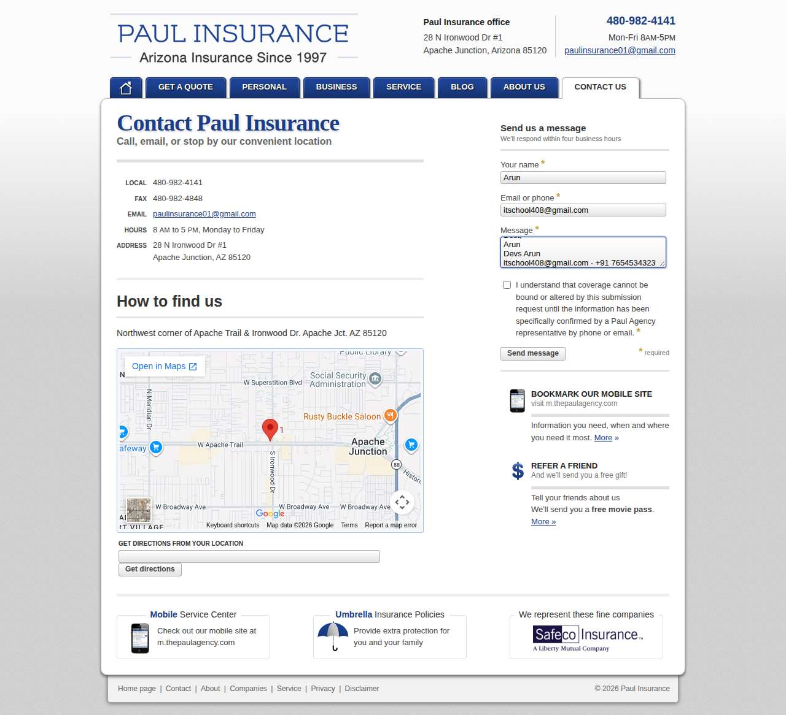

**After submit** — `run-87949dfc_attempt-10348c7d_post_attempt_2026-11-05T03-03-41-759Z.jpg`

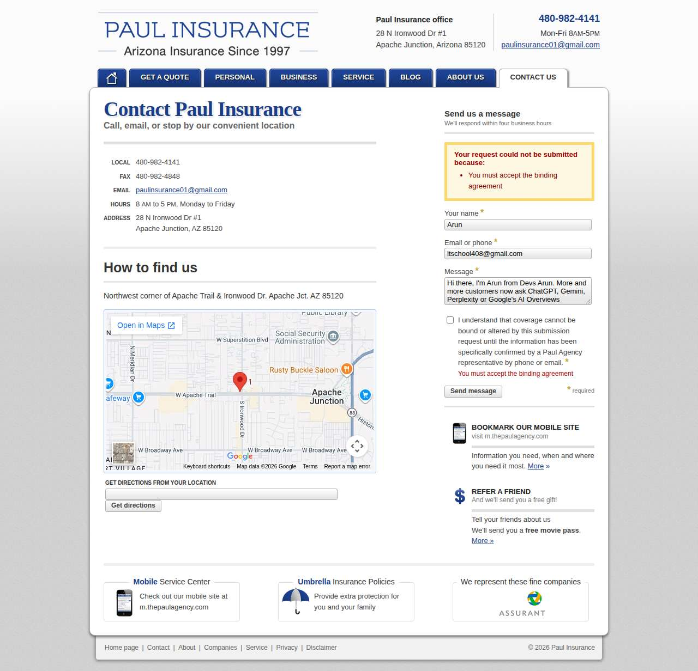

### pjobrokerage.com — error\_after\_submit (LIVE)

| | |
|---|---|
| Attempt ID | `4309fa28-d05d-4b48-818f-db5cd6dbed65` |
| Form URL | https://pjobrokerage.com/contact/ |
| Final URL | https://pjobrokerage.com/contact/ |
| Reserved | 2026-11-05 03:03:49 UTC |
| Submit attempted | 2026-11-05 03:03:51 UTC |
| Template | standard v2 |
| Confirmation text | Write Us One or more fields have an error. Please check and try again. The field is required. The field is required. The field is required. The field is required. The fi |
| Result / error | — |

Exact message:

~~~text
Subject: Helping customers find your business in AI search (AEO + GEO)

Hi there,

I'm Arun from Devs Arun. More and more customers now ask ChatGPT, Gemini, Perplexity or Google's AI Overviews questions like "who should I hire for this in my area?" before they call anyone. These tools answer from websites they can clearly understand, and they tend to recommend businesses whose pages answer real customer questions.

That is what AEO + GEO (Answer Engine and Generative Engine Optimization) is for. I improve your existing service pages so they clearly answer the questions your customers ask, add structured data that matches the page, and make the call, quote or enquiry step obvious. The benefit: your business gets a better chance of being mentioned or linked in AI answers, and visitors who arrive find it easy to contact you.

The AEO + GEO Starter is a one-time $199 (about ₹16,999, negotiable) for one website: a basic audit, 10 customer questions, improvements to two existing pages, relevant structured data and an action plan, with one revision round.

You can read the full details, send an enquiry or book online here:
https://devsarun.io/aeo-geo/

If this isn't relevant, just reply and I won't contact you again.

Best,
Arun
Devs Arun
itschool408@gmail.com · +91 7654534323
~~~

Submitted field values:

- your-name \[name\]: Arun
- message \[message\]: Hi there, I'm Arun from Devs Arun. More and more customers now ask ChatGPT, Gemini, Perplexity or Google's AI Overviews 
- your-email \[email\]: itschool408@gmail.com
- your-phone \[phone\]: +91 7654534323

**Filled form (before submit)** — `run-87949dfc_attempt-4309fa28_filled_2026-11-05T03-03-51-892Z.jpg`

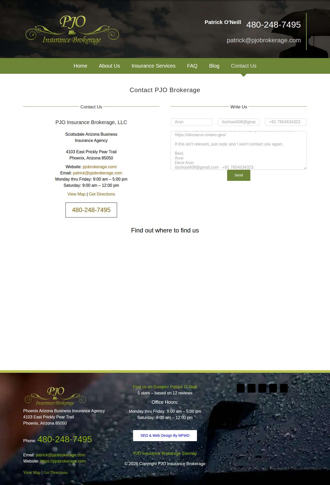

**After submit** — `run-87949dfc_attempt-4309fa28_post_attempt_2026-11-05T03-03-56-235Z.jpg`

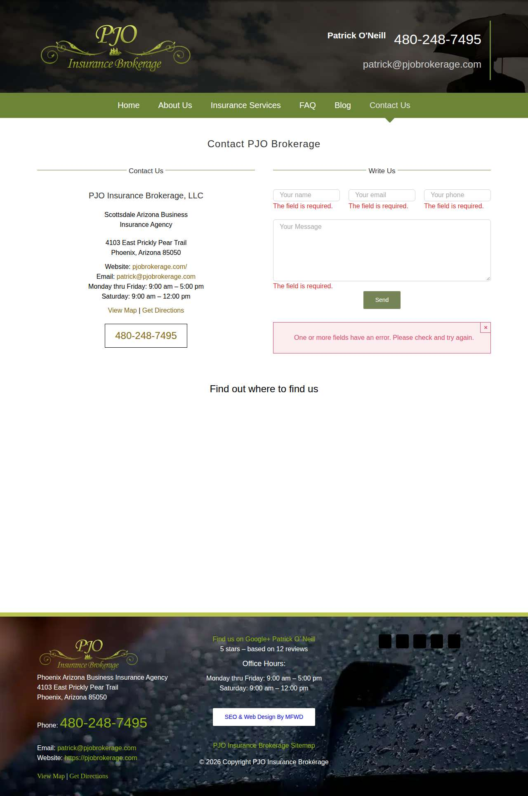

### abrams-california-health-insurance.com — unclear (LIVE)

| | |
|---|---|
| Attempt ID | `49b8f0e6-f070-49fa-8230-75a1e1301ebe` |
| Form URL | http://www.abrams-california-health-insurance.com/contact-us/ |
| Final URL | http://www.abrams-california-health-insurance.com/contact-us/ |
| Reserved | 2026-11-05 03:04:04 UTC |
| Submit attempted | 2026-11-05 03:04:06 UTC |
| Template | standard v2 |
| Confirmation text | none observed |
| Result / error | No new success marker observed |

Exact message:

~~~text
Subject: Helping customers find your business in AI search (AEO + GEO)

Hi there,

I'm Arun from Devs Arun. More and more customers now ask ChatGPT, Gemini, Perplexity or Google's AI Overviews questions like "who should I hire for this in my area?" before they call anyone. These tools answer from websites they can clearly understand, and they tend to recommend businesses whose pages answer real customer questions.

That is what AEO + GEO (Answer Engine and Generative Engine Optimization) is for. I improve your existing service pages so they clearly answer the questions your customers ask, add structured data that matches the page, and make the call, quote or enquiry step obvious. The benefit: your business gets a better chance of being mentioned or linked in AI answers, and visitors who arrive find it easy to contact you.

The AEO + GEO Starter is a one-time $199 (about ₹16,999, negotiable) for one website: a basic audit, 10 customer questions, improvements to two existing pages, relevant structured data and an action plan, with one revision round.

You can read the full details, send an enquiry or book online here:
https://devsarun.io/aeo-geo/

If this isn't relevant, just reply and I won't contact you again.

Best,
Arun
Devs Arun
itschool408@gmail.com · +91 7654534323
~~~

Submitted field values:

- email \[email\]: itschool408@gmail.com
- que \[message\]: Hi there, I'm Arun from Devs Arun. More and more customers now ask ChatGPT, Gemini, Perplexity or Google's AI Overviews 
- mobile\_no \[phone\]: +91 7654534323
- firstname \[first\_name\]: Arun

**Filled form (before submit)** — `run-87949dfc_attempt-49b8f0e6_filled_2026-11-05T03-04-06-127Z.jpg`

**After submit** — `run-87949dfc_attempt-49b8f0e6_post_attempt_2026-11-05T03-04-34-427Z.jpg`

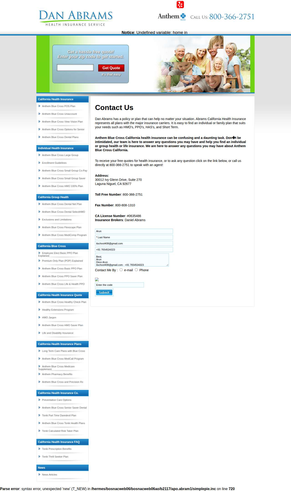

## Events (91)

| Time (UTC) | Event | Website | Details |
|---|---|---|---|
| 03:00:45 | run\_queued | — | live run requested by github:itsDevsArun |
| 03:00:45 | run\_dispatched | — | dispatch disabled (local test mode) |
| 03:00:48 | run\_started | — | Runner claimed live run |
| 03:00:49 | offer\_verified | — | Service page offer facts verified |
| 03:00:49 | website\_selected | clearchoiceplumbingllc.com | Live target clearchoiceplumbingllc.com |
| 03:00:49 | attempt\_reserved | clearchoiceplumbingllc.com | Submission attempt reserved with template standard v2 |
| 03:00:51 | page\_opened | clearchoiceplumbingllc.com | Opened form page |
| 03:00:51 | screenshot\_saved | clearchoiceplumbingllc.com | inspection screenshot saved (145 KB) |
| 03:00:51 | review\_required | clearchoiceplumbingllc.com | failed before submit: locator.fill: Error: Cannot type text into input\[type=number\] |
| 03:00:56 | website\_selected | bwnwincpainting.com | Live target bwnwincpainting.com |
| 03:00:56 | attempt\_reserved | bwnwincpainting.com | Submission attempt reserved with template standard v2 |
| 03:00:58 | page\_opened | bwnwincpainting.com | Opened form page |
| 03:00:58 | screenshot\_saved | bwnwincpainting.com | inspection screenshot saved (118 KB) |
| 03:00:58 | review\_required | bwnwincpainting.com | failed before submit: locator.fill: Error: Cannot type text into input\[type=number\] |
| 03:01:03 | website\_selected | absoluterestorepa.com | Live target absoluterestorepa.com |
| 03:01:03 | attempt\_reserved | absoluterestorepa.com | Submission attempt reserved with template standard v2 |
| 03:01:08 | page\_opened | absoluterestorepa.com | Opened form page |
| 03:01:08 | screenshot\_saved | absoluterestorepa.com | inspection screenshot saved (174 KB) |
| 03:01:08 | review\_required | absoluterestorepa.com | failed before submit: locator.fill: Error: Cannot type text into input\[type=number\] |
| 03:01:13 | website\_selected | masoudlawfirm.com | Live target masoudlawfirm.com |
| 03:01:13 | attempt\_reserved | masoudlawfirm.com | Submission attempt reserved with template standard v2 |
| 03:01:14 | page\_opened | masoudlawfirm.com | Opened form page |
| 03:01:15 | screenshot\_saved | masoudlawfirm.com | inspection screenshot saved (169 KB) |
| 03:01:15 | review\_required | masoudlawfirm.com | failed before submit: locator.fill: Error: Cannot type text into input\[type=number\] |
| 03:01:20 | website\_selected | whiteolivecpa.com | Live target whiteolivecpa.com |
| 03:01:20 | attempt\_reserved | whiteolivecpa.com | Submission attempt reserved with template standard v2 |
| 03:01:21 | page\_opened | whiteolivecpa.com | Opened form page |
| 03:01:21 | screenshot\_saved | whiteolivecpa.com | inspection screenshot saved (198 KB) |
| 03:01:21 | review\_required | whiteolivecpa.com | failed before submit: locator.fill: Error: Cannot type text into input\[type=number\] |
| 03:01:26 | website\_selected | westbrookeplace.com | Live target westbrookeplace.com |
| 03:01:26 | attempt\_reserved | westbrookeplace.com | Submission attempt reserved with template standard v2 |
| 03:01:30 | page\_opened | westbrookeplace.com | Opened form page |
| 03:01:30 | fields\_filled | westbrookeplace.com | filled |
| 03:01:30 | screenshot\_saved | westbrookeplace.com | filled screenshot saved (107 KB) |
| 03:01:30 | submit\_attempted | westbrookeplace.com | submitting |
| 03:01:59 | screenshot\_saved | westbrookeplace.com | post\_attempt screenshot saved (110 KB) |
| 03:01:59 | review\_required | westbrookeplace.com | unclear: No new success marker observed |
| 03:02:07 | website\_selected | grandlivingrealty.net | Live target grandlivingrealty.net |
| 03:02:07 | attempt\_reserved | grandlivingrealty.net | Submission attempt reserved with template standard v2 |
| 03:02:09 | page\_opened | grandlivingrealty.net | Opened form page |
| 03:02:09 | fields\_filled | grandlivingrealty.net | filled |
| 03:02:10 | screenshot\_saved | grandlivingrealty.net | filled screenshot saved (145 KB) |
| 03:02:10 | submit\_attempted | grandlivingrealty.net | submitting |
| 03:02:22 | screenshot\_saved | grandlivingrealty.net | post\_attempt screenshot saved (120 KB) |
| 03:02:22 | confirmation\_observed | grandlivingrealty.net | confirmed — "EFERRED TITLE INVESTMENT LIVE BEACH CAM CONTACT WRITE TO US Thank you for your message. It has been sent. Thank you for " |
| 03:02:30 | website\_selected | wemertgrouprealty.com | Live target wemertgrouprealty.com |
| 03:02:30 | attempt\_reserved | wemertgrouprealty.com | Submission attempt reserved with template standard v2 |
| 03:02:32 | page\_opened | wemertgrouprealty.com | Opened form page |
| 03:02:32 | screenshot\_saved | wemertgrouprealty.com | filled screenshot saved (157 KB) |
| 03:02:32 | review\_required | wemertgrouprealty.com | failed before submit: Field "Your Phone\*" did not accept the value |
| 03:02:37 | website\_selected | trueinsuranceinc.com | Live target trueinsuranceinc.com |
| 03:02:37 | attempt\_reserved | trueinsuranceinc.com | Submission attempt reserved with template standard v2 |
| 03:02:38 | page\_opened | trueinsuranceinc.com | Opened form page |
| 03:02:38 | fields\_filled | trueinsuranceinc.com | filled |
| 03:02:38 | screenshot\_saved | trueinsuranceinc.com | filled screenshot saved (315 KB) |
| 03:02:38 | submit\_attempted | trueinsuranceinc.com | submitting |
| 03:02:44 | screenshot\_saved | trueinsuranceinc.com | post\_attempt screenshot saved (308 KB) |
| 03:02:44 | confirmation\_observed | trueinsuranceinc.com | confirmed — "ompletely satisfied and remain a life-long, loyal customer. Thank you for trusting in True... We're here for YOU\! 24/7 a" |
| 03:02:52 | website\_selected | northerntitle.net | Live target northerntitle.net |
| 03:02:52 | attempt\_reserved | northerntitle.net | Submission attempt reserved with template standard v2 |
| 03:02:53 | page\_opened | northerntitle.net | Opened form page |
| 03:02:54 | fields\_filled | northerntitle.net | filled |
| 03:02:54 | screenshot\_saved | northerntitle.net | filled screenshot saved (29 KB) |
| 03:02:54 | submit\_attempted | northerntitle.net | submitting |
| 03:02:58 | screenshot\_saved | northerntitle.net | post\_attempt screenshot saved (34 KB) |
| 03:02:58 | confirmation\_observed | northerntitle.net | confirmed — "Redirected to /thank-you" |
| 03:03:06 | website\_selected | thepaulagency.com | Live target thepaulagency.com |
| 03:03:06 | attempt\_reserved | thepaulagency.com | Submission attempt reserved with template standard v2 |
| 03:03:09 | page\_opened | thepaulagency.com | Opened form page |
| 03:03:09 | fields\_filled | thepaulagency.com | filled |
| 03:03:09 | screenshot\_saved | thepaulagency.com | filled screenshot saved (116 KB) |
| 03:03:09 | submit\_attempted | thepaulagency.com | submitting |
| 03:03:41 | screenshot\_saved | thepaulagency.com | post\_attempt screenshot saved (124 KB) |
| 03:03:41 | review\_required | thepaulagency.com | unclear: No new success marker observed |
| 03:03:49 | website\_selected | pjobrokerage.com | Live target pjobrokerage.com |
| 03:03:49 | attempt\_reserved | pjobrokerage.com | Submission attempt reserved with template standard v2 |
| 03:03:51 | page\_opened | pjobrokerage.com | Opened form page |
| 03:03:51 | fields\_filled | pjobrokerage.com | filled |
| 03:03:51 | screenshot\_saved | pjobrokerage.com | filled screenshot saved (132 KB) |
| 03:03:51 | submit\_attempted | pjobrokerage.com | submitting |
| 03:03:56 | screenshot\_saved | pjobrokerage.com | post\_attempt screenshot saved (136 KB) |
| 03:03:56 | error | pjobrokerage.com | error after submit — "Write Us One or more fields have an error. Please check and try again. The field is required. The field is required. The" |
| 03:04:04 | website\_selected | abrams-california-health-insurance.com | Live target abrams-california-health-insurance.com |
| 03:04:04 | attempt\_reserved | abrams-california-health-insurance.com | Submission attempt reserved with template standard v2 |
| 03:04:05 | page\_opened | abrams-california-health-insurance.com | Opened form page |
| 03:04:06 | fields\_filled | abrams-california-health-insurance.com | filled |
| 03:04:06 | screenshot\_saved | abrams-california-health-insurance.com | filled screenshot saved (182 KB) |
| 03:04:06 | submit\_attempted | abrams-california-health-insurance.com | submitting |
| 03:04:34 | screenshot\_saved | abrams-california-health-insurance.com | post\_attempt screenshot saved (182 KB) |
| 03:04:34 | review\_required | abrams-california-health-insurance.com | unclear: No new success marker observed |
| 03:04:42 | run\_completed | — | Run completed (queue\_exhausted) |
