# Run 8bb2abb6 — live — completed

| | |
|---|---|
| Run ID | `8bb2abb6-0dba-4d13-be4b-d67a15950525` |
| Requested by | github:itsDevsArun |
| Started | 2026-11-05 06:08:26 UTC |
| Finished | 2026-11-05 06:13:19 UTC |
| Finish reason | queue\_exhausted |
| GitHub Actions | https://github.com/itsDevsArun/aeo-geo/actions/runs/41950876497 |

CSV for this run: [runs/2026-11-05_live_8bb2abb6.csv](2026-11-05_live_8bb2abb6.csv)

## Attempts (15)

### clearchoiceplumbingllc.com — failed\_before\_submit (LIVE)

| | |
|---|---|
| Attempt ID | `edcf0664-556a-4d83-ba4a-fc976496129a` |
| Form URL | https://clearchoiceplumbingllc.com/contact/ |
| Final URL | — |
| Reserved | 2026-11-05 06:08:28 UTC |
| Submit attempted | — |
| Template | standard v2 |
| Confirmation text | none observed |
| Result / error | locator.fill: Error: Cannot type text into input\[type=number\] |

Exact message:

~~~text
Subject: Helping customers find your business in AI search (AEO + GEO)

Hi there,

I'm Arun from Devs Arun. More and more customers now ask ChatGPT, Gemini, Perplexity or Google's AI Overviews questions like "who should I hire for this in my area?" before they call anyone. These tools answer from websites they can clearly understand, and they tend to recommend businesses whose pages answer real customer questions.

That is what AEO + GEO (Answer Engine and Generative Engine Optimization) is for. I improve your existing service pages so they clearly answer the questions your customers ask, add structured data that matches the page, and make the call, quote or enquiry step obvious. The benefit: your business gets a better chance of being mentioned or linked in AI answers, and visitors who arrive find it easy to contact you.

The AEO + GEO Starter is a one-time $199 (about ₹16,999, negotiable) for one website: a basic audit, 10 customer questions, improvements to two existing pages, relevant structured data and an action plan, with one revision round.

You can read the full details, send an enquiry or book online here:
https://devsarun.io/aeo-geo/

If this isn't relevant, just reply and I won't contact you again.

Best,
Arun
Devs Arun
itschool408@gmail.com · +91 7654534323
~~~

Submitted field values:

- \#wpforms-51-field\_1: Arun
- \#wpforms-51-field\_2: itschool408@gmail.com
- \#wpforms-51-field\_3: Hi there, I'm Arun from Devs Arun. More and more customers now ask ChatGPT, Gemini, Perplexity or Google's AI Overviews 
- \#wpforms-51-field\_5: +91 7654534323

**Inspected page** — `run-8bb2abb6_attempt-edcf0664_inspection_2026-11-05T06-08-29-584Z.jpg`

### bwnwincpainting.com — failed\_before\_submit (LIVE)

| | |
|---|---|
| Attempt ID | `ef1244fd-2faa-4ca1-9e62-e7f2eff3c68f` |
| Form URL | https://www.bwnwincpainting.com/contact/ |
| Final URL | — |
| Reserved | 2026-11-05 06:08:34 UTC |
| Submit attempted | — |
| Template | standard v2 |
| Confirmation text | none observed |
| Result / error | locator.fill: Error: Cannot type text into input\[type=number\] |

Exact message:

~~~text
Subject: Helping customers find your business in AI search (AEO + GEO)

Hi there,

I'm Arun from Devs Arun. More and more customers now ask ChatGPT, Gemini, Perplexity or Google's AI Overviews questions like "who should I hire for this in my area?" before they call anyone. These tools answer from websites they can clearly understand, and they tend to recommend businesses whose pages answer real customer questions.

That is what AEO + GEO (Answer Engine and Generative Engine Optimization) is for. I improve your existing service pages so they clearly answer the questions your customers ask, add structured data that matches the page, and make the call, quote or enquiry step obvious. The benefit: your business gets a better chance of being mentioned or linked in AI answers, and visitors who arrive find it easy to contact you.

The AEO + GEO Starter is a one-time $199 (about ₹16,999, negotiable) for one website: a basic audit, 10 customer questions, improvements to two existing pages, relevant structured data and an action plan, with one revision round.

You can read the full details, send an enquiry or book online here:
https://devsarun.io/aeo-geo/

If this isn't relevant, just reply and I won't contact you again.

Best,
Arun
Devs Arun
itschool408@gmail.com · +91 7654534323
~~~

Submitted field values:

- \#name-1151: Arun
- \#email-1151: itschool408@gmail.com
- \#phone-1151: +91 7654534323
- \#message-1151: Hi there, I'm Arun from Devs Arun. More and more customers now ask ChatGPT, Gemini, Perplexity or Google's AI Overviews 

**Inspected page** — `run-8bb2abb6_attempt-ef1244fd_inspection_2026-11-05T06-08-36-345Z.jpg`

### absoluterestorepa.com — failed\_before\_submit (LIVE)

| | |
|---|---|
| Attempt ID | `9382408c-31cb-4808-a7db-24c7dafd1164` |
| Form URL | https://absoluterestorepa.com/contact-us/ |
| Final URL | — |
| Reserved | 2026-11-05 06:08:41 UTC |
| Submit attempted | — |
| Template | standard v2 |
| Confirmation text | none observed |
| Result / error | locator.fill: Error: Cannot type text into input\[type=number\] |

Exact message:

~~~text
Subject: Helping customers find your business in AI search (AEO + GEO)

Hi there,

I'm Arun from Devs Arun. More and more customers now ask ChatGPT, Gemini, Perplexity or Google's AI Overviews questions like "who should I hire for this in my area?" before they call anyone. These tools answer from websites they can clearly understand, and they tend to recommend businesses whose pages answer real customer questions.

That is what AEO + GEO (Answer Engine and Generative Engine Optimization) is for. I improve your existing service pages so they clearly answer the questions your customers ask, add structured data that matches the page, and make the call, quote or enquiry step obvious. The benefit: your business gets a better chance of being mentioned or linked in AI answers, and visitors who arrive find it easy to contact you.

The AEO + GEO Starter is a one-time $199 (about ₹16,999, negotiable) for one website: a basic audit, 10 customer questions, improvements to two existing pages, relevant structured data and an action plan, with one revision round.

You can read the full details, send an enquiry or book online here:
https://devsarun.io/aeo-geo/

If this isn't relevant, just reply and I won't contact you again.

Best,
Arun
Devs Arun
itschool408@gmail.com · +91 7654534323
~~~

Submitted field values:

- \#form-field-name: Arun
- \#form-field-message: Hi there, I'm Arun from Devs Arun. More and more customers now ask ChatGPT, Gemini, Perplexity or Google's AI Overviews 
- \#form-field-field\_ed02ec2: +91 7654534323
- \#content \> div \> div \> div:nth-of-type(2) \> div \> div:nth-of-type(1) \> div:nth-of-type(2) \> div \> form \> div \> div:nth-of-type(3) \> input: itschool408@gmail.com

**Inspected page** — `run-8bb2abb6_attempt-9382408c_inspection_2026-11-05T06-08-44-248Z.jpg`

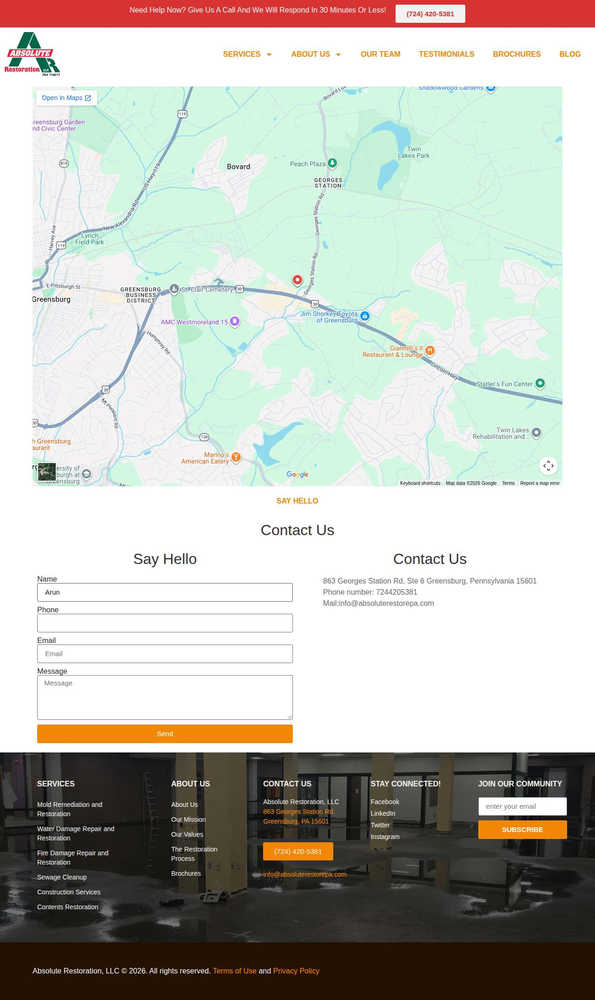

### masoudlawfirm.com — failed\_before\_submit (LIVE)

| | |
|---|---|
| Attempt ID | `3515d394-0036-453d-8b1f-93fea6fff19a` |
| Form URL | https://masoudlawfirm.com/contact/ |
| Final URL | — |
| Reserved | 2026-11-05 06:08:49 UTC |
| Submit attempted | — |
| Template | standard v2 |
| Confirmation text | none observed |
| Result / error | locator.fill: Error: Cannot type text into input\[type=number\] |

Exact message:

~~~text
Subject: Helping customers find your business in AI search (AEO + GEO)

Hi there,

I'm Arun from Devs Arun. More and more customers now ask ChatGPT, Gemini, Perplexity or Google's AI Overviews questions like "who should I hire for this in my area?" before they call anyone. These tools answer from websites they can clearly understand, and they tend to recommend businesses whose pages answer real customer questions.

That is what AEO + GEO (Answer Engine and Generative Engine Optimization) is for. I improve your existing service pages so they clearly answer the questions your customers ask, add structured data that matches the page, and make the call, quote or enquiry step obvious. The benefit: your business gets a better chance of being mentioned or linked in AI answers, and visitors who arrive find it easy to contact you.

The AEO + GEO Starter is a one-time $199 (about ₹16,999, negotiable) for one website: a basic audit, 10 customer questions, improvements to two existing pages, relevant structured data and an action plan, with one revision round.

You can read the full details, send an enquiry or book online here:
https://devsarun.io/aeo-geo/

If this isn't relevant, just reply and I won't contact you again.

Best,
Arun
Devs Arun
itschool408@gmail.com · +91 7654534323
~~~

Submitted field values:

- \#form-field-name: Arun
- \#form-field-field\_3374379: Hi there, I'm Arun from Devs Arun. More and more customers now ask ChatGPT, Gemini, Perplexity or Google's AI Overviews 
- \#form-field-field\_7731784: +91 7654534323
- \#form-field-field\_8bd0f16: itschool408@gmail.com

**Inspected page** — `run-8bb2abb6_attempt-3515d394_inspection_2026-11-05T06-08-51-119Z.jpg`

### whiteolivecpa.com — failed\_before\_submit (LIVE)

| | |
|---|---|
| Attempt ID | `2139a851-1ead-4aa5-b642-5e8995dd2aec` |
| Form URL | https://whiteolivecpa.com/contact/ |
| Final URL | — |
| Reserved | 2026-11-05 06:08:56 UTC |
| Submit attempted | — |
| Template | standard v2 |
| Confirmation text | none observed |
| Result / error | locator.fill: Error: Cannot type text into input\[type=number\] |

Exact message:

~~~text
Subject: Helping customers find your business in AI search (AEO + GEO)

Hi there,

I'm Arun from Devs Arun. More and more customers now ask ChatGPT, Gemini, Perplexity or Google's AI Overviews questions like "who should I hire for this in my area?" before they call anyone. These tools answer from websites they can clearly understand, and they tend to recommend businesses whose pages answer real customer questions.

That is what AEO + GEO (Answer Engine and Generative Engine Optimization) is for. I improve your existing service pages so they clearly answer the questions your customers ask, add structured data that matches the page, and make the call, quote or enquiry step obvious. The benefit: your business gets a better chance of being mentioned or linked in AI answers, and visitors who arrive find it easy to contact you.

The AEO + GEO Starter is a one-time $199 (about ₹16,999, negotiable) for one website: a basic audit, 10 customer questions, improvements to two existing pages, relevant structured data and an action plan, with one revision round.

You can read the full details, send an enquiry or book online here:
https://devsarun.io/aeo-geo/

If this isn't relevant, just reply and I won't contact you again.

Best,
Arun
Devs Arun
itschool408@gmail.com · +91 7654534323
~~~

Submitted field values:

- \#ff\_1\_email: itschool408@gmail.com
- \#ff\_1\_message: Hi there, I'm Arun from Devs Arun. More and more customers now ask ChatGPT, Gemini, Perplexity or Google's AI Overviews 
- \#ff\_1\_numeric\_field: +91 7654534323
- \#ff\_1\_names\_first\_name\_: Arun

**Inspected page** — `run-8bb2abb6_attempt-2139a851_inspection_2026-11-05T06-08-57-719Z.jpg`

### cornellpochily.com — unclear (LIVE)

| | |
|---|---|
| Attempt ID | `5d745f3d-3bca-4239-b066-2defd449ca3d` |
| Form URL | https://www.cornellpochily.com/contact-us |
| Final URL | https://www.cornellpochily.com/contact-us |
| Reserved | 2026-11-05 06:09:02 UTC |
| Submit attempted | 2026-11-05 06:09:05 UTC |
| Template | standard v2 |
| Confirmation text | none observed |
| Result / error | No new success marker observed |

Exact message:

~~~text
Subject: Helping customers find your business in AI search (AEO + GEO)

Hi there,

I'm Arun from Devs Arun. More and more customers now ask ChatGPT, Gemini, Perplexity or Google's AI Overviews questions like "who should I hire for this in my area?" before they call anyone. These tools answer from websites they can clearly understand, and they tend to recommend businesses whose pages answer real customer questions.

That is what AEO + GEO (Answer Engine and Generative Engine Optimization) is for. I improve your existing service pages so they clearly answer the questions your customers ask, add structured data that matches the page, and make the call, quote or enquiry step obvious. The benefit: your business gets a better chance of being mentioned or linked in AI answers, and visitors who arrive find it easy to contact you.

The AEO + GEO Starter is a one-time $199 (about ₹16,999, negotiable) for one website: a basic audit, 10 customer questions, improvements to two existing pages, relevant structured data and an action plan, with one revision round.

You can read the full details, send an enquiry or book online here:
https://devsarun.io/aeo-geo/

If this isn't relevant, just reply and I won't contact you again.

Best,
Arun
Devs Arun
itschool408@gmail.com · +91 7654534323
~~~

Submitted field values:

- Email \[email\]: itschool408@gmail.com
- Subject \[phone\]: +91 7654534323
- Message \[message\]: Hi there, I'm Arun from Devs Arun. More and more customers now ask ChatGPT, Gemini, Perplexity or Google's AI Overviews 
- First Name \[first\_name\]: Arun

**Filled form (before submit)** — `run-8bb2abb6_attempt-5d745f3d_filled_2026-11-05T06-09-05-575Z.jpg`

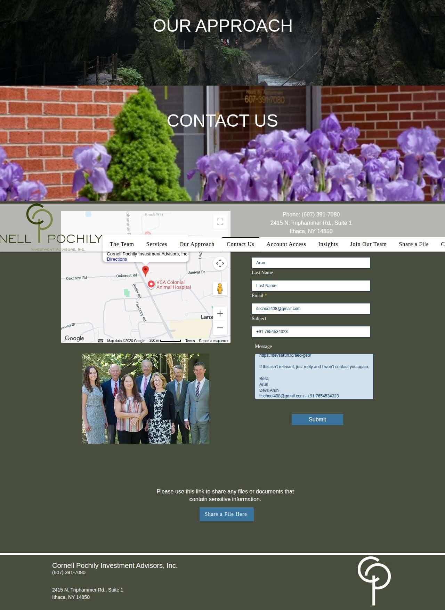

**After submit** — `run-8bb2abb6_attempt-5d745f3d_post_attempt_2026-11-05T06-09-34-642Z.jpg`

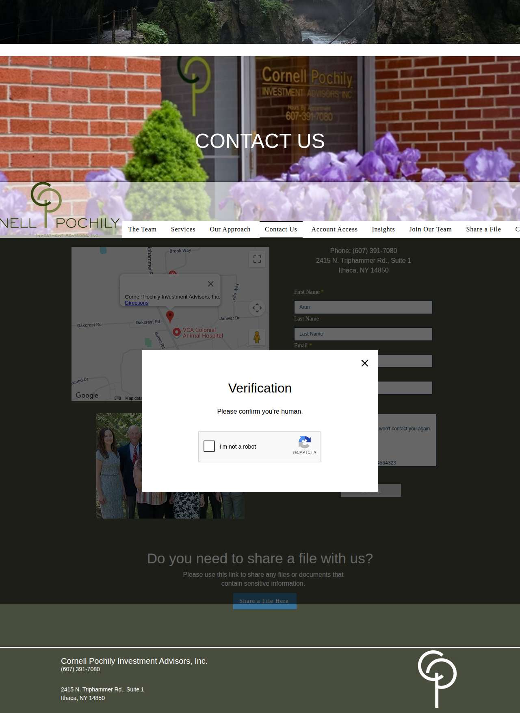

### swsllc.net — confirmed (LIVE)

| | |
|---|---|
| Attempt ID | `bacc0992-952d-480a-8815-6d9fbea8e28c` |
| Form URL | https://www.swsllc.net/contact |
| Final URL | https://www.swsllc.net/ |
| Reserved | 2026-11-05 06:09:42 UTC |
| Submit attempted | 2026-11-05 06:09:45 UTC |
| Template | standard v2 |
| Confirmation text | We Serve Resources Contact Client Login Status message Your message has been sent. × Personalized Client Experience Taking care of what's important so you can focus on what matters |
| Result / error | — |

Exact message:

~~~text
Subject: Helping customers find your business in AI search (AEO + GEO)

Hi there,

I'm Arun from Devs Arun. More and more customers now ask ChatGPT, Gemini, Perplexity or Google's AI Overviews questions like "who should I hire for this in my area?" before they call anyone. These tools answer from websites they can clearly understand, and they tend to recommend businesses whose pages answer real customer questions.

That is what AEO + GEO (Answer Engine and Generative Engine Optimization) is for. I improve your existing service pages so they clearly answer the questions your customers ask, add structured data that matches the page, and make the call, quote or enquiry step obvious. The benefit: your business gets a better chance of being mentioned or linked in AI answers, and visitors who arrive find it easy to contact you.

The AEO + GEO Starter is a one-time $199 (about ₹16,999, negotiable) for one website: a basic audit, 10 customer questions, improvements to two existing pages, relevant structured data and an action plan, with one revision round.

You can read the full details, send an enquiry or book online here:
https://devsarun.io/aeo-geo/

If this isn't relevant, just reply and I won't contact you again.

Best,
Arun
Devs Arun
itschool408@gmail.com · +91 7654534323
~~~

Submitted field values:

- Your name This field is required. \[name\]: Arun
- Message This field is required. \[message\]: Hi there, I'm Arun from Devs Arun. More and more customers now ask ChatGPT, Gemini, Perplexity or Google's AI Overviews 
- Subject This field is required. \[subject\]: Helping customers find your business in AI search (AEO + GEO)
- Your email address This field is required. \[email\]: itschool408@gmail.com

**Filled form (before submit)** — `run-8bb2abb6_attempt-bacc0992_filled_2026-11-05T06-09-45-851Z.jpg`

**After submit** — `run-8bb2abb6_attempt-bacc0992_post_attempt_2026-11-05T06-09-52-618Z.jpg`

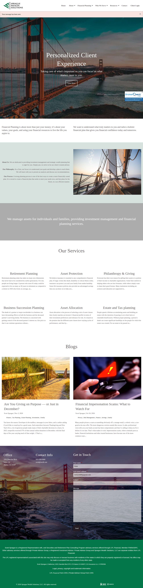

### colleyassetmgmt.com — unclear (LIVE)

| | |
|---|---|
| Attempt ID | `fc383cb9-a5af-4397-b3bb-85622ac47563` |
| Form URL | https://colleyassetmgmt.com/contact.htm |
| Final URL | https://colleyassetmgmt.com/404.shtml |
| Reserved | 2026-11-05 06:10:01 UTC |
| Submit attempted | 2026-11-05 06:10:02 UTC |
| Template | standard v2 |
| Confirmation text | none observed |
| Result / error | No new success marker observed |

Exact message:

~~~text
Subject: Helping customers find your business in AI search (AEO + GEO)

Hi there,

I'm Arun from Devs Arun. More and more customers now ask ChatGPT, Gemini, Perplexity or Google's AI Overviews questions like "who should I hire for this in my area?" before they call anyone. These tools answer from websites they can clearly understand, and they tend to recommend businesses whose pages answer real customer questions.

That is what AEO + GEO (Answer Engine and Generative Engine Optimization) is for. I improve your existing service pages so they clearly answer the questions your customers ask, add structured data that matches the page, and make the call, quote or enquiry step obvious. The benefit: your business gets a better chance of being mentioned or linked in AI answers, and visitors who arrive find it easy to contact you.

The AEO + GEO Starter is a one-time $199 (about ₹16,999, negotiable) for one website: a basic audit, 10 customer questions, improvements to two existing pages, relevant structured data and an action plan, with one revision round.

You can read the full details, send an enquiry or book online here:
https://devsarun.io/aeo-geo/

If this isn't relevant, just reply and I won't contact you again.

Best,
Arun
Devs Arun
itschool408@gmail.com · +91 7654534323
~~~

Submitted field values:

- name \[name\]: Arun
- email \[email\]: itschool408@gmail.com
- message \[message\]: Hi there, I'm Arun from Devs Arun. More and more customers now ask ChatGPT, Gemini, Perplexity or Google's AI Overviews 

**Filled form (before submit)** — `run-8bb2abb6_attempt-fc383cb9_filled_2026-11-05T06-10-02-570Z.jpg`

**After submit** — `run-8bb2abb6_attempt-fc383cb9_post_attempt_2026-11-05T06-10-32-169Z.jpg`

### regalfin.com — confirmed (LIVE)

| | |
|---|---|
| Attempt ID | `32d70f73-a0d5-473c-8f68-2394c0310da2` |
| Form URL | https://www.regalfin.com/contact |
| Final URL | https://www.regalfin.com/ |
| Reserved | 2026-11-05 06:10:40 UTC |
| Submit attempted | 2026-11-05 06:10:46 UTC |
| Template | standard v2 |
| Confirmation text | ibility Resources Offices Client Center STATUS MESSAGE Your message has been sent. × Personalized Financial Guidance to Help You Reach Your Goals Learn More› Contact Us› THIS IS WHA |
| Result / error | — |

Exact message:

~~~text
Subject: Helping customers find your business in AI search (AEO + GEO)

Hi there,

I'm Arun from Devs Arun. More and more customers now ask ChatGPT, Gemini, Perplexity or Google's AI Overviews questions like "who should I hire for this in my area?" before they call anyone. These tools answer from websites they can clearly understand, and they tend to recommend businesses whose pages answer real customer questions.

That is what AEO + GEO (Answer Engine and Generative Engine Optimization) is for. I improve your existing service pages so they clearly answer the questions your customers ask, add structured data that matches the page, and make the call, quote or enquiry step obvious. The benefit: your business gets a better chance of being mentioned or linked in AI answers, and visitors who arrive find it easy to contact you.

The AEO + GEO Starter is a one-time $199 (about ₹16,999, negotiable) for one website: a basic audit, 10 customer questions, improvements to two existing pages, relevant structured data and an action plan, with one revision round.

You can read the full details, send an enquiry or book online here:
https://devsarun.io/aeo-geo/

If this isn't relevant, just reply and I won't contact you again.

Best,
Arun
Devs Arun
itschool408@gmail.com · +91 7654534323
~~~

Submitted field values:

- Phone This field is required. \[phone\]: +91 7654534323
- Your name This field is required. \[name\]: Arun
- Message This field is required. \[message\]: Hi there, I'm Arun from Devs Arun. More and more customers now ask ChatGPT, Gemini, Perplexity or Google's AI Overviews 
- Subject This field is required. \[subject\]: Helping customers find your business in AI search (AEO + GEO)
- Your email address This field is required. \[email\]: itschool408@gmail.com

**Filled form (before submit)** — `run-8bb2abb6_attempt-32d70f73_filled_2026-11-05T06-10-46-620Z.jpg`

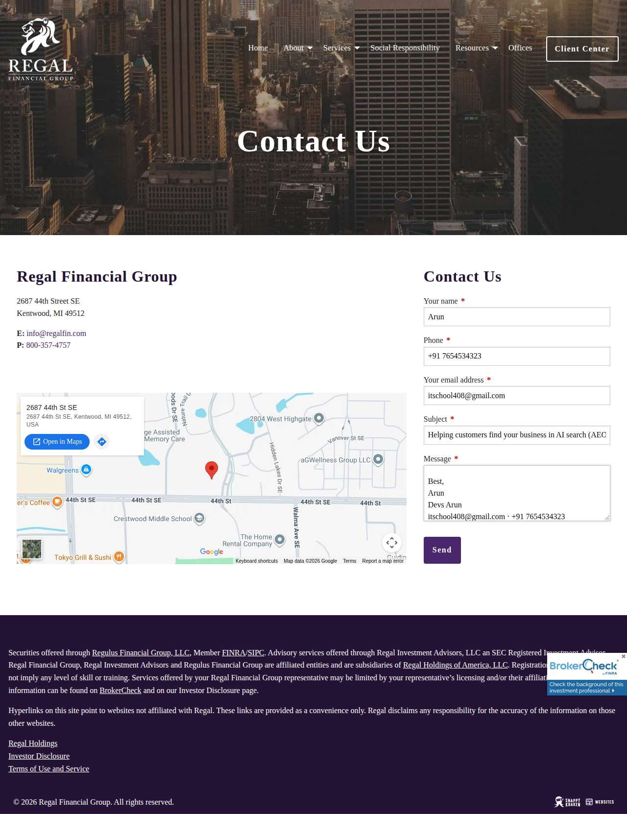

**After submit** — `run-8bb2abb6_attempt-32d70f73_post_attempt_2026-11-05T06-11-00-147Z.jpg`

### fortitudecapitalmgmt.com — confirmed (LIVE)

| | |
|---|---|
| Attempt ID | `539a60a2-456f-4683-8c3c-25f17299dd86` |
| Form URL | https://www.fortitudecapitalmgmt.com/contact |
| Final URL | https://www.fortitudecapitalmgmt.com/ |
| Reserved | 2026-11-05 06:11:08 UTC |
| Submit attempted | 2026-11-05 06:11:11 UTC |
| Template | standard v2 |
| Confirmation text | ervices Resources Account Login Contact STATUS MESSAGE Your message has been sent. × Your Success is Our Goal What does Fortitude mean in our name? “Strength of mind that enables a |
| Result / error | — |

Exact message:

~~~text
Subject: Helping customers find your business in AI search (AEO + GEO)

Hi there,

I'm Arun from Devs Arun. More and more customers now ask ChatGPT, Gemini, Perplexity or Google's AI Overviews questions like "who should I hire for this in my area?" before they call anyone. These tools answer from websites they can clearly understand, and they tend to recommend businesses whose pages answer real customer questions.

That is what AEO + GEO (Answer Engine and Generative Engine Optimization) is for. I improve your existing service pages so they clearly answer the questions your customers ask, add structured data that matches the page, and make the call, quote or enquiry step obvious. The benefit: your business gets a better chance of being mentioned or linked in AI answers, and visitors who arrive find it easy to contact you.

The AEO + GEO Starter is a one-time $199 (about ₹16,999, negotiable) for one website: a basic audit, 10 customer questions, improvements to two existing pages, relevant structured data and an action plan, with one revision round.

You can read the full details, send an enquiry or book online here:
https://devsarun.io/aeo-geo/

If this isn't relevant, just reply and I won't contact you again.

Best,
Arun
Devs Arun
itschool408@gmail.com · +91 7654534323
~~~

Submitted field values:

- Phone This field is required. \[phone\]: +91 7654534323
- Your name This field is required. \[name\]: Arun
- Message This field is required. \[message\]: Hi there, I'm Arun from Devs Arun. More and more customers now ask ChatGPT, Gemini, Perplexity or Google's AI Overviews 
- Subject This field is required. \[subject\]: Helping customers find your business in AI search (AEO + GEO)
- Your email address This field is required. \[email\]: itschool408@gmail.com

**Filled form (before submit)** — `run-8bb2abb6_attempt-539a60a2_filled_2026-11-05T06-11-11-751Z.jpg`

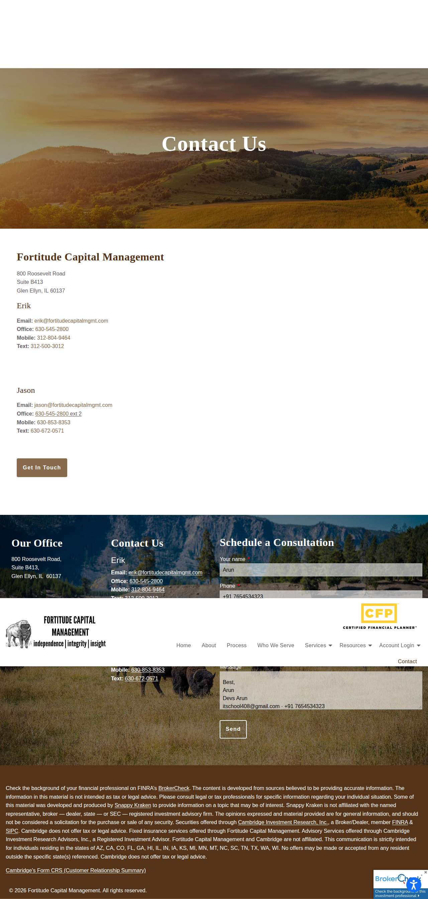

**After submit** — `run-8bb2abb6_attempt-539a60a2_post_attempt_2026-11-05T06-11-19-926Z.jpg`

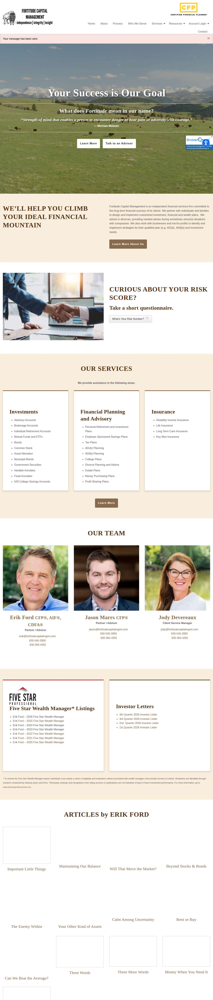

### canterburyadvisor.com — failed\_before\_submit (LIVE)

| | |
|---|---|
| Attempt ID | `b92f5cd3-36e6-4558-a88e-910d9e042024` |
| Form URL | https://canterburyadvisor.com/ |
| Final URL | — |
| Reserved | 2026-11-05 06:11:28 UTC |
| Submit attempted | — |
| Template | standard v2 |
| Confirmation text | none observed |
| Result / error | locator.fill: Error: Cannot type text into input\[type=number\] |

Exact message:

~~~text
Subject: Helping customers find your business in AI search (AEO + GEO)

Hi there,

I'm Arun from Devs Arun. More and more customers now ask ChatGPT, Gemini, Perplexity or Google's AI Overviews questions like "who should I hire for this in my area?" before they call anyone. These tools answer from websites they can clearly understand, and they tend to recommend businesses whose pages answer real customer questions.

That is what AEO + GEO (Answer Engine and Generative Engine Optimization) is for. I improve your existing service pages so they clearly answer the questions your customers ask, add structured data that matches the page, and make the call, quote or enquiry step obvious. The benefit: your business gets a better chance of being mentioned or linked in AI answers, and visitors who arrive find it easy to contact you.

The AEO + GEO Starter is a one-time $199 (about ₹16,999, negotiable) for one website: a basic audit, 10 customer questions, improvements to two existing pages, relevant structured data and an action plan, with one revision round.

You can read the full details, send an enquiry or book online here:
https://devsarun.io/aeo-geo/

If this isn't relevant, just reply and I won't contact you again.

Best,
Arun
Devs Arun
itschool408@gmail.com · +91 7654534323
~~~

Submitted field values:

- \#form-field-name: Arun
- \#form-field-email: itschool408@gmail.com
- \#form-field-message: Hi there, I'm Arun from Devs Arun. More and more customers now ask ChatGPT, Gemini, Perplexity or Google's AI Overviews 
- \#form-field-field\_97f81fb: +91 7654534323

**Inspected page** — `run-8bb2abb6_attempt-b92f5cd3_inspection_2026-11-05T06-11-30-996Z.jpg`

### betterwealth.us — unclear (LIVE)

| | |
|---|---|
| Attempt ID | `eda39574-b291-4e70-a8a4-a220a3bd46c8` |
| Form URL | https://betterwealth.us/contact |
| Final URL | https://betterwealth.us/contact |
| Reserved | 2026-11-05 06:11:36 UTC |
| Submit attempted | 2026-11-05 06:11:38 UTC |
| Template | standard v2 |
| Confirmation text | none observed |
| Result / error | No new success marker observed |

Exact message:

~~~text
Subject: Helping customers find your business in AI search (AEO + GEO)

Hi there,

I'm Arun from Devs Arun. More and more customers now ask ChatGPT, Gemini, Perplexity or Google's AI Overviews questions like "who should I hire for this in my area?" before they call anyone. These tools answer from websites they can clearly understand, and they tend to recommend businesses whose pages answer real customer questions.

That is what AEO + GEO (Answer Engine and Generative Engine Optimization) is for. I improve your existing service pages so they clearly answer the questions your customers ask, add structured data that matches the page, and make the call, quote or enquiry step obvious. The benefit: your business gets a better chance of being mentioned or linked in AI answers, and visitors who arrive find it easy to contact you.

The AEO + GEO Starter is a one-time $199 (about ₹16,999, negotiable) for one website: a basic audit, 10 customer questions, improvements to two existing pages, relevant structured data and an action plan, with one revision round.

You can read the full details, send an enquiry or book online here:
https://devsarun.io/aeo-geo/

If this isn't relevant, just reply and I won't contact you again.

Best,
Arun
Devs Arun
itschool408@gmail.com · +91 7654534323
~~~

Submitted field values:

- NAME \[name\]: Arun
- EMAIL \[email\]: itschool408@gmail.com
- PHONE \[phone\]: +91 7654534323
- MESSAGE \[message\]: Hi there, I'm Arun from Devs Arun. More and more customers now ask ChatGPT, Gemini, Perplexity or Google's AI Overviews 

**Filled form (before submit)** — `run-8bb2abb6_attempt-eda39574_filled_2026-11-05T06-11-38-606Z.jpg`

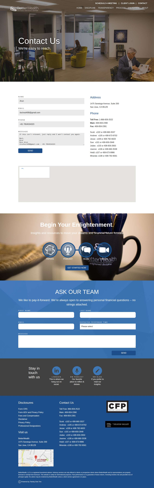

**After submit** — `run-8bb2abb6_attempt-eda39574_post_attempt_2026-11-05T06-12-07-428Z.jpg`

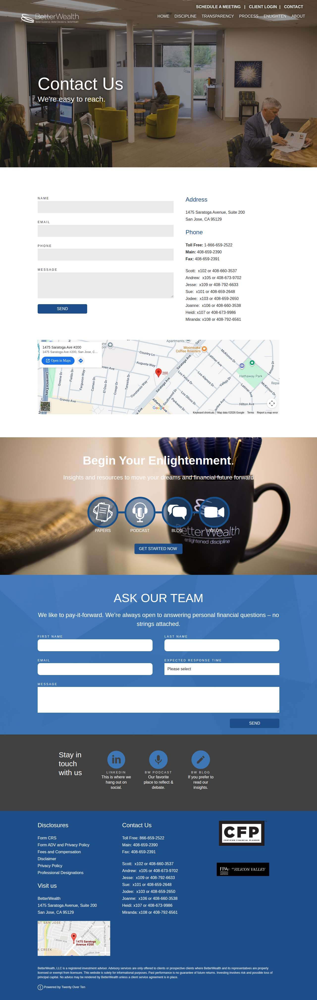

### omico.net — confirmed (LIVE)

| | |
|---|---|
| Attempt ID | `87b0f733-1e6a-4cc4-a39c-098ecb554c65` |
| Form URL | https://www.omico.net/contact-us/ |
| Final URL | https://www.omico.net/contact-us/form-submitted.html |
| Reserved | 2026-11-05 06:12:15 UTC |
| Submit attempted | 2026-11-05 06:12:18 UTC |
| Template | standard v2 |
| Confirmation text | ties Account Access Contact Home Privacy Policy Disclosures Form Submitted Thank you for contacting us. We will get back to you within 48 business hours. Contact Us Name \* Ph |
| Result / error | — |

Exact message:

~~~text
Subject: Helping customers find your business in AI search (AEO + GEO)

Hi there,

I'm Arun from Devs Arun. More and more customers now ask ChatGPT, Gemini, Perplexity or Google's AI Overviews questions like "who should I hire for this in my area?" before they call anyone. These tools answer from websites they can clearly understand, and they tend to recommend businesses whose pages answer real customer questions.

That is what AEO + GEO (Answer Engine and Generative Engine Optimization) is for. I improve your existing service pages so they clearly answer the questions your customers ask, add structured data that matches the page, and make the call, quote or enquiry step obvious. The benefit: your business gets a better chance of being mentioned or linked in AI answers, and visitors who arrive find it easy to contact you.

The AEO + GEO Starter is a one-time $199 (about ₹16,999, negotiable) for one website: a basic audit, 10 customer questions, improvements to two existing pages, relevant structured data and an action plan, with one revision round.

You can read the full details, send an enquiry or book online here:
https://devsarun.io/aeo-geo/

If this isn't relevant, just reply and I won't contact you again.

Best,
Arun
Devs Arun
itschool408@gmail.com · +91 7654534323
~~~

Submitted field values:

- Name \* \[name\]: Arun
- Phone \[phone\]: +91 7654534323
- Email \* \[email\]: itschool408@gmail.com
- Comments \* \[message\]: Hi there, I'm Arun from Devs Arun. More and more customers now ask ChatGPT, Gemini, Perplexity or Google's AI Overviews 

**Filled form (before submit)** — `run-8bb2abb6_attempt-87b0f733_filled_2026-11-05T06-12-18-410Z.jpg`

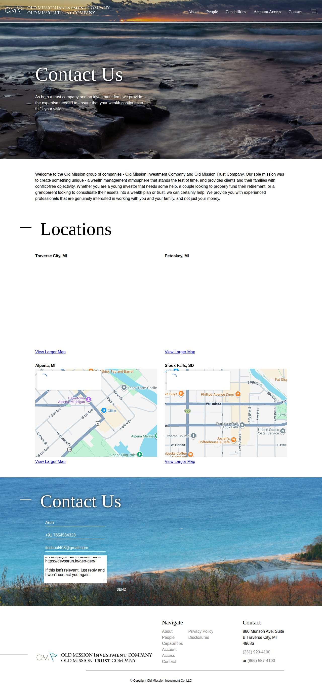

**After submit** — `run-8bb2abb6_attempt-87b0f733_post_attempt_2026-11-05T06-12-23-030Z.jpg`

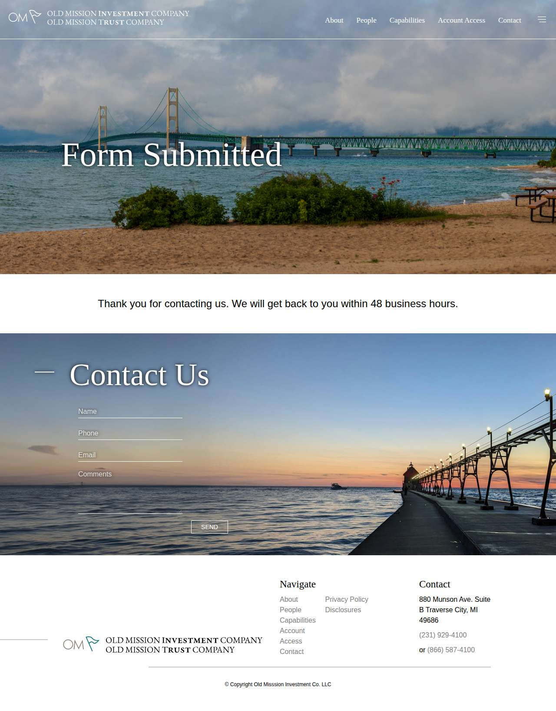

### cudlippfinancial.com — unclear (LIVE)

| | |
|---|---|
| Attempt ID | `44703e35-c2fc-46ef-9d83-c2c7266f8a21` |
| Form URL | https://cudlippfinancial.com/contact-us |
| Final URL | https://cudlippfinancial.com/contact-us |
| Reserved | 2026-11-05 06:12:31 UTC |
| Submit attempted | 2026-11-05 06:12:34 UTC |
| Template | standard v2 |
| Confirmation text | none observed |
| Result / error | No new success marker observed |

Exact message:

~~~text
Subject: Helping customers find your business in AI search (AEO + GEO)

Hi there,

I'm Arun from Devs Arun. More and more customers now ask ChatGPT, Gemini, Perplexity or Google's AI Overviews questions like "who should I hire for this in my area?" before they call anyone. These tools answer from websites they can clearly understand, and they tend to recommend businesses whose pages answer real customer questions.

That is what AEO + GEO (Answer Engine and Generative Engine Optimization) is for. I improve your existing service pages so they clearly answer the questions your customers ask, add structured data that matches the page, and make the call, quote or enquiry step obvious. The benefit: your business gets a better chance of being mentioned or linked in AI answers, and visitors who arrive find it easy to contact you.

The AEO + GEO Starter is a one-time $199 (about ₹16,999, negotiable) for one website: a basic audit, 10 customer questions, improvements to two existing pages, relevant structured data and an action plan, with one revision round.

You can read the full details, send an enquiry or book online here:
https://devsarun.io/aeo-geo/

If this isn't relevant, just reply and I won't contact you again.

Best,
Arun
Devs Arun
itschool408@gmail.com · +91 7654534323
~~~

Submitted field values:

- NAME \[name\]: Arun
- EMAIL \[email\]: itschool408@gmail.com
- PHONE \[phone\]: +91 7654534323
- MESSAGE \[message\]: Hi there, I'm Arun from Devs Arun. More and more customers now ask ChatGPT, Gemini, Perplexity or Google's AI Overviews 

**Filled form (before submit)** — `run-8bb2abb6_attempt-44703e35_filled_2026-11-05T06-12-34-006Z.jpg`

**After submit** — `run-8bb2abb6_attempt-44703e35_post_attempt_2026-11-05T06-13-02-889Z.jpg`

### dimensional.com — failed\_before\_submit (LIVE)

| | |
|---|---|
| Attempt ID | `31ee2ccd-0177-4460-ae14-d0587705d55c` |
| Form URL | https://www.dimensional.com/us-en/financial-professionals/contact-us |
| Final URL | https://www.dimensional.com/us-en/financial-professionals/contact-us |
| Reserved | 2026-11-05 06:13:11 UTC |
| Submit attempted | — |
| Template | standard v2 |
| Confirmation text | none observed |
| Result / error | Message field truncated the text; the required link https://devsarun.io/aeo-geo/ would be lost |

Exact message:

~~~text
Subject: Helping customers find your business in AI search (AEO + GEO)

Hi there,

I'm Arun from Devs Arun. More and more customers now ask ChatGPT, Gemini, Perplexity or Google's AI Overviews questions like "who should I hire for this in my area?" before they call anyone. These tools answer from websites they can clearly understand, and they tend to recommend businesses whose pages answer real customer questions.

That is what AEO + GEO (Answer Engine and Generative Engine Optimization) is for. I improve your existing service pages so they clearly answer the questions your customers ask, add structured data that matches the page, and make the call, quote or enquiry step obvious. The benefit: your business gets a better chance of being mentioned or linked in AI answers, and visitors who arrive find it easy to contact you.

The AEO + GEO Starter is a one-time $199 (about ₹16,999, negotiable) for one website: a basic audit, 10 customer questions, improvements to two existing pages, relevant structured data and an action plan, with one revision round.

You can read the full details, send an enquiry or book online here:
https://devsarun.io/aeo-geo/

If this isn't relevant, just reply and I won't contact you again.

Best,
Arun
Devs Arun
itschool408@gmail.com · +91 7654534323
~~~

Submitted field values:

- \#fxb\_00000000-0000-0000-0000-000000000000\_Fields\_3841b911-3f08-48cf-a826-6bdd446bae6b\_\_Value: Arun
- \#fxb\_00000000-0000-0000-0000-000000000000\_Fields\_38d781d3-6b20-4979-83ea-0db27150910d\_\_Value: Devs Arun
- \#fxb\_00000000-0000-0000-0000-000000000000\_Fields\_463ccfae-f9c0-4da3-af35-b8abb0c1ed21\_\_Value: +91 7654534323
- \#fxb\_00000000-0000-0000-0000-000000000000\_Fields\_6f013715-a920-4499-a956-0d36006f7a75\_\_Value: itschool408@gmail.com
- \#fxb\_00000000-0000-0000-0000-000000000000\_Fields\_f45d306c-d41e-446b-a0c5-44a1f40c2b6d\_\_Value: Hi there, I'm Arun from Devs Arun. More and more customers now ask ChatGPT, Gemini, Perplexity or Google's AI Overviews 

**Filled form (before submit)** — `run-8bb2abb6_attempt-31ee2ccd_filled_2026-11-05T06-13-14-490Z.jpg`

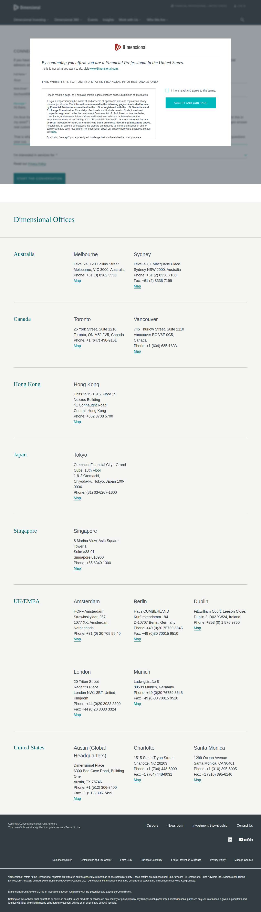

## Events (104)

| Time (UTC) | Event | Website | Details |
|---|---|---|---|
| 06:08:22 | run\_queued | — | live run requested by github:itsDevsArun |
| 06:08:22 | run\_dispatched | — | dispatch disabled (local test mode) |
| 06:08:26 | run\_started | — | Runner claimed live run |
| 06:08:28 | offer\_verified | — | Service page offer facts verified |
| 06:08:28 | website\_selected | clearchoiceplumbingllc.com | Live target clearchoiceplumbingllc.com |
| 06:08:28 | attempt\_reserved | clearchoiceplumbingllc.com | Submission attempt reserved with template standard v2 |
| 06:08:29 | page\_opened | clearchoiceplumbingllc.com | Opened form page |
| 06:08:29 | screenshot\_saved | clearchoiceplumbingllc.com | inspection screenshot saved (145 KB) |
| 06:08:29 | review\_required | clearchoiceplumbingllc.com | failed before submit: locator.fill: Error: Cannot type text into input\[type=number\] |
| 06:08:34 | website\_selected | bwnwincpainting.com | Live target bwnwincpainting.com |
| 06:08:34 | attempt\_reserved | bwnwincpainting.com | Submission attempt reserved with template standard v2 |
| 06:08:36 | page\_opened | bwnwincpainting.com | Opened form page |
| 06:08:36 | screenshot\_saved | bwnwincpainting.com | inspection screenshot saved (118 KB) |
| 06:08:36 | review\_required | bwnwincpainting.com | failed before submit: locator.fill: Error: Cannot type text into input\[type=number\] |
| 06:08:41 | website\_selected | absoluterestorepa.com | Live target absoluterestorepa.com |
| 06:08:41 | attempt\_reserved | absoluterestorepa.com | Submission attempt reserved with template standard v2 |
| 06:08:44 | page\_opened | absoluterestorepa.com | Opened form page |
| 06:08:44 | screenshot\_saved | absoluterestorepa.com | inspection screenshot saved (175 KB) |
| 06:08:44 | review\_required | absoluterestorepa.com | failed before submit: locator.fill: Error: Cannot type text into input\[type=number\] |
| 06:08:49 | website\_selected | masoudlawfirm.com | Live target masoudlawfirm.com |
| 06:08:49 | attempt\_reserved | masoudlawfirm.com | Submission attempt reserved with template standard v2 |
| 06:08:50 | page\_opened | masoudlawfirm.com | Opened form page |
| 06:08:51 | screenshot\_saved | masoudlawfirm.com | inspection screenshot saved (169 KB) |
| 06:08:51 | review\_required | masoudlawfirm.com | failed before submit: locator.fill: Error: Cannot type text into input\[type=number\] |
| 06:08:56 | website\_selected | whiteolivecpa.com | Live target whiteolivecpa.com |
| 06:08:56 | attempt\_reserved | whiteolivecpa.com | Submission attempt reserved with template standard v2 |
| 06:08:57 | page\_opened | whiteolivecpa.com | Opened form page |
| 06:08:57 | screenshot\_saved | whiteolivecpa.com | inspection screenshot saved (197 KB) |
| 06:08:57 | review\_required | whiteolivecpa.com | failed before submit: locator.fill: Error: Cannot type text into input\[type=number\] |
| 06:09:02 | website\_selected | cornellpochily.com | Live target cornellpochily.com |
| 06:09:02 | attempt\_reserved | cornellpochily.com | Submission attempt reserved with template standard v2 |
| 06:09:05 | page\_opened | cornellpochily.com | Opened form page |
| 06:09:05 | fields\_filled | cornellpochily.com | filled |
| 06:09:05 | screenshot\_saved | cornellpochily.com | filled screenshot saved (173 KB) |
| 06:09:05 | submit\_attempted | cornellpochily.com | submitting |
| 06:09:34 | screenshot\_saved | cornellpochily.com | post\_attempt screenshot saved (134 KB) |
| 06:09:34 | review\_required | cornellpochily.com | unclear: No new success marker observed |
| 06:09:42 | website\_selected | swsllc.net | Live target swsllc.net |
| 06:09:42 | attempt\_reserved | swsllc.net | Submission attempt reserved with template standard v2 |
| 06:09:45 | page\_opened | swsllc.net | Opened form page |
| 06:09:45 | fields\_filled | swsllc.net | filled |
| 06:09:45 | screenshot\_saved | swsllc.net | filled screenshot saved (227 KB) |
| 06:09:45 | submit\_attempted | swsllc.net | submitting |
| 06:09:52 | screenshot\_saved | swsllc.net | post\_attempt screenshot saved (483 KB) |
| 06:09:52 | confirmation\_observed | swsllc.net | confirmed — "We Serve Resources Contact Client Login Status message Your message has been sent. × Personalized Client Experience Taki" |
| 06:10:01 | website\_selected | colleyassetmgmt.com | Live target colleyassetmgmt.com |
| 06:10:01 | attempt\_reserved | colleyassetmgmt.com | Submission attempt reserved with template standard v2 |
| 06:10:02 | page\_opened | colleyassetmgmt.com | Opened form page |
| 06:10:02 | fields\_filled | colleyassetmgmt.com | filled |
| 06:10:02 | screenshot\_saved | colleyassetmgmt.com | filled screenshot saved (48 KB) |
| 06:10:02 | submit\_attempted | colleyassetmgmt.com | submitting |
| 06:10:32 | screenshot\_saved | colleyassetmgmt.com | post\_attempt screenshot saved (15 KB) |
| 06:10:32 | review\_required | colleyassetmgmt.com | unclear: No new success marker observed |
| 06:10:40 | website\_selected | regalfin.com | Live target regalfin.com |
| 06:10:40 | attempt\_reserved | regalfin.com | Submission attempt reserved with template standard v2 |
| 06:10:46 | page\_opened | regalfin.com | Opened form page |
| 06:10:46 | fields\_filled | regalfin.com | filled |
| 06:10:46 | screenshot\_saved | regalfin.com | filled screenshot saved (169 KB) |
| 06:10:46 | submit\_attempted | regalfin.com | submitting |
| 06:11:00 | screenshot\_saved | regalfin.com | post\_attempt screenshot saved (177 KB) |
| 06:11:00 | confirmation\_observed | regalfin.com | confirmed — "ibility Resources Offices Client Center STATUS MESSAGE Your message has been sent. × Personalized Financial Guidance to " |
| 06:11:08 | website\_selected | fortitudecapitalmgmt.com | Live target fortitudecapitalmgmt.com |
| 06:11:08 | attempt\_reserved | fortitudecapitalmgmt.com | Submission attempt reserved with template standard v2 |
| 06:11:11 | page\_opened | fortitudecapitalmgmt.com | Opened form page |
| 06:11:11 | fields\_filled | fortitudecapitalmgmt.com | filled |
| 06:11:11 | screenshot\_saved | fortitudecapitalmgmt.com | filled screenshot saved (254 KB) |
| 06:11:11 | submit\_attempted | fortitudecapitalmgmt.com | submitting |
| 06:11:19 | screenshot\_saved | fortitudecapitalmgmt.com | post\_attempt screenshot saved (387 KB) |
| 06:11:19 | confirmation\_observed | fortitudecapitalmgmt.com | confirmed — "ervices Resources Account Login Contact STATUS MESSAGE Your message has been sent. × Your Success is Our Goal What does " |
| 06:11:28 | website\_selected | canterburyadvisor.com | Live target canterburyadvisor.com |
| 06:11:28 | attempt\_reserved | canterburyadvisor.com | Submission attempt reserved with template standard v2 |
| 06:11:30 | page\_opened | canterburyadvisor.com | Opened form page |
| 06:11:30 | screenshot\_saved | canterburyadvisor.com | inspection screenshot saved (350 KB) |
| 06:11:31 | review\_required | canterburyadvisor.com | failed before submit: locator.fill: Error: Cannot type text into input\[type=number\] |
| 06:11:36 | website\_selected | betterwealth.us | Live target betterwealth.us |
| 06:11:36 | attempt\_reserved | betterwealth.us | Submission attempt reserved with template standard v2 |
| 06:11:38 | page\_opened | betterwealth.us | Opened form page |
| 06:11:38 | fields\_filled | betterwealth.us | filled |
| 06:11:38 | screenshot\_saved | betterwealth.us | filled screenshot saved (269 KB) |
| 06:11:38 | submit\_attempted | betterwealth.us | submitting |
| 06:12:07 | screenshot\_saved | betterwealth.us | post\_attempt screenshot saved (292 KB) |
| 06:12:07 | review\_required | betterwealth.us | unclear: No new success marker observed |
| 06:12:15 | website\_selected | omico.net | Live target omico.net |
| 06:12:15 | attempt\_reserved | omico.net | Submission attempt reserved with template standard v2 |
| 06:12:17 | page\_opened | omico.net | Opened form page |
| 06:12:18 | fields\_filled | omico.net | filled |
| 06:12:18 | screenshot\_saved | omico.net | filled screenshot saved (274 KB) |
| 06:12:18 | submit\_attempted | omico.net | submitting |
| 06:12:23 | screenshot\_saved | omico.net | post\_attempt screenshot saved (159 KB) |
| 06:12:23 | confirmation\_observed | omico.net | confirmed — "ties Account Access Contact Home Privacy Policy Disclosures Form Submitted Thank you for contacting us. We will get back" |
| 06:12:31 | website\_selected | cudlippfinancial.com | Live target cudlippfinancial.com |
| 06:12:31 | attempt\_reserved | cudlippfinancial.com | Submission attempt reserved with template standard v2 |
| 06:12:33 | page\_opened | cudlippfinancial.com | Opened form page |
| 06:12:33 | fields\_filled | cudlippfinancial.com | filled |
| 06:12:34 | screenshot\_saved | cudlippfinancial.com | filled screenshot saved (184 KB) |
| 06:12:34 | submit\_attempted | cudlippfinancial.com | submitting |
| 06:13:02 | screenshot\_saved | cudlippfinancial.com | post\_attempt screenshot saved (177 KB) |
| 06:13:02 | review\_required | cudlippfinancial.com | unclear: No new success marker observed |
| 06:13:11 | website\_selected | dimensional.com | Live target dimensional.com |
| 06:13:11 | attempt\_reserved | dimensional.com | Submission attempt reserved with template standard v2 |
| 06:13:14 | page\_opened | dimensional.com | Opened form page |
| 06:13:14 | screenshot\_saved | dimensional.com | filled screenshot saved (256 KB) |
| 06:13:14 | review\_required | dimensional.com | failed before submit: Message field truncated the text; the required link https://devsarun.io/aeo-geo/ would be lost |
| 06:13:19 | run\_completed | — | Run completed (queue\_exhausted) |
