# Run b537a17d — live — completed

| | |
|---|---|
| Run ID | `b537a17d-c3a6-42fe-b538-43ab089aad21` |
| Requested by | github:itsDevsArun |
| Started | 2026-11-05 05:26:07 UTC |
| Finished | 2026-11-05 05:33:17 UTC |
| Finish reason | queue\_exhausted |
| GitHub Actions | https://github.com/itsDevsArun/aeo-geo/actions/runs/41950876497 |

CSV for this run: [runs/2026-11-05_live_b537a17d.csv](2026-11-05_live_b537a17d.csv)

## Attempts (18)

### clearchoiceplumbingllc.com — failed\_before\_submit (LIVE)

| | |
|---|---|
| Attempt ID | `c34b8102-8d6e-446b-a193-fcb3877a1826` |
| Form URL | https://clearchoiceplumbingllc.com/contact/ |
| Final URL | — |
| Reserved | 2026-11-05 05:26:08 UTC |
| Submit attempted | — |
| Template | standard v2 |
| Confirmation text | none observed |
| Result / error | locator.fill: Error: Cannot type text into input\[type=number\] |

Exact message:

~~~text
Subject: Helping customers find your business in AI search (AEO + GEO)

Hi there,

I'm Arun from Devs Arun. More and more customers now ask ChatGPT, Gemini, Perplexity or Google's AI Overviews questions like "who should I hire for this in my area?" before they call anyone. These tools answer from websites they can clearly understand, and they tend to recommend businesses whose pages answer real customer questions.

That is what AEO + GEO (Answer Engine and Generative Engine Optimization) is for. I improve your existing service pages so they clearly answer the questions your customers ask, add structured data that matches the page, and make the call, quote or enquiry step obvious. The benefit: your business gets a better chance of being mentioned or linked in AI answers, and visitors who arrive find it easy to contact you.

The AEO + GEO Starter is a one-time $199 (about ₹16,999, negotiable) for one website: a basic audit, 10 customer questions, improvements to two existing pages, relevant structured data and an action plan, with one revision round.

You can read the full details, send an enquiry or book online here:
https://devsarun.io/aeo-geo/

If this isn't relevant, just reply and I won't contact you again.

Best,
Arun
Devs Arun
itschool408@gmail.com · +91 7654534323
~~~

Submitted field values:

- \#wpforms-51-field\_1: Arun
- \#wpforms-51-field\_2: itschool408@gmail.com
- \#wpforms-51-field\_3: Hi there, I'm Arun from Devs Arun. More and more customers now ask ChatGPT, Gemini, Perplexity or Google's AI Overviews 
- \#wpforms-51-field\_5: +91 7654534323

**Inspected page** — `run-b537a17d_attempt-c34b8102_inspection_2026-11-05T05-26-10-285Z.jpg`

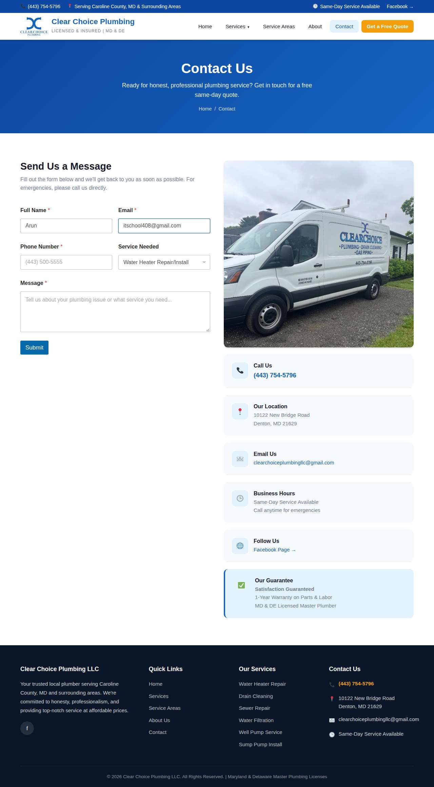

### bwnwincpainting.com — failed\_before\_submit (LIVE)

| | |
|---|---|
| Attempt ID | `c0cc5aed-2e56-4131-ae9d-2857492ac85c` |
| Form URL | https://www.bwnwincpainting.com/contact/ |
| Final URL | — |
| Reserved | 2026-11-05 05:26:15 UTC |
| Submit attempted | — |
| Template | standard v2 |
| Confirmation text | none observed |
| Result / error | locator.fill: Error: Cannot type text into input\[type=number\] |

Exact message:

~~~text
Subject: Helping customers find your business in AI search (AEO + GEO)

Hi there,

I'm Arun from Devs Arun. More and more customers now ask ChatGPT, Gemini, Perplexity or Google's AI Overviews questions like "who should I hire for this in my area?" before they call anyone. These tools answer from websites they can clearly understand, and they tend to recommend businesses whose pages answer real customer questions.

That is what AEO + GEO (Answer Engine and Generative Engine Optimization) is for. I improve your existing service pages so they clearly answer the questions your customers ask, add structured data that matches the page, and make the call, quote or enquiry step obvious. The benefit: your business gets a better chance of being mentioned or linked in AI answers, and visitors who arrive find it easy to contact you.

The AEO + GEO Starter is a one-time $199 (about ₹16,999, negotiable) for one website: a basic audit, 10 customer questions, improvements to two existing pages, relevant structured data and an action plan, with one revision round.

You can read the full details, send an enquiry or book online here:
https://devsarun.io/aeo-geo/

If this isn't relevant, just reply and I won't contact you again.

Best,
Arun
Devs Arun
itschool408@gmail.com · +91 7654534323
~~~

Submitted field values:

- \#name-1151: Arun
- \#email-1151: itschool408@gmail.com
- \#phone-1151: +91 7654534323
- \#message-1151: Hi there, I'm Arun from Devs Arun. More and more customers now ask ChatGPT, Gemini, Perplexity or Google's AI Overviews 

**Inspected page** — `run-b537a17d_attempt-c0cc5aed_inspection_2026-11-05T05-26-17-278Z.jpg`

### absoluterestorepa.com — failed\_before\_submit (LIVE)

| | |
|---|---|
| Attempt ID | `5591034a-50d3-4e77-9fe4-a9389592b684` |
| Form URL | https://absoluterestorepa.com/contact-us/ |
| Final URL | — |
| Reserved | 2026-11-05 05:26:22 UTC |
| Submit attempted | — |
| Template | standard v2 |
| Confirmation text | none observed |
| Result / error | locator.fill: Error: Cannot type text into input\[type=number\] |

Exact message:

~~~text
Subject: Helping customers find your business in AI search (AEO + GEO)

Hi there,

I'm Arun from Devs Arun. More and more customers now ask ChatGPT, Gemini, Perplexity or Google's AI Overviews questions like "who should I hire for this in my area?" before they call anyone. These tools answer from websites they can clearly understand, and they tend to recommend businesses whose pages answer real customer questions.

That is what AEO + GEO (Answer Engine and Generative Engine Optimization) is for. I improve your existing service pages so they clearly answer the questions your customers ask, add structured data that matches the page, and make the call, quote or enquiry step obvious. The benefit: your business gets a better chance of being mentioned or linked in AI answers, and visitors who arrive find it easy to contact you.

The AEO + GEO Starter is a one-time $199 (about ₹16,999, negotiable) for one website: a basic audit, 10 customer questions, improvements to two existing pages, relevant structured data and an action plan, with one revision round.

You can read the full details, send an enquiry or book online here:
https://devsarun.io/aeo-geo/

If this isn't relevant, just reply and I won't contact you again.

Best,
Arun
Devs Arun
itschool408@gmail.com · +91 7654534323
~~~

Submitted field values:

- \#form-field-name: Arun
- \#form-field-message: Hi there, I'm Arun from Devs Arun. More and more customers now ask ChatGPT, Gemini, Perplexity or Google's AI Overviews 
- \#form-field-field\_ed02ec2: +91 7654534323
- \#content \> div \> div \> div:nth-of-type(2) \> div \> div:nth-of-type(1) \> div:nth-of-type(2) \> div \> form \> div \> div:nth-of-type(3) \> input: itschool408@gmail.com

**Inspected page** — `run-b537a17d_attempt-5591034a_inspection_2026-11-05T05-26-25-233Z.jpg`

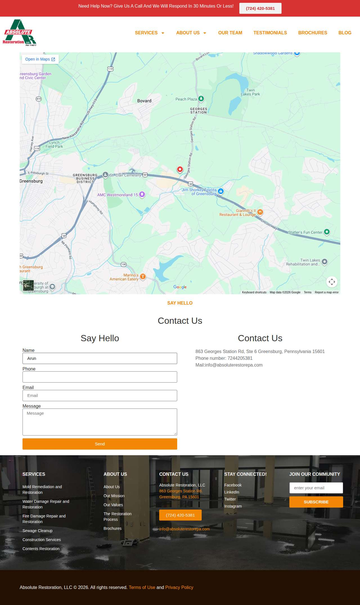

### masoudlawfirm.com — failed\_before\_submit (LIVE)

| | |
|---|---|
| Attempt ID | `3742a24b-4143-43a7-ae1b-9eb92202bc6d` |
| Form URL | https://masoudlawfirm.com/contact/ |
| Final URL | — |
| Reserved | 2026-11-05 05:26:30 UTC |
| Submit attempted | — |
| Template | standard v2 |
| Confirmation text | none observed |
| Result / error | locator.fill: Error: Cannot type text into input\[type=number\] |

Exact message:

~~~text
Subject: Helping customers find your business in AI search (AEO + GEO)

Hi there,

I'm Arun from Devs Arun. More and more customers now ask ChatGPT, Gemini, Perplexity or Google's AI Overviews questions like "who should I hire for this in my area?" before they call anyone. These tools answer from websites they can clearly understand, and they tend to recommend businesses whose pages answer real customer questions.

That is what AEO + GEO (Answer Engine and Generative Engine Optimization) is for. I improve your existing service pages so they clearly answer the questions your customers ask, add structured data that matches the page, and make the call, quote or enquiry step obvious. The benefit: your business gets a better chance of being mentioned or linked in AI answers, and visitors who arrive find it easy to contact you.

The AEO + GEO Starter is a one-time $199 (about ₹16,999, negotiable) for one website: a basic audit, 10 customer questions, improvements to two existing pages, relevant structured data and an action plan, with one revision round.

You can read the full details, send an enquiry or book online here:
https://devsarun.io/aeo-geo/

If this isn't relevant, just reply and I won't contact you again.

Best,
Arun
Devs Arun
itschool408@gmail.com · +91 7654534323
~~~

Submitted field values:

- \#form-field-name: Arun
- \#form-field-field\_3374379: Hi there, I'm Arun from Devs Arun. More and more customers now ask ChatGPT, Gemini, Perplexity or Google's AI Overviews 
- \#form-field-field\_7731784: +91 7654534323
- \#form-field-field\_8bd0f16: itschool408@gmail.com

**Inspected page** — `run-b537a17d_attempt-3742a24b_inspection_2026-11-05T05-26-33-854Z.jpg`

### whiteolivecpa.com — failed\_before\_submit (LIVE)

| | |
|---|---|
| Attempt ID | `4c789954-f264-4607-ab4e-9a597971ce10` |
| Form URL | https://whiteolivecpa.com/contact/ |
| Final URL | — |
| Reserved | 2026-11-05 05:26:38 UTC |
| Submit attempted | — |
| Template | standard v2 |
| Confirmation text | none observed |
| Result / error | locator.fill: Error: Cannot type text into input\[type=number\] |

Exact message:

~~~text
Subject: Helping customers find your business in AI search (AEO + GEO)

Hi there,

I'm Arun from Devs Arun. More and more customers now ask ChatGPT, Gemini, Perplexity or Google's AI Overviews questions like "who should I hire for this in my area?" before they call anyone. These tools answer from websites they can clearly understand, and they tend to recommend businesses whose pages answer real customer questions.

That is what AEO + GEO (Answer Engine and Generative Engine Optimization) is for. I improve your existing service pages so they clearly answer the questions your customers ask, add structured data that matches the page, and make the call, quote or enquiry step obvious. The benefit: your business gets a better chance of being mentioned or linked in AI answers, and visitors who arrive find it easy to contact you.

The AEO + GEO Starter is a one-time $199 (about ₹16,999, negotiable) for one website: a basic audit, 10 customer questions, improvements to two existing pages, relevant structured data and an action plan, with one revision round.

You can read the full details, send an enquiry or book online here:
https://devsarun.io/aeo-geo/

If this isn't relevant, just reply and I won't contact you again.

Best,
Arun
Devs Arun
itschool408@gmail.com · +91 7654534323
~~~

Submitted field values:

- \#ff\_1\_email: itschool408@gmail.com
- \#ff\_1\_message: Hi there, I'm Arun from Devs Arun. More and more customers now ask ChatGPT, Gemini, Perplexity or Google's AI Overviews 
- \#ff\_1\_numeric\_field: +91 7654534323
- \#ff\_1\_names\_first\_name\_: Arun

**Inspected page** — `run-b537a17d_attempt-4c789954_inspection_2026-11-05T05-26-40-568Z.jpg`

### lowdenarchitecture.com — unclear (LIVE)

| | |
|---|---|
| Attempt ID | `2fc81284-db73-49d6-bf98-932ca215fd51` |
| Form URL | https://lowdenarchitecture.com/contact/ |
| Final URL | https://lowdenarchitecture.com/contact/ |
| Reserved | 2026-11-05 05:26:45 UTC |
| Submit attempted | 2026-11-05 05:26:47 UTC |
| Template | standard v2 |
| Confirmation text | none observed |
| Result / error | No new success marker observed |

Exact message:

~~~text
Subject: Helping customers find your business in AI search (AEO + GEO)

Hi there,

I'm Arun from Devs Arun. More and more customers now ask ChatGPT, Gemini, Perplexity or Google's AI Overviews questions like "who should I hire for this in my area?" before they call anyone. These tools answer from websites they can clearly understand, and they tend to recommend businesses whose pages answer real customer questions.

That is what AEO + GEO (Answer Engine and Generative Engine Optimization) is for. I improve your existing service pages so they clearly answer the questions your customers ask, add structured data that matches the page, and make the call, quote or enquiry step obvious. The benefit: your business gets a better chance of being mentioned or linked in AI answers, and visitors who arrive find it easy to contact you.

The AEO + GEO Starter is a one-time $199 (about ₹16,999, negotiable) for one website: a basic audit, 10 customer questions, improvements to two existing pages, relevant structured data and an action plan, with one revision round.

You can read the full details, send an enquiry or book online here:
https://devsarun.io/aeo-geo/

If this isn't relevant, just reply and I won't contact you again.

Best,
Arun
Devs Arun
itschool408@gmail.com · +91 7654534323
~~~

Submitted field values:

- Name \[name\]: Arun
- Email \[email\]: itschool408@gmail.com
- Message \[message\]: Hi there, I'm Arun from Devs Arun. More and more customers now ask ChatGPT, Gemini, Perplexity or Google's AI Overviews 

**Filled form (before submit)** — `run-b537a17d_attempt-2fc81284_filled_2026-11-05T05-26-47-770Z.jpg`

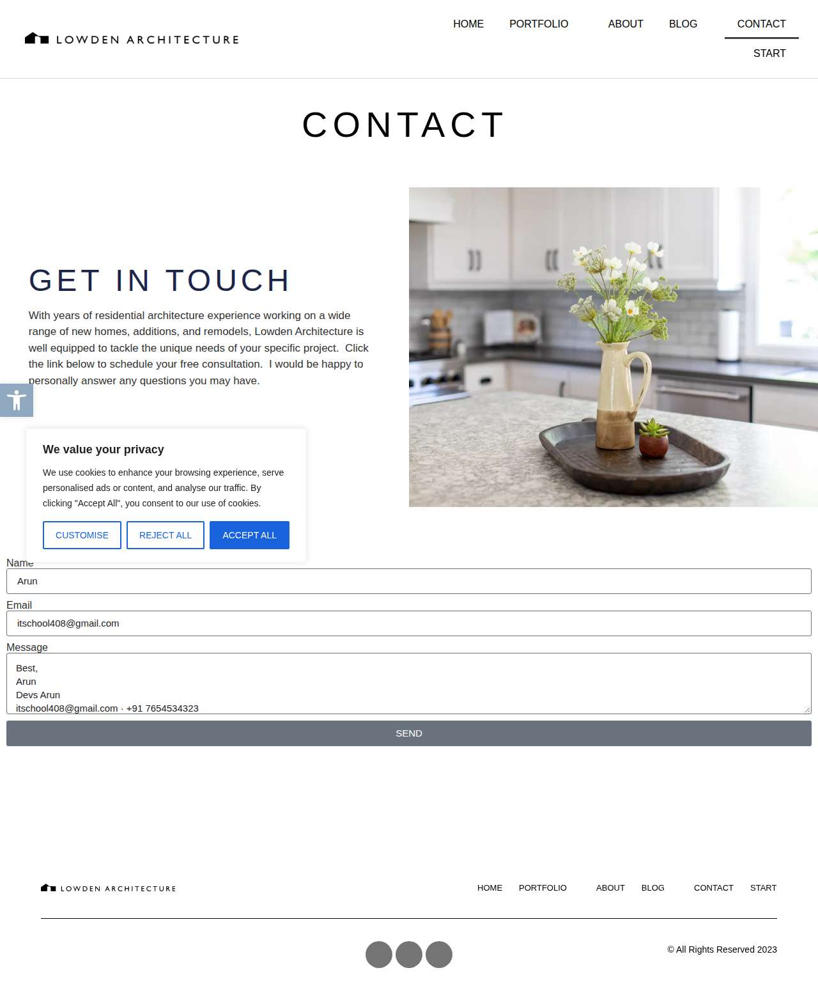

**After submit** — `run-b537a17d_attempt-2fc81284_post_attempt_2026-11-05T05-27-16-472Z.jpg`

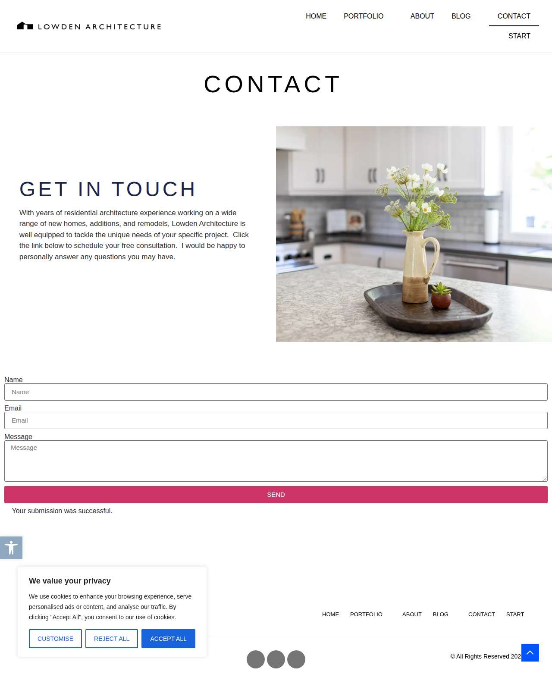

### itarchinc.com — unclear (LIVE)

| | |
|---|---|
| Attempt ID | `4e70ce97-fd4d-43c5-aacd-f9f0ab522d3c` |
| Form URL | https://www.itarchinc.com/ |
| Final URL | https://www.itarchinc.com/ |
| Reserved | 2026-11-05 05:27:24 UTC |
| Submit attempted | 2026-11-05 05:27:29 UTC |
| Template | standard v2 |
| Confirmation text | none observed |
| Result / error | No new success marker observed |

Exact message:

~~~text
Subject: Helping customers find your business in AI search (AEO + GEO)

Hi there,

I'm Arun from Devs Arun. More and more customers now ask ChatGPT, Gemini, Perplexity or Google's AI Overviews questions like "who should I hire for this in my area?" before they call anyone. These tools answer from websites they can clearly understand, and they tend to recommend businesses whose pages answer real customer questions.

That is what AEO + GEO (Answer Engine and Generative Engine Optimization) is for. I improve your existing service pages so they clearly answer the questions your customers ask, add structured data that matches the page, and make the call, quote or enquiry step obvious. The benefit: your business gets a better chance of being mentioned or linked in AI answers, and visitors who arrive find it easy to contact you.

The AEO + GEO Starter is a one-time $199 (about ₹16,999, negotiable) for one website: a basic audit, 10 customer questions, improvements to two existing pages, relevant structured data and an action plan, with one revision round.

You can read the full details, send an enquiry or book online here:
https://devsarun.io/aeo-geo/

If this isn't relevant, just reply and I won't contact you again.

Best,
Arun
Devs Arun
itschool408@gmail.com · +91 7654534323
~~~

Submitted field values:

- Name \[name\]: Arun
- Email \[email\]: itschool408@gmail.com
- Phone \[phone\]: +91 7654534323
- Message \[message\]: Hi there, I'm Arun from Devs Arun. More and more customers now ask ChatGPT, Gemini, Perplexity or Google's AI Overviews 
- Subject \[subject\]: Helping customers find your business in AI search (AEO + GEO)

**Filled form (before submit)** — `run-b537a17d_attempt-4e70ce97_filled_2026-11-05T05-27-29-590Z.jpg`

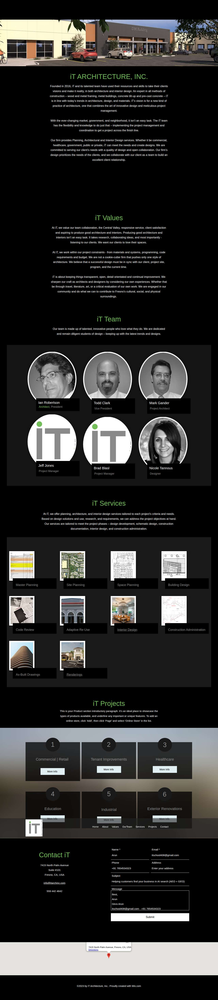

**After submit** — `run-b537a17d_attempt-4e70ce97_post_attempt_2026-11-05T05-28-06-481Z.jpg`

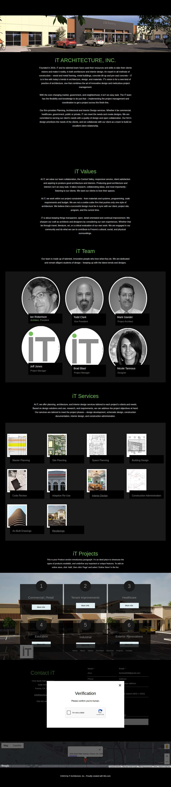

### cookconstructionwi.com — unclear (LIVE)

| | |
|---|---|
| Attempt ID | `6e49fbdc-cf32-4347-9b63-2304a9452f64` |
| Form URL | https://www.cookconstructionwi.com/ |
| Final URL | https://www.cookconstructionwi.com/ |
| Reserved | 2026-11-05 05:28:15 UTC |
| Submit attempted | 2026-11-05 05:28:17 UTC |
| Template | standard v2 |
| Confirmation text | none observed |
| Result / error | No new success marker observed |

Exact message:

~~~text
Subject: Helping customers find your business in AI search (AEO + GEO)

Hi there,

I'm Arun from Devs Arun. More and more customers now ask ChatGPT, Gemini, Perplexity or Google's AI Overviews questions like "who should I hire for this in my area?" before they call anyone. These tools answer from websites they can clearly understand, and they tend to recommend businesses whose pages answer real customer questions.

That is what AEO + GEO (Answer Engine and Generative Engine Optimization) is for. I improve your existing service pages so they clearly answer the questions your customers ask, add structured data that matches the page, and make the call, quote or enquiry step obvious. The benefit: your business gets a better chance of being mentioned or linked in AI answers, and visitors who arrive find it easy to contact you.

The AEO + GEO Starter is a one-time $199 (about ₹16,999, negotiable) for one website: a basic audit, 10 customer questions, improvements to two existing pages, relevant structured data and an action plan, with one revision round.

You can read the full details, send an enquiry or book online here:
https://devsarun.io/aeo-geo/

If this isn't relevant, just reply and I won't contact you again.

Best,
Arun
Devs Arun
itschool408@gmail.com · +91 7654534323
~~~

Submitted field values:

- email \[email\]: itschool408@gmail.com
- name-\* \[name\]: Arun
- Message \[message\]: Hi there, I'm Arun from Devs Arun. More and more customers now ask ChatGPT, Gemini, Perplexity or Google's AI Overviews 
- subject \[subject\]: Helping customers find your business in AI search (AEO + GEO)

**Filled form (before submit)** — `run-b537a17d_attempt-6e49fbdc_filled_2026-11-05T05-28-17-106Z.jpg`

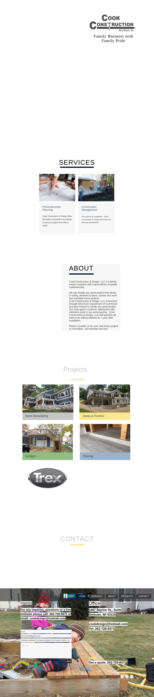

**After submit** — `run-b537a17d_attempt-6e49fbdc_post_attempt_2026-11-05T05-28-45-726Z.jpg`

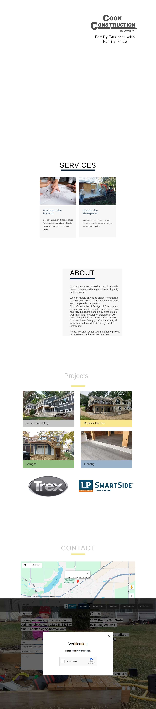

### r4architect.com — confirmed (LIVE)

| | |
|---|---|
| Attempt ID | `9b819ce4-38d8-407a-ab6f-e2a25771042e` |
| Form URL | http://r4architect.com/contact/ |
| Final URL | http://r4architect.com/contact/ |
| Reserved | 2026-11-05 05:28:54 UTC |
| Submit attempted | 2026-11-05 05:28:55 UTC |
| Template | standard v2 |
| Confirmation text | ary phone: 888-747-5295 primary email: main@r4architect.com Thank you for your message. It has been sent. Thank you for your message. It has been sent. © 2026 R4.Architecture,LLC 1-888-7 |
| Result / error | — |

Exact message:

~~~text
Subject: Helping customers find your business in AI search (AEO + GEO)

Hi there,

I'm Arun from Devs Arun. More and more customers now ask ChatGPT, Gemini, Perplexity or Google's AI Overviews questions like "who should I hire for this in my area?" before they call anyone. These tools answer from websites they can clearly understand, and they tend to recommend businesses whose pages answer real customer questions.

That is what AEO + GEO (Answer Engine and Generative Engine Optimization) is for. I improve your existing service pages so they clearly answer the questions your customers ask, add structured data that matches the page, and make the call, quote or enquiry step obvious. The benefit: your business gets a better chance of being mentioned or linked in AI answers, and visitors who arrive find it easy to contact you.

The AEO + GEO Starter is a one-time $199 (about ₹16,999, negotiable) for one website: a basic audit, 10 customer questions, improvements to two existing pages, relevant structured data and an action plan, with one revision round.

You can read the full details, send an enquiry or book online here:
https://devsarun.io/aeo-geo/

If this isn't relevant, just reply and I won't contact you again.

Best,
Arun
Devs Arun
itschool408@gmail.com · +91 7654534323
~~~

Submitted field values:

- your-name \[name\]: Arun
- your-email \[email\]: itschool408@gmail.com
- your-message \[message\]: Hi there, I'm Arun from Devs Arun. More and more customers now ask ChatGPT, Gemini, Perplexity or Google's AI Overviews 
- your-subject \[subject\]: Helping customers find your business in AI search (AEO + GEO)

**Filled form (before submit)** — `run-b537a17d_attempt-9b819ce4_filled_2026-11-05T05-28-55-677Z.jpg`

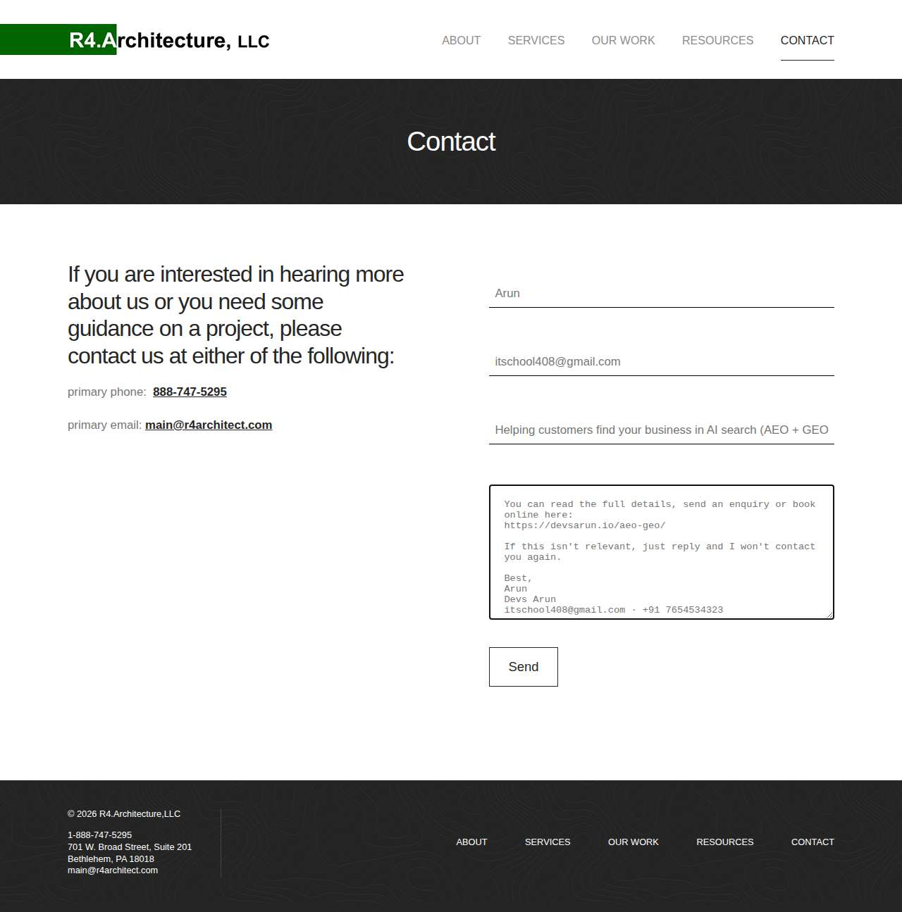

**After submit** — `run-b537a17d_attempt-9b819ce4_post_attempt_2026-11-05T05-29-00-292Z.jpg`

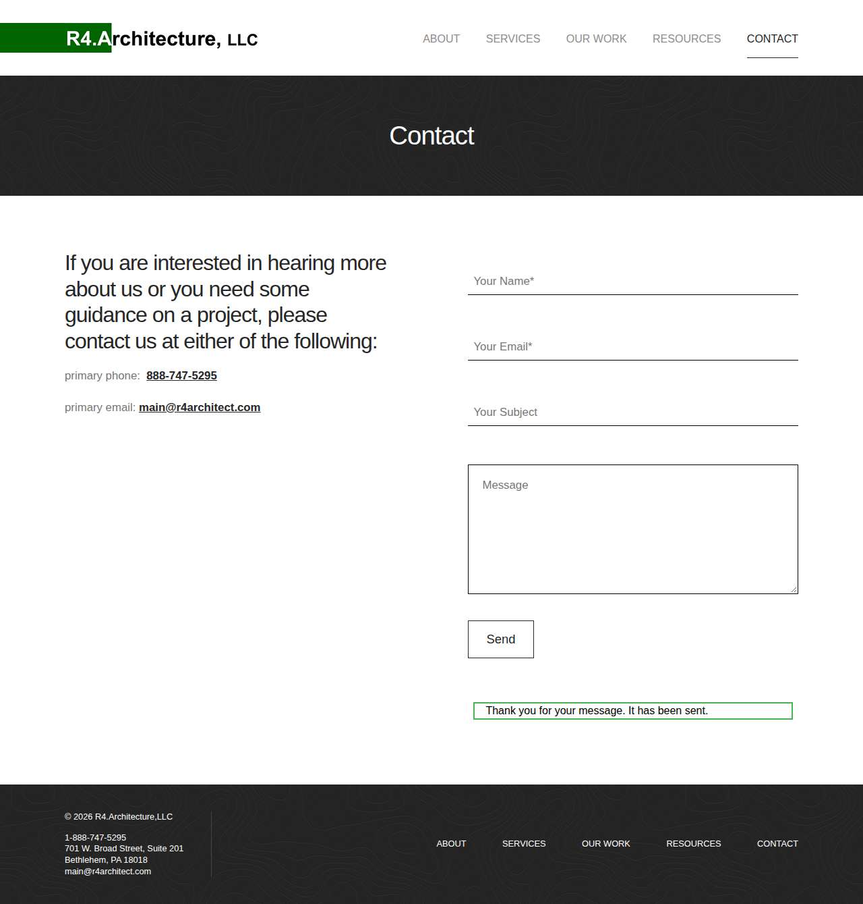

### budddesignllc.com — unclear (LIVE)

| | |
|---|---|
| Attempt ID | `69b270cf-5bd0-4ada-b4eb-286ec10aaf92` |
| Form URL | https://www.budddesignllc.com/ |
| Final URL | https://www.budddesignllc.com/ |
| Reserved | 2026-11-05 05:29:08 UTC |
| Submit attempted | 2026-11-05 05:29:12 UTC |
| Template | standard v2 |
| Confirmation text | none observed |
| Result / error | No new success marker observed |

Exact message:

~~~text
Subject: Helping customers find your business in AI search (AEO + GEO)

Hi there,

I'm Arun from Devs Arun. More and more customers now ask ChatGPT, Gemini, Perplexity or Google's AI Overviews questions like "who should I hire for this in my area?" before they call anyone. These tools answer from websites they can clearly understand, and they tend to recommend businesses whose pages answer real customer questions.

That is what AEO + GEO (Answer Engine and Generative Engine Optimization) is for. I improve your existing service pages so they clearly answer the questions your customers ask, add structured data that matches the page, and make the call, quote or enquiry step obvious. The benefit: your business gets a better chance of being mentioned or linked in AI answers, and visitors who arrive find it easy to contact you.

The AEO + GEO Starter is a one-time $199 (about ₹16,999, negotiable) for one website: a basic audit, 10 customer questions, improvements to two existing pages, relevant structured data and an action plan, with one revision round.

You can read the full details, send an enquiry or book online here:
https://devsarun.io/aeo-geo/

If this isn't relevant, just reply and I won't contact you again.

Best,
Arun
Devs Arun
itschool408@gmail.com · +91 7654534323
~~~

Submitted field values:

- Email \[email\]: itschool408@gmail.com
- Message \[message\]: Hi there, I'm Arun from Devs Arun. More and more customers now ask ChatGPT, Gemini, Perplexity or Google's AI Overviews 
- First Name \[first\_name\]: Arun

**Filled form (before submit)** — `run-b537a17d_attempt-69b270cf_filled_2026-11-05T05-29-12-081Z.jpg`

**After submit** — `run-b537a17d_attempt-69b270cf_post_attempt_2026-11-05T05-29-48-986Z.jpg`

### ywrising.com — unclear (LIVE)

| | |
|---|---|
| Attempt ID | `a53c33f4-b072-4646-a439-0660634bda49` |
| Form URL | https://www.ywrising.com/contact |
| Final URL | https://www.ywrising.com/contact |
| Reserved | 2026-11-05 05:29:57 UTC |
| Submit attempted | 2026-11-05 05:29:59 UTC |
| Template | standard v2 |
| Confirmation text | none observed |
| Result / error | No new success marker observed |

Exact message:

~~~text
Subject: Helping customers find your business in AI search (AEO + GEO)

Hi there,

I'm Arun from Devs Arun. More and more customers now ask ChatGPT, Gemini, Perplexity or Google's AI Overviews questions like "who should I hire for this in my area?" before they call anyone. These tools answer from websites they can clearly understand, and they tend to recommend businesses whose pages answer real customer questions.

That is what AEO + GEO (Answer Engine and Generative Engine Optimization) is for. I improve your existing service pages so they clearly answer the questions your customers ask, add structured data that matches the page, and make the call, quote or enquiry step obvious. The benefit: your business gets a better chance of being mentioned or linked in AI answers, and visitors who arrive find it easy to contact you.

The AEO + GEO Starter is a one-time $199 (about ₹16,999, negotiable) for one website: a basic audit, 10 customer questions, improvements to two existing pages, relevant structured data and an action plan, with one revision round.

You can read the full details, send an enquiry or book online here:
https://devsarun.io/aeo-geo/

If this isn't relevant, just reply and I won't contact you again.

Best,
Arun
Devs Arun
itschool408@gmail.com · +91 7654534323
~~~

Submitted field values:

- Email \[email\]: itschool408@gmail.com
- Your Name \[name\]: Arun
- Subject \[subject\]: Helping customers find your business in AI search (AEO + GEO)
- Leave us a message... \[message\]: Hi there, I'm Arun from Devs Arun. More and more customers now ask ChatGPT, Gemini, Perplexity or Google's AI Overviews 

**Filled form (before submit)** — `run-b537a17d_attempt-a53c33f4_filled_2026-11-05T05-29-59-642Z.jpg`

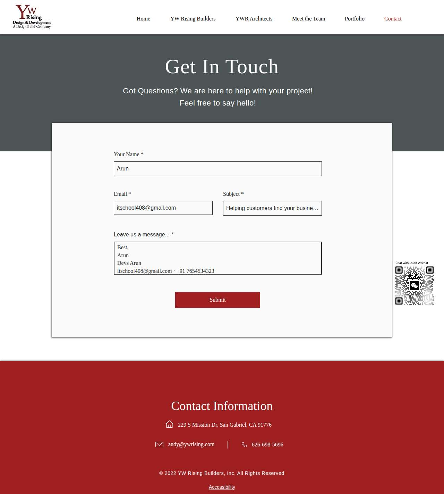

**After submit** — `run-b537a17d_attempt-a53c33f4_post_attempt_2026-11-05T05-30-28-092Z.jpg`

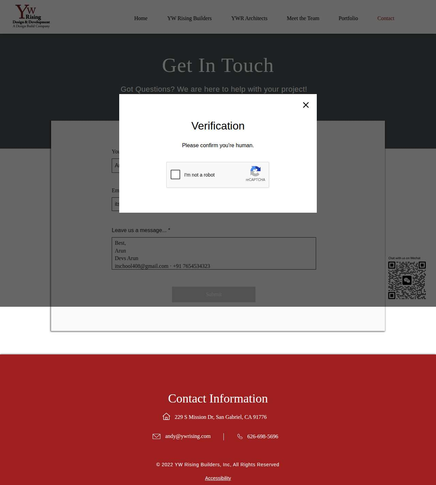

### myvintagehomes.com — unclear (LIVE)

| | |
|---|---|
| Attempt ID | `69e52c2a-22e4-4fb6-a9df-a1e72a79211e` |
| Form URL | https://www.myvintagehomes.com/contact |
| Final URL | https://www.myvintagehomes.com/contact |
| Reserved | 2026-11-05 05:30:36 UTC |
| Submit attempted | 2026-11-05 05:30:39 UTC |
| Template | standard v2 |
| Confirmation text | none observed |
| Result / error | No new success marker observed |

Exact message:

~~~text
Subject: Helping customers find your business in AI search (AEO + GEO)

Hi there,

I'm Arun from Devs Arun. More and more customers now ask ChatGPT, Gemini, Perplexity or Google's AI Overviews questions like "who should I hire for this in my area?" before they call anyone. These tools answer from websites they can clearly understand, and they tend to recommend businesses whose pages answer real customer questions.

That is what AEO + GEO (Answer Engine and Generative Engine Optimization) is for. I improve your existing service pages so they clearly answer the questions your customers ask, add structured data that matches the page, and make the call, quote or enquiry step obvious. The benefit: your business gets a better chance of being mentioned or linked in AI answers, and visitors who arrive find it easy to contact you.

The AEO + GEO Starter is a one-time $199 (about ₹16,999, negotiable) for one website: a basic audit, 10 customer questions, improvements to two existing pages, relevant structured data and an action plan, with one revision round.

You can read the full details, send an enquiry or book online here:
https://devsarun.io/aeo-geo/

If this isn't relevant, just reply and I won't contact you again.

Best,
Arun
Devs Arun
itschool408@gmail.com · +91 7654534323
~~~

Submitted field values:

- Email \[email\]: itschool408@gmail.com
- Phone \[phone\]: +91 7654534323
- First Name \[first\_name\]: Arun
- Leave us a message... \[message\]: Hi there, I'm Arun from Devs Arun. More and more customers now ask ChatGPT, Gemini, Perplexity or Google's AI Overviews 

**Filled form (before submit)** — `run-b537a17d_attempt-69e52c2a_filled_2026-11-05T05-30-39-008Z.jpg`

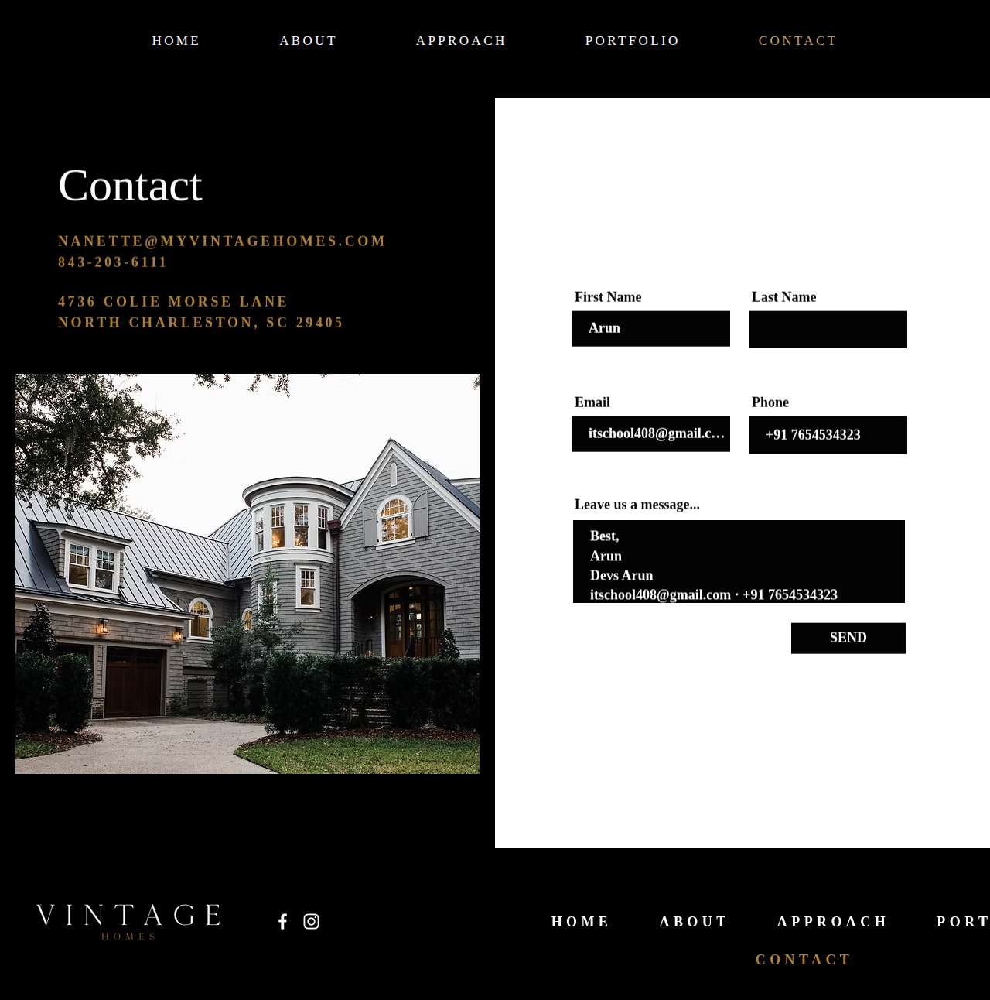

**After submit** — `run-b537a17d_attempt-69e52c2a_post_attempt_2026-11-05T05-31-07-356Z.jpg`

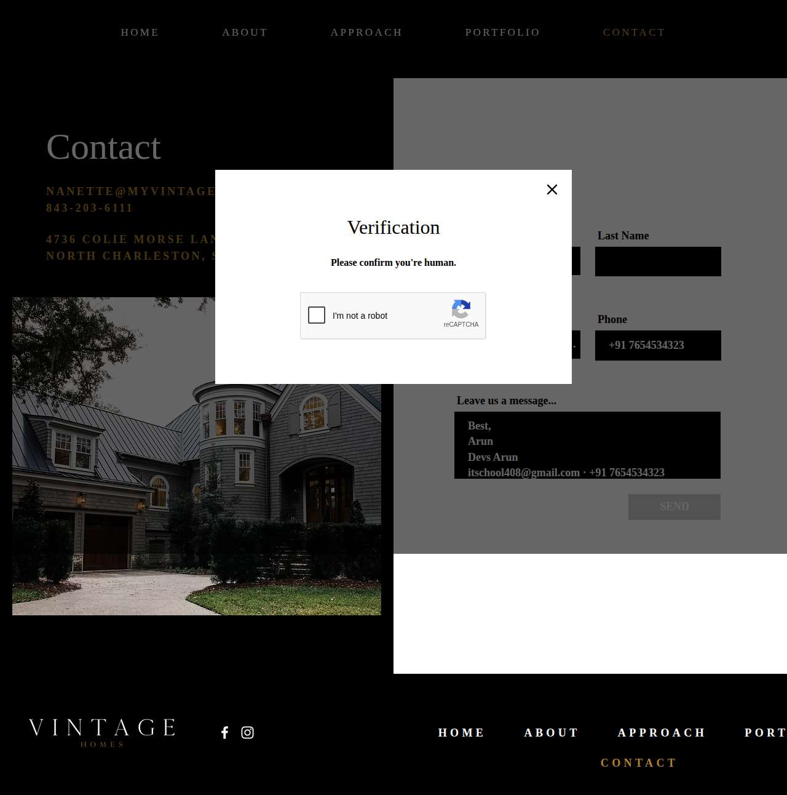

### vpfgroup.com — confirmed (LIVE)

| | |
|---|---|
| Attempt ID | `1f4adff3-3f54-4b54-aef5-6aaa87beb2d5` |
| Form URL | https://www.vpfgroup.com/grand-rapids/ |
| Final URL | https://www.vpfgroup.com/grand-rapids/ |
| Reserved | 2026-11-05 05:31:16 UTC |
| Submit attempted | 2026-11-05 05:31:17 UTC |
| Template | standard v2 |
| Confirmation text | d Rapids team is ready to help. Fill out the form below and we will be in touch shortly. Thank you. Your message has been received. × VantagePointe Financial Group, LLC Navigate H |
| Result / error | — |

Exact message:

~~~text
Subject: Helping customers find your business in AI search (AEO + GEO)

Hi there,

I'm Arun from Devs Arun. More and more customers now ask ChatGPT, Gemini, Perplexity or Google's AI Overviews questions like "who should I hire for this in my area?" before they call anyone. These tools answer from websites they can clearly understand, and they tend to recommend businesses whose pages answer real customer questions.

That is what AEO + GEO (Answer Engine and Generative Engine Optimization) is for. I improve your existing service pages so they clearly answer the questions your customers ask, add structured data that matches the page, and make the call, quote or enquiry step obvious. The benefit: your business gets a better chance of being mentioned or linked in AI answers, and visitors who arrive find it easy to contact you.

The AEO + GEO Starter is a one-time $199 (about ₹16,999, negotiable) for one website: a basic audit, 10 customer questions, improvements to two existing pages, relevant structured data and an action plan, with one revision round.

You can read the full details, send an enquiry or book online here:
https://devsarun.io/aeo-geo/

If this isn't relevant, just reply and I won't contact you again.

Best,
Arun
Devs Arun
itschool408@gmail.com · +91 7654534323
~~~

Submitted field values:

- Full Name \[name\]: Arun
- Message \[message\]: Hi there, I'm Arun from Devs Arun. More and more customers now ask ChatGPT, Gemini, Perplexity or Google's AI Overviews 
- Email Address \[email\]: itschool408@gmail.com
- Phone Number (optional) \[phone\]: +91 7654534323

**Filled form (before submit)** — `run-b537a17d_attempt-1f4adff3_filled_2026-11-05T05-31-17-925Z.jpg`

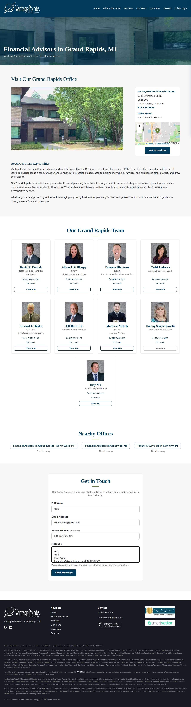

**After submit** — `run-b537a17d_attempt-1f4adff3_post_attempt_2026-11-05T05-31-22-726Z.jpg`

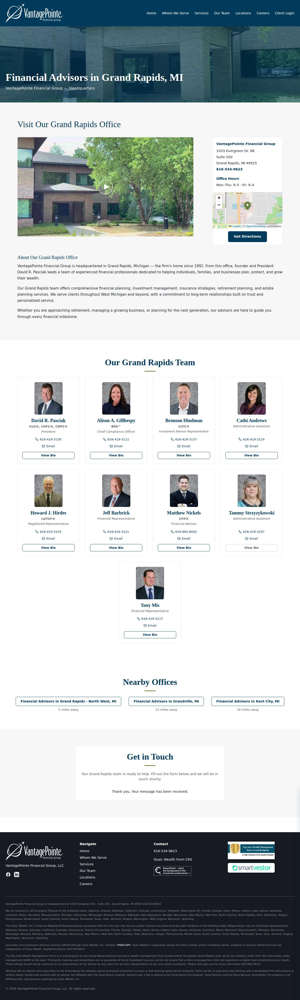

### camargoltd.com — confirmed (LIVE)

| | |
|---|---|
| Attempt ID | `95d1a68a-7dd3-435e-bd6a-27629dd88832` |
| Form URL | http://camargoltd.com/contact-us/ |
| Final URL | http://camargoltd.com/contact-us/ |
| Reserved | 2026-11-05 05:31:31 UTC |
| Submit attempted | 2026-11-05 05:31:32 UTC |
| Template | standard v2 |
| Confirmation text | innati, OH 45243 Phone: 513.936.5050 Fax: 513.793.8509 Your message was sent successfully. Thanks. Your Name (required) Your Phone Number (required) Your Email (required) Subje |
| Result / error | — |

Exact message:

~~~text
Subject: Helping customers find your business in AI search (AEO + GEO)

Hi there,

I'm Arun from Devs Arun. More and more customers now ask ChatGPT, Gemini, Perplexity or Google's AI Overviews questions like "who should I hire for this in my area?" before they call anyone. These tools answer from websites they can clearly understand, and they tend to recommend businesses whose pages answer real customer questions.

That is what AEO + GEO (Answer Engine and Generative Engine Optimization) is for. I improve your existing service pages so they clearly answer the questions your customers ask, add structured data that matches the page, and make the call, quote or enquiry step obvious. The benefit: your business gets a better chance of being mentioned or linked in AI answers, and visitors who arrive find it easy to contact you.

The AEO + GEO Starter is a one-time $199 (about ₹16,999, negotiable) for one website: a basic audit, 10 customer questions, improvements to two existing pages, relevant structured data and an action plan, with one revision round.

You can read the full details, send an enquiry or book online here:
https://devsarun.io/aeo-geo/

If this isn't relevant, just reply and I won't contact you again.

Best,
Arun
Devs Arun
itschool408@gmail.com · +91 7654534323
~~~

Submitted field values:

- tel-613 \[phone\]: +91 7654534323
- your-name \[name\]: Arun
- your-email \[email\]: itschool408@gmail.com
- your-message \[message\]: Hi there, I'm Arun from Devs Arun. More and more customers now ask ChatGPT, Gemini, Perplexity or Google's AI Overviews 
- your-subject \[subject\]: Helping customers find your business in AI search (AEO + GEO)

**Filled form (before submit)** — `run-b537a17d_attempt-95d1a68a_filled_2026-11-05T05-31-32-689Z.jpg`

**After submit** — `run-b537a17d_attempt-95d1a68a_post_attempt_2026-11-05T05-31-37-218Z.jpg`

### bgwealthpartners.com — confirmed (LIVE)

| | |
|---|---|
| Attempt ID | `95f24303-8423-42f5-bbde-0499b754d64e` |
| Form URL | https://bgwealthpartners.com/contact/ |
| Final URL | https://bgwealthpartners.com/contact/ |
| Reserved | 2026-11-05 05:31:45 UTC |
| Submit attempted | 2026-11-05 05:31:47 UTC |
| Template | standard v2 |
| Confirmation text | ame \* Your Email \* Your Phone Number How can we help you? \* THANK YOU FOR CONTACTING OUR TEAM AT BROADWAY GRAHAM\! WE HAVE RECEIVED YOUR MESSAGE AND WILL REVIEW IT AND BE IN CONTACT WIT |
| Result / error | — |

Exact message:

~~~text
Subject: Helping customers find your business in AI search (AEO + GEO)

Hi there,

I'm Arun from Devs Arun. More and more customers now ask ChatGPT, Gemini, Perplexity or Google's AI Overviews questions like "who should I hire for this in my area?" before they call anyone. These tools answer from websites they can clearly understand, and they tend to recommend businesses whose pages answer real customer questions.

That is what AEO + GEO (Answer Engine and Generative Engine Optimization) is for. I improve your existing service pages so they clearly answer the questions your customers ask, add structured data that matches the page, and make the call, quote or enquiry step obvious. The benefit: your business gets a better chance of being mentioned or linked in AI answers, and visitors who arrive find it easy to contact you.

The AEO + GEO Starter is a one-time $199 (about ₹16,999, negotiable) for one website: a basic audit, 10 customer questions, improvements to two existing pages, relevant structured data and an action plan, with one revision round.

You can read the full details, send an enquiry or book online here:
https://devsarun.io/aeo-geo/

If this isn't relevant, just reply and I won't contact you again.

Best,
Arun
Devs Arun
itschool408@gmail.com · +91 7654534323
~~~

Submitted field values:

- Your Name \* \[name\]: Arun
- Your Email \* \[email\]: itschool408@gmail.com
- Your Phone Number \[phone\]: +91 7654534323
- How can we help you? \* \[message\]: Hi there, I'm Arun from Devs Arun. More and more customers now ask ChatGPT, Gemini, Perplexity or Google's AI Overviews 

**Filled form (before submit)** — `run-b537a17d_attempt-95f24303_filled_2026-11-05T05-31-47-993Z.jpg`

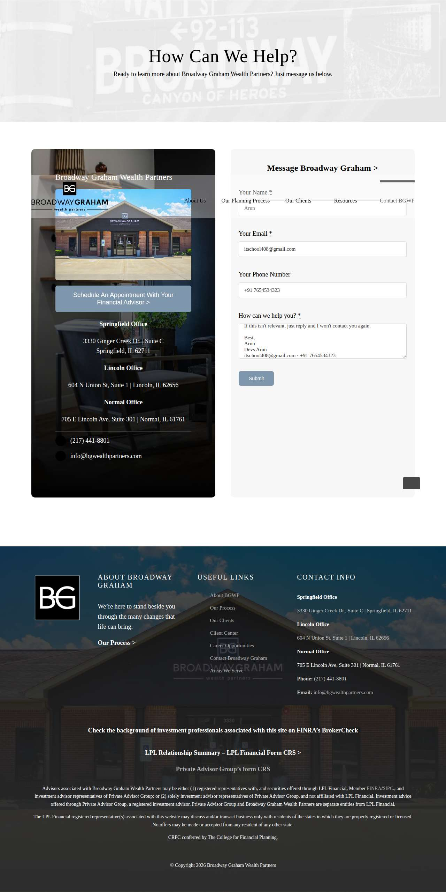

**After submit** — `run-b537a17d_attempt-95f24303_post_attempt_2026-11-05T05-31-53-727Z.jpg`

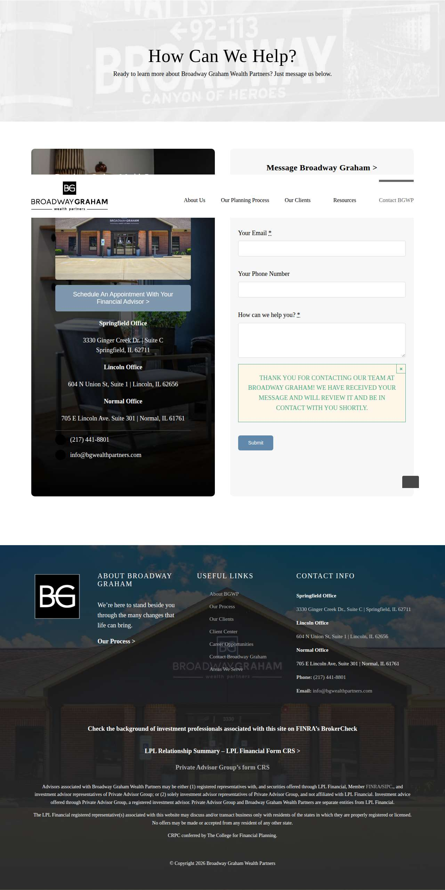

### jpcannata.com — unclear (LIVE)

| | |
|---|---|
| Attempt ID | `2a536887-aa16-408e-a4cc-fe06e4275308` |
| Form URL | https://cannataandcompany.com/contact-us |
| Final URL | https://cannataandcompany.com/contact-us |
| Reserved | 2026-11-05 05:32:02 UTC |
| Submit attempted | 2026-11-05 05:32:05 UTC |
| Template | standard v2 |
| Confirmation text | none observed |
| Result / error | No new success marker observed |

Exact message:

~~~text
Subject: Helping customers find your business in AI search (AEO + GEO)

Hi there,

I'm Arun from Devs Arun. More and more customers now ask ChatGPT, Gemini, Perplexity or Google's AI Overviews questions like "who should I hire for this in my area?" before they call anyone. These tools answer from websites they can clearly understand, and they tend to recommend businesses whose pages answer real customer questions.

That is what AEO + GEO (Answer Engine and Generative Engine Optimization) is for. I improve your existing service pages so they clearly answer the questions your customers ask, add structured data that matches the page, and make the call, quote or enquiry step obvious. The benefit: your business gets a better chance of being mentioned or linked in AI answers, and visitors who arrive find it easy to contact you.

The AEO + GEO Starter is a one-time $199 (about ₹16,999, negotiable) for one website: a basic audit, 10 customer questions, improvements to two existing pages, relevant structured data and an action plan, with one revision round.

You can read the full details, send an enquiry or book online here:
https://devsarun.io/aeo-geo/

If this isn't relevant, just reply and I won't contact you again.

Best,
Arun
Devs Arun
itschool408@gmail.com · +91 7654534323
~~~

Submitted field values:

- NAME \[name\]: Arun
- EMAIL \[email\]: itschool408@gmail.com
- PHONE \[phone\]: +91 7654534323
- MESSAGE \[message\]: Hi there, I'm Arun from Devs Arun. More and more customers now ask ChatGPT, Gemini, Perplexity or Google's AI Overviews 

**Filled form (before submit)** — `run-b537a17d_attempt-2a536887_filled_2026-11-05T05-32-05-322Z.jpg`

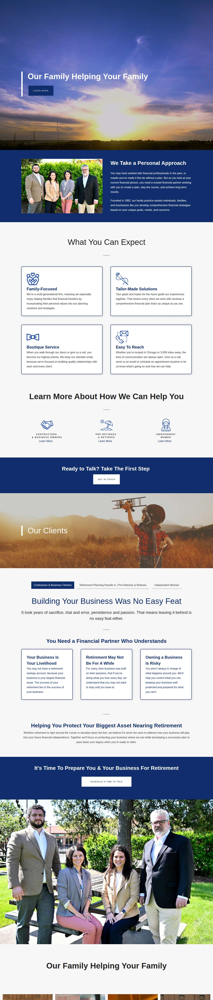

**After submit** — `run-b537a17d_attempt-2a536887_post_attempt_2026-11-05T05-32-34-007Z.jpg`

### thecommco.com — confirmed (LIVE)

| | |
|---|---|
| Attempt ID | `2b4f7df9-0ee5-4d2d-9546-a6fa60d6e0d8` |
| Form URL | https://thecommco.com/contact/ |
| Final URL | https://thecommco.com/contact/\#wpcf7-f555-o1 |
| Reserved | 2026-11-05 05:32:42 UTC |
| Submit attempted | 2026-11-05 05:32:44 UTC |
| Template | standard v2 |
| Confirmation text | more about our services? Please complete the form below and we will be in touch shortly. Thank you for your message. It has been sent. The Commerce Company 5440 SW Westgate Drive, |
| Result / error | — |

Exact message:

~~~text
Subject: Helping customers find your business in AI search (AEO + GEO)

Hi there,

I'm Arun from Devs Arun. More and more customers now ask ChatGPT, Gemini, Perplexity or Google's AI Overviews questions like "who should I hire for this in my area?" before they call anyone. These tools answer from websites they can clearly understand, and they tend to recommend businesses whose pages answer real customer questions.

That is what AEO + GEO (Answer Engine and Generative Engine Optimization) is for. I improve your existing service pages so they clearly answer the questions your customers ask, add structured data that matches the page, and make the call, quote or enquiry step obvious. The benefit: your business gets a better chance of being mentioned or linked in AI answers, and visitors who arrive find it easy to contact you.

The AEO + GEO Starter is a one-time $199 (about ₹16,999, negotiable) for one website: a basic audit, 10 customer questions, improvements to two existing pages, relevant structured data and an action plan, with one revision round.

You can read the full details, send an enquiry or book online here:
https://devsarun.io/aeo-geo/

If this isn't relevant, just reply and I won't contact you again.

Best,
Arun
Devs Arun
itschool408@gmail.com · +91 7654534323
~~~

Submitted field values:

- Company \[company\]: Devs Arun
- Subject \[subject\]: Helping customers find your business in AI search (AEO + GEO)
- Your Message \[message\]: Hi there, I'm Arun from Devs Arun. More and more customers now ask ChatGPT, Gemini, Perplexity or Google's AI Overviews 
- Your Name (Required) \[name\]: Arun
- Your Email (Required) \[email\]: itschool408@gmail.com

**Filled form (before submit)** — `run-b537a17d_attempt-2b4f7df9_filled_2026-11-05T05-32-44-135Z.jpg`

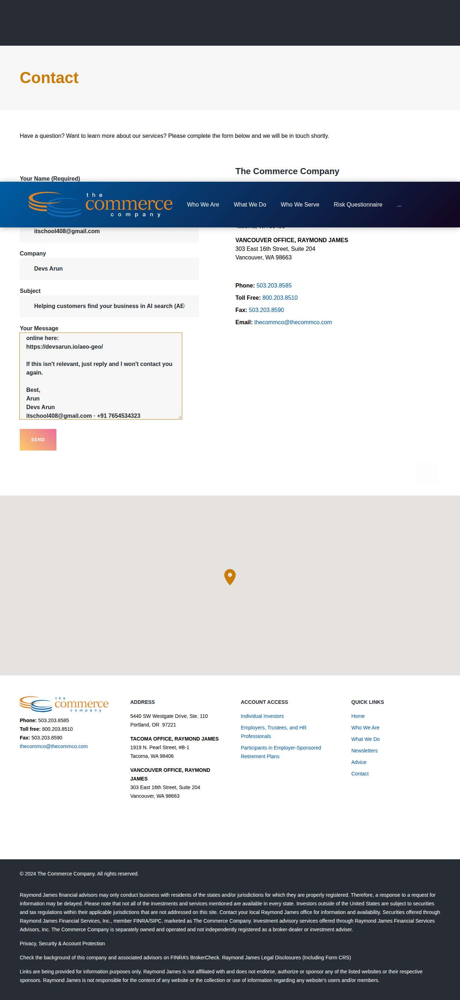

**After submit** — `run-b537a17d_attempt-2b4f7df9_post_attempt_2026-11-05T05-32-52-220Z.jpg`

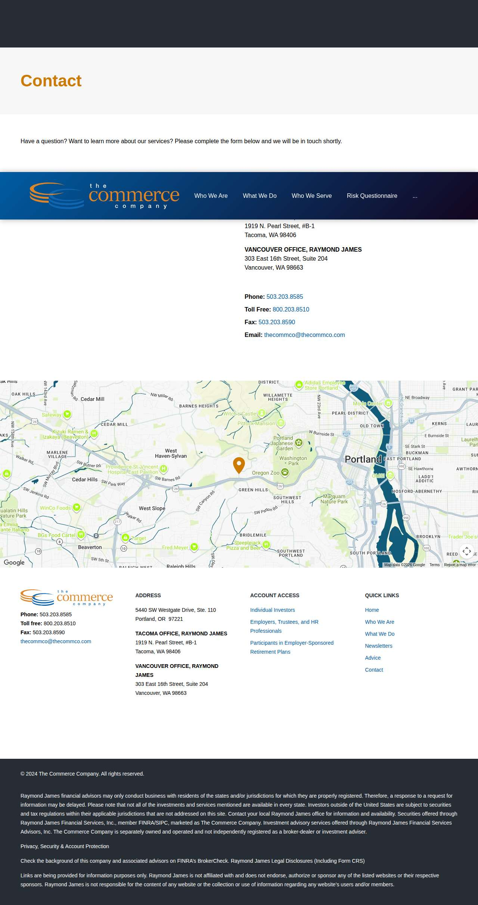

### mccabewealthmanagement.com — confirmed (LIVE)

| | |
|---|---|
| Attempt ID | `d2aa06e6-ca49-40b2-b9c5-126b16daa315` |
| Form URL | https://www.mccabewealthmanagement.com/contact |
| Final URL | https://www.mccabewealthmanagement.com/ |
| Reserved | 2026-11-05 05:33:00 UTC |
| Submit attempted | 2026-11-05 05:33:03 UTC |
| Template | standard v2 |
| Confirmation text | HOME ABOUT OUR SERVICES BLOG RESOURCES Status message Your message has been sent. × Personalized Client Experience Taking care of what's important so you can focus on what matters |
| Result / error | — |

Exact message:

~~~text
Subject: Helping customers find your business in AI search (AEO + GEO)

Hi there,

I'm Arun from Devs Arun. More and more customers now ask ChatGPT, Gemini, Perplexity or Google's AI Overviews questions like "who should I hire for this in my area?" before they call anyone. These tools answer from websites they can clearly understand, and they tend to recommend businesses whose pages answer real customer questions.

That is what AEO + GEO (Answer Engine and Generative Engine Optimization) is for. I improve your existing service pages so they clearly answer the questions your customers ask, add structured data that matches the page, and make the call, quote or enquiry step obvious. The benefit: your business gets a better chance of being mentioned or linked in AI answers, and visitors who arrive find it easy to contact you.

The AEO + GEO Starter is a one-time $199 (about ₹16,999, negotiable) for one website: a basic audit, 10 customer questions, improvements to two existing pages, relevant structured data and an action plan, with one revision round.

You can read the full details, send an enquiry or book online here:
https://devsarun.io/aeo-geo/

If this isn't relevant, just reply and I won't contact you again.

Best,
Arun
Devs Arun
itschool408@gmail.com · +91 7654534323
~~~

Submitted field values:

- Your name This field is required. \[name\]: Arun
- Message This field is required. \[message\]: Hi there, I'm Arun from Devs Arun. More and more customers now ask ChatGPT, Gemini, Perplexity or Google's AI Overviews 
- Subject This field is required. \[subject\]: Helping customers find your business in AI search (AEO + GEO)
- Your email address This field is required. \[email\]: itschool408@gmail.com

**Filled form (before submit)** — `run-b537a17d_attempt-d2aa06e6_filled_2026-11-05T05-33-03-013Z.jpg`

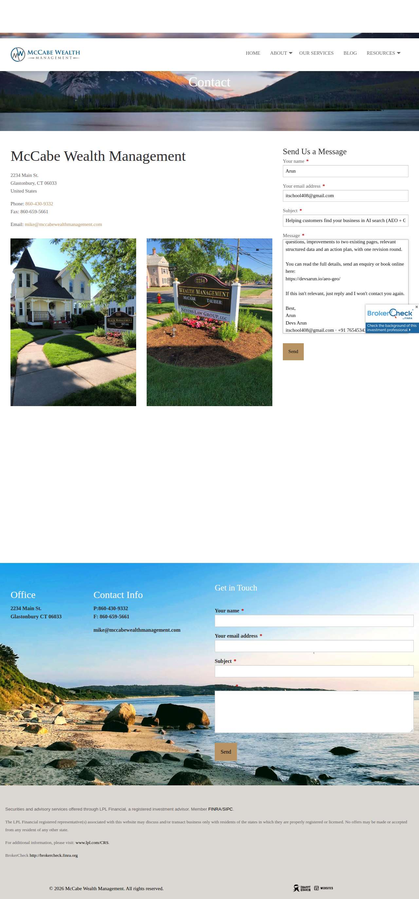

**After submit** — `run-b537a17d_attempt-d2aa06e6_post_attempt_2026-11-05T05-33-09-177Z.jpg`

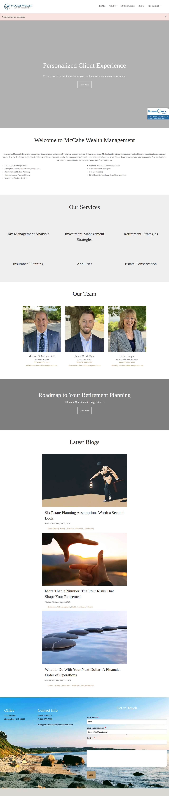

## Events (134)

| Time (UTC) | Event | Website | Details |
|---|---|---|---|
| 05:26:03 | run\_queued | — | live run requested by github:itsDevsArun |
| 05:26:03 | run\_dispatched | — | dispatch disabled (local test mode) |
| 05:26:07 | run\_started | — | Runner claimed live run |
| 05:26:08 | offer\_verified | — | Service page offer facts verified |
| 05:26:08 | website\_selected | clearchoiceplumbingllc.com | Live target clearchoiceplumbingllc.com |
| 05:26:08 | attempt\_reserved | clearchoiceplumbingllc.com | Submission attempt reserved with template standard v2 |
| 05:26:10 | page\_opened | clearchoiceplumbingllc.com | Opened form page |
| 05:26:10 | screenshot\_saved | clearchoiceplumbingllc.com | inspection screenshot saved (145 KB) |
| 05:26:10 | review\_required | clearchoiceplumbingllc.com | failed before submit: locator.fill: Error: Cannot type text into input\[type=number\] |
| 05:26:15 | website\_selected | bwnwincpainting.com | Live target bwnwincpainting.com |
| 05:26:15 | attempt\_reserved | bwnwincpainting.com | Submission attempt reserved with template standard v2 |
| 05:26:17 | page\_opened | bwnwincpainting.com | Opened form page |
| 05:26:17 | screenshot\_saved | bwnwincpainting.com | inspection screenshot saved (118 KB) |
| 05:26:17 | review\_required | bwnwincpainting.com | failed before submit: locator.fill: Error: Cannot type text into input\[type=number\] |
| 05:26:22 | website\_selected | absoluterestorepa.com | Live target absoluterestorepa.com |
| 05:26:22 | attempt\_reserved | absoluterestorepa.com | Submission attempt reserved with template standard v2 |
| 05:26:25 | page\_opened | absoluterestorepa.com | Opened form page |
| 05:26:25 | screenshot\_saved | absoluterestorepa.com | inspection screenshot saved (175 KB) |
| 05:26:25 | review\_required | absoluterestorepa.com | failed before submit: locator.fill: Error: Cannot type text into input\[type=number\] |
| 05:26:30 | website\_selected | masoudlawfirm.com | Live target masoudlawfirm.com |
| 05:26:30 | attempt\_reserved | masoudlawfirm.com | Submission attempt reserved with template standard v2 |
| 05:26:33 | page\_opened | masoudlawfirm.com | Opened form page |
| 05:26:33 | screenshot\_saved | masoudlawfirm.com | inspection screenshot saved (168 KB) |
| 05:26:33 | review\_required | masoudlawfirm.com | failed before submit: locator.fill: Error: Cannot type text into input\[type=number\] |
| 05:26:38 | website\_selected | whiteolivecpa.com | Live target whiteolivecpa.com |
| 05:26:38 | attempt\_reserved | whiteolivecpa.com | Submission attempt reserved with template standard v2 |
| 05:26:40 | page\_opened | whiteolivecpa.com | Opened form page |
| 05:26:40 | screenshot\_saved | whiteolivecpa.com | inspection screenshot saved (197 KB) |
| 05:26:40 | review\_required | whiteolivecpa.com | failed before submit: locator.fill: Error: Cannot type text into input\[type=number\] |
| 05:26:45 | website\_selected | lowdenarchitecture.com | Live target lowdenarchitecture.com |
| 05:26:45 | attempt\_reserved | lowdenarchitecture.com | Submission attempt reserved with template standard v2 |
| 05:26:47 | page\_opened | lowdenarchitecture.com | Opened form page |
| 05:26:47 | fields\_filled | lowdenarchitecture.com | filled |
| 05:26:47 | screenshot\_saved | lowdenarchitecture.com | filled screenshot saved (103 KB) |
| 05:26:47 | submit\_attempted | lowdenarchitecture.com | submitting |
| 05:27:16 | screenshot\_saved | lowdenarchitecture.com | post\_attempt screenshot saved (103 KB) |
| 05:27:16 | review\_required | lowdenarchitecture.com | unclear: No new success marker observed |
| 05:27:24 | website\_selected | itarchinc.com | Live target itarchinc.com |
| 05:27:24 | attempt\_reserved | itarchinc.com | Submission attempt reserved with template standard v2 |
| 05:27:29 | page\_opened | itarchinc.com | Opened form page |
| 05:27:29 | fields\_filled | itarchinc.com | filled |
| 05:27:29 | screenshot\_saved | itarchinc.com | filled screenshot saved (450 KB) |
| 05:27:29 | submit\_attempted | itarchinc.com | submitting |
| 05:28:06 | screenshot\_saved | itarchinc.com | post\_attempt screenshot saved (471 KB) |
| 05:28:06 | review\_required | itarchinc.com | unclear: No new success marker observed |
| 05:28:15 | website\_selected | cookconstructionwi.com | Live target cookconstructionwi.com |
| 05:28:15 | attempt\_reserved | cookconstructionwi.com | Submission attempt reserved with template standard v2 |
| 05:28:16 | page\_opened | cookconstructionwi.com | Opened form page |
| 05:28:16 | fields\_filled | cookconstructionwi.com | filled |
| 05:28:17 | screenshot\_saved | cookconstructionwi.com | filled screenshot saved (428 KB) |
| 05:28:17 | submit\_attempted | cookconstructionwi.com | submitting |
| 05:28:45 | screenshot\_saved | cookconstructionwi.com | post\_attempt screenshot saved (356 KB) |
| 05:28:45 | review\_required | cookconstructionwi.com | unclear: No new success marker observed |
| 05:28:54 | website\_selected | r4architect.com | Live target r4architect.com |
| 05:28:54 | attempt\_reserved | r4architect.com | Submission attempt reserved with template standard v2 |
| 05:28:55 | page\_opened | r4architect.com | Opened form page |
| 05:28:55 | fields\_filled | r4architect.com | filled |
| 05:28:55 | screenshot\_saved | r4architect.com | filled screenshot saved (66 KB) |
| 05:28:55 | submit\_attempted | r4architect.com | submitting |
| 05:29:00 | screenshot\_saved | r4architect.com | post\_attempt screenshot saved (63 KB) |
| 05:29:00 | confirmation\_observed | r4architect.com | confirmed — "ary phone: 888-747-5295 primary email: main@r4architect.com Thank you for your message. It has been sent. Thank you for " |
| 05:29:08 | website\_selected | budddesignllc.com | Live target budddesignllc.com |
| 05:29:08 | attempt\_reserved | budddesignllc.com | Submission attempt reserved with template standard v2 |
| 05:29:11 | page\_opened | budddesignllc.com | Opened form page |
| 05:29:11 | fields\_filled | budddesignllc.com | filled |
| 05:29:12 | screenshot\_saved | budddesignllc.com | filled screenshot saved (630 KB) |
| 05:29:12 | submit\_attempted | budddesignllc.com | submitting |
| 05:29:48 | screenshot\_saved | budddesignllc.com | post\_attempt screenshot saved (648 KB) |
| 05:29:48 | review\_required | budddesignllc.com | unclear: No new success marker observed |
| 05:29:57 | website\_selected | ywrising.com | Live target ywrising.com |
| 05:29:57 | attempt\_reserved | ywrising.com | Submission attempt reserved with template standard v2 |
| 05:29:59 | page\_opened | ywrising.com | Opened form page |
| 05:29:59 | fields\_filled | ywrising.com | filled |
| 05:29:59 | screenshot\_saved | ywrising.com | filled screenshot saved (64 KB) |
| 05:29:59 | submit\_attempted | ywrising.com | submitting |
| 05:30:28 | screenshot\_saved | ywrising.com | post\_attempt screenshot saved (52 KB) |
| 05:30:28 | review\_required | ywrising.com | unclear: No new success marker observed |
| 05:30:36 | website\_selected | myvintagehomes.com | Live target myvintagehomes.com |
| 05:30:36 | attempt\_reserved | myvintagehomes.com | Submission attempt reserved with template standard v2 |
| 05:30:38 | page\_opened | myvintagehomes.com | Opened form page |
| 05:30:38 | fields\_filled | myvintagehomes.com | filled |
| 05:30:39 | screenshot\_saved | myvintagehomes.com | filled screenshot saved (107 KB) |
| 05:30:39 | submit\_attempted | myvintagehomes.com | submitting |
| 05:31:07 | screenshot\_saved | myvintagehomes.com | post\_attempt screenshot saved (79 KB) |
| 05:31:07 | review\_required | myvintagehomes.com | unclear: No new success marker observed |
| 05:31:16 | website\_selected | vpfgroup.com | Live target vpfgroup.com |
| 05:31:16 | attempt\_reserved | vpfgroup.com | Submission attempt reserved with template standard v2 |
| 05:31:17 | page\_opened | vpfgroup.com | Opened form page |
| 05:31:17 | fields\_filled | vpfgroup.com | filled |
| 05:31:17 | screenshot\_saved | vpfgroup.com | filled screenshot saved (393 KB) |
| 05:31:17 | submit\_attempted | vpfgroup.com | submitting |
| 05:31:22 | screenshot\_saved | vpfgroup.com | post\_attempt screenshot saved (373 KB) |
| 05:31:22 | confirmation\_observed | vpfgroup.com | confirmed — "d Rapids team is ready to help. Fill out the form below and we will be in touch shortly. Thank you. Your message has bee" |
| 05:31:31 | website\_selected | camargoltd.com | Live target camargoltd.com |
| 05:31:31 | attempt\_reserved | camargoltd.com | Submission attempt reserved with template standard v2 |
| 05:31:32 | page\_opened | camargoltd.com | Opened form page |
| 05:31:32 | fields\_filled | camargoltd.com | filled |
| 05:31:32 | screenshot\_saved | camargoltd.com | filled screenshot saved (82 KB) |
| 05:31:32 | submit\_attempted | camargoltd.com | submitting |
| 05:31:37 | screenshot\_saved | camargoltd.com | post\_attempt screenshot saved (76 KB) |
| 05:31:37 | confirmation\_observed | camargoltd.com | confirmed — "innati, OH 45243 Phone: 513.936.5050 Fax: 513.793.8509 Your message was sent successfully. Thanks. Your Name (required) " |
| 05:31:45 | website\_selected | bgwealthpartners.com | Live target bgwealthpartners.com |
| 05:31:45 | attempt\_reserved | bgwealthpartners.com | Submission attempt reserved with template standard v2 |
| 05:31:47 | page\_opened | bgwealthpartners.com | Opened form page |
| 05:31:47 | fields\_filled | bgwealthpartners.com | filled |
| 05:31:47 | screenshot\_saved | bgwealthpartners.com | filled screenshot saved (192 KB) |
| 05:31:47 | submit\_attempted | bgwealthpartners.com | submitting |
| 05:31:53 | screenshot\_saved | bgwealthpartners.com | post\_attempt screenshot saved (191 KB) |
| 05:31:53 | confirmation\_observed | bgwealthpartners.com | confirmed — "ame \* Your Email \* Your Phone Number How can we help you? \* THANK YOU FOR CONTACTING OUR TEAM AT BROADWAY GRAHAM\! WE HAV" |
| 05:32:02 | website\_selected | jpcannata.com | Live target jpcannata.com |
| 05:32:02 | attempt\_reserved | jpcannata.com | Submission attempt reserved with template standard v2 |
| 05:32:05 | page\_opened | jpcannata.com | Opened form page |
| 05:32:05 | fields\_filled | jpcannata.com | filled |
| 05:32:05 | screenshot\_saved | jpcannata.com | filled screenshot saved (582 KB) |
| 05:32:05 | submit\_attempted | jpcannata.com | submitting |
| 05:32:34 | screenshot\_saved | jpcannata.com | post\_attempt screenshot saved (582 KB) |
| 05:32:34 | review\_required | jpcannata.com | unclear: No new success marker observed |
| 05:32:42 | website\_selected | thecommco.com | Live target thecommco.com |
| 05:32:42 | attempt\_reserved | thecommco.com | Submission attempt reserved with template standard v2 |
| 05:32:43 | page\_opened | thecommco.com | Opened form page |
| 05:32:43 | fields\_filled | thecommco.com | filled |
| 05:32:44 | screenshot\_saved | thecommco.com | filled screenshot saved (172 KB) |
| 05:32:44 | submit\_attempted | thecommco.com | submitting |
| 05:32:52 | screenshot\_saved | thecommco.com | post\_attempt screenshot saved (234 KB) |
| 05:32:52 | confirmation\_observed | thecommco.com | confirmed — "more about our services? Please complete the form below and we will be in touch shortly. Thank you for your message. It " |
| 05:33:00 | website\_selected | mccabewealthmanagement.com | Live target mccabewealthmanagement.com |
| 05:33:00 | attempt\_reserved | mccabewealthmanagement.com | Submission attempt reserved with template standard v2 |
| 05:33:02 | page\_opened | mccabewealthmanagement.com | Opened form page |
| 05:33:02 | fields\_filled | mccabewealthmanagement.com | filled |
| 05:33:03 | screenshot\_saved | mccabewealthmanagement.com | filled screenshot saved (255 KB) |
| 05:33:03 | submit\_attempted | mccabewealthmanagement.com | submitting |
| 05:33:09 | screenshot\_saved | mccabewealthmanagement.com | post\_attempt screenshot saved (332 KB) |
| 05:33:09 | confirmation\_observed | mccabewealthmanagement.com | confirmed — "HOME ABOUT OUR SERVICES BLOG RESOURCES Status message Your message has been sent. × Personalized Client Experience Takin" |
| 05:33:17 | run\_completed | — | Run completed (queue\_exhausted) |
