# Run d380ad8b — live — completed

| | |
|---|---|
| Run ID | `d380ad8b-db35-49a5-9cd1-941c63b3c2a4` |
| Requested by | github:itsDevsArun |
| Started | 2026-11-05 04:42:40 UTC |
| Finished | 2026-11-05 04:50:11 UTC |
| Finish reason | queue\_exhausted |
| GitHub Actions | https://github.com/itsDevsArun/aeo-geo/actions/runs/41950876497 |

CSV for this run: [runs/2026-11-05_live_d380ad8b.csv](2026-11-05_live_d380ad8b.csv)

## Attempts (21)

### clearchoiceplumbingllc.com — failed\_before\_submit (LIVE)

| | |
|---|---|
| Attempt ID | `3a4e543f-d8b7-4035-b84a-3060805adc9f` |
| Form URL | https://clearchoiceplumbingllc.com/contact/ |
| Final URL | — |
| Reserved | 2026-11-05 04:42:42 UTC |
| Submit attempted | — |
| Template | standard v2 |
| Confirmation text | none observed |
| Result / error | locator.fill: Error: Cannot type text into input\[type=number\] |

Exact message:

~~~text
Subject: Helping customers find your business in AI search (AEO + GEO)

Hi there,

I'm Arun from Devs Arun. More and more customers now ask ChatGPT, Gemini, Perplexity or Google's AI Overviews questions like "who should I hire for this in my area?" before they call anyone. These tools answer from websites they can clearly understand, and they tend to recommend businesses whose pages answer real customer questions.

That is what AEO + GEO (Answer Engine and Generative Engine Optimization) is for. I improve your existing service pages so they clearly answer the questions your customers ask, add structured data that matches the page, and make the call, quote or enquiry step obvious. The benefit: your business gets a better chance of being mentioned or linked in AI answers, and visitors who arrive find it easy to contact you.

The AEO + GEO Starter is a one-time $199 (about ₹16,999, negotiable) for one website: a basic audit, 10 customer questions, improvements to two existing pages, relevant structured data and an action plan, with one revision round.

You can read the full details, send an enquiry or book online here:
https://devsarun.io/aeo-geo/

If this isn't relevant, just reply and I won't contact you again.

Best,
Arun
Devs Arun
itschool408@gmail.com · +91 7654534323
~~~

Submitted field values:

- \#wpforms-51-field\_1: Arun
- \#wpforms-51-field\_2: itschool408@gmail.com
- \#wpforms-51-field\_3: Hi there, I'm Arun from Devs Arun. More and more customers now ask ChatGPT, Gemini, Perplexity or Google's AI Overviews 
- \#wpforms-51-field\_5: +91 7654534323

**Inspected page** — `run-d380ad8b_attempt-3a4e543f_inspection_2026-11-05T04-42-43-456Z.jpg`

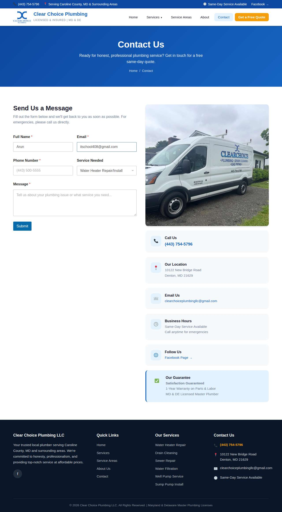

### bwnwincpainting.com — failed\_before\_submit (LIVE)

| | |
|---|---|
| Attempt ID | `a89ef80b-b174-460f-92ef-6053af53d5f4` |
| Form URL | https://www.bwnwincpainting.com/contact/ |
| Final URL | — |
| Reserved | 2026-11-05 04:42:48 UTC |
| Submit attempted | — |
| Template | standard v2 |
| Confirmation text | none observed |
| Result / error | locator.fill: Error: Cannot type text into input\[type=number\] |

Exact message:

~~~text
Subject: Helping customers find your business in AI search (AEO + GEO)

Hi there,

I'm Arun from Devs Arun. More and more customers now ask ChatGPT, Gemini, Perplexity or Google's AI Overviews questions like "who should I hire for this in my area?" before they call anyone. These tools answer from websites they can clearly understand, and they tend to recommend businesses whose pages answer real customer questions.

That is what AEO + GEO (Answer Engine and Generative Engine Optimization) is for. I improve your existing service pages so they clearly answer the questions your customers ask, add structured data that matches the page, and make the call, quote or enquiry step obvious. The benefit: your business gets a better chance of being mentioned or linked in AI answers, and visitors who arrive find it easy to contact you.

The AEO + GEO Starter is a one-time $199 (about ₹16,999, negotiable) for one website: a basic audit, 10 customer questions, improvements to two existing pages, relevant structured data and an action plan, with one revision round.

You can read the full details, send an enquiry or book online here:
https://devsarun.io/aeo-geo/

If this isn't relevant, just reply and I won't contact you again.

Best,
Arun
Devs Arun
itschool408@gmail.com · +91 7654534323
~~~

Submitted field values:

- \#name-1151: Arun
- \#email-1151: itschool408@gmail.com
- \#phone-1151: +91 7654534323
- \#message-1151: Hi there, I'm Arun from Devs Arun. More and more customers now ask ChatGPT, Gemini, Perplexity or Google's AI Overviews 

**Inspected page** — `run-d380ad8b_attempt-a89ef80b_inspection_2026-11-05T04-42-49-733Z.jpg`

### absoluterestorepa.com — failed\_before\_submit (LIVE)

| | |
|---|---|
| Attempt ID | `8d8377ea-6365-415b-aaad-2d61fc16c640` |
| Form URL | https://absoluterestorepa.com/contact-us/ |
| Final URL | — |
| Reserved | 2026-11-05 04:42:54 UTC |
| Submit attempted | — |
| Template | standard v2 |
| Confirmation text | none observed |
| Result / error | locator.fill: Error: Cannot type text into input\[type=number\] |

Exact message:

~~~text
Subject: Helping customers find your business in AI search (AEO + GEO)

Hi there,

I'm Arun from Devs Arun. More and more customers now ask ChatGPT, Gemini, Perplexity or Google's AI Overviews questions like "who should I hire for this in my area?" before they call anyone. These tools answer from websites they can clearly understand, and they tend to recommend businesses whose pages answer real customer questions.

That is what AEO + GEO (Answer Engine and Generative Engine Optimization) is for. I improve your existing service pages so they clearly answer the questions your customers ask, add structured data that matches the page, and make the call, quote or enquiry step obvious. The benefit: your business gets a better chance of being mentioned or linked in AI answers, and visitors who arrive find it easy to contact you.

The AEO + GEO Starter is a one-time $199 (about ₹16,999, negotiable) for one website: a basic audit, 10 customer questions, improvements to two existing pages, relevant structured data and an action plan, with one revision round.

You can read the full details, send an enquiry or book online here:
https://devsarun.io/aeo-geo/

If this isn't relevant, just reply and I won't contact you again.

Best,
Arun
Devs Arun
itschool408@gmail.com · +91 7654534323
~~~

Submitted field values:

- \#form-field-name: Arun
- \#form-field-message: Hi there, I'm Arun from Devs Arun. More and more customers now ask ChatGPT, Gemini, Perplexity or Google's AI Overviews 
- \#form-field-field\_ed02ec2: +91 7654534323
- \#content \> div \> div \> div:nth-of-type(2) \> div \> div:nth-of-type(1) \> div:nth-of-type(2) \> div \> form \> div \> div:nth-of-type(3) \> input: itschool408@gmail.com

**Inspected page** — `run-d380ad8b_attempt-8d8377ea_inspection_2026-11-05T04-42-57-856Z.jpg`

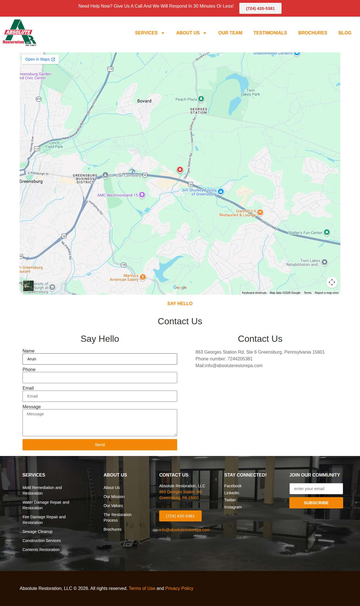

### masoudlawfirm.com — failed\_before\_submit (LIVE)

| | |
|---|---|
| Attempt ID | `23664471-8c9b-48e0-9757-28807a9950a2` |
| Form URL | https://masoudlawfirm.com/contact/ |
| Final URL | — |
| Reserved | 2026-11-05 04:43:02 UTC |
| Submit attempted | — |
| Template | standard v2 |
| Confirmation text | none observed |
| Result / error | locator.fill: Error: Cannot type text into input\[type=number\] |

Exact message:

~~~text
Subject: Helping customers find your business in AI search (AEO + GEO)

Hi there,

I'm Arun from Devs Arun. More and more customers now ask ChatGPT, Gemini, Perplexity or Google's AI Overviews questions like "who should I hire for this in my area?" before they call anyone. These tools answer from websites they can clearly understand, and they tend to recommend businesses whose pages answer real customer questions.

That is what AEO + GEO (Answer Engine and Generative Engine Optimization) is for. I improve your existing service pages so they clearly answer the questions your customers ask, add structured data that matches the page, and make the call, quote or enquiry step obvious. The benefit: your business gets a better chance of being mentioned or linked in AI answers, and visitors who arrive find it easy to contact you.

The AEO + GEO Starter is a one-time $199 (about ₹16,999, negotiable) for one website: a basic audit, 10 customer questions, improvements to two existing pages, relevant structured data and an action plan, with one revision round.

You can read the full details, send an enquiry or book online here:
https://devsarun.io/aeo-geo/

If this isn't relevant, just reply and I won't contact you again.

Best,
Arun
Devs Arun
itschool408@gmail.com · +91 7654534323
~~~

Submitted field values:

- \#form-field-name: Arun
- \#form-field-field\_3374379: Hi there, I'm Arun from Devs Arun. More and more customers now ask ChatGPT, Gemini, Perplexity or Google's AI Overviews 
- \#form-field-field\_7731784: +91 7654534323
- \#form-field-field\_8bd0f16: itschool408@gmail.com

**Inspected page** — `run-d380ad8b_attempt-23664471_inspection_2026-11-05T04-43-04-751Z.jpg`

### whiteolivecpa.com — failed\_before\_submit (LIVE)

| | |
|---|---|
| Attempt ID | `80058c4a-9867-4a38-9aea-bd4a12e18907` |
| Form URL | https://whiteolivecpa.com/contact/ |
| Final URL | — |
| Reserved | 2026-11-05 04:43:09 UTC |
| Submit attempted | — |
| Template | standard v2 |
| Confirmation text | none observed |
| Result / error | locator.fill: Error: Cannot type text into input\[type=number\] |

Exact message:

~~~text
Subject: Helping customers find your business in AI search (AEO + GEO)

Hi there,

I'm Arun from Devs Arun. More and more customers now ask ChatGPT, Gemini, Perplexity or Google's AI Overviews questions like "who should I hire for this in my area?" before they call anyone. These tools answer from websites they can clearly understand, and they tend to recommend businesses whose pages answer real customer questions.

That is what AEO + GEO (Answer Engine and Generative Engine Optimization) is for. I improve your existing service pages so they clearly answer the questions your customers ask, add structured data that matches the page, and make the call, quote or enquiry step obvious. The benefit: your business gets a better chance of being mentioned or linked in AI answers, and visitors who arrive find it easy to contact you.

The AEO + GEO Starter is a one-time $199 (about ₹16,999, negotiable) for one website: a basic audit, 10 customer questions, improvements to two existing pages, relevant structured data and an action plan, with one revision round.

You can read the full details, send an enquiry or book online here:
https://devsarun.io/aeo-geo/

If this isn't relevant, just reply and I won't contact you again.

Best,
Arun
Devs Arun
itschool408@gmail.com · +91 7654534323
~~~

Submitted field values:

- \#ff\_1\_email: itschool408@gmail.com
- \#ff\_1\_message: Hi there, I'm Arun from Devs Arun. More and more customers now ask ChatGPT, Gemini, Perplexity or Google's AI Overviews 
- \#ff\_1\_numeric\_field: +91 7654534323
- \#ff\_1\_names\_first\_name\_: Arun

**Inspected page** — `run-d380ad8b_attempt-80058c4a_inspection_2026-11-05T04-43-11-319Z.jpg`

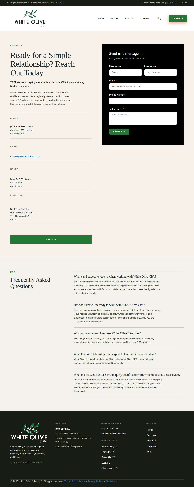

### ezlandscapingpaving.com — confirmed (LIVE)

| | |
|---|---|
| Attempt ID | `ec273908-13ee-45b8-82cd-079423c216c2` |
| Form URL | https://ezlandscapingpaving.com/contact-us |
| Final URL | https://ezlandscapingpaving.com/contact-us |
| Reserved | 2026-11-05 04:43:16 UTC |
| Submit attempted | 2026-11-05 04:43:19 UTC |
| Template | standard v2 |
| Confirmation text | e always dreamed of - contact us now and let’s get started\! Message sent. Keyboard shortcuts Map data ©2026 Google Terms Report a map error This page can't load Google Maps |
| Result / error | — |

Exact message:

~~~text
Subject: Helping customers find your business in AI search (AEO + GEO)

Hi there,

I'm Arun from Devs Arun. More and more customers now ask ChatGPT, Gemini, Perplexity or Google's AI Overviews questions like "who should I hire for this in my area?" before they call anyone. These tools answer from websites they can clearly understand, and they tend to recommend businesses whose pages answer real customer questions.

That is what AEO + GEO (Answer Engine and Generative Engine Optimization) is for. I improve your existing service pages so they clearly answer the questions your customers ask, add structured data that matches the page, and make the call, quote or enquiry step obvious. The benefit: your business gets a better chance of being mentioned or linked in AI answers, and visitors who arrive find it easy to contact you.

The AEO + GEO Starter is a one-time $199 (about ₹16,999, negotiable) for one website: a basic audit, 10 customer questions, improvements to two existing pages, relevant structured data and an action plan, with one revision round.

You can read the full details, send an enquiry or book online here:
https://devsarun.io/aeo-geo/

If this isn't relevant, just reply and I won't contact you again.

Best,
Arun
Devs Arun
itschool408@gmail.com · +91 7654534323
~~~

Submitted field values:

- author \[name\]: Arun
- email \[email\]: itschool408@gmail.com
- comment \[message\]: Hi there, I'm Arun from Devs Arun. More and more customers now ask ChatGPT, Gemini, Perplexity or Google's AI Overviews 

**Filled form (before submit)** — `run-d380ad8b_attempt-ec273908_filled_2026-11-05T04-43-19-444Z.jpg`

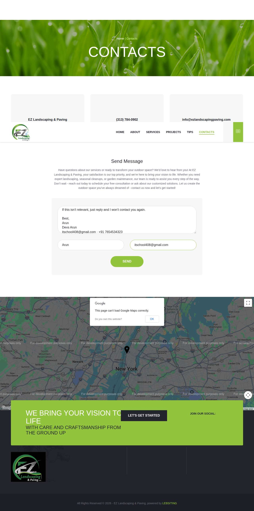

**After submit** — `run-d380ad8b_attempt-ec273908_post_attempt_2026-11-05T04-43-24-003Z.jpg`

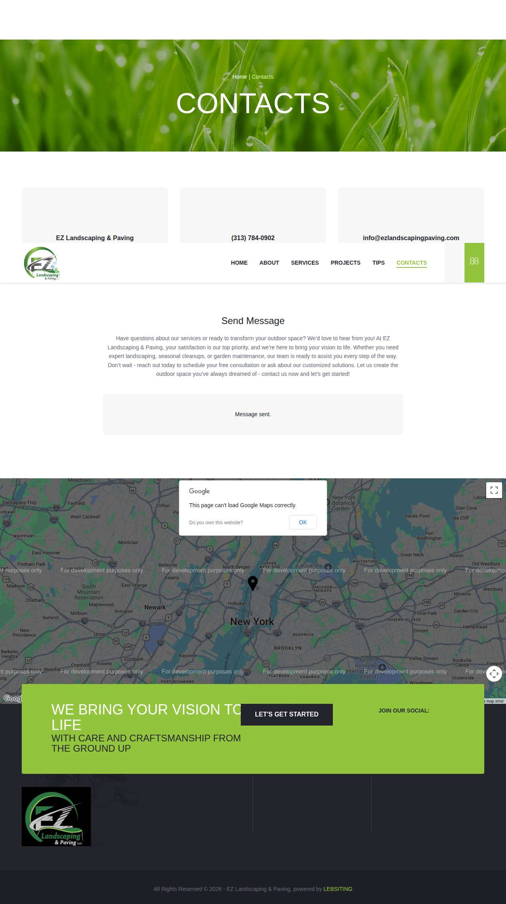

### srsarchitectpc.com — unclear (LIVE)

| | |
|---|---|
| Attempt ID | `55d51d3c-dca7-4c5a-a1dd-cc70c84056d5` |
| Form URL | https://www.srsarchitectpc.com/contact/2083333 |
| Final URL | https://www.srsarchitectpc.com/contact/2083333 |
| Reserved | 2026-11-05 04:43:32 UTC |
| Submit attempted | 2026-11-05 04:43:35 UTC |
| Template | standard v2 |
| Confirmation text | none observed |
| Result / error | No new success marker observed |

Exact message:

~~~text
Subject: Helping customers find your business in AI search (AEO + GEO)

Hi there,

I'm Arun from Devs Arun. More and more customers now ask ChatGPT, Gemini, Perplexity or Google's AI Overviews questions like "who should I hire for this in my area?" before they call anyone. These tools answer from websites they can clearly understand, and they tend to recommend businesses whose pages answer real customer questions.

That is what AEO + GEO (Answer Engine and Generative Engine Optimization) is for. I improve your existing service pages so they clearly answer the questions your customers ask, add structured data that matches the page, and make the call, quote or enquiry step obvious. The benefit: your business gets a better chance of being mentioned or linked in AI answers, and visitors who arrive find it easy to contact you.

The AEO + GEO Starter is a one-time $199 (about ₹16,999, negotiable) for one website: a basic audit, 10 customer questions, improvements to two existing pages, relevant structured data and an action plan, with one revision round.

You can read the full details, send an enquiry or book online here:
https://devsarun.io/aeo-geo/

If this isn't relevant, just reply and I won't contact you again.

Best,
Arun
Devs Arun
itschool408@gmail.com · +91 7654534323
~~~

Submitted field values:

- Name\* \[name\]: Arun
- Phone \[phone\]: +91 7654534323
- Email\* \[email\]: itschool408@gmail.com
- Message: \[message\]: Hi there, I'm Arun from Devs Arun. More and more customers now ask ChatGPT, Gemini, Perplexity or Google's AI Overviews 

**Filled form (before submit)** — `run-d380ad8b_attempt-55d51d3c_filled_2026-11-05T04-43-35-739Z.jpg`

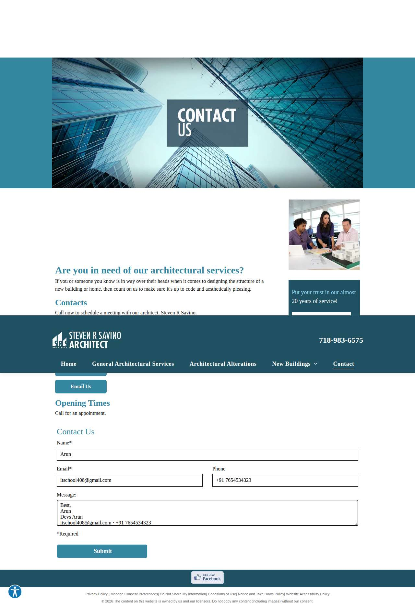

**After submit** — `run-d380ad8b_attempt-55d51d3c_post_attempt_2026-11-05T04-44-06-016Z.jpg`

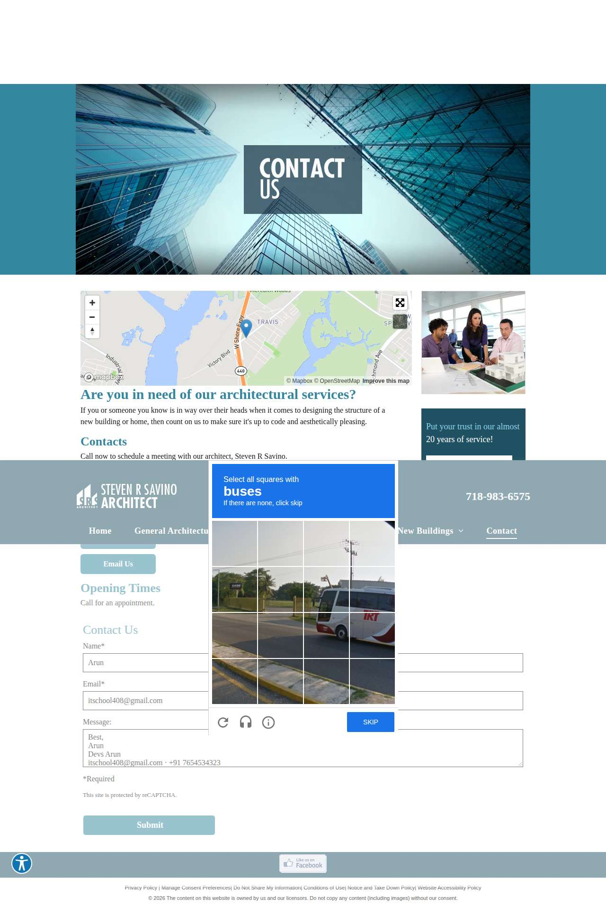

### kellyarchitectural.com — confirmed (LIVE)

| | |
|---|---|
| Attempt ID | `8d0b891a-5d3a-4faa-916f-06cf372ef26e` |
| Form URL | https://www.kellyarchitectural.com/Contact |
| Final URL | https://www.kellyarchitectural.com/Contact |
| Reserved | 2026-11-05 04:44:14 UTC |
| Submit attempted | 2026-11-05 04:44:16 UTC |
| Template | standard v2 |
| Confirmation text | x 740 - 454 - 4898 kelly.architectural@gmail.com Google Map Thank you for your interest. We'll respond to your message as soon as possible. Your name: Your e-mail addres |
| Result / error | — |

Exact message:

~~~text
Subject: Helping customers find your business in AI search (AEO + GEO)

Hi there,

I'm Arun from Devs Arun. More and more customers now ask ChatGPT, Gemini, Perplexity or Google's AI Overviews questions like "who should I hire for this in my area?" before they call anyone. These tools answer from websites they can clearly understand, and they tend to recommend businesses whose pages answer real customer questions.

That is what AEO + GEO (Answer Engine and Generative Engine Optimization) is for. I improve your existing service pages so they clearly answer the questions your customers ask, add structured data that matches the page, and make the call, quote or enquiry step obvious. The benefit: your business gets a better chance of being mentioned or linked in AI answers, and visitors who arrive find it easy to contact you.

The AEO + GEO Starter is a one-time $199 (about ₹16,999, negotiable) for one website: a basic audit, 10 customer questions, improvements to two existing pages, relevant structured data and an action plan, with one revision round.

You can read the full details, send an enquiry or book online here:
https://devsarun.io/aeo-geo/

If this isn't relevant, just reply and I won't contact you again.

Best,
Arun
Devs Arun
itschool408@gmail.com · +91 7654534323
~~~

Submitted field values:

- Your name: \[name\]: Arun
- Comments: \[message\]: Hi there, I'm Arun from Devs Arun. More and more customers now ask ChatGPT, Gemini, Perplexity or Google's AI Overviews 
- Your e-mail address: \[email\]: itschool408@gmail.com

**Filled form (before submit)** — `run-d380ad8b_attempt-8d0b891a_filled_2026-11-05T04-44-16-612Z.jpg`

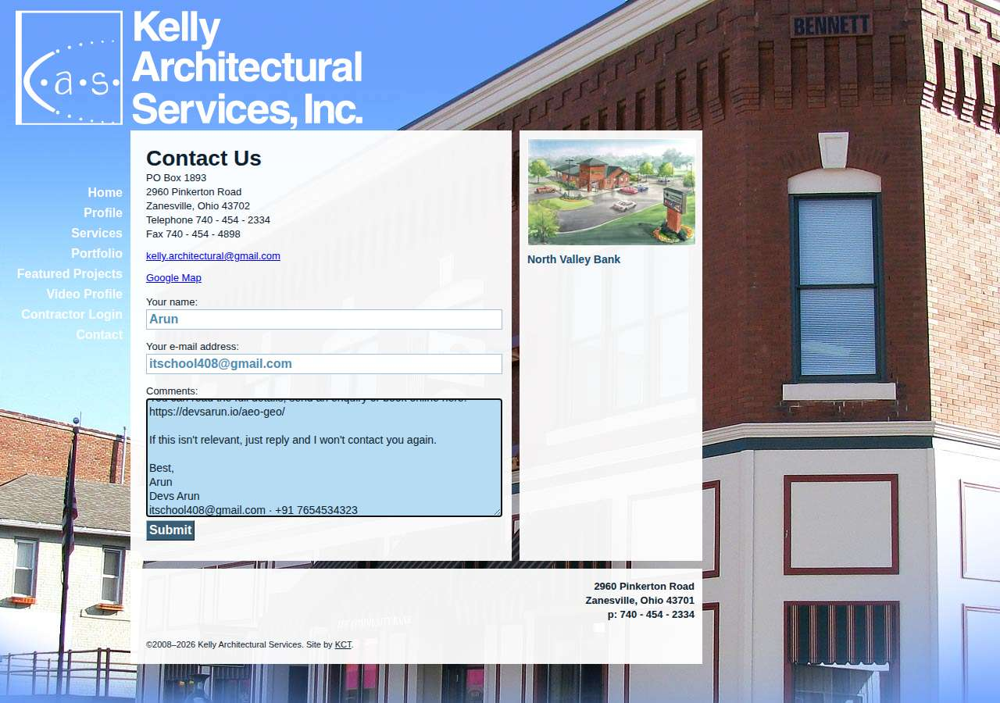

**After submit** — `run-d380ad8b_attempt-8d0b891a_post_attempt_2026-11-05T04-44-21-744Z.jpg`

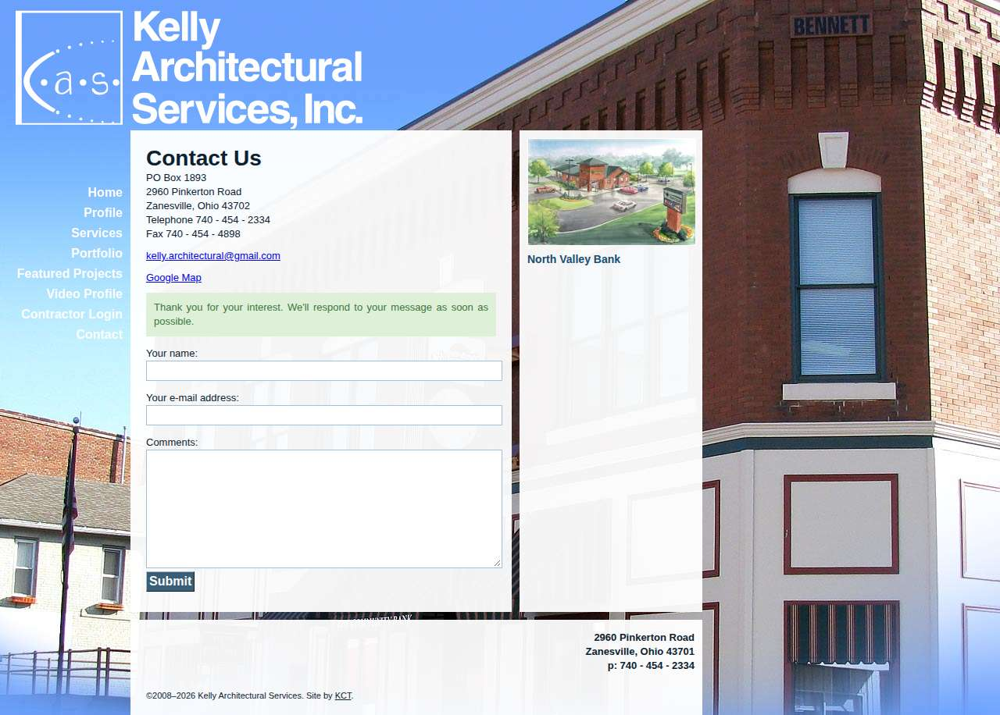

### mpiarch.com — unclear (LIVE)

| | |
|---|---|
| Attempt ID | `be35d849-1375-4537-abc8-267b746ee7a4` |
| Form URL | https://www.mpiarch.com/contact |
| Final URL | https://www.mpiarch.com/contact |
| Reserved | 2026-11-05 04:44:30 UTC |
| Submit attempted | 2026-11-05 04:44:33 UTC |
| Template | standard v2 |
| Confirmation text | none observed |
| Result / error | No new success marker observed |

Exact message:

~~~text
Subject: Helping customers find your business in AI search (AEO + GEO)

Hi there,

I'm Arun from Devs Arun. More and more customers now ask ChatGPT, Gemini, Perplexity or Google's AI Overviews questions like "who should I hire for this in my area?" before they call anyone. These tools answer from websites they can clearly understand, and they tend to recommend businesses whose pages answer real customer questions.

That is what AEO + GEO (Answer Engine and Generative Engine Optimization) is for. I improve your existing service pages so they clearly answer the questions your customers ask, add structured data that matches the page, and make the call, quote or enquiry step obvious. The benefit: your business gets a better chance of being mentioned or linked in AI answers, and visitors who arrive find it easy to contact you.

The AEO + GEO Starter is a one-time $199 (about ₹16,999, negotiable) for one website: a basic audit, 10 customer questions, improvements to two existing pages, relevant structured data and an action plan, with one revision round.

You can read the full details, send an enquiry or book online here:
https://devsarun.io/aeo-geo/

If this isn't relevant, just reply and I won't contact you again.

Best,
Arun
Devs Arun
itschool408@gmail.com · +91 7654534323
~~~

Submitted field values:

- email \[email\]: itschool408@gmail.com
- name-\* \[name\]: Arun
- phone \[phone\]: +91 7654534323
- Message \[message\]: Hi there, I'm Arun from Devs Arun. More and more customers now ask ChatGPT, Gemini, Perplexity or Google's AI Overviews 

**Filled form (before submit)** — `run-d380ad8b_attempt-be35d849_filled_2026-11-05T04-44-33-126Z.jpg`

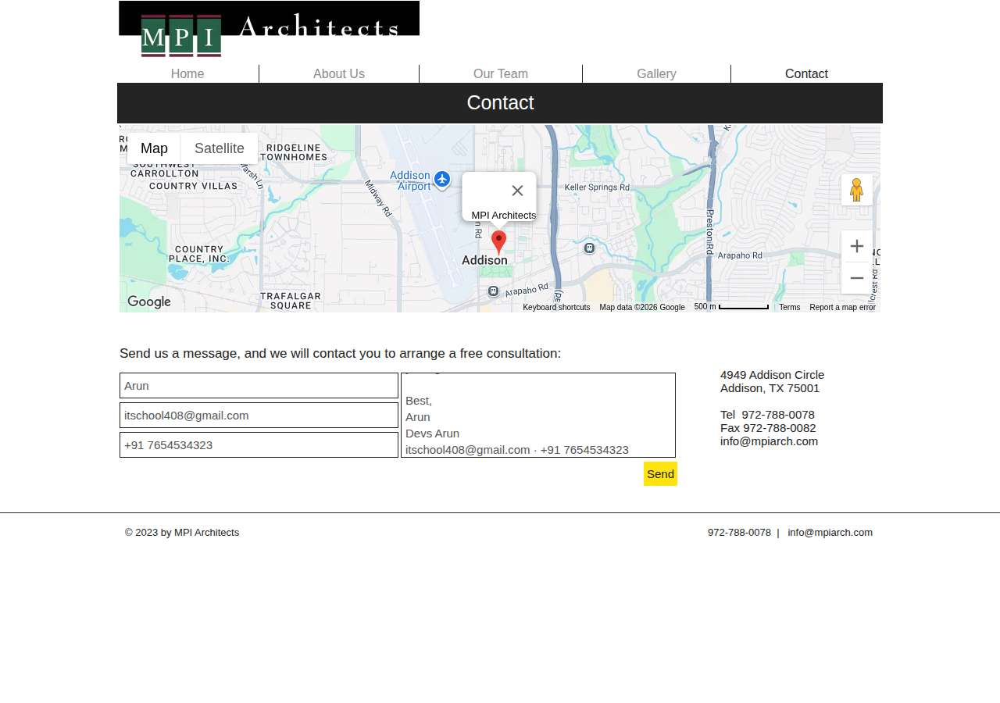

**After submit** — `run-d380ad8b_attempt-be35d849_post_attempt_2026-11-05T04-45-01-608Z.jpg`

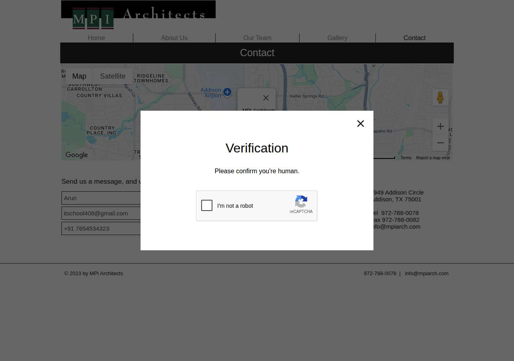

### leuteriothomas.com — unclear (LIVE)

| | |
|---|---|
| Attempt ID | `9dde8f52-eafa-4abc-ae6b-1bc3e0b78894` |
| Form URL | https://leuteriothomas.com/ |
| Final URL | https://leuteriothomas.com/ |
| Reserved | 2026-11-05 04:45:09 UTC |
| Submit attempted | 2026-11-05 04:45:12 UTC |
| Template | standard v2 |
| Confirmation text | none observed |
| Result / error | No new success marker observed |

Exact message:

~~~text
Subject: Helping customers find your business in AI search (AEO + GEO)

Hi there,

I'm Arun from Devs Arun. More and more customers now ask ChatGPT, Gemini, Perplexity or Google's AI Overviews questions like "who should I hire for this in my area?" before they call anyone. These tools answer from websites they can clearly understand, and they tend to recommend businesses whose pages answer real customer questions.

That is what AEO + GEO (Answer Engine and Generative Engine Optimization) is for. I improve your existing service pages so they clearly answer the questions your customers ask, add structured data that matches the page, and make the call, quote or enquiry step obvious. The benefit: your business gets a better chance of being mentioned or linked in AI answers, and visitors who arrive find it easy to contact you.

The AEO + GEO Starter is a one-time $199 (about ₹16,999, negotiable) for one website: a basic audit, 10 customer questions, improvements to two existing pages, relevant structured data and an action plan, with one revision round.

You can read the full details, send an enquiry or book online here:
https://devsarun.io/aeo-geo/

If this isn't relevant, just reply and I won't contact you again.

Best,
Arun
Devs Arun
itschool408@gmail.com · +91 7654534323
~~~

Submitted field values:

- Email \[email\]: itschool408@gmail.com
- form\_fields\[field\_40eecef\] \[message\]: Hi there, I'm Arun from Devs Arun. More and more customers now ask ChatGPT, Gemini, Perplexity or Google's AI Overviews 

**Filled form (before submit)** — `run-d380ad8b_attempt-9dde8f52_filled_2026-11-05T04-45-12-376Z.jpg`

**After submit** — `run-d380ad8b_attempt-9dde8f52_post_attempt_2026-11-05T04-45-40-956Z.jpg`

### invisionarch.com — error\_after\_submit (LIVE)

| | |
|---|---|
| Attempt ID | `3c5f7a75-bfad-4823-9ec5-4fd9515a8b06` |
| Form URL | https://www.invisionarch.com/contact |
| Final URL | https://www.invisionarch.com/contact |
| Reserved | 2026-11-05 04:45:50 UTC |
| Submit attempted | 2026-11-05 04:45:51 UTC |
| Template | standard v2 |
| Confirmation text | ​com. Sorry, there was an error submitting the form. Please try again. LEAVE THIS FIELD BLANK Rather not call? Shoot us an email. FIRST NAME LAST NAME This field is requ |
| Result / error | — |

Exact message:

~~~text
Subject: Helping customers find your business in AI search (AEO + GEO)

Hi there,

I'm Arun from Devs Arun. More and more customers now ask ChatGPT, Gemini, Perplexity or Google's AI Overviews questions like "who should I hire for this in my area?" before they call anyone. These tools answer from websites they can clearly understand, and they tend to recommend businesses whose pages answer real customer questions.

That is what AEO + GEO (Answer Engine and Generative Engine Optimization) is for. I improve your existing service pages so they clearly answer the questions your customers ask, add structured data that matches the page, and make the call, quote or enquiry step obvious. The benefit: your business gets a better chance of being mentioned or linked in AI answers, and visitors who arrive find it easy to contact you.

The AEO + GEO Starter is a one-time $199 (about ₹16,999, negotiable) for one website: a basic audit, 10 customer questions, improvements to two existing pages, relevant structured data and an action plan, with one revision round.

You can read the full details, send an enquiry or book online here:
https://devsarun.io/aeo-geo/

If this isn't relevant, just reply and I won't contact you again.

Best,
Arun
Devs Arun
itschool408@gmail.com · +91 7654534323
~~~

Submitted field values:

- EMAIL \[email\]: itschool408@gmail.com
- MESSAGE \[message\]: Hi there, I'm Arun from Devs Arun. More and more customers now ask ChatGPT, Gemini, Perplexity or Google's AI Overviews 
- PHONE NUMBER \[phone\]: +91 7654534323
- COMPANY NAME \[company\]: Devs Arun
- FIRST NAME \[first\_name\]: Arun

**Filled form (before submit)** — `run-d380ad8b_attempt-3c5f7a75_filled_2026-11-05T04-45-51-842Z.jpg`

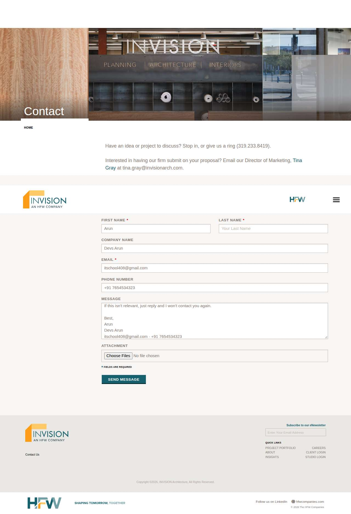

**After submit** — `run-d380ad8b_attempt-3c5f7a75_post_attempt_2026-11-05T04-46-03-882Z.jpg`

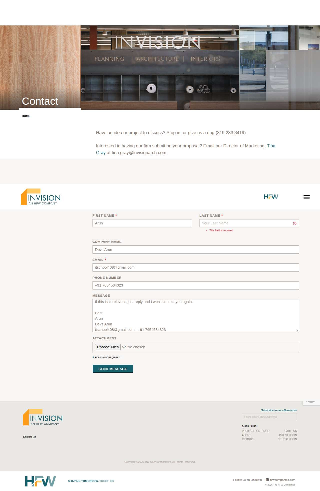

### fullcirclearchitects.com — confirmed (LIVE)

| | |
|---|---|
| Attempt ID | `63f42265-750c-47d8-99a8-51db95ac6155` |
| Form URL | https://fullcirclearchitects.com/contact/ |
| Final URL | https://fullcirclearchitects.com/contact/ |
| Reserved | 2026-11-05 04:46:12 UTC |
| Submit attempted | 2026-11-05 04:46:13 UTC |
| Template | standard v2 |
| Confirmation text | Suite 518 \| Chicago, Illinois 60614 Please Contact Us Your message was sent successfully. We'll get back to you shortly. Thanks\! Your Name\* Your Email\* Your Phone\* Subject\* Yo |
| Result / error | — |

Exact message:

~~~text
Subject: Helping customers find your business in AI search (AEO + GEO)

Hi there,

I'm Arun from Devs Arun. More and more customers now ask ChatGPT, Gemini, Perplexity or Google's AI Overviews questions like "who should I hire for this in my area?" before they call anyone. These tools answer from websites they can clearly understand, and they tend to recommend businesses whose pages answer real customer questions.

That is what AEO + GEO (Answer Engine and Generative Engine Optimization) is for. I improve your existing service pages so they clearly answer the questions your customers ask, add structured data that matches the page, and make the call, quote or enquiry step obvious. The benefit: your business gets a better chance of being mentioned or linked in AI answers, and visitors who arrive find it easy to contact you.

The AEO + GEO Starter is a one-time $199 (about ₹16,999, negotiable) for one website: a basic audit, 10 customer questions, improvements to two existing pages, relevant structured data and an action plan, with one revision round.

You can read the full details, send an enquiry or book online here:
https://devsarun.io/aeo-geo/

If this isn't relevant, just reply and I won't contact you again.

Best,
Arun
Devs Arun
itschool408@gmail.com · +91 7654534323
~~~

Submitted field values:

- Your Name\* \[name\]: Arun
- Subject\* \[subject\]: Helping customers find your business in AI search (AEO + GEO)
- Your Email\* \[email\]: itschool408@gmail.com
- Your Phone\* \[phone\]: +91 7654534323
- Your Message\* \[message\]: Hi there, I'm Arun from Devs Arun. More and more customers now ask ChatGPT, Gemini, Perplexity or Google's AI Overviews 

**Filled form (before submit)** — `run-d380ad8b_attempt-63f42265_filled_2026-11-05T04-46-13-661Z.jpg`

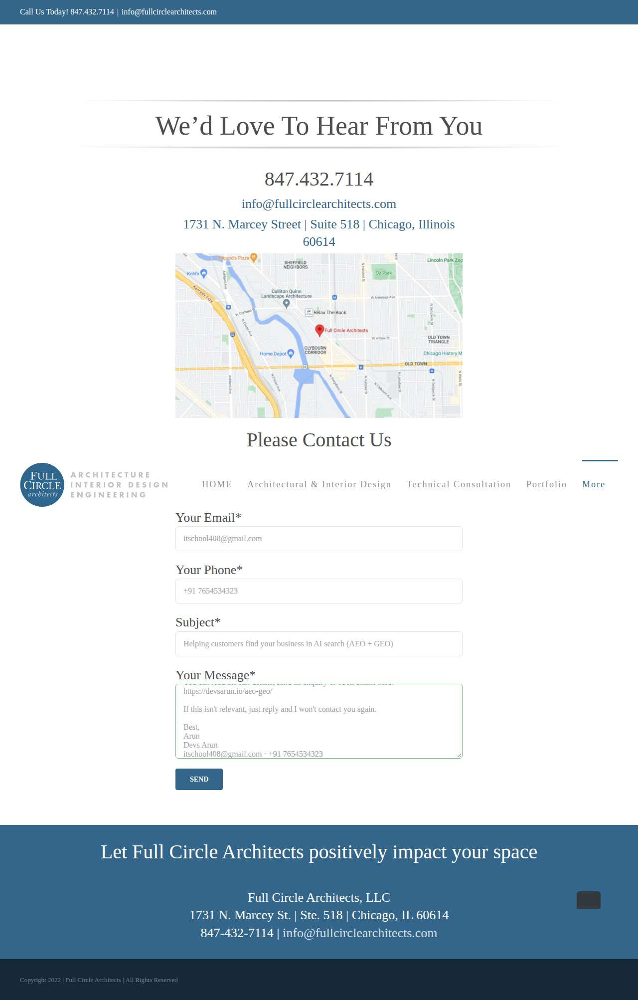

**After submit** — `run-d380ad8b_attempt-63f42265_post_attempt_2026-11-05T04-46-20-857Z.jpg`

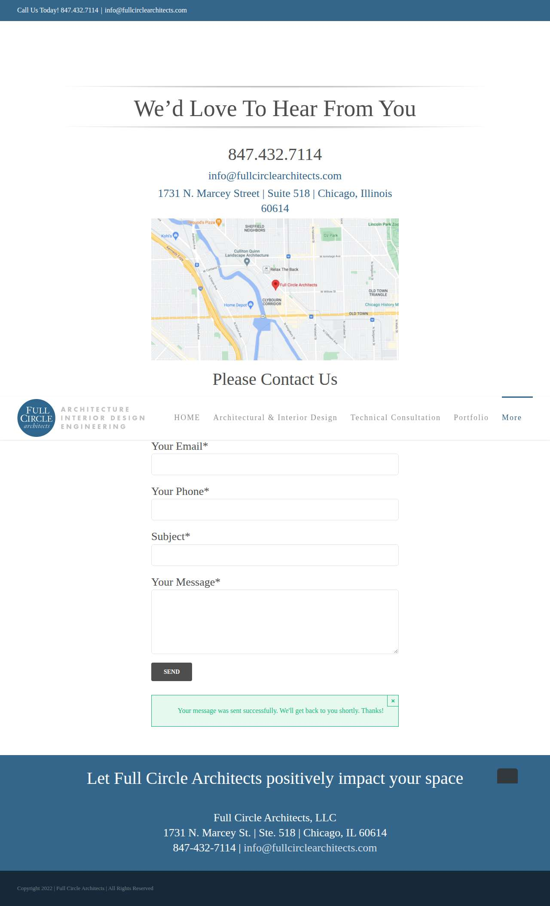

### buraski.com — unclear (LIVE)

| | |
|---|---|
| Attempt ID | `548a7ce5-c560-4547-a355-9f4e7085fca7` |
| Form URL | https://www.buraski.com/ |
| Final URL | https://www.buraski.com/ |
| Reserved | 2026-11-05 04:46:29 UTC |
| Submit attempted | 2026-11-05 04:46:31 UTC |
| Template | standard v2 |
| Confirmation text | none observed |
| Result / error | No new success marker observed |

Exact message:

~~~text
Subject: Helping customers find your business in AI search (AEO + GEO)

Hi there,

I'm Arun from Devs Arun. More and more customers now ask ChatGPT, Gemini, Perplexity or Google's AI Overviews questions like "who should I hire for this in my area?" before they call anyone. These tools answer from websites they can clearly understand, and they tend to recommend businesses whose pages answer real customer questions.

That is what AEO + GEO (Answer Engine and Generative Engine Optimization) is for. I improve your existing service pages so they clearly answer the questions your customers ask, add structured data that matches the page, and make the call, quote or enquiry step obvious. The benefit: your business gets a better chance of being mentioned or linked in AI answers, and visitors who arrive find it easy to contact you.

The AEO + GEO Starter is a one-time $199 (about ₹16,999, negotiable) for one website: a basic audit, 10 customer questions, improvements to two existing pages, relevant structured data and an action plan, with one revision round.

You can read the full details, send an enquiry or book online here:
https://devsarun.io/aeo-geo/

If this isn't relevant, just reply and I won't contact you again.

Best,
Arun
Devs Arun
itschool408@gmail.com · +91 7654534323
~~~

Submitted field values:

- Email \[email\]: itschool408@gmail.com
- Message \[message\]: Hi there, I'm Arun from Devs Arun. More and more customers now ask ChatGPT, Gemini, Perplexity or Google's AI Overviews 
- Subject \[subject\]: Helping customers find your business in AI search (AEO + GEO)
- First Name \[first\_name\]: Arun

**Filled form (before submit)** — `run-d380ad8b_attempt-548a7ce5_filled_2026-11-05T04-46-31-497Z.jpg`

**After submit** — `run-d380ad8b_attempt-548a7ce5_post_attempt_2026-11-05T04-47-00-047Z.jpg`

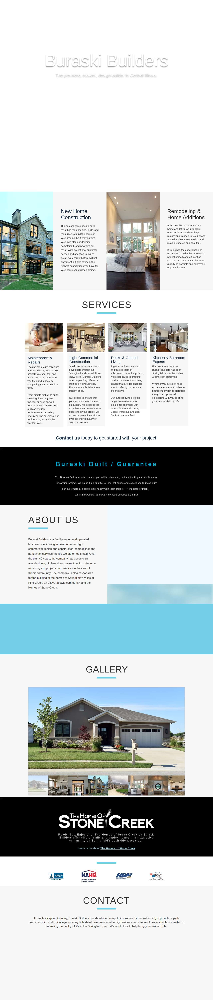

### hackleyarchitects.com — confirmed (LIVE)

| | |
|---|---|
| Attempt ID | `4a43d1b6-3f89-4293-a5c9-7b34d2b1f720` |
| Form URL | https://hackleyarchitects.com/ |
| Final URL | https://hackleyarchitects.com/ |
| Reserved | 2026-11-05 04:47:08 UTC |
| Submit attempted | 2026-11-05 04:47:10 UTC |
| Template | standard v2 |
| Confirmation text | Glencoe, Highland Park, Lake Forest, Lake Bluff Contact Us Thank you for your message. It has been sent. Thank you for your message. It has been sent. Hackley & Associates Architects, I |
| Result / error | — |

Exact message:

~~~text
Subject: Helping customers find your business in AI search (AEO + GEO)

Hi there,

I'm Arun from Devs Arun. More and more customers now ask ChatGPT, Gemini, Perplexity or Google's AI Overviews questions like "who should I hire for this in my area?" before they call anyone. These tools answer from websites they can clearly understand, and they tend to recommend businesses whose pages answer real customer questions.

That is what AEO + GEO (Answer Engine and Generative Engine Optimization) is for. I improve your existing service pages so they clearly answer the questions your customers ask, add structured data that matches the page, and make the call, quote or enquiry step obvious. The benefit: your business gets a better chance of being mentioned or linked in AI answers, and visitors who arrive find it easy to contact you.

The AEO + GEO Starter is a one-time $199 (about ₹16,999, negotiable) for one website: a basic audit, 10 customer questions, improvements to two existing pages, relevant structured data and an action plan, with one revision round.

You can read the full details, send an enquiry or book online here:
https://devsarun.io/aeo-geo/

If this isn't relevant, just reply and I won't contact you again.

Best,
Arun
Devs Arun
itschool408@gmail.com · +91 7654534323
~~~

Submitted field values:

- your-name \[name\]: Arun
- your-email \[email\]: itschool408@gmail.com
- your-phone \[phone\]: +91 7654534323
- your-message \[message\]: Hi there, I'm Arun from Devs Arun. More and more customers now ask ChatGPT, Gemini, Perplexity or Google's AI Overviews 

**Filled form (before submit)** — `run-d380ad8b_attempt-4a43d1b6_filled_2026-11-05T04-47-10-587Z.jpg`

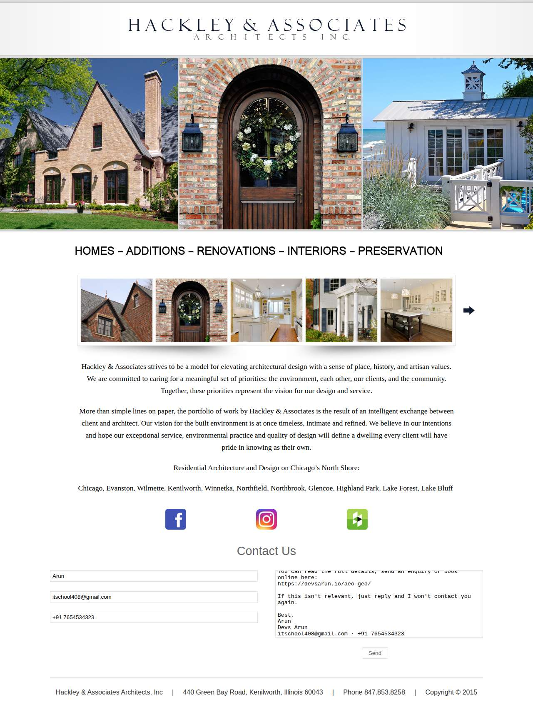

**After submit** — `run-d380ad8b_attempt-4a43d1b6_post_attempt_2026-11-05T04-47-23-036Z.jpg`

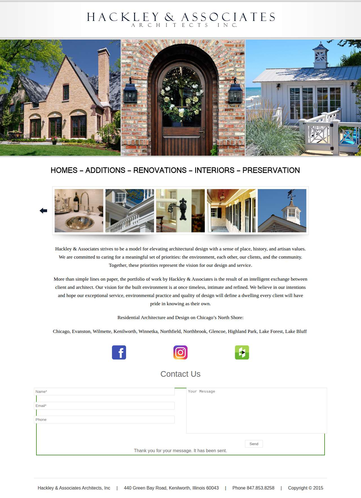

### bbsae.com — failed\_before\_submit (LIVE)

| | |
|---|---|
| Attempt ID | `bbc2f9da-d589-4a4d-b520-22ede4557aee` |
| Form URL | https://www.bbsae.com/contact |
| Final URL | https://www.bbsae.com/contact |
| Reserved | 2026-11-05 04:47:31 UTC |
| Submit attempted | — |
| Template | standard v2 |
| Confirmation text | none observed |
| Result / error | Field "Phone:" did not accept the value |

Exact message:

~~~text
Subject: Helping customers find your business in AI search (AEO + GEO)

Hi there,

I'm Arun from Devs Arun. More and more customers now ask ChatGPT, Gemini, Perplexity or Google's AI Overviews questions like "who should I hire for this in my area?" before they call anyone. These tools answer from websites they can clearly understand, and they tend to recommend businesses whose pages answer real customer questions.

That is what AEO + GEO (Answer Engine and Generative Engine Optimization) is for. I improve your existing service pages so they clearly answer the questions your customers ask, add structured data that matches the page, and make the call, quote or enquiry step obvious. The benefit: your business gets a better chance of being mentioned or linked in AI answers, and visitors who arrive find it easy to contact you.

The AEO + GEO Starter is a one-time $199 (about ₹16,999, negotiable) for one website: a basic audit, 10 customer questions, improvements to two existing pages, relevant structured data and an action plan, with one revision round.

You can read the full details, send an enquiry or book online here:
https://devsarun.io/aeo-geo/

If this isn't relevant, just reply and I won't contact you again.

Best,
Arun
Devs Arun
itschool408@gmail.com · +91 7654534323
~~~

Submitted field values:

- \#fid-field\\$phone\\$17: +91 7654534323
- \#fid-field\\$message\\$23: Hi there, I'm Arun from Devs Arun. More and more customers now ask ChatGPT, Gemini, Perplexity or Google's AI Overviews 
- \#fid-field\\$subject\\$20: Helping customers find your business in AI search (AEO + GEO)
- \#fid-field\\$first-name\\$5: Arun
- \#fid-field\\$company-name\\$11: Devs Arun
- \#fid-field\\$email-address\\$14: itschool408@gmail.com

**Filled form (before submit)** — `run-d380ad8b_attempt-bbc2f9da_filled_2026-11-05T04-47-33-456Z.jpg`

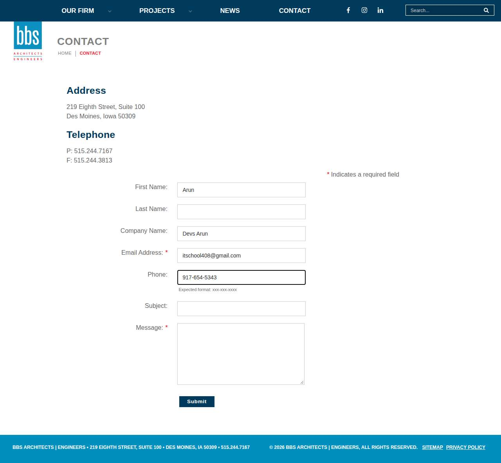

### blegrand.com — unclear (LIVE)

| | |
|---|---|
| Attempt ID | `564a0799-46ea-41a8-a03f-4b500b596cbd` |
| Form URL | http://blegrand.com/contact-us/ |
| Final URL | http://blegrand.com/contact-us/ |
| Reserved | 2026-11-05 04:47:38 UTC |
| Submit attempted | 2026-11-05 04:47:40 UTC |
| Template | standard v2 |
| Confirmation text | none observed |
| Result / error | No new success marker observed |

Exact message:

~~~text
Subject: Helping customers find your business in AI search (AEO + GEO)

Hi there,

I'm Arun from Devs Arun. More and more customers now ask ChatGPT, Gemini, Perplexity or Google's AI Overviews questions like "who should I hire for this in my area?" before they call anyone. These tools answer from websites they can clearly understand, and they tend to recommend businesses whose pages answer real customer questions.

That is what AEO + GEO (Answer Engine and Generative Engine Optimization) is for. I improve your existing service pages so they clearly answer the questions your customers ask, add structured data that matches the page, and make the call, quote or enquiry step obvious. The benefit: your business gets a better chance of being mentioned or linked in AI answers, and visitors who arrive find it easy to contact you.

The AEO + GEO Starter is a one-time $199 (about ₹16,999, negotiable) for one website: a basic audit, 10 customer questions, improvements to two existing pages, relevant structured data and an action plan, with one revision round.

You can read the full details, send an enquiry or book online here:
https://devsarun.io/aeo-geo/

If this isn't relevant, just reply and I won't contact you again.

Best,
Arun
Devs Arun
itschool408@gmail.com · +91 7654534323
~~~

Submitted field values:

- pirate-forms-contact-name \[name\]: Arun
- pirate-forms-contact-email \[email\]: itschool408@gmail.com
- pirate-forms-contact-message \[message\]: Hi there, I'm Arun from Devs Arun. More and more customers now ask ChatGPT, Gemini, Perplexity or Google's AI Overviews 
- pirate-forms-contact-subject \[subject\]: Helping customers find your business in AI search (AEO + GEO)

**Filled form (before submit)** — `run-d380ad8b_attempt-564a0799_filled_2026-11-05T04-47-40-890Z.jpg`

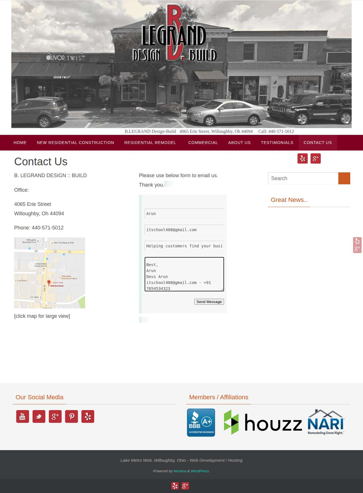

**After submit** — `run-d380ad8b_attempt-564a0799_post_attempt_2026-11-05T04-48-10-633Z.jpg`

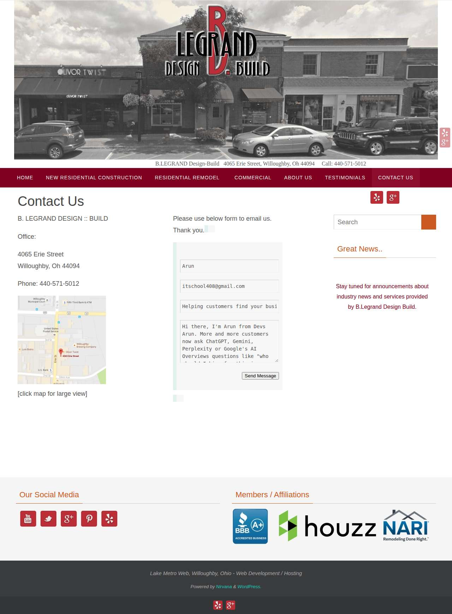

### hdg-architecture.com — confirmed (LIVE)

| | |
|---|---|
| Attempt ID | `c9f6c15e-70bc-4e05-a4a1-190679dda6c8` |
| Form URL | https://hdg-architecture.com/contact/ |
| Final URL | https://hdg-architecture.com/contact/ |
| Reserved | 2026-11-05 04:48:19 UTC |
| Submit attempted | 2026-11-05 04:48:24 UTC |
| Template | standard v2 |
| Confirmation text | 509.321.5064 Email us: info@studiohdg.com Send a message: × THANK YOU\! We will be in touch soon regarding your submission. Contact Us How can we make it happen? Address: |
| Result / error | — |

Exact message:

~~~text
Subject: Helping customers find your business in AI search (AEO + GEO)

Hi there,

I'm Arun from Devs Arun. More and more customers now ask ChatGPT, Gemini, Perplexity or Google's AI Overviews questions like "who should I hire for this in my area?" before they call anyone. These tools answer from websites they can clearly understand, and they tend to recommend businesses whose pages answer real customer questions.

That is what AEO + GEO (Answer Engine and Generative Engine Optimization) is for. I improve your existing service pages so they clearly answer the questions your customers ask, add structured data that matches the page, and make the call, quote or enquiry step obvious. The benefit: your business gets a better chance of being mentioned or linked in AI answers, and visitors who arrive find it easy to contact you.

The AEO + GEO Starter is a one-time $199 (about ₹16,999, negotiable) for one website: a basic audit, 10 customer questions, improvements to two existing pages, relevant structured data and an action plan, with one revision round.

You can read the full details, send an enquiry or book online here:
https://devsarun.io/aeo-geo/

If this isn't relevant, just reply and I won't contact you again.

Best,
Arun
Devs Arun
itschool408@gmail.com · +91 7654534323
~~~

Submitted field values:

- message \[message\]: Hi there, I'm Arun from Devs Arun. More and more customers now ask ChatGPT, Gemini, Perplexity or Google's AI Overviews 
- Send a message: \[email\]: itschool408@gmail.com

**Filled form (before submit)** — `run-d380ad8b_attempt-c9f6c15e_filled_2026-11-05T04-48-24-261Z.jpg`

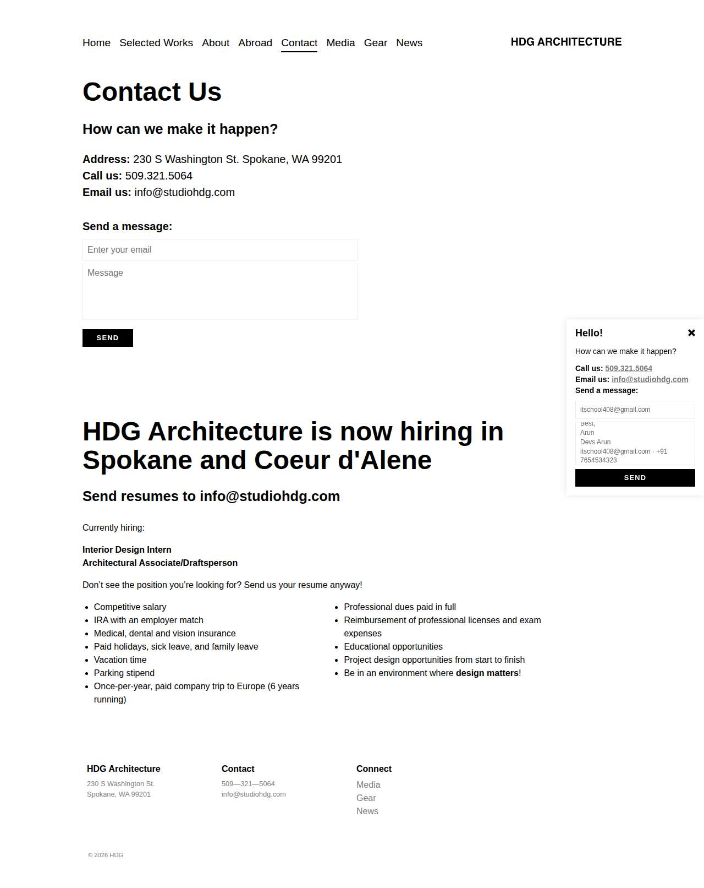

**After submit** — `run-d380ad8b_attempt-c9f6c15e_post_attempt_2026-11-05T04-48-35-660Z.jpg`

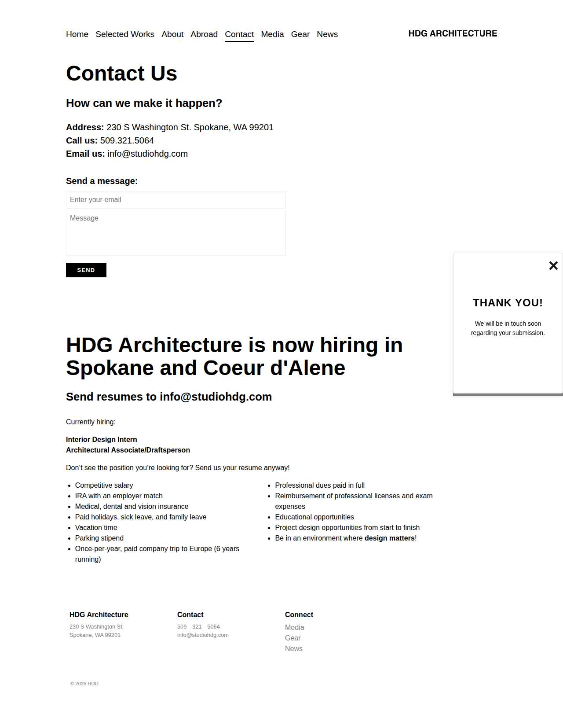

### designwithma.com — confirmed (LIVE)

| | |
|---|---|
| Attempt ID | `4e1ab305-d7cf-456f-8cf3-f8dc9910af5f` |
| Form URL | https://designwithma.com/contact/ |
| Final URL | https://designwithma.com/contact/ |
| Reserved | 2026-11-05 04:48:43 UTC |
| Submit attempted | 2026-11-05 04:48:45 UTC |
| Template | standard v2 |
| Confirmation text | Race Street Cincinnati, Ohio 45202 513-407-8260 Contact Us Thanks for contacting us\! We will get in touch with you shortly. MA Design Columbus, OH 775 Yard Street, Suite 325 Columb |
| Result / error | — |

Exact message:

~~~text
Subject: Helping customers find your business in AI search (AEO + GEO)

Hi there,

I'm Arun from Devs Arun. More and more customers now ask ChatGPT, Gemini, Perplexity or Google's AI Overviews questions like "who should I hire for this in my area?" before they call anyone. These tools answer from websites they can clearly understand, and they tend to recommend businesses whose pages answer real customer questions.

That is what AEO + GEO (Answer Engine and Generative Engine Optimization) is for. I improve your existing service pages so they clearly answer the questions your customers ask, add structured data that matches the page, and make the call, quote or enquiry step obvious. The benefit: your business gets a better chance of being mentioned or linked in AI answers, and visitors who arrive find it easy to contact you.

The AEO + GEO Starter is a one-time $199 (about ₹16,999, negotiable) for one website: a basic audit, 10 customer questions, improvements to two existing pages, relevant structured data and an action plan, with one revision round.

You can read the full details, send an enquiry or book online here:
https://devsarun.io/aeo-geo/

If this isn't relevant, just reply and I won't contact you again.

Best,
Arun
Devs Arun
itschool408@gmail.com · +91 7654534323
~~~

Submitted field values:

- Email \[email\]: itschool408@gmail.com
- Message \[message\]: Hi there, I'm Arun from Devs Arun. More and more customers now ask ChatGPT, Gemini, Perplexity or Google's AI Overviews 
- First \[first\_name\]: Arun

**Filled form (before submit)** — `run-d380ad8b_attempt-4e1ab305_filled_2026-11-05T04-48-45-823Z.jpg`

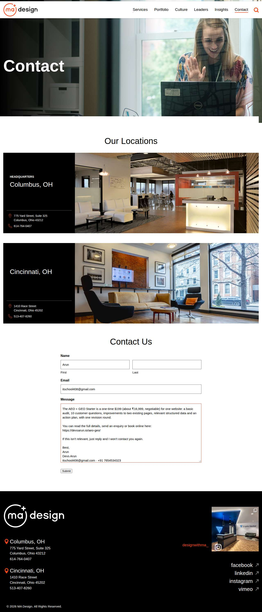

**After submit** — `run-d380ad8b_attempt-4e1ab305_post_attempt_2026-11-05T04-48-51-577Z.jpg`

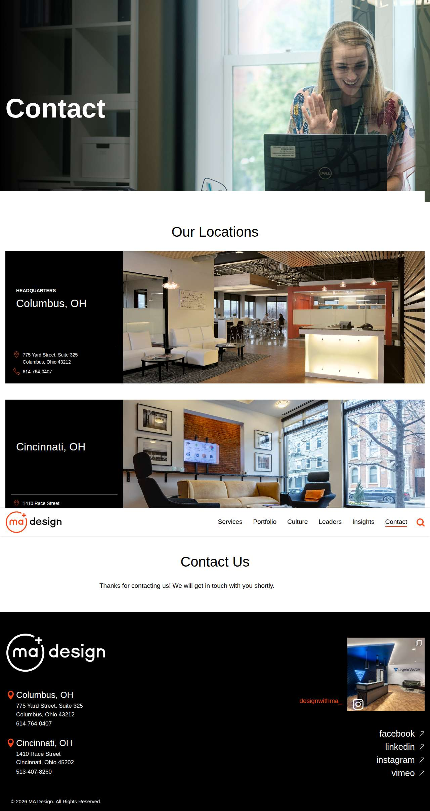

### tkwa.com — error\_after\_submit (LIVE)

| | |
|---|---|
| Attempt ID | `ad8537d1-4ef8-4ea2-b3c0-cfe3cc70b465` |
| Form URL | https://tkwa.com/contact/ |
| Final URL | https://tkwa.com/contact/ |
| Reserved | 2026-11-05 04:48:59 UTC |
| Submit attempted | 2026-11-05 04:49:01 UTC |
| Template | standard v2 |
| Confirmation text | y hello? Drop us a message and we’ll reply ASAP. First Name This field is required Last Name This field is required Email Subject This field is required Comments 3 + 3 = Please enter |
| Result / error | — |

Exact message:

~~~text
Subject: Helping customers find your business in AI search (AEO + GEO)

Hi there,

I'm Arun from Devs Arun. More and more customers now ask ChatGPT, Gemini, Perplexity or Google's AI Overviews questions like "who should I hire for this in my area?" before they call anyone. These tools answer from websites they can clearly understand, and they tend to recommend businesses whose pages answer real customer questions.

That is what AEO + GEO (Answer Engine and Generative Engine Optimization) is for. I improve your existing service pages so they clearly answer the questions your customers ask, add structured data that matches the page, and make the call, quote or enquiry step obvious. The benefit: your business gets a better chance of being mentioned or linked in AI answers, and visitors who arrive find it easy to contact you.

The AEO + GEO Starter is a one-time $199 (about ₹16,999, negotiable) for one website: a basic audit, 10 customer questions, improvements to two existing pages, relevant structured data and an action plan, with one revision round.

You can read the full details, send an enquiry or book online here:
https://devsarun.io/aeo-geo/

If this isn't relevant, just reply and I won't contact you again.

Best,
Arun
Devs Arun
itschool408@gmail.com · +91 7654534323
~~~

Submitted field values:

- ufbl\_field\_4 \[email\]: itschool408@gmail.com
- ufbl\_field\_6 \[message\]: Hi there, I'm Arun from Devs Arun. More and more customers now ask ChatGPT, Gemini, Perplexity or Google's AI Overviews 

**Filled form (before submit)** — `run-d380ad8b_attempt-ad8537d1_filled_2026-11-05T04-49-01-285Z.jpg`

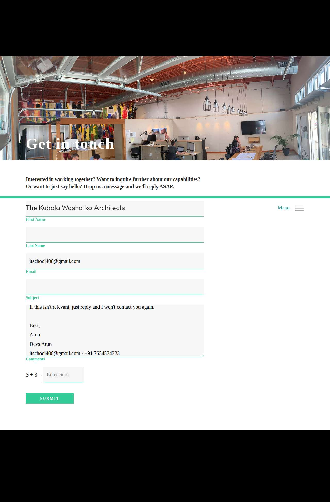

**After submit** — `run-d380ad8b_attempt-ad8537d1_post_attempt_2026-11-05T04-49-05-667Z.jpg`

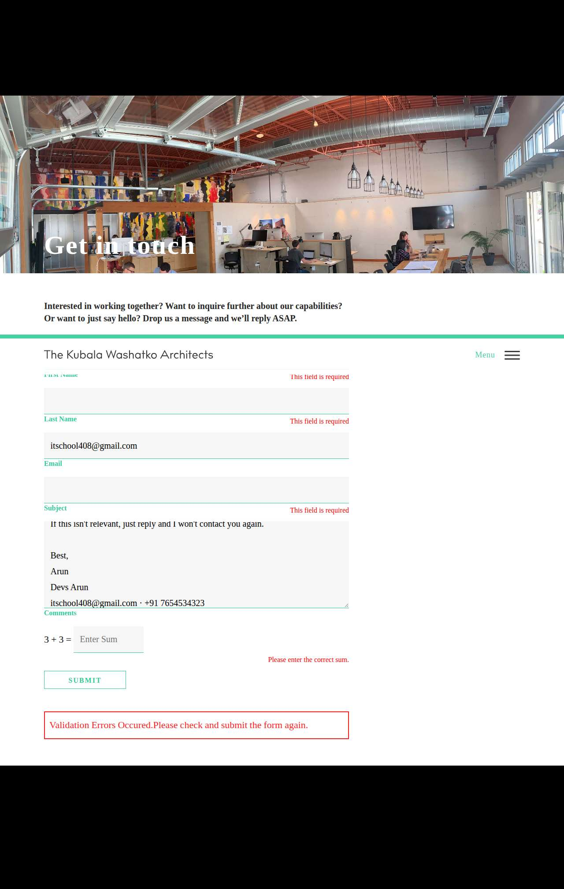

### gsgarchitecture.com — error\_after\_submit (LIVE)

| | |
|---|---|
| Attempt ID | `69abd249-b4ec-41c5-af1f-ecb09abb209a` |
| Form URL | http://www.gsgarchitecture.com/contact/ |
| Final URL | http://www.gsgarchitecture.com/contact/ |
| Reserved | 2026-11-05 04:49:14 UTC |
| Submit attempted | 2026-11-05 04:49:17 UTC |
| Template | standard v2 |
| Confirmation text | ap error One or more fields have an error. Please check and try again. The field is required. Name Phone Email \[contact-form-7 id="ed2e700" title="Contact form 1"\] What |
| Result / error | — |

Exact message:

~~~text
Subject: Helping customers find your business in AI search (AEO + GEO)

Hi there,

I'm Arun from Devs Arun. More and more customers now ask ChatGPT, Gemini, Perplexity or Google's AI Overviews questions like "who should I hire for this in my area?" before they call anyone. These tools answer from websites they can clearly understand, and they tend to recommend businesses whose pages answer real customer questions.

That is what AEO + GEO (Answer Engine and Generative Engine Optimization) is for. I improve your existing service pages so they clearly answer the questions your customers ask, add structured data that matches the page, and make the call, quote or enquiry step obvious. The benefit: your business gets a better chance of being mentioned or linked in AI answers, and visitors who arrive find it easy to contact you.

The AEO + GEO Starter is a one-time $199 (about ₹16,999, negotiable) for one website: a basic audit, 10 customer questions, improvements to two existing pages, relevant structured data and an action plan, with one revision round.

You can read the full details, send an enquiry or book online here:
https://devsarun.io/aeo-geo/

If this isn't relevant, just reply and I won't contact you again.

Best,
Arun
Devs Arun
itschool408@gmail.com · +91 7654534323
~~~

Submitted field values:

- Name \[name\]: Arun
- Email \[email\]: itschool408@gmail.com
- Phone \[phone\]: +91 7654534323
- Questions / Comments \[message\]: Hi there, I'm Arun from Devs Arun. More and more customers now ask ChatGPT, Gemini, Perplexity or Google's AI Overviews 

**Filled form (before submit)** — `run-d380ad8b_attempt-69abd249_filled_2026-11-05T04-49-17-691Z.jpg`

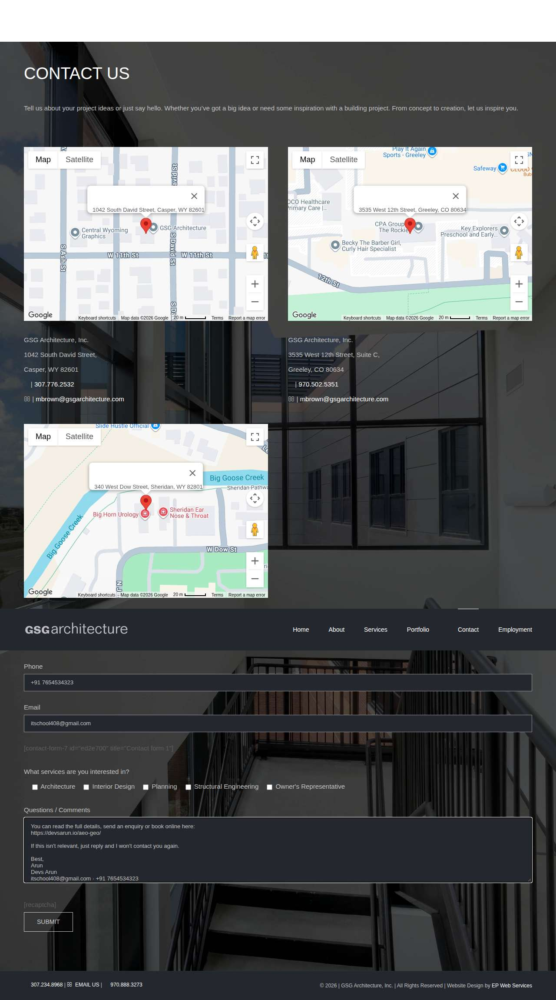

**After submit** — `run-d380ad8b_attempt-69abd249_post_attempt_2026-11-05T04-49-23-147Z.jpg`

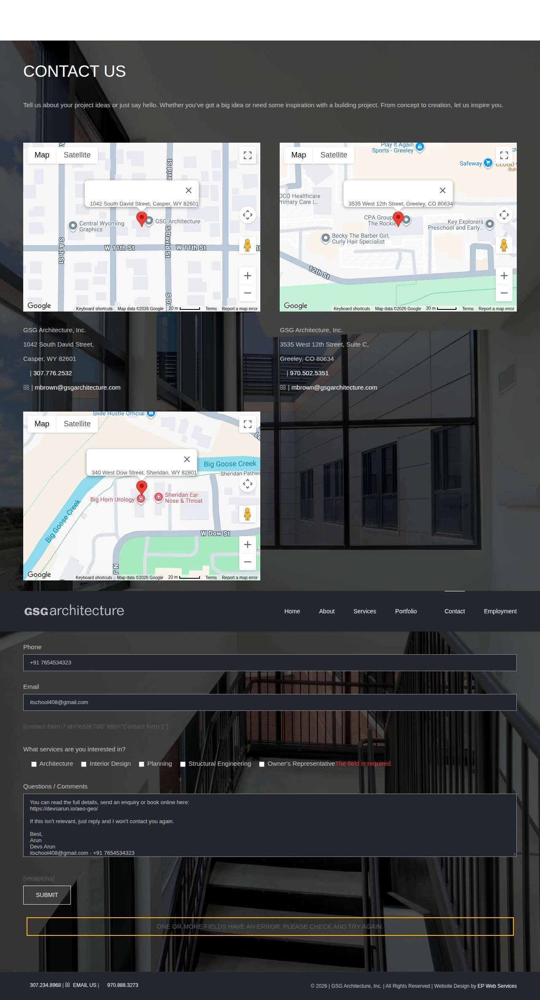

### schuette-design.net — unclear (LIVE)

| | |
|---|---|
| Attempt ID | `8d231d6c-cad1-49c0-960d-2e883c77896d` |
| Form URL | https://www.schuette-design.net/ |
| Final URL | https://www.schuette-design.net/ |
| Reserved | 2026-11-05 04:49:31 UTC |
| Submit attempted | 2026-11-05 04:49:34 UTC |
| Template | standard v2 |
| Confirmation text | none observed |
| Result / error | No new success marker observed |

Exact message:

~~~text
Subject: Helping customers find your business in AI search (AEO + GEO)

Hi there,

I'm Arun from Devs Arun. More and more customers now ask ChatGPT, Gemini, Perplexity or Google's AI Overviews questions like "who should I hire for this in my area?" before they call anyone. These tools answer from websites they can clearly understand, and they tend to recommend businesses whose pages answer real customer questions.

That is what AEO + GEO (Answer Engine and Generative Engine Optimization) is for. I improve your existing service pages so they clearly answer the questions your customers ask, add structured data that matches the page, and make the call, quote or enquiry step obvious. The benefit: your business gets a better chance of being mentioned or linked in AI answers, and visitors who arrive find it easy to contact you.

The AEO + GEO Starter is a one-time $199 (about ₹16,999, negotiable) for one website: a basic audit, 10 customer questions, improvements to two existing pages, relevant structured data and an action plan, with one revision round.

You can read the full details, send an enquiry or book online here:
https://devsarun.io/aeo-geo/

If this isn't relevant, just reply and I won't contact you again.

Best,
Arun
Devs Arun
itschool408@gmail.com · +91 7654534323
~~~

Submitted field values:

- email \[email\]: itschool408@gmail.com
- name-\* \[name\]: Arun
- Message \[message\]: Hi there, I'm Arun from Devs Arun. More and more customers now ask ChatGPT, Gemini, Perplexity or Google's AI Overviews 
- subject \[subject\]: Helping customers find your business in AI search (AEO + GEO)

**Filled form (before submit)** — `run-d380ad8b_attempt-8d231d6c_filled_2026-11-05T04-49-34-325Z.jpg`

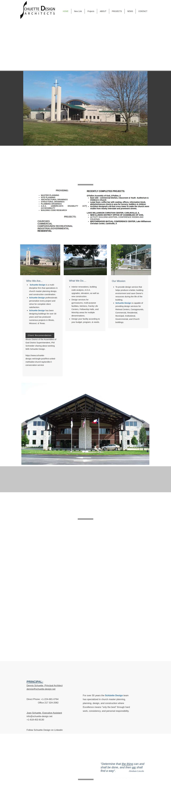

**After submit** — `run-d380ad8b_attempt-8d231d6c_post_attempt_2026-11-05T04-50-02-937Z.jpg`

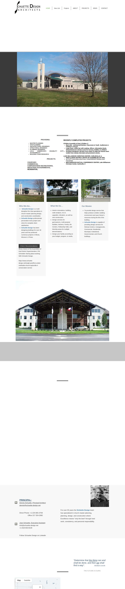

## Events (155)

| Time (UTC) | Event | Website | Details |
|---|---|---|---|
| 04:42:37 | run\_queued | — | live run requested by github:itsDevsArun |
| 04:42:37 | run\_dispatched | — | dispatch disabled (local test mode) |
| 04:42:40 | run\_started | — | Runner claimed live run |
| 04:42:42 | offer\_verified | — | Service page offer facts verified |
| 04:42:42 | website\_selected | clearchoiceplumbingllc.com | Live target clearchoiceplumbingllc.com |
| 04:42:42 | attempt\_reserved | clearchoiceplumbingllc.com | Submission attempt reserved with template standard v2 |
| 04:42:43 | page\_opened | clearchoiceplumbingllc.com | Opened form page |
| 04:42:43 | screenshot\_saved | clearchoiceplumbingllc.com | inspection screenshot saved (144 KB) |
| 04:42:43 | review\_required | clearchoiceplumbingllc.com | failed before submit: locator.fill: Error: Cannot type text into input\[type=number\] |
| 04:42:48 | website\_selected | bwnwincpainting.com | Live target bwnwincpainting.com |
| 04:42:48 | attempt\_reserved | bwnwincpainting.com | Submission attempt reserved with template standard v2 |
| 04:42:49 | page\_opened | bwnwincpainting.com | Opened form page |
| 04:42:49 | screenshot\_saved | bwnwincpainting.com | inspection screenshot saved (118 KB) |
| 04:42:49 | review\_required | bwnwincpainting.com | failed before submit: locator.fill: Error: Cannot type text into input\[type=number\] |
| 04:42:54 | website\_selected | absoluterestorepa.com | Live target absoluterestorepa.com |
| 04:42:54 | attempt\_reserved | absoluterestorepa.com | Submission attempt reserved with template standard v2 |
| 04:42:57 | page\_opened | absoluterestorepa.com | Opened form page |
| 04:42:57 | screenshot\_saved | absoluterestorepa.com | inspection screenshot saved (175 KB) |
| 04:42:57 | review\_required | absoluterestorepa.com | failed before submit: locator.fill: Error: Cannot type text into input\[type=number\] |
| 04:43:02 | website\_selected | masoudlawfirm.com | Live target masoudlawfirm.com |
| 04:43:02 | attempt\_reserved | masoudlawfirm.com | Submission attempt reserved with template standard v2 |
| 04:43:04 | page\_opened | masoudlawfirm.com | Opened form page |
| 04:43:04 | screenshot\_saved | masoudlawfirm.com | inspection screenshot saved (169 KB) |
| 04:43:04 | review\_required | masoudlawfirm.com | failed before submit: locator.fill: Error: Cannot type text into input\[type=number\] |
| 04:43:09 | website\_selected | whiteolivecpa.com | Live target whiteolivecpa.com |
| 04:43:09 | attempt\_reserved | whiteolivecpa.com | Submission attempt reserved with template standard v2 |
| 04:43:11 | page\_opened | whiteolivecpa.com | Opened form page |
| 04:43:11 | screenshot\_saved | whiteolivecpa.com | inspection screenshot saved (198 KB) |
| 04:43:11 | review\_required | whiteolivecpa.com | failed before submit: locator.fill: Error: Cannot type text into input\[type=number\] |
| 04:43:16 | website\_selected | ezlandscapingpaving.com | Live target ezlandscapingpaving.com |
| 04:43:16 | attempt\_reserved | ezlandscapingpaving.com | Submission attempt reserved with template standard v2 |
| 04:43:19 | page\_opened | ezlandscapingpaving.com | Opened form page |
| 04:43:19 | fields\_filled | ezlandscapingpaving.com | filled |
| 04:43:19 | screenshot\_saved | ezlandscapingpaving.com | filled screenshot saved (179 KB) |
| 04:43:19 | submit\_attempted | ezlandscapingpaving.com | submitting |
| 04:43:24 | screenshot\_saved | ezlandscapingpaving.com | post\_attempt screenshot saved (167 KB) |
| 04:43:24 | confirmation\_observed | ezlandscapingpaving.com | confirmed — "e always dreamed of - contact us now and let’s get started\! Message sent. Keyboard shortcuts Map data ©2026 Google Terms" |
| 04:43:32 | website\_selected | srsarchitectpc.com | Live target srsarchitectpc.com |
| 04:43:32 | attempt\_reserved | srsarchitectpc.com | Submission attempt reserved with template standard v2 |
| 04:43:35 | page\_opened | srsarchitectpc.com | Opened form page |
| 04:43:35 | fields\_filled | srsarchitectpc.com | filled |
| 04:43:35 | screenshot\_saved | srsarchitectpc.com | filled screenshot saved (147 KB) |
| 04:43:35 | submit\_attempted | srsarchitectpc.com | submitting |
| 04:44:06 | screenshot\_saved | srsarchitectpc.com | post\_attempt screenshot saved (168 KB) |
| 04:44:06 | review\_required | srsarchitectpc.com | unclear: No new success marker observed |
| 04:44:14 | website\_selected | kellyarchitectural.com | Live target kellyarchitectural.com |
| 04:44:14 | attempt\_reserved | kellyarchitectural.com | Submission attempt reserved with template standard v2 |
| 04:44:16 | page\_opened | kellyarchitectural.com | Opened form page |
| 04:44:16 | fields\_filled | kellyarchitectural.com | filled |
| 04:44:16 | screenshot\_saved | kellyarchitectural.com | filled screenshot saved (126 KB) |
| 04:44:16 | submit\_attempted | kellyarchitectural.com | submitting |
| 04:44:21 | screenshot\_saved | kellyarchitectural.com | post\_attempt screenshot saved (118 KB) |
| 04:44:21 | confirmation\_observed | kellyarchitectural.com | confirmed — "x 740 - 454 - 4898 kelly.architectural@gmail.com Google Map Thank you for your interest. We'll respond to your message a" |
| 04:44:30 | website\_selected | mpiarch.com | Live target mpiarch.com |
| 04:44:30 | attempt\_reserved | mpiarch.com | Submission attempt reserved with template standard v2 |
| 04:44:32 | page\_opened | mpiarch.com | Opened form page |
| 04:44:33 | fields\_filled | mpiarch.com | filled |
| 04:44:33 | screenshot\_saved | mpiarch.com | filled screenshot saved (68 KB) |
| 04:44:33 | submit\_attempted | mpiarch.com | submitting |
| 04:45:01 | screenshot\_saved | mpiarch.com | post\_attempt screenshot saved (41 KB) |
| 04:45:01 | review\_required | mpiarch.com | unclear: No new success marker observed |
| 04:45:09 | website\_selected | leuteriothomas.com | Live target leuteriothomas.com |
| 04:45:09 | attempt\_reserved | leuteriothomas.com | Submission attempt reserved with template standard v2 |
| 04:45:12 | page\_opened | leuteriothomas.com | Opened form page |
| 04:45:12 | fields\_filled | leuteriothomas.com | filled |
| 04:45:12 | screenshot\_saved | leuteriothomas.com | filled screenshot saved (149 KB) |
| 04:45:12 | submit\_attempted | leuteriothomas.com | submitting |
| 04:45:40 | screenshot\_saved | leuteriothomas.com | post\_attempt screenshot saved (228 KB) |
| 04:45:40 | review\_required | leuteriothomas.com | unclear: No new success marker observed |
| 04:45:50 | website\_selected | invisionarch.com | Live target invisionarch.com |
| 04:45:50 | attempt\_reserved | invisionarch.com | Submission attempt reserved with template standard v2 |
| 04:45:51 | page\_opened | invisionarch.com | Opened form page |
| 04:45:51 | fields\_filled | invisionarch.com | filled |
| 04:45:51 | screenshot\_saved | invisionarch.com | filled screenshot saved (108 KB) |
| 04:45:51 | submit\_attempted | invisionarch.com | submitting |
| 04:46:03 | screenshot\_saved | invisionarch.com | post\_attempt screenshot saved (109 KB) |
| 04:46:03 | error | invisionarch.com | error after submit — "​com. Sorry, there was an error submitting the form. Please try again. LEAVE THIS FIELD BLANK Rather not call? Shoot us " |
| 04:46:12 | website\_selected | fullcirclearchitects.com | Live target fullcirclearchitects.com |
| 04:46:12 | attempt\_reserved | fullcirclearchitects.com | Submission attempt reserved with template standard v2 |
| 04:46:13 | page\_opened | fullcirclearchitects.com | Opened form page |
| 04:46:13 | fields\_filled | fullcirclearchitects.com | filled |
| 04:46:13 | screenshot\_saved | fullcirclearchitects.com | filled screenshot saved (104 KB) |
| 04:46:13 | submit\_attempted | fullcirclearchitects.com | submitting |
| 04:46:20 | screenshot\_saved | fullcirclearchitects.com | post\_attempt screenshot saved (102 KB) |
| 04:46:20 | confirmation\_observed | fullcirclearchitects.com | confirmed — "Suite 518 \| Chicago, Illinois 60614 Please Contact Us Your message was sent successfully. We'll get back to you shortly." |
| 04:46:29 | website\_selected | buraski.com | Live target buraski.com |
| 04:46:29 | attempt\_reserved | buraski.com | Submission attempt reserved with template standard v2 |
| 04:46:31 | page\_opened | buraski.com | Opened form page |
| 04:46:31 | fields\_filled | buraski.com | filled |
| 04:46:31 | screenshot\_saved | buraski.com | filled screenshot saved (443 KB) |
| 04:46:31 | submit\_attempted | buraski.com | submitting |
| 04:47:00 | screenshot\_saved | buraski.com | post\_attempt screenshot saved (443 KB) |
| 04:47:00 | review\_required | buraski.com | unclear: No new success marker observed |
| 04:47:08 | website\_selected | hackleyarchitects.com | Live target hackleyarchitects.com |
| 04:47:08 | attempt\_reserved | hackleyarchitects.com | Submission attempt reserved with template standard v2 |
| 04:47:10 | page\_opened | hackleyarchitects.com | Opened form page |
| 04:47:10 | fields\_filled | hackleyarchitects.com | filled |
| 04:47:10 | screenshot\_saved | hackleyarchitects.com | filled screenshot saved (236 KB) |
| 04:47:10 | submit\_attempted | hackleyarchitects.com | submitting |
| 04:47:23 | screenshot\_saved | hackleyarchitects.com | post\_attempt screenshot saved (228 KB) |
| 04:47:23 | confirmation\_observed | hackleyarchitects.com | confirmed — "Glencoe, Highland Park, Lake Forest, Lake Bluff Contact Us Thank you for your message. It has been sent. Thank you for y" |
| 04:47:31 | website\_selected | bbsae.com | Live target bbsae.com |
| 04:47:31 | attempt\_reserved | bbsae.com | Submission attempt reserved with template standard v2 |
| 04:47:33 | page\_opened | bbsae.com | Opened form page |
| 04:47:33 | screenshot\_saved | bbsae.com | filled screenshot saved (50 KB) |
| 04:47:33 | review\_required | bbsae.com | failed before submit: Field "Phone:" did not accept the value |
| 04:47:38 | website\_selected | blegrand.com | Live target blegrand.com |
| 04:47:38 | attempt\_reserved | blegrand.com | Submission attempt reserved with template standard v2 |
| 04:47:40 | page\_opened | blegrand.com | Opened form page |
| 04:47:40 | fields\_filled | blegrand.com | filled |
| 04:47:40 | screenshot\_saved | blegrand.com | filled screenshot saved (131 KB) |
| 04:47:40 | submit\_attempted | blegrand.com | submitting |
| 04:48:10 | screenshot\_saved | blegrand.com | post\_attempt screenshot saved (138 KB) |
| 04:48:10 | review\_required | blegrand.com | unclear: No new success marker observed |
| 04:48:19 | website\_selected | hdg-architecture.com | Live target hdg-architecture.com |
| 04:48:19 | attempt\_reserved | hdg-architecture.com | Submission attempt reserved with template standard v2 |
| 04:48:24 | page\_opened | hdg-architecture.com | Opened form page |
| 04:48:24 | fields\_filled | hdg-architecture.com | filled |
| 04:48:24 | screenshot\_saved | hdg-architecture.com | filled screenshot saved (102 KB) |
| 04:48:24 | submit\_attempted | hdg-architecture.com | submitting |
| 04:48:35 | screenshot\_saved | hdg-architecture.com | post\_attempt screenshot saved (98 KB) |
| 04:48:35 | confirmation\_observed | hdg-architecture.com | confirmed — "509.321.5064 Email us: info@studiohdg.com Send a message: × THANK YOU\! We will be in touch soon regarding your submissio" |
| 04:48:43 | website\_selected | designwithma.com | Live target designwithma.com |
| 04:48:43 | attempt\_reserved | designwithma.com | Submission attempt reserved with template standard v2 |
| 04:48:45 | page\_opened | designwithma.com | Opened form page |
| 04:48:45 | fields\_filled | designwithma.com | filled |
| 04:48:45 | screenshot\_saved | designwithma.com | filled screenshot saved (248 KB) |
| 04:48:45 | submit\_attempted | designwithma.com | submitting |
| 04:48:51 | screenshot\_saved | designwithma.com | post\_attempt screenshot saved (207 KB) |
| 04:48:51 | confirmation\_observed | designwithma.com | confirmed — "Race Street Cincinnati, Ohio 45202 513-407-8260 Contact Us Thanks for contacting us\! We will get in touch with you short" |
| 04:48:59 | website\_selected | tkwa.com | Live target tkwa.com |
| 04:48:59 | attempt\_reserved | tkwa.com | Submission attempt reserved with template standard v2 |
| 04:49:01 | page\_opened | tkwa.com | Opened form page |
| 04:49:01 | fields\_filled | tkwa.com | filled |
| 04:49:01 | screenshot\_saved | tkwa.com | filled screenshot saved (132 KB) |
| 04:49:01 | submit\_attempted | tkwa.com | submitting |
| 04:49:05 | screenshot\_saved | tkwa.com | post\_attempt screenshot saved (145 KB) |
| 04:49:05 | error | tkwa.com | error after submit — "y hello? Drop us a message and we’ll reply ASAP. First Name This field is required Last Name This field is required Emai" |
| 04:49:14 | website\_selected | gsgarchitecture.com | Live target gsgarchitecture.com |
| 04:49:14 | attempt\_reserved | gsgarchitecture.com | Submission attempt reserved with template standard v2 |
| 04:49:17 | page\_opened | gsgarchitecture.com | Opened form page |
| 04:49:17 | fields\_filled | gsgarchitecture.com | filled |
| 04:49:17 | screenshot\_saved | gsgarchitecture.com | filled screenshot saved (182 KB) |
| 04:49:17 | submit\_attempted | gsgarchitecture.com | submitting |
| 04:49:23 | screenshot\_saved | gsgarchitecture.com | post\_attempt screenshot saved (191 KB) |
| 04:49:23 | error | gsgarchitecture.com | error after submit — "ap error One or more fields have an error. Please check and try again. The field is required. Name Phone Email \[contact-" |
| 04:49:31 | website\_selected | schuette-design.net | Live target schuette-design.net |
| 04:49:31 | attempt\_reserved | schuette-design.net | Submission attempt reserved with template standard v2 |
| 04:49:33 | page\_opened | schuette-design.net | Opened form page |
| 04:49:34 | fields\_filled | schuette-design.net | filled |
| 04:49:34 | screenshot\_saved | schuette-design.net | filled screenshot saved (384 KB) |
| 04:49:34 | submit\_attempted | schuette-design.net | submitting |
| 04:50:02 | screenshot\_saved | schuette-design.net | post\_attempt screenshot saved (396 KB) |
| 04:50:02 | review\_required | schuette-design.net | unclear: No new success marker observed |
| 04:50:11 | run\_completed | — | Run completed (queue\_exhausted) |
