# Run f3c1b375 — live — completed

| | |
|---|---|
| Run ID | `f3c1b375-8629-4ee1-8ba1-ba5e19b91f80` |
| Requested by | github:itsDevsArun |
| Started | 2026-11-05 04:08:21 UTC |
| Finished | 2026-11-05 04:13:42 UTC |
| Finish reason | queue\_exhausted |
| GitHub Actions | https://github.com/itsDevsArun/aeo-geo/actions/runs/41950876497 |

CSV for this run: [runs/2026-11-05_live_f3c1b375.csv](2026-11-05_live_f3c1b375.csv)

## Attempts (16)

### clearchoiceplumbingllc.com — failed\_before\_submit (LIVE)

| | |
|---|---|
| Attempt ID | `6b003759-6bdb-4131-b5a4-2e251bbbd6c3` |
| Form URL | https://clearchoiceplumbingllc.com/contact/ |
| Final URL | — |
| Reserved | 2026-11-05 04:08:23 UTC |
| Submit attempted | — |
| Template | standard v2 |
| Confirmation text | none observed |
| Result / error | locator.fill: Error: Cannot type text into input\[type=number\] |

Exact message:

~~~text
Subject: Helping customers find your business in AI search (AEO + GEO)

Hi there,

I'm Arun from Devs Arun. More and more customers now ask ChatGPT, Gemini, Perplexity or Google's AI Overviews questions like "who should I hire for this in my area?" before they call anyone. These tools answer from websites they can clearly understand, and they tend to recommend businesses whose pages answer real customer questions.

That is what AEO + GEO (Answer Engine and Generative Engine Optimization) is for. I improve your existing service pages so they clearly answer the questions your customers ask, add structured data that matches the page, and make the call, quote or enquiry step obvious. The benefit: your business gets a better chance of being mentioned or linked in AI answers, and visitors who arrive find it easy to contact you.

The AEO + GEO Starter is a one-time $199 (about ₹16,999, negotiable) for one website: a basic audit, 10 customer questions, improvements to two existing pages, relevant structured data and an action plan, with one revision round.

You can read the full details, send an enquiry or book online here:
https://devsarun.io/aeo-geo/

If this isn't relevant, just reply and I won't contact you again.

Best,
Arun
Devs Arun
itschool408@gmail.com · +91 7654534323
~~~

Submitted field values:

- \#wpforms-51-field\_1: Arun
- \#wpforms-51-field\_2: itschool408@gmail.com
- \#wpforms-51-field\_3: Hi there, I'm Arun from Devs Arun. More and more customers now ask ChatGPT, Gemini, Perplexity or Google's AI Overviews 
- \#wpforms-51-field\_5: +91 7654534323

**Inspected page** — `run-f3c1b375_attempt-6b003759_inspection_2026-11-05T04-08-24-721Z.jpg`

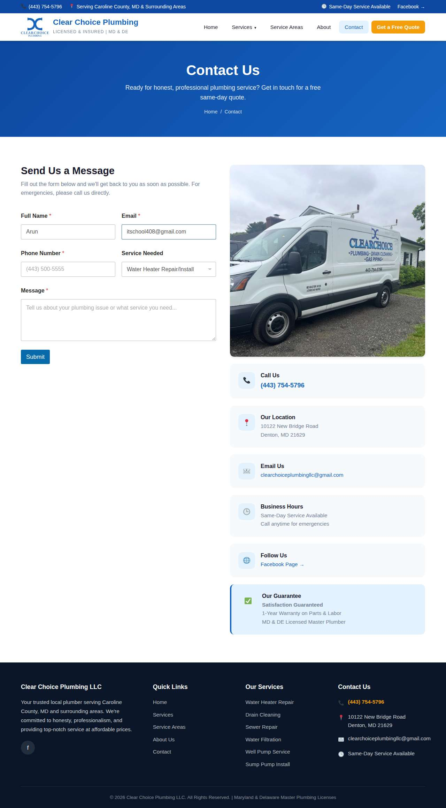

### bwnwincpainting.com — failed\_before\_submit (LIVE)

| | |
|---|---|
| Attempt ID | `fca17d57-a06c-4f26-9842-54d593b45194` |
| Form URL | https://www.bwnwincpainting.com/contact/ |
| Final URL | — |
| Reserved | 2026-11-05 04:08:29 UTC |
| Submit attempted | — |
| Template | standard v2 |
| Confirmation text | none observed |
| Result / error | locator.fill: Error: Cannot type text into input\[type=number\] |

Exact message:

~~~text
Subject: Helping customers find your business in AI search (AEO + GEO)

Hi there,

I'm Arun from Devs Arun. More and more customers now ask ChatGPT, Gemini, Perplexity or Google's AI Overviews questions like "who should I hire for this in my area?" before they call anyone. These tools answer from websites they can clearly understand, and they tend to recommend businesses whose pages answer real customer questions.

That is what AEO + GEO (Answer Engine and Generative Engine Optimization) is for. I improve your existing service pages so they clearly answer the questions your customers ask, add structured data that matches the page, and make the call, quote or enquiry step obvious. The benefit: your business gets a better chance of being mentioned or linked in AI answers, and visitors who arrive find it easy to contact you.

The AEO + GEO Starter is a one-time $199 (about ₹16,999, negotiable) for one website: a basic audit, 10 customer questions, improvements to two existing pages, relevant structured data and an action plan, with one revision round.

You can read the full details, send an enquiry or book online here:
https://devsarun.io/aeo-geo/

If this isn't relevant, just reply and I won't contact you again.

Best,
Arun
Devs Arun
itschool408@gmail.com · +91 7654534323
~~~

Submitted field values:

- \#name-1151: Arun
- \#email-1151: itschool408@gmail.com
- \#phone-1151: +91 7654534323
- \#message-1151: Hi there, I'm Arun from Devs Arun. More and more customers now ask ChatGPT, Gemini, Perplexity or Google's AI Overviews 

**Inspected page** — `run-f3c1b375_attempt-fca17d57_inspection_2026-11-05T04-08-31-633Z.jpg`

### absoluterestorepa.com — failed\_before\_submit (LIVE)

| | |
|---|---|
| Attempt ID | `5e30250f-1352-4d23-9875-844e91f2a0ed` |
| Form URL | https://absoluterestorepa.com/contact-us/ |
| Final URL | — |
| Reserved | 2026-11-05 04:08:36 UTC |
| Submit attempted | — |
| Template | standard v2 |
| Confirmation text | none observed |
| Result / error | locator.fill: Error: Cannot type text into input\[type=number\] |

Exact message:

~~~text
Subject: Helping customers find your business in AI search (AEO + GEO)

Hi there,

I'm Arun from Devs Arun. More and more customers now ask ChatGPT, Gemini, Perplexity or Google's AI Overviews questions like "who should I hire for this in my area?" before they call anyone. These tools answer from websites they can clearly understand, and they tend to recommend businesses whose pages answer real customer questions.

That is what AEO + GEO (Answer Engine and Generative Engine Optimization) is for. I improve your existing service pages so they clearly answer the questions your customers ask, add structured data that matches the page, and make the call, quote or enquiry step obvious. The benefit: your business gets a better chance of being mentioned or linked in AI answers, and visitors who arrive find it easy to contact you.

The AEO + GEO Starter is a one-time $199 (about ₹16,999, negotiable) for one website: a basic audit, 10 customer questions, improvements to two existing pages, relevant structured data and an action plan, with one revision round.

You can read the full details, send an enquiry or book online here:
https://devsarun.io/aeo-geo/

If this isn't relevant, just reply and I won't contact you again.

Best,
Arun
Devs Arun
itschool408@gmail.com · +91 7654534323
~~~

Submitted field values:

- \#form-field-name: Arun
- \#form-field-message: Hi there, I'm Arun from Devs Arun. More and more customers now ask ChatGPT, Gemini, Perplexity or Google's AI Overviews 
- \#form-field-field\_ed02ec2: +91 7654534323
- \#content \> div \> div \> div:nth-of-type(2) \> div \> div:nth-of-type(1) \> div:nth-of-type(2) \> div \> form \> div \> div:nth-of-type(3) \> input: itschool408@gmail.com

**Inspected page** — `run-f3c1b375_attempt-5e30250f_inspection_2026-11-05T04-08-39-403Z.jpg`

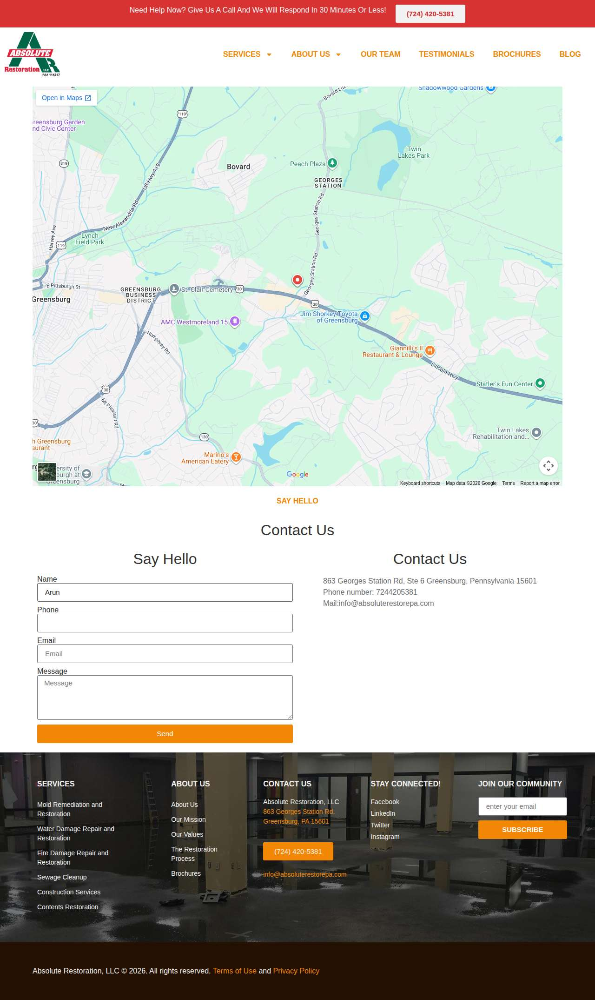

### masoudlawfirm.com — failed\_before\_submit (LIVE)

| | |
|---|---|
| Attempt ID | `c1d83653-7b50-42c2-9b9f-dd999cf9ebd3` |
| Form URL | https://masoudlawfirm.com/contact/ |
| Final URL | — |
| Reserved | 2026-11-05 04:08:44 UTC |
| Submit attempted | — |
| Template | standard v2 |
| Confirmation text | none observed |
| Result / error | locator.fill: Error: Cannot type text into input\[type=number\] |

Exact message:

~~~text
Subject: Helping customers find your business in AI search (AEO + GEO)

Hi there,

I'm Arun from Devs Arun. More and more customers now ask ChatGPT, Gemini, Perplexity or Google's AI Overviews questions like "who should I hire for this in my area?" before they call anyone. These tools answer from websites they can clearly understand, and they tend to recommend businesses whose pages answer real customer questions.

That is what AEO + GEO (Answer Engine and Generative Engine Optimization) is for. I improve your existing service pages so they clearly answer the questions your customers ask, add structured data that matches the page, and make the call, quote or enquiry step obvious. The benefit: your business gets a better chance of being mentioned or linked in AI answers, and visitors who arrive find it easy to contact you.

The AEO + GEO Starter is a one-time $199 (about ₹16,999, negotiable) for one website: a basic audit, 10 customer questions, improvements to two existing pages, relevant structured data and an action plan, with one revision round.

You can read the full details, send an enquiry or book online here:
https://devsarun.io/aeo-geo/

If this isn't relevant, just reply and I won't contact you again.

Best,
Arun
Devs Arun
itschool408@gmail.com · +91 7654534323
~~~

Submitted field values:

- \#form-field-name: Arun
- \#form-field-field\_3374379: Hi there, I'm Arun from Devs Arun. More and more customers now ask ChatGPT, Gemini, Perplexity or Google's AI Overviews 
- \#form-field-field\_7731784: +91 7654534323
- \#form-field-field\_8bd0f16: itschool408@gmail.com

**Inspected page** — `run-f3c1b375_attempt-c1d83653_inspection_2026-11-05T04-08-47-965Z.jpg`

### whiteolivecpa.com — failed\_before\_submit (LIVE)

| | |
|---|---|
| Attempt ID | `dc08c9a8-aaa1-4cff-aec0-186227c63413` |
| Form URL | https://whiteolivecpa.com/contact/ |
| Final URL | — |
| Reserved | 2026-11-05 04:08:52 UTC |
| Submit attempted | — |
| Template | standard v2 |
| Confirmation text | none observed |
| Result / error | locator.fill: Error: Cannot type text into input\[type=number\] |

Exact message:

~~~text
Subject: Helping customers find your business in AI search (AEO + GEO)

Hi there,

I'm Arun from Devs Arun. More and more customers now ask ChatGPT, Gemini, Perplexity or Google's AI Overviews questions like "who should I hire for this in my area?" before they call anyone. These tools answer from websites they can clearly understand, and they tend to recommend businesses whose pages answer real customer questions.

That is what AEO + GEO (Answer Engine and Generative Engine Optimization) is for. I improve your existing service pages so they clearly answer the questions your customers ask, add structured data that matches the page, and make the call, quote or enquiry step obvious. The benefit: your business gets a better chance of being mentioned or linked in AI answers, and visitors who arrive find it easy to contact you.

The AEO + GEO Starter is a one-time $199 (about ₹16,999, negotiable) for one website: a basic audit, 10 customer questions, improvements to two existing pages, relevant structured data and an action plan, with one revision round.

You can read the full details, send an enquiry or book online here:
https://devsarun.io/aeo-geo/

If this isn't relevant, just reply and I won't contact you again.

Best,
Arun
Devs Arun
itschool408@gmail.com · +91 7654534323
~~~

Submitted field values:

- \#ff\_1\_email: itschool408@gmail.com
- \#ff\_1\_message: Hi there, I'm Arun from Devs Arun. More and more customers now ask ChatGPT, Gemini, Perplexity or Google's AI Overviews 
- \#ff\_1\_numeric\_field: +91 7654534323
- \#ff\_1\_names\_first\_name\_: Arun

**Inspected page** — `run-f3c1b375_attempt-dc08c9a8_inspection_2026-11-05T04-08-54-583Z.jpg`

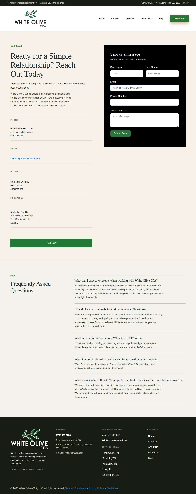

### breslinarchitects.com — confirmed (LIVE)

| | |
|---|---|
| Attempt ID | `674224ef-766c-4399-8398-f1a261018844` |
| Form URL | https://www.breslinarchitects.com/contact-us/ |
| Final URL | https://www.breslinarchitects.com/contact-us/ |
| Reserved | 2026-11-05 04:08:59 UTC |
| Submit attempted | 2026-11-05 04:09:01 UTC |
| Template | standard v2 |
| Confirmation text | oordinator victoriafinzi@breslinarchitects.com Get in Touch Thanks for contacting us\! We will be in touch with you shortly. 610.437.9626 1226 Union Boulevard, Allentown, PA 18109 fo |
| Result / error | — |

Exact message:

~~~text
Subject: Helping customers find your business in AI search (AEO + GEO)

Hi there,

I'm Arun from Devs Arun. More and more customers now ask ChatGPT, Gemini, Perplexity or Google's AI Overviews questions like "who should I hire for this in my area?" before they call anyone. These tools answer from websites they can clearly understand, and they tend to recommend businesses whose pages answer real customer questions.

That is what AEO + GEO (Answer Engine and Generative Engine Optimization) is for. I improve your existing service pages so they clearly answer the questions your customers ask, add structured data that matches the page, and make the call, quote or enquiry step obvious. The benefit: your business gets a better chance of being mentioned or linked in AI answers, and visitors who arrive find it easy to contact you.

The AEO + GEO Starter is a one-time $199 (about ₹16,999, negotiable) for one website: a basic audit, 10 customer questions, improvements to two existing pages, relevant structured data and an action plan, with one revision round.

You can read the full details, send an enquiry or book online here:
https://devsarun.io/aeo-geo/

If this isn't relevant, just reply and I won't contact you again.

Best,
Arun
Devs Arun
itschool408@gmail.com · +91 7654534323
~~~

Submitted field values:

- Name \* \[name\]: Arun
- Email \* \[email\]: itschool408@gmail.com
- Phone Number \* \[phone\]: +91 7654534323
- Comment or Message \[message\]: Hi there, I'm Arun from Devs Arun. More and more customers now ask ChatGPT, Gemini, Perplexity or Google's AI Overviews 

**Filled form (before submit)** — `run-f3c1b375_attempt-674224ef_filled_2026-11-05T04-09-01-846Z.jpg`

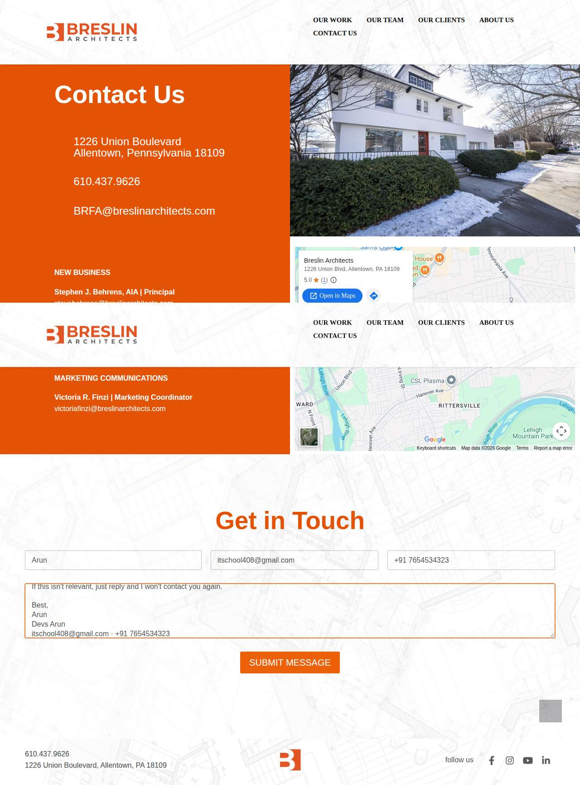

**After submit** — `run-f3c1b375_attempt-674224ef_post_attempt_2026-11-05T04-09-09-564Z.jpg`

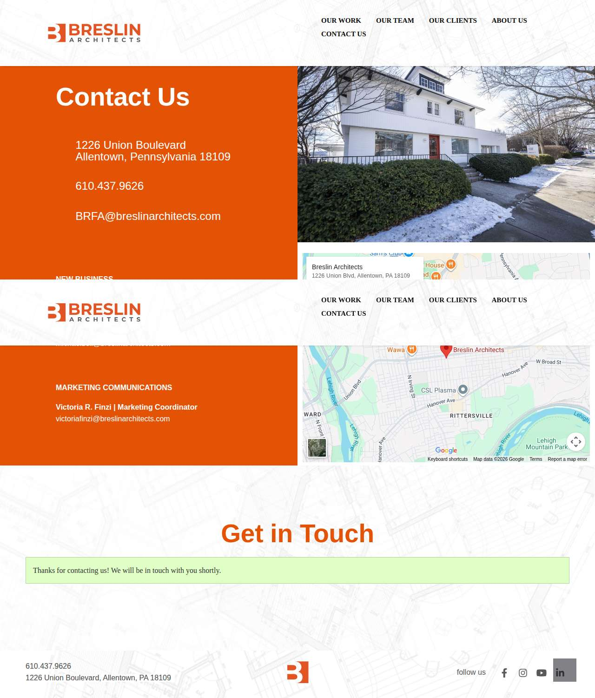

### 2marchitecture.com — confirmed (LIVE)

| | |
|---|---|
| Attempt ID | `83c55840-d127-4314-9777-893f1c1fb45c` |
| Form URL | https://2marchitecture.com/contact/ |
| Final URL | https://2marchitecture.com/thank-you/ |
| Reserved | 2026-11-05 04:09:17 UTC |
| Submit attempted | 2026-11-05 04:09:19 UTC |
| Template | standard v2 |
| Confirmation text | to content Home Our Work About Us Media Contact Search for: Thanks for contacting us\! We will be in touch with you shortly. 2M Architecture 501 Cortland Avenue San Francisco, CA 941 |
| Result / error | — |

Exact message:

~~~text
Subject: Helping customers find your business in AI search (AEO + GEO)

Hi there,

I'm Arun from Devs Arun. More and more customers now ask ChatGPT, Gemini, Perplexity or Google's AI Overviews questions like "who should I hire for this in my area?" before they call anyone. These tools answer from websites they can clearly understand, and they tend to recommend businesses whose pages answer real customer questions.

That is what AEO + GEO (Answer Engine and Generative Engine Optimization) is for. I improve your existing service pages so they clearly answer the questions your customers ask, add structured data that matches the page, and make the call, quote or enquiry step obvious. The benefit: your business gets a better chance of being mentioned or linked in AI answers, and visitors who arrive find it easy to contact you.

The AEO + GEO Starter is a one-time $199 (about ₹16,999, negotiable) for one website: a basic audit, 10 customer questions, improvements to two existing pages, relevant structured data and an action plan, with one revision round.

You can read the full details, send an enquiry or book online here:
https://devsarun.io/aeo-geo/

If this isn't relevant, just reply and I won't contact you again.

Best,
Arun
Devs Arun
itschool408@gmail.com · +91 7654534323
~~~

Submitted field values:

- name \[name\]: Arun
- email \[email\]: itschool408@gmail.com
- message \[message\]: Hi there, I'm Arun from Devs Arun. More and more customers now ask ChatGPT, Gemini, Perplexity or Google's AI Overviews 

**Filled form (before submit)** — `run-f3c1b375_attempt-83c55840_filled_2026-11-05T04-09-19-366Z.jpg`

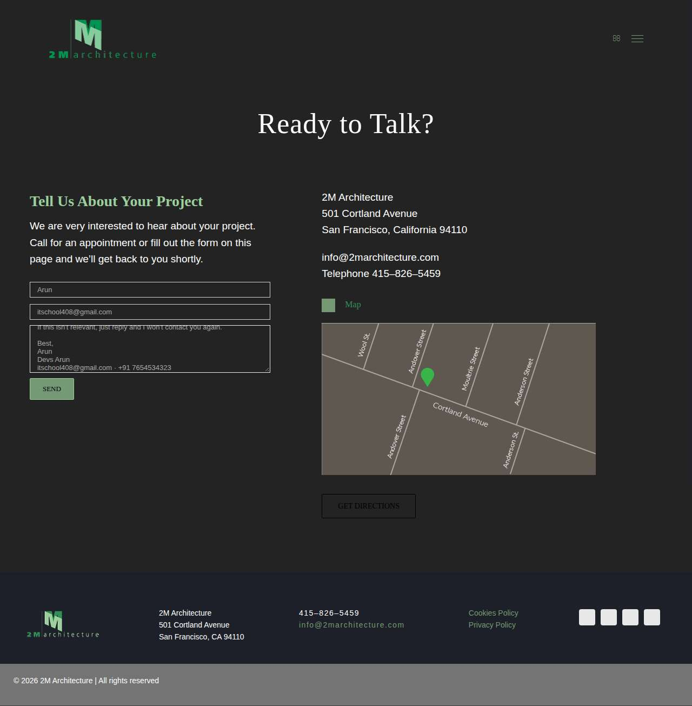

**After submit** — `run-f3c1b375_attempt-83c55840_post_attempt_2026-11-05T04-09-23-417Z.jpg`

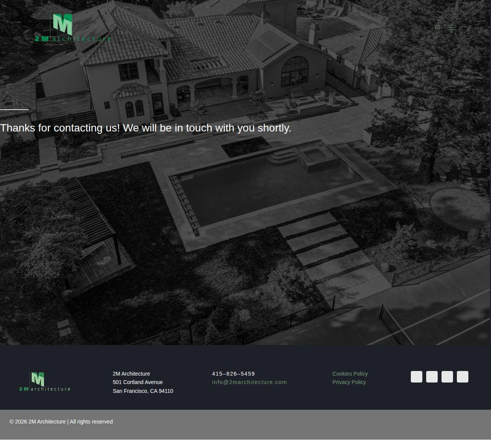

### bumpusandassociates.com — unclear (LIVE)

| | |
|---|---|
| Attempt ID | `ee58e788-f5c3-42f3-8665-b5449c04eb88` |
| Form URL | https://www.bumpusandassociates.com/contact |
| Final URL | https://www.bumpusandassociates.com/contact |
| Reserved | 2026-11-05 04:09:31 UTC |
| Submit attempted | 2026-11-05 04:09:33 UTC |
| Template | standard v2 |
| Confirmation text | none observed |
| Result / error | No new success marker observed |

Exact message:

~~~text
Subject: Helping customers find your business in AI search (AEO + GEO)

Hi there,

I'm Arun from Devs Arun. More and more customers now ask ChatGPT, Gemini, Perplexity or Google's AI Overviews questions like "who should I hire for this in my area?" before they call anyone. These tools answer from websites they can clearly understand, and they tend to recommend businesses whose pages answer real customer questions.

That is what AEO + GEO (Answer Engine and Generative Engine Optimization) is for. I improve your existing service pages so they clearly answer the questions your customers ask, add structured data that matches the page, and make the call, quote or enquiry step obvious. The benefit: your business gets a better chance of being mentioned or linked in AI answers, and visitors who arrive find it easy to contact you.

The AEO + GEO Starter is a one-time $199 (about ₹16,999, negotiable) for one website: a basic audit, 10 customer questions, improvements to two existing pages, relevant structured data and an action plan, with one revision round.

You can read the full details, send an enquiry or book online here:
https://devsarun.io/aeo-geo/

If this isn't relevant, just reply and I won't contact you again.

Best,
Arun
Devs Arun
itschool408@gmail.com · +91 7654534323
~~~

Submitted field values:

- email \[email\]: itschool408@gmail.com
- name-\* \[name\]: Arun
- Message \[message\]: Hi there, I'm Arun from Devs Arun. More and more customers now ask ChatGPT, Gemini, Perplexity or Google's AI Overviews 
- subject \[subject\]: Helping customers find your business in AI search (AEO + GEO)

**Filled form (before submit)** — `run-f3c1b375_attempt-ee58e788_filled_2026-11-05T04-09-33-913Z.jpg`

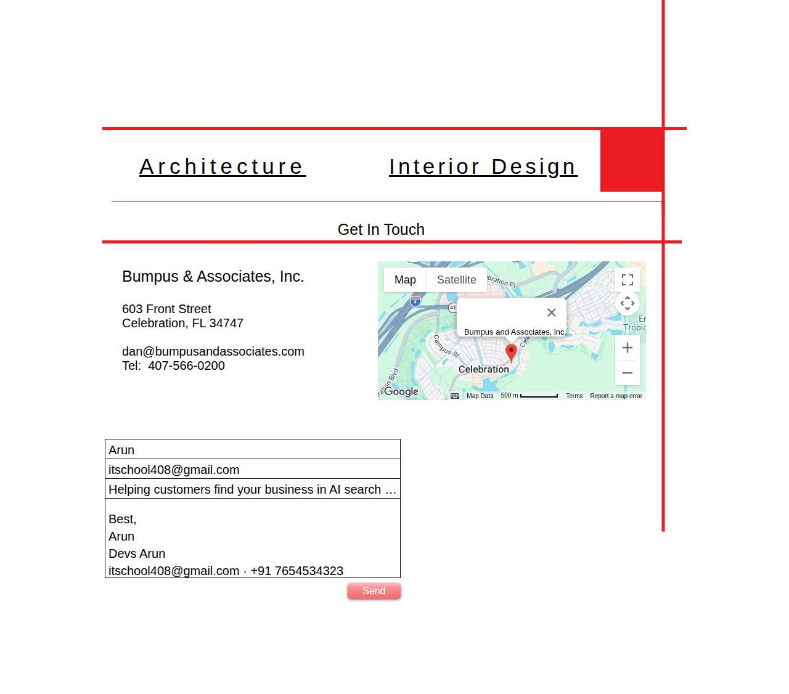

**After submit** — `run-f3c1b375_attempt-ee58e788_post_attempt_2026-11-05T04-10-02-096Z.jpg`

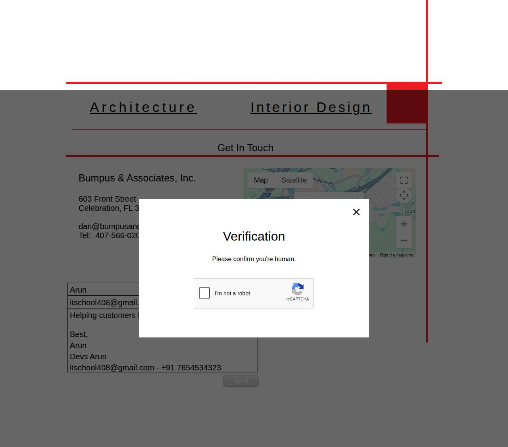

### sgapc.com — unclear (LIVE)

| | |
|---|---|
| Attempt ID | `152be4af-9041-47aa-8467-8d9f662d5a4b` |
| Form URL | https://www.sgapc.com/contact-us/ |
| Final URL | https://www.sgapc.com/contact-us/ |
| Reserved | 2026-11-05 04:10:10 UTC |
| Submit attempted | 2026-11-05 04:10:12 UTC |
| Template | standard v2 |
| Confirmation text | none observed |
| Result / error | No new success marker observed |

Exact message:

~~~text
Subject: Helping customers find your business in AI search (AEO + GEO)

Hi there,

I'm Arun from Devs Arun. More and more customers now ask ChatGPT, Gemini, Perplexity or Google's AI Overviews questions like "who should I hire for this in my area?" before they call anyone. These tools answer from websites they can clearly understand, and they tend to recommend businesses whose pages answer real customer questions.

That is what AEO + GEO (Answer Engine and Generative Engine Optimization) is for. I improve your existing service pages so they clearly answer the questions your customers ask, add structured data that matches the page, and make the call, quote or enquiry step obvious. The benefit: your business gets a better chance of being mentioned or linked in AI answers, and visitors who arrive find it easy to contact you.

The AEO + GEO Starter is a one-time $199 (about ₹16,999, negotiable) for one website: a basic audit, 10 customer questions, improvements to two existing pages, relevant structured data and an action plan, with one revision round.

You can read the full details, send an enquiry or book online here:
https://devsarun.io/aeo-geo/

If this isn't relevant, just reply and I won't contact you again.

Best,
Arun
Devs Arun
itschool408@gmail.com · +91 7654534323
~~~

Submitted field values:

- \* \[message\]: Hi there, I'm Arun from Devs Arun. More and more customers now ask ChatGPT, Gemini, Perplexity or Google's AI Overviews 
- Name \* \[name\]: Arun
- Phone \[phone\]: +91 7654534323
- Email \* \[email\]: itschool408@gmail.com

**Filled form (before submit)** — `run-f3c1b375_attempt-152be4af_filled_2026-11-05T04-10-12-329Z.jpg`

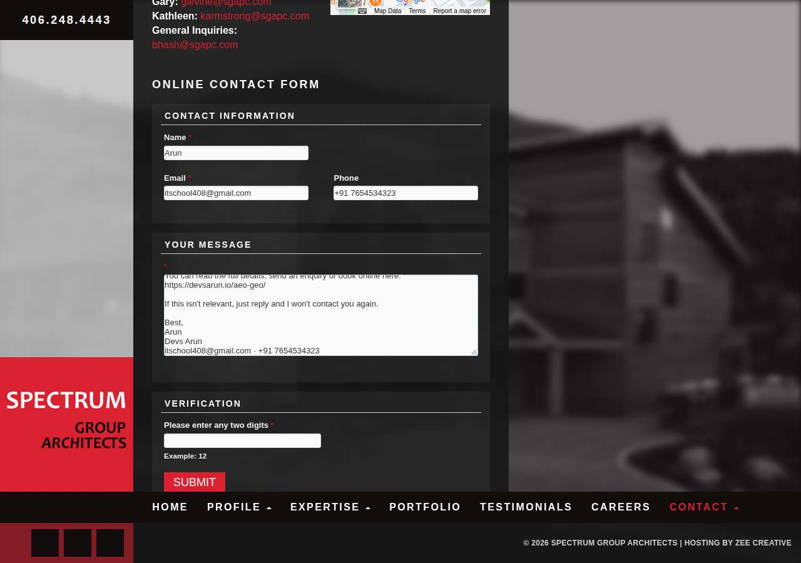

**After submit** — `run-f3c1b375_attempt-152be4af_post_attempt_2026-11-05T04-10-40-636Z.jpg`

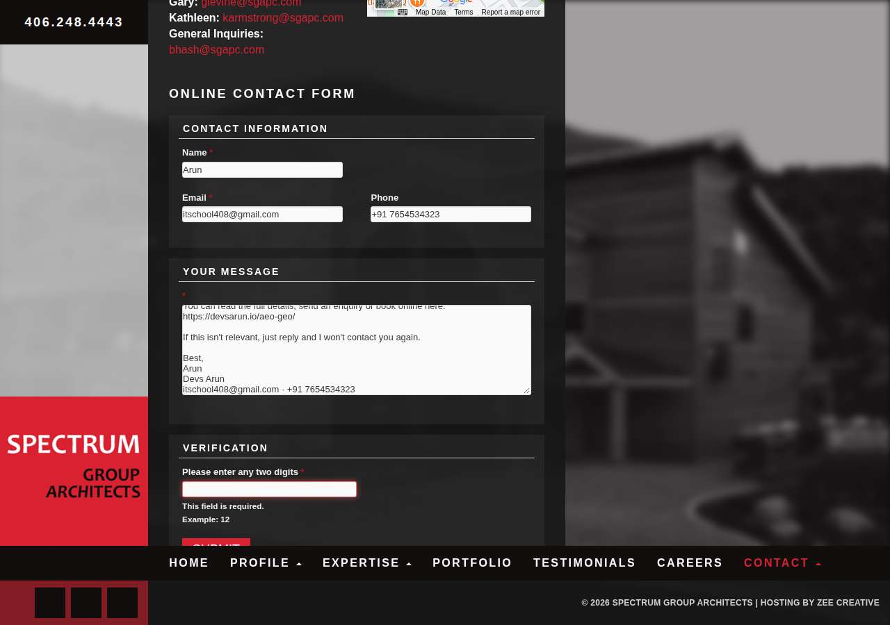

### nasearchitects.com — confirmed (LIVE)

| | |
|---|---|
| Attempt ID | `f47b7d60-c14c-4bcd-8ddf-edc7dee29679` |
| Form URL | https://www.nasearchitects.com/contact/ |
| Final URL | https://www.nasearchitects.com/contact/ |
| Reserved | 2026-11-05 04:10:49 UTC |
| Submit attempted | 2026-11-05 04:10:53 UTC |
| Template | standard v2 |
| Confirmation text | ces Portfolio About Us FAQ Blog Contact Us Get in touch and we'll get back to you as soon as we can. We look forward to hearing from you\! Form submitted successfully. A confi |
| Result / error | — |

Exact message:

~~~text
Subject: Helping customers find your business in AI search (AEO + GEO)

Hi there,

I'm Arun from Devs Arun. More and more customers now ask ChatGPT, Gemini, Perplexity or Google's AI Overviews questions like "who should I hire for this in my area?" before they call anyone. These tools answer from websites they can clearly understand, and they tend to recommend businesses whose pages answer real customer questions.

That is what AEO + GEO (Answer Engine and Generative Engine Optimization) is for. I improve your existing service pages so they clearly answer the questions your customers ask, add structured data that matches the page, and make the call, quote or enquiry step obvious. The benefit: your business gets a better chance of being mentioned or linked in AI answers, and visitors who arrive find it easy to contact you.

The AEO + GEO Starter is a one-time $199 (about ₹16,999, negotiable) for one website: a basic audit, 10 customer questions, improvements to two existing pages, relevant structured data and an action plan, with one revision round.

You can read the full details, send an enquiry or book online here:
https://devsarun.io/aeo-geo/

If this isn't relevant, just reply and I won't contact you again.

Best,
Arun
Devs Arun
itschool408@gmail.com · +91 7654534323
~~~

Submitted field values:

- NAME \* \[name\]: Arun
- EMAIL \* \[email\]: itschool408@gmail.com
- MESSAGE \* \[message\]: Hi there, I'm Arun from Devs Arun. More and more customers now ask ChatGPT, Gemini, Perplexity or Google's AI Overviews 

**Filled form (before submit)** — `run-f3c1b375_attempt-f47b7d60_filled_2026-11-05T04-10-53-714Z.jpg`

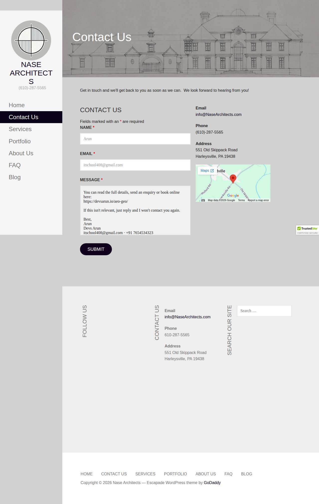

**After submit** — `run-f3c1b375_attempt-f47b7d60_post_attempt_2026-11-05T04-11-05-006Z.jpg`

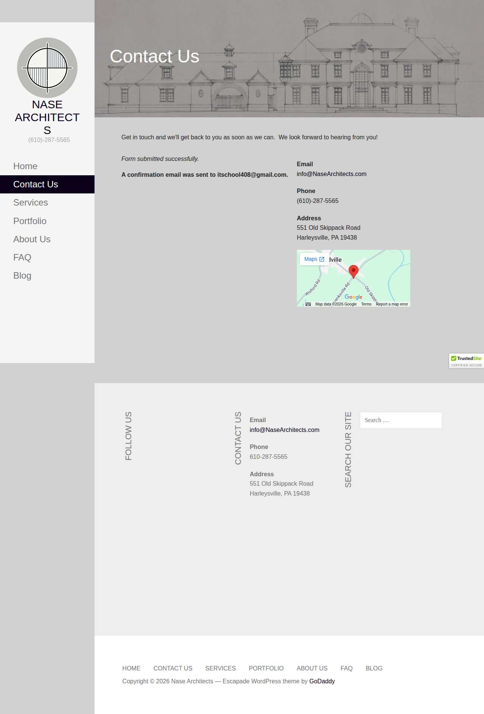

### kasapdx.com — confirmed (LIVE)

| | |
|---|---|
| Attempt ID | `fafb7c13-71cd-47d1-b7af-2ce5812e4b9d` |
| Form URL | https://kasapdx.com/contact-us/ |
| Final URL | https://kasapdx.com/contact-us/ |
| Reserved | 2026-11-05 04:11:13 UTC |
| Submit attempted | 2026-11-05 04:11:17 UTC |
| Template | standard v2 |
| Confirmation text | Skip to content Work Services Contact Thanks for contacting us\! We will be in touch with you shortly. Contact Us LOCATION 4839 NE Martin Luther King Jr. Blvd., |
| Result / error | — |

Exact message:

~~~text
Subject: Helping customers find your business in AI search (AEO + GEO)

Hi there,

I'm Arun from Devs Arun. More and more customers now ask ChatGPT, Gemini, Perplexity or Google's AI Overviews questions like "who should I hire for this in my area?" before they call anyone. These tools answer from websites they can clearly understand, and they tend to recommend businesses whose pages answer real customer questions.

That is what AEO + GEO (Answer Engine and Generative Engine Optimization) is for. I improve your existing service pages so they clearly answer the questions your customers ask, add structured data that matches the page, and make the call, quote or enquiry step obvious. The benefit: your business gets a better chance of being mentioned or linked in AI answers, and visitors who arrive find it easy to contact you.

The AEO + GEO Starter is a one-time $199 (about ₹16,999, negotiable) for one website: a basic audit, 10 customer questions, improvements to two existing pages, relevant structured data and an action plan, with one revision round.

You can read the full details, send an enquiry or book online here:
https://devsarun.io/aeo-geo/

If this isn't relevant, just reply and I won't contact you again.

Best,
Arun
Devs Arun
itschool408@gmail.com · +91 7654534323
~~~

Submitted field values:

- Name \* \[name\]: Arun
- Email \* \[email\]: itschool408@gmail.com
- Comment or Message \* \[message\]: Hi there, I'm Arun from Devs Arun. More and more customers now ask ChatGPT, Gemini, Perplexity or Google's AI Overviews 

**Filled form (before submit)** — `run-f3c1b375_attempt-fafb7c13_filled_2026-11-05T04-11-17-617Z.jpg`

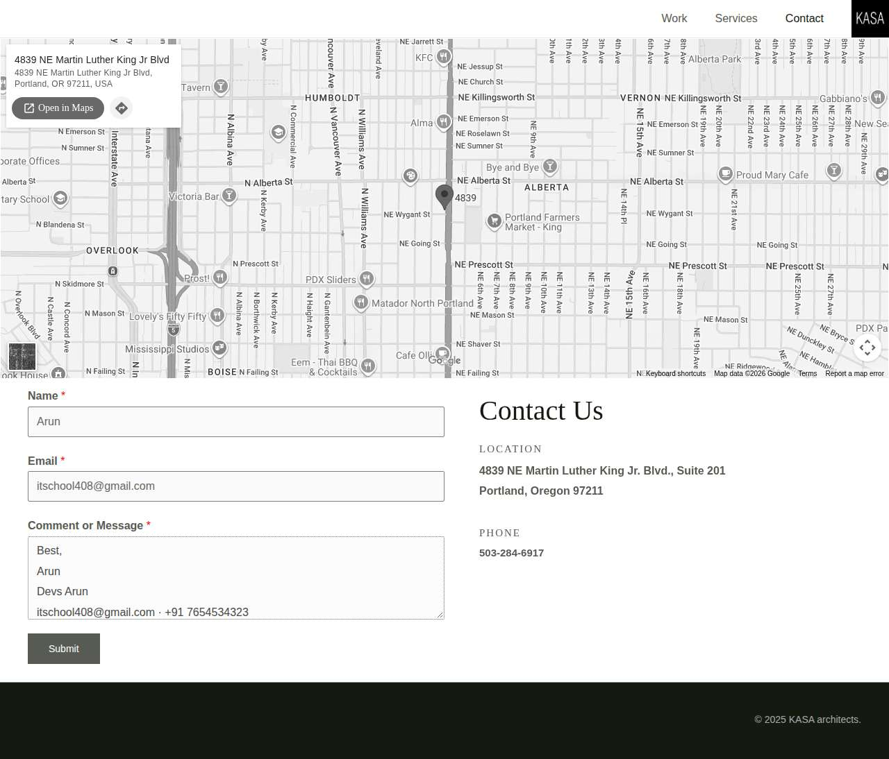

**After submit** — `run-f3c1b375_attempt-fafb7c13_post_attempt_2026-11-05T04-11-23-815Z.jpg`

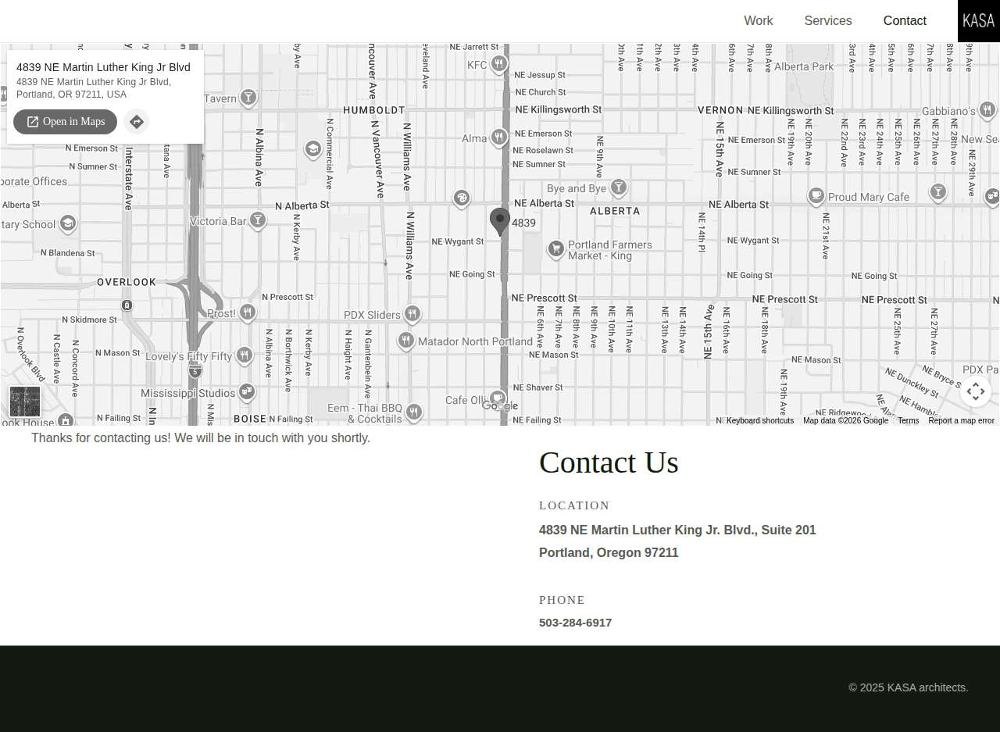

### foremangroup.com — confirmed (LIVE)

| | |
|---|---|
| Attempt ID | `bb186537-1a48-4421-9326-5027acc83112` |
| Form URL | https://www.foremangroup.com/contact/ |
| Final URL | https://www.foremangroup.com/contact/ |
| Reserved | 2026-11-05 04:11:32 UTC |
| Submit attempted | 2026-11-05 04:11:34 UTC |
| Template | standard v2 |
| Confirmation text | ing Foreman Foundation Contact Contact Us Send us a message Thank you for your message. It has been sent. Thank you for your message. It has been sent. telephone: (724) 452-9690 e-mail: |
| Result / error | — |

Exact message:

~~~text
Subject: Helping customers find your business in AI search (AEO + GEO)

Hi there,

I'm Arun from Devs Arun. More and more customers now ask ChatGPT, Gemini, Perplexity or Google's AI Overviews questions like "who should I hire for this in my area?" before they call anyone. These tools answer from websites they can clearly understand, and they tend to recommend businesses whose pages answer real customer questions.

That is what AEO + GEO (Answer Engine and Generative Engine Optimization) is for. I improve your existing service pages so they clearly answer the questions your customers ask, add structured data that matches the page, and make the call, quote or enquiry step obvious. The benefit: your business gets a better chance of being mentioned or linked in AI answers, and visitors who arrive find it easy to contact you.

The AEO + GEO Starter is a one-time $199 (about ₹16,999, negotiable) for one website: a basic audit, 10 customer questions, improvements to two existing pages, relevant structured data and an action plan, with one revision round.

You can read the full details, send an enquiry or book online here:
https://devsarun.io/aeo-geo/

If this isn't relevant, just reply and I won't contact you again.

Best,
Arun
Devs Arun
itschool408@gmail.com · +91 7654534323
~~~

Submitted field values:

- your-name \[name\]: Arun
- your-email \[email\]: itschool408@gmail.com
- your-message \[message\]: Hi there, I'm Arun from Devs Arun. More and more customers now ask ChatGPT, Gemini, Perplexity or Google's AI Overviews 
- your-subject \[subject\]: Helping customers find your business in AI search (AEO + GEO)

**Filled form (before submit)** — `run-f3c1b375_attempt-bb186537_filled_2026-11-05T04-11-34-542Z.jpg`

**After submit** — `run-f3c1b375_attempt-bb186537_post_attempt_2026-11-05T04-11-39-926Z.jpg`

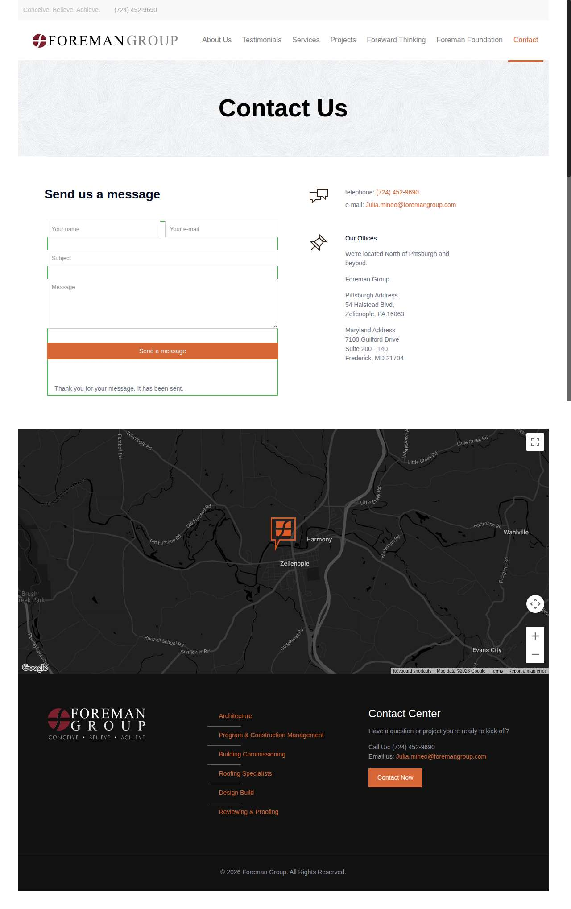

### smith-arc.com — unclear (LIVE)

| | |
|---|---|
| Attempt ID | `e47739a2-beb3-4919-9b4a-ec9ffb0a4256` |
| Form URL | https://www.smith-arc.com/ |
| Final URL | https://www.smith-arc.com/ |
| Reserved | 2026-11-05 04:11:48 UTC |
| Submit attempted | 2026-11-05 04:11:51 UTC |
| Template | standard v2 |
| Confirmation text | none observed |
| Result / error | No new success marker observed |

Exact message:

~~~text
Subject: Helping customers find your business in AI search (AEO + GEO)

Hi there,

I'm Arun from Devs Arun. More and more customers now ask ChatGPT, Gemini, Perplexity or Google's AI Overviews questions like "who should I hire for this in my area?" before they call anyone. These tools answer from websites they can clearly understand, and they tend to recommend businesses whose pages answer real customer questions.

That is what AEO + GEO (Answer Engine and Generative Engine Optimization) is for. I improve your existing service pages so they clearly answer the questions your customers ask, add structured data that matches the page, and make the call, quote or enquiry step obvious. The benefit: your business gets a better chance of being mentioned or linked in AI answers, and visitors who arrive find it easy to contact you.

The AEO + GEO Starter is a one-time $199 (about ₹16,999, negotiable) for one website: a basic audit, 10 customer questions, improvements to two existing pages, relevant structured data and an action plan, with one revision round.

You can read the full details, send an enquiry or book online here:
https://devsarun.io/aeo-geo/

If this isn't relevant, just reply and I won't contact you again.

Best,
Arun
Devs Arun
itschool408@gmail.com · +91 7654534323
~~~

Submitted field values:

- Email \[email\]: itschool408@gmail.com
- First name \[first\_name\]: Arun
- Write a message \[message\]: Hi there, I'm Arun from Devs Arun. More and more customers now ask ChatGPT, Gemini, Perplexity or Google's AI Overviews 

**Filled form (before submit)** — `run-f3c1b375_attempt-e47739a2_filled_2026-11-05T04-11-51-139Z.jpg`

**After submit** — `run-f3c1b375_attempt-e47739a2_post_attempt_2026-11-05T04-12-19-728Z.jpg`

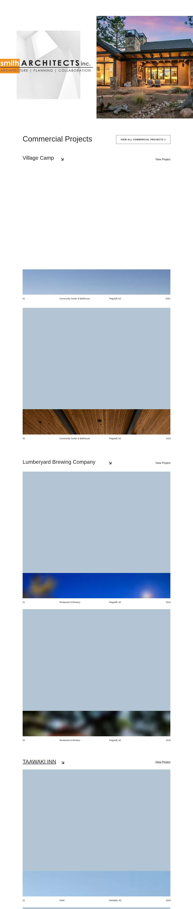

### varchitecture.com — error\_after\_submit (LIVE)

| | |
|---|---|
| Attempt ID | `4d5e3fed-dc8d-4911-8a25-21e0f025d772` |
| Form URL | https://varchitecture.com/contact/ |
| Final URL | https://varchitecture.com/contact/ |
| Reserved | 2026-11-05 04:12:27 UTC |
| Submit attempted | 2026-11-05 04:12:30 UTC |
| Template | standard v2 |
| Confirmation text | 3900 There was an error trying to send your message. Please try again later. THERE WAS AN ERROR TRYING TO SEND YOUR MESSAGE. PLEASE TRY AGAIN LATER. V ARCHITECTURE Centr |
| Result / error | — |

Exact message:

~~~text
Subject: Helping customers find your business in AI search (AEO + GEO)

Hi there,

I'm Arun from Devs Arun. More and more customers now ask ChatGPT, Gemini, Perplexity or Google's AI Overviews questions like "who should I hire for this in my area?" before they call anyone. These tools answer from websites they can clearly understand, and they tend to recommend businesses whose pages answer real customer questions.

That is what AEO + GEO (Answer Engine and Generative Engine Optimization) is for. I improve your existing service pages so they clearly answer the questions your customers ask, add structured data that matches the page, and make the call, quote or enquiry step obvious. The benefit: your business gets a better chance of being mentioned or linked in AI answers, and visitors who arrive find it easy to contact you.

The AEO + GEO Starter is a one-time $199 (about ₹16,999, negotiable) for one website: a basic audit, 10 customer questions, improvements to two existing pages, relevant structured data and an action plan, with one revision round.

You can read the full details, send an enquiry or book online here:
https://devsarun.io/aeo-geo/

If this isn't relevant, just reply and I won't contact you again.

Best,
Arun
Devs Arun
itschool408@gmail.com · +91 7654534323
~~~

Submitted field values:

- your-name \[name\]: Arun
- your-email \[email\]: itschool408@gmail.com
- your-message \[message\]: Hi there, I'm Arun from Devs Arun. More and more customers now ask ChatGPT, Gemini, Perplexity or Google's AI Overviews 

**Filled form (before submit)** — `run-f3c1b375_attempt-4d5e3fed_filled_2026-11-05T04-12-30-682Z.jpg`

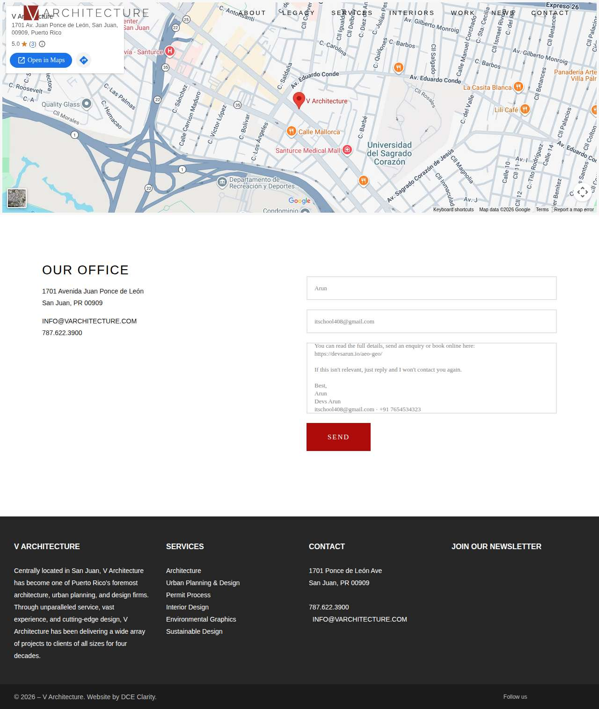

**After submit** — `run-f3c1b375_attempt-4d5e3fed_post_attempt_2026-11-05T04-12-35-180Z.jpg`

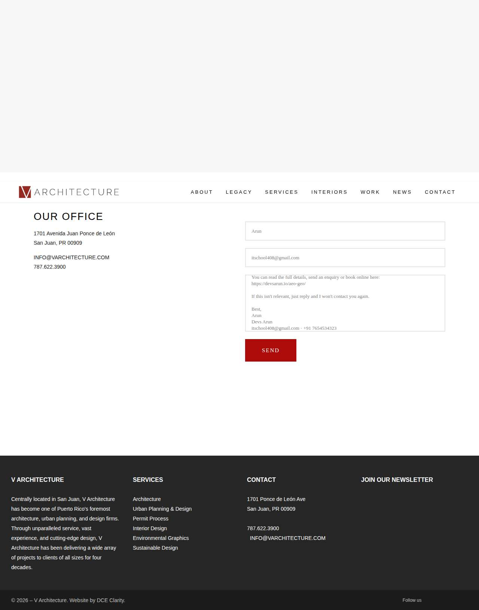

### tkfarchitects.com — unclear (LIVE)

| | |
|---|---|
| Attempt ID | `ad6a176c-05ac-4b4b-92fe-c5f1faefa946` |
| Form URL | https://www.tkfarchitects.com/contact |
| Final URL | https://www.tkfarchitects.com/contact |
| Reserved | 2026-11-05 04:12:43 UTC |
| Submit attempted | 2026-11-05 04:12:46 UTC |
| Template | standard v2 |
| Confirmation text | none observed |
| Result / error | No new success marker observed |

Exact message:

~~~text
Subject: Helping customers find your business in AI search (AEO + GEO)

Hi there,

I'm Arun from Devs Arun. More and more customers now ask ChatGPT, Gemini, Perplexity or Google's AI Overviews questions like "who should I hire for this in my area?" before they call anyone. These tools answer from websites they can clearly understand, and they tend to recommend businesses whose pages answer real customer questions.

That is what AEO + GEO (Answer Engine and Generative Engine Optimization) is for. I improve your existing service pages so they clearly answer the questions your customers ask, add structured data that matches the page, and make the call, quote or enquiry step obvious. The benefit: your business gets a better chance of being mentioned or linked in AI answers, and visitors who arrive find it easy to contact you.

The AEO + GEO Starter is a one-time $199 (about ₹16,999, negotiable) for one website: a basic audit, 10 customer questions, improvements to two existing pages, relevant structured data and an action plan, with one revision round.

You can read the full details, send an enquiry or book online here:
https://devsarun.io/aeo-geo/

If this isn't relevant, just reply and I won't contact you again.

Best,
Arun
Devs Arun
itschool408@gmail.com · +91 7654534323
~~~

Submitted field values:

- email \[email\]: itschool408@gmail.com
- name-\* \[name\]: Arun
- phone \[phone\]: +91 7654534323
- Message \[message\]: Hi there, I'm Arun from Devs Arun. More and more customers now ask ChatGPT, Gemini, Perplexity or Google's AI Overviews 
- subject \[subject\]: Helping customers find your business in AI search (AEO + GEO)

**Filled form (before submit)** — `run-f3c1b375_attempt-ad6a176c_filled_2026-11-05T04-12-46-974Z.jpg`

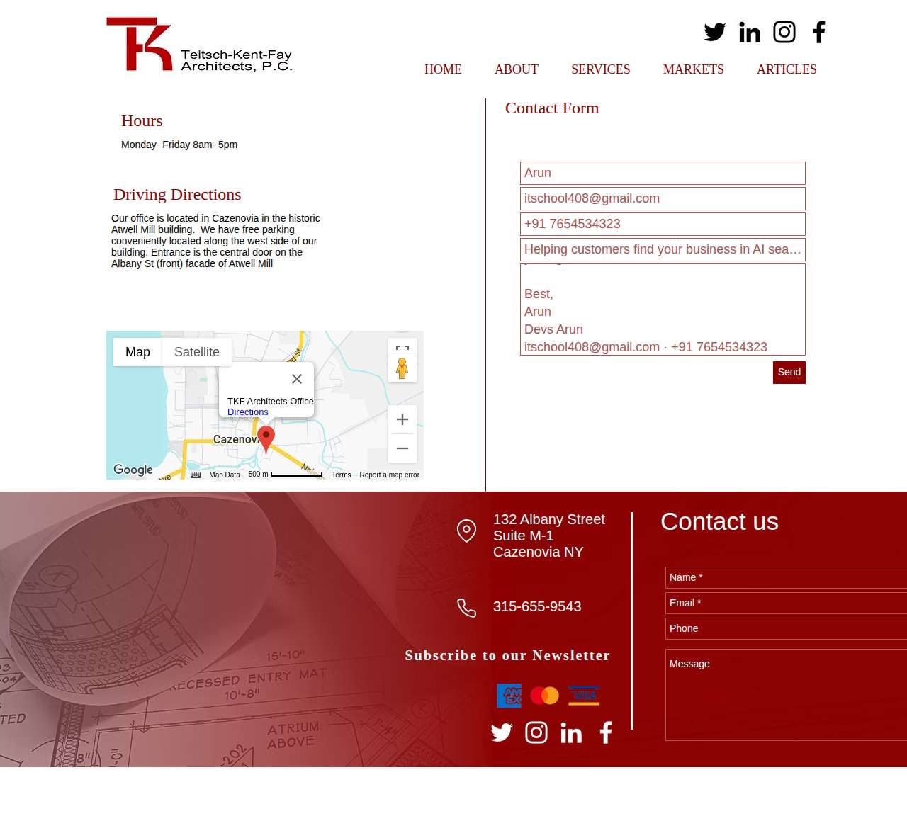

**After submit** — `run-f3c1b375_attempt-ad6a176c_post_attempt_2026-11-05T04-13-15-341Z.jpg`

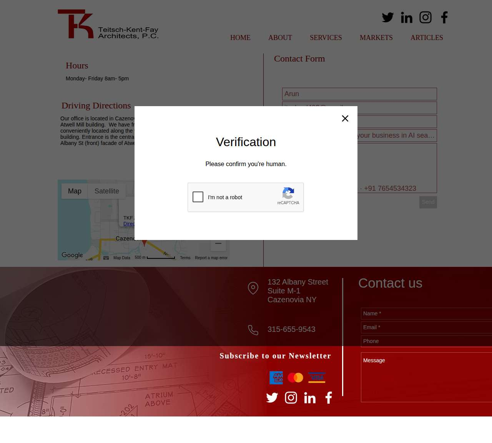

### architectsrule.com — confirmed (LIVE)

| | |
|---|---|
| Attempt ID | `7fde9215-5053-422d-b72e-b5429be20362` |
| Form URL | https://architectsrule.com/contact-us/ |
| Final URL | https://architectsrule.com/contact-us/ |
| Reserved | 2026-11-05 04:13:23 UTC |
| Submit attempted | 2026-11-05 04:13:28 UTC |
| Template | standard v2 |
| Confirmation text | OJECTS SERVICES ABOUT US AWARDS BLOGS CONTACT US Contact Us Thank you for your message. It has been sent. Your Name (required) Your Email (required) Your Contact Number (required) Your M |
| Result / error | — |

Exact message:

~~~text
Subject: Helping customers find your business in AI search (AEO + GEO)

Hi there,

I'm Arun from Devs Arun. More and more customers now ask ChatGPT, Gemini, Perplexity or Google's AI Overviews questions like "who should I hire for this in my area?" before they call anyone. These tools answer from websites they can clearly understand, and they tend to recommend businesses whose pages answer real customer questions.

That is what AEO + GEO (Answer Engine and Generative Engine Optimization) is for. I improve your existing service pages so they clearly answer the questions your customers ask, add structured data that matches the page, and make the call, quote or enquiry step obvious. The benefit: your business gets a better chance of being mentioned or linked in AI answers, and visitors who arrive find it easy to contact you.

The AEO + GEO Starter is a one-time $199 (about ₹16,999, negotiable) for one website: a basic audit, 10 customer questions, improvements to two existing pages, relevant structured data and an action plan, with one revision round.

You can read the full details, send an enquiry or book online here:
https://devsarun.io/aeo-geo/

If this isn't relevant, just reply and I won't contact you again.

Best,
Arun
Devs Arun
itschool408@gmail.com · +91 7654534323
~~~

Submitted field values:

- Your Message \[message\]: Hi there, I'm Arun from Devs Arun. More and more customers now ask ChatGPT, Gemini, Perplexity or Google's AI Overviews 
- Your Name (required) \[name\]: Arun
- Your Email (required) \[email\]: itschool408@gmail.com
- Your Contact Number (required) \[phone\]: +91 7654534323

**Filled form (before submit)** — `run-f3c1b375_attempt-7fde9215_filled_2026-11-05T04-13-28-508Z.jpg`

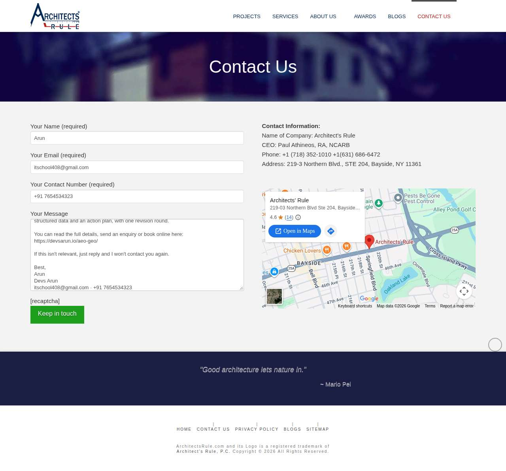

**After submit** — `run-f3c1b375_attempt-7fde9215_post_attempt_2026-11-05T04-13-33-607Z.jpg`

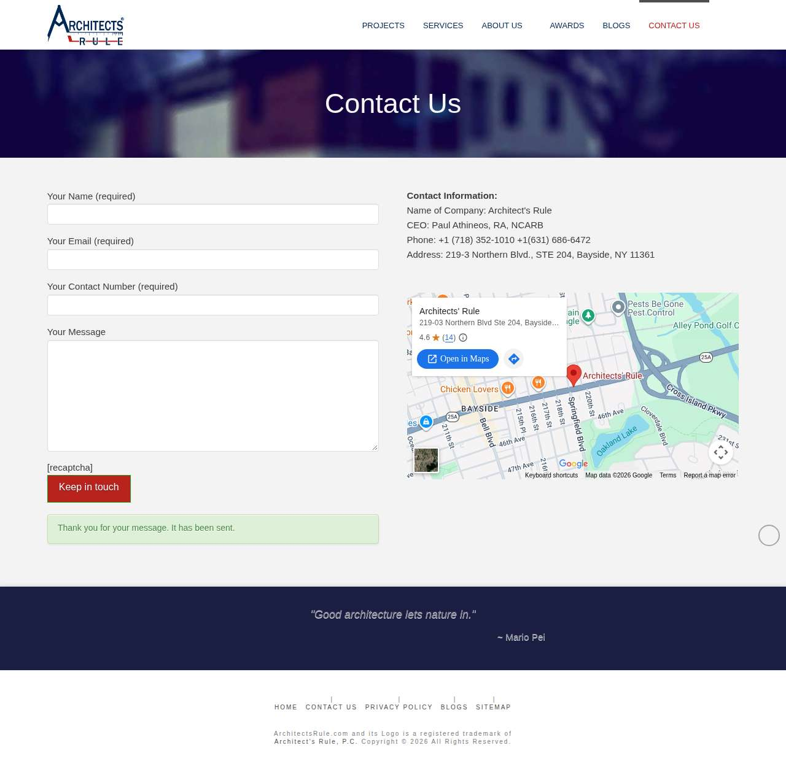

## Events (118)

| Time (UTC) | Event | Website | Details |
|---|---|---|---|
| 04:08:18 | run\_queued | — | live run requested by github:itsDevsArun |
| 04:08:18 | run\_dispatched | — | dispatch disabled (local test mode) |
| 04:08:21 | run\_started | — | Runner claimed live run |
| 04:08:23 | offer\_verified | — | Service page offer facts verified |
| 04:08:23 | website\_selected | clearchoiceplumbingllc.com | Live target clearchoiceplumbingllc.com |
| 04:08:23 | attempt\_reserved | clearchoiceplumbingllc.com | Submission attempt reserved with template standard v2 |
| 04:08:24 | page\_opened | clearchoiceplumbingllc.com | Opened form page |
| 04:08:24 | screenshot\_saved | clearchoiceplumbingllc.com | inspection screenshot saved (144 KB) |
| 04:08:24 | review\_required | clearchoiceplumbingllc.com | failed before submit: locator.fill: Error: Cannot type text into input\[type=number\] |
| 04:08:29 | website\_selected | bwnwincpainting.com | Live target bwnwincpainting.com |
| 04:08:29 | attempt\_reserved | bwnwincpainting.com | Submission attempt reserved with template standard v2 |
| 04:08:31 | page\_opened | bwnwincpainting.com | Opened form page |
| 04:08:31 | screenshot\_saved | bwnwincpainting.com | inspection screenshot saved (118 KB) |
| 04:08:31 | review\_required | bwnwincpainting.com | failed before submit: locator.fill: Error: Cannot type text into input\[type=number\] |
| 04:08:36 | website\_selected | absoluterestorepa.com | Live target absoluterestorepa.com |
| 04:08:36 | attempt\_reserved | absoluterestorepa.com | Submission attempt reserved with template standard v2 |
| 04:08:39 | page\_opened | absoluterestorepa.com | Opened form page |
| 04:08:39 | screenshot\_saved | absoluterestorepa.com | inspection screenshot saved (175 KB) |
| 04:08:39 | review\_required | absoluterestorepa.com | failed before submit: locator.fill: Error: Cannot type text into input\[type=number\] |
| 04:08:44 | website\_selected | masoudlawfirm.com | Live target masoudlawfirm.com |
| 04:08:44 | attempt\_reserved | masoudlawfirm.com | Submission attempt reserved with template standard v2 |
| 04:08:47 | page\_opened | masoudlawfirm.com | Opened form page |
| 04:08:47 | screenshot\_saved | masoudlawfirm.com | inspection screenshot saved (169 KB) |
| 04:08:47 | review\_required | masoudlawfirm.com | failed before submit: locator.fill: Error: Cannot type text into input\[type=number\] |
| 04:08:52 | website\_selected | whiteolivecpa.com | Live target whiteolivecpa.com |
| 04:08:52 | attempt\_reserved | whiteolivecpa.com | Submission attempt reserved with template standard v2 |
| 04:08:54 | page\_opened | whiteolivecpa.com | Opened form page |
| 04:08:54 | screenshot\_saved | whiteolivecpa.com | inspection screenshot saved (198 KB) |
| 04:08:54 | review\_required | whiteolivecpa.com | failed before submit: locator.fill: Error: Cannot type text into input\[type=number\] |
| 04:08:59 | website\_selected | breslinarchitects.com | Live target breslinarchitects.com |
| 04:08:59 | attempt\_reserved | breslinarchitects.com | Submission attempt reserved with template standard v2 |
| 04:09:01 | page\_opened | breslinarchitects.com | Opened form page |
| 04:09:01 | fields\_filled | breslinarchitects.com | filled |
| 04:09:01 | screenshot\_saved | breslinarchitects.com | filled screenshot saved (172 KB) |
| 04:09:01 | submit\_attempted | breslinarchitects.com | submitting |
| 04:09:09 | screenshot\_saved | breslinarchitects.com | post\_attempt screenshot saved (153 KB) |
| 04:09:09 | confirmation\_observed | breslinarchitects.com | confirmed — "oordinator victoriafinzi@breslinarchitects.com Get in Touch Thanks for contacting us\! We will be in touch with you short" |
| 04:09:17 | website\_selected | 2marchitecture.com | Live target 2marchitecture.com |
| 04:09:17 | attempt\_reserved | 2marchitecture.com | Submission attempt reserved with template standard v2 |
| 04:09:19 | page\_opened | 2marchitecture.com | Opened form page |
| 04:09:19 | fields\_filled | 2marchitecture.com | filled |
| 04:09:19 | screenshot\_saved | 2marchitecture.com | filled screenshot saved (61 KB) |
| 04:09:19 | submit\_attempted | 2marchitecture.com | submitting |
| 04:09:23 | screenshot\_saved | 2marchitecture.com | post\_attempt screenshot saved (131 KB) |
| 04:09:23 | confirmation\_observed | 2marchitecture.com | confirmed — "to content Home Our Work About Us Media Contact Search for: Thanks for contacting us\! We will be in touch with you short" |
| 04:09:31 | website\_selected | bumpusandassociates.com | Live target bumpusandassociates.com |
| 04:09:31 | attempt\_reserved | bumpusandassociates.com | Submission attempt reserved with template standard v2 |
| 04:09:33 | page\_opened | bumpusandassociates.com | Opened form page |
| 04:09:33 | fields\_filled | bumpusandassociates.com | filled |
| 04:09:33 | screenshot\_saved | bumpusandassociates.com | filled screenshot saved (67 KB) |
| 04:09:33 | submit\_attempted | bumpusandassociates.com | submitting |
| 04:10:02 | screenshot\_saved | bumpusandassociates.com | post\_attempt screenshot saved (47 KB) |
| 04:10:02 | review\_required | bumpusandassociates.com | unclear: No new success marker observed |
| 04:10:10 | website\_selected | sgapc.com | Live target sgapc.com |
| 04:10:10 | attempt\_reserved | sgapc.com | Submission attempt reserved with template standard v2 |
| 04:10:12 | page\_opened | sgapc.com | Opened form page |
| 04:10:12 | fields\_filled | sgapc.com | filled |
| 04:10:12 | screenshot\_saved | sgapc.com | filled screenshot saved (60 KB) |
| 04:10:12 | submit\_attempted | sgapc.com | submitting |
| 04:10:40 | screenshot\_saved | sgapc.com | post\_attempt screenshot saved (60 KB) |
| 04:10:40 | review\_required | sgapc.com | unclear: No new success marker observed |
| 04:10:49 | website\_selected | nasearchitects.com | Live target nasearchitects.com |
| 04:10:49 | attempt\_reserved | nasearchitects.com | Submission attempt reserved with template standard v2 |
| 04:10:53 | page\_opened | nasearchitects.com | Opened form page |
| 04:10:53 | fields\_filled | nasearchitects.com | filled |
| 04:10:53 | screenshot\_saved | nasearchitects.com | filled screenshot saved (97 KB) |
| 04:10:53 | submit\_attempted | nasearchitects.com | submitting |
| 04:11:05 | screenshot\_saved | nasearchitects.com | post\_attempt screenshot saved (83 KB) |
| 04:11:05 | confirmation\_observed | nasearchitects.com | confirmed — "ces Portfolio About Us FAQ Blog Contact Us Get in touch and we'll get back to you as soon as we can. We look forward to " |
| 04:11:13 | website\_selected | kasapdx.com | Live target kasapdx.com |
| 04:11:13 | attempt\_reserved | kasapdx.com | Submission attempt reserved with template standard v2 |
| 04:11:17 | page\_opened | kasapdx.com | Opened form page |
| 04:11:17 | fields\_filled | kasapdx.com | filled |
| 04:11:17 | screenshot\_saved | kasapdx.com | filled screenshot saved (116 KB) |
| 04:11:17 | submit\_attempted | kasapdx.com | submitting |
| 04:11:23 | screenshot\_saved | kasapdx.com | post\_attempt screenshot saved (105 KB) |
| 04:11:23 | confirmation\_observed | kasapdx.com | confirmed — "Skip to content Work Services Contact Thanks for contacting us\! We will be in touch with you shortly. Contact Us LOCATIO" |
| 04:11:32 | website\_selected | foremangroup.com | Live target foremangroup.com |
| 04:11:32 | attempt\_reserved | foremangroup.com | Submission attempt reserved with template standard v2 |
| 04:11:34 | page\_opened | foremangroup.com | Opened form page |
| 04:11:34 | fields\_filled | foremangroup.com | filled |
| 04:11:34 | screenshot\_saved | foremangroup.com | filled screenshot saved (120 KB) |
| 04:11:34 | submit\_attempted | foremangroup.com | submitting |
| 04:11:39 | screenshot\_saved | foremangroup.com | post\_attempt screenshot saved (116 KB) |
| 04:11:39 | confirmation\_observed | foremangroup.com | confirmed — "ing Foreman Foundation Contact Contact Us Send us a message Thank you for your message. It has been sent. Thank you for " |
| 04:11:48 | website\_selected | smith-arc.com | Live target smith-arc.com |
| 04:11:48 | attempt\_reserved | smith-arc.com | Submission attempt reserved with template standard v2 |
| 04:11:50 | page\_opened | smith-arc.com | Opened form page |
| 04:11:50 | fields\_filled | smith-arc.com | filled |
| 04:11:51 | screenshot\_saved | smith-arc.com | filled screenshot saved (221 KB) |
| 04:11:51 | submit\_attempted | smith-arc.com | submitting |
| 04:12:19 | screenshot\_saved | smith-arc.com | post\_attempt screenshot saved (221 KB) |
| 04:12:19 | review\_required | smith-arc.com | unclear: No new success marker observed |
| 04:12:27 | website\_selected | varchitecture.com | Live target varchitecture.com |
| 04:12:27 | attempt\_reserved | varchitecture.com | Submission attempt reserved with template standard v2 |
| 04:12:30 | page\_opened | varchitecture.com | Opened form page |
| 04:12:30 | fields\_filled | varchitecture.com | filled |
| 04:12:30 | screenshot\_saved | varchitecture.com | filled screenshot saved (139 KB) |
| 04:12:30 | submit\_attempted | varchitecture.com | submitting |
| 04:12:35 | screenshot\_saved | varchitecture.com | post\_attempt screenshot saved (65 KB) |
| 04:12:35 | error | varchitecture.com | error after submit — "3900 There was an error trying to send your message. Please try again later. THERE WAS AN ERROR TRYING TO SEND YOUR MESS" |
| 04:12:43 | website\_selected | tkfarchitects.com | Live target tkfarchitects.com |
| 04:12:43 | attempt\_reserved | tkfarchitects.com | Submission attempt reserved with template standard v2 |
| 04:12:46 | page\_opened | tkfarchitects.com | Opened form page |
| 04:12:46 | fields\_filled | tkfarchitects.com | filled |
| 04:12:46 | screenshot\_saved | tkfarchitects.com | filled screenshot saved (92 KB) |
| 04:12:46 | submit\_attempted | tkfarchitects.com | submitting |
| 04:13:15 | screenshot\_saved | tkfarchitects.com | post\_attempt screenshot saved (66 KB) |
| 04:13:15 | review\_required | tkfarchitects.com | unclear: No new success marker observed |
| 04:13:23 | website\_selected | architectsrule.com | Live target architectsrule.com |
| 04:13:23 | attempt\_reserved | architectsrule.com | Submission attempt reserved with template standard v2 |
| 04:13:28 | page\_opened | architectsrule.com | Opened form page |
| 04:13:28 | fields\_filled | architectsrule.com | filled |
| 04:13:28 | screenshot\_saved | architectsrule.com | filled screenshot saved (92 KB) |
| 04:13:28 | submit\_attempted | architectsrule.com | submitting |
| 04:13:33 | screenshot\_saved | architectsrule.com | post\_attempt screenshot saved (84 KB) |
| 04:13:33 | confirmation\_observed | architectsrule.com | confirmed — "OJECTS SERVICES ABOUT US AWARDS BLOGS CONTACT US Contact Us Thank you for your message. It has been sent. Your Name (req" |
| 04:13:42 | run\_completed | — | Run completed (queue\_exhausted) |
