# Run fbdffc6f — live — completed

| | |
|---|---|
| Run ID | `fbdffc6f-acd4-4f6f-b155-e0ca7464096a` |
| Requested by | github:itsDevsArun |
| Started | 2026-11-05 02:22:31 UTC |
| Finished | 2026-11-05 02:27:52 UTC |
| Finish reason | queue\_exhausted |
| GitHub Actions | https://github.com/itsDevsArun/aeo-geo/actions/runs/41950876497 |

CSV for this run: [runs/2026-11-05_live_fbdffc6f.csv](2026-11-05_live_fbdffc6f.csv)

## Attempts (18)

### clearchoiceplumbingllc.com — failed\_before\_submit (LIVE)

| | |
|---|---|
| Attempt ID | `621e1483-b503-49c1-bcbb-372043a6d89c` |
| Form URL | https://clearchoiceplumbingllc.com/contact/ |
| Final URL | — |
| Reserved | 2026-11-05 02:22:33 UTC |
| Submit attempted | — |
| Template | standard v2 |
| Confirmation text | none observed |
| Result / error | locator.fill: Error: Cannot type text into input\[type=number\] |

Exact message:

~~~text
Subject: Helping customers find your business in AI search (AEO + GEO)

Hi there,

I'm Arun from Devs Arun. More and more customers now ask ChatGPT, Gemini, Perplexity or Google's AI Overviews questions like "who should I hire for this in my area?" before they call anyone. These tools answer from websites they can clearly understand, and they tend to recommend businesses whose pages answer real customer questions.

That is what AEO + GEO (Answer Engine and Generative Engine Optimization) is for. I improve your existing service pages so they clearly answer the questions your customers ask, add structured data that matches the page, and make the call, quote or enquiry step obvious. The benefit: your business gets a better chance of being mentioned or linked in AI answers, and visitors who arrive find it easy to contact you.

The AEO + GEO Starter is a one-time $199 (about ₹16,999, negotiable) for one website: a basic audit, 10 customer questions, improvements to two existing pages, relevant structured data and an action plan, with one revision round.

You can read the full details, send an enquiry or book online here:
https://devsarun.io/aeo-geo/

If this isn't relevant, just reply and I won't contact you again.

Best,
Arun
Devs Arun
itschool408@gmail.com · +91 7654534323
~~~

Submitted field values:

- \#wpforms-51-field\_1: Arun
- \#wpforms-51-field\_2: itschool408@gmail.com
- \#wpforms-51-field\_3: Hi there, I'm Arun from Devs Arun. More and more customers now ask ChatGPT, Gemini, Perplexity or Google's AI Overviews 
- \#wpforms-51-field\_5: +91 7654534323

**Inspected page** — `run-fbdffc6f_attempt-621e1483_inspection_2026-11-05T02-22-34-696Z.jpg`

### bwnwincpainting.com — failed\_before\_submit (LIVE)

| | |
|---|---|
| Attempt ID | `0a03ca94-7d41-4fe5-9629-06b80ed08855` |
| Form URL | https://www.bwnwincpainting.com/contact/ |
| Final URL | — |
| Reserved | 2026-11-05 02:22:39 UTC |
| Submit attempted | — |
| Template | standard v2 |
| Confirmation text | none observed |
| Result / error | locator.fill: Error: Cannot type text into input\[type=number\] |

Exact message:

~~~text
Subject: Helping customers find your business in AI search (AEO + GEO)

Hi there,

I'm Arun from Devs Arun. More and more customers now ask ChatGPT, Gemini, Perplexity or Google's AI Overviews questions like "who should I hire for this in my area?" before they call anyone. These tools answer from websites they can clearly understand, and they tend to recommend businesses whose pages answer real customer questions.

That is what AEO + GEO (Answer Engine and Generative Engine Optimization) is for. I improve your existing service pages so they clearly answer the questions your customers ask, add structured data that matches the page, and make the call, quote or enquiry step obvious. The benefit: your business gets a better chance of being mentioned or linked in AI answers, and visitors who arrive find it easy to contact you.

The AEO + GEO Starter is a one-time $199 (about ₹16,999, negotiable) for one website: a basic audit, 10 customer questions, improvements to two existing pages, relevant structured data and an action plan, with one revision round.

You can read the full details, send an enquiry or book online here:
https://devsarun.io/aeo-geo/

If this isn't relevant, just reply and I won't contact you again.

Best,
Arun
Devs Arun
itschool408@gmail.com · +91 7654534323
~~~

Submitted field values:

- \#name-1151: Arun
- \#email-1151: itschool408@gmail.com
- \#phone-1151: +91 7654534323
- \#message-1151: Hi there, I'm Arun from Devs Arun. More and more customers now ask ChatGPT, Gemini, Perplexity or Google's AI Overviews 

**Inspected page** — `run-fbdffc6f_attempt-0a03ca94_inspection_2026-11-05T02-22-41-721Z.jpg`

### absoluterestorepa.com — failed\_before\_submit (LIVE)

| | |
|---|---|
| Attempt ID | `d68f6464-e67c-4fbb-ac63-f857500e171f` |
| Form URL | https://absoluterestorepa.com/contact-us/ |
| Final URL | — |
| Reserved | 2026-11-05 02:22:46 UTC |
| Submit attempted | — |
| Template | standard v2 |
| Confirmation text | none observed |
| Result / error | locator.fill: Error: Cannot type text into input\[type=number\] |

Exact message:

~~~text
Subject: Helping customers find your business in AI search (AEO + GEO)

Hi there,

I'm Arun from Devs Arun. More and more customers now ask ChatGPT, Gemini, Perplexity or Google's AI Overviews questions like "who should I hire for this in my area?" before they call anyone. These tools answer from websites they can clearly understand, and they tend to recommend businesses whose pages answer real customer questions.

That is what AEO + GEO (Answer Engine and Generative Engine Optimization) is for. I improve your existing service pages so they clearly answer the questions your customers ask, add structured data that matches the page, and make the call, quote or enquiry step obvious. The benefit: your business gets a better chance of being mentioned or linked in AI answers, and visitors who arrive find it easy to contact you.

The AEO + GEO Starter is a one-time $199 (about ₹16,999, negotiable) for one website: a basic audit, 10 customer questions, improvements to two existing pages, relevant structured data and an action plan, with one revision round.

You can read the full details, send an enquiry or book online here:
https://devsarun.io/aeo-geo/

If this isn't relevant, just reply and I won't contact you again.

Best,
Arun
Devs Arun
itschool408@gmail.com · +91 7654534323
~~~

Submitted field values:

- \#form-field-name: Arun
- \#form-field-message: Hi there, I'm Arun from Devs Arun. More and more customers now ask ChatGPT, Gemini, Perplexity or Google's AI Overviews 
- \#form-field-field\_ed02ec2: +91 7654534323
- \#content \> div \> div \> div:nth-of-type(2) \> div \> div:nth-of-type(1) \> div:nth-of-type(2) \> div \> form \> div \> div:nth-of-type(3) \> input: itschool408@gmail.com

**Inspected page** — `run-fbdffc6f_attempt-d68f6464_inspection_2026-11-05T02-22-51-091Z.jpg`

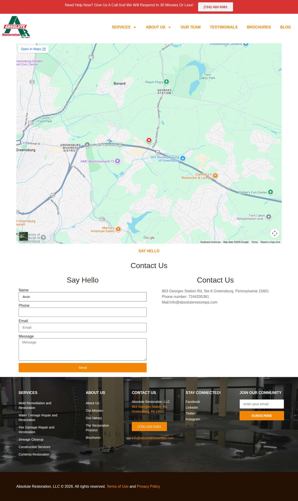

### masoudlawfirm.com — failed\_before\_submit (LIVE)

| | |
|---|---|
| Attempt ID | `07adba63-cb8f-4de7-a8a7-66b8d7db11ca` |
| Form URL | https://masoudlawfirm.com/contact/ |
| Final URL | — |
| Reserved | 2026-11-05 02:22:56 UTC |
| Submit attempted | — |
| Template | standard v2 |
| Confirmation text | none observed |
| Result / error | locator.fill: Error: Cannot type text into input\[type=number\] |

Exact message:

~~~text
Subject: Helping customers find your business in AI search (AEO + GEO)

Hi there,

I'm Arun from Devs Arun. More and more customers now ask ChatGPT, Gemini, Perplexity or Google's AI Overviews questions like "who should I hire for this in my area?" before they call anyone. These tools answer from websites they can clearly understand, and they tend to recommend businesses whose pages answer real customer questions.

That is what AEO + GEO (Answer Engine and Generative Engine Optimization) is for. I improve your existing service pages so they clearly answer the questions your customers ask, add structured data that matches the page, and make the call, quote or enquiry step obvious. The benefit: your business gets a better chance of being mentioned or linked in AI answers, and visitors who arrive find it easy to contact you.

The AEO + GEO Starter is a one-time $199 (about ₹16,999, negotiable) for one website: a basic audit, 10 customer questions, improvements to two existing pages, relevant structured data and an action plan, with one revision round.

You can read the full details, send an enquiry or book online here:
https://devsarun.io/aeo-geo/

If this isn't relevant, just reply and I won't contact you again.

Best,
Arun
Devs Arun
itschool408@gmail.com · +91 7654534323
~~~

Submitted field values:

- \#form-field-name: Arun
- \#form-field-field\_3374379: Hi there, I'm Arun from Devs Arun. More and more customers now ask ChatGPT, Gemini, Perplexity or Google's AI Overviews 
- \#form-field-field\_7731784: +91 7654534323
- \#form-field-field\_8bd0f16: itschool408@gmail.com

**Inspected page** — `run-fbdffc6f_attempt-07adba63_inspection_2026-11-05T02-22-57-868Z.jpg`

### servicioslegales.org — failed\_before\_submit (LIVE)

| | |
|---|---|
| Attempt ID | `4ccabe9b-6952-4477-ae66-a690223f3d2f` |
| Form URL | https://www.servicioslegales.org/contact-2/ |
| Final URL | https://www.servicioslegales.org/contact-2/ |
| Reserved | 2026-11-05 02:23:02 UTC |
| Submit attempted | — |
| Template | standard v2 |
| Confirmation text | none observed |
| Result / error | Reviewed form not found on page (site changed) |

Exact message:

~~~text
Subject: Helping customers find your business in AI search (AEO + GEO)

Hi there,

I'm Arun from Devs Arun. More and more customers now ask ChatGPT, Gemini, Perplexity or Google's AI Overviews questions like "who should I hire for this in my area?" before they call anyone. These tools answer from websites they can clearly understand, and they tend to recommend businesses whose pages answer real customer questions.

That is what AEO + GEO (Answer Engine and Generative Engine Optimization) is for. I improve your existing service pages so they clearly answer the questions your customers ask, add structured data that matches the page, and make the call, quote or enquiry step obvious. The benefit: your business gets a better chance of being mentioned or linked in AI answers, and visitors who arrive find it easy to contact you.

The AEO + GEO Starter is a one-time $199 (about ₹16,999, negotiable) for one website: a basic audit, 10 customer questions, improvements to two existing pages, relevant structured data and an action plan, with one revision round.

You can read the full details, send an enquiry or book online here:
https://devsarun.io/aeo-geo/

If this isn't relevant, just reply and I won't contact you again.

Best,
Arun
Devs Arun
itschool408@gmail.com · +91 7654534323
~~~

Submitted field values:

- input\[name="your-name"\]: Arun
- input\[name="your-email"\]: itschool408@gmail.com
- textarea\[name="your-message"\]: Hi there, I'm Arun from Devs Arun. More and more customers now ask ChatGPT, Gemini, Perplexity or Google's AI Overviews 

**Inspected page** — `run-fbdffc6f_attempt-4ccabe9b_inspection_2026-11-05T02-23-05-279Z.jpg`

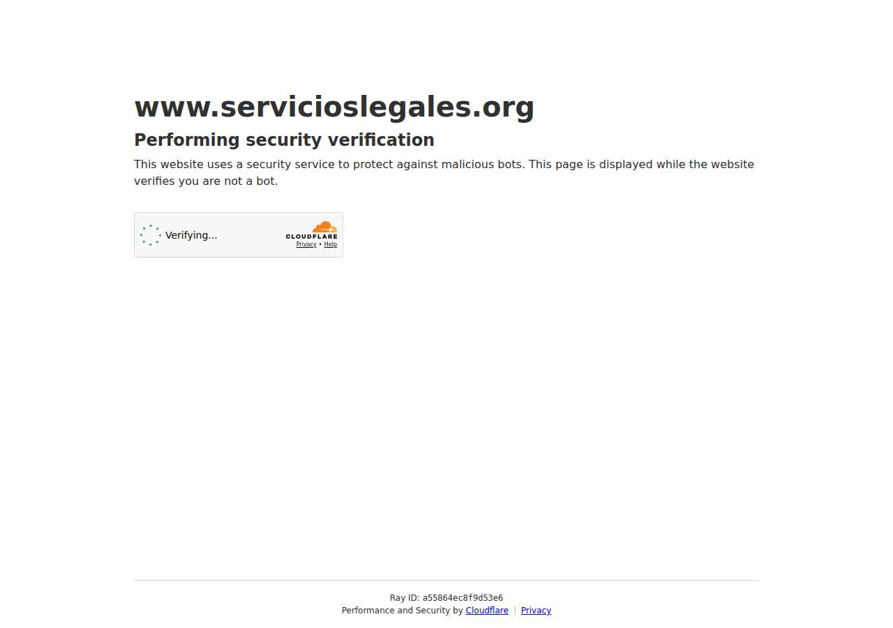

### whiteolivecpa.com — failed\_before\_submit (LIVE)

| | |
|---|---|
| Attempt ID | `58ac84a9-e943-4084-a731-19e8eafb80c3` |
| Form URL | https://whiteolivecpa.com/contact/ |
| Final URL | — |
| Reserved | 2026-11-05 02:23:10 UTC |
| Submit attempted | — |
| Template | standard v2 |
| Confirmation text | none observed |
| Result / error | locator.fill: Error: Cannot type text into input\[type=number\] |

Exact message:

~~~text
Subject: Helping customers find your business in AI search (AEO + GEO)

Hi there,

I'm Arun from Devs Arun. More and more customers now ask ChatGPT, Gemini, Perplexity or Google's AI Overviews questions like "who should I hire for this in my area?" before they call anyone. These tools answer from websites they can clearly understand, and they tend to recommend businesses whose pages answer real customer questions.

That is what AEO + GEO (Answer Engine and Generative Engine Optimization) is for. I improve your existing service pages so they clearly answer the questions your customers ask, add structured data that matches the page, and make the call, quote or enquiry step obvious. The benefit: your business gets a better chance of being mentioned or linked in AI answers, and visitors who arrive find it easy to contact you.

The AEO + GEO Starter is a one-time $199 (about ₹16,999, negotiable) for one website: a basic audit, 10 customer questions, improvements to two existing pages, relevant structured data and an action plan, with one revision round.

You can read the full details, send an enquiry or book online here:
https://devsarun.io/aeo-geo/

If this isn't relevant, just reply and I won't contact you again.

Best,
Arun
Devs Arun
itschool408@gmail.com · +91 7654534323
~~~

Submitted field values:

- \#ff\_1\_email: itschool408@gmail.com
- \#ff\_1\_message: Hi there, I'm Arun from Devs Arun. More and more customers now ask ChatGPT, Gemini, Perplexity or Google's AI Overviews 
- \#ff\_1\_numeric\_field: +91 7654534323
- \#ff\_1\_names\_first\_name\_: Arun

**Inspected page** — `run-fbdffc6f_attempt-58ac84a9_inspection_2026-11-05T02-23-11-875Z.jpg`

### segal-labate.com — unclear (LIVE)

| | |
|---|---|
| Attempt ID | `693b1f55-62f8-46d9-a0cf-a10c30f24822` |
| Form URL | https://segal-labate.com/contact-form/ |
| Final URL | https://segal-labate.com/wp-comments-post.php |
| Reserved | 2026-11-05 02:23:16 UTC |
| Submit attempted | 2026-11-05 02:23:19 UTC |
| Template | standard v2 |
| Confirmation text | none observed |
| Result / error | No new success marker observed |

Exact message:

~~~text
Subject: Helping customers find your business in AI search (AEO + GEO)

Hi there,

I'm Arun from Devs Arun. More and more customers now ask ChatGPT, Gemini, Perplexity or Google's AI Overviews questions like "who should I hire for this in my area?" before they call anyone. These tools answer from websites they can clearly understand, and they tend to recommend businesses whose pages answer real customer questions.

That is what AEO + GEO (Answer Engine and Generative Engine Optimization) is for. I improve your existing service pages so they clearly answer the questions your customers ask, add structured data that matches the page, and make the call, quote or enquiry step obvious. The benefit: your business gets a better chance of being mentioned or linked in AI answers, and visitors who arrive find it easy to contact you.

The AEO + GEO Starter is a one-time $199 (about ₹16,999, negotiable) for one website: a basic audit, 10 customer questions, improvements to two existing pages, relevant structured data and an action plan, with one revision round.

You can read the full details, send an enquiry or book online here:
https://devsarun.io/aeo-geo/

If this isn't relevant, just reply and I won't contact you again.

Best,
Arun
Devs Arun
itschool408@gmail.com · +91 7654534323
~~~

Submitted field values:

- Name \* \[name\]: Arun
- Email \* \[email\]: itschool408@gmail.com
- Website \[website\]: https://devsarun.io/aeo-geo/
- Comment \* \[message\]: Hi there, I'm Arun from Devs Arun. More and more customers now ask ChatGPT, Gemini, Perplexity or Google's AI Overviews 

**Filled form (before submit)** — `run-fbdffc6f_attempt-693b1f55_filled_2026-11-05T02-23-19-311Z.jpg`

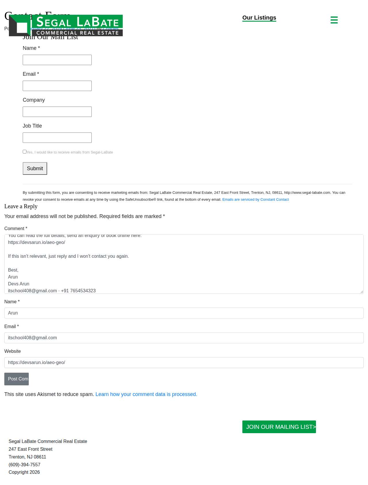

**After submit** — `run-fbdffc6f_attempt-693b1f55_post_attempt_2026-11-05T02-23-49-093Z.jpg`

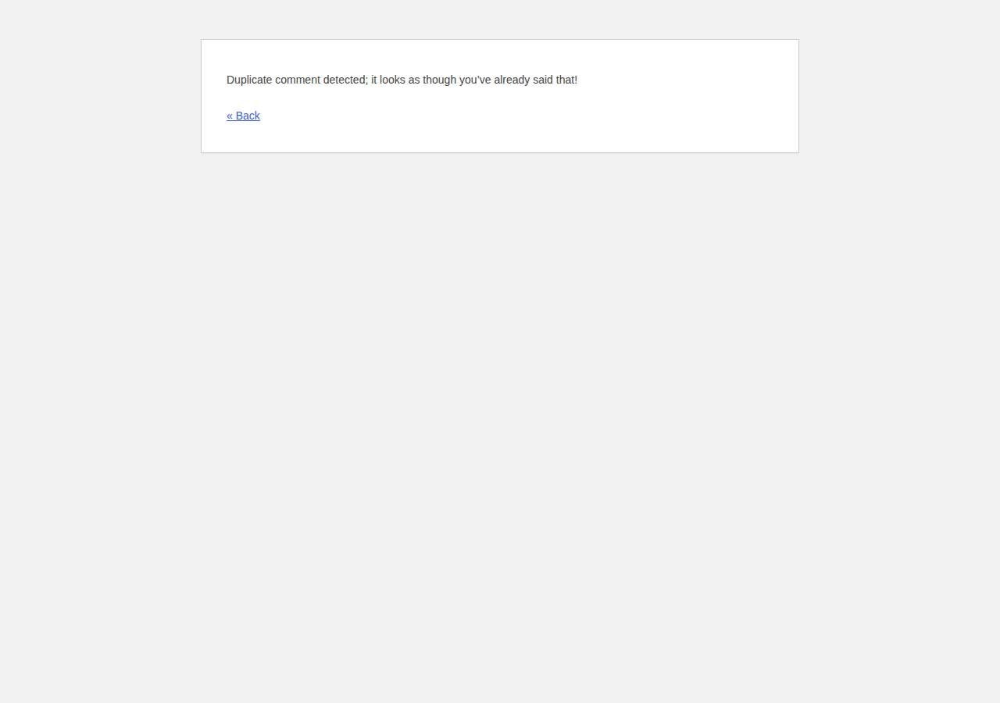

### ransonrealestate.com — confirmed (LIVE)

| | |
|---|---|
| Attempt ID | `edbaa978-c7df-4525-9c50-3561c6bdaeb5` |
| Form URL | https://ransonrealestate.com/contact/ |
| Final URL | https://ransonrealestate.com/contact/ |
| Reserved | 2026-11-05 02:23:57 UTC |
| Submit attempted | 2026-11-05 02:24:00 UTC |
| Template | standard v2 |
| Confirmation text | on Kunjolata Other / General Enquiry Message SEND ENQUIRY → Thank you — your enquiry has been sent. The Ranson Real Estate team will get back to you. DIRECT CONTACT Choo |
| Result / error | — |

Exact message:

~~~text
Subject: Helping customers find your business in AI search (AEO + GEO)

Hi there,

I'm Arun from Devs Arun. More and more customers now ask ChatGPT, Gemini, Perplexity or Google's AI Overviews questions like "who should I hire for this in my area?" before they call anyone. These tools answer from websites they can clearly understand, and they tend to recommend businesses whose pages answer real customer questions.

That is what AEO + GEO (Answer Engine and Generative Engine Optimization) is for. I improve your existing service pages so they clearly answer the questions your customers ask, add structured data that matches the page, and make the call, quote or enquiry step obvious. The benefit: your business gets a better chance of being mentioned or linked in AI answers, and visitors who arrive find it easy to contact you.

The AEO + GEO Starter is a one-time $199 (about ₹16,999, negotiable) for one website: a basic audit, 10 customer questions, improvements to two existing pages, relevant structured data and an action plan, with one revision round.

You can read the full details, send an enquiry or book online here:
https://devsarun.io/aeo-geo/

If this isn't relevant, just reply and I won't contact you again.

Best,
Arun
Devs Arun
itschool408@gmail.com · +91 7654534323
~~~

Submitted field values:

- \* \[name\]: Arun
- \* \[phone\]: +91 7654534323
- Message \[message\]: Hi there, I'm Arun from Devs Arun. More and more customers now ask ChatGPT, Gemini, Perplexity or Google's AI Overviews 
- Email Address \[email\]: itschool408@gmail.com

**Filled form (before submit)** — `run-fbdffc6f_attempt-edbaa978_filled_2026-11-05T02-24-00-233Z.jpg`

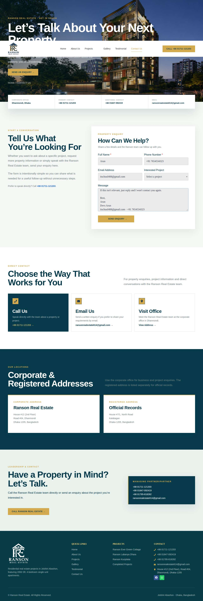

**After submit** — `run-fbdffc6f_attempt-edbaa978_post_attempt_2026-11-05T02-24-05-537Z.jpg`

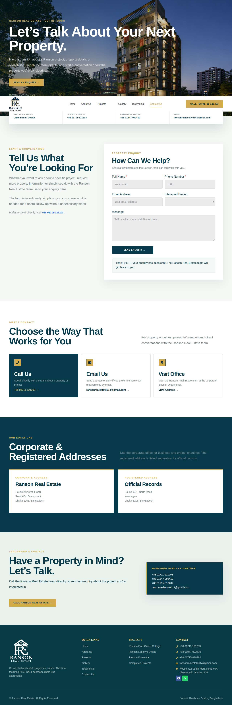

### dobbspropertymanagement.com — unclear (LIVE)

| | |
|---|---|
| Attempt ID | `5cd124bc-c0a7-49a8-aa9e-a4d2217b4d9b` |
| Form URL | https://www.dobbsrealtygroup.com/ |
| Final URL | https://www.dobbsrealtygroup.com/ |
| Reserved | 2026-11-05 02:24:13 UTC |
| Submit attempted | 2026-11-05 02:24:16 UTC |
| Template | standard v2 |
| Confirmation text | none observed |
| Result / error | No new success marker observed |

Exact message:

~~~text
Subject: Helping customers find your business in AI search (AEO + GEO)

Hi there,

I'm Arun from Devs Arun. More and more customers now ask ChatGPT, Gemini, Perplexity or Google's AI Overviews questions like "who should I hire for this in my area?" before they call anyone. These tools answer from websites they can clearly understand, and they tend to recommend businesses whose pages answer real customer questions.

That is what AEO + GEO (Answer Engine and Generative Engine Optimization) is for. I improve your existing service pages so they clearly answer the questions your customers ask, add structured data that matches the page, and make the call, quote or enquiry step obvious. The benefit: your business gets a better chance of being mentioned or linked in AI answers, and visitors who arrive find it easy to contact you.

The AEO + GEO Starter is a one-time $199 (about ₹16,999, negotiable) for one website: a basic audit, 10 customer questions, improvements to two existing pages, relevant structured data and an action plan, with one revision round.

You can read the full details, send an enquiry or book online here:
https://devsarun.io/aeo-geo/

If this isn't relevant, just reply and I won't contact you again.

Best,
Arun
Devs Arun
itschool408@gmail.com · +91 7654534323
~~~

Submitted field values:

- email \[email\]: itschool408@gmail.com
- name-\* \[name\]: Arun
- phone \[phone\]: +91 7654534323
- subject \[subject\]: Helping customers find your business in AI search (AEO + GEO)
- Message \* \[message\]: Hi there, I'm Arun from Devs Arun. More and more customers now ask ChatGPT, Gemini, Perplexity or Google's AI Overviews 

**Filled form (before submit)** — `run-fbdffc6f_attempt-5cd124bc_filled_2026-11-05T02-24-16-205Z.jpg`

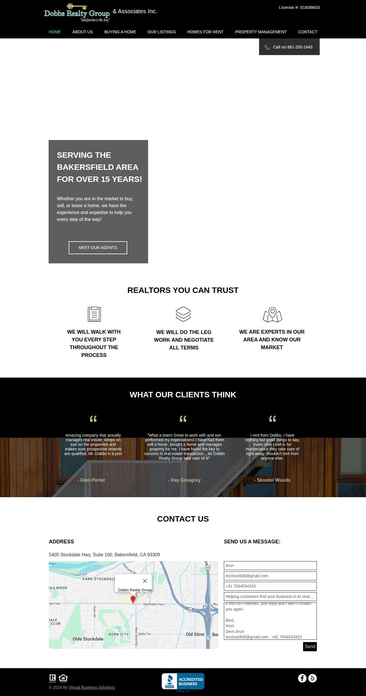

**After submit** — `run-fbdffc6f_attempt-5cd124bc_post_attempt_2026-11-05T02-24-44-306Z.jpg`

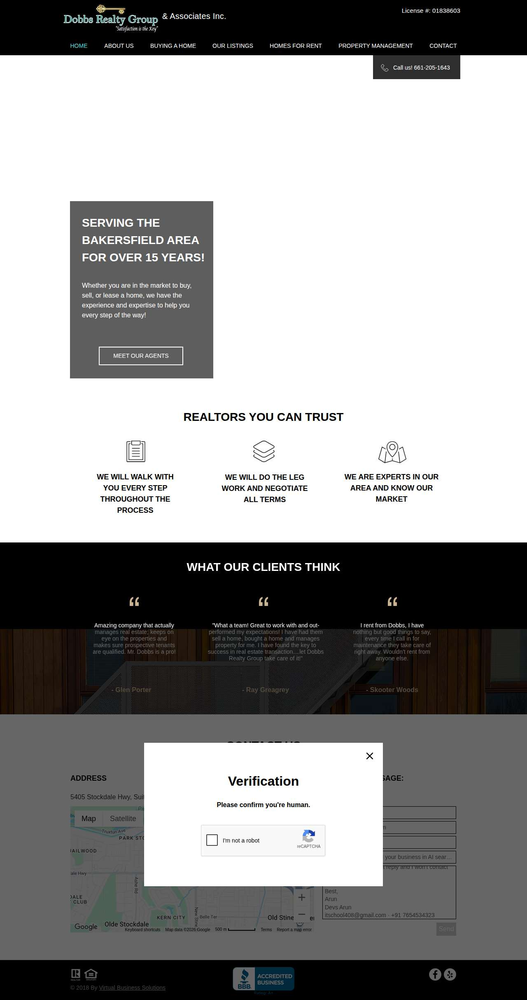

### ascendpropertymanagementoregon.com — confirmed (LIVE)

| | |
|---|---|
| Attempt ID | `b0a3ead4-ec80-4718-9901-e5c120571d67` |
| Form URL | https://www.ascendpropertymanagementoregon.com/contact\_us |
| Final URL | https://www.ascendpropertymanagementoregon.com/contact\_us |
| Reserved | 2026-11-05 02:24:52 UTC |
| Submit attempted | 2026-11-05 02:24:54 UTC |
| Template | standard v2 |
| Confirmation text | ear what you have to say\! Feel free to contact us directly. Thank you for contacting us. We will get back to you as soon as possible. Sitemap © 2021 All Rights Reserved. Ascend Realty |
| Result / error | — |

Exact message:

~~~text
Subject: Helping customers find your business in AI search (AEO + GEO)

Hi there,

I'm Arun from Devs Arun. More and more customers now ask ChatGPT, Gemini, Perplexity or Google's AI Overviews questions like "who should I hire for this in my area?" before they call anyone. These tools answer from websites they can clearly understand, and they tend to recommend businesses whose pages answer real customer questions.

That is what AEO + GEO (Answer Engine and Generative Engine Optimization) is for. I improve your existing service pages so they clearly answer the questions your customers ask, add structured data that matches the page, and make the call, quote or enquiry step obvious. The benefit: your business gets a better chance of being mentioned or linked in AI answers, and visitors who arrive find it easy to contact you.

The AEO + GEO Starter is a one-time $199 (about ₹16,999, negotiable) for one website: a basic audit, 10 customer questions, improvements to two existing pages, relevant structured data and an action plan, with one revision round.

You can read the full details, send an enquiry or book online here:
https://devsarun.io/aeo-geo/

If this isn't relevant, just reply and I won't contact you again.

Best,
Arun
Devs Arun
itschool408@gmail.com · +91 7654534323
~~~

Submitted field values:

- Name: \[name\]: Arun
- Email: \[email\]: itschool408@gmail.com
- Phone: \[phone\]: +91 7654534323
- Message: \[message\]: Hi there, I'm Arun from Devs Arun. More and more customers now ask ChatGPT, Gemini, Perplexity or Google's AI Overviews 

**Filled form (before submit)** — `run-fbdffc6f_attempt-b0a3ead4_filled_2026-11-05T02-24-54-800Z.jpg`

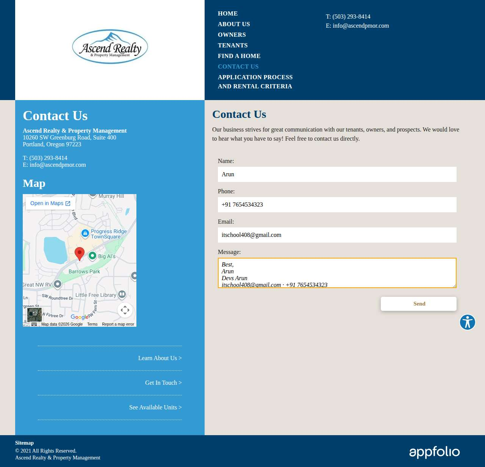

**After submit** — `run-fbdffc6f_attempt-b0a3ead4_post_attempt_2026-11-05T02-24-58-999Z.jpg`

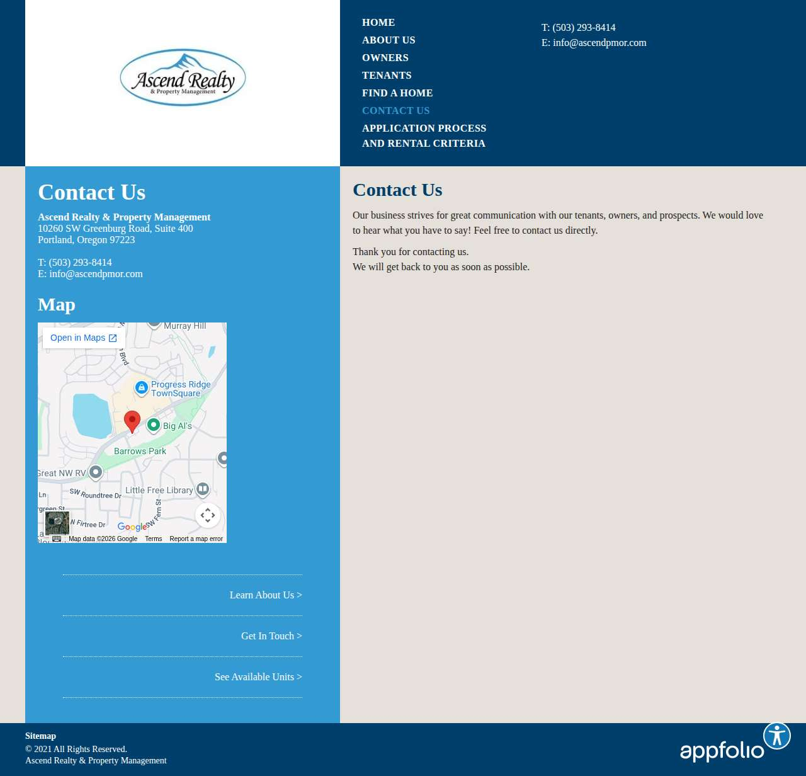

### infiniterealestategroup.com — confirmed (LIVE)

| | |
|---|---|
| Attempt ID | `0ceb00b5-c3fb-427b-893d-09ec4ee1b2e8` |
| Form URL | https://infiniterealestategroup.com/contact/ |
| Final URL | https://infiniterealestategroup.com/contact/ |
| Reserved | 2026-11-05 02:25:07 UTC |
| Submit attempted | 2026-11-05 02:25:08 UTC |
| Template | standard v2 |
| Confirmation text | nt a Free Market Report? Please fill out the form below and we'll get back to you as quickly as we can\! Send Thanks for sending Email\! Infinite Real Estate, Inc 24 E Main St |
| Result / error | — |

Exact message:

~~~text
Subject: Helping customers find your business in AI search (AEO + GEO)

Hi there,

I'm Arun from Devs Arun. More and more customers now ask ChatGPT, Gemini, Perplexity or Google's AI Overviews questions like "who should I hire for this in my area?" before they call anyone. These tools answer from websites they can clearly understand, and they tend to recommend businesses whose pages answer real customer questions.

That is what AEO + GEO (Answer Engine and Generative Engine Optimization) is for. I improve your existing service pages so they clearly answer the questions your customers ask, add structured data that matches the page, and make the call, quote or enquiry step obvious. The benefit: your business gets a better chance of being mentioned or linked in AI answers, and visitors who arrive find it easy to contact you.

The AEO + GEO Starter is a one-time $199 (about ₹16,999, negotiable) for one website: a basic audit, 10 customer questions, improvements to two existing pages, relevant structured data and an action plan, with one revision round.

You can read the full details, send an enquiry or book online here:
https://devsarun.io/aeo-geo/

If this isn't relevant, just reply and I won't contact you again.

Best,
Arun
Devs Arun
itschool408@gmail.com · +91 7654534323
~~~

Submitted field values:

- Enter Your Name \* \[name\]: Arun
- Enter Your Email \* \[email\]: itschool408@gmail.com
- Enter Your Message \* \[message\]: Hi there, I'm Arun from Devs Arun. More and more customers now ask ChatGPT, Gemini, Perplexity or Google's AI Overviews 
- Enter Your Subject \* \[subject\]: Helping customers find your business in AI search (AEO + GEO)

**Filled form (before submit)** — `run-fbdffc6f_attempt-0ceb00b5_filled_2026-11-05T02-25-08-606Z.jpg`

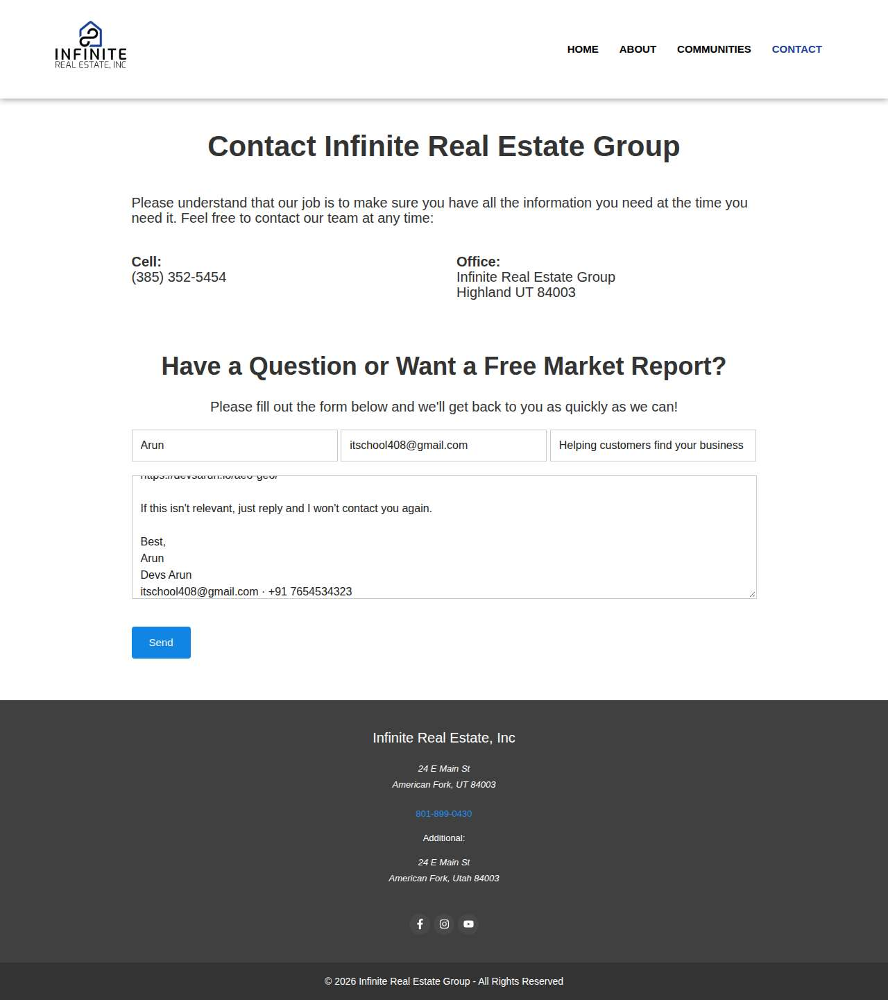

**After submit** — `run-fbdffc6f_attempt-0ceb00b5_post_attempt_2026-11-05T02-25-12-704Z.jpg`

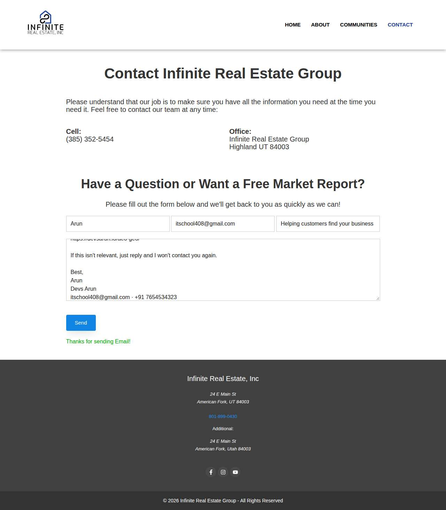

### okobojilakehomes.com — confirmed (LIVE)

| | |
|---|---|
| Attempt ID | `cfa2bd66-5722-4e6b-b456-f6af43762e7e` |
| Form URL | https://okobojilakehomes.com/contact/ |
| Final URL | https://okobojilakehomes.com/contact/ |
| Reserved | 2026-11-05 02:25:20 UTC |
| Submit attempted | 2026-11-05 02:25:22 UTC |
| Template | standard v2 |
| Confirmation text | u’re still asking questions, this is a good place to start. Thanks for contacting us\! We will be in touch with you shortly. NOT SURE WHERE TO START? Choose the conversation that sou |
| Result / error | — |

Exact message:

~~~text
Subject: Helping customers find your business in AI search (AEO + GEO)

Hi there,

I'm Arun from Devs Arun. More and more customers now ask ChatGPT, Gemini, Perplexity or Google's AI Overviews questions like "who should I hire for this in my area?" before they call anyone. These tools answer from websites they can clearly understand, and they tend to recommend businesses whose pages answer real customer questions.

That is what AEO + GEO (Answer Engine and Generative Engine Optimization) is for. I improve your existing service pages so they clearly answer the questions your customers ask, add structured data that matches the page, and make the call, quote or enquiry step obvious. The benefit: your business gets a better chance of being mentioned or linked in AI answers, and visitors who arrive find it easy to contact you.

The AEO + GEO Starter is a one-time $199 (about ₹16,999, negotiable) for one website: a basic audit, 10 customer questions, improvements to two existing pages, relevant structured data and an action plan, with one revision round.

You can read the full details, send an enquiry or book online here:
https://devsarun.io/aeo-geo/

If this isn't relevant, just reply and I won't contact you again.

Best,
Arun
Devs Arun
itschool408@gmail.com · +91 7654534323
~~~

Submitted field values:

- Name \* \[name\]: Arun
- Email \* \[email\]: itschool408@gmail.com
- Phone \* \[phone\]: +91 7654534323
- How Can We Help? \[message\]: Hi there, I'm Arun from Devs Arun. More and more customers now ask ChatGPT, Gemini, Perplexity or Google's AI Overviews 

**Filled form (before submit)** — `run-fbdffc6f_attempt-cfa2bd66_filled_2026-11-05T02-25-22-925Z.jpg`

**After submit** — `run-fbdffc6f_attempt-cfa2bd66_post_attempt_2026-11-05T02-25-30-047Z.jpg`

### auburnrealty.com — unclear (LIVE)

| | |
|---|---|
| Attempt ID | `9d67fef0-2d30-43ee-88a9-319e32019da7` |
| Form URL | https://www.auburnrealty.com/contact-us |
| Final URL | https://www.auburnrealty.com/contact-us |
| Reserved | 2026-11-05 02:25:38 UTC |
| Submit attempted | 2026-11-05 02:25:40 UTC |
| Template | standard v2 |
| Confirmation text | none observed |
| Result / error | No new success marker observed |

Exact message:

~~~text
Subject: Helping customers find your business in AI search (AEO + GEO)

Hi there,

I'm Arun from Devs Arun. More and more customers now ask ChatGPT, Gemini, Perplexity or Google's AI Overviews questions like "who should I hire for this in my area?" before they call anyone. These tools answer from websites they can clearly understand, and they tend to recommend businesses whose pages answer real customer questions.

That is what AEO + GEO (Answer Engine and Generative Engine Optimization) is for. I improve your existing service pages so they clearly answer the questions your customers ask, add structured data that matches the page, and make the call, quote or enquiry step obvious. The benefit: your business gets a better chance of being mentioned or linked in AI answers, and visitors who arrive find it easy to contact you.

The AEO + GEO Starter is a one-time $199 (about ₹16,999, negotiable) for one website: a basic audit, 10 customer questions, improvements to two existing pages, relevant structured data and an action plan, with one revision round.

You can read the full details, send an enquiry or book online here:
https://devsarun.io/aeo-geo/

If this isn't relevant, just reply and I won't contact you again.

Best,
Arun
Devs Arun
itschool408@gmail.com · +91 7654534323
~~~

Submitted field values:

- Email \[email\]: itschool408@gmail.com
- Phone number \[phone\]: +91 7654534323
- First Name \[first\_name\]: Arun
- How can we help? \[message\]: Hi there, I'm Arun from Devs Arun. More and more customers now ask ChatGPT, Gemini, Perplexity or Google's AI Overviews 

**Filled form (before submit)** — `run-fbdffc6f_attempt-9d67fef0_filled_2026-11-05T02-25-40-569Z.jpg`

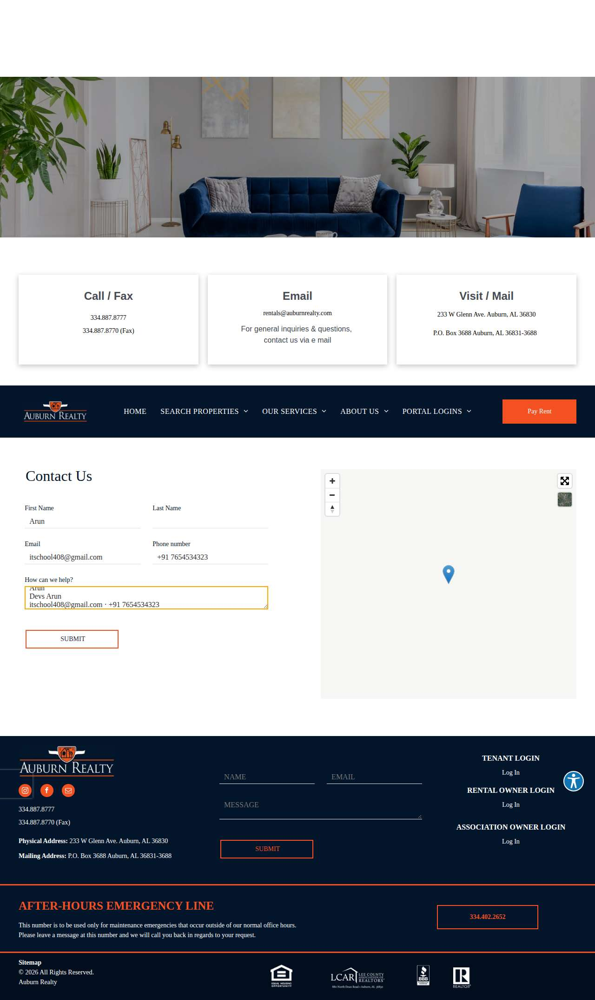

**After submit** — `run-fbdffc6f_attempt-9d67fef0_post_attempt_2026-11-05T02-26-10-717Z.jpg`

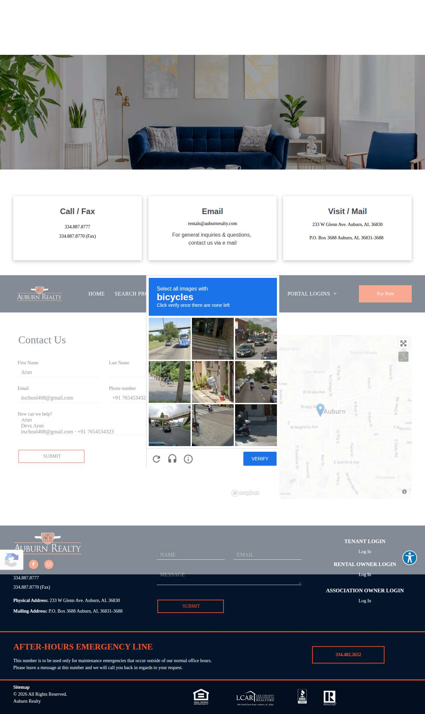

### callredcompass.com — failed\_before\_submit (LIVE)

| | |
|---|---|
| Attempt ID | `b25f5815-bac5-4657-ae1a-80f1525e1256` |
| Form URL | https://callredcompass.com/contact/ |
| Final URL | https://callredcompass.com/contact/ |
| Reserved | 2026-11-05 02:26:18 UTC |
| Submit attempted | — |
| Template | standard v2 |
| Confirmation text | none observed |
| Result / error | Field "Your Phone Number" did not accept the value |

Exact message:

~~~text
Subject: Helping customers find your business in AI search (AEO + GEO)

Hi there,

I'm Arun from Devs Arun. More and more customers now ask ChatGPT, Gemini, Perplexity or Google's AI Overviews questions like "who should I hire for this in my area?" before they call anyone. These tools answer from websites they can clearly understand, and they tend to recommend businesses whose pages answer real customer questions.

That is what AEO + GEO (Answer Engine and Generative Engine Optimization) is for. I improve your existing service pages so they clearly answer the questions your customers ask, add structured data that matches the page, and make the call, quote or enquiry step obvious. The benefit: your business gets a better chance of being mentioned or linked in AI answers, and visitors who arrive find it easy to contact you.

The AEO + GEO Starter is a one-time $199 (about ₹16,999, negotiable) for one website: a basic audit, 10 customer questions, improvements to two existing pages, relevant structured data and an action plan, with one revision round.

You can read the full details, send an enquiry or book online here:
https://devsarun.io/aeo-geo/

If this isn't relevant, just reply and I won't contact you again.

Best,
Arun
Devs Arun
itschool408@gmail.com · +91 7654534323
~~~

Submitted field values:

- \#input\_1\_1: Arun
- \#input\_1\_3: itschool408@gmail.com
- \#input\_1\_4: +91 7654534323
- \#input\_1\_5: Hi there, I'm Arun from Devs Arun. More and more customers now ask ChatGPT, Gemini, Perplexity or Google's AI Overviews 

**Filled form (before submit)** — `run-fbdffc6f_attempt-b25f5815_filled_2026-11-05T02-26-20-758Z.jpg`

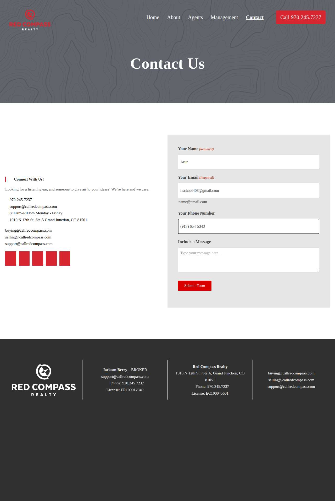

### tedbuyshousesnc.com — confirmed (LIVE)

| | |
|---|---|
| Attempt ID | `266698a9-2508-460d-93b6-4e7808894df9` |
| Form URL | https://tedbuyshousesnc.com/contact/ |
| Final URL | https://tedbuyshousesnc.com/contact/ |
| Reserved | 2026-11-05 02:26:25 UTC |
| Submit attempted | 2026-11-05 02:26:27 UTC |
| Template | standard v2 |
| Confirmation text | ach your goals.  Call: +1 888-701-1740  Lorem ipsum dolor Thanks for contacting us +1 888-701-1740 Discover the benefits of our cutting-edge solar panel technology and leverage th |
| Result / error | — |

Exact message:

~~~text
Subject: Helping customers find your business in AI search (AEO + GEO)

Hi there,

I'm Arun from Devs Arun. More and more customers now ask ChatGPT, Gemini, Perplexity or Google's AI Overviews questions like "who should I hire for this in my area?" before they call anyone. These tools answer from websites they can clearly understand, and they tend to recommend businesses whose pages answer real customer questions.

That is what AEO + GEO (Answer Engine and Generative Engine Optimization) is for. I improve your existing service pages so they clearly answer the questions your customers ask, add structured data that matches the page, and make the call, quote or enquiry step obvious. The benefit: your business gets a better chance of being mentioned or linked in AI answers, and visitors who arrive find it easy to contact you.

The AEO + GEO Starter is a one-time $199 (about ₹16,999, negotiable) for one website: a basic audit, 10 customer questions, improvements to two existing pages, relevant structured data and an action plan, with one revision round.

You can read the full details, send an enquiry or book online here:
https://devsarun.io/aeo-geo/

If this isn't relevant, just reply and I won't contact you again.

Best,
Arun
Devs Arun
itschool408@gmail.com · +91 7654534323
~~~

Submitted field values:

- Name \[name\]: Arun
- Message \[message\]: Hi there, I'm Arun from Devs Arun. More and more customers now ask ChatGPT, Gemini, Perplexity or Google's AI Overviews 
- Email Address \[email\]: itschool408@gmail.com

**Filled form (before submit)** — `run-fbdffc6f_attempt-266698a9_filled_2026-11-05T02-26-27-305Z.jpg`

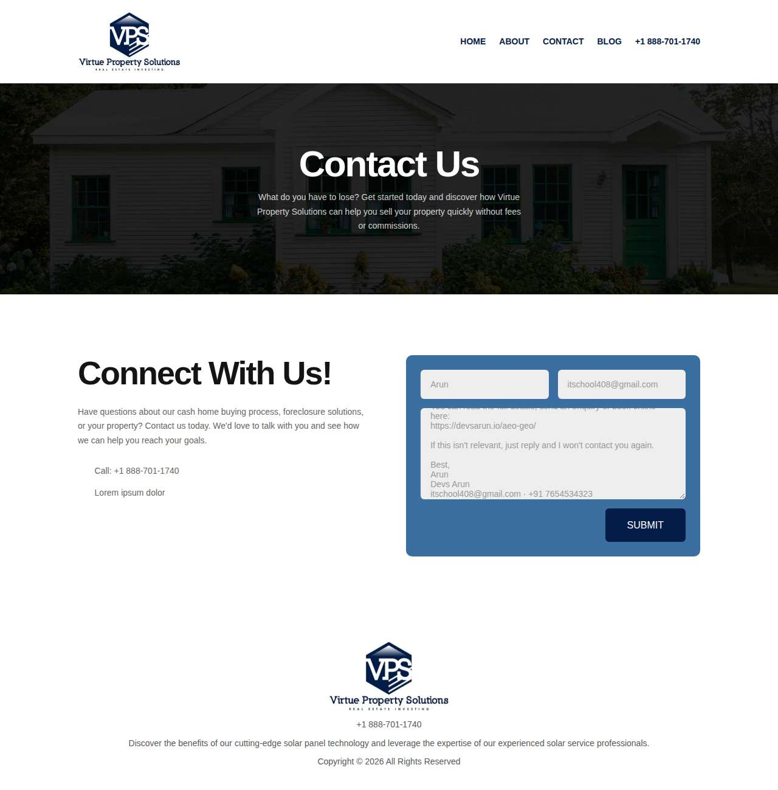

**After submit** — `run-fbdffc6f_attempt-266698a9_post_attempt_2026-11-05T02-26-32-431Z.jpg`

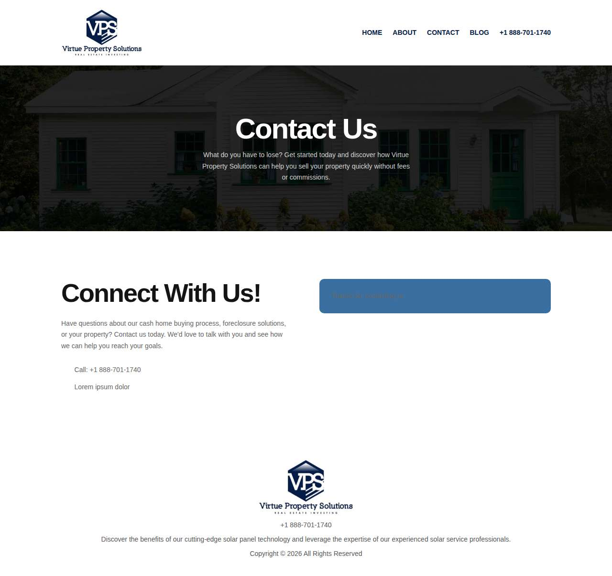

### murraypropertiesllc.com — failed\_before\_submit (LIVE)

| | |
|---|---|
| Attempt ID | `3cf788f4-2fe1-4559-8d12-3dd113044b10` |
| Form URL | https://murraypropertiesllc.com/\# |
| Final URL | https://murraypropertiesllc.com/\# |
| Reserved | 2026-11-05 02:26:40 UTC |
| Submit attempted | — |
| Template | standard v2 |
| Confirmation text | none observed |
| Result / error | Field "Phone" did not accept the value |

Exact message:

~~~text
Subject: Helping customers find your business in AI search (AEO + GEO)

Hi there,

I'm Arun from Devs Arun. More and more customers now ask ChatGPT, Gemini, Perplexity or Google's AI Overviews questions like "who should I hire for this in my area?" before they call anyone. These tools answer from websites they can clearly understand, and they tend to recommend businesses whose pages answer real customer questions.

That is what AEO + GEO (Answer Engine and Generative Engine Optimization) is for. I improve your existing service pages so they clearly answer the questions your customers ask, add structured data that matches the page, and make the call, quote or enquiry step obvious. The benefit: your business gets a better chance of being mentioned or linked in AI answers, and visitors who arrive find it easy to contact you.

The AEO + GEO Starter is a one-time $199 (about ₹16,999, negotiable) for one website: a basic audit, 10 customer questions, improvements to two existing pages, relevant structured data and an action plan, with one revision round.

You can read the full details, send an enquiry or book online here:
https://devsarun.io/aeo-geo/

If this isn't relevant, just reply and I won't contact you again.

Best,
Arun
Devs Arun
itschool408@gmail.com · +91 7654534323
~~~

Submitted field values:

- \#nf-field-20: Arun
- \#nf-field-21: itschool408@gmail.com
- \#nf-field-22: +91 7654534323
- \#nf-field-23: Hi there, I'm Arun from Devs Arun. More and more customers now ask ChatGPT, Gemini, Perplexity or Google's AI Overviews 

**Filled form (before submit)** — `run-fbdffc6f_attempt-3cf788f4_filled_2026-11-05T02-26-42-507Z.jpg`

### melchorrealty.com — confirmed (LIVE)

| | |
|---|---|
| Attempt ID | `d3128f04-80ad-4a21-91da-775932fae2d7` |
| Form URL | https://www.melchorrealty.com/contact |
| Final URL | https://www.melchorrealty.com/contact |
| Reserved | 2026-11-05 02:26:47 UTC |
| Submit attempted | 2026-11-05 02:26:49 UTC |
| Template | standard v2 |
| Confirmation text | he local market — we'd love to hear from you. Reach out and we'll get back to you promptly. Our Office Melchor Realty LLC Belvidere, NJ 07823 Serving New Jersey & Pennsylvani |
| Result / error | — |

Exact message:

~~~text
Subject: Helping customers find your business in AI search (AEO + GEO)

Hi there,

I'm Arun from Devs Arun. More and more customers now ask ChatGPT, Gemini, Perplexity or Google's AI Overviews questions like "who should I hire for this in my area?" before they call anyone. These tools answer from websites they can clearly understand, and they tend to recommend businesses whose pages answer real customer questions.

That is what AEO + GEO (Answer Engine and Generative Engine Optimization) is for. I improve your existing service pages so they clearly answer the questions your customers ask, add structured data that matches the page, and make the call, quote or enquiry step obvious. The benefit: your business gets a better chance of being mentioned or linked in AI answers, and visitors who arrive find it easy to contact you.

The AEO + GEO Starter is a one-time $199 (about ₹16,999, negotiable) for one website: a basic audit, 10 customer questions, improvements to two existing pages, relevant structured data and an action plan, with one revision round.

You can read the full details, send an enquiry or book online here:
https://devsarun.io/aeo-geo/

If this isn't relevant, just reply and I won't contact you again.

Best,
Arun
Devs Arun
itschool408@gmail.com · +91 7654534323
~~~

Submitted field values:

- Full Name \* \[name\]: Arun
- Message \* \[message\]: Hi there, I'm Arun from Devs Arun. More and more customers now ask ChatGPT, Gemini, Perplexity or Google's AI Overviews 
- Phone Number \[phone\]: +91 7654534323
- Email Address \* \[email\]: itschool408@gmail.com

**Filled form (before submit)** — `run-fbdffc6f_attempt-d3128f04_filled_2026-11-05T02-26-49-817Z.jpg`

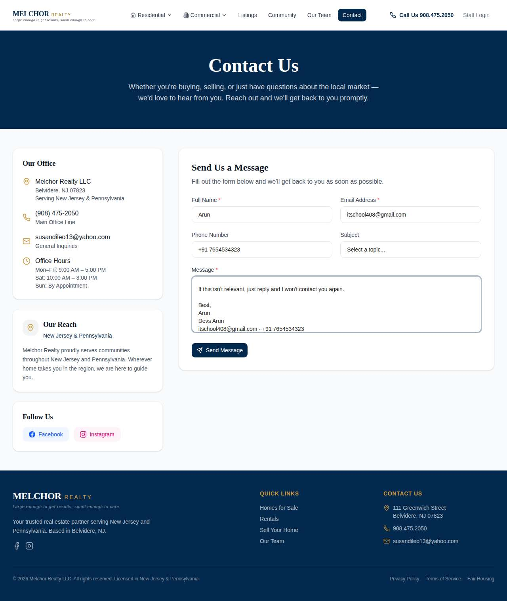

**After submit** — `run-fbdffc6f_attempt-d3128f04_post_attempt_2026-11-05T02-26-56-132Z.jpg`

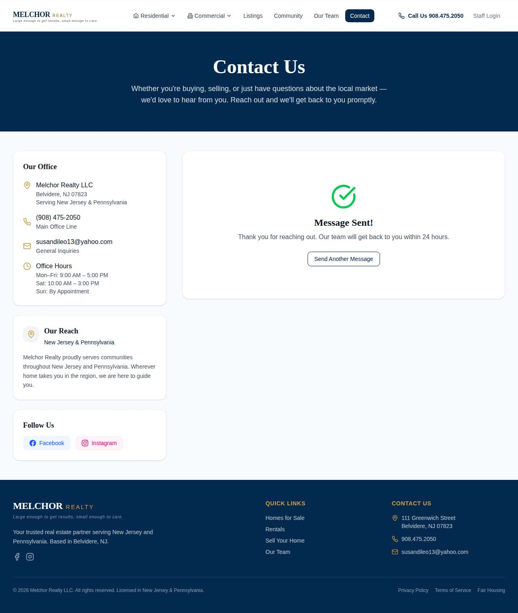

### jdsalley.com — unclear (LIVE)

| | |
|---|---|
| Attempt ID | `9170eaf1-b1a9-40dd-801a-5a87ae6628d9` |
| Form URL | https://www.jdsalley.com/contact |
| Final URL | https://www.jdsalley.com/contact |
| Reserved | 2026-11-05 02:27:04 UTC |
| Submit attempted | 2026-11-05 02:27:08 UTC |
| Template | standard v2 |
| Confirmation text | none observed |
| Result / error | No new success marker observed |

Exact message:

~~~text
Subject: Helping customers find your business in AI search (AEO + GEO)

Hi there,

I'm Arun from Devs Arun. More and more customers now ask ChatGPT, Gemini, Perplexity or Google's AI Overviews questions like "who should I hire for this in my area?" before they call anyone. These tools answer from websites they can clearly understand, and they tend to recommend businesses whose pages answer real customer questions.

That is what AEO + GEO (Answer Engine and Generative Engine Optimization) is for. I improve your existing service pages so they clearly answer the questions your customers ask, add structured data that matches the page, and make the call, quote or enquiry step obvious. The benefit: your business gets a better chance of being mentioned or linked in AI answers, and visitors who arrive find it easy to contact you.

The AEO + GEO Starter is a one-time $199 (about ₹16,999, negotiable) for one website: a basic audit, 10 customer questions, improvements to two existing pages, relevant structured data and an action plan, with one revision round.

You can read the full details, send an enquiry or book online here:
https://devsarun.io/aeo-geo/

If this isn't relevant, just reply and I won't contact you again.

Best,
Arun
Devs Arun
itschool408@gmail.com · +91 7654534323
~~~

Submitted field values:

- email \[email\]: itschool408@gmail.com
- name-\* \[name\]: Arun
- phone \[phone\]: +91 7654534323
- Message \[message\]: Hi there, I'm Arun from Devs Arun. More and more customers now ask ChatGPT, Gemini, Perplexity or Google's AI Overviews 
- subject \[subject\]: Helping customers find your business in AI search (AEO + GEO)

**Filled form (before submit)** — `run-fbdffc6f_attempt-9170eaf1_filled_2026-11-05T02-27-08-716Z.jpg`

**After submit** — `run-fbdffc6f_attempt-9170eaf1_post_attempt_2026-11-05T02-27-44-750Z.jpg`

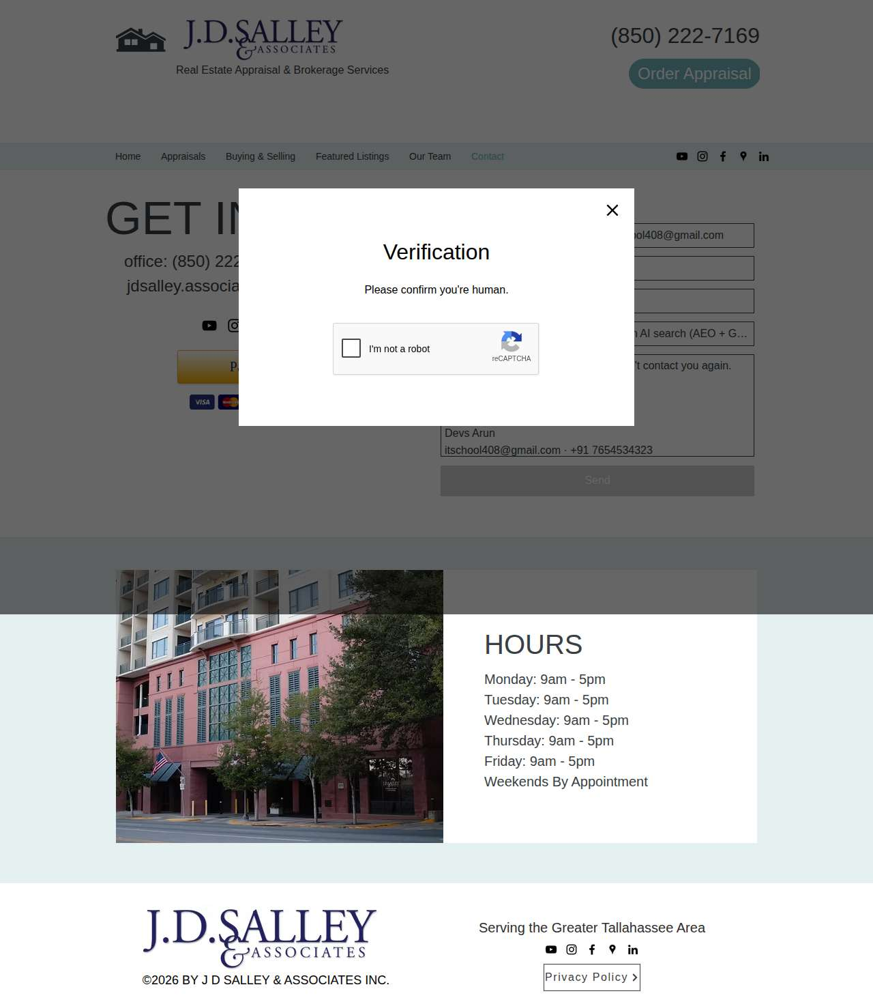

## Events (125)

| Time (UTC) | Event | Website | Details |
|---|---|---|---|
| 02:22:28 | run\_queued | — | live run requested by github:itsDevsArun |
| 02:22:28 | run\_dispatched | — | dispatch disabled (local test mode) |
| 02:22:31 | run\_started | — | Runner claimed live run |
| 02:22:33 | offer\_verified | — | Service page offer facts verified |
| 02:22:33 | website\_selected | clearchoiceplumbingllc.com | Live target clearchoiceplumbingllc.com |
| 02:22:33 | attempt\_reserved | clearchoiceplumbingllc.com | Submission attempt reserved with template standard v2 |
| 02:22:34 | page\_opened | clearchoiceplumbingllc.com | Opened form page |
| 02:22:34 | screenshot\_saved | clearchoiceplumbingllc.com | inspection screenshot saved (145 KB) |
| 02:22:34 | review\_required | clearchoiceplumbingllc.com | failed before submit: locator.fill: Error: Cannot type text into input\[type=number\] |
| 02:22:39 | website\_selected | bwnwincpainting.com | Live target bwnwincpainting.com |
| 02:22:39 | attempt\_reserved | bwnwincpainting.com | Submission attempt reserved with template standard v2 |
| 02:22:41 | page\_opened | bwnwincpainting.com | Opened form page |
| 02:22:41 | screenshot\_saved | bwnwincpainting.com | inspection screenshot saved (118 KB) |
| 02:22:41 | review\_required | bwnwincpainting.com | failed before submit: locator.fill: Error: Cannot type text into input\[type=number\] |
| 02:22:46 | website\_selected | absoluterestorepa.com | Live target absoluterestorepa.com |
| 02:22:46 | attempt\_reserved | absoluterestorepa.com | Submission attempt reserved with template standard v2 |
| 02:22:50 | page\_opened | absoluterestorepa.com | Opened form page |
| 02:22:51 | screenshot\_saved | absoluterestorepa.com | inspection screenshot saved (174 KB) |
| 02:22:51 | review\_required | absoluterestorepa.com | failed before submit: locator.fill: Error: Cannot type text into input\[type=number\] |
| 02:22:56 | website\_selected | masoudlawfirm.com | Live target masoudlawfirm.com |
| 02:22:56 | attempt\_reserved | masoudlawfirm.com | Submission attempt reserved with template standard v2 |
| 02:22:57 | page\_opened | masoudlawfirm.com | Opened form page |
| 02:22:57 | screenshot\_saved | masoudlawfirm.com | inspection screenshot saved (169 KB) |
| 02:22:57 | review\_required | masoudlawfirm.com | failed before submit: locator.fill: Error: Cannot type text into input\[type=number\] |
| 02:23:02 | website\_selected | servicioslegales.org | Live target servicioslegales.org |
| 02:23:02 | attempt\_reserved | servicioslegales.org | Submission attempt reserved with template standard v2 |
| 02:23:05 | page\_opened | servicioslegales.org | Opened form page |
| 02:23:05 | screenshot\_saved | servicioslegales.org | inspection screenshot saved (30 KB) |
| 02:23:05 | review\_required | servicioslegales.org | failed before submit: Reviewed form not found on page (site changed) |
| 02:23:10 | website\_selected | whiteolivecpa.com | Live target whiteolivecpa.com |
| 02:23:10 | attempt\_reserved | whiteolivecpa.com | Submission attempt reserved with template standard v2 |
| 02:23:11 | page\_opened | whiteolivecpa.com | Opened form page |
| 02:23:11 | screenshot\_saved | whiteolivecpa.com | inspection screenshot saved (197 KB) |
| 02:23:11 | review\_required | whiteolivecpa.com | failed before submit: locator.fill: Error: Cannot type text into input\[type=number\] |
| 02:23:16 | website\_selected | segal-labate.com | Live target segal-labate.com |
| 02:23:16 | attempt\_reserved | segal-labate.com | Submission attempt reserved with template standard v2 |
| 02:23:19 | page\_opened | segal-labate.com | Opened form page |
| 02:23:19 | fields\_filled | segal-labate.com | filled |
| 02:23:19 | screenshot\_saved | segal-labate.com | filled screenshot saved (86 KB) |
| 02:23:19 | submit\_attempted | segal-labate.com | submitting |
| 02:23:49 | screenshot\_saved | segal-labate.com | post\_attempt screenshot saved (12 KB) |
| 02:23:49 | review\_required | segal-labate.com | unclear: No new success marker observed |
| 02:23:57 | website\_selected | ransonrealestate.com | Live target ransonrealestate.com |
| 02:23:57 | attempt\_reserved | ransonrealestate.com | Submission attempt reserved with template standard v2 |
| 02:23:59 | page\_opened | ransonrealestate.com | Opened form page |
| 02:23:59 | fields\_filled | ransonrealestate.com | filled |
| 02:24:00 | screenshot\_saved | ransonrealestate.com | filled screenshot saved (285 KB) |
| 02:24:00 | submit\_attempted | ransonrealestate.com | submitting |
| 02:24:05 | screenshot\_saved | ransonrealestate.com | post\_attempt screenshot saved (286 KB) |
| 02:24:05 | confirmation\_observed | ransonrealestate.com | confirmed — "on Kunjolata Other / General Enquiry Message SEND ENQUIRY → Thank you — your enquiry has been sent. The Ranson Real Esta" |
| 02:24:13 | website\_selected | dobbspropertymanagement.com | Live target dobbspropertymanagement.com |
| 02:24:13 | attempt\_reserved | dobbspropertymanagement.com | Submission attempt reserved with template standard v2 |
| 02:24:15 | page\_opened | dobbspropertymanagement.com | Opened form page |
| 02:24:16 | fields\_filled | dobbspropertymanagement.com | filled |
| 02:24:16 | screenshot\_saved | dobbspropertymanagement.com | filled screenshot saved (182 KB) |
| 02:24:16 | submit\_attempted | dobbspropertymanagement.com | submitting |
| 02:24:44 | screenshot\_saved | dobbspropertymanagement.com | post\_attempt screenshot saved (138 KB) |
| 02:24:44 | review\_required | dobbspropertymanagement.com | unclear: No new success marker observed |
| 02:24:52 | website\_selected | ascendpropertymanagementoregon.com | Live target ascendpropertymanagementoregon.com |
| 02:24:52 | attempt\_reserved | ascendpropertymanagementoregon.com | Submission attempt reserved with template standard v2 |
| 02:24:54 | page\_opened | ascendpropertymanagementoregon.com | Opened form page |
| 02:24:54 | fields\_filled | ascendpropertymanagementoregon.com | filled |
| 02:24:54 | screenshot\_saved | ascendpropertymanagementoregon.com | filled screenshot saved (82 KB) |
| 02:24:54 | submit\_attempted | ascendpropertymanagementoregon.com | submitting |
| 02:24:59 | screenshot\_saved | ascendpropertymanagementoregon.com | post\_attempt screenshot saved (74 KB) |
| 02:24:59 | confirmation\_observed | ascendpropertymanagementoregon.com | confirmed — "ear what you have to say\! Feel free to contact us directly. Thank you for contacting us. We will get back to you as soon" |
| 02:25:07 | website\_selected | infiniterealestategroup.com | Live target infiniterealestategroup.com |
| 02:25:07 | attempt\_reserved | infiniterealestategroup.com | Submission attempt reserved with template standard v2 |
| 02:25:08 | page\_opened | infiniterealestategroup.com | Opened form page |
| 02:25:08 | fields\_filled | infiniterealestategroup.com | filled |
| 02:25:08 | screenshot\_saved | infiniterealestategroup.com | filled screenshot saved (78 KB) |
| 02:25:08 | submit\_attempted | infiniterealestategroup.com | submitting |
| 02:25:12 | screenshot\_saved | infiniterealestategroup.com | post\_attempt screenshot saved (79 KB) |
| 02:25:12 | confirmation\_observed | infiniterealestategroup.com | confirmed — "nt a Free Market Report? Please fill out the form below and we'll get back to you as quickly as we can\! Send Thanks for " |
| 02:25:20 | website\_selected | okobojilakehomes.com | Live target okobojilakehomes.com |
| 02:25:20 | attempt\_reserved | okobojilakehomes.com | Submission attempt reserved with template standard v2 |
| 02:25:22 | page\_opened | okobojilakehomes.com | Opened form page |
| 02:25:22 | fields\_filled | okobojilakehomes.com | filled |
| 02:25:22 | screenshot\_saved | okobojilakehomes.com | filled screenshot saved (283 KB) |
| 02:25:22 | submit\_attempted | okobojilakehomes.com | submitting |
| 02:25:30 | screenshot\_saved | okobojilakehomes.com | post\_attempt screenshot saved (259 KB) |
| 02:25:30 | confirmation\_observed | okobojilakehomes.com | confirmed — "u’re still asking questions, this is a good place to start. Thanks for contacting us\! We will be in touch with you short" |
| 02:25:38 | website\_selected | auburnrealty.com | Live target auburnrealty.com |
| 02:25:38 | attempt\_reserved | auburnrealty.com | Submission attempt reserved with template standard v2 |
| 02:25:39 | page\_opened | auburnrealty.com | Opened form page |
| 02:25:40 | fields\_filled | auburnrealty.com | filled |
| 02:25:40 | screenshot\_saved | auburnrealty.com | filled screenshot saved (128 KB) |
| 02:25:40 | submit\_attempted | auburnrealty.com | submitting |
| 02:26:10 | screenshot\_saved | auburnrealty.com | post\_attempt screenshot saved (151 KB) |
| 02:26:10 | review\_required | auburnrealty.com | unclear: No new success marker observed |
| 02:26:18 | website\_selected | callredcompass.com | Live target callredcompass.com |
| 02:26:18 | attempt\_reserved | callredcompass.com | Submission attempt reserved with template standard v2 |
| 02:26:20 | page\_opened | callredcompass.com | Opened form page |
| 02:26:20 | screenshot\_saved | callredcompass.com | filled screenshot saved (81 KB) |
| 02:26:20 | review\_required | callredcompass.com | failed before submit: Field "Your Phone Number" did not accept the value |
| 02:26:25 | website\_selected | tedbuyshousesnc.com | Live target tedbuyshousesnc.com |
| 02:26:25 | attempt\_reserved | tedbuyshousesnc.com | Submission attempt reserved with template standard v2 |
| 02:26:27 | page\_opened | tedbuyshousesnc.com | Opened form page |
| 02:26:27 | fields\_filled | tedbuyshousesnc.com | filled |
| 02:26:27 | screenshot\_saved | tedbuyshousesnc.com | filled screenshot saved (81 KB) |
| 02:26:27 | submit\_attempted | tedbuyshousesnc.com | submitting |
| 02:26:32 | screenshot\_saved | tedbuyshousesnc.com | post\_attempt screenshot saved (71 KB) |
| 02:26:32 | confirmation\_observed | tedbuyshousesnc.com | confirmed — "ach your goals.  Call: +1 888-701-1740  Lorem ipsum dolor Thanks for contacting us +1 888-701-1740 Discover the benefi" |
| 02:26:40 | website\_selected | murraypropertiesllc.com | Live target murraypropertiesllc.com |
| 02:26:40 | attempt\_reserved | murraypropertiesllc.com | Submission attempt reserved with template standard v2 |
| 02:26:42 | page\_opened | murraypropertiesllc.com | Opened form page |
| 02:26:42 | screenshot\_saved | murraypropertiesllc.com | filled screenshot saved (122 KB) |
| 02:26:42 | review\_required | murraypropertiesllc.com | failed before submit: Field "Phone" did not accept the value |
| 02:26:47 | website\_selected | melchorrealty.com | Live target melchorrealty.com |
| 02:26:47 | attempt\_reserved | melchorrealty.com | Submission attempt reserved with template standard v2 |
| 02:26:49 | page\_opened | melchorrealty.com | Opened form page |
| 02:26:49 | fields\_filled | melchorrealty.com | filled |
| 02:26:49 | screenshot\_saved | melchorrealty.com | filled screenshot saved (99 KB) |
| 02:26:49 | submit\_attempted | melchorrealty.com | submitting |
| 02:26:56 | screenshot\_saved | melchorrealty.com | post\_attempt screenshot saved (85 KB) |
| 02:26:56 | confirmation\_observed | melchorrealty.com | confirmed — "he local market — we'd love to hear from you. Reach out and we'll get back to you promptly. Our Office Melchor Realty LL" |
| 02:27:04 | website\_selected | jdsalley.com | Live target jdsalley.com |
| 02:27:04 | attempt\_reserved | jdsalley.com | Submission attempt reserved with template standard v2 |
| 02:27:08 | page\_opened | jdsalley.com | Opened form page |
| 02:27:08 | fields\_filled | jdsalley.com | filled |
| 02:27:08 | screenshot\_saved | jdsalley.com | filled screenshot saved (120 KB) |
| 02:27:08 | submit\_attempted | jdsalley.com | submitting |
| 02:27:44 | screenshot\_saved | jdsalley.com | post\_attempt screenshot saved (97 KB) |
| 02:27:44 | review\_required | jdsalley.com | unclear: No new success marker observed |
| 02:27:52 | run\_completed | — | Run completed (queue\_exhausted) |
