# Run 8a12c942 — dry\_run — completed

| | |
|---|---|
| Run ID | `8a12c942-ea91-48ce-9c93-70d78b1399c0` |
| Requested by | github:itsDevsArun |
| Started | 2026-11-06 05:24:35 UTC |
| Finished | 2026-11-06 05:26:57 UTC |
| Finish reason | queue\_exhausted |
| GitHub Actions | https://github.com/itsDevsArun/aeo-geo/actions/runs/42148448245 |

CSV for this run: [runs/2026-11-06_dry_run_8a12c942.csv](2026-11-06_dry_run_8a12c942.csv)

## Attempts (18)

### helixmechanical.com — dry\_run\_failed (dry run)

| | |
|---|---|
| Attempt ID | `71c797cb-93df-43a9-9f95-c68546b5e46b` |
| Form URL | https://helixmechanical.com/contact/ |
| Final URL | https://helixmechanical.com/contact/ |
| Reserved | 2026-11-06 05:24:35 UTC |
| Submit attempted | — |
| Template | standard v2 |
| Confirmation text | none observed |
| Result / error | Mapped field "First Name \*" not found uniquely |

Exact message:

~~~text
Subject: Helping customers find your business in AI search (AEO + GEO)

Hi there,

I'm Arun from Devs Arun. More and more customers now ask ChatGPT, Gemini, Perplexity or Google's AI Overviews questions like "who should I hire for this in my area?" before they call anyone. These tools answer from websites they can clearly understand, and they tend to recommend businesses whose pages answer real customer questions.

That is what AEO + GEO (Answer Engine and Generative Engine Optimization) is for. I improve your existing service pages so they clearly answer the questions your customers ask, add structured data that matches the page, and make the call, quote or enquiry step obvious. The benefit: your business gets a better chance of being mentioned or linked in AI answers, and visitors who arrive find it easy to contact you.

The AEO + GEO Starter is a one-time $199 (about ₹16,999, negotiable) for one website: a basic audit, 10 customer questions, improvements to two existing pages, relevant structured data and an action plan, with one revision round.

You can read the full details, send an enquiry or book online here:
https://devsarun.io/aeo-geo/

If this isn't relevant, just reply and I won't contact you again.

Best,
Arun
Devs Arun
itschool408@gmail.com · +91 7654534323
~~~

Submitted field values:

- \#forminator-field-name-1\_6ae7ff023fd3c: Arun
- \#forminator-field-email-1\_6ae7ff023fd3c: itschool408@gmail.com
- \#forminator-field-phone-1\_6ae7ff023fd3c: +91 7654534323
- \#forminator-field-textarea-1\_6ae7ff023fd3c: Hi there, I'm Arun from Devs Arun. More and more customers now ask ChatGPT, Gemini, Perplexity or Google's AI Overviews 

**Inspected page** — `run-8a12c942_attempt-71c797cb_inspection_2026-11-06T05-24-37-127Z.jpg`

### knoxvilleelectrician.com — dry\_run\_failed (dry run)

| | |
|---|---|
| Attempt ID | `2b7a78c1-dec2-431c-a9d3-a042156db264` |
| Form URL | https://knoxvilleelectrician.com/contact-us/ |
| Final URL | https://knoxvilleelectrician.com/contact-us/ |
| Reserved | 2026-11-06 05:24:42 UTC |
| Submit attempted | — |
| Template | standard v2 |
| Confirmation text | none observed |
| Result / error | Mapped field "Name" not found uniquely |

Exact message:

~~~text
Subject: Helping customers find your business in AI search (AEO + GEO)

Hi there,

I'm Arun from Devs Arun. More and more customers now ask ChatGPT, Gemini, Perplexity or Google's AI Overviews questions like "who should I hire for this in my area?" before they call anyone. These tools answer from websites they can clearly understand, and they tend to recommend businesses whose pages answer real customer questions.

That is what AEO + GEO (Answer Engine and Generative Engine Optimization) is for. I improve your existing service pages so they clearly answer the questions your customers ask, add structured data that matches the page, and make the call, quote or enquiry step obvious. The benefit: your business gets a better chance of being mentioned or linked in AI answers, and visitors who arrive find it easy to contact you.

The AEO + GEO Starter is a one-time $199 (about ₹16,999, negotiable) for one website: a basic audit, 10 customer questions, improvements to two existing pages, relevant structured data and an action plan, with one revision round.

You can read the full details, send an enquiry or book online here:
https://devsarun.io/aeo-geo/

If this isn't relevant, just reply and I won't contact you again.

Best,
Arun
Devs Arun
itschool408@gmail.com · +91 7654534323
~~~

Submitted field values:

- \#form-field-1b7221: itschool408@gmail.com
- \#form-field-2fa3ac: +91 7654534323
- \#form-field-96f51f: Arun
- \#form-field-fed9d8: Hi there, I'm Arun from Devs Arun. More and more customers now ask ChatGPT, Gemini, Perplexity or Google's AI Overviews 

**Inspected page** — `run-8a12c942_attempt-2b7a78c1_inspection_2026-11-06T05-24-44-142Z.jpg`

### mspc.cpa — dry\_run\_failed (dry run)

| | |
|---|---|
| Attempt ID | `a82fac45-ecec-4e67-8593-df718b24fea1` |
| Form URL | https://www.mspc.cpa/contact/ |
| Final URL | https://www.mspc.cpa/contact/ |
| Reserved | 2026-11-06 05:24:49 UTC |
| Submit attempted | — |
| Template | standard v2 |
| Confirmation text | none observed |
| Result / error | Mapped field "Full Name \*" not found uniquely |

Exact message:

~~~text
Subject: Helping customers find your business in AI search (AEO + GEO)

Hi there,

I'm Arun from Devs Arun. More and more customers now ask ChatGPT, Gemini, Perplexity or Google's AI Overviews questions like "who should I hire for this in my area?" before they call anyone. These tools answer from websites they can clearly understand, and they tend to recommend businesses whose pages answer real customer questions.

That is what AEO + GEO (Answer Engine and Generative Engine Optimization) is for. I improve your existing service pages so they clearly answer the questions your customers ask, add structured data that matches the page, and make the call, quote or enquiry step obvious. The benefit: your business gets a better chance of being mentioned or linked in AI answers, and visitors who arrive find it easy to contact you.

The AEO + GEO Starter is a one-time $199 (about ₹16,999, negotiable) for one website: a basic audit, 10 customer questions, improvements to two existing pages, relevant structured data and an action plan, with one revision round.

You can read the full details, send an enquiry or book online here:
https://devsarun.io/aeo-geo/

If this isn't relevant, just reply and I won't contact you again.

Best,
Arun
Devs Arun
itschool408@gmail.com · +91 7654534323
~~~

Submitted field values:

- \#forminator-field-name-1\_6aeaca2579f24: Arun
- \#forminator-field-text-1\_6aeaca2579f24: Devs Arun
- \#forminator-field-email-1\_6aeaca2579f24: itschool408@gmail.com
- \#forminator-field-phone-1\_6aeaca2579f24: +91 7654534323
- \#forminator-field-textarea-1\_6aeaca2579f24: Hi there, I'm Arun from Devs Arun. More and more customers now ask ChatGPT, Gemini, Perplexity or Google's AI Overviews 

**Inspected page** — `run-8a12c942_attempt-a82fac45_inspection_2026-11-06T05-24-54-343Z.jpg`

### trustthedata.net — dry\_run\_ok (dry run)

| | |
|---|---|
| Attempt ID | `fd246cf3-1989-46b2-b32f-d8851d9a4e32` |
| Form URL | https://trustthedata.net/contact-us-in-clearwater-fl/ |
| Final URL | https://trustthedata.net/contact-us-in-clearwater-fl/ |
| Reserved | 2026-11-06 05:24:59 UTC |
| Submit attempted | — |
| Template | standard v2 |
| Confirmation text | none observed |
| Result / error | Selectors verified; fields not typed (domain not in dry-run fill list); not submitted |

Exact message:

~~~text
Subject: Helping customers find your business in AI search (AEO + GEO)

Hi there,

I'm Arun from Devs Arun. More and more customers now ask ChatGPT, Gemini, Perplexity or Google's AI Overviews questions like "who should I hire for this in my area?" before they call anyone. These tools answer from websites they can clearly understand, and they tend to recommend businesses whose pages answer real customer questions.

That is what AEO + GEO (Answer Engine and Generative Engine Optimization) is for. I improve your existing service pages so they clearly answer the questions your customers ask, add structured data that matches the page, and make the call, quote or enquiry step obvious. The benefit: your business gets a better chance of being mentioned or linked in AI answers, and visitors who arrive find it easy to contact you.

The AEO + GEO Starter is a one-time $199 (about ₹16,999, negotiable) for one website: a basic audit, 10 customer questions, improvements to two existing pages, relevant structured data and an action plan, with one revision round.

You can read the full details, send an enquiry or book online here:
https://devsarun.io/aeo-geo/

If this isn't relevant, just reply and I won't contact you again.

Best,
Arun
Devs Arun
itschool408@gmail.com · +91 7654534323
~~~

Submitted field values:

- div \> div \> section:nth-of-type(2) \> div \> div:nth-of-type(2) \> div \> div \> div \> form \> div \> div:nth-of-type(1) \> input: Arun
- div \> div \> section:nth-of-type(2) \> div \> div:nth-of-type(2) \> div \> div \> div \> form \> div \> div:nth-of-type(2) \> input: +91 7654534323
- div \> div \> section:nth-of-type(2) \> div \> div:nth-of-type(2) \> div \> div \> div \> form \> div \> div:nth-of-type(3) \> input: itschool408@gmail.com
- div \> div \> section:nth-of-type(2) \> div \> div:nth-of-type(2) \> div \> div \> div \> form \> div \> div:nth-of-type(4) \> input: https://devsarun.io/aeo-geo/
- div \> div \> section:nth-of-type(2) \> div \> div:nth-of-type(2) \> div \> div \> div \> form \> div \> div:nth-of-type(5) \> textarea: Hi there, I'm Arun from Devs Arun. More and more customers now ask ChatGPT, Gemini, Perplexity or Google's AI Overviews 

**Inspected page** — `run-8a12c942_attempt-fd246cf3_inspection_2026-11-06T05-25-01-072Z.jpg`

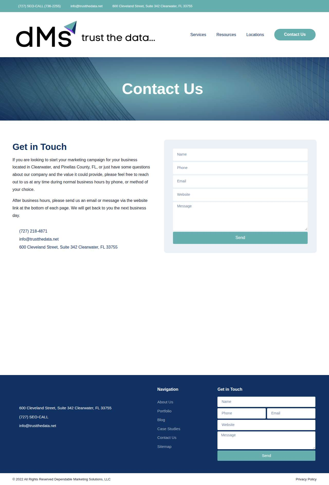

### core6.marketing — dry\_run\_ok (dry run)

| | |
|---|---|
| Attempt ID | `b7378097-06f0-445d-85b4-fac2397202fc` |
| Form URL | https://core6.marketing/work-with-us/ |
| Final URL | https://core6.marketing/work-with-us/ |
| Reserved | 2026-11-06 05:25:06 UTC |
| Submit attempted | — |
| Template | standard v2 |
| Confirmation text | none observed |
| Result / error | Selectors verified; fields not typed (domain not in dry-run fill list); not submitted |

Exact message:

~~~text
Subject: Helping customers find your business in AI search (AEO + GEO)

Hi there,

I'm Arun from Devs Arun. More and more customers now ask ChatGPT, Gemini, Perplexity or Google's AI Overviews questions like "who should I hire for this in my area?" before they call anyone. These tools answer from websites they can clearly understand, and they tend to recommend businesses whose pages answer real customer questions.

That is what AEO + GEO (Answer Engine and Generative Engine Optimization) is for. I improve your existing service pages so they clearly answer the questions your customers ask, add structured data that matches the page, and make the call, quote or enquiry step obvious. The benefit: your business gets a better chance of being mentioned or linked in AI answers, and visitors who arrive find it easy to contact you.

The AEO + GEO Starter is a one-time $199 (about ₹16,999, negotiable) for one website: a basic audit, 10 customer questions, improvements to two existing pages, relevant structured data and an action plan, with one revision round.

You can read the full details, send an enquiry or book online here:
https://devsarun.io/aeo-geo/

If this isn't relevant, just reply and I won't contact you again.

Best,
Arun
Devs Arun
itschool408@gmail.com · +91 7654534323
~~~

Submitted field values:

- \#input\_20\_1: Arun
- \#input\_20\_2: itschool408@gmail.com
- \#input\_20\_3: Devs Arun
- \#input\_20\_4: +91 7654534323
- \#input\_20\_16: Hi there, I'm Arun from Devs Arun. More and more customers now ask ChatGPT, Gemini, Perplexity or Google's AI Overviews 

**Inspected page** — `run-8a12c942_attempt-b7378097_inspection_2026-11-06T05-25-09-159Z.jpg`

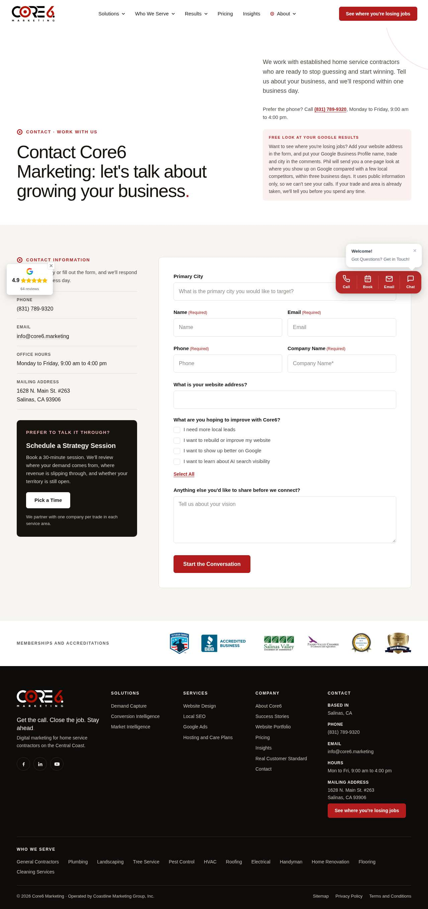

### glendalemarketing.com — dry\_run\_ok (dry run)

| | |
|---|---|
| Attempt ID | `2ecdd04e-2bc6-4a11-95e4-72f6ec8fce87` |
| Form URL | https://www.glendalemarketing.com/ |
| Final URL | https://www.glendalemarketing.com/ |
| Reserved | 2026-11-06 05:25:14 UTC |
| Submit attempted | — |
| Template | standard v2 |
| Confirmation text | none observed |
| Result / error | Selectors verified; fields not typed (domain not in dry-run fill list); not submitted |

Exact message:

~~~text
Subject: Helping customers find your business in AI search (AEO + GEO)

Hi there,

I'm Arun from Devs Arun. More and more customers now ask ChatGPT, Gemini, Perplexity or Google's AI Overviews questions like "who should I hire for this in my area?" before they call anyone. These tools answer from websites they can clearly understand, and they tend to recommend businesses whose pages answer real customer questions.

That is what AEO + GEO (Answer Engine and Generative Engine Optimization) is for. I improve your existing service pages so they clearly answer the questions your customers ask, add structured data that matches the page, and make the call, quote or enquiry step obvious. The benefit: your business gets a better chance of being mentioned or linked in AI answers, and visitors who arrive find it easy to contact you.

The AEO + GEO Starter is a one-time $199 (about ₹16,999, negotiable) for one website: a basic audit, 10 customer questions, improvements to two existing pages, relevant structured data and an action plan, with one revision round.

You can read the full details, send an enquiry or book online here:
https://devsarun.io/aeo-geo/

If this isn't relevant, just reply and I won't contact you again.

Best,
Arun
Devs Arun
itschool408@gmail.com · +91 7654534323
~~~

Submitted field values:

- \#\\31 070035550: Hi there, I'm Arun from Devs Arun. More and more customers now ask ChatGPT, Gemini, Perplexity or Google's AI Overviews 
- \#\\31 348465635: itschool408@gmail.com
- \#\\31 747080326: +91 7654534323
- \#\\31 913836697: Arun

**Inspected page** — `run-8a12c942_attempt-2ecdd04e_inspection_2026-11-06T05-25-15-802Z.jpg`

### ewiworldwide.com — dry\_run\_ok (dry run)

| | |
|---|---|
| Attempt ID | `91411801-378e-404f-8c22-4a51d6223263` |
| Form URL | https://www.ewiworldwide.com/contact/ |
| Final URL | https://www.ewiworldwide.com/contact/ |
| Reserved | 2026-11-06 05:25:20 UTC |
| Submit attempted | — |
| Template | standard v2 |
| Confirmation text | none observed |
| Result / error | Selectors verified; fields not typed (domain not in dry-run fill list); not submitted |

Exact message:

~~~text
Subject: Helping customers find your business in AI search (AEO + GEO)

Hi there,

I'm Arun from Devs Arun. More and more customers now ask ChatGPT, Gemini, Perplexity or Google's AI Overviews questions like "who should I hire for this in my area?" before they call anyone. These tools answer from websites they can clearly understand, and they tend to recommend businesses whose pages answer real customer questions.

That is what AEO + GEO (Answer Engine and Generative Engine Optimization) is for. I improve your existing service pages so they clearly answer the questions your customers ask, add structured data that matches the page, and make the call, quote or enquiry step obvious. The benefit: your business gets a better chance of being mentioned or linked in AI answers, and visitors who arrive find it easy to contact you.

The AEO + GEO Starter is a one-time $199 (about ₹16,999, negotiable) for one website: a basic audit, 10 customer questions, improvements to two existing pages, relevant structured data and an action plan, with one revision round.

You can read the full details, send an enquiry or book online here:
https://devsarun.io/aeo-geo/

If this isn't relevant, just reply and I won't contact you again.

Best,
Arun
Devs Arun
itschool408@gmail.com · +91 7654534323
~~~

Submitted field values:

- \#name: Arun
- \#email: itschool408@gmail.com
- \#company-url: Devs Arun
- \#company-name: Devs Arun
- \#phone-number: +91 7654534323
- \#reason-for-contact: Hi there, I'm Arun from Devs Arun. More and more customers now ask ChatGPT, Gemini, Perplexity or Google's AI Overviews 

**Inspected page** — `run-8a12c942_attempt-91411801_inspection_2026-11-06T05-25-25-191Z.jpg`

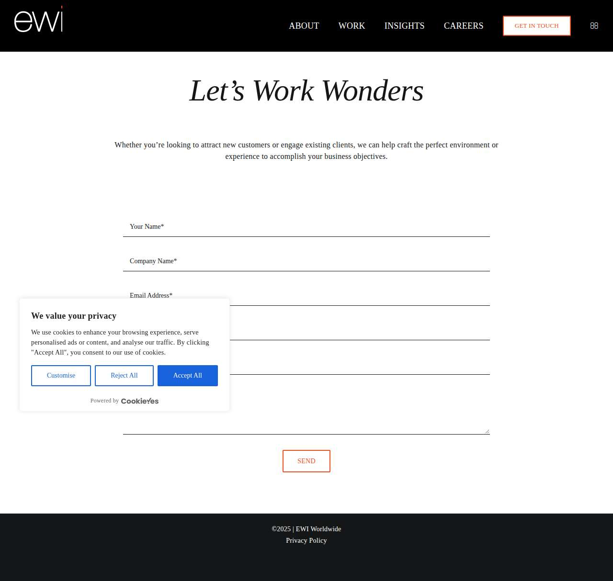

### halibutblue.com — dry\_run\_ok (dry run)

| | |
|---|---|
| Attempt ID | `474a7b10-f843-4b31-bd2a-fe9c02217fd1` |
| Form URL | https://www.halibutblue.com/contact/ |
| Final URL | https://www.halibutblue.com/contact/ |
| Reserved | 2026-11-06 05:25:30 UTC |
| Submit attempted | — |
| Template | standard v2 |
| Confirmation text | none observed |
| Result / error | Selectors verified; fields not typed (domain not in dry-run fill list); not submitted |

Exact message:

~~~text
Subject: Helping customers find your business in AI search (AEO + GEO)

Hi there,

I'm Arun from Devs Arun. More and more customers now ask ChatGPT, Gemini, Perplexity or Google's AI Overviews questions like "who should I hire for this in my area?" before they call anyone. These tools answer from websites they can clearly understand, and they tend to recommend businesses whose pages answer real customer questions.

That is what AEO + GEO (Answer Engine and Generative Engine Optimization) is for. I improve your existing service pages so they clearly answer the questions your customers ask, add structured data that matches the page, and make the call, quote or enquiry step obvious. The benefit: your business gets a better chance of being mentioned or linked in AI answers, and visitors who arrive find it easy to contact you.

The AEO + GEO Starter is a one-time $199 (about ₹16,999, negotiable) for one website: a basic audit, 10 customer questions, improvements to two existing pages, relevant structured data and an action plan, with one revision round.

You can read the full details, send an enquiry or book online here:
https://devsarun.io/aeo-geo/

If this isn't relevant, just reply and I won't contact you again.

Best,
Arun
Devs Arun
itschool408@gmail.com · +91 7654534323
~~~

Submitted field values:

- \#input\_1\_3: itschool408@gmail.com
- \#input\_1\_4: Hi there, I'm Arun from Devs Arun. More and more customers now ask ChatGPT, Gemini, Perplexity or Google's AI Overviews 
- \#input\_1\_5: +91 7654534323
- \#input\_1\_6\_3: Arun

**Inspected page** — `run-8a12c942_attempt-474a7b10_inspection_2026-11-06T05-25-33-279Z.jpg`

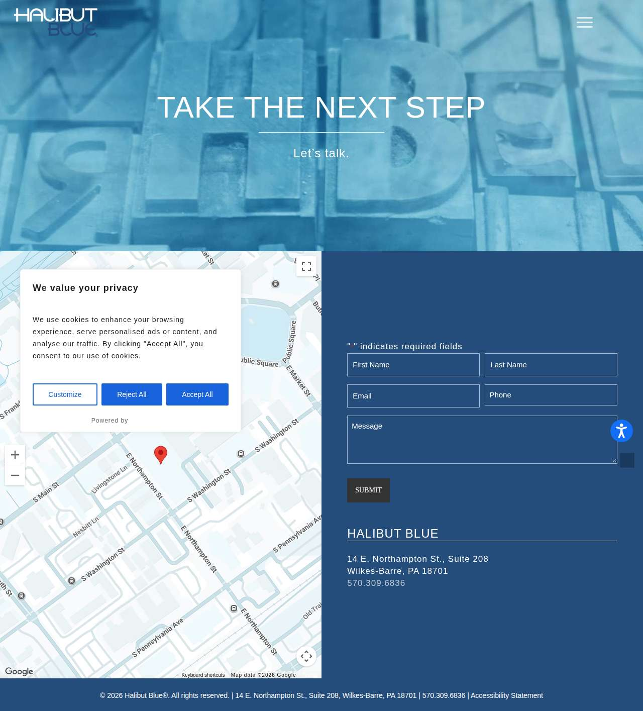

### startflourishing.com — dry\_run\_ok (dry run)

| | |
|---|---|
| Attempt ID | `b9b1c1c7-1cb8-4b91-9ec8-62e2e810d96a` |
| Form URL | https://www.startflourishing.com/contact |
| Final URL | https://www.startflourishing.com/contact |
| Reserved | 2026-11-06 05:25:38 UTC |
| Submit attempted | — |
| Template | standard v2 |
| Confirmation text | none observed |
| Result / error | Selectors verified; fields not typed (domain not in dry-run fill list); not submitted |

Exact message:

~~~text
Subject: Helping customers find your business in AI search (AEO + GEO)

Hi there,

I'm Arun from Devs Arun. More and more customers now ask ChatGPT, Gemini, Perplexity or Google's AI Overviews questions like "who should I hire for this in my area?" before they call anyone. These tools answer from websites they can clearly understand, and they tend to recommend businesses whose pages answer real customer questions.

That is what AEO + GEO (Answer Engine and Generative Engine Optimization) is for. I improve your existing service pages so they clearly answer the questions your customers ask, add structured data that matches the page, and make the call, quote or enquiry step obvious. The benefit: your business gets a better chance of being mentioned or linked in AI answers, and visitors who arrive find it easy to contact you.

The AEO + GEO Starter is a one-time $199 (about ₹16,999, negotiable) for one website: a basic audit, 10 customer questions, improvements to two existing pages, relevant structured data and an action plan, with one revision round.

You can read the full details, send an enquiry or book online here:
https://devsarun.io/aeo-geo/

If this isn't relevant, just reply and I won't contact you again.

Best,
Arun
Devs Arun
itschool408@gmail.com · +91 7654534323
~~~

Submitted field values:

- \#\\31 191339167: +91 7654534323
- \#\\31 341428595: itschool408@gmail.com
- \#\\31 529335102: Devs Arun
- \#\\31 554908546: Hi there, I'm Arun from Devs Arun. More and more customers now ask ChatGPT, Gemini, Perplexity or Google's AI Overviews 
- \#\\31 655890103: Arun

**Inspected page** — `run-8a12c942_attempt-b9b1c1c7_inspection_2026-11-06T05-25-39-536Z.jpg`

### localdigitalgenius.com — dry\_run\_ok (dry run)

| | |
|---|---|
| Attempt ID | `752b6209-af28-4d90-b945-0706c80fb7ad` |
| Form URL | https://localdigitalgenius.com/contact-us/\#help |
| Final URL | https://localdigitalgenius.com/contact-us/\#help |
| Reserved | 2026-11-06 05:25:44 UTC |
| Submit attempted | — |
| Template | standard v2 |
| Confirmation text | none observed |
| Result / error | Selectors verified; fields not typed (domain not in dry-run fill list); not submitted |

Exact message:

~~~text
Subject: Helping customers find your business in AI search (AEO + GEO)

Hi there,

I'm Arun from Devs Arun. More and more customers now ask ChatGPT, Gemini, Perplexity or Google's AI Overviews questions like "who should I hire for this in my area?" before they call anyone. These tools answer from websites they can clearly understand, and they tend to recommend businesses whose pages answer real customer questions.

That is what AEO + GEO (Answer Engine and Generative Engine Optimization) is for. I improve your existing service pages so they clearly answer the questions your customers ask, add structured data that matches the page, and make the call, quote or enquiry step obvious. The benefit: your business gets a better chance of being mentioned or linked in AI answers, and visitors who arrive find it easy to contact you.

The AEO + GEO Starter is a one-time $199 (about ₹16,999, negotiable) for one website: a basic audit, 10 customer questions, improvements to two existing pages, relevant structured data and an action plan, with one revision round.

You can read the full details, send an enquiry or book online here:
https://devsarun.io/aeo-geo/

If this isn't relevant, just reply and I won't contact you again.

Best,
Arun
Devs Arun
itschool408@gmail.com · +91 7654534323
~~~

Submitted field values:

- \#input\_2\_9: itschool408@gmail.com
- \#input\_2\_10: +91 7654534323
- \#input\_2\_11: Hi there, I'm Arun from Devs Arun. More and more customers now ask ChatGPT, Gemini, Perplexity or Google's AI Overviews 
- \#input\_2\_12: Devs Arun
- \#input\_2\_13: https://devsarun.io/aeo-geo/
- \#input\_2\_1\_3: Arun

**Inspected page** — `run-8a12c942_attempt-752b6209_inspection_2026-11-06T05-25-46-751Z.jpg`

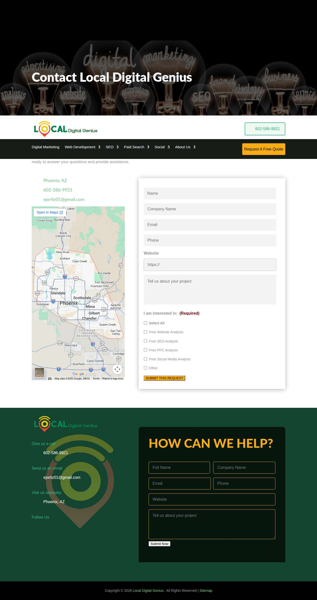

### pinkdotmedia.com — dry\_run\_ok (dry run)

| | |
|---|---|
| Attempt ID | `54971c9d-695c-4bc7-bcf8-5cb9563fbec4` |
| Form URL | https://www.pinkdotmedia.com/ |
| Final URL | https://www.pinkdotmedia.com/ |
| Reserved | 2026-11-06 05:25:51 UTC |
| Submit attempted | — |
| Template | standard v2 |
| Confirmation text | none observed |
| Result / error | Selectors verified; fields not typed (domain not in dry-run fill list); not submitted |

Exact message:

~~~text
Subject: Helping customers find your business in AI search (AEO + GEO)

Hi there,

I'm Arun from Devs Arun. More and more customers now ask ChatGPT, Gemini, Perplexity or Google's AI Overviews questions like "who should I hire for this in my area?" before they call anyone. These tools answer from websites they can clearly understand, and they tend to recommend businesses whose pages answer real customer questions.

That is what AEO + GEO (Answer Engine and Generative Engine Optimization) is for. I improve your existing service pages so they clearly answer the questions your customers ask, add structured data that matches the page, and make the call, quote or enquiry step obvious. The benefit: your business gets a better chance of being mentioned or linked in AI answers, and visitors who arrive find it easy to contact you.

The AEO + GEO Starter is a one-time $199 (about ₹16,999, negotiable) for one website: a basic audit, 10 customer questions, improvements to two existing pages, relevant structured data and an action plan, with one revision round.

You can read the full details, send an enquiry or book online here:
https://devsarun.io/aeo-geo/

If this isn't relevant, just reply and I won't contact you again.

Best,
Arun
Devs Arun
itschool408@gmail.com · +91 7654534323
~~~

Submitted field values:

- \#Form-replaceable \> form \> div:nth-of-type(1) \> textarea: Hi there, I'm Arun from Devs Arun. More and more customers now ask ChatGPT, Gemini, Perplexity or Google's AI Overviews 
- \#Form-replaceable \> form \> div:nth-of-type(1) \> input:nth-of-type(1): Arun
- \#Form-replaceable \> form \> div:nth-of-type(1) \> input:nth-of-type(2): Devs Arun
- \#Form-replaceable \> form \> div:nth-of-type(1) \> input:nth-of-type(3): itschool408@gmail.com
- \#Form-replaceable \> form \> div:nth-of-type(1) \> input:nth-of-type(4): +91 7654534323

**Inspected page** — `run-8a12c942_attempt-54971c9d_inspection_2026-11-06T05-25-53-627Z.jpg`

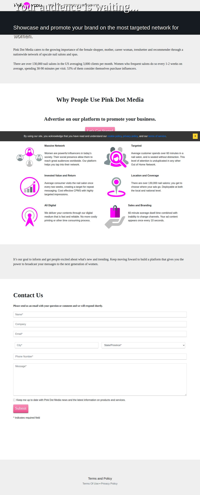

### chefsroll.com — dry\_run\_ok (dry run)

| | |
|---|---|
| Attempt ID | `6ca7c039-48e1-4e9c-aa38-f39698368ecd` |
| Form URL | https://chefsroll.com/contact-us/ |
| Final URL | https://chefsroll.com/contact-us/ |
| Reserved | 2026-11-06 05:25:58 UTC |
| Submit attempted | — |
| Template | standard v2 |
| Confirmation text | none observed |
| Result / error | Selectors verified; fields not typed (domain not in dry-run fill list); not submitted |

Exact message:

~~~text
Subject: Helping customers find your business in AI search (AEO + GEO)

Hi there,

I'm Arun from Devs Arun. More and more customers now ask ChatGPT, Gemini, Perplexity or Google's AI Overviews questions like "who should I hire for this in my area?" before they call anyone. These tools answer from websites they can clearly understand, and they tend to recommend businesses whose pages answer real customer questions.

That is what AEO + GEO (Answer Engine and Generative Engine Optimization) is for. I improve your existing service pages so they clearly answer the questions your customers ask, add structured data that matches the page, and make the call, quote or enquiry step obvious. The benefit: your business gets a better chance of being mentioned or linked in AI answers, and visitors who arrive find it easy to contact you.

The AEO + GEO Starter is a one-time $199 (about ₹16,999, negotiable) for one website: a basic audit, 10 customer questions, improvements to two existing pages, relevant structured data and an action plan, with one revision round.

You can read the full details, send an enquiry or book online here:
https://devsarun.io/aeo-geo/

If this isn't relevant, just reply and I won't contact you again.

Best,
Arun
Devs Arun
itschool408@gmail.com · +91 7654534323
~~~

Submitted field values:

- \#nf-field-1: Arun
- \#nf-field-2: itschool408@gmail.com
- \#nf-field-3: Hi there, I'm Arun from Devs Arun. More and more customers now ask ChatGPT, Gemini, Perplexity or Google's AI Overviews 
- \#nf-field-11: Hi there, I'm Arun from Devs Arun. More and more customers now ask ChatGPT, Gemini, Perplexity or Google's AI Overviews 

**Inspected page** — `run-8a12c942_attempt-6ca7c039_inspection_2026-11-06T05-26-00-606Z.jpg`

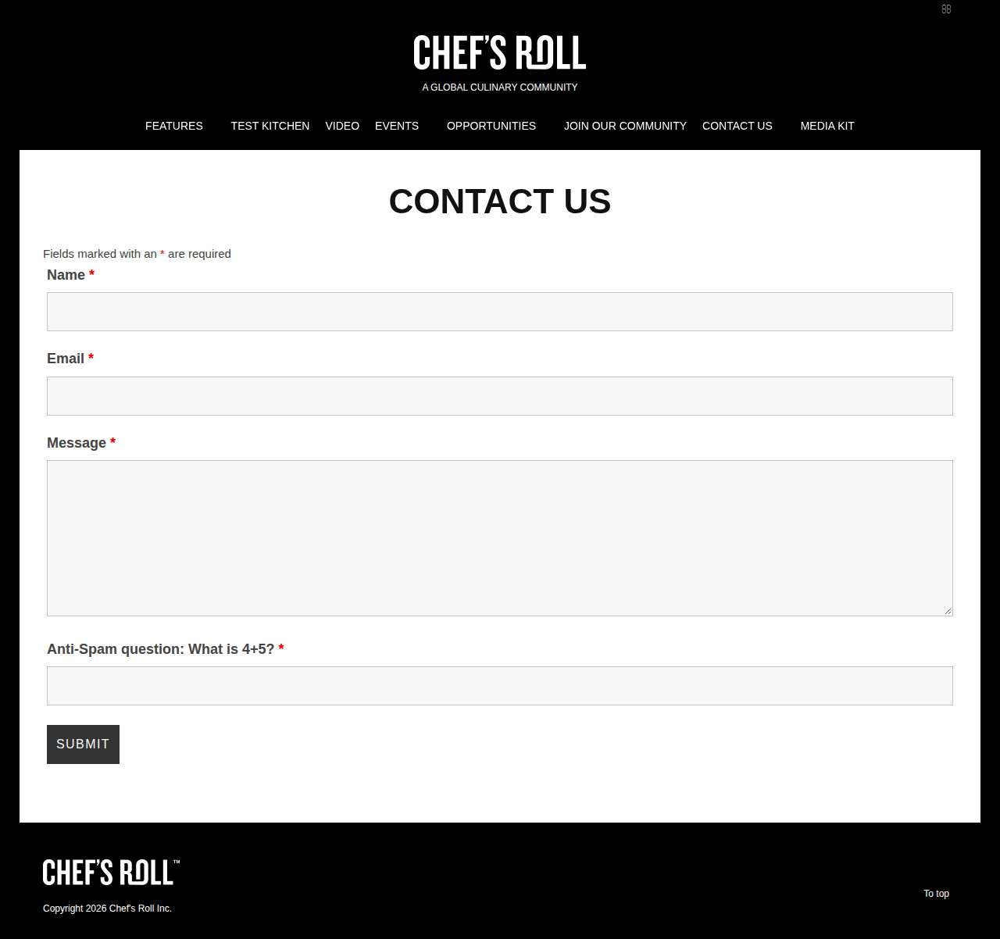

### meritmarketingservices.com — dry\_run\_ok (dry run)

| | |
|---|---|
| Attempt ID | `e03a6f2b-faf2-45f0-a574-a76a253cd2d6` |
| Form URL | https://meritmarketingservices.com/Contact |
| Final URL | https://meritmarketingservices.com/Contact |
| Reserved | 2026-11-06 05:26:05 UTC |
| Submit attempted | — |
| Template | standard v2 |
| Confirmation text | none observed |
| Result / error | Selectors verified; fields not typed (domain not in dry-run fill list); not submitted |

Exact message:

~~~text
Subject: Helping customers find your business in AI search (AEO + GEO)

Hi there,

I'm Arun from Devs Arun. More and more customers now ask ChatGPT, Gemini, Perplexity or Google's AI Overviews questions like "who should I hire for this in my area?" before they call anyone. These tools answer from websites they can clearly understand, and they tend to recommend businesses whose pages answer real customer questions.

That is what AEO + GEO (Answer Engine and Generative Engine Optimization) is for. I improve your existing service pages so they clearly answer the questions your customers ask, add structured data that matches the page, and make the call, quote or enquiry step obvious. The benefit: your business gets a better chance of being mentioned or linked in AI answers, and visitors who arrive find it easy to contact you.

The AEO + GEO Starter is a one-time $199 (about ₹16,999, negotiable) for one website: a basic audit, 10 customer questions, improvements to two existing pages, relevant structured data and an action plan, with one revision round.

You can read the full details, send an enquiry or book online here:
https://devsarun.io/aeo-geo/

If this isn't relevant, just reply and I won't contact you again.

Best,
Arun
Devs Arun
itschool408@gmail.com · +91 7654534323
~~~

Submitted field values:

- \#name: Arun
- \#email: itschool408@gmail.com
- \#phone: +91 7654534323
- \#message: Hi there, I'm Arun from Devs Arun. More and more customers now ask ChatGPT, Gemini, Perplexity or Google's AI Overviews 

**Inspected page** — `run-8a12c942_attempt-e03a6f2b_inspection_2026-11-06T05-26-10-343Z.jpg`

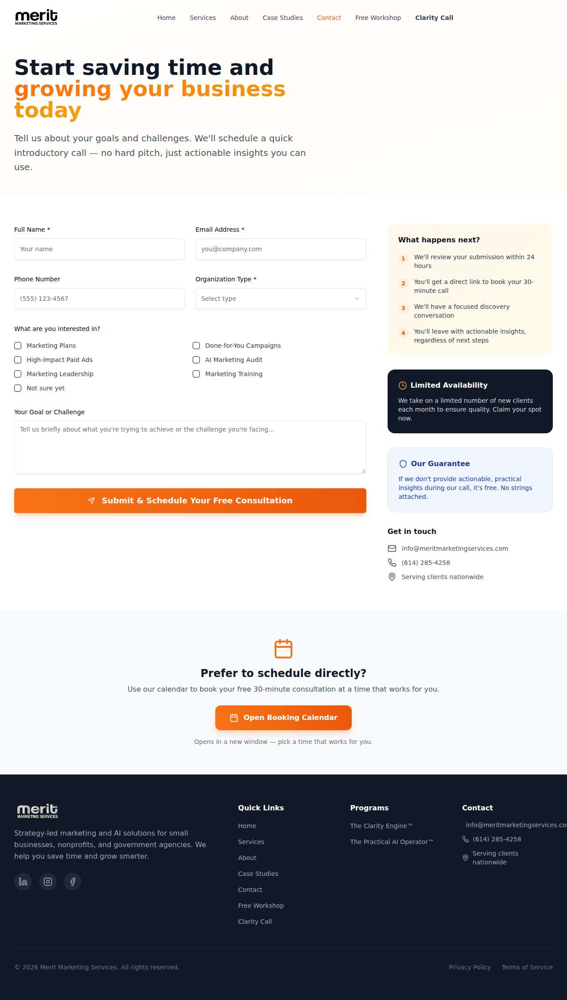

### wcmedia.net — dry\_run\_ok (dry run)

| | |
|---|---|
| Attempt ID | `dc7fab4b-75c4-46cd-92f8-8b1e4f1999cd` |
| Form URL | https://wcmedia.net/contact/ |
| Final URL | https://wcmedia.net/contact/ |
| Reserved | 2026-11-06 05:26:15 UTC |
| Submit attempted | — |
| Template | standard v2 |
| Confirmation text | none observed |
| Result / error | Selectors verified; fields not typed (domain not in dry-run fill list); not submitted |

Exact message:

~~~text
Subject: Helping customers find your business in AI search (AEO + GEO)

Hi there,

I'm Arun from Devs Arun. More and more customers now ask ChatGPT, Gemini, Perplexity or Google's AI Overviews questions like "who should I hire for this in my area?" before they call anyone. These tools answer from websites they can clearly understand, and they tend to recommend businesses whose pages answer real customer questions.

That is what AEO + GEO (Answer Engine and Generative Engine Optimization) is for. I improve your existing service pages so they clearly answer the questions your customers ask, add structured data that matches the page, and make the call, quote or enquiry step obvious. The benefit: your business gets a better chance of being mentioned or linked in AI answers, and visitors who arrive find it easy to contact you.

The AEO + GEO Starter is a one-time $199 (about ₹16,999, negotiable) for one website: a basic audit, 10 customer questions, improvements to two existing pages, relevant structured data and an action plan, with one revision round.

You can read the full details, send an enquiry or book online here:
https://devsarun.io/aeo-geo/

If this isn't relevant, just reply and I won't contact you again.

Best,
Arun
Devs Arun
itschool408@gmail.com · +91 7654534323
~~~

Submitted field values:

- \#ff\_1\_email: itschool408@gmail.com
- \#ff\_1\_message: Hi there, I'm Arun from Devs Arun. More and more customers now ask ChatGPT, Gemini, Perplexity or Google's AI Overviews 
- \#ff\_1\_subject: Helping customers find your business in AI search (AEO + GEO)
- \#ff\_1\_names\_first\_name\_: Arun

**Inspected page** — `run-8a12c942_attempt-dc7fab4b_inspection_2026-11-06T05-26-19-946Z.jpg`

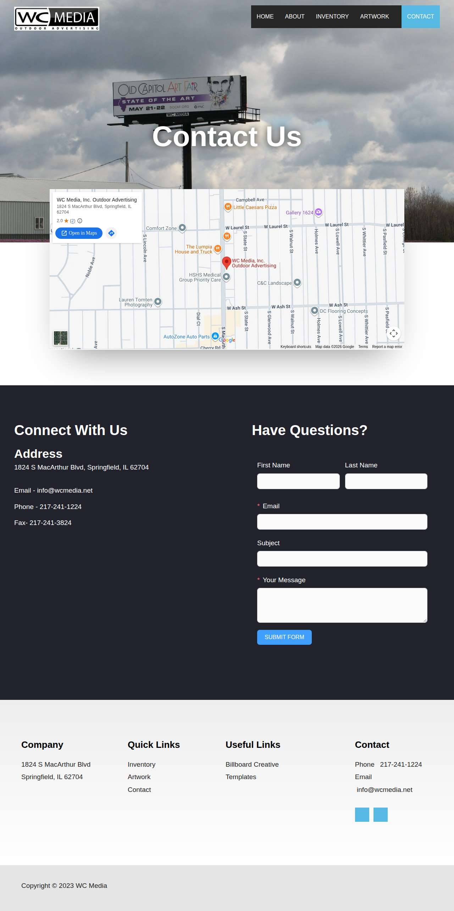

### prhollywood.com — dry\_run\_ok (dry run)

| | |
|---|---|
| Attempt ID | `5f834043-9529-45e2-a1b7-cb1897b005e4` |
| Form URL | https://www.prhollywood.com/contact |
| Final URL | https://www.prhollywood.com/contact |
| Reserved | 2026-11-06 05:26:24 UTC |
| Submit attempted | — |
| Template | standard v2 |
| Confirmation text | none observed |
| Result / error | Selectors verified; fields not typed (domain not in dry-run fill list); not submitted |

Exact message:

~~~text
Subject: Helping customers find your business in AI search (AEO + GEO)

Hi there,

I'm Arun from Devs Arun. More and more customers now ask ChatGPT, Gemini, Perplexity or Google's AI Overviews questions like "who should I hire for this in my area?" before they call anyone. These tools answer from websites they can clearly understand, and they tend to recommend businesses whose pages answer real customer questions.

That is what AEO + GEO (Answer Engine and Generative Engine Optimization) is for. I improve your existing service pages so they clearly answer the questions your customers ask, add structured data that matches the page, and make the call, quote or enquiry step obvious. The benefit: your business gets a better chance of being mentioned or linked in AI answers, and visitors who arrive find it easy to contact you.

The AEO + GEO Starter is a one-time $199 (about ₹16,999, negotiable) for one website: a basic audit, 10 customer questions, improvements to two existing pages, relevant structured data and an action plan, with one revision round.

You can read the full details, send an enquiry or book online here:
https://devsarun.io/aeo-geo/

If this isn't relevant, just reply and I won't contact you again.

Best,
Arun
Devs Arun
itschool408@gmail.com · +91 7654534323
~~~

Submitted field values:

- \#input\_comp-kf5tfv5o: Arun
- \#input\_comp-kf5tfv60: itschool408@gmail.com
- \#input\_comp-kf5tfv6b: Helping customers find your business in AI search (AEO + GEO)
- \#textarea\_comp-kf5tfv73: Hi there, I'm Arun from Devs Arun. More and more customers now ask ChatGPT, Gemini, Perplexity or Google's AI Overviews 

**Inspected page** — `run-8a12c942_attempt-5f834043_inspection_2026-11-06T05-26-27-135Z.jpg`

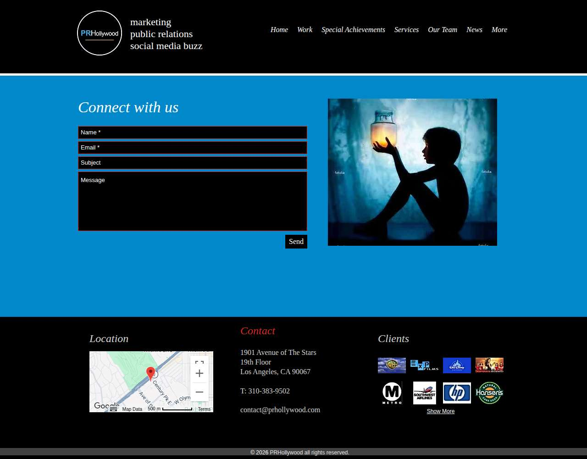

### eazydtf.com — dry\_run\_ok (dry run)

| | |
|---|---|
| Attempt ID | `8dc0fff2-0333-4dbf-8560-6bcef72b3350` |
| Form URL | https://eazydtf.com/pages/contact |
| Final URL | https://eazydtf.com/pages/contact |
| Reserved | 2026-11-06 05:26:32 UTC |
| Submit attempted | — |
| Template | standard v2 |
| Confirmation text | none observed |
| Result / error | Selectors verified; fields not typed (domain not in dry-run fill list); not submitted |

Exact message:

~~~text
Subject: Helping customers find your business in AI search (AEO + GEO)

Hi there,

I'm Arun from Devs Arun. More and more customers now ask ChatGPT, Gemini, Perplexity or Google's AI Overviews questions like "who should I hire for this in my area?" before they call anyone. These tools answer from websites they can clearly understand, and they tend to recommend businesses whose pages answer real customer questions.

That is what AEO + GEO (Answer Engine and Generative Engine Optimization) is for. I improve your existing service pages so they clearly answer the questions your customers ask, add structured data that matches the page, and make the call, quote or enquiry step obvious. The benefit: your business gets a better chance of being mentioned or linked in AI answers, and visitors who arrive find it easy to contact you.

The AEO + GEO Starter is a one-time $199 (about ₹16,999, negotiable) for one website: a basic audit, 10 customer questions, improvements to two existing pages, relevant structured data and an action plan, with one revision round.

You can read the full details, send an enquiry or book online here:
https://devsarun.io/aeo-geo/

If this isn't relevant, just reply and I won't contact you again.

Best,
Arun
Devs Arun
itschool408@gmail.com · +91 7654534323
~~~

Submitted field values:

- \#ContactForm-body: Hi there, I'm Arun from Devs Arun. More and more customers now ask ChatGPT, Gemini, Perplexity or Google's AI Overviews 
- \#ContactForm-name: Arun
- \#ContactForm-email: itschool408@gmail.com
- \#ContactForm-phone: +91 7654534323

**Inspected page** — `run-8a12c942_attempt-8dc0fff2_inspection_2026-11-06T05-26-36-973Z.jpg`

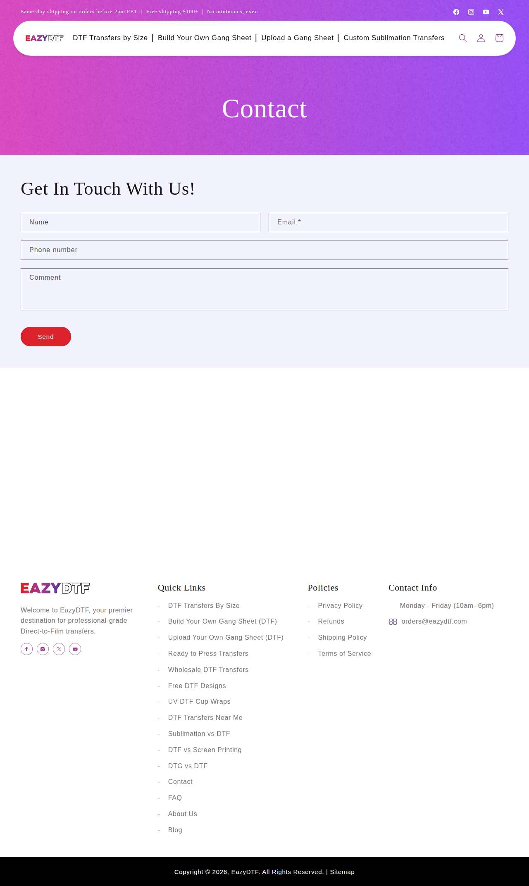

### seolocale.com — dry\_run\_ok (dry run)

| | |
|---|---|
| Attempt ID | `3fcb9393-6fcc-4ee8-ae24-176e5197a62f` |
| Form URL | https://seolocale.com/contact-us/ |
| Final URL | https://seolocale.com/contact-us/ |
| Reserved | 2026-11-06 05:26:42 UTC |
| Submit attempted | — |
| Template | standard v2 |
| Confirmation text | none observed |
| Result / error | Selectors verified; fields not typed (domain not in dry-run fill list); not submitted |

Exact message:

~~~text
Subject: Helping customers find your business in AI search (AEO + GEO)

Hi there,

I'm Arun from Devs Arun. More and more customers now ask ChatGPT, Gemini, Perplexity or Google's AI Overviews questions like "who should I hire for this in my area?" before they call anyone. These tools answer from websites they can clearly understand, and they tend to recommend businesses whose pages answer real customer questions.

That is what AEO + GEO (Answer Engine and Generative Engine Optimization) is for. I improve your existing service pages so they clearly answer the questions your customers ask, add structured data that matches the page, and make the call, quote or enquiry step obvious. The benefit: your business gets a better chance of being mentioned or linked in AI answers, and visitors who arrive find it easy to contact you.

The AEO + GEO Starter is a one-time $199 (about ₹16,999, negotiable) for one website: a basic audit, 10 customer questions, improvements to two existing pages, relevant structured data and an action plan, with one revision round.

You can read the full details, send an enquiry or book online here:
https://devsarun.io/aeo-geo/

If this isn't relevant, just reply and I won't contact you again.

Best,
Arun
Devs Arun
itschool408@gmail.com · +91 7654534323
~~~

Submitted field values:

- \#input\_1\_1: Arun
- \#input\_1\_2: itschool408@gmail.com
- \#input\_1\_3: +91 7654534323
- \#input\_1\_5: Other
- \#input\_1\_6: Hi there, I'm Arun from Devs Arun. More and more customers now ask ChatGPT, Gemini, Perplexity or Google's AI Overviews 

**Inspected page** — `run-8a12c942_attempt-3fcb9393_inspection_2026-11-06T05-26-43-935Z.jpg`

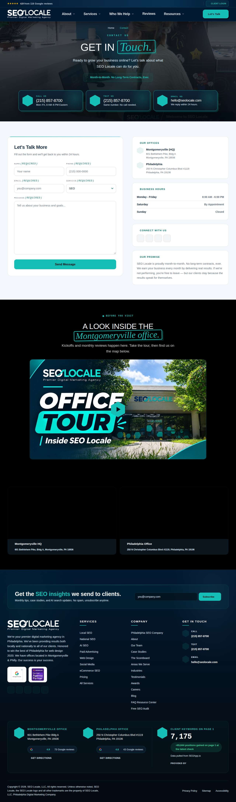

### rankplan.us — dry\_run\_ok (dry run)

| | |
|---|---|
| Attempt ID | `aca74aba-90cb-494b-8bf2-286c766a1f02` |
| Form URL | https://rankplan.us/case-study-using-seo-to-increase-inquiries-for-a-large-corporation-by-600-in-a-few-months/ |
| Final URL | https://rankplan.us/case-study-using-seo-to-increase-inquiries-for-a-large-corporation-by-600-in-a-few-months/ |
| Reserved | 2026-11-06 05:26:48 UTC |
| Submit attempted | — |
| Template | standard v2 |
| Confirmation text | none observed |
| Result / error | Selectors verified; fields not typed (domain not in dry-run fill list); not submitted |

Exact message:

~~~text
Subject: Helping customers find your business in AI search (AEO + GEO)

Hi there,

I'm Arun from Devs Arun. More and more customers now ask ChatGPT, Gemini, Perplexity or Google's AI Overviews questions like "who should I hire for this in my area?" before they call anyone. These tools answer from websites they can clearly understand, and they tend to recommend businesses whose pages answer real customer questions.

That is what AEO + GEO (Answer Engine and Generative Engine Optimization) is for. I improve your existing service pages so they clearly answer the questions your customers ask, add structured data that matches the page, and make the call, quote or enquiry step obvious. The benefit: your business gets a better chance of being mentioned or linked in AI answers, and visitors who arrive find it easy to contact you.

The AEO + GEO Starter is a one-time $199 (about ₹16,999, negotiable) for one website: a basic audit, 10 customer questions, improvements to two existing pages, relevant structured data and an action plan, with one revision round.

You can read the full details, send an enquiry or book online here:
https://devsarun.io/aeo-geo/

If this isn't relevant, just reply and I won't contact you again.

Best,
Arun
Devs Arun
itschool408@gmail.com · +91 7654534323
~~~

Submitted field values:

- \#url: https://devsarun.io/aeo-geo/
- \#email: itschool408@gmail.com
- \#author: Arun
- \#comment: Hi there, I'm Arun from Devs Arun. More and more customers now ask ChatGPT, Gemini, Perplexity or Google's AI Overviews 

**Inspected page** — `run-8a12c942_attempt-aca74aba_inspection_2026-11-06T05-26-52-756Z.jpg`

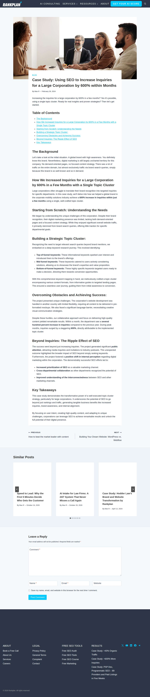

## Events (94)

| Time (UTC) | Event | Website | Details |
|---|---|---|---|
| 05:24:31 | run\_queued | — | dry\_run run requested by github:itsDevsArun |
| 05:24:31 | run\_dispatched | — | dispatch disabled (local test mode) |
| 05:24:35 | run\_started | — | Runner claimed dry\_run run |
| 05:24:35 | website\_selected | helixmechanical.com | Dry-run target helixmechanical.com |
| 05:24:35 | draft\_prepared | helixmechanical.com | Draft prepared with template standard v2 |
| 05:24:37 | page\_opened | helixmechanical.com | Opened form page |
| 05:24:37 | screenshot\_saved | helixmechanical.com | inspection screenshot saved (54 KB) |
| 05:24:37 | review\_required | helixmechanical.com | dry run failed: Mapped field "First Name \*" not found uniquely |
| 05:24:42 | website\_selected | knoxvilleelectrician.com | Dry-run target knoxvilleelectrician.com |
| 05:24:42 | draft\_prepared | knoxvilleelectrician.com | Draft prepared with template standard v2 |
| 05:24:44 | page\_opened | knoxvilleelectrician.com | Opened form page |
| 05:24:44 | screenshot\_saved | knoxvilleelectrician.com | inspection screenshot saved (137 KB) |
| 05:24:44 | review\_required | knoxvilleelectrician.com | dry run failed: Mapped field "Name" not found uniquely |
| 05:24:49 | website\_selected | mspc.cpa | Dry-run target mspc.cpa |
| 05:24:49 | draft\_prepared | mspc.cpa | Draft prepared with template standard v2 |
| 05:24:54 | page\_opened | mspc.cpa | Opened form page |
| 05:24:54 | screenshot\_saved | mspc.cpa | inspection screenshot saved (162 KB) |
| 05:24:54 | review\_required | mspc.cpa | dry run failed: Mapped field "Full Name \*" not found uniquely |
| 05:24:59 | website\_selected | trustthedata.net | Dry-run target trustthedata.net |
| 05:24:59 | draft\_prepared | trustthedata.net | Draft prepared with template standard v2 |
| 05:25:00 | page\_opened | trustthedata.net | Opened form page |
| 05:25:01 | screenshot\_saved | trustthedata.net | inspection screenshot saved (101 KB) |
| 05:25:01 | dry\_run\_checked | trustthedata.net | dry run ok: Selectors verified; fields not typed (domain not in dry-run fill list); not submitted |
| 05:25:06 | website\_selected | core6.marketing | Dry-run target core6.marketing |
| 05:25:06 | draft\_prepared | core6.marketing | Draft prepared with template standard v2 |
| 05:25:08 | page\_opened | core6.marketing | Opened form page |
| 05:25:09 | screenshot\_saved | core6.marketing | inspection screenshot saved (197 KB) |
| 05:25:09 | dry\_run\_checked | core6.marketing | dry run ok: Selectors verified; fields not typed (domain not in dry-run fill list); not submitted |
| 05:25:14 | website\_selected | glendalemarketing.com | Dry-run target glendalemarketing.com |
| 05:25:14 | draft\_prepared | glendalemarketing.com | Draft prepared with template standard v2 |
| 05:25:15 | page\_opened | glendalemarketing.com | Opened form page |
| 05:25:15 | screenshot\_saved | glendalemarketing.com | inspection screenshot saved (357 KB) |
| 05:25:15 | dry\_run\_checked | glendalemarketing.com | dry run ok: Selectors verified; fields not typed (domain not in dry-run fill list); not submitted |
| 05:25:20 | website\_selected | ewiworldwide.com | Dry-run target ewiworldwide.com |
| 05:25:20 | draft\_prepared | ewiworldwide.com | Draft prepared with template standard v2 |
| 05:25:25 | page\_opened | ewiworldwide.com | Opened form page |
| 05:25:25 | screenshot\_saved | ewiworldwide.com | inspection screenshot saved (55 KB) |
| 05:25:25 | dry\_run\_checked | ewiworldwide.com | dry run ok: Selectors verified; fields not typed (domain not in dry-run fill list); not submitted |
| 05:25:30 | website\_selected | halibutblue.com | Dry-run target halibutblue.com |
| 05:25:30 | draft\_prepared | halibutblue.com | Draft prepared with template standard v2 |
| 05:25:33 | page\_opened | halibutblue.com | Opened form page |
| 05:25:33 | screenshot\_saved | halibutblue.com | inspection screenshot saved (115 KB) |
| 05:25:33 | dry\_run\_checked | halibutblue.com | dry run ok: Selectors verified; fields not typed (domain not in dry-run fill list); not submitted |
| 05:25:38 | website\_selected | startflourishing.com | Dry-run target startflourishing.com |
| 05:25:38 | draft\_prepared | startflourishing.com | Draft prepared with template standard v2 |
| 05:25:39 | page\_opened | startflourishing.com | Opened form page |
| 05:25:39 | screenshot\_saved | startflourishing.com | inspection screenshot saved (82 KB) |
| 05:25:39 | dry\_run\_checked | startflourishing.com | dry run ok: Selectors verified; fields not typed (domain not in dry-run fill list); not submitted |
| 05:25:44 | website\_selected | localdigitalgenius.com | Dry-run target localdigitalgenius.com |
| 05:25:44 | draft\_prepared | localdigitalgenius.com | Draft prepared with template standard v2 |
| 05:25:46 | page\_opened | localdigitalgenius.com | Opened form page |
| 05:25:46 | screenshot\_saved | localdigitalgenius.com | inspection screenshot saved (148 KB) |
| 05:25:46 | dry\_run\_checked | localdigitalgenius.com | dry run ok: Selectors verified; fields not typed (domain not in dry-run fill list); not submitted |
| 05:25:51 | website\_selected | pinkdotmedia.com | Dry-run target pinkdotmedia.com |
| 05:25:51 | draft\_prepared | pinkdotmedia.com | Draft prepared with template standard v2 |
| 05:25:53 | page\_opened | pinkdotmedia.com | Opened form page |
| 05:25:53 | screenshot\_saved | pinkdotmedia.com | inspection screenshot saved (205 KB) |
| 05:25:53 | dry\_run\_checked | pinkdotmedia.com | dry run ok: Selectors verified; fields not typed (domain not in dry-run fill list); not submitted |
| 05:25:58 | website\_selected | chefsroll.com | Dry-run target chefsroll.com |
| 05:25:58 | draft\_prepared | chefsroll.com | Draft prepared with template standard v2 |
| 05:26:00 | page\_opened | chefsroll.com | Opened form page |
| 05:26:00 | screenshot\_saved | chefsroll.com | inspection screenshot saved (47 KB) |
| 05:26:00 | dry\_run\_checked | chefsroll.com | dry run ok: Selectors verified; fields not typed (domain not in dry-run fill list); not submitted |
| 05:26:05 | website\_selected | meritmarketingservices.com | Dry-run target meritmarketingservices.com |
| 05:26:05 | draft\_prepared | meritmarketingservices.com | Draft prepared with template standard v2 |
| 05:26:10 | page\_opened | meritmarketingservices.com | Opened form page |
| 05:26:10 | screenshot\_saved | meritmarketingservices.com | inspection screenshot saved (136 KB) |
| 05:26:10 | dry\_run\_checked | meritmarketingservices.com | dry run ok: Selectors verified; fields not typed (domain not in dry-run fill list); not submitted |
| 05:26:15 | website\_selected | wcmedia.net | Dry-run target wcmedia.net |
| 05:26:15 | draft\_prepared | wcmedia.net | Draft prepared with template standard v2 |
| 05:26:19 | page\_opened | wcmedia.net | Opened form page |
| 05:26:19 | screenshot\_saved | wcmedia.net | inspection screenshot saved (149 KB) |
| 05:26:19 | dry\_run\_checked | wcmedia.net | dry run ok: Selectors verified; fields not typed (domain not in dry-run fill list); not submitted |
| 05:26:24 | website\_selected | prhollywood.com | Dry-run target prhollywood.com |
| 05:26:24 | draft\_prepared | prhollywood.com | Draft prepared with template standard v2 |
| 05:26:27 | page\_opened | prhollywood.com | Opened form page |
| 05:26:27 | screenshot\_saved | prhollywood.com | inspection screenshot saved (66 KB) |
| 05:26:27 | dry\_run\_checked | prhollywood.com | dry run ok: Selectors verified; fields not typed (domain not in dry-run fill list); not submitted |
| 05:26:32 | website\_selected | eazydtf.com | Dry-run target eazydtf.com |
| 05:26:32 | draft\_prepared | eazydtf.com | Draft prepared with template standard v2 |
| 05:26:36 | page\_opened | eazydtf.com | Opened form page |
| 05:26:36 | screenshot\_saved | eazydtf.com | inspection screenshot saved (97 KB) |
| 05:26:36 | dry\_run\_checked | eazydtf.com | dry run ok: Selectors verified; fields not typed (domain not in dry-run fill list); not submitted |
| 05:26:42 | website\_selected | seolocale.com | Dry-run target seolocale.com |
| 05:26:42 | draft\_prepared | seolocale.com | Draft prepared with template standard v2 |
| 05:26:43 | page\_opened | seolocale.com | Opened form page |
| 05:26:43 | screenshot\_saved | seolocale.com | inspection screenshot saved (320 KB) |
| 05:26:43 | dry\_run\_checked | seolocale.com | dry run ok: Selectors verified; fields not typed (domain not in dry-run fill list); not submitted |
| 05:26:48 | website\_selected | rankplan.us | Dry-run target rankplan.us |
| 05:26:48 | draft\_prepared | rankplan.us | Draft prepared with template standard v2 |
| 05:26:52 | page\_opened | rankplan.us | Opened form page |
| 05:26:52 | screenshot\_saved | rankplan.us | inspection screenshot saved (449 KB) |
| 05:26:52 | dry\_run\_checked | rankplan.us | dry run ok: Selectors verified; fields not typed (domain not in dry-run fill list); not submitted |
| 05:26:57 | run\_completed | — | Run completed (queue\_exhausted) |
