# Run c80e4e0b — dry\_run — completed

| | |
|---|---|
| Run ID | `c80e4e0b-f9a6-4aa6-bf53-f35755c5b62c` |
| Requested by | github:itsDevsArun |
| Started | 2026-11-06 03:57:52 UTC |
| Finished | 2026-11-06 04:00:37 UTC |
| Finish reason | queue\_exhausted |
| GitHub Actions | https://github.com/itsDevsArun/aeo-geo/actions/runs/42148448245 |

CSV for this run: [runs/2026-11-06_dry_run_c80e4e0b.csv](2026-11-06_dry_run_c80e4e0b.csv)

## Attempts (21)

### helixmechanical.com — dry\_run\_failed (dry run)

| | |
|---|---|
| Attempt ID | `c9355f6d-ad6e-4b34-bf09-f579ef1d3707` |
| Form URL | https://helixmechanical.com/contact/ |
| Final URL | https://helixmechanical.com/contact/ |
| Reserved | 2026-11-06 03:57:52 UTC |
| Submit attempted | — |
| Template | standard v2 |
| Confirmation text | none observed |
| Result / error | Mapped field "First Name \*" not found uniquely |

Exact message:

~~~text
Subject: Helping customers find your business in AI search (AEO + GEO)

Hi there,

I'm Arun from Devs Arun. More and more customers now ask ChatGPT, Gemini, Perplexity or Google's AI Overviews questions like "who should I hire for this in my area?" before they call anyone. These tools answer from websites they can clearly understand, and they tend to recommend businesses whose pages answer real customer questions.

That is what AEO + GEO (Answer Engine and Generative Engine Optimization) is for. I improve your existing service pages so they clearly answer the questions your customers ask, add structured data that matches the page, and make the call, quote or enquiry step obvious. The benefit: your business gets a better chance of being mentioned or linked in AI answers, and visitors who arrive find it easy to contact you.

The AEO + GEO Starter is a one-time $199 (about ₹16,999, negotiable) for one website: a basic audit, 10 customer questions, improvements to two existing pages, relevant structured data and an action plan, with one revision round.

You can read the full details, send an enquiry or book online here:
https://devsarun.io/aeo-geo/

If this isn't relevant, just reply and I won't contact you again.

Best,
Arun
Devs Arun
itschool408@gmail.com · +91 7654534323
~~~

Submitted field values:

- \#forminator-field-name-1\_6ae7ff023fd3c: Arun
- \#forminator-field-email-1\_6ae7ff023fd3c: itschool408@gmail.com
- \#forminator-field-phone-1\_6ae7ff023fd3c: +91 7654534323
- \#forminator-field-textarea-1\_6ae7ff023fd3c: Hi there, I'm Arun from Devs Arun. More and more customers now ask ChatGPT, Gemini, Perplexity or Google's AI Overviews 

**Inspected page** — `run-c80e4e0b_attempt-c9355f6d_inspection_2026-11-06T03-57-54-502Z.jpg`

### knoxvilleelectrician.com — dry\_run\_failed (dry run)

| | |
|---|---|
| Attempt ID | `6c07d540-464b-4852-995f-98d1eab49130` |
| Form URL | https://knoxvilleelectrician.com/contact-us/ |
| Final URL | https://knoxvilleelectrician.com/contact-us/ |
| Reserved | 2026-11-06 03:57:59 UTC |
| Submit attempted | — |
| Template | standard v2 |
| Confirmation text | none observed |
| Result / error | Mapped field "Name" not found uniquely |

Exact message:

~~~text
Subject: Helping customers find your business in AI search (AEO + GEO)

Hi there,

I'm Arun from Devs Arun. More and more customers now ask ChatGPT, Gemini, Perplexity or Google's AI Overviews questions like "who should I hire for this in my area?" before they call anyone. These tools answer from websites they can clearly understand, and they tend to recommend businesses whose pages answer real customer questions.

That is what AEO + GEO (Answer Engine and Generative Engine Optimization) is for. I improve your existing service pages so they clearly answer the questions your customers ask, add structured data that matches the page, and make the call, quote or enquiry step obvious. The benefit: your business gets a better chance of being mentioned or linked in AI answers, and visitors who arrive find it easy to contact you.

The AEO + GEO Starter is a one-time $199 (about ₹16,999, negotiable) for one website: a basic audit, 10 customer questions, improvements to two existing pages, relevant structured data and an action plan, with one revision round.

You can read the full details, send an enquiry or book online here:
https://devsarun.io/aeo-geo/

If this isn't relevant, just reply and I won't contact you again.

Best,
Arun
Devs Arun
itschool408@gmail.com · +91 7654534323
~~~

Submitted field values:

- \#form-field-1b7221: itschool408@gmail.com
- \#form-field-2fa3ac: +91 7654534323
- \#form-field-96f51f: Arun
- \#form-field-fed9d8: Hi there, I'm Arun from Devs Arun. More and more customers now ask ChatGPT, Gemini, Perplexity or Google's AI Overviews 

**Inspected page** — `run-c80e4e0b_attempt-6c07d540_inspection_2026-11-06T03-58-02-282Z.jpg`

### mspc.cpa — dry\_run\_failed (dry run)

| | |
|---|---|
| Attempt ID | `68a5ccb4-a5e2-4bb5-b831-f4ebd9cb8d56` |
| Form URL | https://www.mspc.cpa/contact/ |
| Final URL | https://www.mspc.cpa/contact/ |
| Reserved | 2026-11-06 03:58:07 UTC |
| Submit attempted | — |
| Template | standard v2 |
| Confirmation text | none observed |
| Result / error | Mapped field "Full Name \*" not found uniquely |

Exact message:

~~~text
Subject: Helping customers find your business in AI search (AEO + GEO)

Hi there,

I'm Arun from Devs Arun. More and more customers now ask ChatGPT, Gemini, Perplexity or Google's AI Overviews questions like "who should I hire for this in my area?" before they call anyone. These tools answer from websites they can clearly understand, and they tend to recommend businesses whose pages answer real customer questions.

That is what AEO + GEO (Answer Engine and Generative Engine Optimization) is for. I improve your existing service pages so they clearly answer the questions your customers ask, add structured data that matches the page, and make the call, quote or enquiry step obvious. The benefit: your business gets a better chance of being mentioned or linked in AI answers, and visitors who arrive find it easy to contact you.

The AEO + GEO Starter is a one-time $199 (about ₹16,999, negotiable) for one website: a basic audit, 10 customer questions, improvements to two existing pages, relevant structured data and an action plan, with one revision round.

You can read the full details, send an enquiry or book online here:
https://devsarun.io/aeo-geo/

If this isn't relevant, just reply and I won't contact you again.

Best,
Arun
Devs Arun
itschool408@gmail.com · +91 7654534323
~~~

Submitted field values:

- \#forminator-field-name-1\_6aeaca2579f24: Arun
- \#forminator-field-text-1\_6aeaca2579f24: Devs Arun
- \#forminator-field-email-1\_6aeaca2579f24: itschool408@gmail.com
- \#forminator-field-phone-1\_6aeaca2579f24: +91 7654534323
- \#forminator-field-textarea-1\_6aeaca2579f24: Hi there, I'm Arun from Devs Arun. More and more customers now ask ChatGPT, Gemini, Perplexity or Google's AI Overviews 

**Inspected page** — `run-c80e4e0b_attempt-68a5ccb4_inspection_2026-11-06T03-58-10-619Z.jpg`

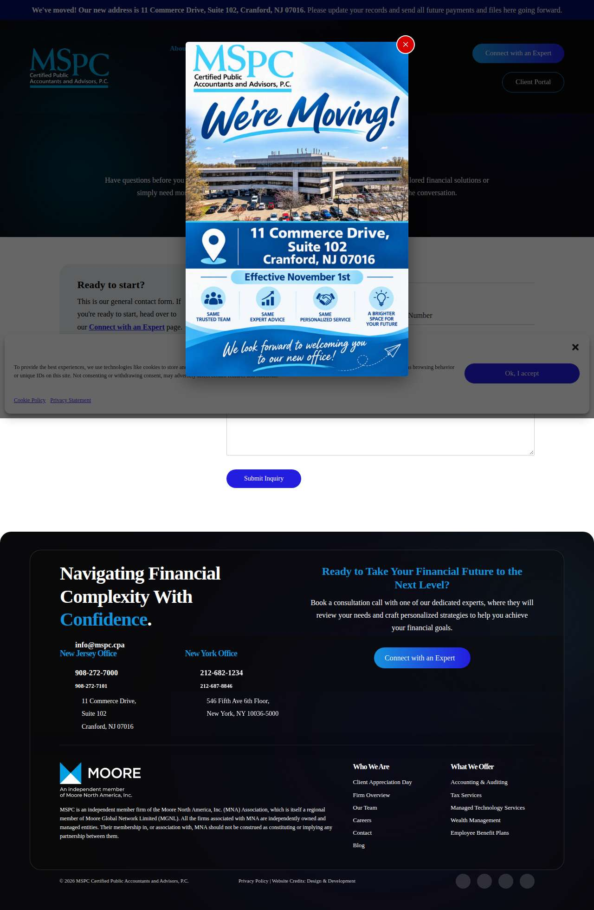

### rebaca.com — dry\_run\_ok (dry run)

| | |
|---|---|
| Attempt ID | `c880199e-d900-45c6-8531-5e88c23c6e82` |
| Form URL | https://rebaca.com/contact-us/ |
| Final URL | https://rebaca.com/contact-us/ |
| Reserved | 2026-11-06 03:58:15 UTC |
| Submit attempted | — |
| Template | standard v2 |
| Confirmation text | none observed |
| Result / error | Selectors verified; fields not typed (domain not in dry-run fill list); not submitted |

Exact message:

~~~text
Subject: Helping customers find your business in AI search (AEO + GEO)

Hi there,

I'm Arun from Devs Arun. More and more customers now ask ChatGPT, Gemini, Perplexity or Google's AI Overviews questions like "who should I hire for this in my area?" before they call anyone. These tools answer from websites they can clearly understand, and they tend to recommend businesses whose pages answer real customer questions.

That is what AEO + GEO (Answer Engine and Generative Engine Optimization) is for. I improve your existing service pages so they clearly answer the questions your customers ask, add structured data that matches the page, and make the call, quote or enquiry step obvious. The benefit: your business gets a better chance of being mentioned or linked in AI answers, and visitors who arrive find it easy to contact you.

The AEO + GEO Starter is a one-time $199 (about ₹16,999, negotiable) for one website: a basic audit, 10 customer questions, improvements to two existing pages, relevant structured data and an action plan, with one revision round.

You can read the full details, send an enquiry or book online here:
https://devsarun.io/aeo-geo/

If this isn't relevant, just reply and I won't contact you again.

Best,
Arun
Devs Arun
itschool408@gmail.com · +91 7654534323
~~~

Submitted field values:

- \#wpforms-6871-field\_2: itschool408@gmail.com
- \#wpforms-6871-field\_4: Arun
- \#wpforms-6871-field\_5: Helping customers find your business in AI search (AEO + GEO)
- \#wpforms-6871-field\_6: Hi there, I'm Arun from Devs Arun. More and more customers now ask ChatGPT, Gemini, Perplexity or Google's AI Overviews 
- \#wpforms-6871-field\_7: +91 7654534323

**Inspected page** — `run-c80e4e0b_attempt-c880199e_inspection_2026-11-06T03-58-17-947Z.jpg`

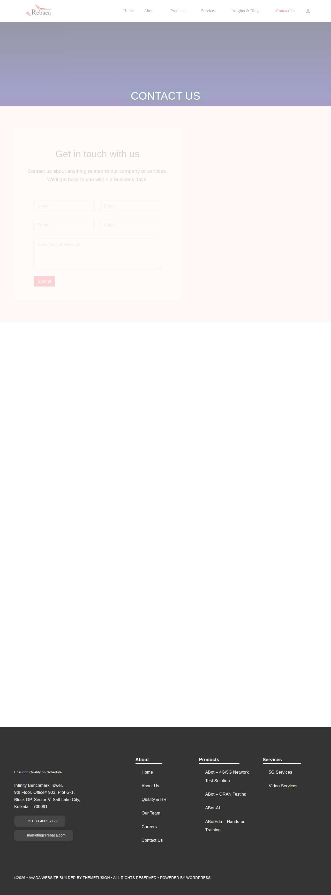

### oactel.com — dry\_run\_ok (dry run)

| | |
|---|---|
| Attempt ID | `adaadcbc-6c53-4c01-a44b-96999c99bbe1` |
| Form URL | https://oactel.com/contact-page/ |
| Final URL | https://oactel.com/contact-page/ |
| Reserved | 2026-11-06 03:58:22 UTC |
| Submit attempted | — |
| Template | standard v2 |
| Confirmation text | none observed |
| Result / error | Selectors verified; fields not typed (domain not in dry-run fill list); not submitted |

Exact message:

~~~text
Subject: Helping customers find your business in AI search (AEO + GEO)

Hi there,

I'm Arun from Devs Arun. More and more customers now ask ChatGPT, Gemini, Perplexity or Google's AI Overviews questions like "who should I hire for this in my area?" before they call anyone. These tools answer from websites they can clearly understand, and they tend to recommend businesses whose pages answer real customer questions.

That is what AEO + GEO (Answer Engine and Generative Engine Optimization) is for. I improve your existing service pages so they clearly answer the questions your customers ask, add structured data that matches the page, and make the call, quote or enquiry step obvious. The benefit: your business gets a better chance of being mentioned or linked in AI answers, and visitors who arrive find it easy to contact you.

The AEO + GEO Starter is a one-time $199 (about ₹16,999, negotiable) for one website: a basic audit, 10 customer questions, improvements to two existing pages, relevant structured data and an action plan, with one revision round.

You can read the full details, send an enquiry or book online here:
https://devsarun.io/aeo-geo/

If this isn't relevant, just reply and I won't contact you again.

Best,
Arun
Devs Arun
itschool408@gmail.com · +91 7654534323
~~~

Submitted field values:

- \#name: Arun
- \#email: itschool408@gmail.com
- \#phone: +91 7654534323
- \#message: Hi there, I'm Arun from Devs Arun. More and more customers now ask ChatGPT, Gemini, Perplexity or Google's AI Overviews 

**Inspected page** — `run-c80e4e0b_attempt-adaadcbc_inspection_2026-11-06T03-58-27-392Z.jpg`

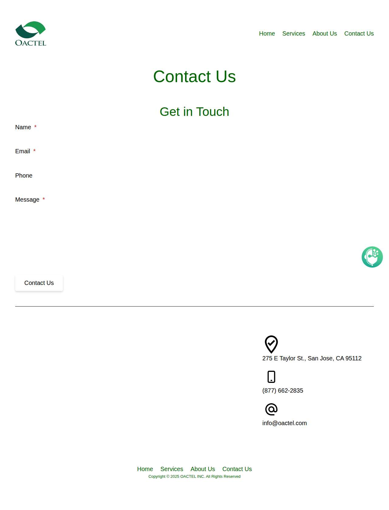

### anytechsystems.com — dry\_run\_ok (dry run)

| | |
|---|---|
| Attempt ID | `fe143f1a-0f74-4d9a-91c4-99fc19b6b1b2` |
| Form URL | https://anytechsystems.com/ |
| Final URL | https://anytechsystems.com/ |
| Reserved | 2026-11-06 03:58:32 UTC |
| Submit attempted | — |
| Template | standard v2 |
| Confirmation text | none observed |
| Result / error | Selectors verified; fields not typed (domain not in dry-run fill list); not submitted |

Exact message:

~~~text
Subject: Helping customers find your business in AI search (AEO + GEO)

Hi there,

I'm Arun from Devs Arun. More and more customers now ask ChatGPT, Gemini, Perplexity or Google's AI Overviews questions like "who should I hire for this in my area?" before they call anyone. These tools answer from websites they can clearly understand, and they tend to recommend businesses whose pages answer real customer questions.

That is what AEO + GEO (Answer Engine and Generative Engine Optimization) is for. I improve your existing service pages so they clearly answer the questions your customers ask, add structured data that matches the page, and make the call, quote or enquiry step obvious. The benefit: your business gets a better chance of being mentioned or linked in AI answers, and visitors who arrive find it easy to contact you.

The AEO + GEO Starter is a one-time $199 (about ₹16,999, negotiable) for one website: a basic audit, 10 customer questions, improvements to two existing pages, relevant structured data and an action plan, with one revision round.

You can read the full details, send an enquiry or book online here:
https://devsarun.io/aeo-geo/

If this isn't relevant, just reply and I won't contact you again.

Best,
Arun
Devs Arun
itschool408@gmail.com · +91 7654534323
~~~

Submitted field values:

- \#input\_1\_1: Arun
- \#input\_1\_2: itschool408@gmail.com
- \#input\_1\_3: +91 7654534323
- \#input\_1\_4: Hi there, I'm Arun from Devs Arun. More and more customers now ask ChatGPT, Gemini, Perplexity or Google's AI Overviews 

**Inspected page** — `run-c80e4e0b_attempt-fe143f1a_inspection_2026-11-06T03-58-37-006Z.jpg`

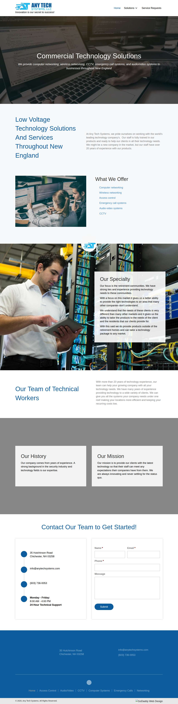

### jamsys.com — dry\_run\_ok (dry run)

| | |
|---|---|
| Attempt ID | `62c9e6cb-c493-4ce6-b950-0f67de517a48` |
| Form URL | https://www.jamsys.com/contact |
| Final URL | https://www.jamsys.com/contact |
| Reserved | 2026-11-06 03:58:42 UTC |
| Submit attempted | — |
| Template | standard v2 |
| Confirmation text | none observed |
| Result / error | Selectors verified; fields not typed (domain not in dry-run fill list); not submitted |

Exact message:

~~~text
Subject: Helping customers find your business in AI search (AEO + GEO)

Hi there,

I'm Arun from Devs Arun. More and more customers now ask ChatGPT, Gemini, Perplexity or Google's AI Overviews questions like "who should I hire for this in my area?" before they call anyone. These tools answer from websites they can clearly understand, and they tend to recommend businesses whose pages answer real customer questions.

That is what AEO + GEO (Answer Engine and Generative Engine Optimization) is for. I improve your existing service pages so they clearly answer the questions your customers ask, add structured data that matches the page, and make the call, quote or enquiry step obvious. The benefit: your business gets a better chance of being mentioned or linked in AI answers, and visitors who arrive find it easy to contact you.

The AEO + GEO Starter is a one-time $199 (about ₹16,999, negotiable) for one website: a basic audit, 10 customer questions, improvements to two existing pages, relevant structured data and an action plan, with one revision round.

You can read the full details, send an enquiry or book online here:
https://devsarun.io/aeo-geo/

If this isn't relevant, just reply and I won't contact you again.

Best,
Arun
Devs Arun
itschool408@gmail.com · +91 7654534323
~~~

Submitted field values:

- input\[name="Name"\]: Arun
- input\[name="Email"\]: itschool408@gmail.com
- input\[name="Phone"\]: +91 7654534323
- input\[name="Company"\]: Devs Arun
- textarea\[name="Message"\]: Hi there, I'm Arun from Devs Arun. More and more customers now ask ChatGPT, Gemini, Perplexity or Google's AI Overviews 

**Inspected page** — `run-c80e4e0b_attempt-62c9e6cb_inspection_2026-11-06T03-58-43-706Z.jpg`

### 1845solutions.com — dry\_run\_ok (dry run)

| | |
|---|---|
| Attempt ID | `168c7665-4a9a-4a94-97e0-6e5339700c41` |
| Form URL | https://1845solutions.com/contact-us/ |
| Final URL | https://1845solutions.com/contact-us/ |
| Reserved | 2026-11-06 03:58:48 UTC |
| Submit attempted | — |
| Template | standard v2 |
| Confirmation text | none observed |
| Result / error | Selectors verified; fields not typed (domain not in dry-run fill list); not submitted |

Exact message:

~~~text
Subject: Helping customers find your business in AI search (AEO + GEO)

Hi there,

I'm Arun from Devs Arun. More and more customers now ask ChatGPT, Gemini, Perplexity or Google's AI Overviews questions like "who should I hire for this in my area?" before they call anyone. These tools answer from websites they can clearly understand, and they tend to recommend businesses whose pages answer real customer questions.

That is what AEO + GEO (Answer Engine and Generative Engine Optimization) is for. I improve your existing service pages so they clearly answer the questions your customers ask, add structured data that matches the page, and make the call, quote or enquiry step obvious. The benefit: your business gets a better chance of being mentioned or linked in AI answers, and visitors who arrive find it easy to contact you.

The AEO + GEO Starter is a one-time $199 (about ₹16,999, negotiable) for one website: a basic audit, 10 customer questions, improvements to two existing pages, relevant structured data and an action plan, with one revision round.

You can read the full details, send an enquiry or book online here:
https://devsarun.io/aeo-geo/

If this isn't relevant, just reply and I won't contact you again.

Best,
Arun
Devs Arun
itschool408@gmail.com · +91 7654534323
~~~

Submitted field values:

- input\[name="your-name"\]: Arun
- input\[name="your-email"\]: itschool408@gmail.com
- input\[name="your-subject"\]: Helping customers find your business in AI search (AEO + GEO)
- textarea\[name="your-message"\]: Hi there, I'm Arun from Devs Arun. More and more customers now ask ChatGPT, Gemini, Perplexity or Google's AI Overviews 

**Inspected page** — `run-c80e4e0b_attempt-168c7665_inspection_2026-11-06T03-58-51-922Z.jpg`

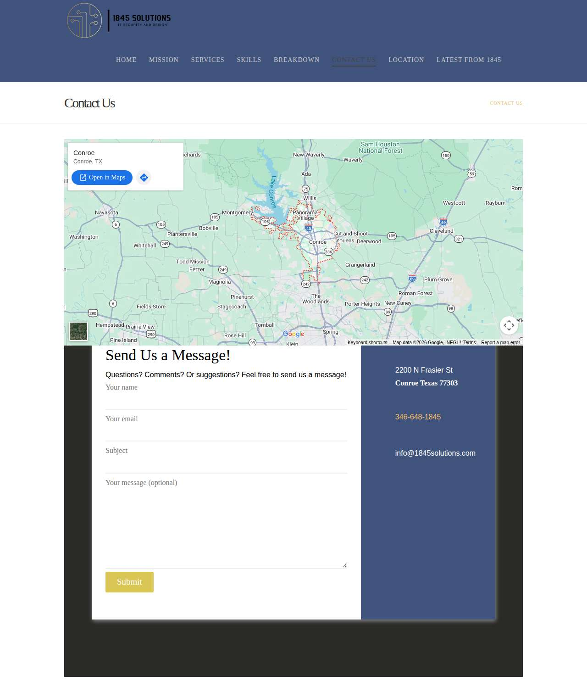

### actionvideoservice.com — dry\_run\_ok (dry run)

| | |
|---|---|
| Attempt ID | `008639cd-079b-4188-bd1a-e5c4121ea632` |
| Form URL | https://actionvideoservice.com/contact/ |
| Final URL | https://actionvideoservice.com/contact/ |
| Reserved | 2026-11-06 03:58:56 UTC |
| Submit attempted | — |
| Template | standard v2 |
| Confirmation text | none observed |
| Result / error | Selectors verified; fields not typed (domain not in dry-run fill list); not submitted |

Exact message:

~~~text
Subject: Helping customers find your business in AI search (AEO + GEO)

Hi there,

I'm Arun from Devs Arun. More and more customers now ask ChatGPT, Gemini, Perplexity or Google's AI Overviews questions like "who should I hire for this in my area?" before they call anyone. These tools answer from websites they can clearly understand, and they tend to recommend businesses whose pages answer real customer questions.

That is what AEO + GEO (Answer Engine and Generative Engine Optimization) is for. I improve your existing service pages so they clearly answer the questions your customers ask, add structured data that matches the page, and make the call, quote or enquiry step obvious. The benefit: your business gets a better chance of being mentioned or linked in AI answers, and visitors who arrive find it easy to contact you.

The AEO + GEO Starter is a one-time $199 (about ₹16,999, negotiable) for one website: a basic audit, 10 customer questions, improvements to two existing pages, relevant structured data and an action plan, with one revision round.

You can read the full details, send an enquiry or book online here:
https://devsarun.io/aeo-geo/

If this isn't relevant, just reply and I won't contact you again.

Best,
Arun
Devs Arun
itschool408@gmail.com · +91 7654534323
~~~

Submitted field values:

- \#input\_2\_1: Arun
- \#input\_2\_2: itschool408@gmail.com
- \#input\_2\_3: Helping customers find your business in AI search (AEO + GEO)
- \#input\_2\_4: Hi there, I'm Arun from Devs Arun. More and more customers now ask ChatGPT, Gemini, Perplexity or Google's AI Overviews 

**Inspected page** — `run-c80e4e0b_attempt-008639cd_inspection_2026-11-06T03-58-58-534Z.jpg`

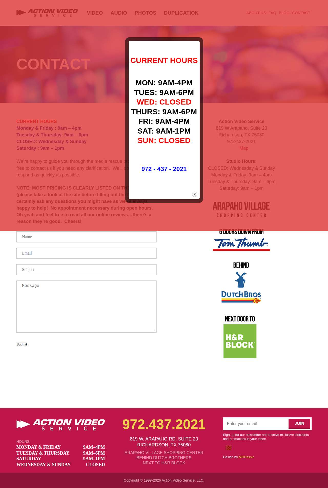

### computech.biz — dry\_run\_ok (dry run)

| | |
|---|---|
| Attempt ID | `c0cde683-04f0-44b1-8666-9e0a4286b322` |
| Form URL | https://www.computech.biz/contact |
| Final URL | https://www.computech.biz/contact |
| Reserved | 2026-11-06 03:59:03 UTC |
| Submit attempted | — |
| Template | standard v2 |
| Confirmation text | none observed |
| Result / error | Selectors verified; fields not typed (domain not in dry-run fill list); not submitted |

Exact message:

~~~text
Subject: Helping customers find your business in AI search (AEO + GEO)

Hi there,

I'm Arun from Devs Arun. More and more customers now ask ChatGPT, Gemini, Perplexity or Google's AI Overviews questions like "who should I hire for this in my area?" before they call anyone. These tools answer from websites they can clearly understand, and they tend to recommend businesses whose pages answer real customer questions.

That is what AEO + GEO (Answer Engine and Generative Engine Optimization) is for. I improve your existing service pages so they clearly answer the questions your customers ask, add structured data that matches the page, and make the call, quote or enquiry step obvious. The benefit: your business gets a better chance of being mentioned or linked in AI answers, and visitors who arrive find it easy to contact you.

The AEO + GEO Starter is a one-time $199 (about ₹16,999, negotiable) for one website: a basic audit, 10 customer questions, improvements to two existing pages, relevant structured data and an action plan, with one revision round.

You can read the full details, send an enquiry or book online here:
https://devsarun.io/aeo-geo/

If this isn't relevant, just reply and I won't contact you again.

Best,
Arun
Devs Arun
itschool408@gmail.com · +91 7654534323
~~~

Submitted field values:

- \#field1: Arun
- \#field2: itschool408@gmail.com
- \#field3: +91 7654534323
- \#field4: Hi there, I'm Arun from Devs Arun. More and more customers now ask ChatGPT, Gemini, Perplexity or Google's AI Overviews 
- \#field5: Devs Arun

**Inspected page** — `run-c80e4e0b_attempt-c0cde683_inspection_2026-11-06T03-59-04-892Z.jpg`

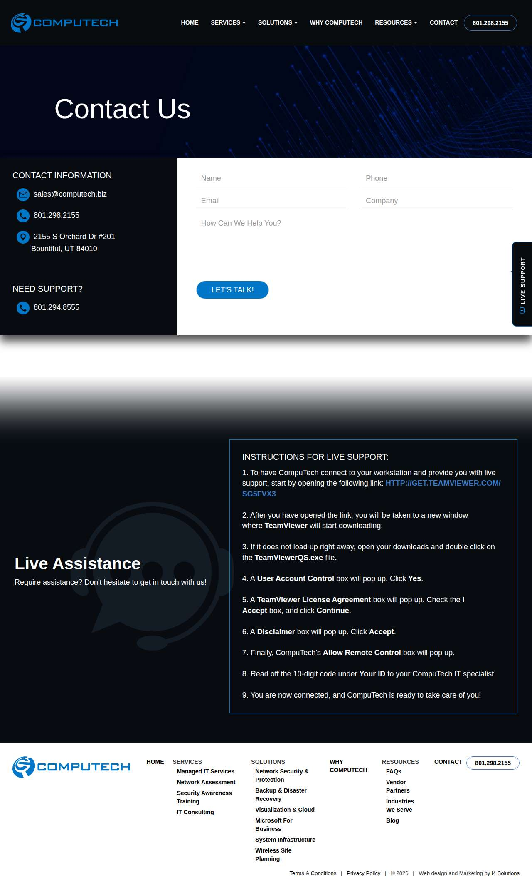

### scarlettculture.com — dry\_run\_ok (dry run)

| | |
|---|---|
| Attempt ID | `a2706282-90a1-408a-afd0-eeb973d0bf81` |
| Form URL | https://www.scarlettgroup.com/about-us/contact-us |
| Final URL | https://www.scarlettgroup.com/about-us/contact-us |
| Reserved | 2026-11-06 03:59:09 UTC |
| Submit attempted | — |
| Template | standard v2 |
| Confirmation text | none observed |
| Result / error | Selectors verified; fields not typed (domain not in dry-run fill list); not submitted |

Exact message:

~~~text
Subject: Helping customers find your business in AI search (AEO + GEO)

Hi there,

I'm Arun from Devs Arun. More and more customers now ask ChatGPT, Gemini, Perplexity or Google's AI Overviews questions like "who should I hire for this in my area?" before they call anyone. These tools answer from websites they can clearly understand, and they tend to recommend businesses whose pages answer real customer questions.

That is what AEO + GEO (Answer Engine and Generative Engine Optimization) is for. I improve your existing service pages so they clearly answer the questions your customers ask, add structured data that matches the page, and make the call, quote or enquiry step obvious. The benefit: your business gets a better chance of being mentioned or linked in AI answers, and visitors who arrive find it easy to contact you.

The AEO + GEO Starter is a one-time $199 (about ₹16,999, negotiable) for one website: a basic audit, 10 customer questions, improvements to two existing pages, relevant structured data and an action plan, with one revision round.

You can read the full details, send an enquiry or book online here:
https://devsarun.io/aeo-geo/

If this isn't relevant, just reply and I won't contact you again.

Best,
Arun
Devs Arun
itschool408@gmail.com · +91 7654534323
~~~

Submitted field values:

- \#edit-name: Arun
- \#edit-email: itschool408@gmail.com
- \#edit-phone: +91 7654534323
- \#edit-title: Helping customers find your business in AI search (AEO + GEO)
- \#edit-company: Devs Arun
- \#edit-message: Hi there, I'm Arun from Devs Arun. More and more customers now ask ChatGPT, Gemini, Perplexity or Google's AI Overviews 

**Inspected page** — `run-c80e4e0b_attempt-a2706282_inspection_2026-11-06T03-59-15-078Z.jpg`

### trinoor.com — dry\_run\_ok (dry run)

| | |
|---|---|
| Attempt ID | `48323b42-b551-4e71-8340-92c576ed650a` |
| Form URL | https://www.trinoor.com/contact\#contact |
| Final URL | https://www.trinoor.com/contact\#contact |
| Reserved | 2026-11-06 03:59:20 UTC |
| Submit attempted | — |
| Template | standard v2 |
| Confirmation text | none observed |
| Result / error | Selectors verified; fields not typed (domain not in dry-run fill list); not submitted |

Exact message:

~~~text
Subject: Helping customers find your business in AI search (AEO + GEO)

Hi there,

I'm Arun from Devs Arun. More and more customers now ask ChatGPT, Gemini, Perplexity or Google's AI Overviews questions like "who should I hire for this in my area?" before they call anyone. These tools answer from websites they can clearly understand, and they tend to recommend businesses whose pages answer real customer questions.

That is what AEO + GEO (Answer Engine and Generative Engine Optimization) is for. I improve your existing service pages so they clearly answer the questions your customers ask, add structured data that matches the page, and make the call, quote or enquiry step obvious. The benefit: your business gets a better chance of being mentioned or linked in AI answers, and visitors who arrive find it easy to contact you.

The AEO + GEO Starter is a one-time $199 (about ₹16,999, negotiable) for one website: a basic audit, 10 customer questions, improvements to two existing pages, relevant structured data and an action plan, with one revision round.

You can read the full details, send an enquiry or book online here:
https://devsarun.io/aeo-geo/

If this isn't relevant, just reply and I won't contact you again.

Best,
Arun
Devs Arun
itschool408@gmail.com · +91 7654534323
~~~

Submitted field values:

- input\[name="Email"\]: itschool408@gmail.com
- textarea\[name="Message"\]: Hi there, I'm Arun from Devs Arun. More and more customers now ask ChatGPT, Gemini, Perplexity or Google's AI Overviews 
- \#contact \> div \> div:nth-of-type(2) \> form \> label:nth-of-type(1) \> div:nth-of-type(2) \> input: Arun
- \#contact \> div \> div:nth-of-type(2) \> form \> label:nth-of-type(3) \> div:nth-of-type(2) \> input: Devs Arun

**Inspected page** — `run-c80e4e0b_attempt-48323b42_inspection_2026-11-06T03-59-24-022Z.jpg`

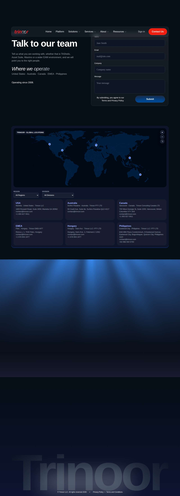

### ackavionics.com — dry\_run\_ok (dry run)

| | |
|---|---|
| Attempt ID | `d0e1d951-2450-41a2-b13a-e20de7f27e8a` |
| Form URL | https://www.ackavionics.com/contact-us-2/ |
| Final URL | https://www.ackavionics.com/contact-us-2/ |
| Reserved | 2026-11-06 03:59:29 UTC |
| Submit attempted | — |
| Template | standard v2 |
| Confirmation text | none observed |
| Result / error | Selectors verified; fields not typed (domain not in dry-run fill list); not submitted |

Exact message:

~~~text
Subject: Helping customers find your business in AI search (AEO + GEO)

Hi there,

I'm Arun from Devs Arun. More and more customers now ask ChatGPT, Gemini, Perplexity or Google's AI Overviews questions like "who should I hire for this in my area?" before they call anyone. These tools answer from websites they can clearly understand, and they tend to recommend businesses whose pages answer real customer questions.

That is what AEO + GEO (Answer Engine and Generative Engine Optimization) is for. I improve your existing service pages so they clearly answer the questions your customers ask, add structured data that matches the page, and make the call, quote or enquiry step obvious. The benefit: your business gets a better chance of being mentioned or linked in AI answers, and visitors who arrive find it easy to contact you.

The AEO + GEO Starter is a one-time $199 (about ₹16,999, negotiable) for one website: a basic audit, 10 customer questions, improvements to two existing pages, relevant structured data and an action plan, with one revision round.

You can read the full details, send an enquiry or book online here:
https://devsarun.io/aeo-geo/

If this isn't relevant, just reply and I won't contact you again.

Best,
Arun
Devs Arun
itschool408@gmail.com · +91 7654534323
~~~

Submitted field values:

- input\[name="text-30"\]: Arun
- input\[name="email-380"\]: itschool408@gmail.com
- input\[name="number-19"\]: +91 7654534323
- textarea\[name="textarea"\]: Hi there, I'm Arun from Devs Arun. More and more customers now ask ChatGPT, Gemini, Perplexity or Google's AI Overviews 

**Inspected page** — `run-c80e4e0b_attempt-d0e1d951_inspection_2026-11-06T03-59-30-929Z.jpg`

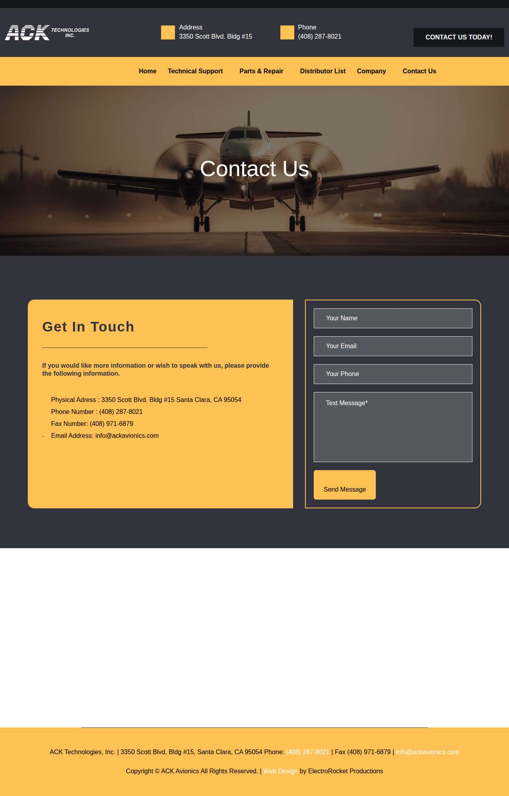

### atomicmachines.com — dry\_run\_ok (dry run)

| | |
|---|---|
| Attempt ID | `1ba41b27-bfe3-4327-8dc1-de9da26dcb2f` |
| Form URL | https://www.atomicmachines.com/contact |
| Final URL | https://www.atomicmachines.com/contact |
| Reserved | 2026-11-06 03:59:35 UTC |
| Submit attempted | — |
| Template | standard v2 |
| Confirmation text | none observed |
| Result / error | Selectors verified; fields not typed (domain not in dry-run fill list); not submitted |

Exact message:

~~~text
Subject: Helping customers find your business in AI search (AEO + GEO)

Hi there,

I'm Arun from Devs Arun. More and more customers now ask ChatGPT, Gemini, Perplexity or Google's AI Overviews questions like "who should I hire for this in my area?" before they call anyone. These tools answer from websites they can clearly understand, and they tend to recommend businesses whose pages answer real customer questions.

That is what AEO + GEO (Answer Engine and Generative Engine Optimization) is for. I improve your existing service pages so they clearly answer the questions your customers ask, add structured data that matches the page, and make the call, quote or enquiry step obvious. The benefit: your business gets a better chance of being mentioned or linked in AI answers, and visitors who arrive find it easy to contact you.

The AEO + GEO Starter is a one-time $199 (about ₹16,999, negotiable) for one website: a basic audit, 10 customer questions, improvements to two existing pages, relevant structured data and an action plan, with one revision round.

You can read the full details, send an enquiry or book online here:
https://devsarun.io/aeo-geo/

If this isn't relevant, just reply and I won't contact you again.

Best,
Arun
Devs Arun
itschool408@gmail.com · +91 7654534323
~~~

Submitted field values:

- input\[name="name"\]: Arun
- input\[name="email"\]: itschool408@gmail.com
- input\[name="company"\]: Devs Arun
- textarea\[name="message"\]: Hi there, I'm Arun from Devs Arun. More and more customers now ask ChatGPT, Gemini, Perplexity or Google's AI Overviews 

**Inspected page** — `run-c80e4e0b_attempt-1ba41b27_inspection_2026-11-06T03-59-37-133Z.jpg`

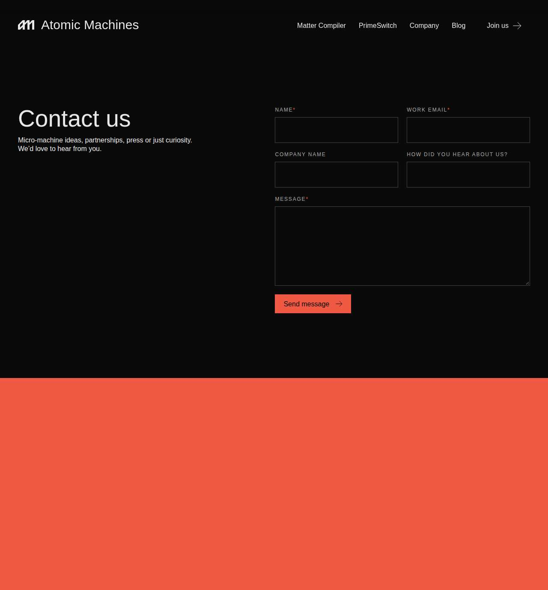

### copiersnw.com — dry\_run\_ok (dry run)

| | |
|---|---|
| Attempt ID | `7fc99250-2cbb-42eb-a268-4db2c416a414` |
| Form URL | https://copiersnw.com/contact/ |
| Final URL | https://copiersnw.com/contact/ |
| Reserved | 2026-11-06 03:59:42 UTC |
| Submit attempted | — |
| Template | standard v2 |
| Confirmation text | none observed |
| Result / error | Selectors verified; fields not typed (domain not in dry-run fill list); not submitted |

Exact message:

~~~text
Subject: Helping customers find your business in AI search (AEO + GEO)

Hi there,

I'm Arun from Devs Arun. More and more customers now ask ChatGPT, Gemini, Perplexity or Google's AI Overviews questions like "who should I hire for this in my area?" before they call anyone. These tools answer from websites they can clearly understand, and they tend to recommend businesses whose pages answer real customer questions.

That is what AEO + GEO (Answer Engine and Generative Engine Optimization) is for. I improve your existing service pages so they clearly answer the questions your customers ask, add structured data that matches the page, and make the call, quote or enquiry step obvious. The benefit: your business gets a better chance of being mentioned or linked in AI answers, and visitors who arrive find it easy to contact you.

The AEO + GEO Starter is a one-time $199 (about ₹16,999, negotiable) for one website: a basic audit, 10 customer questions, improvements to two existing pages, relevant structured data and an action plan, with one revision round.

You can read the full details, send an enquiry or book online here:
https://devsarun.io/aeo-geo/

If this isn't relevant, just reply and I won't contact you again.

Best,
Arun
Devs Arun
itschool408@gmail.com · +91 7654534323
~~~

Submitted field values:

- \#input\_2\_1: Devs Arun
- \#input\_2\_3: itschool408@gmail.com
- \#input\_2\_4: +91 7654534323
- \#input\_2\_6: Hi there, I'm Arun from Devs Arun. More and more customers now ask ChatGPT, Gemini, Perplexity or Google's AI Overviews 
- \#input\_2\_9: itschool408@gmail.com
- \#input\_2\_12: Arun

**Inspected page** — `run-c80e4e0b_attempt-7fc99250_inspection_2026-11-06T03-59-47-227Z.jpg`

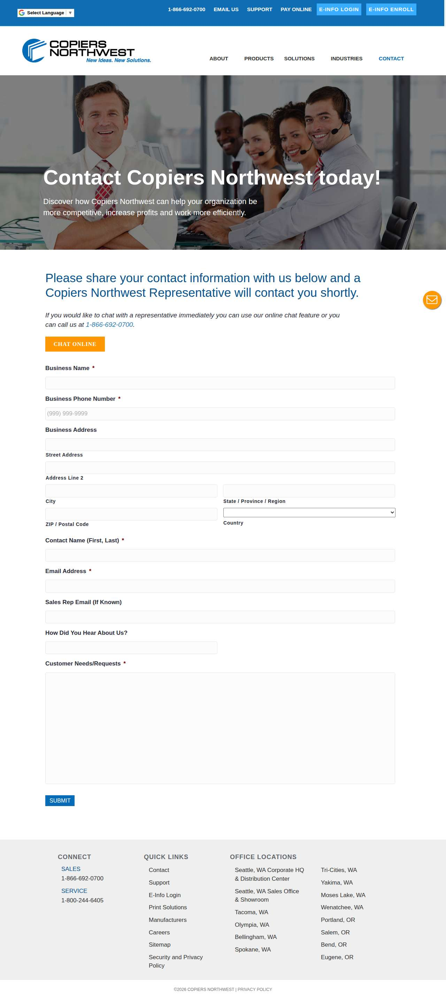

### docu-source.com — dry\_run\_ok (dry run)

| | |
|---|---|
| Attempt ID | `125dd702-5dc3-4cca-80c4-16047d7e43ea` |
| Form URL | http://www.docu-source.com/ |
| Final URL | http://www.docu-source.com/ |
| Reserved | 2026-11-06 03:59:52 UTC |
| Submit attempted | — |
| Template | standard v2 |
| Confirmation text | none observed |
| Result / error | Selectors verified; fields not typed (domain not in dry-run fill list); not submitted |

Exact message:

~~~text
Subject: Helping customers find your business in AI search (AEO + GEO)

Hi there,

I'm Arun from Devs Arun. More and more customers now ask ChatGPT, Gemini, Perplexity or Google's AI Overviews questions like "who should I hire for this in my area?" before they call anyone. These tools answer from websites they can clearly understand, and they tend to recommend businesses whose pages answer real customer questions.

That is what AEO + GEO (Answer Engine and Generative Engine Optimization) is for. I improve your existing service pages so they clearly answer the questions your customers ask, add structured data that matches the page, and make the call, quote or enquiry step obvious. The benefit: your business gets a better chance of being mentioned or linked in AI answers, and visitors who arrive find it easy to contact you.

The AEO + GEO Starter is a one-time $199 (about ₹16,999, negotiable) for one website: a basic audit, 10 customer questions, improvements to two existing pages, relevant structured data and an action plan, with one revision round.

You can read the full details, send an enquiry or book online here:
https://devsarun.io/aeo-geo/

If this isn't relevant, just reply and I won't contact you again.

Best,
Arun
Devs Arun
itschool408@gmail.com · +91 7654534323
~~~

Submitted field values:

- \#input\_1\_1: Arun
- \#input\_1\_2: itschool408@gmail.com
- \#input\_1\_3: Hi there, I'm Arun from Devs Arun. More and more customers now ask ChatGPT, Gemini, Perplexity or Google's AI Overviews 

**Inspected page** — `run-c80e4e0b_attempt-125dd702_inspection_2026-11-06T03-59-55-027Z.jpg`

### whoisowenjones.com — dry\_run\_ok (dry run)

| | |
|---|---|
| Attempt ID | `d135b7ae-0fc0-4fca-bd84-f5f21e8b31fc` |
| Form URL | https://weareowen.co/contact/ |
| Final URL | https://weareowen.co/contact/ |
| Reserved | 2026-11-06 04:00:00 UTC |
| Submit attempted | — |
| Template | standard v2 |
| Confirmation text | none observed |
| Result / error | Selectors verified; fields not typed (domain not in dry-run fill list); not submitted |

Exact message:

~~~text
Subject: Helping customers find your business in AI search (AEO + GEO)

Hi there,

I'm Arun from Devs Arun. More and more customers now ask ChatGPT, Gemini, Perplexity or Google's AI Overviews questions like "who should I hire for this in my area?" before they call anyone. These tools answer from websites they can clearly understand, and they tend to recommend businesses whose pages answer real customer questions.

That is what AEO + GEO (Answer Engine and Generative Engine Optimization) is for. I improve your existing service pages so they clearly answer the questions your customers ask, add structured data that matches the page, and make the call, quote or enquiry step obvious. The benefit: your business gets a better chance of being mentioned or linked in AI answers, and visitors who arrive find it easy to contact you.

The AEO + GEO Starter is a one-time $199 (about ₹16,999, negotiable) for one website: a basic audit, 10 customer questions, improvements to two existing pages, relevant structured data and an action plan, with one revision round.

You can read the full details, send an enquiry or book online here:
https://devsarun.io/aeo-geo/

If this isn't relevant, just reply and I won't contact you again.

Best,
Arun
Devs Arun
itschool408@gmail.com · +91 7654534323
~~~

Submitted field values:

- \#owen-contact-name: Arun
- \#owen-contact-email: itschool408@gmail.com
- \#owen-contact-company: Devs Arun
- \#owen-contact-message: Hi there, I'm Arun from Devs Arun. More and more customers now ask ChatGPT, Gemini, Perplexity or Google's AI Overviews 

**Inspected page** — `run-c80e4e0b_attempt-d135b7ae_inspection_2026-11-06T04-00-02-480Z.jpg`

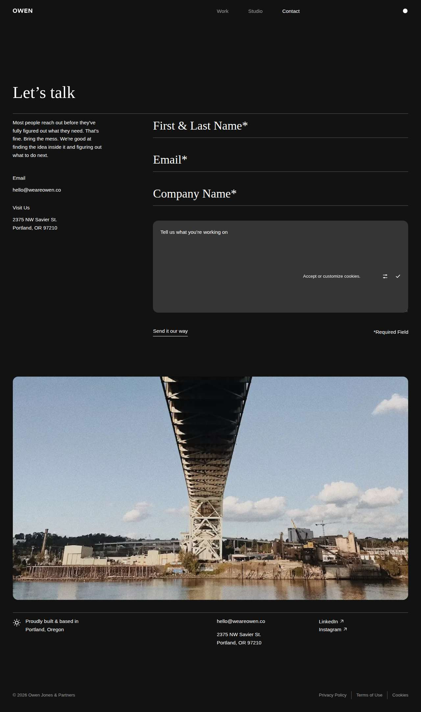

### 206agency.com — dry\_run\_ok (dry run)

| | |
|---|---|
| Attempt ID | `63d9dd71-8007-4fb3-85dc-455b068efb28` |
| Form URL | https://206agency.com/ |
| Final URL | https://206agency.com/ |
| Reserved | 2026-11-06 04:00:07 UTC |
| Submit attempted | — |
| Template | standard v2 |
| Confirmation text | none observed |
| Result / error | Selectors verified; fields not typed (domain not in dry-run fill list); not submitted |

Exact message:

~~~text
Subject: Helping customers find your business in AI search (AEO + GEO)

Hi there,

I'm Arun from Devs Arun. More and more customers now ask ChatGPT, Gemini, Perplexity or Google's AI Overviews questions like "who should I hire for this in my area?" before they call anyone. These tools answer from websites they can clearly understand, and they tend to recommend businesses whose pages answer real customer questions.

That is what AEO + GEO (Answer Engine and Generative Engine Optimization) is for. I improve your existing service pages so they clearly answer the questions your customers ask, add structured data that matches the page, and make the call, quote or enquiry step obvious. The benefit: your business gets a better chance of being mentioned or linked in AI answers, and visitors who arrive find it easy to contact you.

The AEO + GEO Starter is a one-time $199 (about ₹16,999, negotiable) for one website: a basic audit, 10 customer questions, improvements to two existing pages, relevant structured data and an action plan, with one revision round.

You can read the full details, send an enquiry or book online here:
https://devsarun.io/aeo-geo/

If this isn't relevant, just reply and I won't contact you again.

Best,
Arun
Devs Arun
itschool408@gmail.com · +91 7654534323
~~~

Submitted field values:

- \#Name: Arun
- \#Email: itschool408@gmail.com
- \#Message: Hi there, I'm Arun from Devs Arun. More and more customers now ask ChatGPT, Gemini, Perplexity or Google's AI Overviews 

**Inspected page** — `run-c80e4e0b_attempt-63d9dd71_inspection_2026-11-06T04-00-09-834Z.jpg`

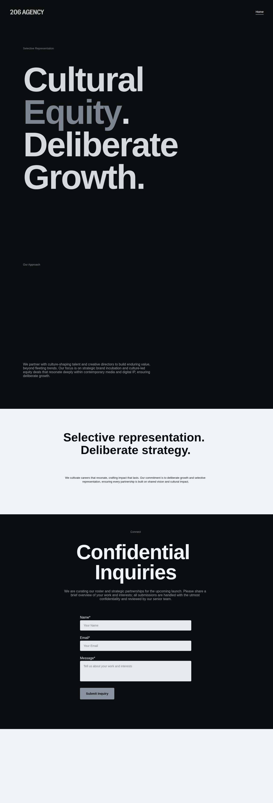

### alphagraphics.com — dry\_run\_ok (dry run)

| | |
|---|---|
| Attempt ID | `a776aba6-f7e7-4a11-bae5-add869f9b11e` |
| Form URL | https://www.alphagraphics.com/contact-us/ |
| Final URL | https://www.alphagraphics.com/contact-us/ |
| Reserved | 2026-11-06 04:00:14 UTC |
| Submit attempted | — |
| Template | standard v2 |
| Confirmation text | none observed |
| Result / error | Selectors verified; fields not typed (domain not in dry-run fill list); not submitted |

Exact message:

~~~text
Subject: Helping customers find your business in AI search (AEO + GEO)

Hi there,

I'm Arun from Devs Arun. More and more customers now ask ChatGPT, Gemini, Perplexity or Google's AI Overviews questions like "who should I hire for this in my area?" before they call anyone. These tools answer from websites they can clearly understand, and they tend to recommend businesses whose pages answer real customer questions.

That is what AEO + GEO (Answer Engine and Generative Engine Optimization) is for. I improve your existing service pages so they clearly answer the questions your customers ask, add structured data that matches the page, and make the call, quote or enquiry step obvious. The benefit: your business gets a better chance of being mentioned or linked in AI answers, and visitors who arrive find it easy to contact you.

The AEO + GEO Starter is a one-time $199 (about ₹16,999, negotiable) for one website: a basic audit, 10 customer questions, improvements to two existing pages, relevant structured data and an action plan, with one revision round.

You can read the full details, send an enquiry or book online here:
https://devsarun.io/aeo-geo/

If this isn't relevant, just reply and I won't contact you again.

Best,
Arun
Devs Arun
itschool408@gmail.com · +91 7654534323
~~~

Submitted field values:

- \#id\_email: itschool408@gmail.com
- \#id\_company: Devs Arun
- \#id\_message: Hi there, I'm Arun from Devs Arun. More and more customers now ask ChatGPT, Gemini, Perplexity or Google's AI Overviews 
- \#id\_full-name: Arun

**Inspected page** — `run-c80e4e0b_attempt-a776aba6_inspection_2026-11-06T04-00-19-341Z.jpg`

### completemediainc.com — dry\_run\_ok (dry run)

| | |
|---|---|
| Attempt ID | `03f721db-72f0-4ca0-83dc-c0e7d9ee21f5` |
| Form URL | https://complete.media/contact |
| Final URL | https://complete.media/contact |
| Reserved | 2026-11-06 04:00:24 UTC |
| Submit attempted | — |
| Template | standard v2 |
| Confirmation text | none observed |
| Result / error | Selectors verified; fields not typed (domain not in dry-run fill list); not submitted |

Exact message:

~~~text
Subject: Helping customers find your business in AI search (AEO + GEO)

Hi there,

I'm Arun from Devs Arun. More and more customers now ask ChatGPT, Gemini, Perplexity or Google's AI Overviews questions like "who should I hire for this in my area?" before they call anyone. These tools answer from websites they can clearly understand, and they tend to recommend businesses whose pages answer real customer questions.

That is what AEO + GEO (Answer Engine and Generative Engine Optimization) is for. I improve your existing service pages so they clearly answer the questions your customers ask, add structured data that matches the page, and make the call, quote or enquiry step obvious. The benefit: your business gets a better chance of being mentioned or linked in AI answers, and visitors who arrive find it easy to contact you.

The AEO + GEO Starter is a one-time $199 (about ₹16,999, negotiable) for one website: a basic audit, 10 customer questions, improvements to two existing pages, relevant structured data and an action plan, with one revision round.

You can read the full details, send an enquiry or book online here:
https://devsarun.io/aeo-geo/

If this isn't relevant, just reply and I won't contact you again.

Best,
Arun
Devs Arun
itschool408@gmail.com · +91 7654534323
~~~

Submitted field values:

- input\[name="name"\]: Arun
- input\[name="email"\]: itschool408@gmail.com
- input\[name="phone"\]: +91 7654534323
- input\[name="business"\]: Devs Arun
- textarea\[name="message"\]: Hi there, I'm Arun from Devs Arun. More and more customers now ask ChatGPT, Gemini, Perplexity or Google's AI Overviews 

**Inspected page** — `run-c80e4e0b_attempt-03f721db_inspection_2026-11-06T04-00-26-727Z.jpg`

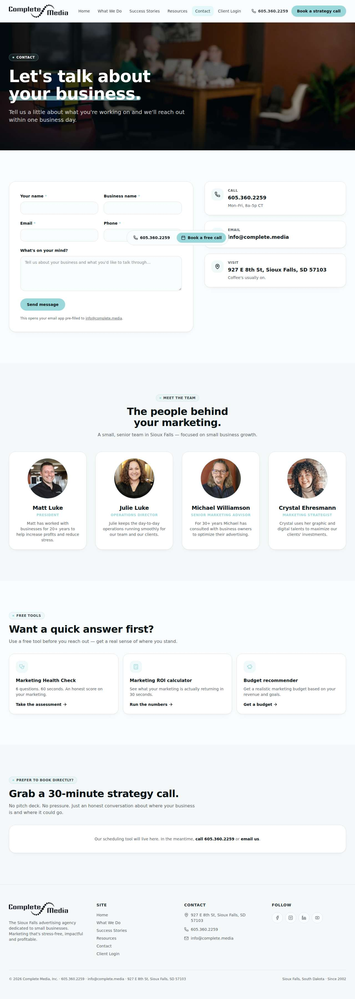

### i5810media.com — dry\_run\_ok (dry run)

| | |
|---|---|
| Attempt ID | `97061f3f-3729-453c-8599-002f4b2bb381` |
| Form URL | https://missionactivate.com/contact/ |
| Final URL | https://missionactivate.com/contact/ |
| Reserved | 2026-11-06 04:00:31 UTC |
| Submit attempted | — |
| Template | standard v2 |
| Confirmation text | none observed |
| Result / error | Selectors verified; fields not typed (domain not in dry-run fill list); not submitted |

Exact message:

~~~text
Subject: Helping customers find your business in AI search (AEO + GEO)

Hi there,

I'm Arun from Devs Arun. More and more customers now ask ChatGPT, Gemini, Perplexity or Google's AI Overviews questions like "who should I hire for this in my area?" before they call anyone. These tools answer from websites they can clearly understand, and they tend to recommend businesses whose pages answer real customer questions.

That is what AEO + GEO (Answer Engine and Generative Engine Optimization) is for. I improve your existing service pages so they clearly answer the questions your customers ask, add structured data that matches the page, and make the call, quote or enquiry step obvious. The benefit: your business gets a better chance of being mentioned or linked in AI answers, and visitors who arrive find it easy to contact you.

The AEO + GEO Starter is a one-time $199 (about ₹16,999, negotiable) for one website: a basic audit, 10 customer questions, improvements to two existing pages, relevant structured data and an action plan, with one revision round.

You can read the full details, send an enquiry or book online here:
https://devsarun.io/aeo-geo/

If this isn't relevant, just reply and I won't contact you again.

Best,
Arun
Devs Arun
itschool408@gmail.com · +91 7654534323
~~~

Submitted field values:

- \#form-field-name: Arun
- \#form-field-email: itschool408@gmail.com
- \#form-field-message: Hi there, I'm Arun from Devs Arun. More and more customers now ask ChatGPT, Gemini, Perplexity or Google's AI Overviews 
- \#form-field-field\_a75e35c: Devs Arun

**Inspected page** — `run-c80e4e0b_attempt-97061f3f_inspection_2026-11-06T04-00-32-943Z.jpg`

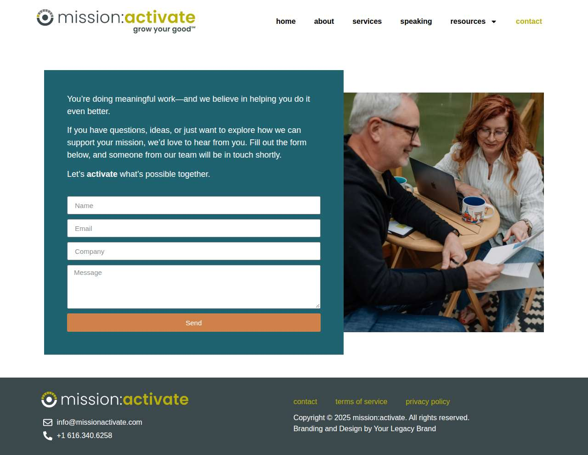

## Events (109)

| Time (UTC) | Event | Website | Details |
|---|---|---|---|
| 03:57:48 | run\_queued | — | dry\_run run requested by github:itsDevsArun |
| 03:57:48 | run\_dispatched | — | dispatch disabled (local test mode) |
| 03:57:52 | run\_started | — | Runner claimed dry\_run run |
| 03:57:52 | website\_selected | helixmechanical.com | Dry-run target helixmechanical.com |
| 03:57:52 | draft\_prepared | helixmechanical.com | Draft prepared with template standard v2 |
| 03:57:54 | page\_opened | helixmechanical.com | Opened form page |
| 03:57:54 | screenshot\_saved | helixmechanical.com | inspection screenshot saved (54 KB) |
| 03:57:54 | review\_required | helixmechanical.com | dry run failed: Mapped field "First Name \*" not found uniquely |
| 03:57:59 | website\_selected | knoxvilleelectrician.com | Dry-run target knoxvilleelectrician.com |
| 03:57:59 | draft\_prepared | knoxvilleelectrician.com | Draft prepared with template standard v2 |
| 03:58:02 | page\_opened | knoxvilleelectrician.com | Opened form page |
| 03:58:02 | screenshot\_saved | knoxvilleelectrician.com | inspection screenshot saved (137 KB) |
| 03:58:02 | review\_required | knoxvilleelectrician.com | dry run failed: Mapped field "Name" not found uniquely |
| 03:58:07 | website\_selected | mspc.cpa | Dry-run target mspc.cpa |
| 03:58:07 | draft\_prepared | mspc.cpa | Draft prepared with template standard v2 |
| 03:58:10 | page\_opened | mspc.cpa | Opened form page |
| 03:58:10 | screenshot\_saved | mspc.cpa | inspection screenshot saved (162 KB) |
| 03:58:10 | review\_required | mspc.cpa | dry run failed: Mapped field "Full Name \*" not found uniquely |
| 03:58:15 | website\_selected | rebaca.com | Dry-run target rebaca.com |
| 03:58:15 | draft\_prepared | rebaca.com | Draft prepared with template standard v2 |
| 03:58:17 | page\_opened | rebaca.com | Opened form page |
| 03:58:17 | screenshot\_saved | rebaca.com | inspection screenshot saved (68 KB) |
| 03:58:17 | dry\_run\_checked | rebaca.com | dry run ok: Selectors verified; fields not typed (domain not in dry-run fill list); not submitted |
| 03:58:22 | website\_selected | oactel.com | Dry-run target oactel.com |
| 03:58:22 | draft\_prepared | oactel.com | Draft prepared with template standard v2 |
| 03:58:27 | page\_opened | oactel.com | Opened form page |
| 03:58:27 | screenshot\_saved | oactel.com | inspection screenshot saved (42 KB) |
| 03:58:27 | dry\_run\_checked | oactel.com | dry run ok: Selectors verified; fields not typed (domain not in dry-run fill list); not submitted |
| 03:58:32 | website\_selected | anytechsystems.com | Dry-run target anytechsystems.com |
| 03:58:32 | draft\_prepared | anytechsystems.com | Draft prepared with template standard v2 |
| 03:58:36 | page\_opened | anytechsystems.com | Opened form page |
| 03:58:37 | screenshot\_saved | anytechsystems.com | inspection screenshot saved (383 KB) |
| 03:58:37 | dry\_run\_checked | anytechsystems.com | dry run ok: Selectors verified; fields not typed (domain not in dry-run fill list); not submitted |
| 03:58:42 | website\_selected | jamsys.com | Dry-run target jamsys.com |
| 03:58:42 | draft\_prepared | jamsys.com | Draft prepared with template standard v2 |
| 03:58:43 | page\_opened | jamsys.com | Opened form page |
| 03:58:43 | screenshot\_saved | jamsys.com | inspection screenshot saved (143 KB) |
| 03:58:43 | dry\_run\_checked | jamsys.com | dry run ok: Selectors verified; fields not typed (domain not in dry-run fill list); not submitted |
| 03:58:48 | website\_selected | 1845solutions.com | Dry-run target 1845solutions.com |
| 03:58:48 | draft\_prepared | 1845solutions.com | Draft prepared with template standard v2 |
| 03:58:51 | page\_opened | 1845solutions.com | Opened form page |
| 03:58:51 | screenshot\_saved | 1845solutions.com | inspection screenshot saved (96 KB) |
| 03:58:51 | dry\_run\_checked | 1845solutions.com | dry run ok: Selectors verified; fields not typed (domain not in dry-run fill list); not submitted |
| 03:58:56 | website\_selected | actionvideoservice.com | Dry-run target actionvideoservice.com |
| 03:58:56 | draft\_prepared | actionvideoservice.com | Draft prepared with template standard v2 |
| 03:58:58 | page\_opened | actionvideoservice.com | Opened form page |
| 03:58:58 | screenshot\_saved | actionvideoservice.com | inspection screenshot saved (124 KB) |
| 03:58:58 | dry\_run\_checked | actionvideoservice.com | dry run ok: Selectors verified; fields not typed (domain not in dry-run fill list); not submitted |
| 03:59:03 | website\_selected | computech.biz | Dry-run target computech.biz |
| 03:59:03 | draft\_prepared | computech.biz | Draft prepared with template standard v2 |
| 03:59:04 | page\_opened | computech.biz | Opened form page |
| 03:59:04 | screenshot\_saved | computech.biz | inspection screenshot saved (155 KB) |
| 03:59:04 | dry\_run\_checked | computech.biz | dry run ok: Selectors verified; fields not typed (domain not in dry-run fill list); not submitted |
| 03:59:09 | website\_selected | scarlettculture.com | Dry-run target scarlettculture.com |
| 03:59:09 | draft\_prepared | scarlettculture.com | Draft prepared with template standard v2 |
| 03:59:14 | page\_opened | scarlettculture.com | Opened form page |
| 03:59:15 | screenshot\_saved | scarlettculture.com | inspection screenshot saved (223 KB) |
| 03:59:15 | dry\_run\_checked | scarlettculture.com | dry run ok: Selectors verified; fields not typed (domain not in dry-run fill list); not submitted |
| 03:59:20 | website\_selected | trinoor.com | Dry-run target trinoor.com |
| 03:59:20 | draft\_prepared | trinoor.com | Draft prepared with template standard v2 |
| 03:59:22 | page\_opened | trinoor.com | Opened form page |
| 03:59:24 | screenshot\_saved | trinoor.com | inspection screenshot saved (123 KB) |
| 03:59:24 | dry\_run\_checked | trinoor.com | dry run ok: Selectors verified; fields not typed (domain not in dry-run fill list); not submitted |
| 03:59:29 | website\_selected | ackavionics.com | Dry-run target ackavionics.com |
| 03:59:29 | draft\_prepared | ackavionics.com | Draft prepared with template standard v2 |
| 03:59:30 | page\_opened | ackavionics.com | Opened form page |
| 03:59:30 | screenshot\_saved | ackavionics.com | inspection screenshot saved (100 KB) |
| 03:59:30 | dry\_run\_checked | ackavionics.com | dry run ok: Selectors verified; fields not typed (domain not in dry-run fill list); not submitted |
| 03:59:35 | website\_selected | atomicmachines.com | Dry-run target atomicmachines.com |
| 03:59:35 | draft\_prepared | atomicmachines.com | Draft prepared with template standard v2 |
| 03:59:37 | page\_opened | atomicmachines.com | Opened form page |
| 03:59:37 | screenshot\_saved | atomicmachines.com | inspection screenshot saved (34 KB) |
| 03:59:37 | dry\_run\_checked | atomicmachines.com | dry run ok: Selectors verified; fields not typed (domain not in dry-run fill list); not submitted |
| 03:59:42 | website\_selected | copiersnw.com | Dry-run target copiersnw.com |
| 03:59:42 | draft\_prepared | copiersnw.com | Draft prepared with template standard v2 |
| 03:59:47 | page\_opened | copiersnw.com | Opened form page |
| 03:59:47 | screenshot\_saved | copiersnw.com | inspection screenshot saved (171 KB) |
| 03:59:47 | dry\_run\_checked | copiersnw.com | dry run ok: Selectors verified; fields not typed (domain not in dry-run fill list); not submitted |
| 03:59:52 | website\_selected | docu-source.com | Dry-run target docu-source.com |
| 03:59:52 | draft\_prepared | docu-source.com | Draft prepared with template standard v2 |
| 03:59:54 | page\_opened | docu-source.com | Opened form page |
| 03:59:55 | screenshot\_saved | docu-source.com | inspection screenshot saved (573 KB) |
| 03:59:55 | dry\_run\_checked | docu-source.com | dry run ok: Selectors verified; fields not typed (domain not in dry-run fill list); not submitted |
| 04:00:00 | website\_selected | whoisowenjones.com | Dry-run target whoisowenjones.com |
| 04:00:00 | draft\_prepared | whoisowenjones.com | Draft prepared with template standard v2 |
| 04:00:02 | page\_opened | whoisowenjones.com | Opened form page |
| 04:00:02 | screenshot\_saved | whoisowenjones.com | inspection screenshot saved (132 KB) |
| 04:00:02 | dry\_run\_checked | whoisowenjones.com | dry run ok: Selectors verified; fields not typed (domain not in dry-run fill list); not submitted |
| 04:00:07 | website\_selected | 206agency.com | Dry-run target 206agency.com |
| 04:00:07 | draft\_prepared | 206agency.com | Draft prepared with template standard v2 |
| 04:00:09 | page\_opened | 206agency.com | Opened form page |
| 04:00:09 | screenshot\_saved | 206agency.com | inspection screenshot saved (126 KB) |
| 04:00:09 | dry\_run\_checked | 206agency.com | dry run ok: Selectors verified; fields not typed (domain not in dry-run fill list); not submitted |
| 04:00:14 | website\_selected | alphagraphics.com | Dry-run target alphagraphics.com |
| 04:00:14 | draft\_prepared | alphagraphics.com | Draft prepared with template standard v2 |
| 04:00:19 | page\_opened | alphagraphics.com | Opened form page |
| 04:00:19 | screenshot\_saved | alphagraphics.com | inspection screenshot saved (175 KB) |
| 04:00:19 | dry\_run\_checked | alphagraphics.com | dry run ok: Selectors verified; fields not typed (domain not in dry-run fill list); not submitted |
| 04:00:24 | website\_selected | completemediainc.com | Dry-run target completemediainc.com |
| 04:00:24 | draft\_prepared | completemediainc.com | Draft prepared with template standard v2 |
| 04:00:26 | page\_opened | completemediainc.com | Opened form page |
| 04:00:26 | screenshot\_saved | completemediainc.com | inspection screenshot saved (209 KB) |
| 04:00:26 | dry\_run\_checked | completemediainc.com | dry run ok: Selectors verified; fields not typed (domain not in dry-run fill list); not submitted |
| 04:00:31 | website\_selected | i5810media.com | Dry-run target i5810media.com |
| 04:00:31 | draft\_prepared | i5810media.com | Draft prepared with template standard v2 |
| 04:00:32 | page\_opened | i5810media.com | Opened form page |
| 04:00:32 | screenshot\_saved | i5810media.com | inspection screenshot saved (79 KB) |
| 04:00:32 | dry\_run\_checked | i5810media.com | dry run ok: Selectors verified; fields not typed (domain not in dry-run fill list); not submitted |
| 04:00:37 | run\_completed | — | Run completed (queue\_exhausted) |
