# Run 4077e053 — live — completed

| | |
|---|---|
| Run ID | `4077e053-10de-4cef-b1c8-413725412c01` |
| Requested by | github:itsDevsArun |
| Started | 2026-11-06 03:16:19 UTC |
| Finished | 2026-11-06 03:25:18 UTC |
| Finish reason | queue\_exhausted |
| GitHub Actions | https://github.com/itsDevsArun/aeo-geo/actions/runs/42148448245 |

CSV for this run: [runs/2026-11-06_live_4077e053.csv](2026-11-06_live_4077e053.csv)

## Attempts (26)

### clearchoiceplumbingllc.com — failed\_before\_submit (LIVE)

| | |
|---|---|
| Attempt ID | `a6ff634e-2746-4156-a041-ec97b8d36a44` |
| Form URL | https://clearchoiceplumbingllc.com/contact/ |
| Final URL | — |
| Reserved | 2026-11-06 03:16:20 UTC |
| Submit attempted | — |
| Template | standard v2 |
| Confirmation text | none observed |
| Result / error | locator.fill: Error: Cannot type text into input\[type=number\] |

Exact message:

~~~text
Subject: Helping customers find your business in AI search (AEO + GEO)

Hi there,

I'm Arun from Devs Arun. More and more customers now ask ChatGPT, Gemini, Perplexity or Google's AI Overviews questions like "who should I hire for this in my area?" before they call anyone. These tools answer from websites they can clearly understand, and they tend to recommend businesses whose pages answer real customer questions.

That is what AEO + GEO (Answer Engine and Generative Engine Optimization) is for. I improve your existing service pages so they clearly answer the questions your customers ask, add structured data that matches the page, and make the call, quote or enquiry step obvious. The benefit: your business gets a better chance of being mentioned or linked in AI answers, and visitors who arrive find it easy to contact you.

The AEO + GEO Starter is a one-time $199 (about ₹16,999, negotiable) for one website: a basic audit, 10 customer questions, improvements to two existing pages, relevant structured data and an action plan, with one revision round.

You can read the full details, send an enquiry or book online here:
https://devsarun.io/aeo-geo/

If this isn't relevant, just reply and I won't contact you again.

Best,
Arun
Devs Arun
itschool408@gmail.com · +91 7654534323
~~~

Submitted field values:

- \#wpforms-51-field\_1: Arun
- \#wpforms-51-field\_2: itschool408@gmail.com
- \#wpforms-51-field\_3: Hi there, I'm Arun from Devs Arun. More and more customers now ask ChatGPT, Gemini, Perplexity or Google's AI Overviews 
- \#wpforms-51-field\_5: +91 7654534323

**Inspected page** — `run-4077e053_attempt-a6ff634e_inspection_2026-11-06T03-16-21-905Z.jpg`

### bwnwincpainting.com — failed\_before\_submit (LIVE)

| | |
|---|---|
| Attempt ID | `03d19b0f-067c-4262-982e-1df477638243` |
| Form URL | https://www.bwnwincpainting.com/contact/ |
| Final URL | — |
| Reserved | 2026-11-06 03:16:26 UTC |
| Submit attempted | — |
| Template | standard v2 |
| Confirmation text | none observed |
| Result / error | locator.fill: Error: Cannot type text into input\[type=number\] |

Exact message:

~~~text
Subject: Helping customers find your business in AI search (AEO + GEO)

Hi there,

I'm Arun from Devs Arun. More and more customers now ask ChatGPT, Gemini, Perplexity or Google's AI Overviews questions like "who should I hire for this in my area?" before they call anyone. These tools answer from websites they can clearly understand, and they tend to recommend businesses whose pages answer real customer questions.

That is what AEO + GEO (Answer Engine and Generative Engine Optimization) is for. I improve your existing service pages so they clearly answer the questions your customers ask, add structured data that matches the page, and make the call, quote or enquiry step obvious. The benefit: your business gets a better chance of being mentioned or linked in AI answers, and visitors who arrive find it easy to contact you.

The AEO + GEO Starter is a one-time $199 (about ₹16,999, negotiable) for one website: a basic audit, 10 customer questions, improvements to two existing pages, relevant structured data and an action plan, with one revision round.

You can read the full details, send an enquiry or book online here:
https://devsarun.io/aeo-geo/

If this isn't relevant, just reply and I won't contact you again.

Best,
Arun
Devs Arun
itschool408@gmail.com · +91 7654534323
~~~

Submitted field values:

- \#name-1151: Arun
- \#email-1151: itschool408@gmail.com
- \#phone-1151: +91 7654534323
- \#message-1151: Hi there, I'm Arun from Devs Arun. More and more customers now ask ChatGPT, Gemini, Perplexity or Google's AI Overviews 

**Inspected page** — `run-4077e053_attempt-03d19b0f_inspection_2026-11-06T03-16-28-952Z.jpg`

### absoluterestorepa.com — failed\_before\_submit (LIVE)

| | |
|---|---|
| Attempt ID | `3a8cc5d5-5f40-4a2b-a815-6f8c8ff72ca4` |
| Form URL | https://absoluterestorepa.com/contact-us/ |
| Final URL | — |
| Reserved | 2026-11-06 03:16:33 UTC |
| Submit attempted | — |
| Template | standard v2 |
| Confirmation text | none observed |
| Result / error | locator.fill: Error: Cannot type text into input\[type=number\] |

Exact message:

~~~text
Subject: Helping customers find your business in AI search (AEO + GEO)

Hi there,

I'm Arun from Devs Arun. More and more customers now ask ChatGPT, Gemini, Perplexity or Google's AI Overviews questions like "who should I hire for this in my area?" before they call anyone. These tools answer from websites they can clearly understand, and they tend to recommend businesses whose pages answer real customer questions.

That is what AEO + GEO (Answer Engine and Generative Engine Optimization) is for. I improve your existing service pages so they clearly answer the questions your customers ask, add structured data that matches the page, and make the call, quote or enquiry step obvious. The benefit: your business gets a better chance of being mentioned or linked in AI answers, and visitors who arrive find it easy to contact you.

The AEO + GEO Starter is a one-time $199 (about ₹16,999, negotiable) for one website: a basic audit, 10 customer questions, improvements to two existing pages, relevant structured data and an action plan, with one revision round.

You can read the full details, send an enquiry or book online here:
https://devsarun.io/aeo-geo/

If this isn't relevant, just reply and I won't contact you again.

Best,
Arun
Devs Arun
itschool408@gmail.com · +91 7654534323
~~~

Submitted field values:

- \#form-field-name: Arun
- \#form-field-message: Hi there, I'm Arun from Devs Arun. More and more customers now ask ChatGPT, Gemini, Perplexity or Google's AI Overviews 
- \#form-field-field\_ed02ec2: +91 7654534323
- \#content \> div \> div \> div:nth-of-type(2) \> div \> div:nth-of-type(1) \> div:nth-of-type(2) \> div \> form \> div \> div:nth-of-type(3) \> input: itschool408@gmail.com

**Inspected page** — `run-4077e053_attempt-3a8cc5d5_inspection_2026-11-06T03-16-38-370Z.jpg`

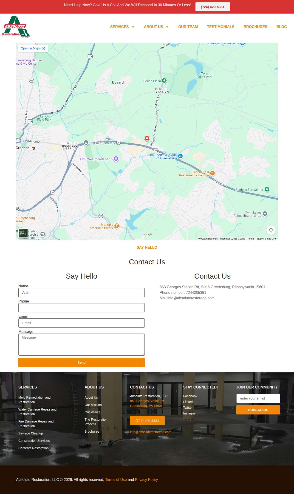

### masoudlawfirm.com — failed\_before\_submit (LIVE)

| | |
|---|---|
| Attempt ID | `cea3390a-7a7c-4307-8f77-7f02993737ed` |
| Form URL | https://masoudlawfirm.com/contact/ |
| Final URL | — |
| Reserved | 2026-11-06 03:16:43 UTC |
| Submit attempted | — |
| Template | standard v2 |
| Confirmation text | none observed |
| Result / error | locator.fill: Error: Cannot type text into input\[type=number\] |

Exact message:

~~~text
Subject: Helping customers find your business in AI search (AEO + GEO)

Hi there,

I'm Arun from Devs Arun. More and more customers now ask ChatGPT, Gemini, Perplexity or Google's AI Overviews questions like "who should I hire for this in my area?" before they call anyone. These tools answer from websites they can clearly understand, and they tend to recommend businesses whose pages answer real customer questions.

That is what AEO + GEO (Answer Engine and Generative Engine Optimization) is for. I improve your existing service pages so they clearly answer the questions your customers ask, add structured data that matches the page, and make the call, quote or enquiry step obvious. The benefit: your business gets a better chance of being mentioned or linked in AI answers, and visitors who arrive find it easy to contact you.

The AEO + GEO Starter is a one-time $199 (about ₹16,999, negotiable) for one website: a basic audit, 10 customer questions, improvements to two existing pages, relevant structured data and an action plan, with one revision round.

You can read the full details, send an enquiry or book online here:
https://devsarun.io/aeo-geo/

If this isn't relevant, just reply and I won't contact you again.

Best,
Arun
Devs Arun
itschool408@gmail.com · +91 7654534323
~~~

Submitted field values:

- \#form-field-name: Arun
- \#form-field-field\_3374379: Hi there, I'm Arun from Devs Arun. More and more customers now ask ChatGPT, Gemini, Perplexity or Google's AI Overviews 
- \#form-field-field\_7731784: +91 7654534323
- \#form-field-field\_8bd0f16: itschool408@gmail.com

**Inspected page** — `run-4077e053_attempt-cea3390a_inspection_2026-11-06T03-16-45-715Z.jpg`

### whiteolivecpa.com — failed\_before\_submit (LIVE)

| | |
|---|---|
| Attempt ID | `96a4a835-7f46-4db0-a72d-9c4aea2fcd63` |
| Form URL | https://whiteolivecpa.com/contact/ |
| Final URL | — |
| Reserved | 2026-11-06 03:16:50 UTC |
| Submit attempted | — |
| Template | standard v2 |
| Confirmation text | none observed |
| Result / error | locator.fill: Error: Cannot type text into input\[type=number\] |

Exact message:

~~~text
Subject: Helping customers find your business in AI search (AEO + GEO)

Hi there,

I'm Arun from Devs Arun. More and more customers now ask ChatGPT, Gemini, Perplexity or Google's AI Overviews questions like "who should I hire for this in my area?" before they call anyone. These tools answer from websites they can clearly understand, and they tend to recommend businesses whose pages answer real customer questions.

That is what AEO + GEO (Answer Engine and Generative Engine Optimization) is for. I improve your existing service pages so they clearly answer the questions your customers ask, add structured data that matches the page, and make the call, quote or enquiry step obvious. The benefit: your business gets a better chance of being mentioned or linked in AI answers, and visitors who arrive find it easy to contact you.

The AEO + GEO Starter is a one-time $199 (about ₹16,999, negotiable) for one website: a basic audit, 10 customer questions, improvements to two existing pages, relevant structured data and an action plan, with one revision round.

You can read the full details, send an enquiry or book online here:
https://devsarun.io/aeo-geo/

If this isn't relevant, just reply and I won't contact you again.

Best,
Arun
Devs Arun
itschool408@gmail.com · +91 7654534323
~~~

Submitted field values:

- \#ff\_1\_email: itschool408@gmail.com
- \#ff\_1\_message: Hi there, I'm Arun from Devs Arun. More and more customers now ask ChatGPT, Gemini, Perplexity or Google's AI Overviews 
- \#ff\_1\_numeric\_field: +91 7654534323
- \#ff\_1\_names\_first\_name\_: Arun

**Inspected page** — `run-4077e053_attempt-96a4a835_inspection_2026-11-06T03-16-52-236Z.jpg`

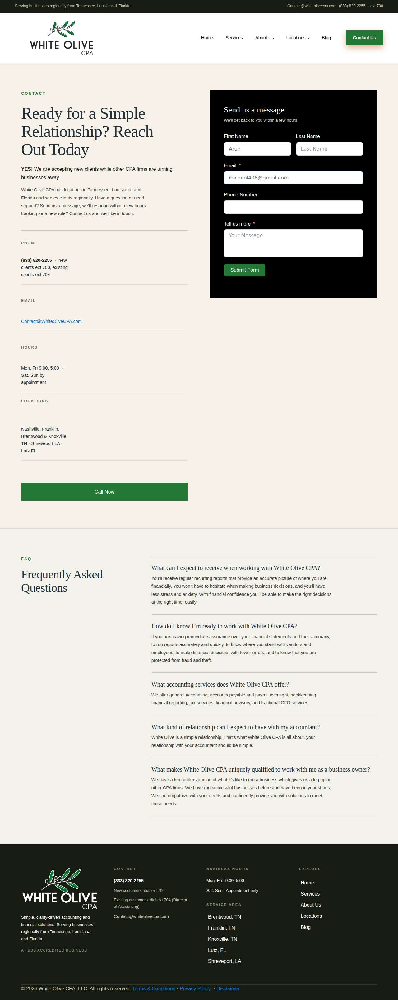

### canterburyadvisor.com — failed\_before\_submit (LIVE)

| | |
|---|---|
| Attempt ID | `8f106c5f-20cf-4618-8e43-98262c4af6c0` |
| Form URL | https://canterburyadvisor.com/ |
| Final URL | — |
| Reserved | 2026-11-06 03:16:57 UTC |
| Submit attempted | — |
| Template | standard v2 |
| Confirmation text | none observed |
| Result / error | locator.fill: Error: Cannot type text into input\[type=number\] |

Exact message:

~~~text
Subject: Helping customers find your business in AI search (AEO + GEO)

Hi there,

I'm Arun from Devs Arun. More and more customers now ask ChatGPT, Gemini, Perplexity or Google's AI Overviews questions like "who should I hire for this in my area?" before they call anyone. These tools answer from websites they can clearly understand, and they tend to recommend businesses whose pages answer real customer questions.

That is what AEO + GEO (Answer Engine and Generative Engine Optimization) is for. I improve your existing service pages so they clearly answer the questions your customers ask, add structured data that matches the page, and make the call, quote or enquiry step obvious. The benefit: your business gets a better chance of being mentioned or linked in AI answers, and visitors who arrive find it easy to contact you.

The AEO + GEO Starter is a one-time $199 (about ₹16,999, negotiable) for one website: a basic audit, 10 customer questions, improvements to two existing pages, relevant structured data and an action plan, with one revision round.

You can read the full details, send an enquiry or book online here:
https://devsarun.io/aeo-geo/

If this isn't relevant, just reply and I won't contact you again.

Best,
Arun
Devs Arun
itschool408@gmail.com · +91 7654534323
~~~

Submitted field values:

- \#form-field-name: Arun
- \#form-field-email: itschool408@gmail.com
- \#form-field-message: Hi there, I'm Arun from Devs Arun. More and more customers now ask ChatGPT, Gemini, Perplexity or Google's AI Overviews 
- \#form-field-field\_97f81fb: +91 7654534323

**Inspected page** — `run-4077e053_attempt-8f106c5f_inspection_2026-11-06T03-16-59-296Z.jpg`

### connectionzpcrepair.com — failed\_before\_submit (LIVE)

| | |
|---|---|
| Attempt ID | `84ce7ab0-1c7b-443e-829a-665cdcf8f2be` |
| Form URL | https://connectionzpcrepair.com/contact/ |
| Final URL | — |
| Reserved | 2026-11-06 03:17:04 UTC |
| Submit attempted | — |
| Template | standard v2 |
| Confirmation text | none observed |
| Result / error | locator.fill: Error: Cannot type text into input\[type=number\] |

Exact message:

~~~text
Subject: Helping customers find your business in AI search (AEO + GEO)

Hi there,

I'm Arun from Devs Arun. More and more customers now ask ChatGPT, Gemini, Perplexity or Google's AI Overviews questions like "who should I hire for this in my area?" before they call anyone. These tools answer from websites they can clearly understand, and they tend to recommend businesses whose pages answer real customer questions.

That is what AEO + GEO (Answer Engine and Generative Engine Optimization) is for. I improve your existing service pages so they clearly answer the questions your customers ask, add structured data that matches the page, and make the call, quote or enquiry step obvious. The benefit: your business gets a better chance of being mentioned or linked in AI answers, and visitors who arrive find it easy to contact you.

The AEO + GEO Starter is a one-time $199 (about ₹16,999, negotiable) for one website: a basic audit, 10 customer questions, improvements to two existing pages, relevant structured data and an action plan, with one revision round.

You can read the full details, send an enquiry or book online here:
https://devsarun.io/aeo-geo/

If this isn't relevant, just reply and I won't contact you again.

Best,
Arun
Devs Arun
itschool408@gmail.com · +91 7654534323
~~~

Submitted field values:

- \#form-field-name: Arun
- \#form-field-email: itschool408@gmail.com
- \#form-field-message: Hi there, I'm Arun from Devs Arun. More and more customers now ask ChatGPT, Gemini, Perplexity or Google's AI Overviews 
- \#form-field-field\_99a8620: +91 7654534323

**Inspected page** — `run-4077e053_attempt-84ce7ab0_inspection_2026-11-06T03-17-06-309Z.jpg`

### bendyworks.com — confirmed (LIVE)

| | |
|---|---|
| Attempt ID | `1e66ccff-eb4f-48ee-a517-71198af6c8f2` |
| Form URL | https://bendyworks.com/contact-form/ |
| Final URL | https://bendyworks.com/thank-you/ |
| Reserved | 2026-11-06 03:17:11 UTC |
| Submit attempted | 2026-11-06 03:17:12 UTC |
| Template | standard v2 |
| Confirmation text | Our Work Our Team Craft a Project With Us Careers Our Blog THANK YOU\! Thanks for your interest. We'll be in touch soon\! Back To Top Follow Bendyworks on Twitter Follow |
| Result / error | — |

Exact message:

~~~text
Subject: Helping customers find your business in AI search (AEO + GEO)

Hi there,

I'm Arun from Devs Arun. More and more customers now ask ChatGPT, Gemini, Perplexity or Google's AI Overviews questions like "who should I hire for this in my area?" before they call anyone. These tools answer from websites they can clearly understand, and they tend to recommend businesses whose pages answer real customer questions.

That is what AEO + GEO (Answer Engine and Generative Engine Optimization) is for. I improve your existing service pages so they clearly answer the questions your customers ask, add structured data that matches the page, and make the call, quote or enquiry step obvious. The benefit: your business gets a better chance of being mentioned or linked in AI answers, and visitors who arrive find it easy to contact you.

The AEO + GEO Starter is a one-time $199 (about ₹16,999, negotiable) for one website: a basic audit, 10 customer questions, improvements to two existing pages, relevant structured data and an action plan, with one revision round.

You can read the full details, send an enquiry or book online here:
https://devsarun.io/aeo-geo/

If this isn't relevant, just reply and I won't contact you again.

Best,
Arun
Devs Arun
itschool408@gmail.com · +91 7654534323
~~~

Submitted field values:

- Phone \[phone\]: +91 7654534323
- Message \* \[message\]: Hi there, I'm Arun from Devs Arun. More and more customers now ask ChatGPT, Gemini, Perplexity or Google's AI Overviews 
- Email Address \* \[email\]: itschool408@gmail.com
- Your Name \* \* Indicates A Required Field \[name\]: Arun

**Filled form (before submit)** — `run-4077e053_attempt-1e66ccff_filled_2026-11-06T03-17-12-436Z.jpg`

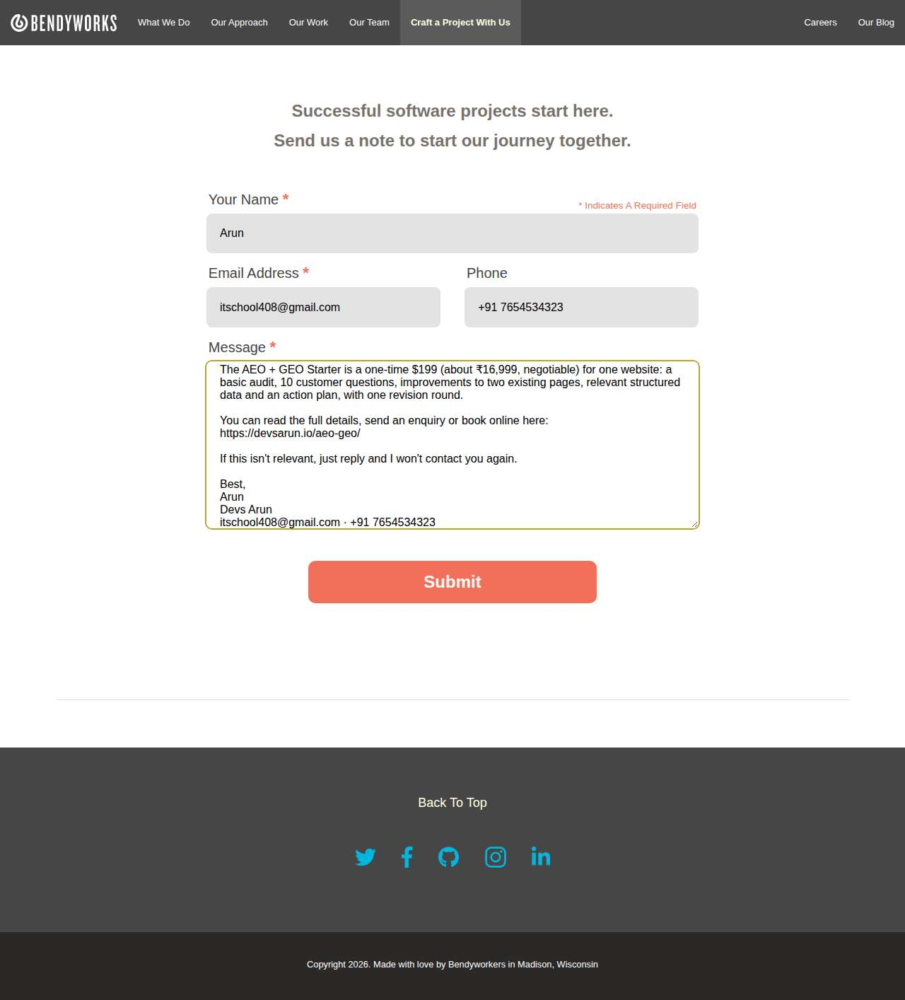

**After submit** — `run-4077e053_attempt-1e66ccff_post_attempt_2026-11-06T03-17-17-792Z.jpg`

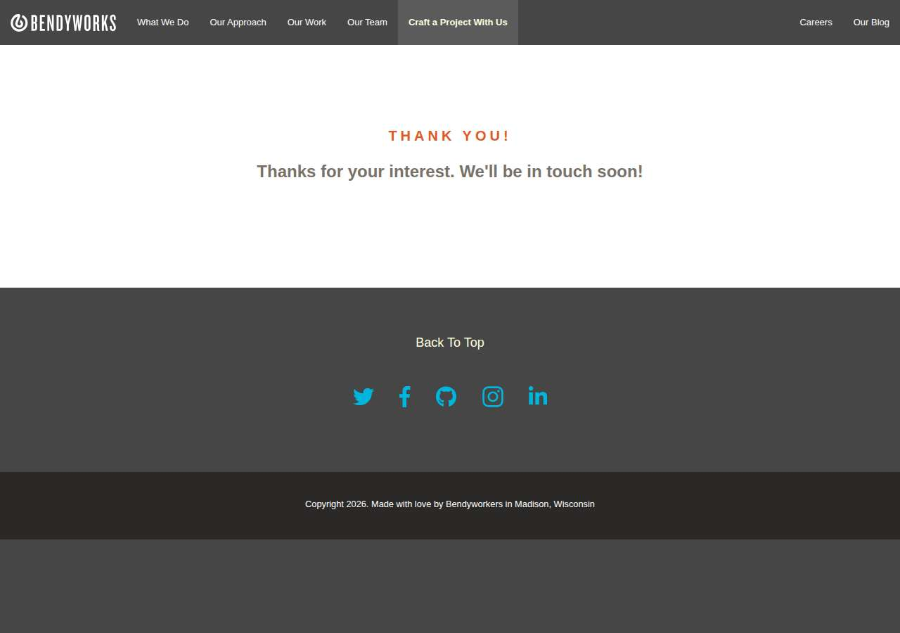

### gaugedigitalmedia.com — unclear (LIVE)

| | |
|---|---|
| Attempt ID | `6b14580c-9585-40b4-bc23-d3571ab8508b` |
| Form URL | https://gaugedigitalmedia.com/contact/ |
| Final URL | https://gaugedigitalmedia.com/contact/ |
| Reserved | 2026-11-06 03:17:26 UTC |
| Submit attempted | 2026-11-06 03:17:28 UTC |
| Template | standard v2 |
| Confirmation text | none observed |
| Result / error | No new success marker observed |

Exact message:

~~~text
Subject: Helping customers find your business in AI search (AEO + GEO)

Hi there,

I'm Arun from Devs Arun. More and more customers now ask ChatGPT, Gemini, Perplexity or Google's AI Overviews questions like "who should I hire for this in my area?" before they call anyone. These tools answer from websites they can clearly understand, and they tend to recommend businesses whose pages answer real customer questions.

That is what AEO + GEO (Answer Engine and Generative Engine Optimization) is for. I improve your existing service pages so they clearly answer the questions your customers ask, add structured data that matches the page, and make the call, quote or enquiry step obvious. The benefit: your business gets a better chance of being mentioned or linked in AI answers, and visitors who arrive find it easy to contact you.

The AEO + GEO Starter is a one-time $199 (about ₹16,999, negotiable) for one website: a basic audit, 10 customer questions, improvements to two existing pages, relevant structured data and an action plan, with one revision round.

You can read the full details, send an enquiry or book online here:
https://devsarun.io/aeo-geo/

If this isn't relevant, just reply and I won't contact you again.

Best,
Arun
Devs Arun
itschool408@gmail.com · +91 7654534323
~~~

Submitted field values:

- Phone \[phone\]: +91 7654534323
- Name(Required) \[name\]: Arun
- Website URL \[website\]: https://devsarun.io/aeo-geo/
- Email(Required) \[email\]: itschool408@gmail.com
- How Can We Help? \[message\]: Hi there, I'm Arun from Devs Arun. More and more customers now ask ChatGPT, Gemini, Perplexity or Google's AI Overviews 

**Filled form (before submit)** — `run-4077e053_attempt-6b14580c_filled_2026-11-06T03-17-28-227Z.jpg`

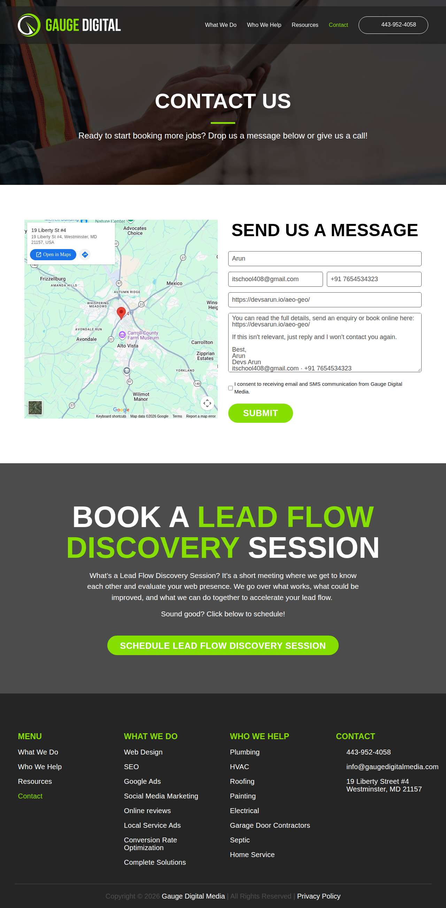

**After submit** — `run-4077e053_attempt-6b14580c_post_attempt_2026-11-06T03-17-57-012Z.jpg`

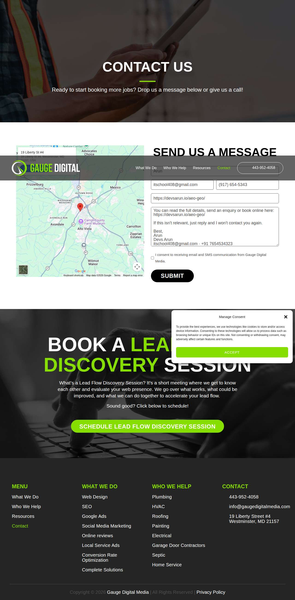

### attackresearch.com — failed\_before\_submit (LIVE)

| | |
|---|---|
| Attempt ID | `52e13df5-23e3-4aa9-8396-0a03c64210a1` |
| Form URL | https://www.attackresearch.com/ |
| Final URL | https://www.attackresearch.com/ |
| Reserved | 2026-11-06 03:18:05 UTC |
| Submit attempted | — |
| Template | standard v2 |
| Confirmation text | none observed |
| Result / error | Form validation would block sending: : Please check this box if you want to proceed. |

Exact message:

~~~text
Subject: Helping customers find your business in AI search (AEO + GEO)

Hi there,

I'm Arun from Devs Arun. More and more customers now ask ChatGPT, Gemini, Perplexity or Google's AI Overviews questions like "who should I hire for this in my area?" before they call anyone. These tools answer from websites they can clearly understand, and they tend to recommend businesses whose pages answer real customer questions.

That is what AEO + GEO (Answer Engine and Generative Engine Optimization) is for. I improve your existing service pages so they clearly answer the questions your customers ask, add structured data that matches the page, and make the call, quote or enquiry step obvious. The benefit: your business gets a better chance of being mentioned or linked in AI answers, and visitors who arrive find it easy to contact you.

The AEO + GEO Starter is a one-time $199 (about ₹16,999, negotiable) for one website: a basic audit, 10 customer questions, improvements to two existing pages, relevant structured data and an action plan, with one revision round.

You can read the full details, send an enquiry or book online here:
https://devsarun.io/aeo-geo/

If this isn't relevant, just reply and I won't contact you again.

Best,
Arun
Devs Arun
itschool408@gmail.com · +91 7654534323
~~~

Submitted field values:

- \#input\_comp-lvzigf7m: +91 7654534323
- \#input\_comp-lvzigf791: Arun
- \#input\_comp-lvzigf7j4: itschool408@gmail.com
- \#textarea\_comp-lvzigf7p3: Hi there, I'm Arun from Devs Arun. More and more customers now ask ChatGPT, Gemini, Perplexity or Google's AI Overviews 

**Filled form (before submit)** — `run-4077e053_attempt-52e13df5_filled_2026-11-06T03-18-08-299Z.jpg`

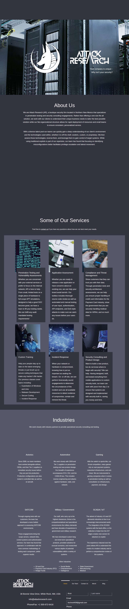

### belugalab.com — confirmed (LIVE)

| | |
|---|---|
| Attempt ID | `abd9eb7a-7e9d-46ef-b31d-f11608258648` |
| Form URL | https://belugalab.com/ |
| Final URL | https://belugalab.com/thank-you/ |
| Reserved | 2026-11-06 03:18:13 UTC |
| Submit attempted | 2026-11-06 03:18:15 UTC |
| Template | standard v2 |
| Confirmation text | Redirected to /thank-you/ |
| Result / error | — |

Exact message:

~~~text
Subject: Helping customers find your business in AI search (AEO + GEO)

Hi there,

I'm Arun from Devs Arun. More and more customers now ask ChatGPT, Gemini, Perplexity or Google's AI Overviews questions like "who should I hire for this in my area?" before they call anyone. These tools answer from websites they can clearly understand, and they tend to recommend businesses whose pages answer real customer questions.

That is what AEO + GEO (Answer Engine and Generative Engine Optimization) is for. I improve your existing service pages so they clearly answer the questions your customers ask, add structured data that matches the page, and make the call, quote or enquiry step obvious. The benefit: your business gets a better chance of being mentioned or linked in AI answers, and visitors who arrive find it easy to contact you.

The AEO + GEO Starter is a one-time $199 (about ₹16,999, negotiable) for one website: a basic audit, 10 customer questions, improvements to two existing pages, relevant structured data and an action plan, with one revision round.

You can read the full details, send an enquiry or book online here:
https://devsarun.io/aeo-geo/

If this isn't relevant, just reply and I won't contact you again.

Best,
Arun
Devs Arun
itschool408@gmail.com · +91 7654534323
~~~

Submitted field values:

- name \[name\]: Arun
- email \[email\]: itschool408@gmail.com
- phone \[phone\]: +91 7654534323
- message \[message\]: Hi there, I'm Arun from Devs Arun. More and more customers now ask ChatGPT, Gemini, Perplexity or Google's AI Overviews 

**Filled form (before submit)** — `run-4077e053_attempt-abd9eb7a_filled_2026-11-06T03-18-14-950Z.jpg`

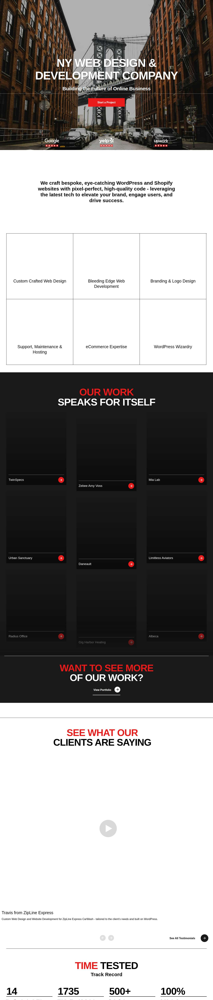

**After submit** — `run-4077e053_attempt-abd9eb7a_post_attempt_2026-11-06T03-18-21-062Z.jpg`

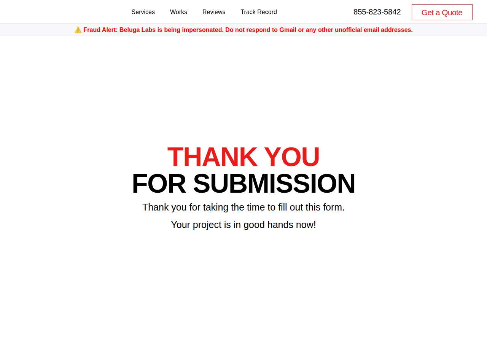

### veracitysolutions.com — confirmed (LIVE)

| | |
|---|---|
| Attempt ID | `f8f832ab-0755-403c-8fcd-f6f8994d5e04` |
| Form URL | https://www.veracitysolutions.com/contact |
| Final URL | https://www.veracitysolutions.com/contact |
| Reserved | 2026-11-06 03:18:29 UTC |
| Submit attempted | 2026-11-06 03:18:31 UTC |
| Template | standard v2 |
| Confirmation text | ould take on first. Lehi, Utah · pods@veracitysolutions.com MESSAGE SENT Thanks — your message is on its way. We read every message ourselves and will be in touch shortly. |
| Result / error | — |

Exact message:

~~~text
Subject: Helping customers find your business in AI search (AEO + GEO)

Hi there,

I'm Arun from Devs Arun. More and more customers now ask ChatGPT, Gemini, Perplexity or Google's AI Overviews questions like "who should I hire for this in my area?" before they call anyone. These tools answer from websites they can clearly understand, and they tend to recommend businesses whose pages answer real customer questions.

That is what AEO + GEO (Answer Engine and Generative Engine Optimization) is for. I improve your existing service pages so they clearly answer the questions your customers ask, add structured data that matches the page, and make the call, quote or enquiry step obvious. The benefit: your business gets a better chance of being mentioned or linked in AI answers, and visitors who arrive find it easy to contact you.

The AEO + GEO Starter is a one-time $199 (about ₹16,999, negotiable) for one website: a basic audit, 10 customer questions, improvements to two existing pages, relevant structured data and an action plan, with one revision round.

You can read the full details, send an enquiry or book online here:
https://devsarun.io/aeo-geo/

If this isn't relevant, just reply and I won't contact you again.

Best,
Arun
Devs Arun
itschool408@gmail.com · +91 7654534323
~~~

Submitted field values:

- Name \[name\]: Arun
- Company \[company\]: Devs Arun
- Work email \[email\]: itschool408@gmail.com
- Role / titleoptional \[subject\]: Helping customers find your business in AI search (AEO + GEO)
- What outcome do you care about?optional \[message\]: Hi there, I'm Arun from Devs Arun. More and more customers now ask ChatGPT, Gemini, Perplexity or Google's AI Overviews 

**Filled form (before submit)** — `run-4077e053_attempt-f8f832ab_filled_2026-11-06T03-18-31-204Z.jpg`

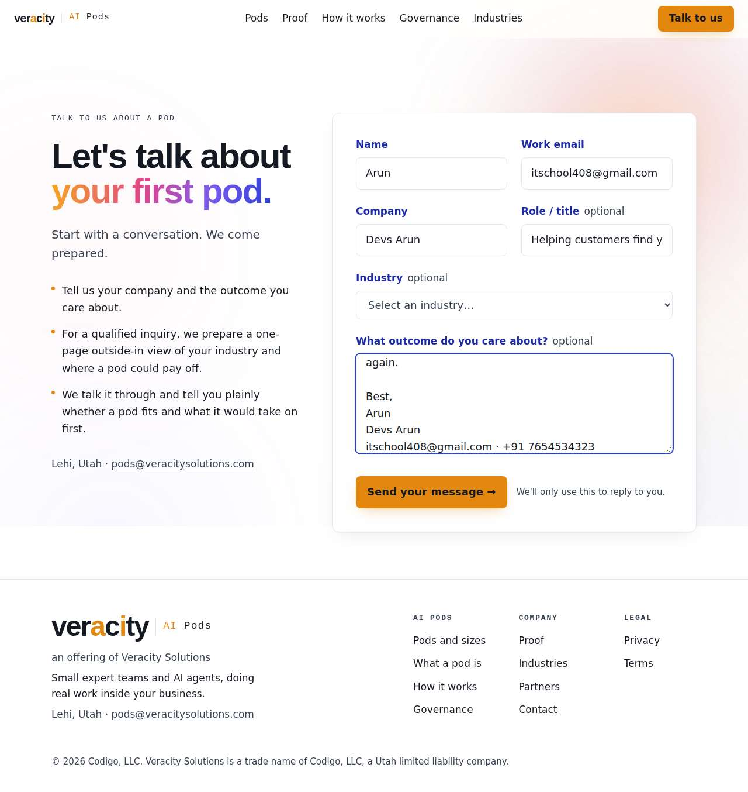

**After submit** — `run-4077e053_attempt-f8f832ab_post_attempt_2026-11-06T03-18-35-989Z.jpg`

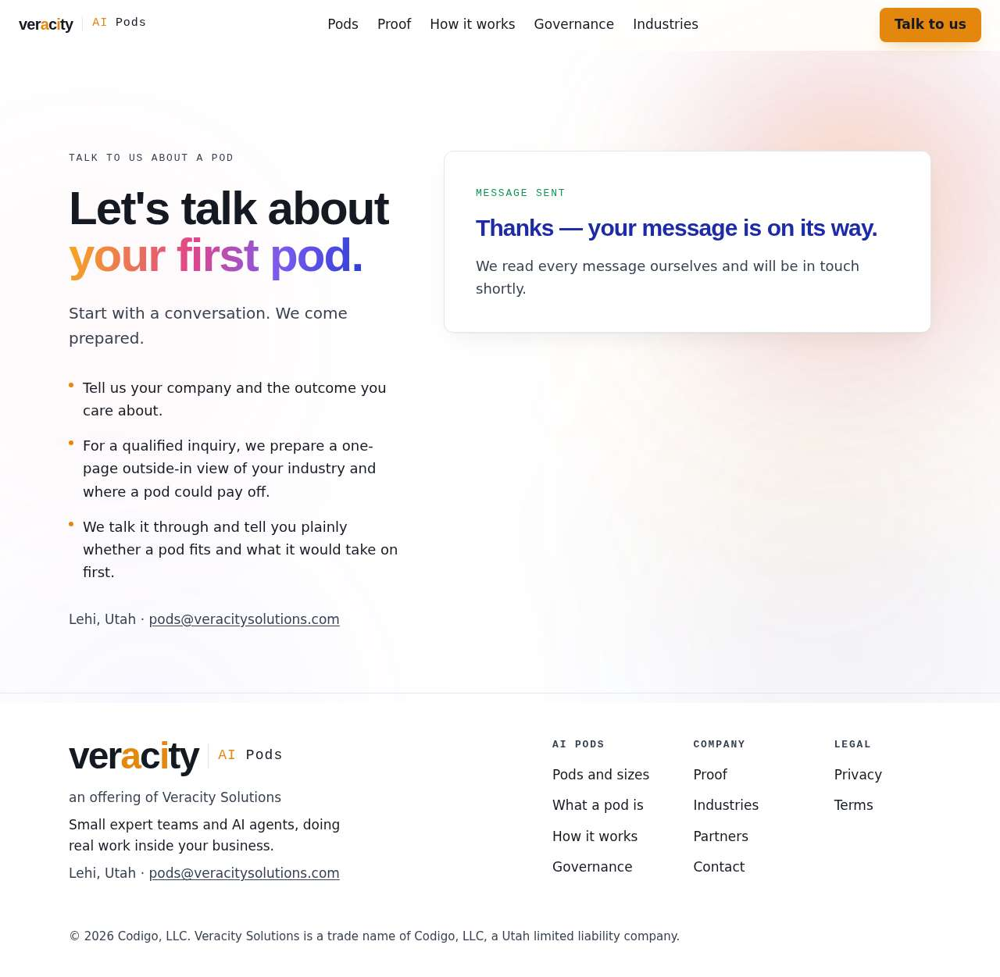

### newyorkcomputerhelp.com — confirmed (LIVE)

| | |
|---|---|
| Attempt ID | `87fa02cd-babd-4ed5-9c96-65f5272e3ec6` |
| Form URL | https://newyorkcomputerhelp.com/contact/ |
| Final URL | https://newyorkcomputerhelp.com/contact/ |
| Reserved | 2026-11-06 03:18:44 UTC |
| Submit attempted | 2026-11-06 03:18:46 UTC |
| Template | standard v2 |
| Confirmation text | we usually reply within a few hours during business hours. Thank you for your message We will get back to you shortly. NYCH Repair Center 53 E 34th St, Floor 3, New York, NY 10016 Get D |
| Result / error | — |

Exact message:

~~~text
Subject: Helping customers find your business in AI search (AEO + GEO)

Hi there,

I'm Arun from Devs Arun. More and more customers now ask ChatGPT, Gemini, Perplexity or Google's AI Overviews questions like "who should I hire for this in my area?" before they call anyone. These tools answer from websites they can clearly understand, and they tend to recommend businesses whose pages answer real customer questions.

That is what AEO + GEO (Answer Engine and Generative Engine Optimization) is for. I improve your existing service pages so they clearly answer the questions your customers ask, add structured data that matches the page, and make the call, quote or enquiry step obvious. The benefit: your business gets a better chance of being mentioned or linked in AI answers, and visitors who arrive find it easy to contact you.

The AEO + GEO Starter is a one-time $199 (about ₹16,999, negotiable) for one website: a basic audit, 10 customer questions, improvements to two existing pages, relevant structured data and an action plan, with one revision round.

You can read the full details, send an enquiry or book online here:
https://devsarun.io/aeo-geo/

If this isn't relevant, just reply and I won't contact you again.

Best,
Arun
Devs Arun
itschool408@gmail.com · +91 7654534323
~~~

Submitted field values:

- Name \[name\]: Arun
- Phone number \[phone\]: +91 7654534323
- Email(Required) \[email\]: itschool408@gmail.com
- Request or issue \[message\]: Hi there, I'm Arun from Devs Arun. More and more customers now ask ChatGPT, Gemini, Perplexity or Google's AI Overviews 

**Filled form (before submit)** — `run-4077e053_attempt-87fa02cd_filled_2026-11-06T03-18-46-368Z.jpg`

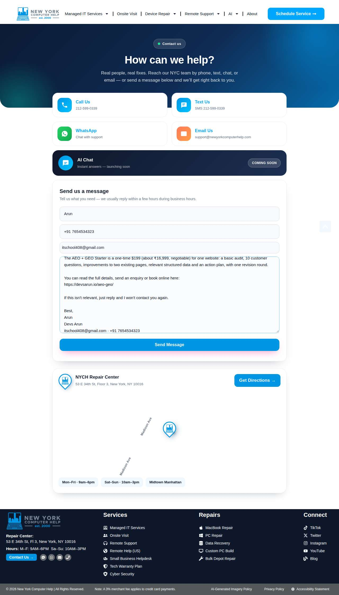

**After submit** — `run-4077e053_attempt-87fa02cd_post_attempt_2026-11-06T03-18-51-352Z.jpg`

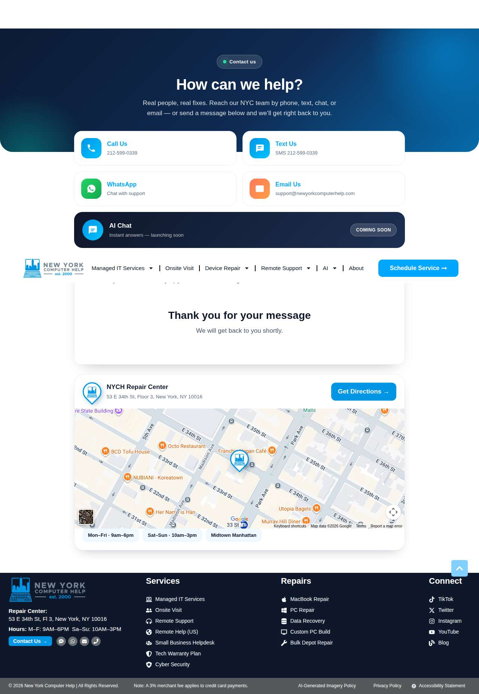

### azcomp.com — unclear (LIVE)

| | |
|---|---|
| Attempt ID | `5a6225e3-8d42-4c28-a746-cd6bcc8a76f0` |
| Form URL | https://www.azcomp.com/contact/ |
| Final URL | https://www.azcomp.com/contact/ |
| Reserved | 2026-11-06 03:18:59 UTC |
| Submit attempted | 2026-11-06 03:19:01 UTC |
| Template | standard v2 |
| Confirmation text | none observed |
| Result / error | No new success marker observed |

Exact message:

~~~text
Subject: Helping customers find your business in AI search (AEO + GEO)

Hi there,

I'm Arun from Devs Arun. More and more customers now ask ChatGPT, Gemini, Perplexity or Google's AI Overviews questions like "who should I hire for this in my area?" before they call anyone. These tools answer from websites they can clearly understand, and they tend to recommend businesses whose pages answer real customer questions.

That is what AEO + GEO (Answer Engine and Generative Engine Optimization) is for. I improve your existing service pages so they clearly answer the questions your customers ask, add structured data that matches the page, and make the call, quote or enquiry step obvious. The benefit: your business gets a better chance of being mentioned or linked in AI answers, and visitors who arrive find it easy to contact you.

The AEO + GEO Starter is a one-time $199 (about ₹16,999, negotiable) for one website: a basic audit, 10 customer questions, improvements to two existing pages, relevant structured data and an action plan, with one revision round.

You can read the full details, send an enquiry or book online here:
https://devsarun.io/aeo-geo/

If this isn't relevant, just reply and I won't contact you again.

Best,
Arun
Devs Arun
itschool408@gmail.com · +91 7654534323
~~~

Submitted field values:

- Email \* \[email\]: itschool408@gmail.com
- Phone \* \[phone\]: +91 7654534323
- Company \[company\]: Devs Arun
- First Name \* \[first\_name\]: Arun
- Write your message here. \[message\]: Hi there, I'm Arun from Devs Arun. More and more customers now ask ChatGPT, Gemini, Perplexity or Google's AI Overviews 

**Filled form (before submit)** — `run-4077e053_attempt-5a6225e3_filled_2026-11-06T03-19-01-845Z.jpg`

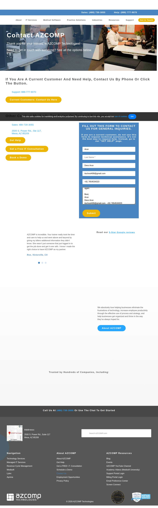

**After submit** — `run-4077e053_attempt-5a6225e3_post_attempt_2026-11-06T03-19-30-645Z.jpg`

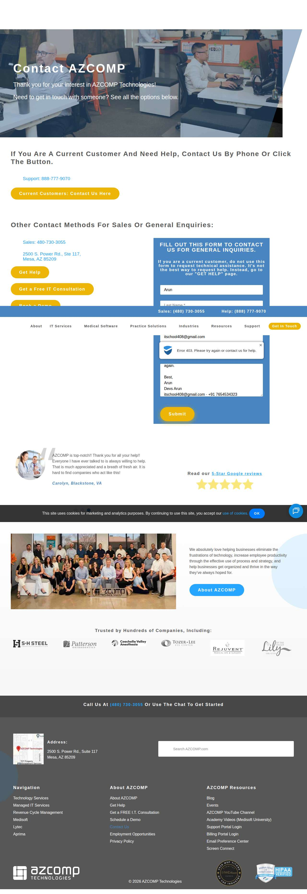

### icuro.com — error\_after\_submit (LIVE)

| | |
|---|---|
| Attempt ID | `4a66994e-2408-41d0-b354-2acd7c8ef0e3` |
| Form URL | https://icuro.com/contact-us/ |
| Final URL | https://icuro.com/contact-us/ |
| Reserved | 2026-11-06 03:19:39 UTC |
| Submit attempted | 2026-11-06 03:19:41 UTC |
| Template | standard v2 |
| Confirmation text | here? I agree to the Terms and Conditions Submit Message An error occurred. U.S. Headquarters 3350 Scott Blvd Building 46-02, Santa Clara, CA 95054 India Office \#55, 10th Cro |
| Result / error | — |

Exact message:

~~~text
Subject: Helping customers find your business in AI search (AEO + GEO)

Hi there,

I'm Arun from Devs Arun. More and more customers now ask ChatGPT, Gemini, Perplexity or Google's AI Overviews questions like "who should I hire for this in my area?" before they call anyone. These tools answer from websites they can clearly understand, and they tend to recommend businesses whose pages answer real customer questions.

That is what AEO + GEO (Answer Engine and Generative Engine Optimization) is for. I improve your existing service pages so they clearly answer the questions your customers ask, add structured data that matches the page, and make the call, quote or enquiry step obvious. The benefit: your business gets a better chance of being mentioned or linked in AI answers, and visitors who arrive find it easy to contact you.

The AEO + GEO Starter is a one-time $199 (about ₹16,999, negotiable) for one website: a basic audit, 10 customer questions, improvements to two existing pages, relevant structured data and an action plan, with one revision round.

You can read the full details, send an enquiry or book online here:
https://devsarun.io/aeo-geo/

If this isn't relevant, just reply and I won't contact you again.

Best,
Arun
Devs Arun
itschool408@gmail.com · +91 7654534323
~~~

Submitted field values:

- Your Name \[name\]: Arun
- Your Email \[email\]: itschool408@gmail.com
- Your Phone \[phone\]: +91 7654534323
- Why do you want to work here? \[message\]: Hi there, I'm Arun from Devs Arun. More and more customers now ask ChatGPT, Gemini, Perplexity or Google's AI Overviews 

**Filled form (before submit)** — `run-4077e053_attempt-4a66994e_filled_2026-11-06T03-19-41-518Z.jpg`

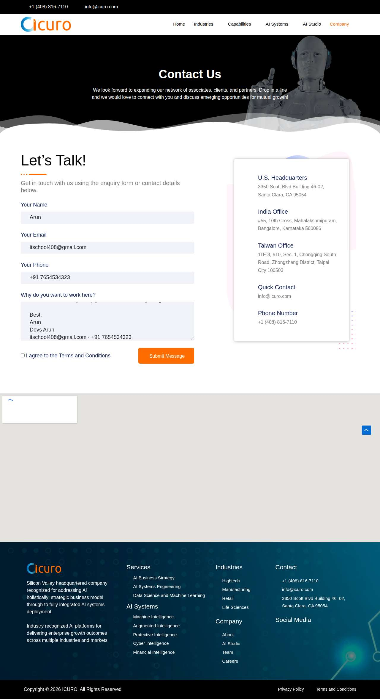

**After submit** — `run-4077e053_attempt-4a66994e_post_attempt_2026-11-06T03-19-45-997Z.jpg`

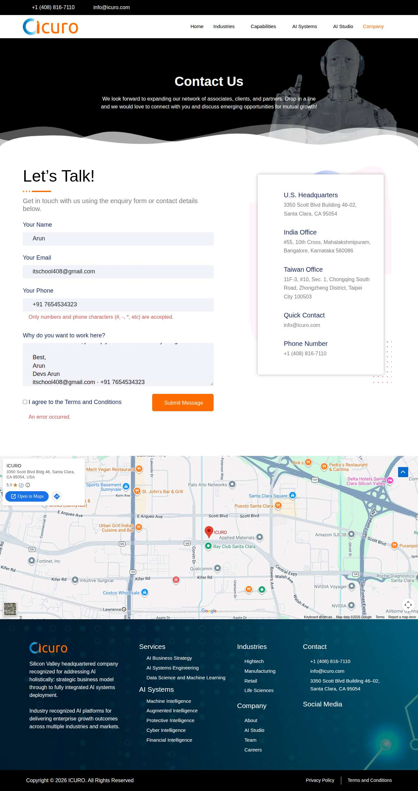

### tech-fusion.us — unclear (LIVE)

| | |
|---|---|
| Attempt ID | `e446a91a-f151-48ba-93c0-5aa9744e4869` |
| Form URL | https://www.tech-fusion.us/contact.html |
| Final URL | chrome-error://chromewebdata/ |
| Reserved | 2026-11-06 03:19:54 UTC |
| Submit attempted | 2026-11-06 03:19:56 UTC |
| Template | standard v2 |
| Confirmation text | none observed |
| Result / error | No new success marker observed |

Exact message:

~~~text
Subject: Helping customers find your business in AI search (AEO + GEO)

Hi there,

I'm Arun from Devs Arun. More and more customers now ask ChatGPT, Gemini, Perplexity or Google's AI Overviews questions like "who should I hire for this in my area?" before they call anyone. These tools answer from websites they can clearly understand, and they tend to recommend businesses whose pages answer real customer questions.

That is what AEO + GEO (Answer Engine and Generative Engine Optimization) is for. I improve your existing service pages so they clearly answer the questions your customers ask, add structured data that matches the page, and make the call, quote or enquiry step obvious. The benefit: your business gets a better chance of being mentioned or linked in AI answers, and visitors who arrive find it easy to contact you.

The AEO + GEO Starter is a one-time $199 (about ₹16,999, negotiable) for one website: a basic audit, 10 customer questions, improvements to two existing pages, relevant structured data and an action plan, with one revision round.

You can read the full details, send an enquiry or book online here:
https://devsarun.io/aeo-geo/

If this isn't relevant, just reply and I won't contact you again.

Best,
Arun
Devs Arun
itschool408@gmail.com · +91 7654534323
~~~

Submitted field values:

- Name \[name\]: Arun
- Email \[email\]: itschool408@gmail.com
- Phone \[phone\]: +91 7654534323
- Company \[company\]: Devs Arun
- Tell us more about your needs: \[message\]: Hi there, I'm Arun from Devs Arun. More and more customers now ask ChatGPT, Gemini, Perplexity or Google's AI Overviews 

**Filled form (before submit)** — `run-4077e053_attempt-e446a91a_filled_2026-11-06T03-19-56-546Z.jpg`

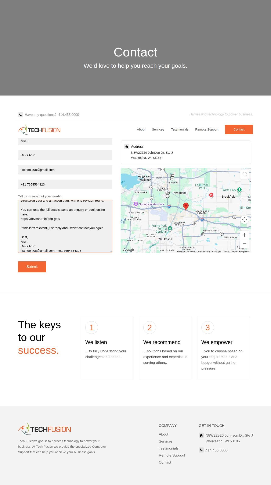

**After submit** — `run-4077e053_attempt-e446a91a_post_attempt_2026-11-06T03-20-25-149Z.jpg`

### qualitycomputer.net — unclear (LIVE)

| | |
|---|---|
| Attempt ID | `fafa58aa-1c38-4ef6-bfd7-9cbcc4014a5e` |
| Form URL | https://www.qualitycomputer.net/contact |
| Final URL | https://www.qualitycomputer.net/contact |
| Reserved | 2026-11-06 03:20:33 UTC |
| Submit attempted | 2026-11-06 03:20:36 UTC |
| Template | standard v2 |
| Confirmation text | none observed |
| Result / error | No new success marker observed |

Exact message:

~~~text
Subject: Helping customers find your business in AI search (AEO + GEO)

Hi there,

I'm Arun from Devs Arun. More and more customers now ask ChatGPT, Gemini, Perplexity or Google's AI Overviews questions like "who should I hire for this in my area?" before they call anyone. These tools answer from websites they can clearly understand, and they tend to recommend businesses whose pages answer real customer questions.

That is what AEO + GEO (Answer Engine and Generative Engine Optimization) is for. I improve your existing service pages so they clearly answer the questions your customers ask, add structured data that matches the page, and make the call, quote or enquiry step obvious. The benefit: your business gets a better chance of being mentioned or linked in AI answers, and visitors who arrive find it easy to contact you.

The AEO + GEO Starter is a one-time $199 (about ₹16,999, negotiable) for one website: a basic audit, 10 customer questions, improvements to two existing pages, relevant structured data and an action plan, with one revision round.

You can read the full details, send an enquiry or book online here:
https://devsarun.io/aeo-geo/

If this isn't relevant, just reply and I won't contact you again.

Best,
Arun
Devs Arun
itschool408@gmail.com · +91 7654534323
~~~

Submitted field values:

- email \[email\]: itschool408@gmail.com
- name-\* \[name\]: Arun
- Message \[message\]: Hi there, I'm Arun from Devs Arun. More and more customers now ask ChatGPT, Gemini, Perplexity or Google's AI Overviews 
- subject \[subject\]: Helping customers find your business in AI search (AEO + GEO)

**Filled form (before submit)** — `run-4077e053_attempt-fafa58aa_filled_2026-11-06T03-20-36-409Z.jpg`

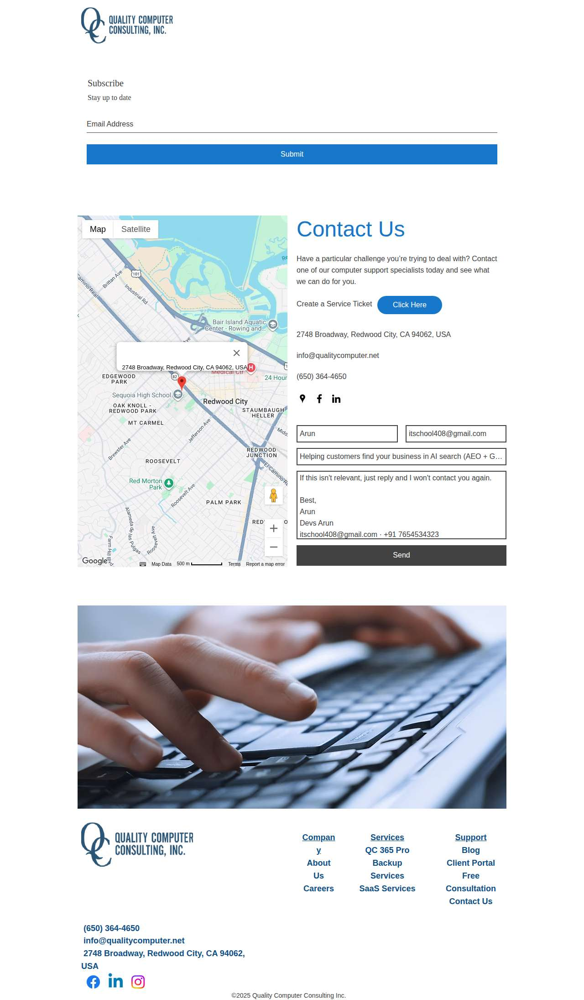

**After submit** — `run-4077e053_attempt-fafa58aa_post_attempt_2026-11-06T03-21-04-997Z.jpg`

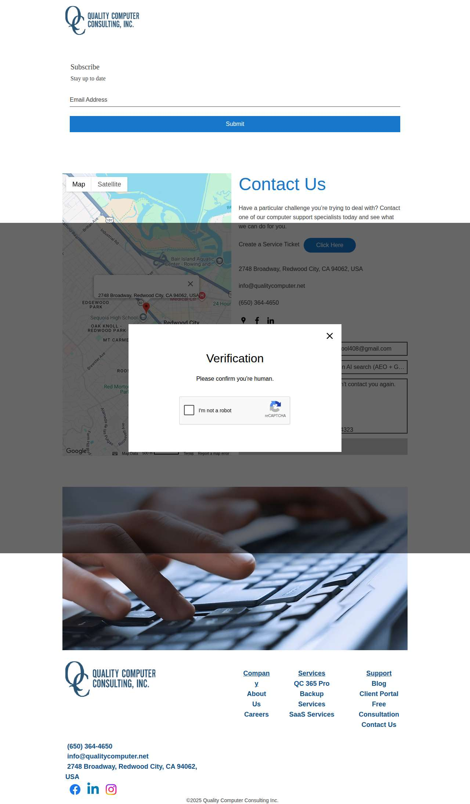

### partnersin.tech — confirmed (LIVE)

| | |
|---|---|
| Attempt ID | `54a65bfb-e679-4932-8ecc-e00d1b647469` |
| Form URL | https://partnersin.tech/ |
| Final URL | https://partnersin.tech/ |
| Reserved | 2026-11-06 03:21:13 UTC |
| Submit attempted | 2026-11-06 03:21:14 UTC |
| Template | standard v2 |
| Confirmation text | llowstone" Get in touch You can reach us anytime Contact us Message sent successfully\! © 2025 Partners In.TechPrivacy PolicyCookie Policy We use cookies to enhance your bro |
| Result / error | — |

Exact message:

~~~text
Subject: Helping customers find your business in AI search (AEO + GEO)

Hi there,

I'm Arun from Devs Arun. More and more customers now ask ChatGPT, Gemini, Perplexity or Google's AI Overviews questions like "who should I hire for this in my area?" before they call anyone. These tools answer from websites they can clearly understand, and they tend to recommend businesses whose pages answer real customer questions.

That is what AEO + GEO (Answer Engine and Generative Engine Optimization) is for. I improve your existing service pages so they clearly answer the questions your customers ask, add structured data that matches the page, and make the call, quote or enquiry step obvious. The benefit: your business gets a better chance of being mentioned or linked in AI answers, and visitors who arrive find it easy to contact you.

The AEO + GEO Starter is a one-time $199 (about ₹16,999, negotiable) for one website: a basic audit, 10 customer questions, improvements to two existing pages, relevant structured data and an action plan, with one revision round.

You can read the full details, send an enquiry or book online here:
https://devsarun.io/aeo-geo/

If this isn't relevant, just reply and I won't contact you again.

Best,
Arun
Devs Arun
itschool408@gmail.com · +91 7654534323
~~~

Submitted field values:

- name \[name\]: Arun
- email \[email\]: itschool408@gmail.com
- phone \[phone\]: +91 7654534323
- message \[message\]: Hi there, I'm Arun from Devs Arun. More and more customers now ask ChatGPT, Gemini, Perplexity or Google's AI Overviews 

**Filled form (before submit)** — `run-4077e053_attempt-54a65bfb_filled_2026-11-06T03-21-14-709Z.jpg`

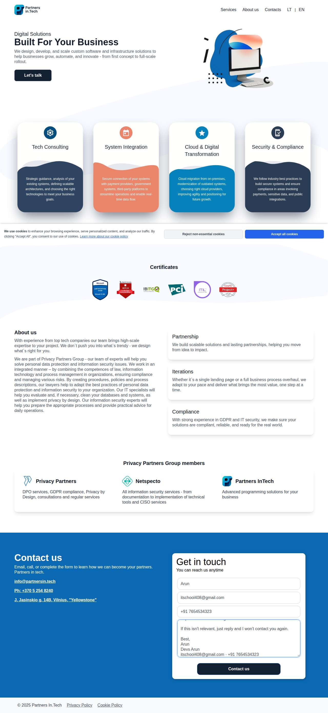

**After submit** — `run-4077e053_attempt-54a65bfb_post_attempt_2026-11-06T03-21-19-373Z.jpg`

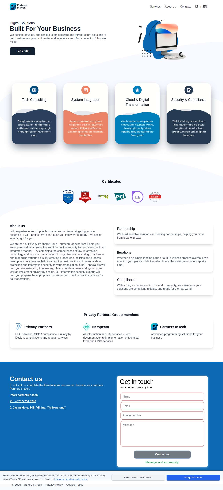

### medicaldesignsolutions.com — unclear (LIVE)

| | |
|---|---|
| Attempt ID | `9653ad3b-074d-439f-8298-d54f5a02d473` |
| Form URL | https://www.medicaldesignsolutions.com/contact |
| Final URL | https://www.medicaldesignsolutions.com/contact |
| Reserved | 2026-11-06 03:21:27 UTC |
| Submit attempted | 2026-11-06 03:21:30 UTC |
| Template | standard v2 |
| Confirmation text | none observed |
| Result / error | No new success marker observed |

Exact message:

~~~text
Subject: Helping customers find your business in AI search (AEO + GEO)

Hi there,

I'm Arun from Devs Arun. More and more customers now ask ChatGPT, Gemini, Perplexity or Google's AI Overviews questions like "who should I hire for this in my area?" before they call anyone. These tools answer from websites they can clearly understand, and they tend to recommend businesses whose pages answer real customer questions.

That is what AEO + GEO (Answer Engine and Generative Engine Optimization) is for. I improve your existing service pages so they clearly answer the questions your customers ask, add structured data that matches the page, and make the call, quote or enquiry step obvious. The benefit: your business gets a better chance of being mentioned or linked in AI answers, and visitors who arrive find it easy to contact you.

The AEO + GEO Starter is a one-time $199 (about ₹16,999, negotiable) for one website: a basic audit, 10 customer questions, improvements to two existing pages, relevant structured data and an action plan, with one revision round.

You can read the full details, send an enquiry or book online here:
https://devsarun.io/aeo-geo/

If this isn't relevant, just reply and I won't contact you again.

Best,
Arun
Devs Arun
itschool408@gmail.com · +91 7654534323
~~~

Submitted field values:

- name \[name\]: Arun
- email \[email\]: itschool408@gmail.com
- phone \[phone\]: +91 7654534323
- comments \[message\]: Hi there, I'm Arun from Devs Arun. More and more customers now ask ChatGPT, Gemini, Perplexity or Google's AI Overviews 

**Filled form (before submit)** — `run-4077e053_attempt-9653ad3b_filled_2026-11-06T03-21-30-192Z.jpg`

**After submit** — `run-4077e053_attempt-9653ad3b_post_attempt_2026-11-06T03-22-00-260Z.jpg`

### teralogics.com — unclear (LIVE)

| | |
|---|---|
| Attempt ID | `b64e9b59-6c4e-4647-8e51-a56f7da29d07` |
| Form URL | https://www.teralogics.com/contact-teralogics.html |
| Final URL | chrome-error://chromewebdata/ |
| Reserved | 2026-11-06 03:22:08 UTC |
| Submit attempted | 2026-11-06 03:22:10 UTC |
| Template | standard v2 |
| Confirmation text | none observed |
| Result / error | No new success marker observed |

Exact message:

~~~text
Subject: Helping customers find your business in AI search (AEO + GEO)

Hi there,

I'm Arun from Devs Arun. More and more customers now ask ChatGPT, Gemini, Perplexity or Google's AI Overviews questions like "who should I hire for this in my area?" before they call anyone. These tools answer from websites they can clearly understand, and they tend to recommend businesses whose pages answer real customer questions.

That is what AEO + GEO (Answer Engine and Generative Engine Optimization) is for. I improve your existing service pages so they clearly answer the questions your customers ask, add structured data that matches the page, and make the call, quote or enquiry step obvious. The benefit: your business gets a better chance of being mentioned or linked in AI answers, and visitors who arrive find it easy to contact you.

The AEO + GEO Starter is a one-time $199 (about ₹16,999, negotiable) for one website: a basic audit, 10 customer questions, improvements to two existing pages, relevant structured data and an action plan, with one revision round.

You can read the full details, send an enquiry or book online here:
https://devsarun.io/aeo-geo/

If this isn't relevant, just reply and I won't contact you again.

Best,
Arun
Devs Arun
itschool408@gmail.com · +91 7654534323
~~~

Submitted field values:

- name \[name\]: Arun
- email \[email\]: itschool408@gmail.com
- message \[message\]: Hi there, I'm Arun from Devs Arun. More and more customers now ask ChatGPT, Gemini, Perplexity or Google's AI Overviews 
- subject \[subject\]: Helping customers find your business in AI search (AEO + GEO)

**Filled form (before submit)** — `run-4077e053_attempt-b64e9b59_filled_2026-11-06T03-22-10-041Z.jpg`

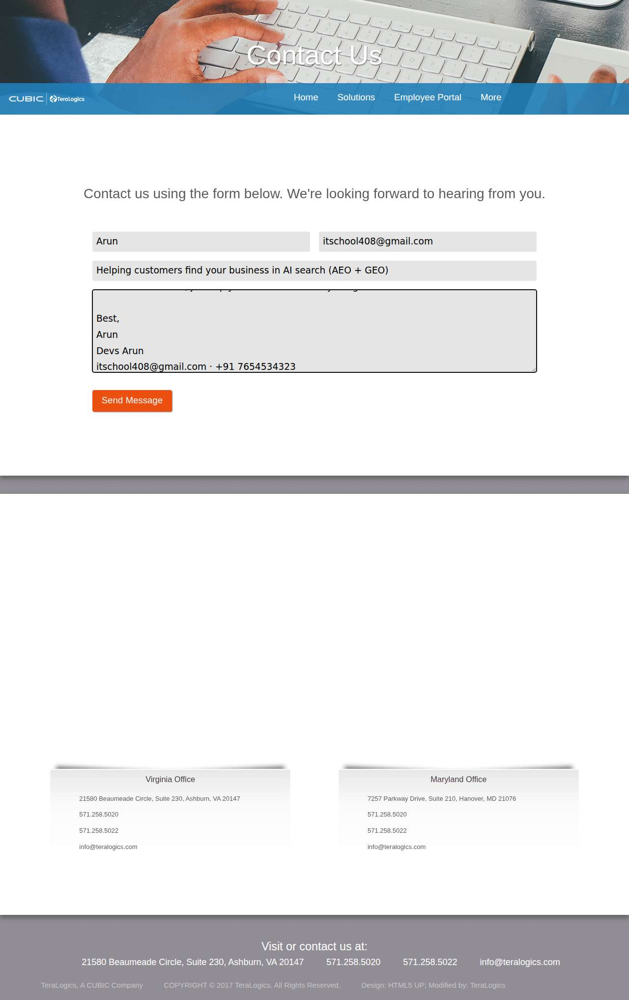

**After submit** — `run-4077e053_attempt-b64e9b59_post_attempt_2026-11-06T03-22-38-678Z.jpg`

### jabitllc.com — confirmed (LIVE)

| | |
|---|---|
| Attempt ID | `85b53218-1831-4489-b8cf-1e1e9eff94fb` |
| Form URL | https://jabitllc.com/contact/ |
| Final URL | https://jabitllc.com/contact/ |
| Reserved | 2026-11-06 03:22:47 UTC |
| Submit attempted | 2026-11-06 03:22:53 UTC |
| Template | standard v2 |
| Confirmation text | Friday 9AM – 6PM Saturday 10AM – 4PM CST Your response was successfully submitted. Thank you\! JAB IT LLC \| 2680 Planet Ave \| Salina, KS 67401 \| 877-522-2739 Copyright © 2026 JAB IT |
| Result / error | — |

Exact message:

~~~text
Subject: Helping customers find your business in AI search (AEO + GEO)

Hi there,

I'm Arun from Devs Arun. More and more customers now ask ChatGPT, Gemini, Perplexity or Google's AI Overviews questions like "who should I hire for this in my area?" before they call anyone. These tools answer from websites they can clearly understand, and they tend to recommend businesses whose pages answer real customer questions.

That is what AEO + GEO (Answer Engine and Generative Engine Optimization) is for. I improve your existing service pages so they clearly answer the questions your customers ask, add structured data that matches the page, and make the call, quote or enquiry step obvious. The benefit: your business gets a better chance of being mentioned or linked in AI answers, and visitors who arrive find it easy to contact you.

The AEO + GEO Starter is a one-time $199 (about ₹16,999, negotiable) for one website: a basic audit, 10 customer questions, improvements to two existing pages, relevant structured data and an action plan, with one revision round.

You can read the full details, send an enquiry or book online here:
https://devsarun.io/aeo-geo/

If this isn't relevant, just reply and I won't contact you again.

Best,
Arun
Devs Arun
itschool408@gmail.com · +91 7654534323
~~~

Submitted field values:

- Name \* \[name\]: Arun
- Email \* \[email\]: itschool408@gmail.com
- Phone \* \[phone\]: +91 7654534323
- Message \* \[message\]: Hi there, I'm Arun from Devs Arun. More and more customers now ask ChatGPT, Gemini, Perplexity or Google's AI Overviews 

**Filled form (before submit)** — `run-4077e053_attempt-85b53218_filled_2026-11-06T03-22-53-244Z.jpg`

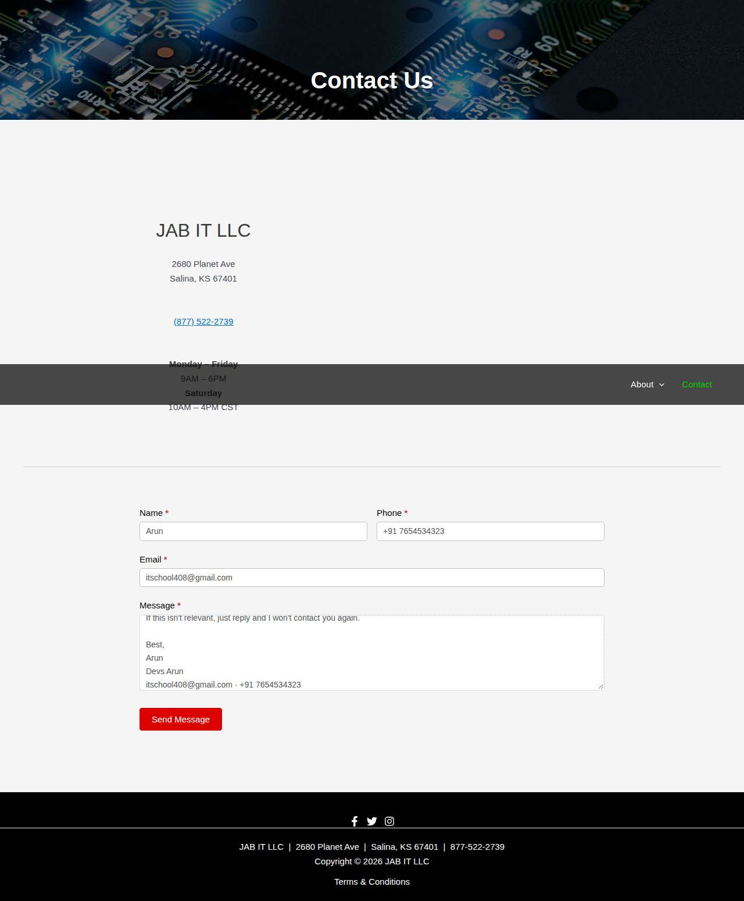

**After submit** — `run-4077e053_attempt-85b53218_post_attempt_2026-11-06T03-22-58-400Z.jpg`

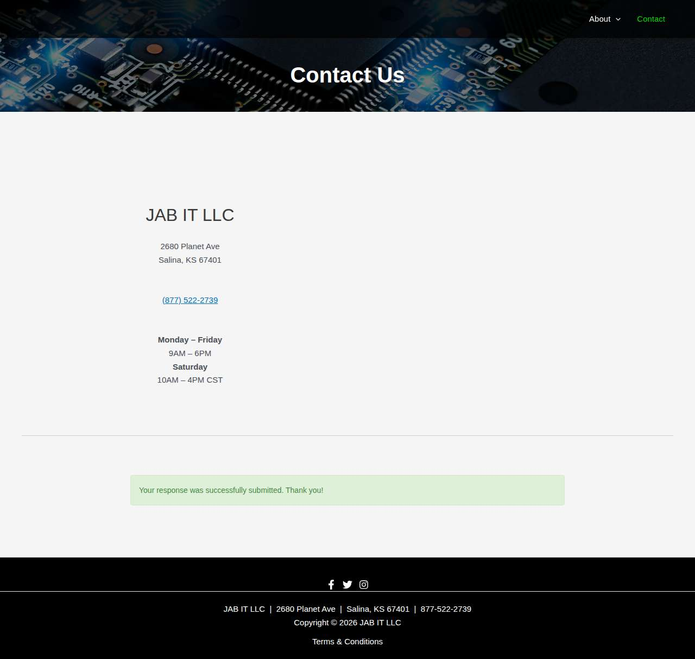

### cne-inc.com — confirmed (LIVE)

| | |
|---|---|
| Attempt ID | `e105e867-4388-47d1-9374-98c4a062ea6b` |
| Form URL | https://www.cne-inc.com/contact-us/ |
| Final URL | https://www.cne-inc.com/contact-us/ |
| Reserved | 2026-11-06 03:23:06 UTC |
| Submit attempted | 2026-11-06 03:23:11 UTC |
| Template | standard v2 |
| Confirmation text | 954 Gainesville: (352) 373-9697 Ocala: (352) 840-0881 Help\! Thank you for your message. It has been sent. Privacy Policy © Copyright 2026 Computer Network Experts / Powered by Accelerati |
| Result / error | — |

Exact message:

~~~text
Subject: Helping customers find your business in AI search (AEO + GEO)

Hi there,

I'm Arun from Devs Arun. More and more customers now ask ChatGPT, Gemini, Perplexity or Google's AI Overviews questions like "who should I hire for this in my area?" before they call anyone. These tools answer from websites they can clearly understand, and they tend to recommend businesses whose pages answer real customer questions.

That is what AEO + GEO (Answer Engine and Generative Engine Optimization) is for. I improve your existing service pages so they clearly answer the questions your customers ask, add structured data that matches the page, and make the call, quote or enquiry step obvious. The benefit: your business gets a better chance of being mentioned or linked in AI answers, and visitors who arrive find it easy to contact you.

The AEO + GEO Starter is a one-time $199 (about ₹16,999, negotiable) for one website: a basic audit, 10 customer questions, improvements to two existing pages, relevant structured data and an action plan, with one revision round.

You can read the full details, send an enquiry or book online here:
https://devsarun.io/aeo-geo/

If this isn't relevant, just reply and I won't contact you again.

Best,
Arun
Devs Arun
itschool408@gmail.com · +91 7654534323
~~~

Submitted field values:

- phone \[phone\]: +91 7654534323
- your-name \[name\]: Arun
- your-email \[email\]: itschool408@gmail.com
- your-message \[message\]: Hi there, I'm Arun from Devs Arun. More and more customers now ask ChatGPT, Gemini, Perplexity or Google's AI Overviews 

**Filled form (before submit)** — `run-4077e053_attempt-e105e867_filled_2026-11-06T03-23-11-567Z.jpg`

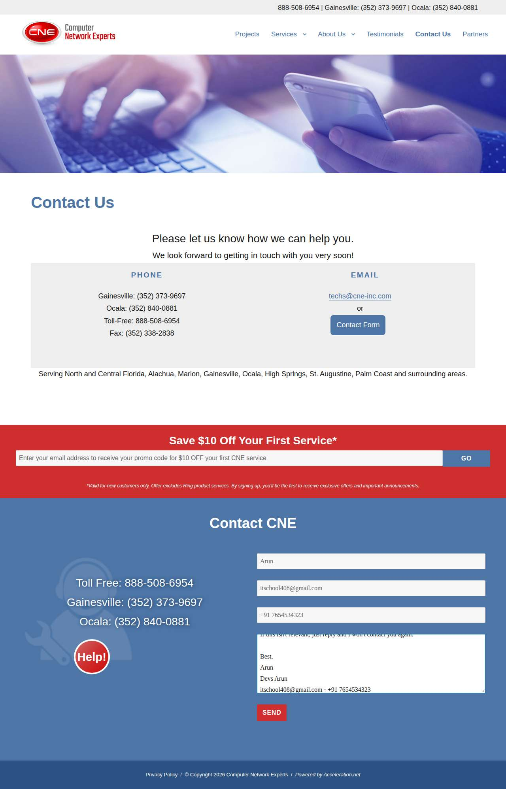

**After submit** — `run-4077e053_attempt-e105e867_post_attempt_2026-11-06T03-23-17-132Z.jpg`

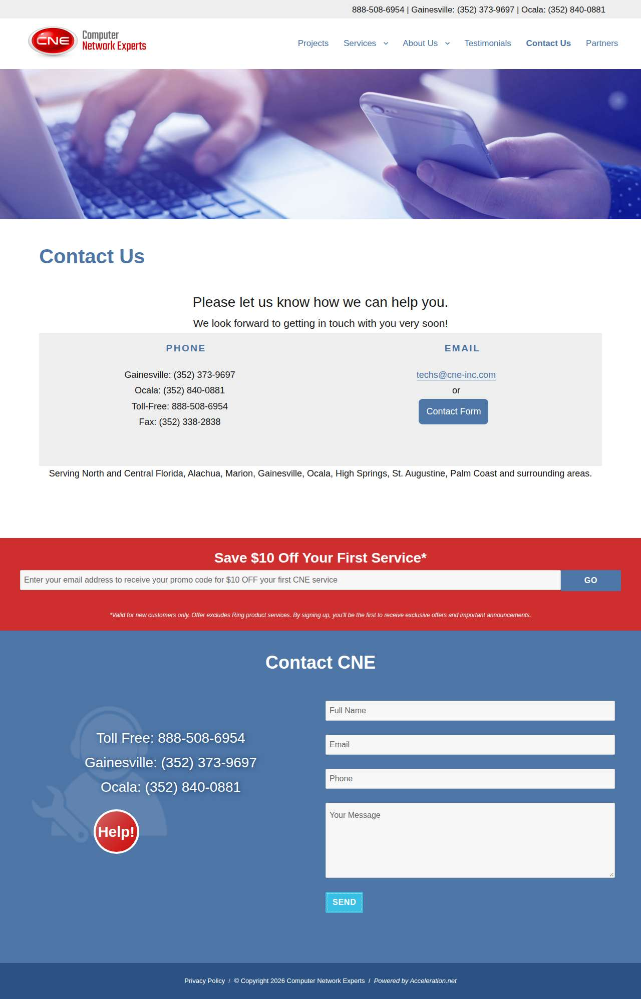

### k2technologies.net — unclear (LIVE)

| | |
|---|---|
| Attempt ID | `ee932614-0848-41bb-9664-8aa3e1d9a54b` |
| Form URL | https://cleverpathit.com/contact-us/ |
| Final URL | https://cleverpathit.com/contact-us/ |
| Reserved | 2026-11-06 03:23:25 UTC |
| Submit attempted | 2026-11-06 03:23:26 UTC |
| Template | standard v2 |
| Confirmation text | none observed |
| Result / error | No new success marker observed |

Exact message:

~~~text
Subject: Helping customers find your business in AI search (AEO + GEO)

Hi there,

I'm Arun from Devs Arun. More and more customers now ask ChatGPT, Gemini, Perplexity or Google's AI Overviews questions like "who should I hire for this in my area?" before they call anyone. These tools answer from websites they can clearly understand, and they tend to recommend businesses whose pages answer real customer questions.

That is what AEO + GEO (Answer Engine and Generative Engine Optimization) is for. I improve your existing service pages so they clearly answer the questions your customers ask, add structured data that matches the page, and make the call, quote or enquiry step obvious. The benefit: your business gets a better chance of being mentioned or linked in AI answers, and visitors who arrive find it easy to contact you.

The AEO + GEO Starter is a one-time $199 (about ₹16,999, negotiable) for one website: a basic audit, 10 customer questions, improvements to two existing pages, relevant structured data and an action plan, with one revision round.

You can read the full details, send an enquiry or book online here:
https://devsarun.io/aeo-geo/

If this isn't relevant, just reply and I won't contact you again.

Best,
Arun
Devs Arun
itschool408@gmail.com · +91 7654534323
~~~

Submitted field values:

- PHONE \[phone\]: +91 7654534323
- EMAIL\* \[email\]: itschool408@gmail.com
- FIRST \[first\_name\]: Arun
- COMPANY NAME \[company\]: Devs Arun
- HOW CAN WE HELP YOU? \[message\]: Hi there, I'm Arun from Devs Arun. More and more customers now ask ChatGPT, Gemini, Perplexity or Google's AI Overviews 

**Filled form (before submit)** — `run-4077e053_attempt-ee932614_filled_2026-11-06T03-23-26-591Z.jpg`

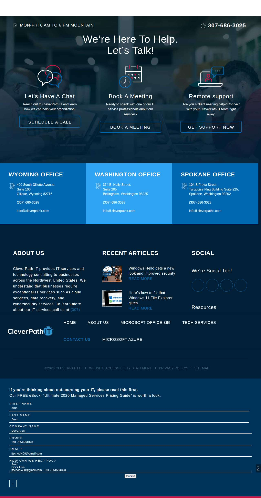

**After submit** — `run-4077e053_attempt-ee932614_post_attempt_2026-11-06T03-23-55-200Z.jpg`

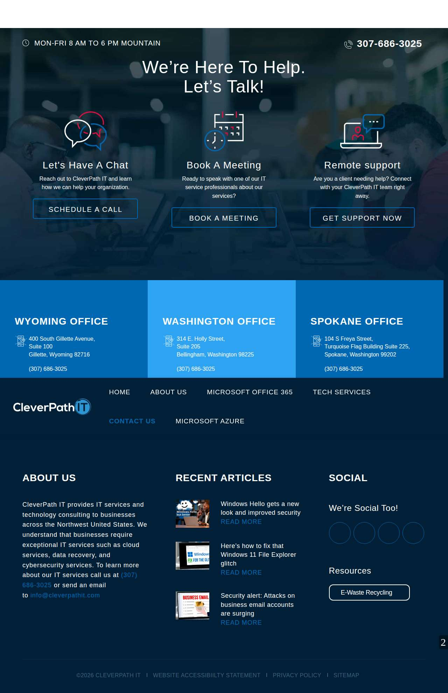

### pgtek.com — confirmed (LIVE)

| | |
|---|---|
| Attempt ID | `5876d4d5-523a-4048-bee0-25bc2f1148e0` |
| Form URL | https://www.pgtek.com/contact.html |
| Final URL | https://www.pgtek.com/contact.html |
| Reserved | 2026-11-06 03:24:04 UTC |
| Submit attempted | 2026-11-06 03:24:05 UTC |
| Template | standard v2 |
| Confirmation text | n you are. Name Organization Email Phone (optional) Message Message sent ✓ LOCATION 20394 Exchange Street, Suite 250 Ashburn, VA 20147 PHONE (703) 474-2800 FAX (703) 858-76 |
| Result / error | — |

Exact message:

~~~text
Subject: Helping customers find your business in AI search (AEO + GEO)

Hi there,

I'm Arun from Devs Arun. More and more customers now ask ChatGPT, Gemini, Perplexity or Google's AI Overviews questions like "who should I hire for this in my area?" before they call anyone. These tools answer from websites they can clearly understand, and they tend to recommend businesses whose pages answer real customer questions.

That is what AEO + GEO (Answer Engine and Generative Engine Optimization) is for. I improve your existing service pages so they clearly answer the questions your customers ask, add structured data that matches the page, and make the call, quote or enquiry step obvious. The benefit: your business gets a better chance of being mentioned or linked in AI answers, and visitors who arrive find it easy to contact you.

The AEO + GEO Starter is a one-time $199 (about ₹16,999, negotiable) for one website: a basic audit, 10 customer questions, improvements to two existing pages, relevant structured data and an action plan, with one revision round.

You can read the full details, send an enquiry or book online here:
https://devsarun.io/aeo-geo/

If this isn't relevant, just reply and I won't contact you again.

Best,
Arun
Devs Arun
itschool408@gmail.com · +91 7654534323
~~~

Submitted field values:

- Name \[name\]: Arun
- Email \[email\]: itschool408@gmail.com
- Message \[message\]: Hi there, I'm Arun from Devs Arun. More and more customers now ask ChatGPT, Gemini, Perplexity or Google's AI Overviews 
- Organization \[company\]: Devs Arun
- Phone (optional) \[phone\]: +91 7654534323

**Filled form (before submit)** — `run-4077e053_attempt-5876d4d5_filled_2026-11-06T03-24-05-242Z.jpg`

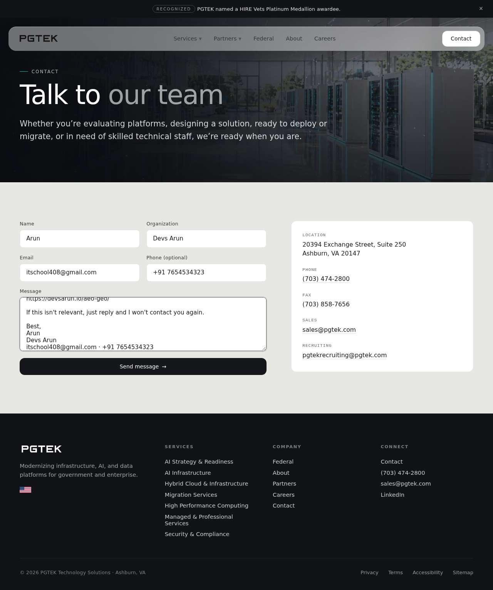

**After submit** — `run-4077e053_attempt-5876d4d5_post_attempt_2026-11-06T03-24-08-869Z.jpg`

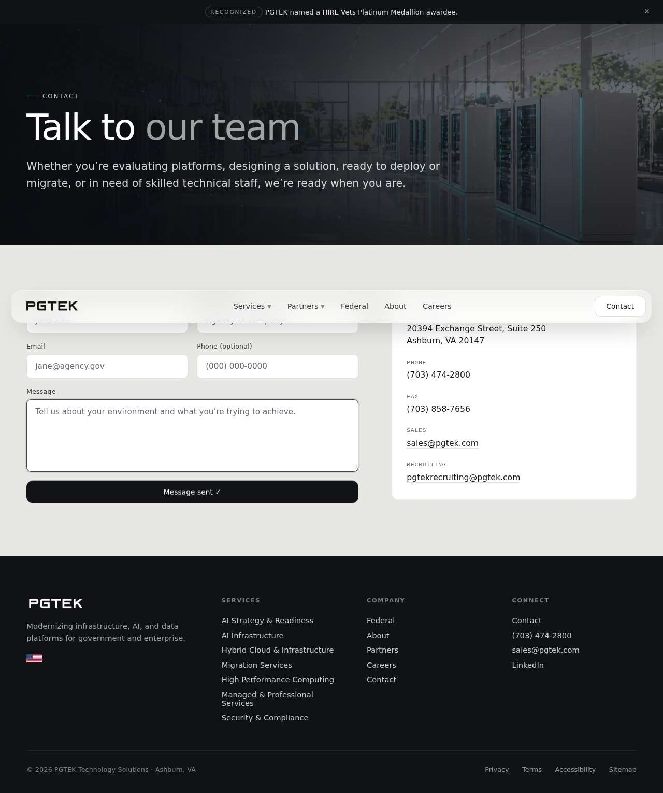

### reanimac.com — confirmed (LIVE)

| | |
|---|---|
| Attempt ID | `8ea6d44d-f854-40c2-b6ce-c4ceee38d19d` |
| Form URL | https://slotmanual.com/contact/ |
| Final URL | https://slotmanual.com/contact/ |
| Reserved | 2026-11-06 03:24:17 UTC |
| Submit attempted | 2026-11-06 03:24:21 UTC |
| Template | standard v2 |
| Confirmation text | ISH Contact Get in Touch Feel free to drop us a line below\! Thank you for your message. It has been sent. SEND MESSAGE ABOUT US Learn more about our team CONTACTS Find out how to contact |
| Result / error | — |

Exact message:

~~~text
Subject: Helping customers find your business in AI search (AEO + GEO)

Hi there,

I'm Arun from Devs Arun. More and more customers now ask ChatGPT, Gemini, Perplexity or Google's AI Overviews questions like "who should I hire for this in my area?" before they call anyone. These tools answer from websites they can clearly understand, and they tend to recommend businesses whose pages answer real customer questions.

That is what AEO + GEO (Answer Engine and Generative Engine Optimization) is for. I improve your existing service pages so they clearly answer the questions your customers ask, add structured data that matches the page, and make the call, quote or enquiry step obvious. The benefit: your business gets a better chance of being mentioned or linked in AI answers, and visitors who arrive find it easy to contact you.

The AEO + GEO Starter is a one-time $199 (about ₹16,999, negotiable) for one website: a basic audit, 10 customer questions, improvements to two existing pages, relevant structured data and an action plan, with one revision round.

You can read the full details, send an enquiry or book online here:
https://devsarun.io/aeo-geo/

If this isn't relevant, just reply and I won't contact you again.

Best,
Arun
Devs Arun
itschool408@gmail.com · +91 7654534323
~~~

Submitted field values:

- email \[email\]: itschool408@gmail.com
- your-message \[message\]: Hi there, I'm Arun from Devs Arun. More and more customers now ask ChatGPT, Gemini, Perplexity or Google's AI Overviews 
- first-name \[first\_name\]: Arun

**Filled form (before submit)** — `run-4077e053_attempt-8ea6d44d_filled_2026-11-06T03-24-21-891Z.jpg`

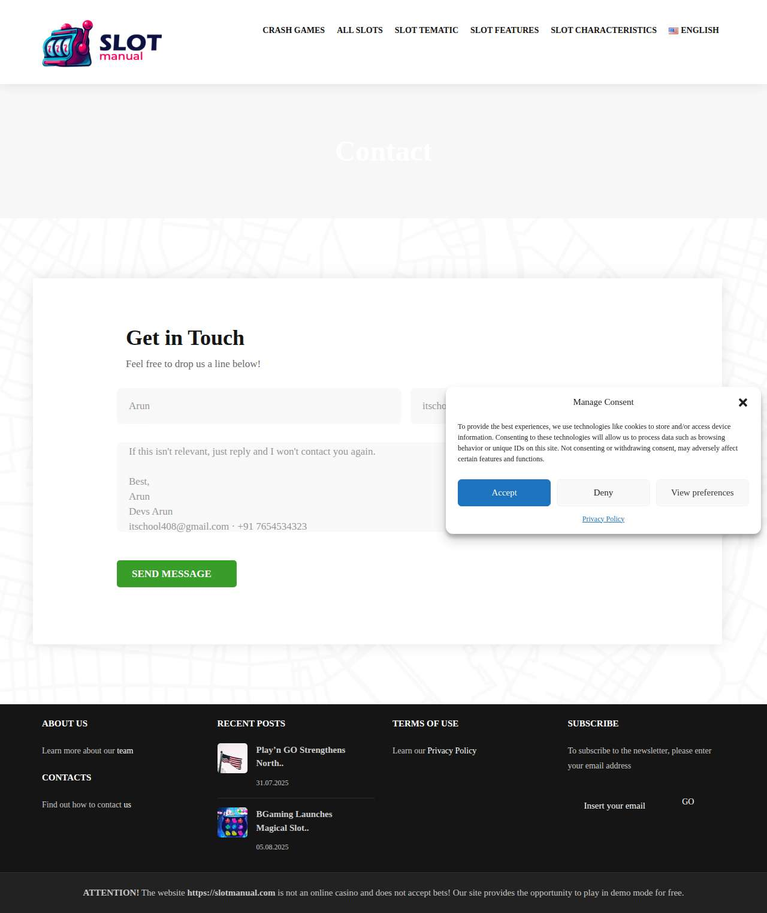

**After submit** — `run-4077e053_attempt-8ea6d44d_post_attempt_2026-11-06T03-24-29-620Z.jpg`

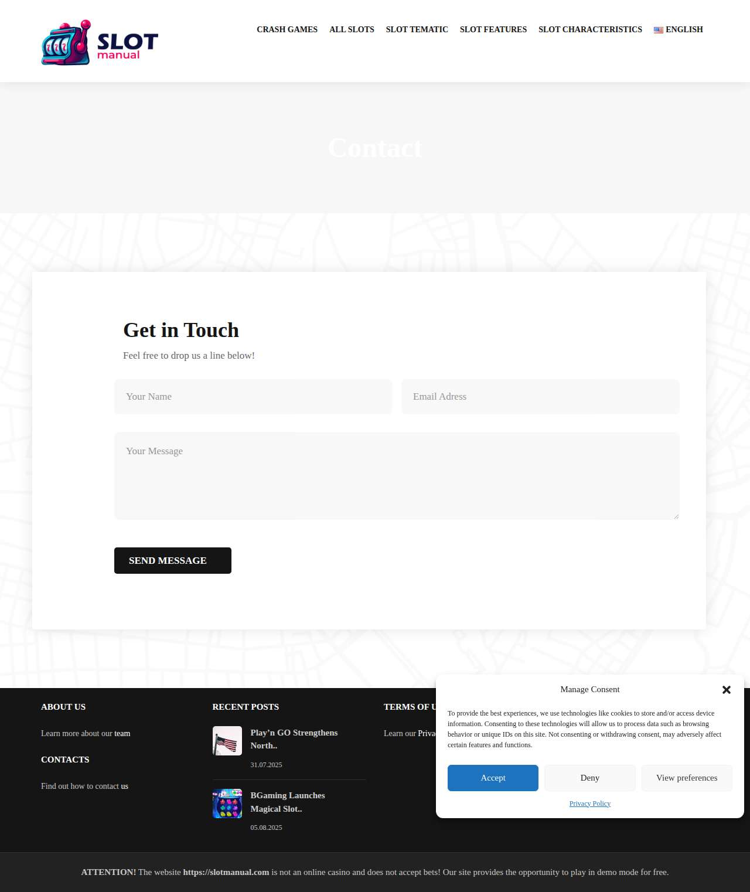

### cascadepc.com — unclear (LIVE)

| | |
|---|---|
| Attempt ID | `72b384a7-e302-443b-93d9-646dae2d6080` |
| Form URL | https://www.cascadepc.com/contact-us/ |
| Final URL | https://www.cascadepc.com/contact-us/ |
| Reserved | 2026-11-06 03:24:38 UTC |
| Submit attempted | 2026-11-06 03:24:40 UTC |
| Template | standard v2 |
| Confirmation text | none observed |
| Result / error | No new success marker observed |

Exact message:

~~~text
Subject: Helping customers find your business in AI search (AEO + GEO)

Hi there,

I'm Arun from Devs Arun. More and more customers now ask ChatGPT, Gemini, Perplexity or Google's AI Overviews questions like "who should I hire for this in my area?" before they call anyone. These tools answer from websites they can clearly understand, and they tend to recommend businesses whose pages answer real customer questions.

That is what AEO + GEO (Answer Engine and Generative Engine Optimization) is for. I improve your existing service pages so they clearly answer the questions your customers ask, add structured data that matches the page, and make the call, quote or enquiry step obvious. The benefit: your business gets a better chance of being mentioned or linked in AI answers, and visitors who arrive find it easy to contact you.

The AEO + GEO Starter is a one-time $199 (about ₹16,999, negotiable) for one website: a basic audit, 10 customer questions, improvements to two existing pages, relevant structured data and an action plan, with one revision round.

You can read the full details, send an enquiry or book online here:
https://devsarun.io/aeo-geo/

If this isn't relevant, just reply and I won't contact you again.

Best,
Arun
Devs Arun
itschool408@gmail.com · +91 7654534323
~~~

Submitted field values:

- Email \* \[email\]: itschool408@gmail.com
- Company \[company\]: Devs Arun
- Phone Number \[phone\]: +91 7654534323
- First Name \* \[first\_name\]: Arun
- Message/Description \[message\]: Hi there, I'm Arun from Devs Arun. More and more customers now ask ChatGPT, Gemini, Perplexity or Google's AI Overviews 

**Filled form (before submit)** — `run-4077e053_attempt-72b384a7_filled_2026-11-06T03-24-40-595Z.jpg`

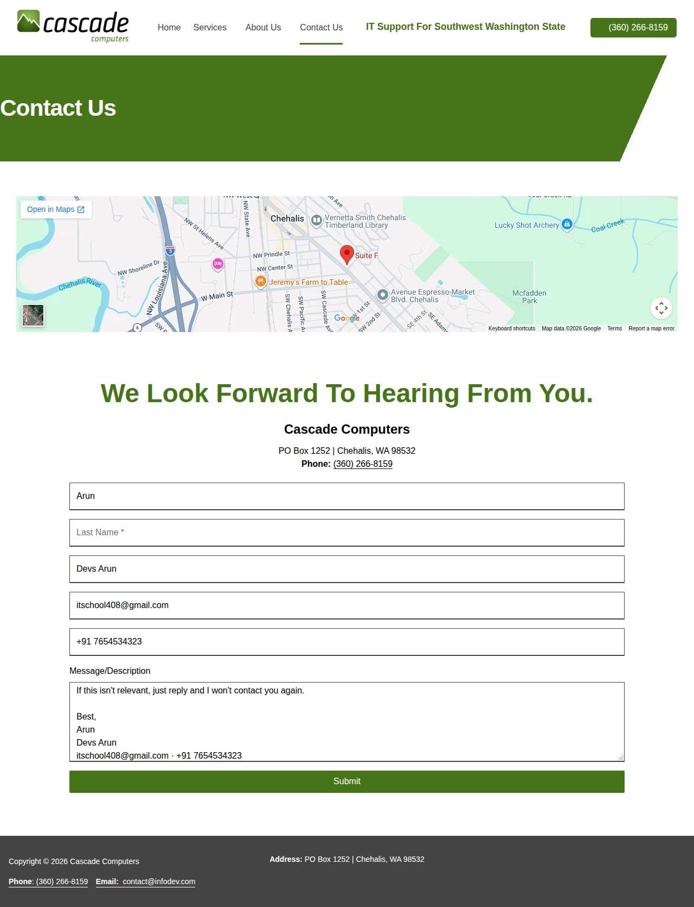

**After submit** — `run-4077e053_attempt-72b384a7_post_attempt_2026-11-06T03-25-09-023Z.jpg`

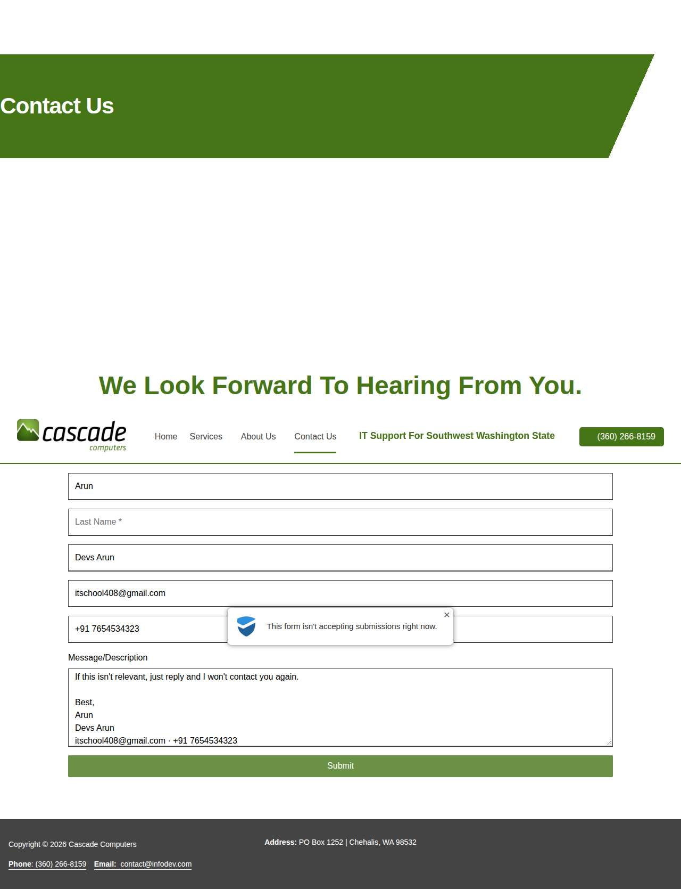

## Events (189)

| Time (UTC) | Event | Website | Details |
|---|---|---|---|
| 03:16:15 | run\_queued | — | live run requested by github:itsDevsArun |
| 03:16:15 | run\_dispatched | — | dispatch disabled (local test mode) |
| 03:16:19 | run\_started | — | Runner claimed live run |
| 03:16:20 | offer\_verified | — | Service page offer facts verified |
| 03:16:20 | website\_selected | clearchoiceplumbingllc.com | Live target clearchoiceplumbingllc.com |
| 03:16:20 | attempt\_reserved | clearchoiceplumbingllc.com | Submission attempt reserved with template standard v2 |
| 03:16:21 | page\_opened | clearchoiceplumbingllc.com | Opened form page |
| 03:16:21 | screenshot\_saved | clearchoiceplumbingllc.com | inspection screenshot saved (145 KB) |
| 03:16:21 | review\_required | clearchoiceplumbingllc.com | failed before submit: locator.fill: Error: Cannot type text into input\[type=number\] |
| 03:16:26 | website\_selected | bwnwincpainting.com | Live target bwnwincpainting.com |
| 03:16:26 | attempt\_reserved | bwnwincpainting.com | Submission attempt reserved with template standard v2 |
| 03:16:28 | page\_opened | bwnwincpainting.com | Opened form page |
| 03:16:28 | screenshot\_saved | bwnwincpainting.com | inspection screenshot saved (118 KB) |
| 03:16:28 | review\_required | bwnwincpainting.com | failed before submit: locator.fill: Error: Cannot type text into input\[type=number\] |
| 03:16:33 | website\_selected | absoluterestorepa.com | Live target absoluterestorepa.com |
| 03:16:33 | attempt\_reserved | absoluterestorepa.com | Submission attempt reserved with template standard v2 |
| 03:16:38 | page\_opened | absoluterestorepa.com | Opened form page |
| 03:16:38 | screenshot\_saved | absoluterestorepa.com | inspection screenshot saved (174 KB) |
| 03:16:38 | review\_required | absoluterestorepa.com | failed before submit: locator.fill: Error: Cannot type text into input\[type=number\] |
| 03:16:43 | website\_selected | masoudlawfirm.com | Live target masoudlawfirm.com |
| 03:16:43 | attempt\_reserved | masoudlawfirm.com | Submission attempt reserved with template standard v2 |
| 03:16:45 | page\_opened | masoudlawfirm.com | Opened form page |
| 03:16:45 | screenshot\_saved | masoudlawfirm.com | inspection screenshot saved (168 KB) |
| 03:16:45 | review\_required | masoudlawfirm.com | failed before submit: locator.fill: Error: Cannot type text into input\[type=number\] |
| 03:16:50 | website\_selected | whiteolivecpa.com | Live target whiteolivecpa.com |
| 03:16:50 | attempt\_reserved | whiteolivecpa.com | Submission attempt reserved with template standard v2 |
| 03:16:51 | page\_opened | whiteolivecpa.com | Opened form page |
| 03:16:52 | screenshot\_saved | whiteolivecpa.com | inspection screenshot saved (198 KB) |
| 03:16:52 | review\_required | whiteolivecpa.com | failed before submit: locator.fill: Error: Cannot type text into input\[type=number\] |
| 03:16:57 | website\_selected | canterburyadvisor.com | Live target canterburyadvisor.com |
| 03:16:57 | attempt\_reserved | canterburyadvisor.com | Submission attempt reserved with template standard v2 |
| 03:16:59 | page\_opened | canterburyadvisor.com | Opened form page |
| 03:16:59 | screenshot\_saved | canterburyadvisor.com | inspection screenshot saved (350 KB) |
| 03:16:59 | review\_required | canterburyadvisor.com | failed before submit: locator.fill: Error: Cannot type text into input\[type=number\] |
| 03:17:04 | website\_selected | connectionzpcrepair.com | Live target connectionzpcrepair.com |
| 03:17:04 | attempt\_reserved | connectionzpcrepair.com | Submission attempt reserved with template standard v2 |
| 03:17:06 | page\_opened | connectionzpcrepair.com | Opened form page |
| 03:17:06 | screenshot\_saved | connectionzpcrepair.com | inspection screenshot saved (145 KB) |
| 03:17:06 | review\_required | connectionzpcrepair.com | failed before submit: locator.fill: Error: Cannot type text into input\[type=number\] |
| 03:17:11 | website\_selected | bendyworks.com | Live target bendyworks.com |
| 03:17:11 | attempt\_reserved | bendyworks.com | Submission attempt reserved with template standard v2 |
| 03:17:12 | page\_opened | bendyworks.com | Opened form page |
| 03:17:12 | fields\_filled | bendyworks.com | filled |
| 03:17:12 | screenshot\_saved | bendyworks.com | filled screenshot saved (67 KB) |
| 03:17:12 | submit\_attempted | bendyworks.com | submitting |
| 03:17:17 | screenshot\_saved | bendyworks.com | post\_attempt screenshot saved (25 KB) |
| 03:17:17 | confirmation\_observed | bendyworks.com | confirmed — "Our Work Our Team Craft a Project With Us Careers Our Blog THANK YOU\! Thanks for your interest. We'll be in touch soon\! " |
| 03:17:26 | website\_selected | gaugedigitalmedia.com | Live target gaugedigitalmedia.com |
| 03:17:26 | attempt\_reserved | gaugedigitalmedia.com | Submission attempt reserved with template standard v2 |
| 03:17:27 | page\_opened | gaugedigitalmedia.com | Opened form page |
| 03:17:28 | fields\_filled | gaugedigitalmedia.com | filled |
| 03:17:28 | screenshot\_saved | gaugedigitalmedia.com | filled screenshot saved (200 KB) |
| 03:17:28 | submit\_attempted | gaugedigitalmedia.com | submitting |
| 03:17:57 | screenshot\_saved | gaugedigitalmedia.com | post\_attempt screenshot saved (222 KB) |
| 03:17:57 | review\_required | gaugedigitalmedia.com | unclear: No new success marker observed |
| 03:18:05 | website\_selected | attackresearch.com | Live target attackresearch.com |
| 03:18:05 | attempt\_reserved | attackresearch.com | Submission attempt reserved with template standard v2 |
| 03:18:07 | page\_opened | attackresearch.com | Opened form page |
| 03:18:08 | screenshot\_saved | attackresearch.com | filled screenshot saved (522 KB) |
| 03:18:08 | review\_required | attackresearch.com | failed before submit: Form validation would block sending: : Please check this box if you want to proceed. |
| 03:18:13 | website\_selected | belugalab.com | Live target belugalab.com |
| 03:18:13 | attempt\_reserved | belugalab.com | Submission attempt reserved with template standard v2 |
| 03:18:14 | page\_opened | belugalab.com | Opened form page |
| 03:18:14 | fields\_filled | belugalab.com | filled |
| 03:18:14 | screenshot\_saved | belugalab.com | filled screenshot saved (328 KB) |
| 03:18:15 | submit\_attempted | belugalab.com | submitting |
| 03:18:21 | screenshot\_saved | belugalab.com | post\_attempt screenshot saved (42 KB) |
| 03:18:21 | confirmation\_observed | belugalab.com | confirmed — "Redirected to /thank-you/" |
| 03:18:29 | website\_selected | veracitysolutions.com | Live target veracitysolutions.com |
| 03:18:29 | attempt\_reserved | veracitysolutions.com | Submission attempt reserved with template standard v2 |
| 03:18:30 | page\_opened | veracitysolutions.com | Opened form page |
| 03:18:30 | fields\_filled | veracitysolutions.com | filled |
| 03:18:31 | screenshot\_saved | veracitysolutions.com | filled screenshot saved (104 KB) |
| 03:18:31 | submit\_attempted | veracitysolutions.com | submitting |
| 03:18:35 | screenshot\_saved | veracitysolutions.com | post\_attempt screenshot saved (84 KB) |
| 03:18:35 | confirmation\_observed | veracitysolutions.com | confirmed — "ould take on first. Lehi, Utah · pods@veracitysolutions.com MESSAGE SENT Thanks — your message is on its way. We read ev" |
| 03:18:44 | website\_selected | newyorkcomputerhelp.com | Live target newyorkcomputerhelp.com |
| 03:18:44 | attempt\_reserved | newyorkcomputerhelp.com | Submission attempt reserved with template standard v2 |
| 03:18:46 | page\_opened | newyorkcomputerhelp.com | Opened form page |
| 03:18:46 | fields\_filled | newyorkcomputerhelp.com | filled |
| 03:18:46 | screenshot\_saved | newyorkcomputerhelp.com | filled screenshot saved (142 KB) |
| 03:18:46 | submit\_attempted | newyorkcomputerhelp.com | submitting |
| 03:18:51 | screenshot\_saved | newyorkcomputerhelp.com | post\_attempt screenshot saved (135 KB) |
| 03:18:51 | confirmation\_observed | newyorkcomputerhelp.com | confirmed — "we usually reply within a few hours during business hours. Thank you for your message We will get back to you shortly. N" |
| 03:18:59 | website\_selected | azcomp.com | Live target azcomp.com |
| 03:18:59 | attempt\_reserved | azcomp.com | Submission attempt reserved with template standard v2 |
| 03:19:01 | page\_opened | azcomp.com | Opened form page |
| 03:19:01 | fields\_filled | azcomp.com | filled |
| 03:19:01 | screenshot\_saved | azcomp.com | filled screenshot saved (240 KB) |
| 03:19:01 | submit\_attempted | azcomp.com | submitting |
| 03:19:30 | screenshot\_saved | azcomp.com | post\_attempt screenshot saved (279 KB) |
| 03:19:30 | review\_required | azcomp.com | unclear: No new success marker observed |
| 03:19:39 | website\_selected | icuro.com | Live target icuro.com |
| 03:19:39 | attempt\_reserved | icuro.com | Submission attempt reserved with template standard v2 |
| 03:19:41 | page\_opened | icuro.com | Opened form page |
| 03:19:41 | fields\_filled | icuro.com | filled |
| 03:19:41 | screenshot\_saved | icuro.com | filled screenshot saved (143 KB) |
| 03:19:41 | submit\_attempted | icuro.com | submitting |
| 03:19:45 | screenshot\_saved | icuro.com | post\_attempt screenshot saved (209 KB) |
| 03:19:46 | error | icuro.com | error after submit — "here? I agree to the Terms and Conditions Submit Message An error occurred. U.S. Headquarters 3350 Scott Blvd Building 4" |
| 03:19:54 | website\_selected | tech-fusion.us | Live target tech-fusion.us |
| 03:19:54 | attempt\_reserved | tech-fusion.us | Submission attempt reserved with template standard v2 |
| 03:19:56 | page\_opened | tech-fusion.us | Opened form page |
| 03:19:56 | fields\_filled | tech-fusion.us | filled |
| 03:19:56 | screenshot\_saved | tech-fusion.us | filled screenshot saved (134 KB) |
| 03:19:56 | submit\_attempted | tech-fusion.us | submitting |
| 03:20:25 | screenshot\_saved | tech-fusion.us | post\_attempt screenshot saved (7 KB) |
| 03:20:25 | review\_required | tech-fusion.us | unclear: No new success marker observed |
| 03:20:33 | website\_selected | qualitycomputer.net | Live target qualitycomputer.net |
| 03:20:33 | attempt\_reserved | qualitycomputer.net | Submission attempt reserved with template standard v2 |
| 03:20:36 | page\_opened | qualitycomputer.net | Opened form page |
| 03:20:36 | fields\_filled | qualitycomputer.net | filled |
| 03:20:36 | screenshot\_saved | qualitycomputer.net | filled screenshot saved (158 KB) |
| 03:20:36 | submit\_attempted | qualitycomputer.net | submitting |
| 03:21:04 | screenshot\_saved | qualitycomputer.net | post\_attempt screenshot saved (123 KB) |
| 03:21:05 | review\_required | qualitycomputer.net | unclear: No new success marker observed |
| 03:21:13 | website\_selected | partnersin.tech | Live target partnersin.tech |
| 03:21:13 | attempt\_reserved | partnersin.tech | Submission attempt reserved with template standard v2 |
| 03:21:14 | page\_opened | partnersin.tech | Opened form page |
| 03:21:14 | fields\_filled | partnersin.tech | filled |
| 03:21:14 | screenshot\_saved | partnersin.tech | filled screenshot saved (217 KB) |
| 03:21:14 | submit\_attempted | partnersin.tech | submitting |
| 03:21:19 | screenshot\_saved | partnersin.tech | post\_attempt screenshot saved (217 KB) |
| 03:21:19 | confirmation\_observed | partnersin.tech | confirmed — "llowstone" Get in touch You can reach us anytime Contact us Message sent successfully\! © 2025 Partners In.TechPrivacy Po" |
| 03:21:27 | website\_selected | medicaldesignsolutions.com | Live target medicaldesignsolutions.com |
| 03:21:27 | attempt\_reserved | medicaldesignsolutions.com | Submission attempt reserved with template standard v2 |
| 03:21:30 | page\_opened | medicaldesignsolutions.com | Opened form page |
| 03:21:30 | fields\_filled | medicaldesignsolutions.com | filled |
| 03:21:30 | screenshot\_saved | medicaldesignsolutions.com | filled screenshot saved (96 KB) |
| 03:21:30 | submit\_attempted | medicaldesignsolutions.com | submitting |
| 03:22:00 | screenshot\_saved | medicaldesignsolutions.com | post\_attempt screenshot saved (101 KB) |
| 03:22:00 | review\_required | medicaldesignsolutions.com | unclear: No new success marker observed |
| 03:22:08 | website\_selected | teralogics.com | Live target teralogics.com |
| 03:22:08 | attempt\_reserved | teralogics.com | Submission attempt reserved with template standard v2 |
| 03:22:09 | page\_opened | teralogics.com | Opened form page |
| 03:22:09 | fields\_filled | teralogics.com | filled |
| 03:22:10 | screenshot\_saved | teralogics.com | filled screenshot saved (99 KB) |
| 03:22:10 | submit\_attempted | teralogics.com | submitting |
| 03:22:38 | screenshot\_saved | teralogics.com | post\_attempt screenshot saved (7 KB) |
| 03:22:38 | review\_required | teralogics.com | unclear: No new success marker observed |
| 03:22:47 | website\_selected | jabitllc.com | Live target jabitllc.com |
| 03:22:47 | attempt\_reserved | jabitllc.com | Submission attempt reserved with template standard v2 |
| 03:22:53 | page\_opened | jabitllc.com | Opened form page |
| 03:22:53 | fields\_filled | jabitllc.com | filled |
| 03:22:53 | screenshot\_saved | jabitllc.com | filled screenshot saved (73 KB) |
| 03:22:53 | submit\_attempted | jabitllc.com | submitting |
| 03:22:58 | screenshot\_saved | jabitllc.com | post\_attempt screenshot saved (55 KB) |
| 03:22:58 | confirmation\_observed | jabitllc.com | confirmed — "Friday 9AM – 6PM Saturday 10AM – 4PM CST Your response was successfully submitted. Thank you\! JAB IT LLC \| 2680 Planet A" |
| 03:23:06 | website\_selected | cne-inc.com | Live target cne-inc.com |
| 03:23:06 | attempt\_reserved | cne-inc.com | Submission attempt reserved with template standard v2 |
| 03:23:11 | page\_opened | cne-inc.com | Opened form page |
| 03:23:11 | fields\_filled | cne-inc.com | filled |
| 03:23:11 | screenshot\_saved | cne-inc.com | filled screenshot saved (126 KB) |
| 03:23:11 | submit\_attempted | cne-inc.com | submitting |
| 03:23:17 | screenshot\_saved | cne-inc.com | post\_attempt screenshot saved (121 KB) |
| 03:23:17 | confirmation\_observed | cne-inc.com | confirmed — "954 Gainesville: (352) 373-9697 Ocala: (352) 840-0881 Help\! Thank you for your message. It has been sent. Privacy Policy" |
| 03:23:25 | website\_selected | k2technologies.net | Live target k2technologies.net |
| 03:23:25 | attempt\_reserved | k2technologies.net | Submission attempt reserved with template standard v2 |
| 03:23:26 | page\_opened | k2technologies.net | Opened form page |
| 03:23:26 | fields\_filled | k2technologies.net | filled |
| 03:23:26 | screenshot\_saved | k2technologies.net | filled screenshot saved (193 KB) |
| 03:23:26 | submit\_attempted | k2technologies.net | submitting |
| 03:23:55 | screenshot\_saved | k2technologies.net | post\_attempt screenshot saved (159 KB) |
| 03:23:55 | review\_required | k2technologies.net | unclear: No new success marker observed |
| 03:24:04 | website\_selected | pgtek.com | Live target pgtek.com |
| 03:24:04 | attempt\_reserved | pgtek.com | Submission attempt reserved with template standard v2 |
| 03:24:04 | page\_opened | pgtek.com | Opened form page |
| 03:24:05 | fields\_filled | pgtek.com | filled |
| 03:24:05 | screenshot\_saved | pgtek.com | filled screenshot saved (105 KB) |
| 03:24:05 | submit\_attempted | pgtek.com | submitting |
| 03:24:08 | screenshot\_saved | pgtek.com | post\_attempt screenshot saved (98 KB) |
| 03:24:08 | confirmation\_observed | pgtek.com | confirmed — "n you are. Name Organization Email Phone (optional) Message Message sent ✓ LOCATION 20394 Exchange Street, Suite 250 Ash" |
| 03:24:17 | website\_selected | reanimac.com | Live target reanimac.com |
| 03:24:17 | attempt\_reserved | reanimac.com | Submission attempt reserved with template standard v2 |
| 03:24:21 | page\_opened | reanimac.com | Opened form page |
| 03:24:21 | fields\_filled | reanimac.com | filled |
| 03:24:21 | screenshot\_saved | reanimac.com | filled screenshot saved (74 KB) |
| 03:24:21 | submit\_attempted | reanimac.com | submitting |
| 03:24:29 | screenshot\_saved | reanimac.com | post\_attempt screenshot saved (68 KB) |
| 03:24:29 | confirmation\_observed | reanimac.com | confirmed — "ISH Contact Get in Touch Feel free to drop us a line below\! Thank you for your message. It has been sent. SEND MESSAGE A" |
| 03:24:38 | website\_selected | cascadepc.com | Live target cascadepc.com |
| 03:24:38 | attempt\_reserved | cascadepc.com | Submission attempt reserved with template standard v2 |
| 03:24:40 | page\_opened | cascadepc.com | Opened form page |
| 03:24:40 | fields\_filled | cascadepc.com | filled |
| 03:24:40 | screenshot\_saved | cascadepc.com | filled screenshot saved (114 KB) |
| 03:24:40 | submit\_attempted | cascadepc.com | submitting |
| 03:25:09 | screenshot\_saved | cascadepc.com | post\_attempt screenshot saved (80 KB) |
| 03:25:09 | review\_required | cascadepc.com | unclear: No new success marker observed |
| 03:25:18 | run\_completed | — | Run completed (queue\_exhausted) |
