# Run a1f5f6f1 — live — completed

| | |
|---|---|
| Run ID | `a1f5f6f1-383e-4102-8c90-a0a3695c8d42` |
| Requested by | github:itsDevsArun |
| Started | 2026-11-06 05:27:06 UTC |
| Finished | 2026-11-06 05:33:56 UTC |
| Finish reason | queue\_exhausted |
| GitHub Actions | https://github.com/itsDevsArun/aeo-geo/actions/runs/42148448245 |

CSV for this run: [runs/2026-11-06_live_a1f5f6f1.csv](2026-11-06_live_a1f5f6f1.csv)

## Attempts (23)

### clearchoiceplumbingllc.com — failed\_before\_submit (LIVE)

| | |
|---|---|
| Attempt ID | `20174a7a-adf3-4f82-ba31-439834240874` |
| Form URL | https://clearchoiceplumbingllc.com/contact/ |
| Final URL | — |
| Reserved | 2026-11-06 05:27:07 UTC |
| Submit attempted | — |
| Template | standard v2 |
| Confirmation text | none observed |
| Result / error | locator.fill: Error: Cannot type text into input\[type=number\] |

Exact message:

~~~text
Subject: Helping customers find your business in AI search (AEO + GEO)

Hi there,

I'm Arun from Devs Arun. More and more customers now ask ChatGPT, Gemini, Perplexity or Google's AI Overviews questions like "who should I hire for this in my area?" before they call anyone. These tools answer from websites they can clearly understand, and they tend to recommend businesses whose pages answer real customer questions.

That is what AEO + GEO (Answer Engine and Generative Engine Optimization) is for. I improve your existing service pages so they clearly answer the questions your customers ask, add structured data that matches the page, and make the call, quote or enquiry step obvious. The benefit: your business gets a better chance of being mentioned or linked in AI answers, and visitors who arrive find it easy to contact you.

The AEO + GEO Starter is a one-time $199 (about ₹16,999, negotiable) for one website: a basic audit, 10 customer questions, improvements to two existing pages, relevant structured data and an action plan, with one revision round.

You can read the full details, send an enquiry or book online here:
https://devsarun.io/aeo-geo/

If this isn't relevant, just reply and I won't contact you again.

Best,
Arun
Devs Arun
itschool408@gmail.com · +91 7654534323
~~~

Submitted field values:

- \#wpforms-51-field\_1: Arun
- \#wpforms-51-field\_2: itschool408@gmail.com
- \#wpforms-51-field\_3: Hi there, I'm Arun from Devs Arun. More and more customers now ask ChatGPT, Gemini, Perplexity or Google's AI Overviews 
- \#wpforms-51-field\_5: +91 7654534323

**Inspected page** — `run-a1f5f6f1_attempt-20174a7a_inspection_2026-11-06T05-27-08-844Z.jpg`

### bwnwincpainting.com — failed\_before\_submit (LIVE)

| | |
|---|---|
| Attempt ID | `72eec683-da7b-45ac-851c-56057e4bb621` |
| Form URL | https://www.bwnwincpainting.com/contact/ |
| Final URL | — |
| Reserved | 2026-11-06 05:27:13 UTC |
| Submit attempted | — |
| Template | standard v2 |
| Confirmation text | none observed |
| Result / error | locator.fill: Error: Cannot type text into input\[type=number\] |

Exact message:

~~~text
Subject: Helping customers find your business in AI search (AEO + GEO)

Hi there,

I'm Arun from Devs Arun. More and more customers now ask ChatGPT, Gemini, Perplexity or Google's AI Overviews questions like "who should I hire for this in my area?" before they call anyone. These tools answer from websites they can clearly understand, and they tend to recommend businesses whose pages answer real customer questions.

That is what AEO + GEO (Answer Engine and Generative Engine Optimization) is for. I improve your existing service pages so they clearly answer the questions your customers ask, add structured data that matches the page, and make the call, quote or enquiry step obvious. The benefit: your business gets a better chance of being mentioned or linked in AI answers, and visitors who arrive find it easy to contact you.

The AEO + GEO Starter is a one-time $199 (about ₹16,999, negotiable) for one website: a basic audit, 10 customer questions, improvements to two existing pages, relevant structured data and an action plan, with one revision round.

You can read the full details, send an enquiry or book online here:
https://devsarun.io/aeo-geo/

If this isn't relevant, just reply and I won't contact you again.

Best,
Arun
Devs Arun
itschool408@gmail.com · +91 7654534323
~~~

Submitted field values:

- \#name-1151: Arun
- \#email-1151: itschool408@gmail.com
- \#phone-1151: +91 7654534323
- \#message-1151: Hi there, I'm Arun from Devs Arun. More and more customers now ask ChatGPT, Gemini, Perplexity or Google's AI Overviews 

**Inspected page** — `run-a1f5f6f1_attempt-72eec683_inspection_2026-11-06T05-27-15-172Z.jpg`

### absoluterestorepa.com — failed\_before\_submit (LIVE)

| | |
|---|---|
| Attempt ID | `5e7cadb1-5d5e-4dc1-b49c-dad1254e2c60` |
| Form URL | https://absoluterestorepa.com/contact-us/ |
| Final URL | — |
| Reserved | 2026-11-06 05:27:20 UTC |
| Submit attempted | — |
| Template | standard v2 |
| Confirmation text | none observed |
| Result / error | locator.fill: Error: Cannot type text into input\[type=number\] |

Exact message:

~~~text
Subject: Helping customers find your business in AI search (AEO + GEO)

Hi there,

I'm Arun from Devs Arun. More and more customers now ask ChatGPT, Gemini, Perplexity or Google's AI Overviews questions like "who should I hire for this in my area?" before they call anyone. These tools answer from websites they can clearly understand, and they tend to recommend businesses whose pages answer real customer questions.

That is what AEO + GEO (Answer Engine and Generative Engine Optimization) is for. I improve your existing service pages so they clearly answer the questions your customers ask, add structured data that matches the page, and make the call, quote or enquiry step obvious. The benefit: your business gets a better chance of being mentioned or linked in AI answers, and visitors who arrive find it easy to contact you.

The AEO + GEO Starter is a one-time $199 (about ₹16,999, negotiable) for one website: a basic audit, 10 customer questions, improvements to two existing pages, relevant structured data and an action plan, with one revision round.

You can read the full details, send an enquiry or book online here:
https://devsarun.io/aeo-geo/

If this isn't relevant, just reply and I won't contact you again.

Best,
Arun
Devs Arun
itschool408@gmail.com · +91 7654534323
~~~

Submitted field values:

- \#form-field-name: Arun
- \#form-field-message: Hi there, I'm Arun from Devs Arun. More and more customers now ask ChatGPT, Gemini, Perplexity or Google's AI Overviews 
- \#form-field-field\_ed02ec2: +91 7654534323
- \#content \> div \> div \> div:nth-of-type(2) \> div \> div:nth-of-type(1) \> div:nth-of-type(2) \> div \> form \> div \> div:nth-of-type(3) \> input: itschool408@gmail.com

**Inspected page** — `run-a1f5f6f1_attempt-5e7cadb1_inspection_2026-11-06T05-27-22-790Z.jpg`

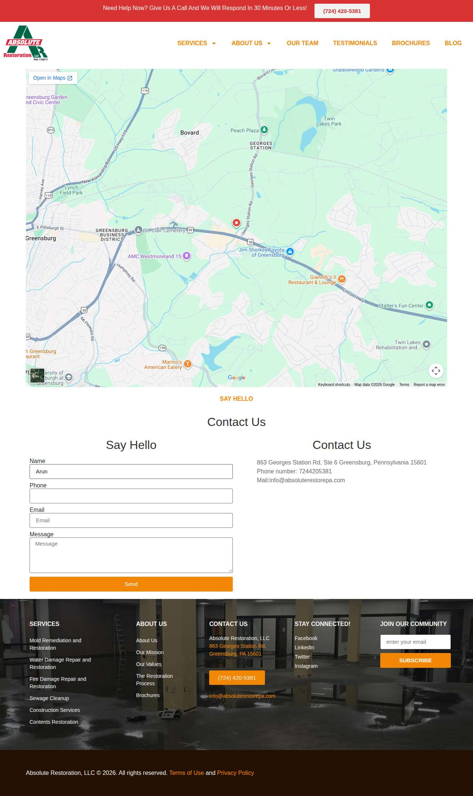

### masoudlawfirm.com — failed\_before\_submit (LIVE)

| | |
|---|---|
| Attempt ID | `fbcbcae3-93d9-4011-941c-d7dc3f74a894` |
| Form URL | https://masoudlawfirm.com/contact/ |
| Final URL | — |
| Reserved | 2026-11-06 05:27:27 UTC |
| Submit attempted | — |
| Template | standard v2 |
| Confirmation text | none observed |
| Result / error | locator.fill: Error: Cannot type text into input\[type=number\] |

Exact message:

~~~text
Subject: Helping customers find your business in AI search (AEO + GEO)

Hi there,

I'm Arun from Devs Arun. More and more customers now ask ChatGPT, Gemini, Perplexity or Google's AI Overviews questions like "who should I hire for this in my area?" before they call anyone. These tools answer from websites they can clearly understand, and they tend to recommend businesses whose pages answer real customer questions.

That is what AEO + GEO (Answer Engine and Generative Engine Optimization) is for. I improve your existing service pages so they clearly answer the questions your customers ask, add structured data that matches the page, and make the call, quote or enquiry step obvious. The benefit: your business gets a better chance of being mentioned or linked in AI answers, and visitors who arrive find it easy to contact you.

The AEO + GEO Starter is a one-time $199 (about ₹16,999, negotiable) for one website: a basic audit, 10 customer questions, improvements to two existing pages, relevant structured data and an action plan, with one revision round.

You can read the full details, send an enquiry or book online here:
https://devsarun.io/aeo-geo/

If this isn't relevant, just reply and I won't contact you again.

Best,
Arun
Devs Arun
itschool408@gmail.com · +91 7654534323
~~~

Submitted field values:

- \#form-field-name: Arun
- \#form-field-field\_3374379: Hi there, I'm Arun from Devs Arun. More and more customers now ask ChatGPT, Gemini, Perplexity or Google's AI Overviews 
- \#form-field-field\_7731784: +91 7654534323
- \#form-field-field\_8bd0f16: itschool408@gmail.com

**Inspected page** — `run-a1f5f6f1_attempt-fbcbcae3_inspection_2026-11-06T05-27-31-737Z.jpg`

### whiteolivecpa.com — failed\_before\_submit (LIVE)

| | |
|---|---|
| Attempt ID | `5991bfc6-7719-43b3-9633-d3b06b15ab05` |
| Form URL | https://whiteolivecpa.com/contact/ |
| Final URL | — |
| Reserved | 2026-11-06 05:27:36 UTC |
| Submit attempted | — |
| Template | standard v2 |
| Confirmation text | none observed |
| Result / error | locator.fill: Error: Cannot type text into input\[type=number\] |

Exact message:

~~~text
Subject: Helping customers find your business in AI search (AEO + GEO)

Hi there,

I'm Arun from Devs Arun. More and more customers now ask ChatGPT, Gemini, Perplexity or Google's AI Overviews questions like "who should I hire for this in my area?" before they call anyone. These tools answer from websites they can clearly understand, and they tend to recommend businesses whose pages answer real customer questions.

That is what AEO + GEO (Answer Engine and Generative Engine Optimization) is for. I improve your existing service pages so they clearly answer the questions your customers ask, add structured data that matches the page, and make the call, quote or enquiry step obvious. The benefit: your business gets a better chance of being mentioned or linked in AI answers, and visitors who arrive find it easy to contact you.

The AEO + GEO Starter is a one-time $199 (about ₹16,999, negotiable) for one website: a basic audit, 10 customer questions, improvements to two existing pages, relevant structured data and an action plan, with one revision round.

You can read the full details, send an enquiry or book online here:
https://devsarun.io/aeo-geo/

If this isn't relevant, just reply and I won't contact you again.

Best,
Arun
Devs Arun
itschool408@gmail.com · +91 7654534323
~~~

Submitted field values:

- \#ff\_1\_email: itschool408@gmail.com
- \#ff\_1\_message: Hi there, I'm Arun from Devs Arun. More and more customers now ask ChatGPT, Gemini, Perplexity or Google's AI Overviews 
- \#ff\_1\_numeric\_field: +91 7654534323
- \#ff\_1\_names\_first\_name\_: Arun

**Inspected page** — `run-a1f5f6f1_attempt-5991bfc6_inspection_2026-11-06T05-27-38-170Z.jpg`

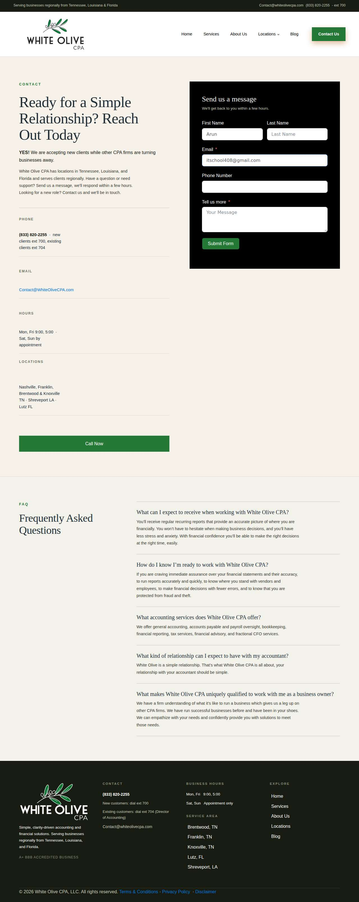

### canterburyadvisor.com — failed\_before\_submit (LIVE)

| | |
|---|---|
| Attempt ID | `a59dfb9d-c0fd-4ef2-8a45-8d6d0b639a37` |
| Form URL | https://canterburyadvisor.com/ |
| Final URL | — |
| Reserved | 2026-11-06 05:27:43 UTC |
| Submit attempted | — |
| Template | standard v2 |
| Confirmation text | none observed |
| Result / error | locator.fill: Error: Cannot type text into input\[type=number\] |

Exact message:

~~~text
Subject: Helping customers find your business in AI search (AEO + GEO)

Hi there,

I'm Arun from Devs Arun. More and more customers now ask ChatGPT, Gemini, Perplexity or Google's AI Overviews questions like "who should I hire for this in my area?" before they call anyone. These tools answer from websites they can clearly understand, and they tend to recommend businesses whose pages answer real customer questions.

That is what AEO + GEO (Answer Engine and Generative Engine Optimization) is for. I improve your existing service pages so they clearly answer the questions your customers ask, add structured data that matches the page, and make the call, quote or enquiry step obvious. The benefit: your business gets a better chance of being mentioned or linked in AI answers, and visitors who arrive find it easy to contact you.

The AEO + GEO Starter is a one-time $199 (about ₹16,999, negotiable) for one website: a basic audit, 10 customer questions, improvements to two existing pages, relevant structured data and an action plan, with one revision round.

You can read the full details, send an enquiry or book online here:
https://devsarun.io/aeo-geo/

If this isn't relevant, just reply and I won't contact you again.

Best,
Arun
Devs Arun
itschool408@gmail.com · +91 7654534323
~~~

Submitted field values:

- \#form-field-name: Arun
- \#form-field-email: itschool408@gmail.com
- \#form-field-message: Hi there, I'm Arun from Devs Arun. More and more customers now ask ChatGPT, Gemini, Perplexity or Google's AI Overviews 
- \#form-field-field\_97f81fb: +91 7654534323

**Inspected page** — `run-a1f5f6f1_attempt-a59dfb9d_inspection_2026-11-06T05-27-45-167Z.jpg`

### connectionzpcrepair.com — failed\_before\_submit (LIVE)

| | |
|---|---|
| Attempt ID | `42f108e2-35b2-4662-82b5-0df63ceae530` |
| Form URL | https://connectionzpcrepair.com/contact/ |
| Final URL | — |
| Reserved | 2026-11-06 05:27:50 UTC |
| Submit attempted | — |
| Template | standard v2 |
| Confirmation text | none observed |
| Result / error | locator.fill: Error: Cannot type text into input\[type=number\] |

Exact message:

~~~text
Subject: Helping customers find your business in AI search (AEO + GEO)

Hi there,

I'm Arun from Devs Arun. More and more customers now ask ChatGPT, Gemini, Perplexity or Google's AI Overviews questions like "who should I hire for this in my area?" before they call anyone. These tools answer from websites they can clearly understand, and they tend to recommend businesses whose pages answer real customer questions.

That is what AEO + GEO (Answer Engine and Generative Engine Optimization) is for. I improve your existing service pages so they clearly answer the questions your customers ask, add structured data that matches the page, and make the call, quote or enquiry step obvious. The benefit: your business gets a better chance of being mentioned or linked in AI answers, and visitors who arrive find it easy to contact you.

The AEO + GEO Starter is a one-time $199 (about ₹16,999, negotiable) for one website: a basic audit, 10 customer questions, improvements to two existing pages, relevant structured data and an action plan, with one revision round.

You can read the full details, send an enquiry or book online here:
https://devsarun.io/aeo-geo/

If this isn't relevant, just reply and I won't contact you again.

Best,
Arun
Devs Arun
itschool408@gmail.com · +91 7654534323
~~~

Submitted field values:

- \#form-field-name: Arun
- \#form-field-email: itschool408@gmail.com
- \#form-field-message: Hi there, I'm Arun from Devs Arun. More and more customers now ask ChatGPT, Gemini, Perplexity or Google's AI Overviews 
- \#form-field-field\_99a8620: +91 7654534323

**Inspected page** — `run-a1f5f6f1_attempt-42f108e2_inspection_2026-11-06T05-27-52-513Z.jpg`

### ackavionics.com — failed\_before\_submit (LIVE)

| | |
|---|---|
| Attempt ID | `f1826a0f-6f78-45ba-9ba0-7bbeab26232a` |
| Form URL | https://www.ackavionics.com/contact-us-2/ |
| Final URL | — |
| Reserved | 2026-11-06 05:27:57 UTC |
| Submit attempted | — |
| Template | standard v2 |
| Confirmation text | none observed |
| Result / error | locator.fill: Error: Cannot type text into input\[type=number\] |

Exact message:

~~~text
Subject: Helping customers find your business in AI search (AEO + GEO)

Hi there,

I'm Arun from Devs Arun. More and more customers now ask ChatGPT, Gemini, Perplexity or Google's AI Overviews questions like "who should I hire for this in my area?" before they call anyone. These tools answer from websites they can clearly understand, and they tend to recommend businesses whose pages answer real customer questions.

That is what AEO + GEO (Answer Engine and Generative Engine Optimization) is for. I improve your existing service pages so they clearly answer the questions your customers ask, add structured data that matches the page, and make the call, quote or enquiry step obvious. The benefit: your business gets a better chance of being mentioned or linked in AI answers, and visitors who arrive find it easy to contact you.

The AEO + GEO Starter is a one-time $199 (about ₹16,999, negotiable) for one website: a basic audit, 10 customer questions, improvements to two existing pages, relevant structured data and an action plan, with one revision round.

You can read the full details, send an enquiry or book online here:
https://devsarun.io/aeo-geo/

If this isn't relevant, just reply and I won't contact you again.

Best,
Arun
Devs Arun
itschool408@gmail.com · +91 7654534323
~~~

Submitted field values:

- input\[name="text-30"\]: Arun
- input\[name="email-380"\]: itschool408@gmail.com
- input\[name="number-19"\]: +91 7654534323
- textarea\[name="textarea"\]: Hi there, I'm Arun from Devs Arun. More and more customers now ask ChatGPT, Gemini, Perplexity or Google's AI Overviews 

**Inspected page** — `run-a1f5f6f1_attempt-f1826a0f_inspection_2026-11-06T05-27-59-535Z.jpg`

### glendalemarketing.com — confirmed (LIVE)

| | |
|---|---|
| Attempt ID | `c926d3bf-542e-4b9f-874e-cece95e4bef4` |
| Form URL | https://www.glendalemarketing.com/ |
| Final URL | https://www.glendalemarketing.com/ |
| Reserved | 2026-11-06 05:28:04 UTC |
| Submit attempted | 2026-11-06 05:28:06 UTC |
| Template | standard v2 |
| Confirmation text | the form below and we’ll get back to you as soon as we can. Thank you for contacting us. We will get back to you in less than 24 hours\! Interested in our services? We’re here to help\! |
| Result / error | — |

Exact message:

~~~text
Subject: Helping customers find your business in AI search (AEO + GEO)

Hi there,

I'm Arun from Devs Arun. More and more customers now ask ChatGPT, Gemini, Perplexity or Google's AI Overviews questions like "who should I hire for this in my area?" before they call anyone. These tools answer from websites they can clearly understand, and they tend to recommend businesses whose pages answer real customer questions.

That is what AEO + GEO (Answer Engine and Generative Engine Optimization) is for. I improve your existing service pages so they clearly answer the questions your customers ask, add structured data that matches the page, and make the call, quote or enquiry step obvious. The benefit: your business gets a better chance of being mentioned or linked in AI answers, and visitors who arrive find it easy to contact you.

The AEO + GEO Starter is a one-time $199 (about ₹16,999, negotiable) for one website: a basic audit, 10 customer questions, improvements to two existing pages, relevant structured data and an action plan, with one revision round.

You can read the full details, send an enquiry or book online here:
https://devsarun.io/aeo-geo/

If this isn't relevant, just reply and I won't contact you again.

Best,
Arun
Devs Arun
itschool408@gmail.com · +91 7654534323
~~~

Submitted field values:

- NAME \[name\]: Arun
- EMAIL \[email\]: itschool408@gmail.com
- PHONE \[phone\]: +91 7654534323
- MESSAGE \[message\]: Hi there, I'm Arun from Devs Arun. More and more customers now ask ChatGPT, Gemini, Perplexity or Google's AI Overviews 

**Filled form (before submit)** — `run-a1f5f6f1_attempt-c926d3bf_filled_2026-11-06T05-28-06-248Z.jpg`

**After submit** — `run-a1f5f6f1_attempt-c926d3bf_post_attempt_2026-11-06T05-28-11-522Z.jpg`

### ewiworldwide.com — confirmed (LIVE)

| | |
|---|---|
| Attempt ID | `ea748743-50e1-4460-8f14-9373466ce0e7` |
| Form URL | https://www.ewiworldwide.com/contact/ |
| Final URL | https://www.ewiworldwide.com/contact/ |
| Reserved | 2026-11-06 05:28:20 UTC |
| Submit attempted | 2026-11-06 05:28:25 UTC |
| Template | standard v2 |
| Confirmation text | nment or experience to accomplish your business objectives. Thank you for reaching out\! We’re excited about your interest in EWI. One of our team members will get in touch with you soon. |
| Result / error | — |

Exact message:

~~~text
Subject: Helping customers find your business in AI search (AEO + GEO)

Hi there,

I'm Arun from Devs Arun. More and more customers now ask ChatGPT, Gemini, Perplexity or Google's AI Overviews questions like "who should I hire for this in my area?" before they call anyone. These tools answer from websites they can clearly understand, and they tend to recommend businesses whose pages answer real customer questions.

That is what AEO + GEO (Answer Engine and Generative Engine Optimization) is for. I improve your existing service pages so they clearly answer the questions your customers ask, add structured data that matches the page, and make the call, quote or enquiry step obvious. The benefit: your business gets a better chance of being mentioned or linked in AI answers, and visitors who arrive find it easy to contact you.

The AEO + GEO Starter is a one-time $199 (about ₹16,999, negotiable) for one website: a basic audit, 10 customer questions, improvements to two existing pages, relevant structured data and an action plan, with one revision round.

You can read the full details, send an enquiry or book online here:
https://devsarun.io/aeo-geo/

If this isn't relevant, just reply and I won't contact you again.

Best,
Arun
Devs Arun
itschool408@gmail.com · +91 7654534323
~~~

Submitted field values:

- name \[name\]: Arun
- email \[email\]: itschool408@gmail.com
- phone-number \[phone\]: +91 7654534323
- company-url \[company\]: Devs Arun
- company-name \[company\]: Devs Arun
- reason-for-contact \[message\]: Hi there, I'm Arun from Devs Arun. More and more customers now ask ChatGPT, Gemini, Perplexity or Google's AI Overviews 

**Filled form (before submit)** — `run-a1f5f6f1_attempt-ea748743_filled_2026-11-06T05-28-25-737Z.jpg`

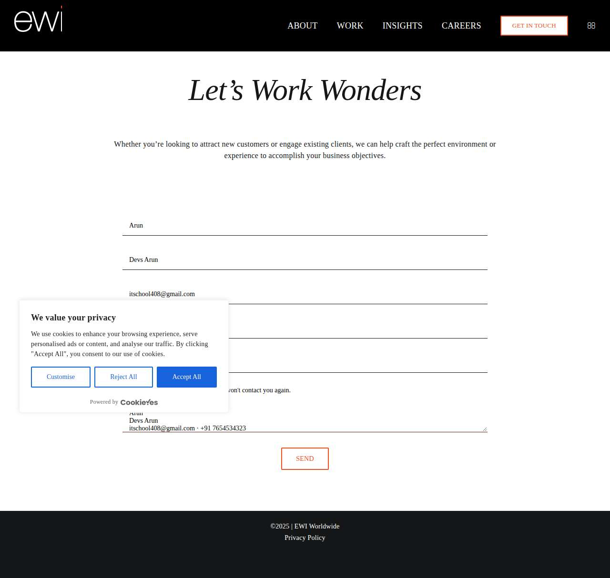

**After submit** — `run-a1f5f6f1_attempt-ea748743_post_attempt_2026-11-06T05-28-33-672Z.jpg`

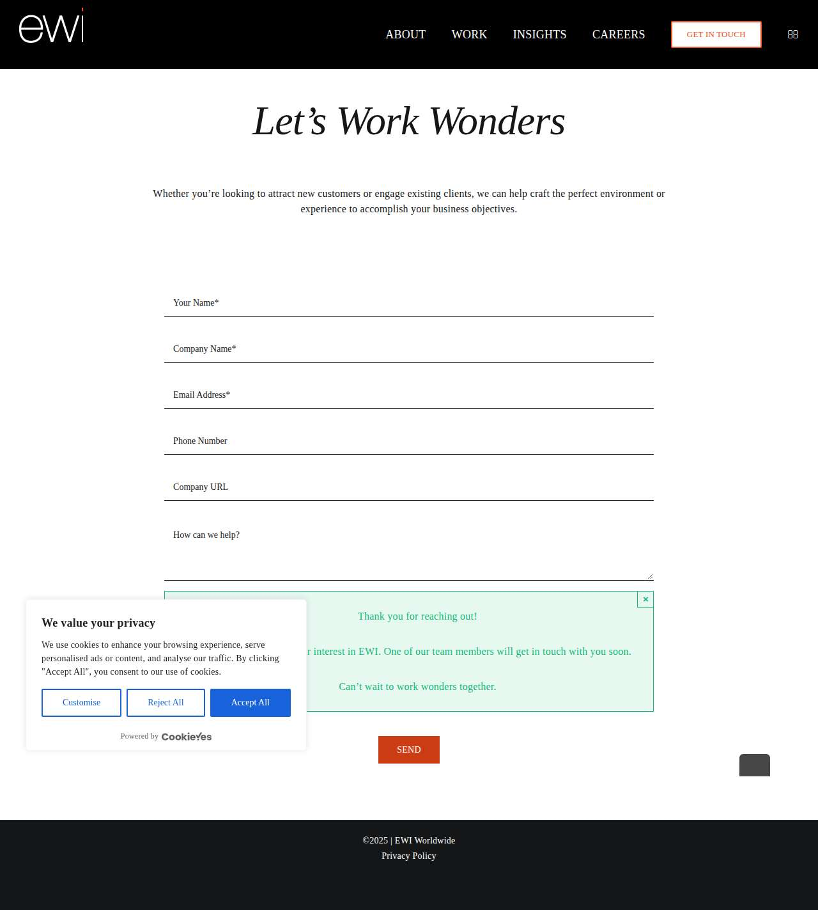

### pinkdotmedia.com — unclear (LIVE)

| | |
|---|---|
| Attempt ID | `f9539444-2ae2-4cef-9c60-86cee3238c67` |
| Form URL | https://www.pinkdotmedia.com/ |
| Final URL | https://www.pinkdotmedia.com/ |
| Reserved | 2026-11-06 05:28:42 UTC |
| Submit attempted | 2026-11-06 05:28:43 UTC |
| Template | standard v2 |
| Confirmation text | none observed |
| Result / error | No new success marker observed |

Exact message:

~~~text
Subject: Helping customers find your business in AI search (AEO + GEO)

Hi there,

I'm Arun from Devs Arun. More and more customers now ask ChatGPT, Gemini, Perplexity or Google's AI Overviews questions like "who should I hire for this in my area?" before they call anyone. These tools answer from websites they can clearly understand, and they tend to recommend businesses whose pages answer real customer questions.

That is what AEO + GEO (Answer Engine and Generative Engine Optimization) is for. I improve your existing service pages so they clearly answer the questions your customers ask, add structured data that matches the page, and make the call, quote or enquiry step obvious. The benefit: your business gets a better chance of being mentioned or linked in AI answers, and visitors who arrive find it easy to contact you.

The AEO + GEO Starter is a one-time $199 (about ₹16,999, negotiable) for one website: a basic audit, 10 customer questions, improvements to two existing pages, relevant structured data and an action plan, with one revision round.

You can read the full details, send an enquiry or book online here:
https://devsarun.io/aeo-geo/

If this isn't relevant, just reply and I won't contact you again.

Best,
Arun
Devs Arun
itschool408@gmail.com · +91 7654534323
~~~

Submitted field values:

- Name\* \[name\]: Arun
- Email\* \[email\]: itschool408@gmail.com
- Company \[company\]: Devs Arun
- Message\* \[message\]: Hi there, I'm Arun from Devs Arun. More and more customers now ask ChatGPT, Gemini, Perplexity or Google's AI Overviews 
- Phone Number\* \[phone\]: +91 7654534323

**Filled form (before submit)** — `run-a1f5f6f1_attempt-f9539444_filled_2026-11-06T05-28-43-988Z.jpg`

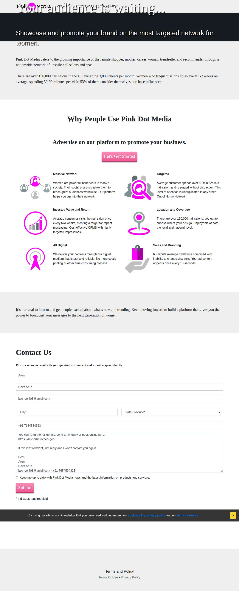

**After submit** — `run-a1f5f6f1_attempt-f9539444_post_attempt_2026-11-06T05-29-12-803Z.jpg`

### chefsroll.com — failed\_before\_submit (LIVE)

| | |
|---|---|
| Attempt ID | `c8ac6df2-307a-4135-a18b-0a2a24f1c392` |
| Form URL | https://chefsroll.com/contact-us/ |
| Final URL | https://chefsroll.com/contact-us/ |
| Reserved | 2026-11-06 05:29:21 UTC |
| Submit attempted | — |
| Template | standard v2 |
| Confirmation text | none observed |
| Result / error | Message field altered the text (length limit?) |

Exact message:

~~~text
Subject: Helping customers find your business in AI search (AEO + GEO)

Hi there,

I'm Arun from Devs Arun. More and more customers now ask ChatGPT, Gemini, Perplexity or Google's AI Overviews questions like "who should I hire for this in my area?" before they call anyone. These tools answer from websites they can clearly understand, and they tend to recommend businesses whose pages answer real customer questions.

That is what AEO + GEO (Answer Engine and Generative Engine Optimization) is for. I improve your existing service pages so they clearly answer the questions your customers ask, add structured data that matches the page, and make the call, quote or enquiry step obvious. The benefit: your business gets a better chance of being mentioned or linked in AI answers, and visitors who arrive find it easy to contact you.

The AEO + GEO Starter is a one-time $199 (about ₹16,999, negotiable) for one website: a basic audit, 10 customer questions, improvements to two existing pages, relevant structured data and an action plan, with one revision round.

You can read the full details, send an enquiry or book online here:
https://devsarun.io/aeo-geo/

If this isn't relevant, just reply and I won't contact you again.

Best,
Arun
Devs Arun
itschool408@gmail.com · +91 7654534323
~~~

Submitted field values:

- \#nf-field-1: Arun
- \#nf-field-2: itschool408@gmail.com
- \#nf-field-3: Hi there, I'm Arun from Devs Arun. More and more customers now ask ChatGPT, Gemini, Perplexity or Google's AI Overviews 
- \#nf-field-11: Hi there, I'm Arun from Devs Arun. More and more customers now ask ChatGPT, Gemini, Perplexity or Google's AI Overviews 

**Filled form (before submit)** — `run-a1f5f6f1_attempt-c8ac6df2_filled_2026-11-06T05-29-23-752Z.jpg`

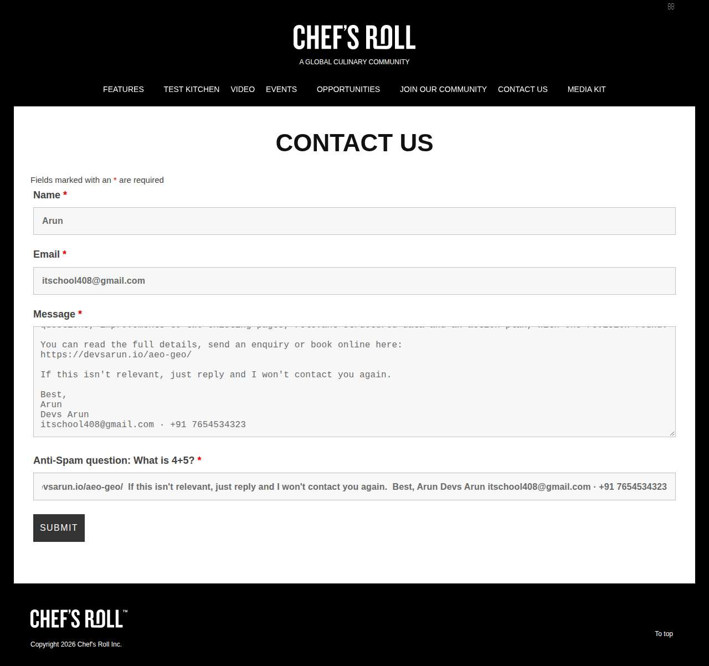

### wcmedia.net — confirmed (LIVE)

| | |
|---|---|
| Attempt ID | `189853d4-7b12-4bc4-87d5-0667e8bfbb63` |
| Form URL | https://wcmedia.net/contact/ |
| Final URL | https://wcmedia.net/contact/ |
| Reserved | 2026-11-06 05:29:28 UTC |
| Submit attempted | 2026-11-06 05:29:33 UTC |
| Template | standard v2 |
| Confirmation text | .net Phone - 217-241-1224 Fax- 217-241-3824 Have Questions? Thank you for your message. We will get in touch with you shortly Company 1824 S MacArthur Blvd Springfield, IL 62704 Quick Li |
| Result / error | — |

Exact message:

~~~text
Subject: Helping customers find your business in AI search (AEO + GEO)

Hi there,

I'm Arun from Devs Arun. More and more customers now ask ChatGPT, Gemini, Perplexity or Google's AI Overviews questions like "who should I hire for this in my area?" before they call anyone. These tools answer from websites they can clearly understand, and they tend to recommend businesses whose pages answer real customer questions.

That is what AEO + GEO (Answer Engine and Generative Engine Optimization) is for. I improve your existing service pages so they clearly answer the questions your customers ask, add structured data that matches the page, and make the call, quote or enquiry step obvious. The benefit: your business gets a better chance of being mentioned or linked in AI answers, and visitors who arrive find it easy to contact you.

The AEO + GEO Starter is a one-time $199 (about ₹16,999, negotiable) for one website: a basic audit, 10 customer questions, improvements to two existing pages, relevant structured data and an action plan, with one revision round.

You can read the full details, send an enquiry or book online here:
https://devsarun.io/aeo-geo/

If this isn't relevant, just reply and I won't contact you again.

Best,
Arun
Devs Arun
itschool408@gmail.com · +91 7654534323
~~~

Submitted field values:

- Email \[email\]: itschool408@gmail.com
- Subject \[subject\]: Helping customers find your business in AI search (AEO + GEO)
- Your Message \[message\]: Hi there, I'm Arun from Devs Arun. More and more customers now ask ChatGPT, Gemini, Perplexity or Google's AI Overviews 
- First Name \[first\_name\]: Arun

**Filled form (before submit)** — `run-a1f5f6f1_attempt-189853d4_filled_2026-11-06T05-29-33-389Z.jpg`

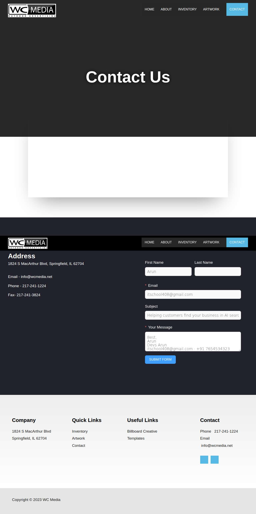

**After submit** — `run-a1f5f6f1_attempt-189853d4_post_attempt_2026-11-06T05-29-45-452Z.jpg`

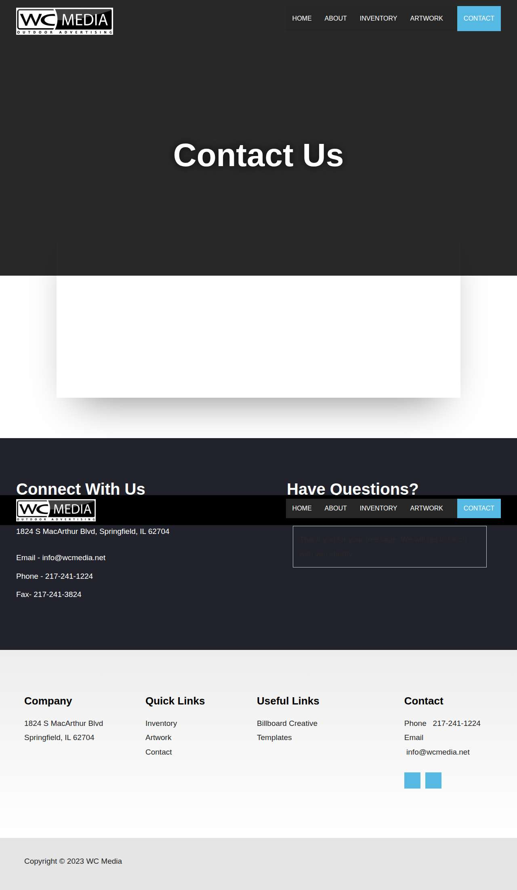

### prhollywood.com — unclear (LIVE)

| | |
|---|---|
| Attempt ID | `1e261006-2e40-4156-b60b-75480f2084a5` |
| Form URL | https://www.prhollywood.com/contact |
| Final URL | https://www.prhollywood.com/contact |
| Reserved | 2026-11-06 05:29:54 UTC |
| Submit attempted | 2026-11-06 05:29:56 UTC |
| Template | standard v2 |
| Confirmation text | none observed |
| Result / error | No new success marker observed |

Exact message:

~~~text
Subject: Helping customers find your business in AI search (AEO + GEO)

Hi there,

I'm Arun from Devs Arun. More and more customers now ask ChatGPT, Gemini, Perplexity or Google's AI Overviews questions like "who should I hire for this in my area?" before they call anyone. These tools answer from websites they can clearly understand, and they tend to recommend businesses whose pages answer real customer questions.

That is what AEO + GEO (Answer Engine and Generative Engine Optimization) is for. I improve your existing service pages so they clearly answer the questions your customers ask, add structured data that matches the page, and make the call, quote or enquiry step obvious. The benefit: your business gets a better chance of being mentioned or linked in AI answers, and visitors who arrive find it easy to contact you.

The AEO + GEO Starter is a one-time $199 (about ₹16,999, negotiable) for one website: a basic audit, 10 customer questions, improvements to two existing pages, relevant structured data and an action plan, with one revision round.

You can read the full details, send an enquiry or book online here:
https://devsarun.io/aeo-geo/

If this isn't relevant, just reply and I won't contact you again.

Best,
Arun
Devs Arun
itschool408@gmail.com · +91 7654534323
~~~

Submitted field values:

- email \[email\]: itschool408@gmail.com
- name-\* \[name\]: Arun
- Message \[message\]: Hi there, I'm Arun from Devs Arun. More and more customers now ask ChatGPT, Gemini, Perplexity or Google's AI Overviews 
- subject \[subject\]: Helping customers find your business in AI search (AEO + GEO)

**Filled form (before submit)** — `run-a1f5f6f1_attempt-1e261006_filled_2026-11-06T05-29-56-495Z.jpg`

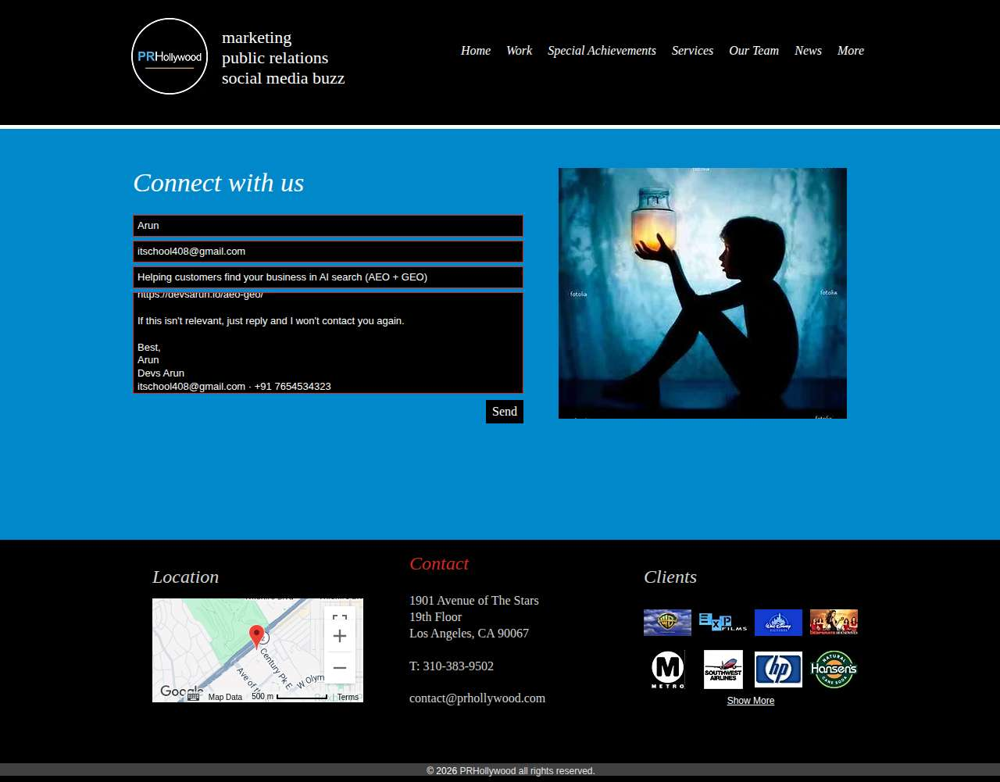

**After submit** — `run-a1f5f6f1_attempt-1e261006_post_attempt_2026-11-06T05-30-25-297Z.jpg`

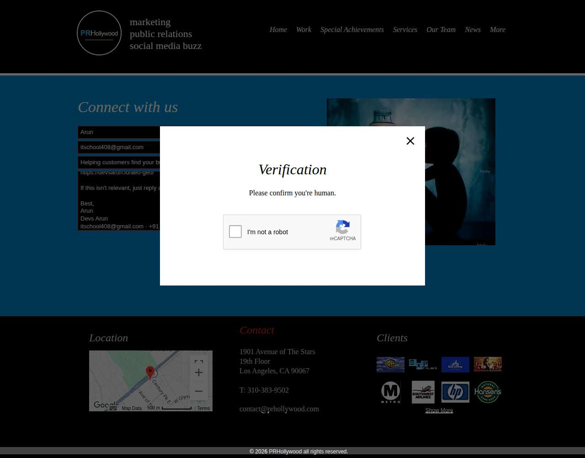

### trustthedata.net — unclear (LIVE)

| | |
|---|---|
| Attempt ID | `19ca75e0-e7db-4973-ad43-bc55e34080c5` |
| Form URL | https://trustthedata.net/contact-us-in-clearwater-fl/ |
| Final URL | https://trustthedata.net/contact-us-in-clearwater-fl/ |
| Reserved | 2026-11-06 05:30:33 UTC |
| Submit attempted | 2026-11-06 05:30:35 UTC |
| Template | standard v2 |
| Confirmation text | none observed |
| Result / error | No new success marker observed |

Exact message:

~~~text
Subject: Helping customers find your business in AI search (AEO + GEO)

Hi there,

I'm Arun from Devs Arun. More and more customers now ask ChatGPT, Gemini, Perplexity or Google's AI Overviews questions like "who should I hire for this in my area?" before they call anyone. These tools answer from websites they can clearly understand, and they tend to recommend businesses whose pages answer real customer questions.

That is what AEO + GEO (Answer Engine and Generative Engine Optimization) is for. I improve your existing service pages so they clearly answer the questions your customers ask, add structured data that matches the page, and make the call, quote or enquiry step obvious. The benefit: your business gets a better chance of being mentioned or linked in AI answers, and visitors who arrive find it easy to contact you.

The AEO + GEO Starter is a one-time $199 (about ₹16,999, negotiable) for one website: a basic audit, 10 customer questions, improvements to two existing pages, relevant structured data and an action plan, with one revision round.

You can read the full details, send an enquiry or book online here:
https://devsarun.io/aeo-geo/

If this isn't relevant, just reply and I won't contact you again.

Best,
Arun
Devs Arun
itschool408@gmail.com · +91 7654534323
~~~

Submitted field values:

- Name \[name\]: Arun
- Email \[email\]: itschool408@gmail.com
- Phone \[phone\]: +91 7654534323
- Message \[message\]: Hi there, I'm Arun from Devs Arun. More and more customers now ask ChatGPT, Gemini, Perplexity or Google's AI Overviews 
- Website \[website\]: https://devsarun.io/aeo-geo/

**Filled form (before submit)** — `run-a1f5f6f1_attempt-19ca75e0_filled_2026-11-06T05-30-35-898Z.jpg`

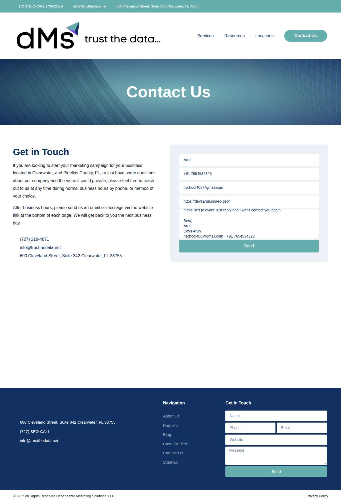

**After submit** — `run-a1f5f6f1_attempt-19ca75e0_post_attempt_2026-11-06T05-31-04-793Z.jpg`

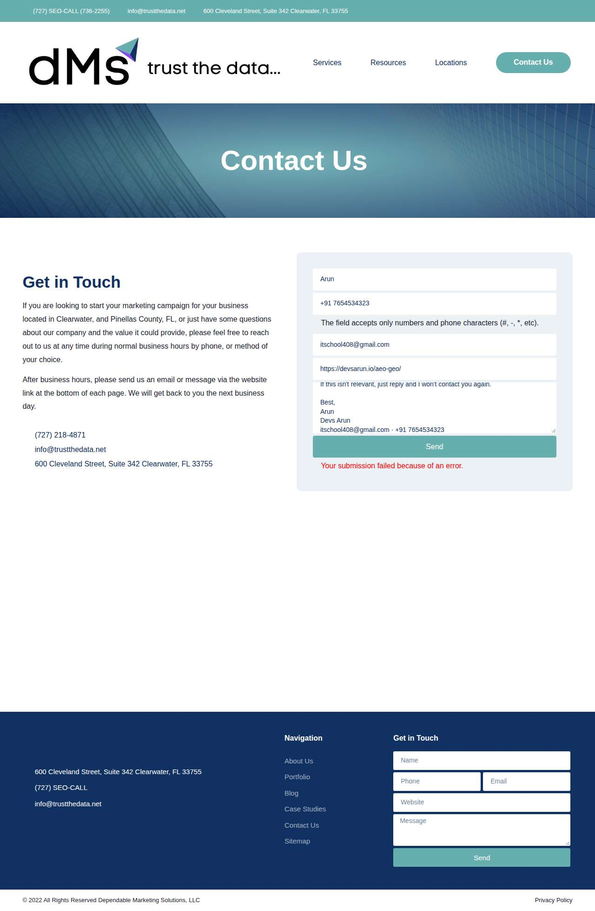

### core6.marketing — failed\_before\_submit (LIVE)

| | |
|---|---|
| Attempt ID | `d3ca9d44-9f68-45b0-a5d8-2e98901ba2a3` |
| Form URL | https://core6.marketing/work-with-us/ |
| Final URL | https://core6.marketing/work-with-us/ |
| Reserved | 2026-11-06 05:31:13 UTC |
| Submit attempted | — |
| Template | standard v2 |
| Confirmation text | none observed |
| Result / error | Field "Phone(Required)" did not accept the value |

Exact message:

~~~text
Subject: Helping customers find your business in AI search (AEO + GEO)

Hi there,

I'm Arun from Devs Arun. More and more customers now ask ChatGPT, Gemini, Perplexity or Google's AI Overviews questions like "who should I hire for this in my area?" before they call anyone. These tools answer from websites they can clearly understand, and they tend to recommend businesses whose pages answer real customer questions.

That is what AEO + GEO (Answer Engine and Generative Engine Optimization) is for. I improve your existing service pages so they clearly answer the questions your customers ask, add structured data that matches the page, and make the call, quote or enquiry step obvious. The benefit: your business gets a better chance of being mentioned or linked in AI answers, and visitors who arrive find it easy to contact you.

The AEO + GEO Starter is a one-time $199 (about ₹16,999, negotiable) for one website: a basic audit, 10 customer questions, improvements to two existing pages, relevant structured data and an action plan, with one revision round.

You can read the full details, send an enquiry or book online here:
https://devsarun.io/aeo-geo/

If this isn't relevant, just reply and I won't contact you again.

Best,
Arun
Devs Arun
itschool408@gmail.com · +91 7654534323
~~~

Submitted field values:

- \#input\_20\_1: Arun
- \#input\_20\_2: itschool408@gmail.com
- \#input\_20\_3: Devs Arun
- \#input\_20\_4: +91 7654534323
- \#input\_20\_16: Hi there, I'm Arun from Devs Arun. More and more customers now ask ChatGPT, Gemini, Perplexity or Google's AI Overviews 

**Filled form (before submit)** — `run-a1f5f6f1_attempt-d3ca9d44_filled_2026-11-06T05-31-17-349Z.jpg`

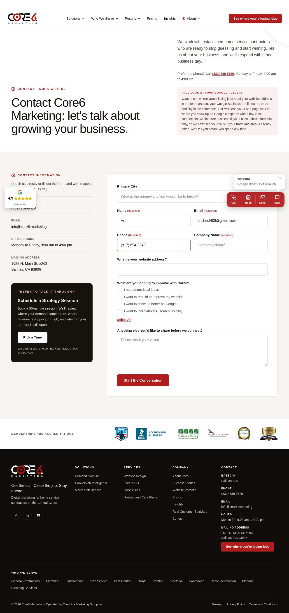

### seolocale.com — confirmed (LIVE)

| | |
|---|---|
| Attempt ID | `1372e8fb-482e-4987-af3f-058737daa186` |
| Form URL | https://seolocale.com/contact-us/ |
| Final URL | https://seolocale.com/thank-you/?from=contact |
| Reserved | 2026-11-06 05:31:22 UTC |
| Submit attempted | 2026-11-06 05:31:24 UTC |
| Template | standard v2 |
| Confirmation text | ices Who We Help Reviews Resources Let’s Talk Home Services Thank You MESSAGE RECEIVED THANK YOU. We have it. Someone on our team reads every one of these, and you will |
| Result / error | — |

Exact message:

~~~text
Subject: Helping customers find your business in AI search (AEO + GEO)

Hi there,

I'm Arun from Devs Arun. More and more customers now ask ChatGPT, Gemini, Perplexity or Google's AI Overviews questions like "who should I hire for this in my area?" before they call anyone. These tools answer from websites they can clearly understand, and they tend to recommend businesses whose pages answer real customer questions.

That is what AEO + GEO (Answer Engine and Generative Engine Optimization) is for. I improve your existing service pages so they clearly answer the questions your customers ask, add structured data that matches the page, and make the call, quote or enquiry step obvious. The benefit: your business gets a better chance of being mentioned or linked in AI answers, and visitors who arrive find it easy to contact you.

The AEO + GEO Starter is a one-time $199 (about ₹16,999, negotiable) for one website: a basic audit, 10 customer questions, improvements to two existing pages, relevant structured data and an action plan, with one revision round.

You can read the full details, send an enquiry or book online here:
https://devsarun.io/aeo-geo/

If this isn't relevant, just reply and I won't contact you again.

Best,
Arun
Devs Arun
itschool408@gmail.com · +91 7654534323
~~~

Submitted field values:

- NAME(REQUIRED) \[name\]: Arun
- EMAIL(REQUIRED) \[email\]: itschool408@gmail.com
- PHONE(REQUIRED) \[phone\]: +91 7654534323
- SERVICE(REQUIRED) \[fixed\]: Other
- MESSAGE(REQUIRED) \[message\]: Hi there, I'm Arun from Devs Arun. More and more customers now ask ChatGPT, Gemini, Perplexity or Google's AI Overviews 

**Filled form (before submit)** — `run-a1f5f6f1_attempt-1372e8fb_filled_2026-11-06T05-31-24-349Z.jpg`

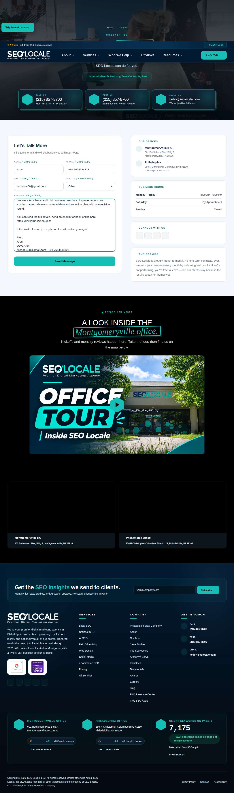

**After submit** — `run-a1f5f6f1_attempt-1372e8fb_post_attempt_2026-11-06T05-31-32-876Z.jpg`

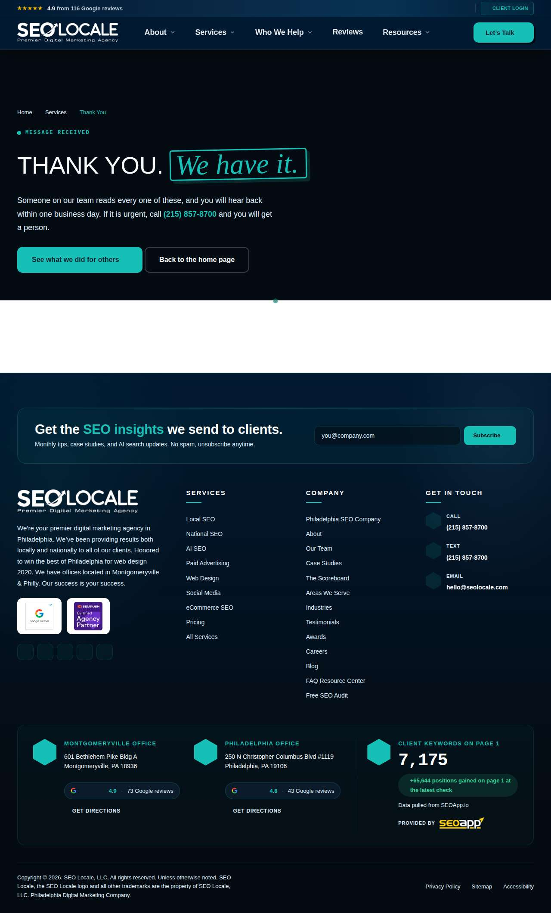

### rankplan.us — unclear (LIVE)

| | |
|---|---|
| Attempt ID | `c6c29a09-60f3-4195-8158-97fffa6a4159` |
| Form URL | https://rankplan.us/case-study-using-seo-to-increase-inquiries-for-a-large-corporation-by-600-in-a-few-months/ |
| Final URL | https://rankplan.us/case-study-using-seo-to-increase-inquiries-for-a-large-corporation-by-600-in-a-few-months/?unapproved=937&moderation-hash=30abc8c5e3f547fd7b079050d8762323\#comment-937 |
| Reserved | 2026-11-06 05:31:41 UTC |
| Submit attempted | 2026-11-06 05:31:44 UTC |
| Template | standard v2 |
| Confirmation text | none observed |
| Result / error | No new success marker observed |

Exact message:

~~~text
Subject: Helping customers find your business in AI search (AEO + GEO)

Hi there,

I'm Arun from Devs Arun. More and more customers now ask ChatGPT, Gemini, Perplexity or Google's AI Overviews questions like "who should I hire for this in my area?" before they call anyone. These tools answer from websites they can clearly understand, and they tend to recommend businesses whose pages answer real customer questions.

That is what AEO + GEO (Answer Engine and Generative Engine Optimization) is for. I improve your existing service pages so they clearly answer the questions your customers ask, add structured data that matches the page, and make the call, quote or enquiry step obvious. The benefit: your business gets a better chance of being mentioned or linked in AI answers, and visitors who arrive find it easy to contact you.

The AEO + GEO Starter is a one-time $199 (about ₹16,999, negotiable) for one website: a basic audit, 10 customer questions, improvements to two existing pages, relevant structured data and an action plan, with one revision round.

You can read the full details, send an enquiry or book online here:
https://devsarun.io/aeo-geo/

If this isn't relevant, just reply and I won't contact you again.

Best,
Arun
Devs Arun
itschool408@gmail.com · +91 7654534323
~~~

Submitted field values:

- Name \* \[name\]: Arun
- Email \* \[email\]: itschool408@gmail.com
- Website \[website\]: https://devsarun.io/aeo-geo/
- Comment \* \[message\]: Hi there, I'm Arun from Devs Arun. More and more customers now ask ChatGPT, Gemini, Perplexity or Google's AI Overviews 

**Filled form (before submit)** — `run-a1f5f6f1_attempt-c6c29a09_filled_2026-11-06T05-31-44-462Z.jpg`

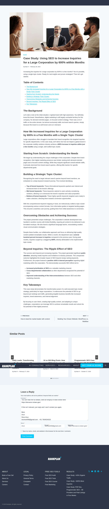

**After submit** — `run-a1f5f6f1_attempt-c6c29a09_post_attempt_2026-11-06T05-32-16-814Z.jpg`

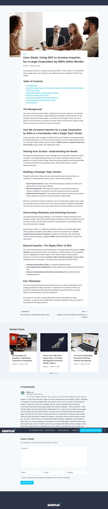

### halibutblue.com — failed\_before\_submit (LIVE)

| | |
|---|---|
| Attempt ID | `04444c73-bc40-4434-bef5-1d868c835b0a` |
| Form URL | https://www.halibutblue.com/contact/ |
| Final URL | https://www.halibutblue.com/contact/ |
| Reserved | 2026-11-06 05:32:25 UTC |
| Submit attempted | — |
| Template | standard v2 |
| Confirmation text | none observed |
| Result / error | Field "Phone\*" did not accept the value |

Exact message:

~~~text
Subject: Helping customers find your business in AI search (AEO + GEO)

Hi there,

I'm Arun from Devs Arun. More and more customers now ask ChatGPT, Gemini, Perplexity or Google's AI Overviews questions like "who should I hire for this in my area?" before they call anyone. These tools answer from websites they can clearly understand, and they tend to recommend businesses whose pages answer real customer questions.

That is what AEO + GEO (Answer Engine and Generative Engine Optimization) is for. I improve your existing service pages so they clearly answer the questions your customers ask, add structured data that matches the page, and make the call, quote or enquiry step obvious. The benefit: your business gets a better chance of being mentioned or linked in AI answers, and visitors who arrive find it easy to contact you.

The AEO + GEO Starter is a one-time $199 (about ₹16,999, negotiable) for one website: a basic audit, 10 customer questions, improvements to two existing pages, relevant structured data and an action plan, with one revision round.

You can read the full details, send an enquiry or book online here:
https://devsarun.io/aeo-geo/

If this isn't relevant, just reply and I won't contact you again.

Best,
Arun
Devs Arun
itschool408@gmail.com · +91 7654534323
~~~

Submitted field values:

- \#input\_1\_3: itschool408@gmail.com
- \#input\_1\_4: Hi there, I'm Arun from Devs Arun. More and more customers now ask ChatGPT, Gemini, Perplexity or Google's AI Overviews 
- \#input\_1\_5: +91 7654534323
- \#input\_1\_6\_3: Arun

**Filled form (before submit)** — `run-a1f5f6f1_attempt-04444c73_filled_2026-11-06T05-32-28-596Z.jpg`

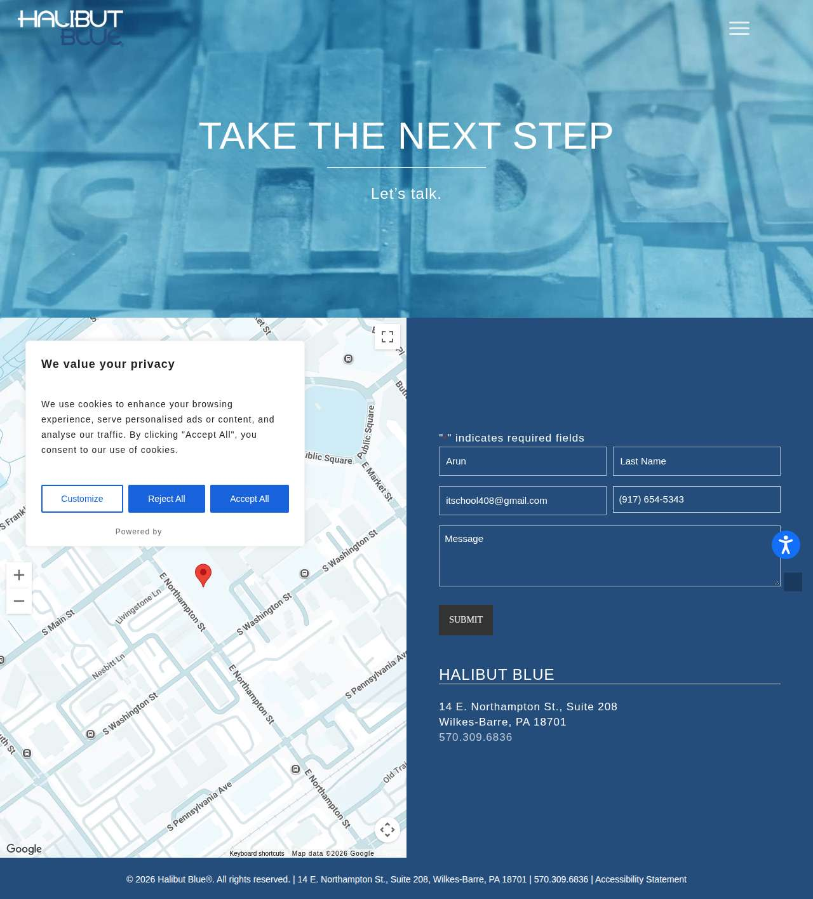

### startflourishing.com — unclear (LIVE)

| | |
|---|---|
| Attempt ID | `fde758a6-437c-47d1-a9e7-d3076dddefe9` |
| Form URL | https://www.startflourishing.com/contact |
| Final URL | https://www.startflourishing.com/contact |
| Reserved | 2026-11-06 05:32:33 UTC |
| Submit attempted | 2026-11-06 05:32:35 UTC |
| Template | standard v2 |
| Confirmation text | none observed |
| Result / error | No new success marker observed |

Exact message:

~~~text
Subject: Helping customers find your business in AI search (AEO + GEO)

Hi there,

I'm Arun from Devs Arun. More and more customers now ask ChatGPT, Gemini, Perplexity or Google's AI Overviews questions like "who should I hire for this in my area?" before they call anyone. These tools answer from websites they can clearly understand, and they tend to recommend businesses whose pages answer real customer questions.

That is what AEO + GEO (Answer Engine and Generative Engine Optimization) is for. I improve your existing service pages so they clearly answer the questions your customers ask, add structured data that matches the page, and make the call, quote or enquiry step obvious. The benefit: your business gets a better chance of being mentioned or linked in AI answers, and visitors who arrive find it easy to contact you.

The AEO + GEO Starter is a one-time $199 (about ₹16,999, negotiable) for one website: a basic audit, 10 customer questions, improvements to two existing pages, relevant structured data and an action plan, with one revision round.

You can read the full details, send an enquiry or book online here:
https://devsarun.io/aeo-geo/

If this isn't relevant, just reply and I won't contact you again.

Best,
Arun
Devs Arun
itschool408@gmail.com · +91 7654534323
~~~

Submitted field values:

- Name: \[name\]: Arun
- Email: \[email\]: itschool408@gmail.com
- Phone: \[phone\]: +91 7654534323
- Free Text \[message\]: Hi there, I'm Arun from Devs Arun. More and more customers now ask ChatGPT, Gemini, Perplexity or Google's AI Overviews 
- Organization: \[company\]: Devs Arun

**Filled form (before submit)** — `run-a1f5f6f1_attempt-fde758a6_filled_2026-11-06T05-32-35-159Z.jpg`

**After submit** — `run-a1f5f6f1_attempt-fde758a6_post_attempt_2026-11-06T05-33-05-153Z.jpg`

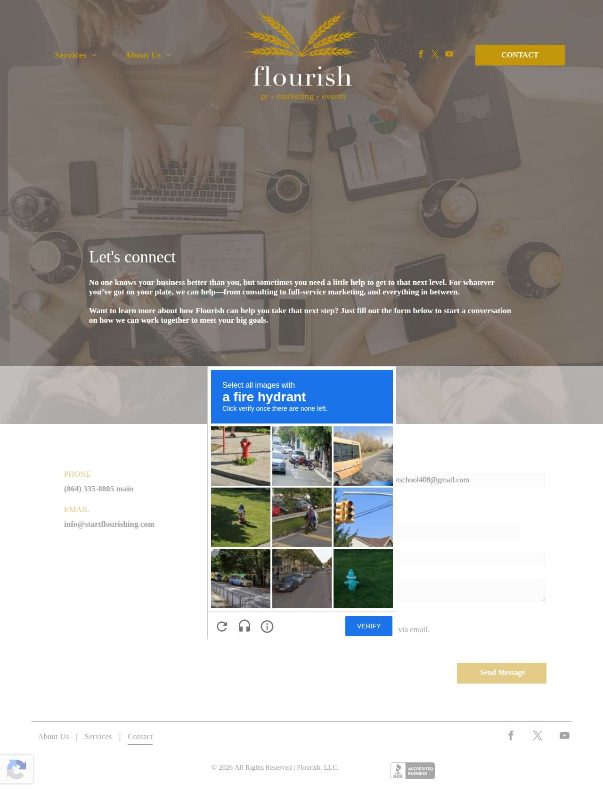

### localdigitalgenius.com — failed\_before\_submit (LIVE)

| | |
|---|---|
| Attempt ID | `94ef9824-16f1-43de-9b5e-e3349165cbc8` |
| Form URL | https://localdigitalgenius.com/contact-us/\#help |
| Final URL | https://localdigitalgenius.com/contact-us/\#help |
| Reserved | 2026-11-06 05:33:13 UTC |
| Submit attempted | — |
| Template | standard v2 |
| Confirmation text | none observed |
| Result / error | Field "Phone(Required)" did not accept the value |

Exact message:

~~~text
Subject: Helping customers find your business in AI search (AEO + GEO)

Hi there,

I'm Arun from Devs Arun. More and more customers now ask ChatGPT, Gemini, Perplexity or Google's AI Overviews questions like "who should I hire for this in my area?" before they call anyone. These tools answer from websites they can clearly understand, and they tend to recommend businesses whose pages answer real customer questions.

That is what AEO + GEO (Answer Engine and Generative Engine Optimization) is for. I improve your existing service pages so they clearly answer the questions your customers ask, add structured data that matches the page, and make the call, quote or enquiry step obvious. The benefit: your business gets a better chance of being mentioned or linked in AI answers, and visitors who arrive find it easy to contact you.

The AEO + GEO Starter is a one-time $199 (about ₹16,999, negotiable) for one website: a basic audit, 10 customer questions, improvements to two existing pages, relevant structured data and an action plan, with one revision round.

You can read the full details, send an enquiry or book online here:
https://devsarun.io/aeo-geo/

If this isn't relevant, just reply and I won't contact you again.

Best,
Arun
Devs Arun
itschool408@gmail.com · +91 7654534323
~~~

Submitted field values:

- \#input\_2\_9: itschool408@gmail.com
- \#input\_2\_10: +91 7654534323
- \#input\_2\_11: Hi there, I'm Arun from Devs Arun. More and more customers now ask ChatGPT, Gemini, Perplexity or Google's AI Overviews 
- \#input\_2\_12: Devs Arun
- \#input\_2\_13: https://devsarun.io/aeo-geo/
- \#input\_2\_1\_3: Arun

**Filled form (before submit)** — `run-a1f5f6f1_attempt-94ef9824_filled_2026-11-06T05-33-15-931Z.jpg`

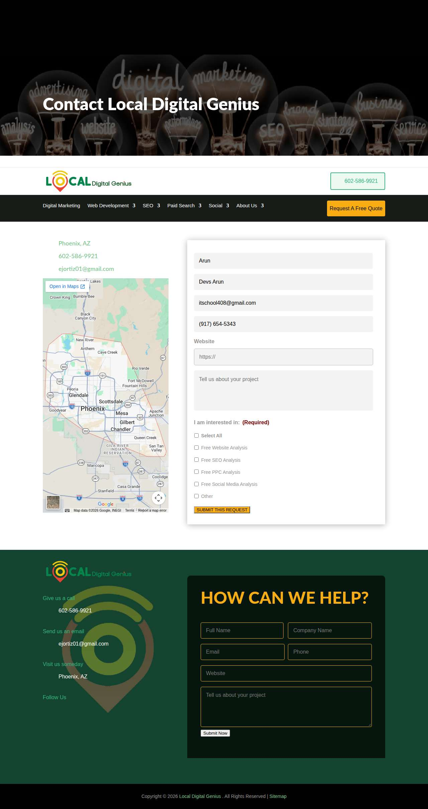

### meritmarketingservices.com — confirmed (LIVE)

| | |
|---|---|
| Attempt ID | `11651459-f9de-47f4-b4f9-08db65f2a823` |
| Form URL | https://meritmarketingservices.com/Contact |
| Final URL | https://meritmarketingservices.com/Contact |
| Reserved | 2026-11-06 05:33:20 UTC |
| Submit attempted | 2026-11-06 05:33:25 UTC |
| Template | standard v2 |
| Confirmation text | vices About Case Studies Contact Free Workshop Clarity Call Thank you for reaching out\! We've received your message and will get back to you within 24 business hours. Keep an eye on your |
| Result / error | — |

Exact message:

~~~text
Subject: Helping customers find your business in AI search (AEO + GEO)

Hi there,

I'm Arun from Devs Arun. More and more customers now ask ChatGPT, Gemini, Perplexity or Google's AI Overviews questions like "who should I hire for this in my area?" before they call anyone. These tools answer from websites they can clearly understand, and they tend to recommend businesses whose pages answer real customer questions.

That is what AEO + GEO (Answer Engine and Generative Engine Optimization) is for. I improve your existing service pages so they clearly answer the questions your customers ask, add structured data that matches the page, and make the call, quote or enquiry step obvious. The benefit: your business gets a better chance of being mentioned or linked in AI answers, and visitors who arrive find it easy to contact you.

The AEO + GEO Starter is a one-time $199 (about ₹16,999, negotiable) for one website: a basic audit, 10 customer questions, improvements to two existing pages, relevant structured data and an action plan, with one revision round.

You can read the full details, send an enquiry or book online here:
https://devsarun.io/aeo-geo/

If this isn't relevant, just reply and I won't contact you again.

Best,
Arun
Devs Arun
itschool408@gmail.com · +91 7654534323
~~~

Submitted field values:

- Full Name \* \[name\]: Arun
- Phone Number \[phone\]: +91 7654534323
- Email Address \* \[email\]: itschool408@gmail.com
- Your Goal or Challenge \[message\]: Hi there, I'm Arun from Devs Arun. More and more customers now ask ChatGPT, Gemini, Perplexity or Google's AI Overviews 

**Filled form (before submit)** — `run-a1f5f6f1_attempt-11651459_filled_2026-11-06T05-33-25-713Z.jpg`

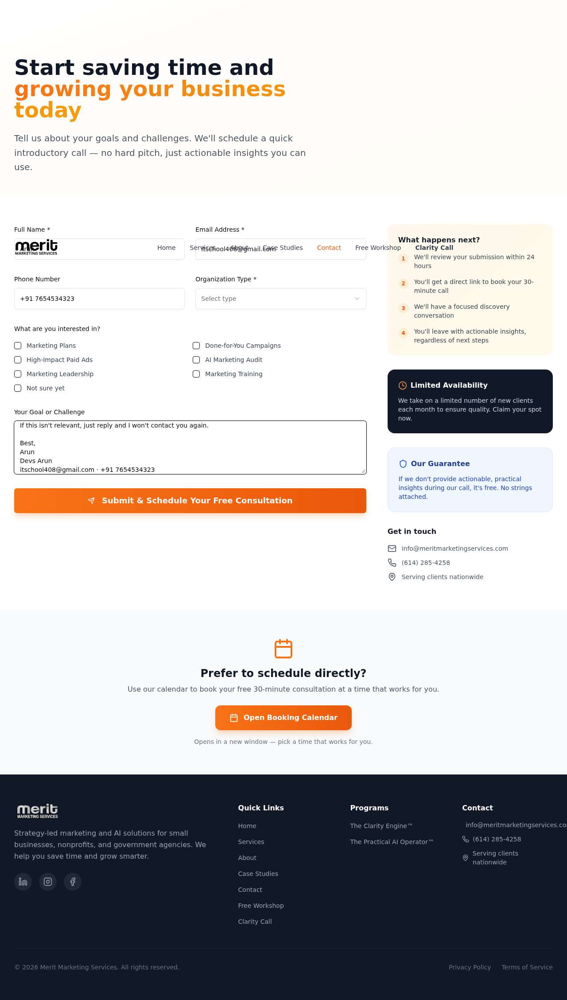

**After submit** — `run-a1f5f6f1_attempt-11651459_post_attempt_2026-11-06T05-33-37-877Z.jpg`

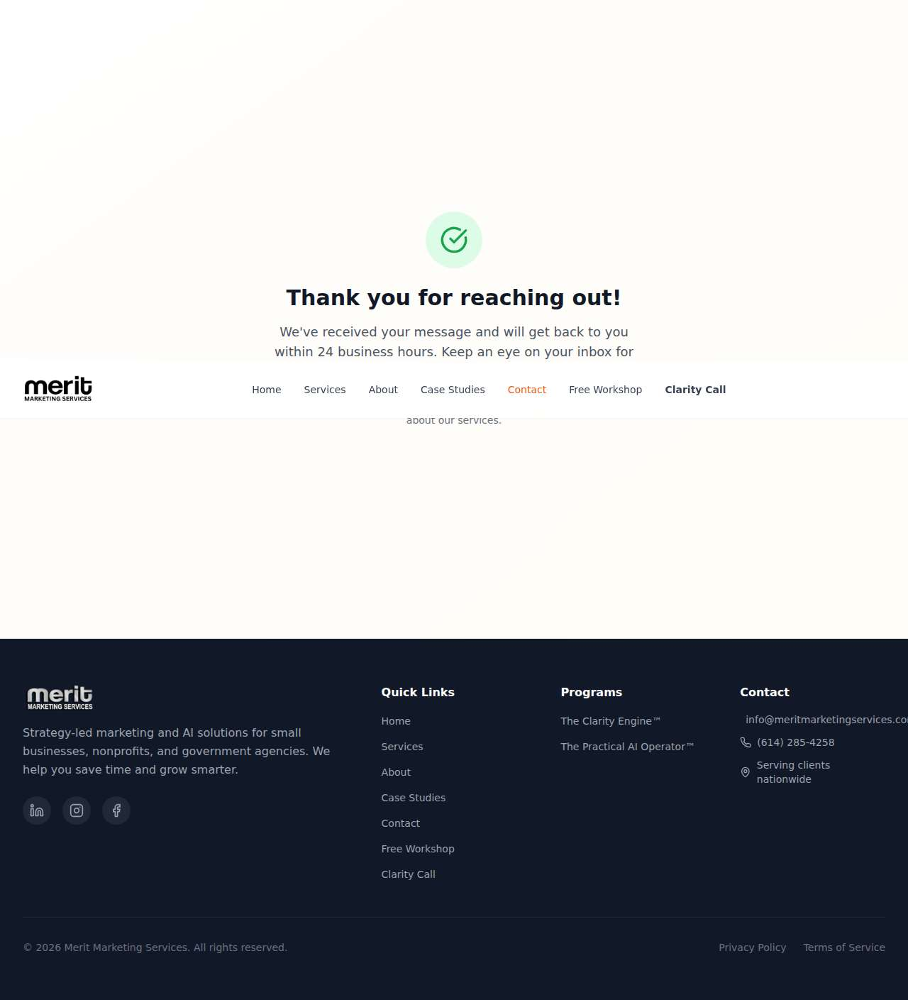

### eazydtf.com — failed\_before\_submit (LIVE)

| | |
|---|---|
| Attempt ID | `c143dc78-1d59-4af9-a5e8-08e07ec64e82` |
| Form URL | https://eazydtf.com/pages/contact |
| Final URL | https://eazydtf.com/pages/contact |
| Reserved | 2026-11-06 05:33:46 UTC |
| Submit attempted | — |
| Template | standard v2 |
| Confirmation text | none observed |
| Result / error | Form validation would block sending: contact\[Phone number\]: Please match the requested format. |

Exact message:

~~~text
Subject: Helping customers find your business in AI search (AEO + GEO)

Hi there,

I'm Arun from Devs Arun. More and more customers now ask ChatGPT, Gemini, Perplexity or Google's AI Overviews questions like "who should I hire for this in my area?" before they call anyone. These tools answer from websites they can clearly understand, and they tend to recommend businesses whose pages answer real customer questions.

That is what AEO + GEO (Answer Engine and Generative Engine Optimization) is for. I improve your existing service pages so they clearly answer the questions your customers ask, add structured data that matches the page, and make the call, quote or enquiry step obvious. The benefit: your business gets a better chance of being mentioned or linked in AI answers, and visitors who arrive find it easy to contact you.

The AEO + GEO Starter is a one-time $199 (about ₹16,999, negotiable) for one website: a basic audit, 10 customer questions, improvements to two existing pages, relevant structured data and an action plan, with one revision round.

You can read the full details, send an enquiry or book online here:
https://devsarun.io/aeo-geo/

If this isn't relevant, just reply and I won't contact you again.

Best,
Arun
Devs Arun
itschool408@gmail.com · +91 7654534323
~~~

Submitted field values:

- \#ContactForm-body: Hi there, I'm Arun from Devs Arun. More and more customers now ask ChatGPT, Gemini, Perplexity or Google's AI Overviews 
- \#ContactForm-name: Arun
- \#ContactForm-email: itschool408@gmail.com
- \#ContactForm-phone: +91 7654534323

**Filled form (before submit)** — `run-a1f5f6f1_attempt-c143dc78_filled_2026-11-06T05-33-51-519Z.jpg`

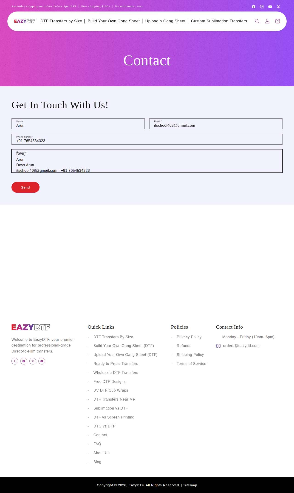

## Events (150)

| Time (UTC) | Event | Website | Details |
|---|---|---|---|
| 05:27:02 | run\_queued | — | live run requested by github:itsDevsArun |
| 05:27:02 | run\_dispatched | — | dispatch disabled (local test mode) |
| 05:27:06 | run\_started | — | Runner claimed live run |
| 05:27:07 | offer\_verified | — | Service page offer facts verified |
| 05:27:07 | website\_selected | clearchoiceplumbingllc.com | Live target clearchoiceplumbingllc.com |
| 05:27:07 | attempt\_reserved | clearchoiceplumbingllc.com | Submission attempt reserved with template standard v2 |
| 05:27:08 | page\_opened | clearchoiceplumbingllc.com | Opened form page |
| 05:27:08 | screenshot\_saved | clearchoiceplumbingllc.com | inspection screenshot saved (145 KB) |
| 05:27:08 | review\_required | clearchoiceplumbingllc.com | failed before submit: locator.fill: Error: Cannot type text into input\[type=number\] |
| 05:27:13 | website\_selected | bwnwincpainting.com | Live target bwnwincpainting.com |
| 05:27:13 | attempt\_reserved | bwnwincpainting.com | Submission attempt reserved with template standard v2 |
| 05:27:15 | page\_opened | bwnwincpainting.com | Opened form page |
| 05:27:15 | screenshot\_saved | bwnwincpainting.com | inspection screenshot saved (118 KB) |
| 05:27:15 | review\_required | bwnwincpainting.com | failed before submit: locator.fill: Error: Cannot type text into input\[type=number\] |
| 05:27:20 | website\_selected | absoluterestorepa.com | Live target absoluterestorepa.com |
| 05:27:20 | attempt\_reserved | absoluterestorepa.com | Submission attempt reserved with template standard v2 |
| 05:27:22 | page\_opened | absoluterestorepa.com | Opened form page |
| 05:27:22 | screenshot\_saved | absoluterestorepa.com | inspection screenshot saved (174 KB) |
| 05:27:22 | review\_required | absoluterestorepa.com | failed before submit: locator.fill: Error: Cannot type text into input\[type=number\] |
| 05:27:27 | website\_selected | masoudlawfirm.com | Live target masoudlawfirm.com |
| 05:27:27 | attempt\_reserved | masoudlawfirm.com | Submission attempt reserved with template standard v2 |
| 05:27:31 | page\_opened | masoudlawfirm.com | Opened form page |
| 05:27:31 | screenshot\_saved | masoudlawfirm.com | inspection screenshot saved (168 KB) |
| 05:27:31 | review\_required | masoudlawfirm.com | failed before submit: locator.fill: Error: Cannot type text into input\[type=number\] |
| 05:27:36 | website\_selected | whiteolivecpa.com | Live target whiteolivecpa.com |
| 05:27:36 | attempt\_reserved | whiteolivecpa.com | Submission attempt reserved with template standard v2 |
| 05:27:37 | page\_opened | whiteolivecpa.com | Opened form page |
| 05:27:38 | screenshot\_saved | whiteolivecpa.com | inspection screenshot saved (198 KB) |
| 05:27:38 | review\_required | whiteolivecpa.com | failed before submit: locator.fill: Error: Cannot type text into input\[type=number\] |
| 05:27:43 | website\_selected | canterburyadvisor.com | Live target canterburyadvisor.com |
| 05:27:43 | attempt\_reserved | canterburyadvisor.com | Submission attempt reserved with template standard v2 |
| 05:27:44 | page\_opened | canterburyadvisor.com | Opened form page |
| 05:27:45 | screenshot\_saved | canterburyadvisor.com | inspection screenshot saved (350 KB) |
| 05:27:45 | review\_required | canterburyadvisor.com | failed before submit: locator.fill: Error: Cannot type text into input\[type=number\] |
| 05:27:50 | website\_selected | connectionzpcrepair.com | Live target connectionzpcrepair.com |
| 05:27:50 | attempt\_reserved | connectionzpcrepair.com | Submission attempt reserved with template standard v2 |
| 05:27:52 | page\_opened | connectionzpcrepair.com | Opened form page |
| 05:27:52 | screenshot\_saved | connectionzpcrepair.com | inspection screenshot saved (145 KB) |
| 05:27:52 | review\_required | connectionzpcrepair.com | failed before submit: locator.fill: Error: Cannot type text into input\[type=number\] |
| 05:27:57 | website\_selected | ackavionics.com | Live target ackavionics.com |
| 05:27:57 | attempt\_reserved | ackavionics.com | Submission attempt reserved with template standard v2 |
| 05:27:59 | page\_opened | ackavionics.com | Opened form page |
| 05:27:59 | screenshot\_saved | ackavionics.com | inspection screenshot saved (100 KB) |
| 05:27:59 | review\_required | ackavionics.com | failed before submit: locator.fill: Error: Cannot type text into input\[type=number\] |
| 05:28:04 | website\_selected | glendalemarketing.com | Live target glendalemarketing.com |
| 05:28:04 | attempt\_reserved | glendalemarketing.com | Submission attempt reserved with template standard v2 |
| 05:28:05 | page\_opened | glendalemarketing.com | Opened form page |
| 05:28:06 | fields\_filled | glendalemarketing.com | filled |
| 05:28:06 | screenshot\_saved | glendalemarketing.com | filled screenshot saved (378 KB) |
| 05:28:06 | submit\_attempted | glendalemarketing.com | submitting |
| 05:28:11 | screenshot\_saved | glendalemarketing.com | post\_attempt screenshot saved (363 KB) |
| 05:28:11 | confirmation\_observed | glendalemarketing.com | confirmed — "the form below and we’ll get back to you as soon as we can. Thank you for contacting us. We will get back to you in less" |
| 05:28:20 | website\_selected | ewiworldwide.com | Live target ewiworldwide.com |
| 05:28:20 | attempt\_reserved | ewiworldwide.com | Submission attempt reserved with template standard v2 |
| 05:28:25 | page\_opened | ewiworldwide.com | Opened form page |
| 05:28:25 | fields\_filled | ewiworldwide.com | filled |
| 05:28:25 | screenshot\_saved | ewiworldwide.com | filled screenshot saved (57 KB) |
| 05:28:25 | submit\_attempted | ewiworldwide.com | submitting |
| 05:28:33 | screenshot\_saved | ewiworldwide.com | post\_attempt screenshot saved (66 KB) |
| 05:28:33 | confirmation\_observed | ewiworldwide.com | confirmed — "nment or experience to accomplish your business objectives. Thank you for reaching out\! We’re excited about your interes" |
| 05:28:42 | website\_selected | pinkdotmedia.com | Live target pinkdotmedia.com |
| 05:28:42 | attempt\_reserved | pinkdotmedia.com | Submission attempt reserved with template standard v2 |
| 05:28:43 | page\_opened | pinkdotmedia.com | Opened form page |
| 05:28:43 | fields\_filled | pinkdotmedia.com | filled |
| 05:28:43 | screenshot\_saved | pinkdotmedia.com | filled screenshot saved (216 KB) |
| 05:28:43 | submit\_attempted | pinkdotmedia.com | submitting |
| 05:29:12 | screenshot\_saved | pinkdotmedia.com | post\_attempt screenshot saved (219 KB) |
| 05:29:12 | review\_required | pinkdotmedia.com | unclear: No new success marker observed |
| 05:29:21 | website\_selected | chefsroll.com | Live target chefsroll.com |
| 05:29:21 | attempt\_reserved | chefsroll.com | Submission attempt reserved with template standard v2 |
| 05:29:23 | page\_opened | chefsroll.com | Opened form page |
| 05:29:23 | screenshot\_saved | chefsroll.com | filled screenshot saved (65 KB) |
| 05:29:23 | review\_required | chefsroll.com | failed before submit: Message field altered the text (length limit?) |
| 05:29:28 | website\_selected | wcmedia.net | Live target wcmedia.net |
| 05:29:28 | attempt\_reserved | wcmedia.net | Submission attempt reserved with template standard v2 |
| 05:29:33 | page\_opened | wcmedia.net | Opened form page |
| 05:29:33 | fields\_filled | wcmedia.net | filled |
| 05:29:33 | screenshot\_saved | wcmedia.net | filled screenshot saved (91 KB) |
| 05:29:33 | submit\_attempted | wcmedia.net | submitting |
| 05:29:45 | screenshot\_saved | wcmedia.net | post\_attempt screenshot saved (78 KB) |
| 05:29:45 | confirmation\_observed | wcmedia.net | confirmed — ".net Phone - 217-241-1224 Fax- 217-241-3824 Have Questions? Thank you for your message. We will get in touch with you sh" |
| 05:29:54 | website\_selected | prhollywood.com | Live target prhollywood.com |
| 05:29:54 | attempt\_reserved | prhollywood.com | Submission attempt reserved with template standard v2 |
| 05:29:56 | page\_opened | prhollywood.com | Opened form page |
| 05:29:56 | fields\_filled | prhollywood.com | filled |
| 05:29:56 | screenshot\_saved | prhollywood.com | filled screenshot saved (73 KB) |
| 05:29:56 | submit\_attempted | prhollywood.com | submitting |
| 05:30:25 | screenshot\_saved | prhollywood.com | post\_attempt screenshot saved (49 KB) |
| 05:30:25 | review\_required | prhollywood.com | unclear: No new success marker observed |
| 05:30:33 | website\_selected | trustthedata.net | Live target trustthedata.net |
| 05:30:33 | attempt\_reserved | trustthedata.net | Submission attempt reserved with template standard v2 |
| 05:30:35 | page\_opened | trustthedata.net | Opened form page |
| 05:30:35 | fields\_filled | trustthedata.net | filled |
| 05:30:35 | screenshot\_saved | trustthedata.net | filled screenshot saved (107 KB) |
| 05:30:35 | submit\_attempted | trustthedata.net | submitting |
| 05:31:04 | screenshot\_saved | trustthedata.net | post\_attempt screenshot saved (116 KB) |
| 05:31:04 | review\_required | trustthedata.net | unclear: No new success marker observed |
| 05:31:13 | website\_selected | core6.marketing | Live target core6.marketing |
| 05:31:13 | attempt\_reserved | core6.marketing | Submission attempt reserved with template standard v2 |
| 05:31:17 | page\_opened | core6.marketing | Opened form page |
| 05:31:17 | screenshot\_saved | core6.marketing | filled screenshot saved (200 KB) |
| 05:31:17 | review\_required | core6.marketing | failed before submit: Field "Phone(Required)" did not accept the value |
| 05:31:22 | website\_selected | seolocale.com | Live target seolocale.com |
| 05:31:22 | attempt\_reserved | seolocale.com | Submission attempt reserved with template standard v2 |
| 05:31:23 | page\_opened | seolocale.com | Opened form page |
| 05:31:24 | fields\_filled | seolocale.com | filled |
| 05:31:24 | screenshot\_saved | seolocale.com | filled screenshot saved (330 KB) |
| 05:31:24 | submit\_attempted | seolocale.com | submitting |
| 05:31:32 | screenshot\_saved | seolocale.com | post\_attempt screenshot saved (142 KB) |
| 05:31:32 | confirmation\_observed | seolocale.com | confirmed — "ices Who We Help Reviews Resources Let’s Talk Home Services Thank You MESSAGE RECEIVED THANK YOU. We have it. Someone on" |
| 05:31:41 | website\_selected | rankplan.us | Live target rankplan.us |
| 05:31:41 | attempt\_reserved | rankplan.us | Submission attempt reserved with template standard v2 |
| 05:31:44 | page\_opened | rankplan.us | Opened form page |
| 05:31:44 | fields\_filled | rankplan.us | filled |
| 05:31:44 | screenshot\_saved | rankplan.us | filled screenshot saved (460 KB) |
| 05:31:44 | submit\_attempted | rankplan.us | submitting |
| 05:32:16 | screenshot\_saved | rankplan.us | post\_attempt screenshot saved (524 KB) |
| 05:32:16 | review\_required | rankplan.us | unclear: No new success marker observed |
| 05:32:25 | website\_selected | halibutblue.com | Live target halibutblue.com |
| 05:32:25 | attempt\_reserved | halibutblue.com | Submission attempt reserved with template standard v2 |
| 05:32:28 | page\_opened | halibutblue.com | Opened form page |
| 05:32:28 | screenshot\_saved | halibutblue.com | filled screenshot saved (116 KB) |
| 05:32:28 | review\_required | halibutblue.com | failed before submit: Field "Phone\*" did not accept the value |
| 05:32:33 | website\_selected | startflourishing.com | Live target startflourishing.com |
| 05:32:33 | attempt\_reserved | startflourishing.com | Submission attempt reserved with template standard v2 |
| 05:32:34 | page\_opened | startflourishing.com | Opened form page |
| 05:32:35 | fields\_filled | startflourishing.com | filled |
| 05:32:35 | screenshot\_saved | startflourishing.com | filled screenshot saved (87 KB) |
| 05:32:35 | submit\_attempted | startflourishing.com | submitting |
| 05:33:05 | screenshot\_saved | startflourishing.com | post\_attempt screenshot saved (104 KB) |
| 05:33:05 | review\_required | startflourishing.com | unclear: No new success marker observed |
| 05:33:13 | website\_selected | localdigitalgenius.com | Live target localdigitalgenius.com |
| 05:33:13 | attempt\_reserved | localdigitalgenius.com | Submission attempt reserved with template standard v2 |
| 05:33:15 | page\_opened | localdigitalgenius.com | Opened form page |
| 05:33:15 | screenshot\_saved | localdigitalgenius.com | filled screenshot saved (151 KB) |
| 05:33:15 | review\_required | localdigitalgenius.com | failed before submit: Field "Phone(Required)" did not accept the value |
| 05:33:20 | website\_selected | meritmarketingservices.com | Live target meritmarketingservices.com |
| 05:33:20 | attempt\_reserved | meritmarketingservices.com | Submission attempt reserved with template standard v2 |
| 05:33:25 | page\_opened | meritmarketingservices.com | Opened form page |
| 05:33:25 | fields\_filled | meritmarketingservices.com | filled |
| 05:33:25 | screenshot\_saved | meritmarketingservices.com | filled screenshot saved (141 KB) |
| 05:33:25 | submit\_attempted | meritmarketingservices.com | submitting |
| 05:33:37 | screenshot\_saved | meritmarketingservices.com | post\_attempt screenshot saved (51 KB) |
| 05:33:37 | confirmation\_observed | meritmarketingservices.com | confirmed — "vices About Case Studies Contact Free Workshop Clarity Call Thank you for reaching out\! We've received your message and " |
| 05:33:46 | website\_selected | eazydtf.com | Live target eazydtf.com |
| 05:33:46 | attempt\_reserved | eazydtf.com | Submission attempt reserved with template standard v2 |
| 05:33:51 | page\_opened | eazydtf.com | Opened form page |
| 05:33:51 | screenshot\_saved | eazydtf.com | filled screenshot saved (102 KB) |
| 05:33:51 | review\_required | eazydtf.com | failed before submit: Form validation would block sending: contact\[Phone number\]: Please match the requested format. |
| 05:33:56 | run\_completed | — | Run completed (queue\_exhausted) |
