# Run a4a26496 — live — completed

| | |
|---|---|
| Run ID | `a4a26496-f4ea-424d-bfe6-24945cbdf120` |
| Requested by | github:itsDevsArun |
| Started | 2026-11-06 06:11:37 UTC |
| Finished | 2026-11-06 06:21:12 UTC |
| Finish reason | queue\_exhausted |
| GitHub Actions | https://github.com/itsDevsArun/aeo-geo/actions/runs/42148448245 |

CSV for this run: [runs/2026-11-06_live_a4a26496.csv](2026-11-06_live_a4a26496.csv)

## Attempts (28)

### clearchoiceplumbingllc.com — failed\_before\_submit (LIVE)

| | |
|---|---|
| Attempt ID | `d9520007-a897-4909-8137-f517629aadc2` |
| Form URL | https://clearchoiceplumbingllc.com/contact/ |
| Final URL | — |
| Reserved | 2026-11-06 06:11:38 UTC |
| Submit attempted | — |
| Template | standard v2 |
| Confirmation text | none observed |
| Result / error | locator.fill: Error: Cannot type text into input\[type=number\] |

Exact message:

~~~text
Subject: Helping customers find your business in AI search (AEO + GEO)

Hi there,

I'm Arun from Devs Arun. More and more customers now ask ChatGPT, Gemini, Perplexity or Google's AI Overviews questions like "who should I hire for this in my area?" before they call anyone. These tools answer from websites they can clearly understand, and they tend to recommend businesses whose pages answer real customer questions.

That is what AEO + GEO (Answer Engine and Generative Engine Optimization) is for. I improve your existing service pages so they clearly answer the questions your customers ask, add structured data that matches the page, and make the call, quote or enquiry step obvious. The benefit: your business gets a better chance of being mentioned or linked in AI answers, and visitors who arrive find it easy to contact you.

The AEO + GEO Starter is a one-time $199 (about ₹16,999, negotiable) for one website: a basic audit, 10 customer questions, improvements to two existing pages, relevant structured data and an action plan, with one revision round.

You can read the full details, send an enquiry or book online here:
https://devsarun.io/aeo-geo/

If this isn't relevant, just reply and I won't contact you again.

Best,
Arun
Devs Arun
itschool408@gmail.com · +91 7654534323
~~~

Submitted field values:

- \#wpforms-51-field\_1: Arun
- \#wpforms-51-field\_2: itschool408@gmail.com
- \#wpforms-51-field\_3: Hi there, I'm Arun from Devs Arun. More and more customers now ask ChatGPT, Gemini, Perplexity or Google's AI Overviews 
- \#wpforms-51-field\_5: +91 7654534323

**Inspected page** — `run-a4a26496_attempt-d9520007_inspection_2026-11-06T06-11-40-101Z.jpg`

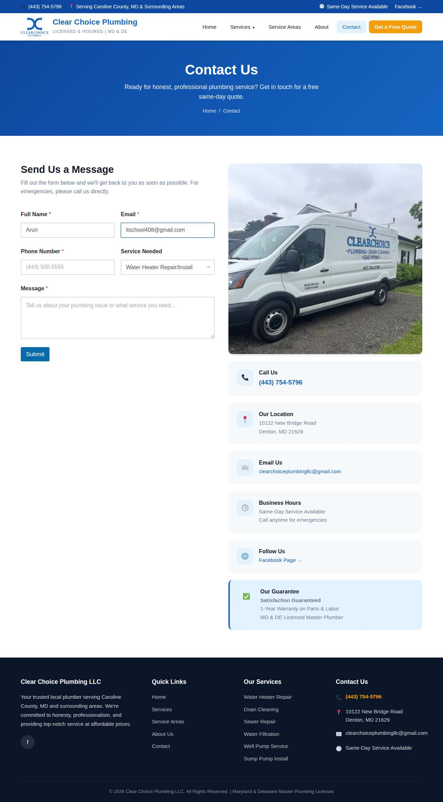

### epssb.com.au — unclear (LIVE)

| | |
|---|---|
| Attempt ID | `07d23159-6c42-44ef-8c58-c65888383cd3` |
| Form URL | https://www.epssb.com.au/contact-us |
| Final URL | https://www.epssb.com.au/contact-us |
| Reserved | 2026-11-06 06:11:45 UTC |
| Submit attempted | 2026-11-06 06:11:48 UTC |
| Template | standard v2 |
| Confirmation text | none observed |
| Result / error | No new success marker observed |

Exact message:

~~~text
Subject: Helping customers find your business in AI search (AEO + GEO)

Hi there,

I'm Arun from Devs Arun. More and more customers now ask ChatGPT, Gemini, Perplexity or Google's AI Overviews questions like "who should I hire for this in my area?" before they call anyone. These tools answer from websites they can clearly understand, and they tend to recommend businesses whose pages answer real customer questions.

That is what AEO + GEO (Answer Engine and Generative Engine Optimization) is for. I improve your existing service pages so they clearly answer the questions your customers ask, add structured data that matches the page, and make the call, quote or enquiry step obvious. The benefit: your business gets a better chance of being mentioned or linked in AI answers, and visitors who arrive find it easy to contact you.

The AEO + GEO Starter is a one-time $199 (about ₹16,999, negotiable) for one website: a basic audit, 10 customer questions, improvements to two existing pages, relevant structured data and an action plan, with one revision round.

You can read the full details, send an enquiry or book online here:
https://devsarun.io/aeo-geo/

If this isn't relevant, just reply and I won't contact you again.

Best,
Arun
Devs Arun
itschool408@gmail.com · +91 7654534323
~~~

Submitted field values:

- Name: \[name\]: Arun
- Email \[email\]: itschool408@gmail.com
- Phone: \[phone\]: +91 7654534323
- Message \[message\]: Hi there, I'm Arun from Devs Arun. More and more customers now ask ChatGPT, Gemini, Perplexity or Google's AI Overviews 

**Filled form (before submit)** — `run-a4a26496_attempt-07d23159_filled_2026-11-06T06-11-48-063Z.jpg`

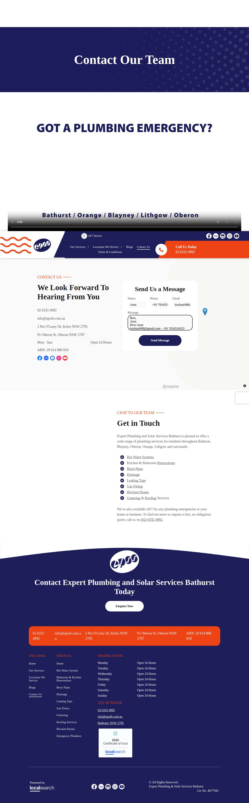

**After submit** — `run-a4a26496_attempt-07d23159_post_attempt_2026-11-06T06-12-18-724Z.jpg`

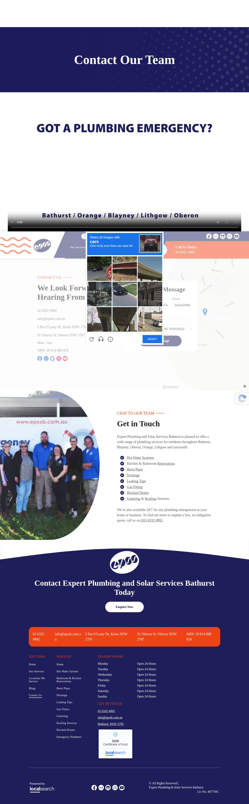

### clarkiesplumbing.com.au — confirmed (LIVE)

| | |
|---|---|
| Attempt ID | `b67d679f-cb25-465c-aaab-aa55924575db` |
| Form URL | https://clarkiesplumbing.com.au/contact-us/ |
| Final URL | https://clarkiesplumbing.com.au/contact-us/ |
| Reserved | 2026-11-06 06:12:27 UTC |
| Submit attempted | 2026-11-06 06:12:31 UTC |
| Template | standard v2 |
| Confirmation text | .com 38 Dunbar Street, Stockton, NSW 2295 Send Us A Message Thank you\! Form submitted successfully. SEND MESSAGE Got a burst pipe, blocked drain, or no hot water? Don’t |
| Result / error | — |

Exact message:

~~~text
Subject: Helping customers find your business in AI search (AEO + GEO)

Hi there,

I'm Arun from Devs Arun. More and more customers now ask ChatGPT, Gemini, Perplexity or Google's AI Overviews questions like "who should I hire for this in my area?" before they call anyone. These tools answer from websites they can clearly understand, and they tend to recommend businesses whose pages answer real customer questions.

That is what AEO + GEO (Answer Engine and Generative Engine Optimization) is for. I improve your existing service pages so they clearly answer the questions your customers ask, add structured data that matches the page, and make the call, quote or enquiry step obvious. The benefit: your business gets a better chance of being mentioned or linked in AI answers, and visitors who arrive find it easy to contact you.

The AEO + GEO Starter is a one-time $199 (about ₹16,999, negotiable) for one website: a basic audit, 10 customer questions, improvements to two existing pages, relevant structured data and an action plan, with one revision round.

You can read the full details, send an enquiry or book online here:
https://devsarun.io/aeo-geo/

If this isn't relevant, just reply and I won't contact you again.

Best,
Arun
Devs Arun
itschool408@gmail.com · +91 7654534323
~~~

Submitted field values:

- mf-email \[email\]: itschool408@gmail.com
- mf-comment \[message\]: Hi there, I'm Arun from Devs Arun. More and more customers now ask ChatGPT, Gemini, Perplexity or Google's AI Overviews 
- mf-subject \[subject\]: Helping customers find your business in AI search (AEO + GEO)
- mf-telephone \[phone\]: +91 7654534323
- mf-first-name \[first\_name\]: Arun

**Filled form (before submit)** — `run-a4a26496_attempt-b67d679f_filled_2026-11-06T06-12-31-618Z.jpg`

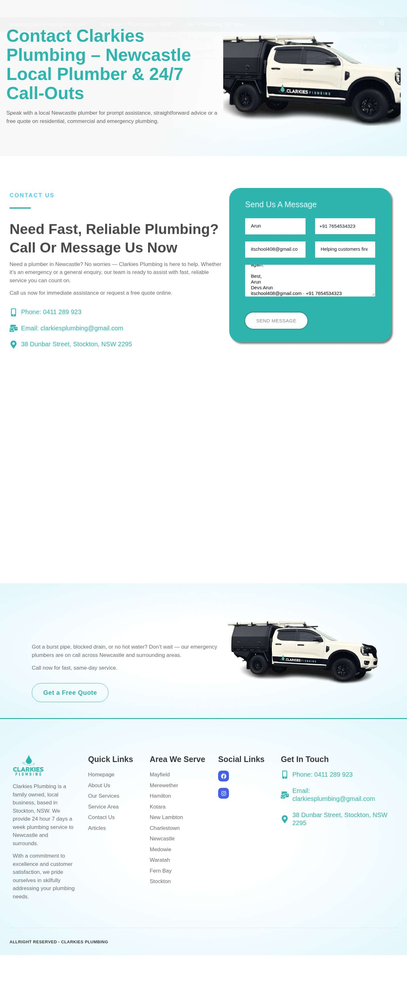

**After submit** — `run-a4a26496_attempt-b67d679f_post_attempt_2026-11-06T06-12-37-919Z.jpg`

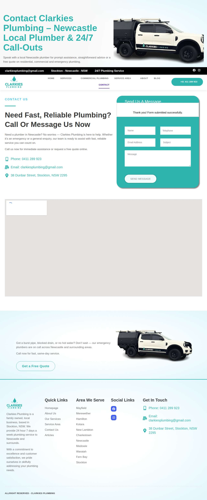

### wantgas.com.au — confirmed (LIVE)

| | |
|---|---|
| Attempt ID | `5b70fe0a-d35b-4562-9f12-7c0f882a6748` |
| Form URL | https://www.wantgas.com.au/contact |
| Final URL | https://www.wantgas.com.au/contact |
| Reserved | 2026-11-06 06:12:46 UTC |
| Submit attempted | 2026-11-06 06:12:49 UTC |
| Template | standard v2 |
| Confirmation text | d, Byron Bay, Alstonville, Lismore, Bangalow or Evans Head. Thank you for contacting Want Gas Plumbing (Ballina) . We will be in touch soon. Contact Information 21 North Creek Rd, Ball |
| Result / error | — |

Exact message:

~~~text
Subject: Helping customers find your business in AI search (AEO + GEO)

Hi there,

I'm Arun from Devs Arun. More and more customers now ask ChatGPT, Gemini, Perplexity or Google's AI Overviews questions like "who should I hire for this in my area?" before they call anyone. These tools answer from websites they can clearly understand, and they tend to recommend businesses whose pages answer real customer questions.

That is what AEO + GEO (Answer Engine and Generative Engine Optimization) is for. I improve your existing service pages so they clearly answer the questions your customers ask, add structured data that matches the page, and make the call, quote or enquiry step obvious. The benefit: your business gets a better chance of being mentioned or linked in AI answers, and visitors who arrive find it easy to contact you.

The AEO + GEO Starter is a one-time $199 (about ₹16,999, negotiable) for one website: a basic audit, 10 customer questions, improvements to two existing pages, relevant structured data and an action plan, with one revision round.

You can read the full details, send an enquiry or book online here:
https://devsarun.io/aeo-geo/

If this isn't relevant, just reply and I won't contact you again.

Best,
Arun
Devs Arun
itschool408@gmail.com · +91 7654534323
~~~

Submitted field values:

- Name: \[name\]: Arun
- Email: \[email\]: itschool408@gmail.com
- Phone: \[phone\]: +91 7654534323
- Message: \[message\]: Hi there, I'm Arun from Devs Arun. More and more customers now ask ChatGPT, Gemini, Perplexity or Google's AI Overviews 

**Filled form (before submit)** — `run-a4a26496_attempt-5b70fe0a_filled_2026-11-06T06-12-49-266Z.jpg`

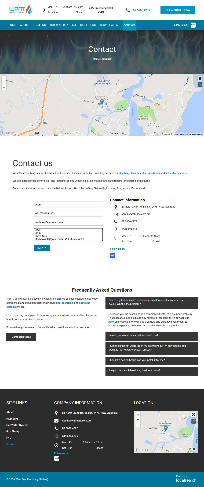

**After submit** — `run-a4a26496_attempt-5b70fe0a_post_attempt_2026-11-06T06-12-54-698Z.jpg`

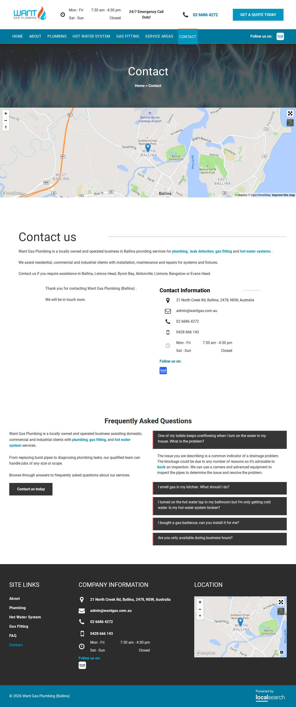

### acmplumbing.com.au — confirmed (LIVE)

| | |
|---|---|
| Attempt ID | `ab0239f4-b2e5-41fd-b9c8-ea29ecf1d007` |
| Form URL | https://acmplumbing.com.au/ |
| Final URL | http://www.acmplumbing.com.au/thankyou.aspx\#Contact |
| Reserved | 2026-11-06 06:13:03 UTC |
| Submit attempted | 2026-11-06 06:13:07 UTC |
| Template | standard v2 |
| Confirmation text | 4:00pm Alternatively, you can get in touch via the form and we'll get back to you as soon as possible. Thank you for your enquiry. We will be in contact with you soon. |
| Result / error | — |

Exact message:

~~~text
Subject: Helping customers find your business in AI search (AEO + GEO)

Hi there,

I'm Arun from Devs Arun. More and more customers now ask ChatGPT, Gemini, Perplexity or Google's AI Overviews questions like "who should I hire for this in my area?" before they call anyone. These tools answer from websites they can clearly understand, and they tend to recommend businesses whose pages answer real customer questions.

That is what AEO + GEO (Answer Engine and Generative Engine Optimization) is for. I improve your existing service pages so they clearly answer the questions your customers ask, add structured data that matches the page, and make the call, quote or enquiry step obvious. The benefit: your business gets a better chance of being mentioned or linked in AI answers, and visitors who arrive find it easy to contact you.

The AEO + GEO Starter is a one-time $199 (about ₹16,999, negotiable) for one website: a basic audit, 10 customer questions, improvements to two existing pages, relevant structured data and an action plan, with one revision round.

You can read the full details, send an enquiry or book online here:
https://devsarun.io/aeo-geo/

If this isn't relevant, just reply and I won't contact you again.

Best,
Arun
Devs Arun
itschool408@gmail.com · +91 7654534323
~~~

Submitted field values:

- Name \[name\]: Arun
- Email \[email\]: itschool408@gmail.com
- Phone \[phone\]: +91 7654534323
- Message \[message\]: Hi there, I'm Arun from Devs Arun. More and more customers now ask ChatGPT, Gemini, Perplexity or Google's AI Overviews 

**Filled form (before submit)** — `run-a4a26496_attempt-ab0239f4_filled_2026-11-06T06-13-07-690Z.jpg`

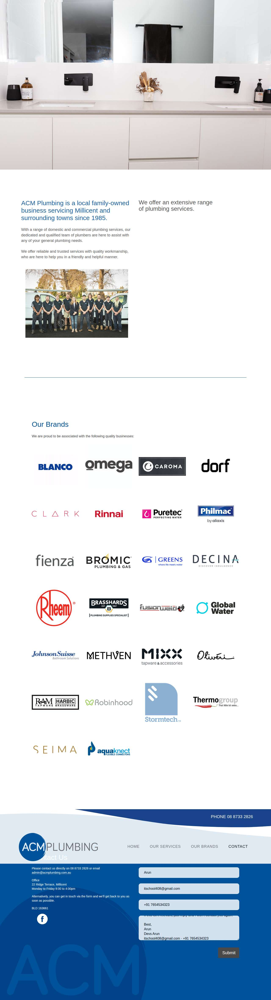

**After submit** — `run-a4a26496_attempt-ab0239f4_post_attempt_2026-11-06T06-13-18-955Z.jpg`

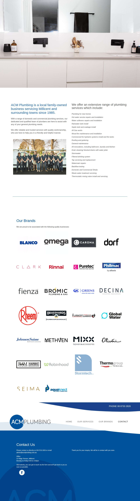

### dynamictradies.com.au — failed\_before\_submit (LIVE)

| | |
|---|---|
| Attempt ID | `7a38380a-f972-42d4-bce1-2af1d0329b58` |
| Form URL | https://dynamictradies.com.au/contact/ |
| Final URL | https://dynamictradies.com.au/contact/ |
| Reserved | 2026-11-06 06:13:27 UTC |
| Submit attempted | — |
| Template | standard v2 |
| Confirmation text | none observed |
| Result / error | Form validation would block sending: et\_pb\_contact\_phone\_number\_0: Please match the requested format. |

Exact message:

~~~text
Subject: Helping customers find your business in AI search (AEO + GEO)

Hi there,

I'm Arun from Devs Arun. More and more customers now ask ChatGPT, Gemini, Perplexity or Google's AI Overviews questions like "who should I hire for this in my area?" before they call anyone. These tools answer from websites they can clearly understand, and they tend to recommend businesses whose pages answer real customer questions.

That is what AEO + GEO (Answer Engine and Generative Engine Optimization) is for. I improve your existing service pages so they clearly answer the questions your customers ask, add structured data that matches the page, and make the call, quote or enquiry step obvious. The benefit: your business gets a better chance of being mentioned or linked in AI answers, and visitors who arrive find it easy to contact you.

The AEO + GEO Starter is a one-time $199 (about ₹16,999, negotiable) for one website: a basic audit, 10 customer questions, improvements to two existing pages, relevant structured data and an action plan, with one revision round.

You can read the full details, send an enquiry or book online here:
https://devsarun.io/aeo-geo/

If this isn't relevant, just reply and I won't contact you again.

Best,
Arun
Devs Arun
itschool408@gmail.com · +91 7654534323
~~~

Submitted field values:

- \#et\_pb\_contact\_email\_0: itschool408@gmail.com
- \#et\_pb\_contact\_message\_0: Hi there, I'm Arun from Devs Arun. More and more customers now ask ChatGPT, Gemini, Perplexity or Google's AI Overviews 
- \#et\_pb\_contact\_first\_name\_0: Arun
- \#et\_pb\_contact\_phone\_number\_0: +91 7654534323

**Filled form (before submit)** — `run-a4a26496_attempt-7a38380a_filled_2026-11-06T06-13-32-003Z.jpg`

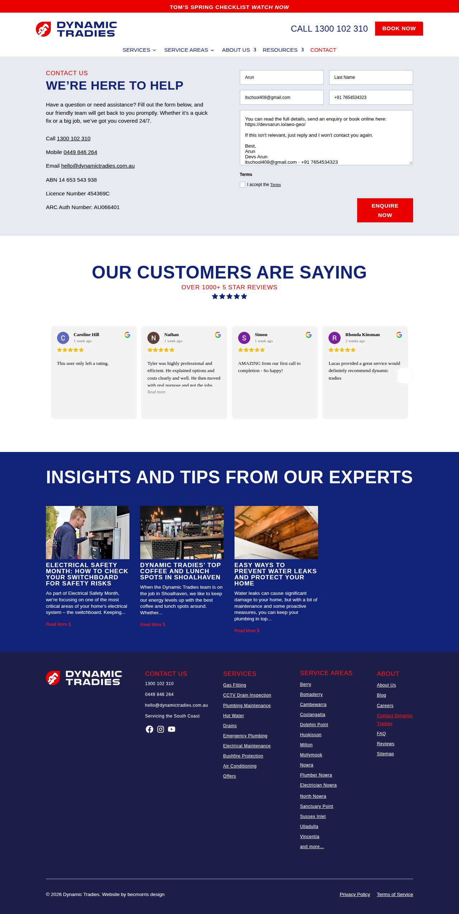

### oceansideservices.com.au — unclear (LIVE)

| | |
|---|---|
| Attempt ID | `7a8ec167-586d-4ac6-b0d0-d0e239aa8b05` |
| Form URL | https://oceansideservices.com.au/contact/ |
| Final URL | https://oceansideservices.com.au/contact/ |
| Reserved | 2026-11-06 06:13:37 UTC |
| Submit attempted | 2026-11-06 06:13:39 UTC |
| Template | standard v2 |
| Confirmation text | none observed |
| Result / error | No new success marker observed |

Exact message:

~~~text
Subject: Helping customers find your business in AI search (AEO + GEO)

Hi there,

I'm Arun from Devs Arun. More and more customers now ask ChatGPT, Gemini, Perplexity or Google's AI Overviews questions like "who should I hire for this in my area?" before they call anyone. These tools answer from websites they can clearly understand, and they tend to recommend businesses whose pages answer real customer questions.

That is what AEO + GEO (Answer Engine and Generative Engine Optimization) is for. I improve your existing service pages so they clearly answer the questions your customers ask, add structured data that matches the page, and make the call, quote or enquiry step obvious. The benefit: your business gets a better chance of being mentioned or linked in AI answers, and visitors who arrive find it easy to contact you.

The AEO + GEO Starter is a one-time $199 (about ₹16,999, negotiable) for one website: a basic audit, 10 customer questions, improvements to two existing pages, relevant structured data and an action plan, with one revision round.

You can read the full details, send an enquiry or book online here:
https://devsarun.io/aeo-geo/

If this isn't relevant, just reply and I won't contact you again.

Best,
Arun
Devs Arun
itschool408@gmail.com · +91 7654534323
~~~

Submitted field values:

- Name \[name\]: Arun
- Email \[email\]: itschool408@gmail.com
- Message \[message\]: Hi there, I'm Arun from Devs Arun. More and more customers now ask ChatGPT, Gemini, Perplexity or Google's AI Overviews 
- Mobile Number \[phone\]: +91 7654534323

**Filled form (before submit)** — `run-a4a26496_attempt-7a8ec167_filled_2026-11-06T06-13-39-643Z.jpg`

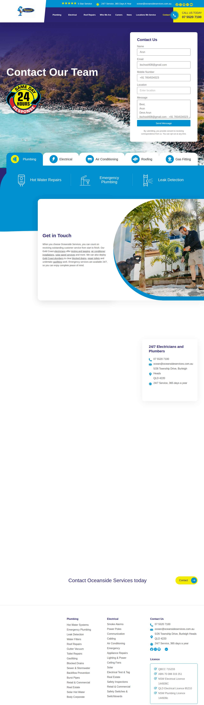

**After submit** — `run-a4a26496_attempt-7a8ec167_post_attempt_2026-11-06T06-14-09-590Z.jpg`

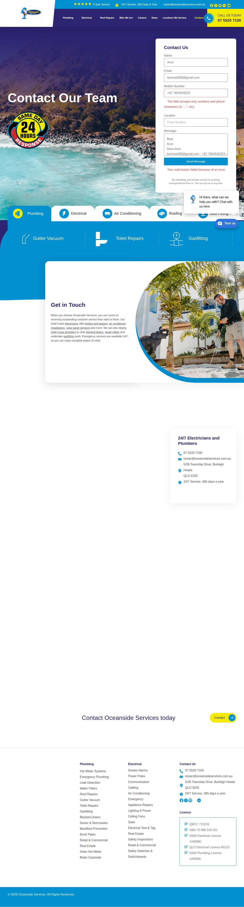

### harrisandthorn.com.au — unclear (LIVE)

| | |
|---|---|
| Attempt ID | `38b5245e-e47a-4950-b3fd-bebc99b7c32e` |
| Form URL | http://www.harrisandthorn.com.au/contact/ |
| Final URL | http://www.harrisandthorn.com.au/contact/ |
| Reserved | 2026-11-06 06:14:18 UTC |
| Submit attempted | 2026-11-06 06:14:21 UTC |
| Template | standard v2 |
| Confirmation text | none observed |
| Result / error | No new success marker observed |

Exact message:

~~~text
Subject: Helping customers find your business in AI search (AEO + GEO)

Hi there,

I'm Arun from Devs Arun. More and more customers now ask ChatGPT, Gemini, Perplexity or Google's AI Overviews questions like "who should I hire for this in my area?" before they call anyone. These tools answer from websites they can clearly understand, and they tend to recommend businesses whose pages answer real customer questions.

That is what AEO + GEO (Answer Engine and Generative Engine Optimization) is for. I improve your existing service pages so they clearly answer the questions your customers ask, add structured data that matches the page, and make the call, quote or enquiry step obvious. The benefit: your business gets a better chance of being mentioned or linked in AI answers, and visitors who arrive find it easy to contact you.

The AEO + GEO Starter is a one-time $199 (about ₹16,999, negotiable) for one website: a basic audit, 10 customer questions, improvements to two existing pages, relevant structured data and an action plan, with one revision round.

You can read the full details, send an enquiry or book online here:
https://devsarun.io/aeo-geo/

If this isn't relevant, just reply and I won't contact you again.

Best,
Arun
Devs Arun
itschool408@gmail.com · +91 7654534323
~~~

Submitted field values:

- email \[email\]: itschool408@gmail.com
- phone \[phone\]: +91 7654534323
- mobile \[phone\]: +91 7654534323
- enquiry \[message\]: Hi there, I'm Arun from Devs Arun. More and more customers now ask ChatGPT, Gemini, Perplexity or Google's AI Overviews 
- firstname \[first\_name\]: Arun

**Filled form (before submit)** — `run-a4a26496_attempt-38b5245e_filled_2026-11-06T06-14-21-186Z.jpg`

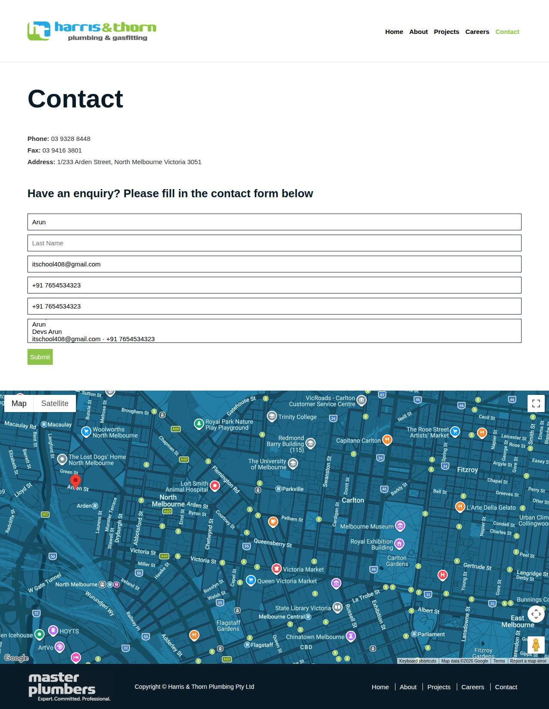

**After submit** — `run-a4a26496_attempt-38b5245e_post_attempt_2026-11-06T06-14-50-067Z.jpg`

### njdahl.com.au — error\_after\_submit (LIVE)

| | |
|---|---|
| Attempt ID | `966f7a14-d37f-4d47-9a48-58f36cc73a63` |
| Form URL | https://www.njdahl.com.au/contact-us/ |
| Final URL | https://www.njdahl.com.au/contact-us/ |
| Reserved | 2026-11-06 06:14:58 UTC |
| Submit attempted | 2026-11-06 06:15:01 UTC |
| Template | standard v2 |
| Confirmation text | Hume ACT One or more fields have an error. Please check and try again. We do not accept spam emails, ADs and other type of unwanted info. If this is a false block, pleas |
| Result / error | — |

Exact message:

~~~text
Subject: Helping customers find your business in AI search (AEO + GEO)

Hi there,

I'm Arun from Devs Arun. More and more customers now ask ChatGPT, Gemini, Perplexity or Google's AI Overviews questions like "who should I hire for this in my area?" before they call anyone. These tools answer from websites they can clearly understand, and they tend to recommend businesses whose pages answer real customer questions.

That is what AEO + GEO (Answer Engine and Generative Engine Optimization) is for. I improve your existing service pages so they clearly answer the questions your customers ask, add structured data that matches the page, and make the call, quote or enquiry step obvious. The benefit: your business gets a better chance of being mentioned or linked in AI answers, and visitors who arrive find it easy to contact you.

The AEO + GEO Starter is a one-time $199 (about ₹16,999, negotiable) for one website: a basic audit, 10 customer questions, improvements to two existing pages, relevant structured data and an action plan, with one revision round.

You can read the full details, send an enquiry or book online here:
https://devsarun.io/aeo-geo/

If this isn't relevant, just reply and I won't contact you again.

Best,
Arun
Devs Arun
itschool408@gmail.com · +91 7654534323
~~~

Submitted field values:

- Name \[name\]: Arun
- Email \[email\]: itschool408@gmail.com
- Phone \[phone\]: +91 7654534323
- Message \[message\]: Hi there, I'm Arun from Devs Arun. More and more customers now ask ChatGPT, Gemini, Perplexity or Google's AI Overviews 

**Filled form (before submit)** — `run-a4a26496_attempt-966f7a14_filled_2026-11-06T06-15-01-756Z.jpg`

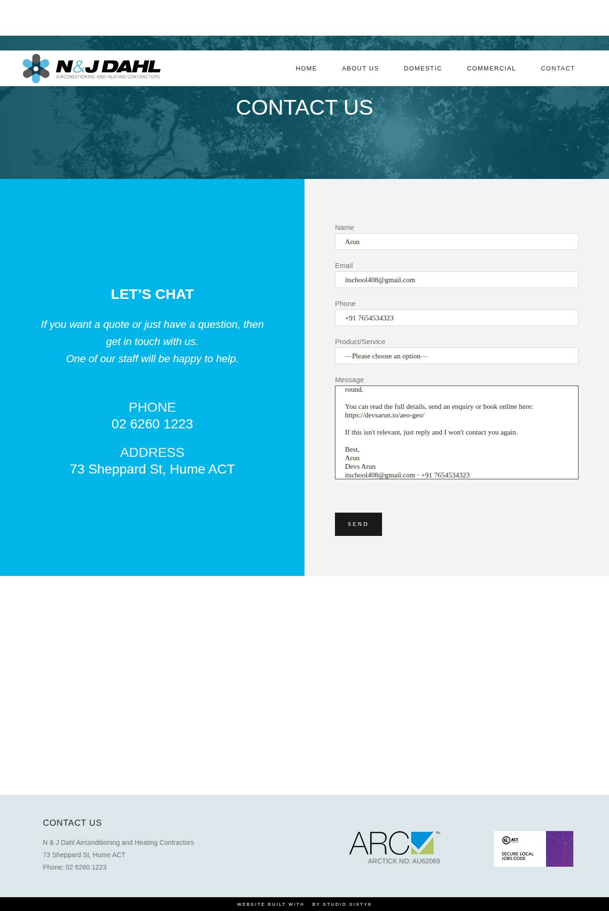

**After submit** — `run-a4a26496_attempt-966f7a14_post_attempt_2026-11-06T06-15-08-715Z.jpg`

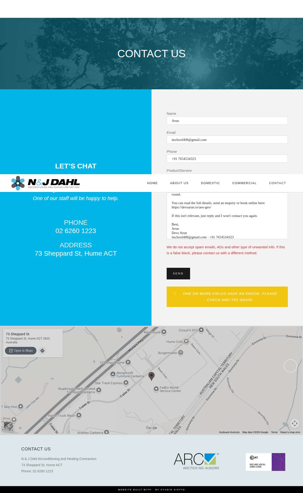

### mcguinnessrefrigeration.com.au — failed\_before\_submit (LIVE)

| | |
|---|---|
| Attempt ID | `5bf8951b-2b64-487c-b876-48413f940b19` |
| Form URL | https://mcguinnessrefrigeration.com.au/pages/contact |
| Final URL | https://mcguinnessrefrigeration.com.au/pages/contact |
| Reserved | 2026-11-06 06:15:17 UTC |
| Submit attempted | — |
| Template | standard v2 |
| Confirmation text | none observed |
| Result / error | Form validation would block sending: contact\[phone\]: Please match the requested format. |

Exact message:

~~~text
Subject: Helping customers find your business in AI search (AEO + GEO)

Hi there,

I'm Arun from Devs Arun. More and more customers now ask ChatGPT, Gemini, Perplexity or Google's AI Overviews questions like "who should I hire for this in my area?" before they call anyone. These tools answer from websites they can clearly understand, and they tend to recommend businesses whose pages answer real customer questions.

That is what AEO + GEO (Answer Engine and Generative Engine Optimization) is for. I improve your existing service pages so they clearly answer the questions your customers ask, add structured data that matches the page, and make the call, quote or enquiry step obvious. The benefit: your business gets a better chance of being mentioned or linked in AI answers, and visitors who arrive find it easy to contact you.

The AEO + GEO Starter is a one-time $199 (about ₹16,999, negotiable) for one website: a basic audit, 10 customer questions, improvements to two existing pages, relevant structured data and an action plan, with one revision round.

You can read the full details, send an enquiry or book online here:
https://devsarun.io/aeo-geo/

If this isn't relevant, just reply and I won't contact you again.

Best,
Arun
Devs Arun
itschool408@gmail.com · +91 7654534323
~~~

Submitted field values:

- \#ContactForm-body: Hi there, I'm Arun from Devs Arun. More and more customers now ask ChatGPT, Gemini, Perplexity or Google's AI Overviews 
- \#ContactForm-name: Arun
- \#ContactForm-email: itschool408@gmail.com
- \#ContactForm-phone: +91 7654534323

**Filled form (before submit)** — `run-a4a26496_attempt-5bf8951b_filled_2026-11-06T06-15-22-472Z.jpg`

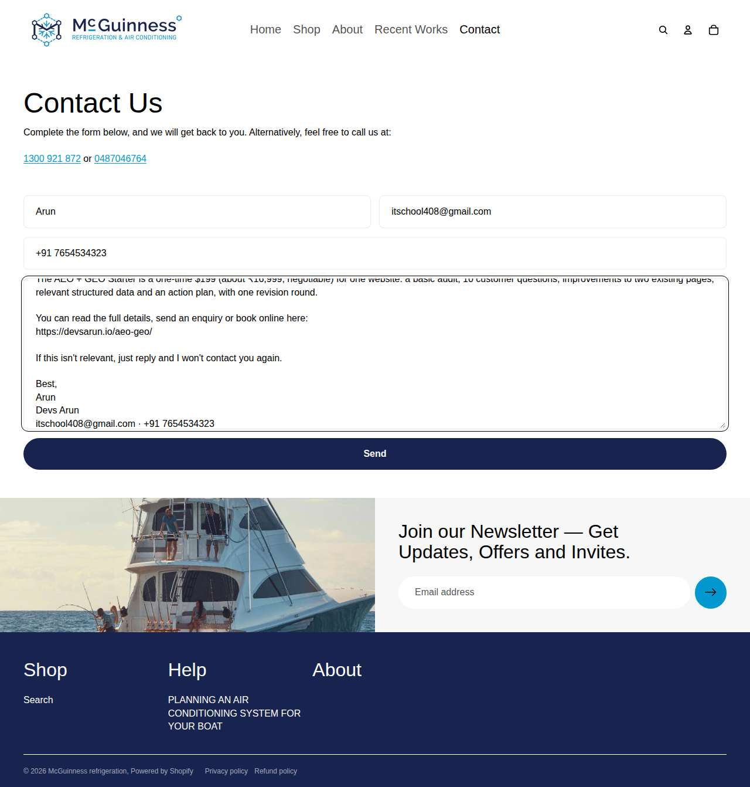

### apracs.com — failed\_before\_submit (LIVE)

| | |
|---|---|
| Attempt ID | `842bbe10-c895-4f92-bd51-1cbbeb788e2f` |
| Form URL | https://www.apracs.com/contact-us |
| Final URL | https://www.apracs.com/contact-us |
| Reserved | 2026-11-06 06:15:27 UTC |
| Submit attempted | — |
| Template | standard v2 |
| Confirmation text | none observed |
| Result / error | Form validation would block sending: : Please check this box if you want to proceed. |

Exact message:

~~~text
Subject: Helping customers find your business in AI search (AEO + GEO)

Hi there,

I'm Arun from Devs Arun. More and more customers now ask ChatGPT, Gemini, Perplexity or Google's AI Overviews questions like "who should I hire for this in my area?" before they call anyone. These tools answer from websites they can clearly understand, and they tend to recommend businesses whose pages answer real customer questions.

That is what AEO + GEO (Answer Engine and Generative Engine Optimization) is for. I improve your existing service pages so they clearly answer the questions your customers ask, add structured data that matches the page, and make the call, quote or enquiry step obvious. The benefit: your business gets a better chance of being mentioned or linked in AI answers, and visitors who arrive find it easy to contact you.

The AEO + GEO Starter is a one-time $199 (about ₹16,999, negotiable) for one website: a basic audit, 10 customer questions, improvements to two existing pages, relevant structured data and an action plan, with one revision round.

You can read the full details, send an enquiry or book online here:
https://devsarun.io/aeo-geo/

If this isn't relevant, just reply and I won't contact you again.

Best,
Arun
Devs Arun
itschool408@gmail.com · +91 7654534323
~~~

Submitted field values:

- \#input\_comp-kadelb5d: Arun
- \#input\_comp-kadelb5q: itschool408@gmail.com
- \#input\_comp-kadelb5u: +91 7654534323
- \#textarea\_comp-kadelb64: Hi there, I'm Arun from Devs Arun. More and more customers now ask ChatGPT, Gemini, Perplexity or Google's AI Overviews 

**Filled form (before submit)** — `run-a4a26496_attempt-842bbe10_filled_2026-11-06T06-15-31-369Z.jpg`

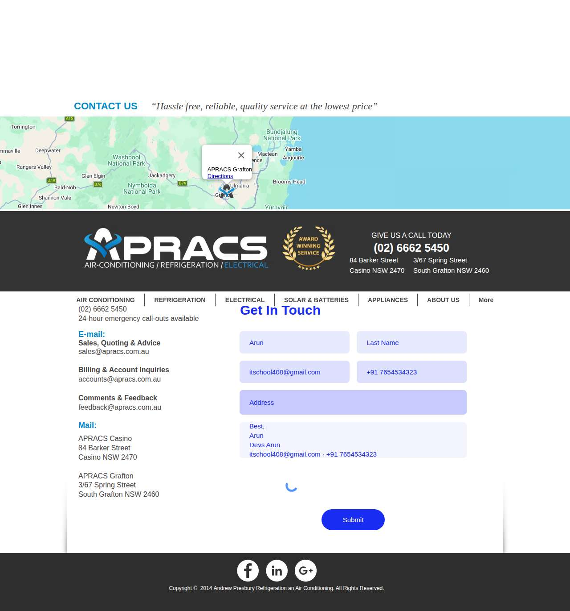

### airmech.com.au — error\_after\_submit (LIVE)

| | |
|---|---|
| Attempt ID | `fdcb5134-dd3c-4645-a919-ffc8ea7d621e` |
| Form URL | http://www.airmech.com.au/contact/ |
| Final URL | http://www.airmech.com.au/contact/ |
| Reserved | 2026-11-06 06:15:36 UTC |
| Submit attempted | 2026-11-06 06:15:40 UTC |
| Template | standard v2 |
| Confirmation text | orrectly. Do you own this website? OK WHERE YOU CAN FIND US Failed to send your message. Please try later or contact the administrator by another method. Failed to send your |
| Result / error | — |

Exact message:

~~~text
Subject: Helping customers find your business in AI search (AEO + GEO)

Hi there,

I'm Arun from Devs Arun. More and more customers now ask ChatGPT, Gemini, Perplexity or Google's AI Overviews questions like "who should I hire for this in my area?" before they call anyone. These tools answer from websites they can clearly understand, and they tend to recommend businesses whose pages answer real customer questions.

That is what AEO + GEO (Answer Engine and Generative Engine Optimization) is for. I improve your existing service pages so they clearly answer the questions your customers ask, add structured data that matches the page, and make the call, quote or enquiry step obvious. The benefit: your business gets a better chance of being mentioned or linked in AI answers, and visitors who arrive find it easy to contact you.

The AEO + GEO Starter is a one-time $199 (about ₹16,999, negotiable) for one website: a basic audit, 10 customer questions, improvements to two existing pages, relevant structured data and an action plan, with one revision round.

You can read the full details, send an enquiry or book online here:
https://devsarun.io/aeo-geo/

If this isn't relevant, just reply and I won't contact you again.

Best,
Arun
Devs Arun
itschool408@gmail.com · +91 7654534323
~~~

Submitted field values:

- your-name \[name\]: Arun
- your-email \[email\]: itschool408@gmail.com
- your-message \[message\]: Hi there, I'm Arun from Devs Arun. More and more customers now ask ChatGPT, Gemini, Perplexity or Google's AI Overviews 
- your-subject \[subject\]: Helping customers find your business in AI search (AEO + GEO)

**Filled form (before submit)** — `run-a4a26496_attempt-fdcb5134_filled_2026-11-06T06-15-40-637Z.jpg`

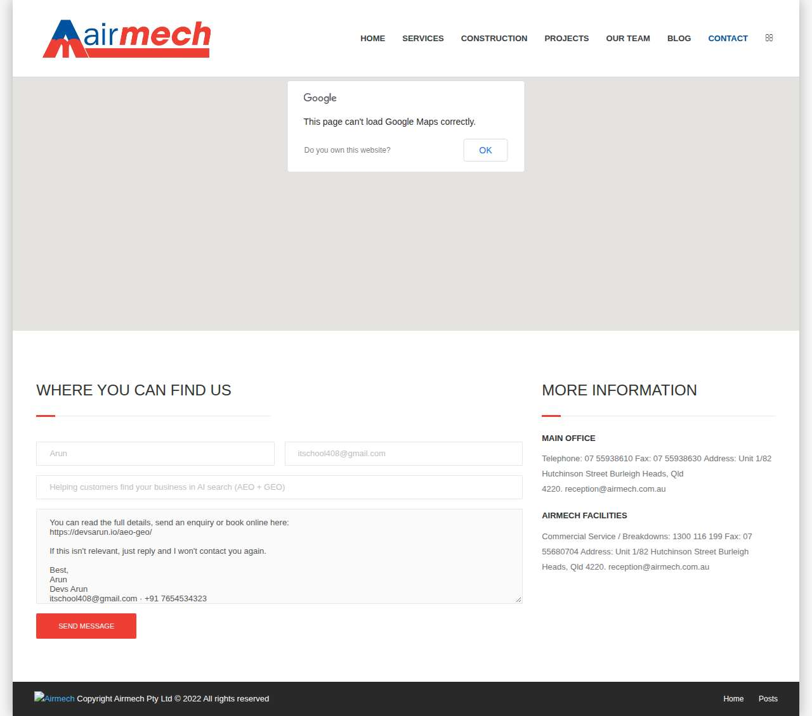

**After submit** — `run-a4a26496_attempt-fdcb5134_post_attempt_2026-11-06T06-15-45-986Z.jpg`

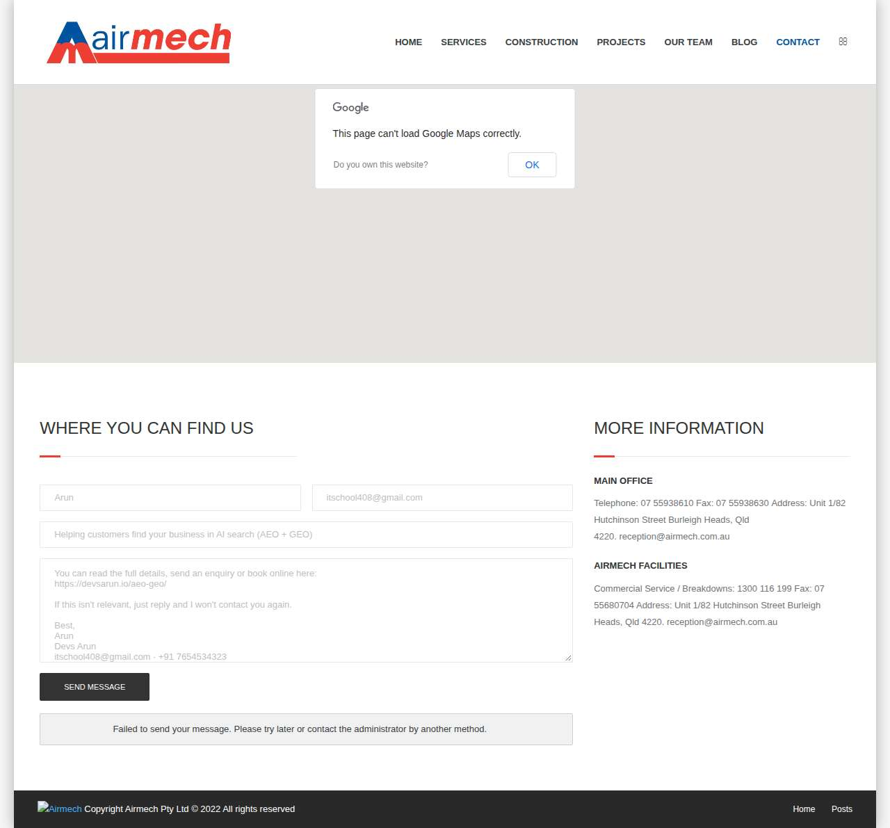

### lawsonair.com.au — confirmed (LIVE)

| | |
|---|---|
| Attempt ID | `089dddaa-c4c4-4cbd-ae29-58cab4e06d6e` |
| Form URL | https://www.lawsonair.com.au/contact-us-online-air-conditioning-supply-installation |
| Final URL | https://www.lawsonair.com.au/contact-us-online-air-conditioning-supply-installation |
| Reserved | 2026-11-06 06:15:54 UTC |
| Submit attempted | 2026-11-06 06:16:01 UTC |
| Template | standard v2 |
| Confirmation text | uire Online FOLLOW @LAWSONAIR ON INSTAGRAM HomeContact Us - Thank You Contact Us - Thank You Your message has been received. Air Conditioning SYDNEY Air Conditioning BRI |
| Result / error | — |

Exact message:

~~~text
Subject: Helping customers find your business in AI search (AEO + GEO)

Hi there,

I'm Arun from Devs Arun. More and more customers now ask ChatGPT, Gemini, Perplexity or Google's AI Overviews questions like "who should I hire for this in my area?" before they call anyone. These tools answer from websites they can clearly understand, and they tend to recommend businesses whose pages answer real customer questions.

That is what AEO + GEO (Answer Engine and Generative Engine Optimization) is for. I improve your existing service pages so they clearly answer the questions your customers ask, add structured data that matches the page, and make the call, quote or enquiry step obvious. The benefit: your business gets a better chance of being mentioned or linked in AI answers, and visitors who arrive find it easy to contact you.

The AEO + GEO Starter is a one-time $199 (about ₹16,999, negotiable) for one website: a basic audit, 10 customer questions, improvements to two existing pages, relevant structured data and an action plan, with one revision round.

You can read the full details, send an enquiry or book online here:
https://devsarun.io/aeo-geo/

If this isn't relevant, just reply and I won't contact you again.

Best,
Arun
Devs Arun
itschool408@gmail.com · +91 7654534323
~~~

Submitted field values:

- Required \[email\]: itschool408@gmail.com
- Message \[message\]: Hi there, I'm Arun from Devs Arun. More and more customers now ask ChatGPT, Gemini, Perplexity or Google's AI Overviews 
- Full Name \[first\_name\]: Arun
- Contact Phone Number \[phone\]: +91 7654534323

**Filled form (before submit)** — `run-a4a26496_attempt-089dddaa_filled_2026-11-06T06-16-01-420Z.jpg`

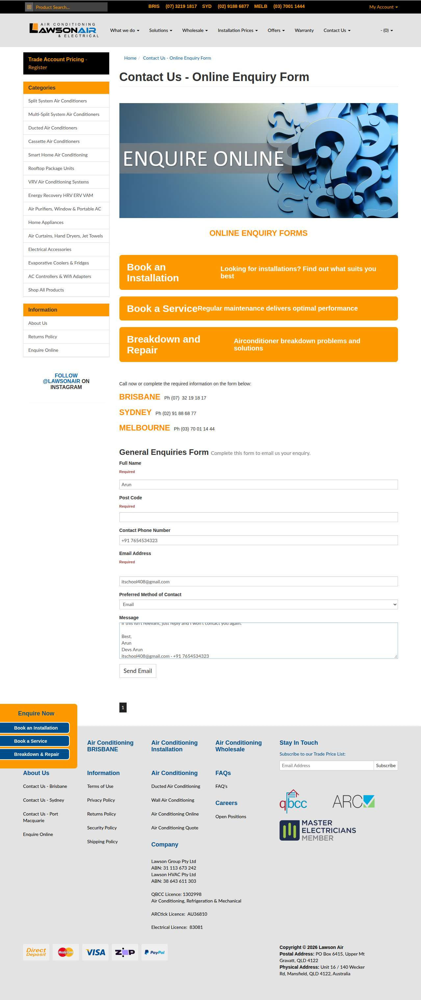

**After submit** — `run-a4a26496_attempt-089dddaa_post_attempt_2026-11-06T06-16-15-086Z.jpg`

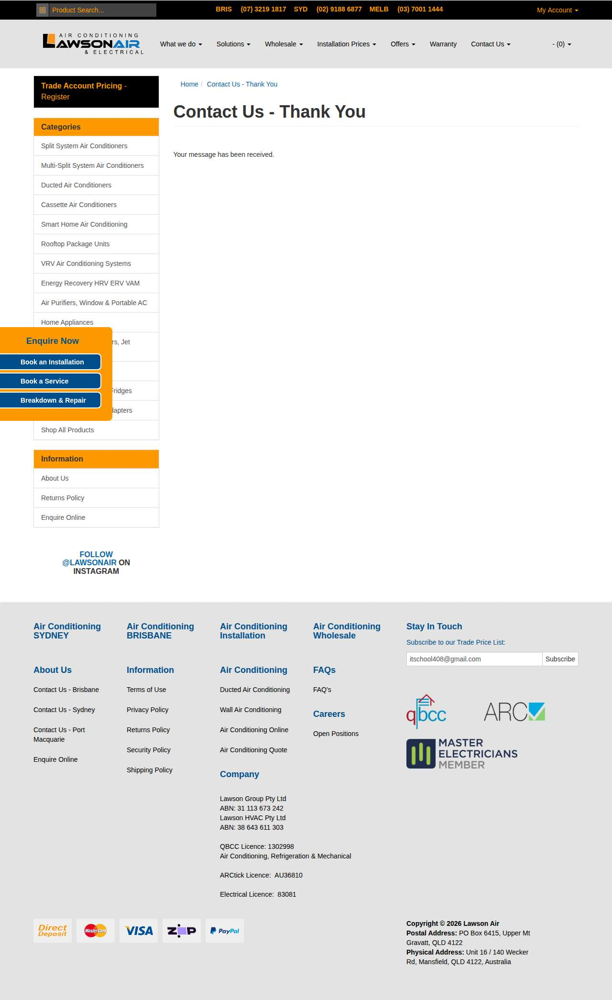

### austclimate.com.au — confirmed (LIVE)

| | |
|---|---|
| Attempt ID | `dcb8c651-f5ec-4c0e-bc2f-49f7375bc558` |
| Form URL | https://austclimate.com.au/contact-us/ |
| Final URL | https://austclimate.com.au/contact-us/ |
| Reserved | 2026-11-06 06:16:24 UTC |
| Submit attempted | 2026-11-06 06:16:25 UTC |
| Template | standard v2 |
| Confirmation text | r) AirHub Ducted System Controller MyAir Message (optional) ENQUIRY SENT We use your details to respond to your enquiry. Privacy policy. Thank you. Your enquiry has been su |
| Result / error | — |

Exact message:

~~~text
Subject: Helping customers find your business in AI search (AEO + GEO)

Hi there,

I'm Arun from Devs Arun. More and more customers now ask ChatGPT, Gemini, Perplexity or Google's AI Overviews questions like "who should I hire for this in my area?" before they call anyone. These tools answer from websites they can clearly understand, and they tend to recommend businesses whose pages answer real customer questions.

That is what AEO + GEO (Answer Engine and Generative Engine Optimization) is for. I improve your existing service pages so they clearly answer the questions your customers ask, add structured data that matches the page, and make the call, quote or enquiry step obvious. The benefit: your business gets a better chance of being mentioned or linked in AI answers, and visitors who arrive find it easy to contact you.

The AEO + GEO Starter is a one-time $199 (about ₹16,999, negotiable) for one website: a basic audit, 10 customer questions, improvements to two existing pages, relevant structured data and an action plan, with one revision round.

You can read the full details, send an enquiry or book online here:
https://devsarun.io/aeo-geo/

If this isn't relevant, just reply and I won't contact you again.

Best,
Arun
Devs Arun
itschool408@gmail.com · +91 7654534323
~~~

Submitted field values:

- Email\* \[email\]: itschool408@gmail.com
- Phone\* \[phone\]: +91 7654534323
- Suburb\* \[city\]: Bangalore
- Full Name\* \[name\]: Arun
- Message (optional) \[message\]: Hi there, I'm Arun from Devs Arun. More and more customers now ask ChatGPT, Gemini, Perplexity or Google's AI Overviews 

**Filled form (before submit)** — `run-a4a26496_attempt-dcb8c651_filled_2026-11-06T06-16-25-979Z.jpg`

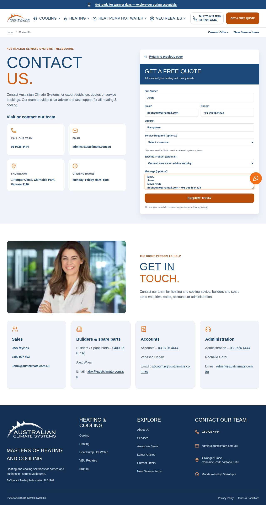

**After submit** — `run-a4a26496_attempt-dcb8c651_post_attempt_2026-11-06T06-16-30-840Z.jpg`

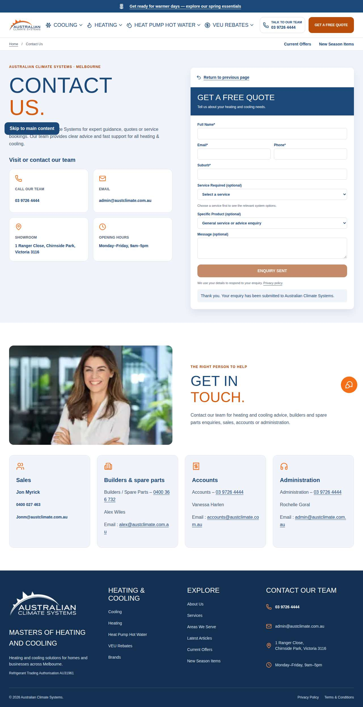

### teamnt.com.au — confirmed (LIVE)

| | |
|---|---|
| Attempt ID | `a404b6f1-abc2-48ba-90c3-04f425b87a10` |
| Form URL | https://www.teamnt.com.au/contact |
| Final URL | https://www.teamnt.com.au/contact |
| Reserved | 2026-11-06 06:16:39 UTC |
| Submit attempted | 2026-11-06 06:16:42 UTC |
| Template | standard v2 |
| Confirmation text | rt care. We care about what we do and are here to help you. Thank you for contacting us. We will get back to you as soon as possible Get a quick clean quote Contact the TEAM today\! Our |
| Result / error | — |

Exact message:

~~~text
Subject: Helping customers find your business in AI search (AEO + GEO)

Hi there,

I'm Arun from Devs Arun. More and more customers now ask ChatGPT, Gemini, Perplexity or Google's AI Overviews questions like "who should I hire for this in my area?" before they call anyone. These tools answer from websites they can clearly understand, and they tend to recommend businesses whose pages answer real customer questions.

That is what AEO + GEO (Answer Engine and Generative Engine Optimization) is for. I improve your existing service pages so they clearly answer the questions your customers ask, add structured data that matches the page, and make the call, quote or enquiry step obvious. The benefit: your business gets a better chance of being mentioned or linked in AI answers, and visitors who arrive find it easy to contact you.

The AEO + GEO Starter is a one-time $199 (about ₹16,999, negotiable) for one website: a basic audit, 10 customer questions, improvements to two existing pages, relevant structured data and an action plan, with one revision round.

You can read the full details, send an enquiry or book online here:
https://devsarun.io/aeo-geo/

If this isn't relevant, just reply and I won't contact you again.

Best,
Arun
Devs Arun
itschool408@gmail.com · +91 7654534323
~~~

Submitted field values:

- Name \[name\]: Arun
- Email \[email\]: itschool408@gmail.com
- Phone \[phone\]: +91 7654534323
- Message \[message\]: Hi there, I'm Arun from Devs Arun. More and more customers now ask ChatGPT, Gemini, Perplexity or Google's AI Overviews 
- Subject \[subject\]: Helping customers find your business in AI search (AEO + GEO)

**Filled form (before submit)** — `run-a4a26496_attempt-a404b6f1_filled_2026-11-06T06-16-42-271Z.jpg`

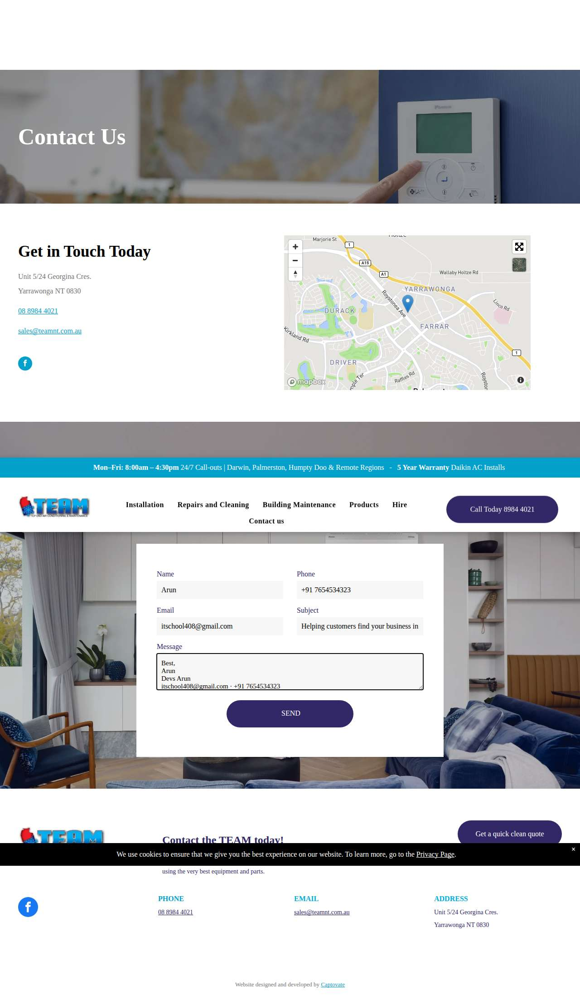

**After submit** — `run-a4a26496_attempt-a404b6f1_post_attempt_2026-11-06T06-16-47-031Z.jpg`

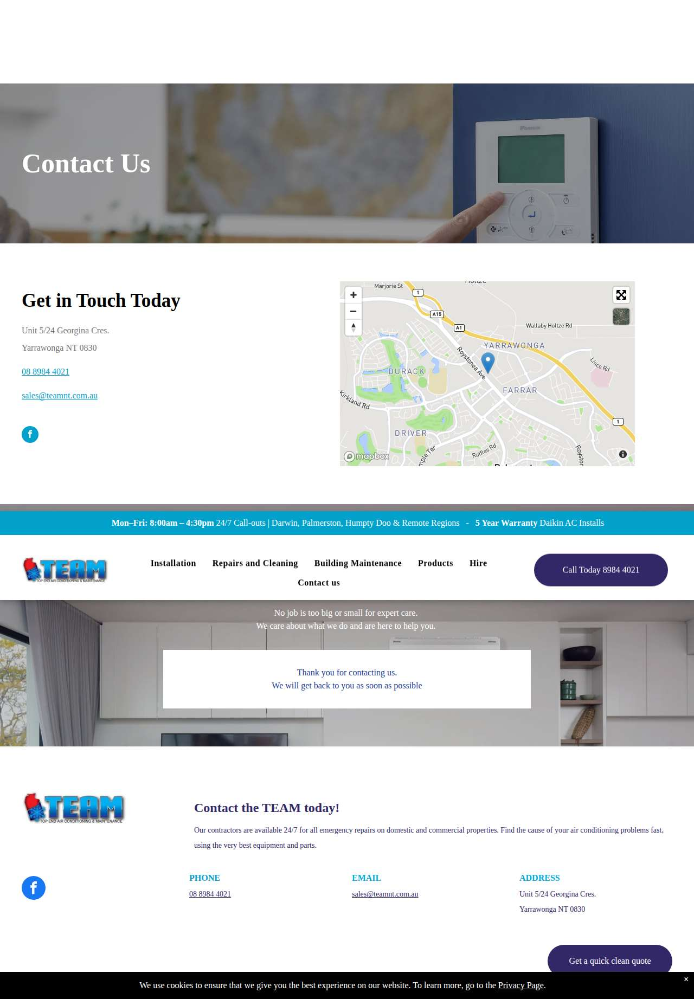

### armidale-electrical.com.au — unclear (LIVE)

| | |
|---|---|
| Attempt ID | `114145bf-169d-4571-912d-e905d45549c2` |
| Form URL | https://www.armidale-electrical.com.au/contact |
| Final URL | https://www.armidale-electrical.com.au/contact |
| Reserved | 2026-11-06 06:16:55 UTC |
| Submit attempted | 2026-11-06 06:16:58 UTC |
| Template | standard v2 |
| Confirmation text | none observed |
| Result / error | No new success marker observed |

Exact message:

~~~text
Subject: Helping customers find your business in AI search (AEO + GEO)

Hi there,

I'm Arun from Devs Arun. More and more customers now ask ChatGPT, Gemini, Perplexity or Google's AI Overviews questions like "who should I hire for this in my area?" before they call anyone. These tools answer from websites they can clearly understand, and they tend to recommend businesses whose pages answer real customer questions.

That is what AEO + GEO (Answer Engine and Generative Engine Optimization) is for. I improve your existing service pages so they clearly answer the questions your customers ask, add structured data that matches the page, and make the call, quote or enquiry step obvious. The benefit: your business gets a better chance of being mentioned or linked in AI answers, and visitors who arrive find it easy to contact you.

The AEO + GEO Starter is a one-time $199 (about ₹16,999, negotiable) for one website: a basic audit, 10 customer questions, improvements to two existing pages, relevant structured data and an action plan, with one revision round.

You can read the full details, send an enquiry or book online here:
https://devsarun.io/aeo-geo/

If this isn't relevant, just reply and I won't contact you again.

Best,
Arun
Devs Arun
itschool408@gmail.com · +91 7654534323
~~~

Submitted field values:

- Name: \[name\]: Arun
- Email: \[email\]: itschool408@gmail.com
- Phone: \[phone\]: +91 7654534323
- Message: \[message\]: Hi there, I'm Arun from Devs Arun. More and more customers now ask ChatGPT, Gemini, Perplexity or Google's AI Overviews 

**Filled form (before submit)** — `run-a4a26496_attempt-114145bf_filled_2026-11-06T06-16-58-036Z.jpg`

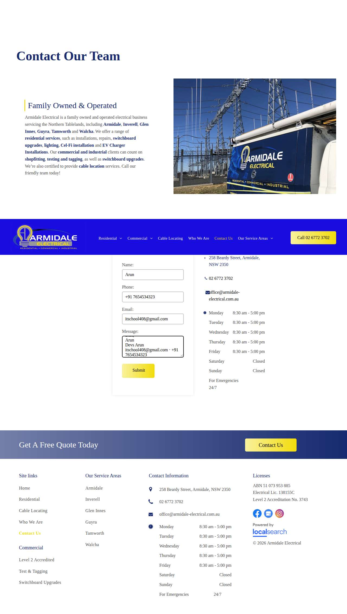

**After submit** — `run-a4a26496_attempt-114145bf_post_attempt_2026-11-06T06-17-28-455Z.jpg`

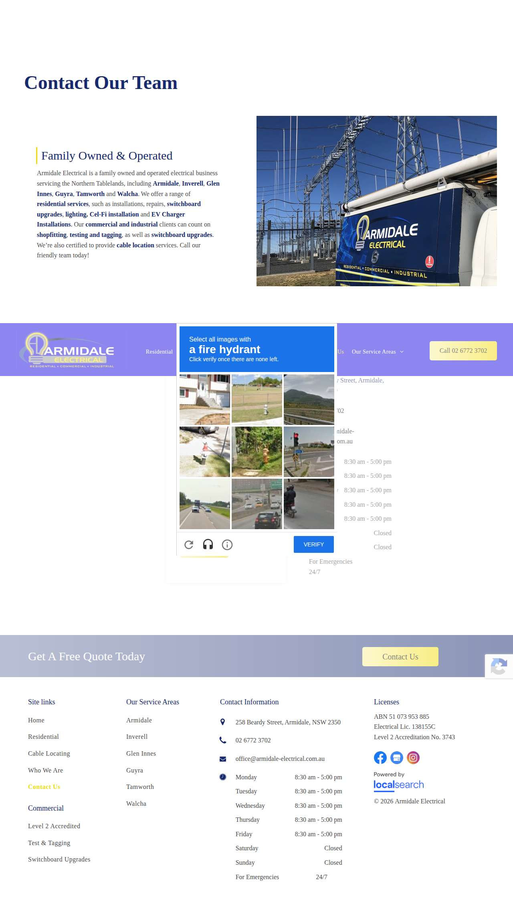

### ctmelectrical.com.au — unclear (LIVE)

| | |
|---|---|
| Attempt ID | `f6c65c1e-3ca6-40d2-8e6c-0d1b57f28efd` |
| Form URL | https://www.ctmelectrical.com.au/contact-us.html |
| Final URL | https://www.ctmelectrical.com.au/contact-us.html |
| Reserved | 2026-11-06 06:17:37 UTC |
| Submit attempted | 2026-11-06 06:17:41 UTC |
| Template | standard v2 |
| Confirmation text | none observed |
| Result / error | No new success marker observed |

Exact message:

~~~text
Subject: Helping customers find your business in AI search (AEO + GEO)

Hi there,

I'm Arun from Devs Arun. More and more customers now ask ChatGPT, Gemini, Perplexity or Google's AI Overviews questions like "who should I hire for this in my area?" before they call anyone. These tools answer from websites they can clearly understand, and they tend to recommend businesses whose pages answer real customer questions.

That is what AEO + GEO (Answer Engine and Generative Engine Optimization) is for. I improve your existing service pages so they clearly answer the questions your customers ask, add structured data that matches the page, and make the call, quote or enquiry step obvious. The benefit: your business gets a better chance of being mentioned or linked in AI answers, and visitors who arrive find it easy to contact you.

The AEO + GEO Starter is a one-time $199 (about ₹16,999, negotiable) for one website: a basic audit, 10 customer questions, improvements to two existing pages, relevant structured data and an action plan, with one revision round.

You can read the full details, send an enquiry or book online here:
https://devsarun.io/aeo-geo/

If this isn't relevant, just reply and I won't contact you again.

Best,
Arun
Devs Arun
itschool408@gmail.com · +91 7654534323
~~~

Submitted field values:

- email \[email\]: itschool408@gmail.com
- phone \[phone\]: +91 7654534323
- message \[message\]: Hi there, I'm Arun from Devs Arun. More and more customers now ask ChatGPT, Gemini, Perplexity or Google's AI Overviews 
- name \[first\_name\]: Arun

**Filled form (before submit)** — `run-a4a26496_attempt-f6c65c1e_filled_2026-11-06T06-17-41-594Z.jpg`

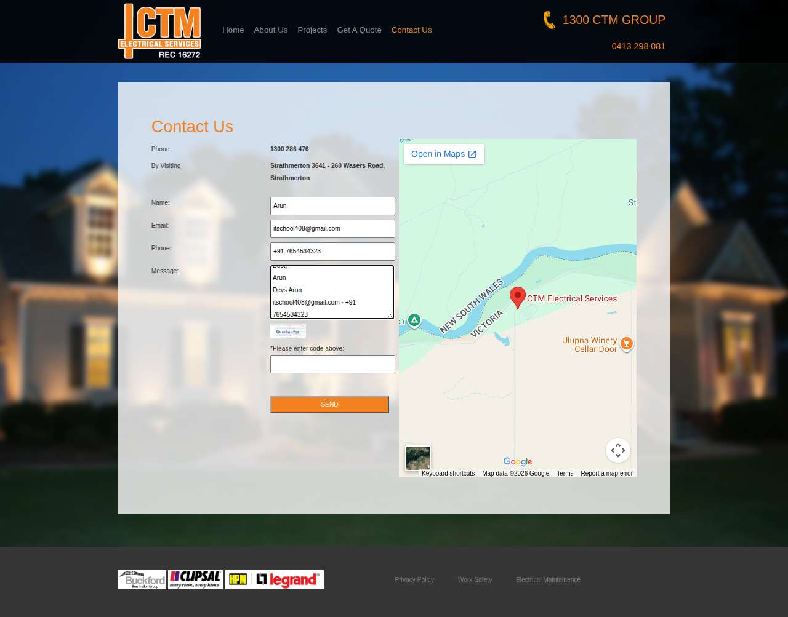

**After submit** — `run-a4a26496_attempt-f6c65c1e_post_attempt_2026-11-06T06-18-12-765Z.jpg`

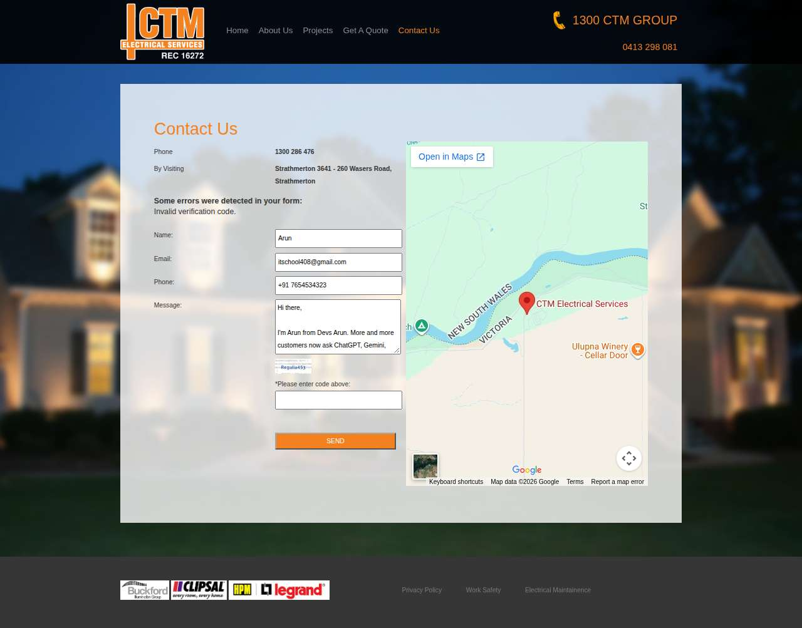

### kolbang.com.au — unclear (LIVE)

| | |
|---|---|
| Attempt ID | `302d7881-af6b-4cfc-b67b-7a537393ec12` |
| Form URL | https://kolbang.com.au/contact-us/ |
| Final URL | https://kolbang.com.au/contact-us/ |
| Reserved | 2026-11-06 06:18:22 UTC |
| Submit attempted | 2026-11-06 06:18:27 UTC |
| Template | standard v2 |
| Confirmation text | none observed |
| Result / error | No new success marker observed |

Exact message:

~~~text
Subject: Helping customers find your business in AI search (AEO + GEO)

Hi there,

I'm Arun from Devs Arun. More and more customers now ask ChatGPT, Gemini, Perplexity or Google's AI Overviews questions like "who should I hire for this in my area?" before they call anyone. These tools answer from websites they can clearly understand, and they tend to recommend businesses whose pages answer real customer questions.

That is what AEO + GEO (Answer Engine and Generative Engine Optimization) is for. I improve your existing service pages so they clearly answer the questions your customers ask, add structured data that matches the page, and make the call, quote or enquiry step obvious. The benefit: your business gets a better chance of being mentioned or linked in AI answers, and visitors who arrive find it easy to contact you.

The AEO + GEO Starter is a one-time $199 (about ₹16,999, negotiable) for one website: a basic audit, 10 customer questions, improvements to two existing pages, relevant structured data and an action plan, with one revision round.

You can read the full details, send an enquiry or book online here:
https://devsarun.io/aeo-geo/

If this isn't relevant, just reply and I won't contact you again.

Best,
Arun
Devs Arun
itschool408@gmail.com · +91 7654534323
~~~

Submitted field values:

- Email \[email\]: itschool408@gmail.com
- Last Name \[email\]: itschool408@gmail.com
- First Name \[first\_name\]: Arun
- form\_fields\[field\_3\] \[message\]: Hi there, I'm Arun from Devs Arun. More and more customers now ask ChatGPT, Gemini, Perplexity or Google's AI Overviews 

**Filled form (before submit)** — `run-a4a26496_attempt-302d7881_filled_2026-11-06T06-18-27-268Z.jpg`

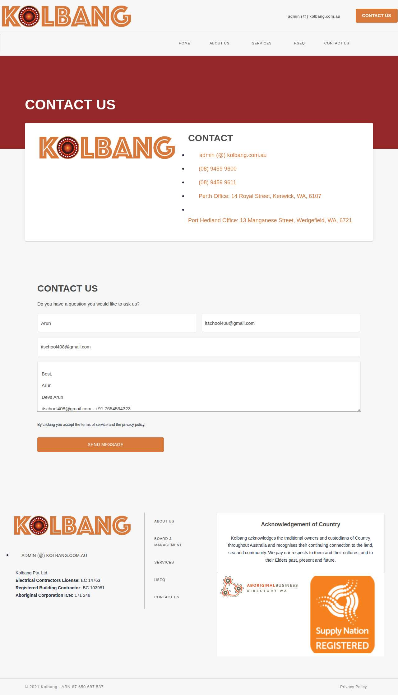

**After submit** — `run-a4a26496_attempt-302d7881_post_attempt_2026-11-06T06-18-56-233Z.jpg`

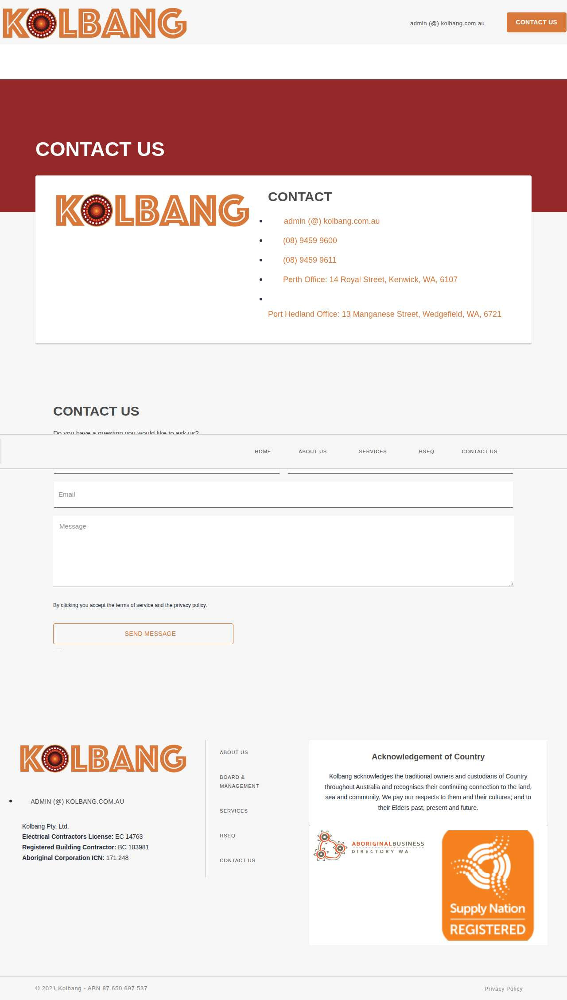

### perthantennaservices.com.au — failed\_before\_submit (LIVE)

| | |
|---|---|
| Attempt ID | `a2b8b316-b77b-4452-8539-4b1e71a5dae1` |
| Form URL | https://perthantennaservices.com.au/contact/ |
| Final URL | https://perthantennaservices.com.au/contact/ |
| Reserved | 2026-11-06 06:19:05 UTC |
| Submit attempted | — |
| Template | standard v2 |
| Confirmation text | none observed |
| Result / error | Field "Phone:\*" did not accept the value |

Exact message:

~~~text
Subject: Helping customers find your business in AI search (AEO + GEO)

Hi there,

I'm Arun from Devs Arun. More and more customers now ask ChatGPT, Gemini, Perplexity or Google's AI Overviews questions like "who should I hire for this in my area?" before they call anyone. These tools answer from websites they can clearly understand, and they tend to recommend businesses whose pages answer real customer questions.

That is what AEO + GEO (Answer Engine and Generative Engine Optimization) is for. I improve your existing service pages so they clearly answer the questions your customers ask, add structured data that matches the page, and make the call, quote or enquiry step obvious. The benefit: your business gets a better chance of being mentioned or linked in AI answers, and visitors who arrive find it easy to contact you.

The AEO + GEO Starter is a one-time $199 (about ₹16,999, negotiable) for one website: a basic audit, 10 customer questions, improvements to two existing pages, relevant structured data and an action plan, with one revision round.

You can read the full details, send an enquiry or book online here:
https://devsarun.io/aeo-geo/

If this isn't relevant, just reply and I won't contact you again.

Best,
Arun
Devs Arun
itschool408@gmail.com · +91 7654534323
~~~

Submitted field values:

- \#input\_1\_1: Arun
- \#input\_1\_4: +91 7654534323
- \#input\_1\_5: itschool408@gmail.com
- \#input\_1\_7: Hi there, I'm Arun from Devs Arun. More and more customers now ask ChatGPT, Gemini, Perplexity or Google's AI Overviews 

**Filled form (before submit)** — `run-a4a26496_attempt-a2b8b316_filled_2026-11-06T06-19-09-132Z.jpg`

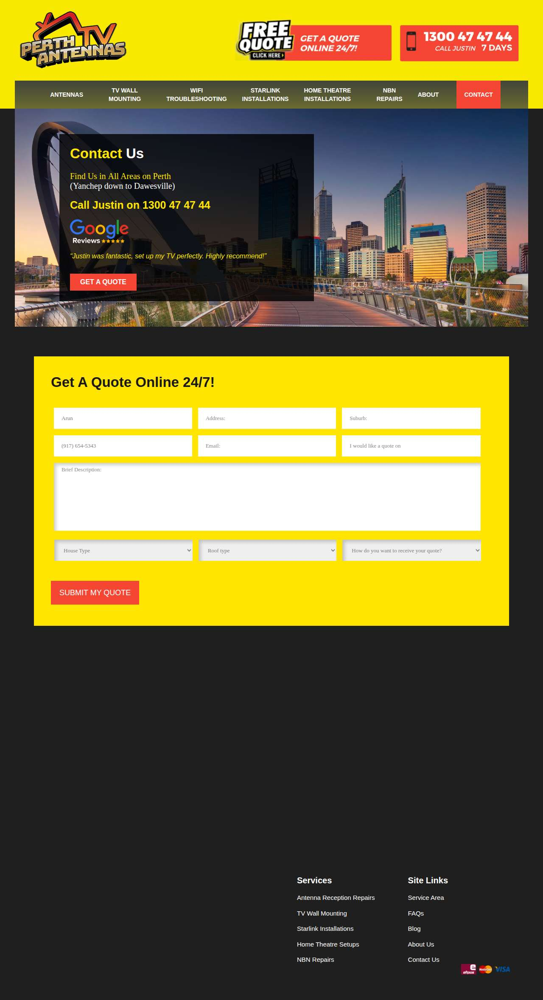

### electracare.com.au — unclear (LIVE)

| | |
|---|---|
| Attempt ID | `7aadc1c5-e0cf-43f8-932f-cf0c5d13b20c` |
| Form URL | https://www.electracare.com.au/contact-us |
| Final URL | https://www.electracare.com.au/contact-us |
| Reserved | 2026-11-06 06:19:14 UTC |
| Submit attempted | 2026-11-06 06:19:17 UTC |
| Template | standard v2 |
| Confirmation text | none observed |
| Result / error | No new success marker observed |

Exact message:

~~~text
Subject: Helping customers find your business in AI search (AEO + GEO)

Hi there,

I'm Arun from Devs Arun. More and more customers now ask ChatGPT, Gemini, Perplexity or Google's AI Overviews questions like "who should I hire for this in my area?" before they call anyone. These tools answer from websites they can clearly understand, and they tend to recommend businesses whose pages answer real customer questions.

That is what AEO + GEO (Answer Engine and Generative Engine Optimization) is for. I improve your existing service pages so they clearly answer the questions your customers ask, add structured data that matches the page, and make the call, quote or enquiry step obvious. The benefit: your business gets a better chance of being mentioned or linked in AI answers, and visitors who arrive find it easy to contact you.

The AEO + GEO Starter is a one-time $199 (about ₹16,999, negotiable) for one website: a basic audit, 10 customer questions, improvements to two existing pages, relevant structured data and an action plan, with one revision round.

You can read the full details, send an enquiry or book online here:
https://devsarun.io/aeo-geo/

If this isn't relevant, just reply and I won't contact you again.

Best,
Arun
Devs Arun
itschool408@gmail.com · +91 7654534323
~~~

Submitted field values:

- email \[email\]: itschool408@gmail.com
- phone \[phone\]: +91 7654534323
- first-name \[first\_name\]: Arun
- Type your message here... \[message\]: Hi there, I'm Arun from Devs Arun. More and more customers now ask ChatGPT, Gemini, Perplexity or Google's AI Overviews 

**Filled form (before submit)** — `run-a4a26496_attempt-7aadc1c5_filled_2026-11-06T06-19-17-103Z.jpg`

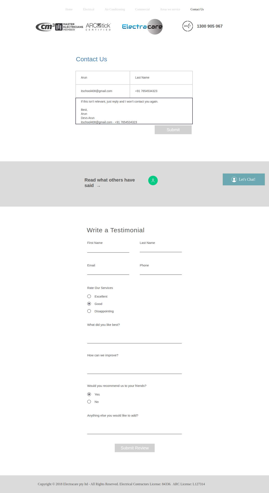

**After submit** — `run-a4a26496_attempt-7aadc1c5_post_attempt_2026-11-06T06-19-54-286Z.jpg`

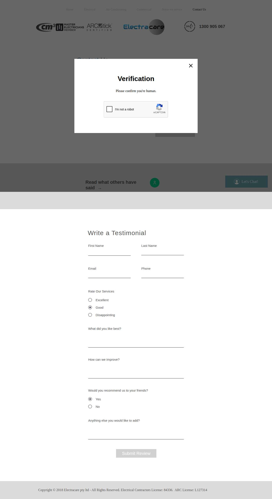

### zenindustrial.com.au — confirmed (LIVE)

| | |
|---|---|
| Attempt ID | `b539ed83-ad20-42ce-8a89-fbed4f3ef989` |
| Form URL | https://zenindustrial.com.au/index.php/contact-us |
| Final URL | https://zenindustrial.com.au/index.php/contact-us |
| Reserved | 2026-11-06 06:20:02 UTC |
| Submit attempted | 2026-11-06 06:20:06 UTC |
| Template | standard v2 |
| Confirmation text | HOME PROJECT GALLERY CONTACT US × Message Thank you for your email. Contact Zen Industrial Contact Address Shed 19 South @ 33 Gugandi road Narara NSW 2 |
| Result / error | — |

Exact message:

~~~text
Subject: Helping customers find your business in AI search (AEO + GEO)

Hi there,

I'm Arun from Devs Arun. More and more customers now ask ChatGPT, Gemini, Perplexity or Google's AI Overviews questions like "who should I hire for this in my area?" before they call anyone. These tools answer from websites they can clearly understand, and they tend to recommend businesses whose pages answer real customer questions.

That is what AEO + GEO (Answer Engine and Generative Engine Optimization) is for. I improve your existing service pages so they clearly answer the questions your customers ask, add structured data that matches the page, and make the call, quote or enquiry step obvious. The benefit: your business gets a better chance of being mentioned or linked in AI answers, and visitors who arrive find it easy to contact you.

The AEO + GEO Starter is a one-time $199 (about ₹16,999, negotiable) for one website: a basic audit, 10 customer questions, improvements to two existing pages, relevant structured data and an action plan, with one revision round.

You can read the full details, send an enquiry or book online here:
https://devsarun.io/aeo-geo/

If this isn't relevant, just reply and I won't contact you again.

Best,
Arun
Devs Arun
itschool408@gmail.com · +91 7654534323
~~~

Submitted field values:

- Name \* \[name\]: Arun
- Email \* \[email\]: itschool408@gmail.com
- Subject \* \[email\]: itschool408@gmail.com
- Message \* \[message\]: Hi there, I'm Arun from Devs Arun. More and more customers now ask ChatGPT, Gemini, Perplexity or Google's AI Overviews 

**Filled form (before submit)** — `run-a4a26496_attempt-b539ed83_filled_2026-11-06T06-20-06-637Z.jpg`

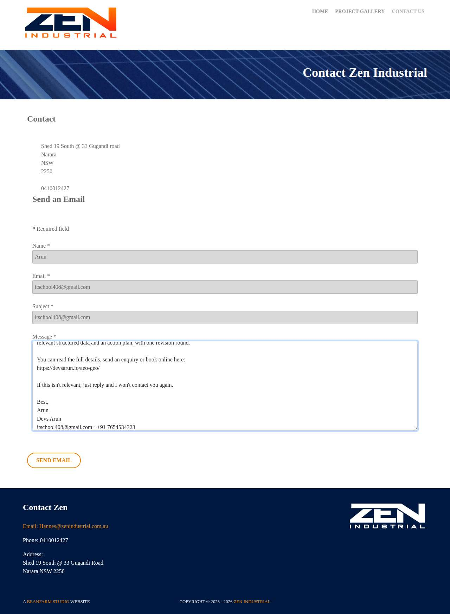

**After submit** — `run-a4a26496_attempt-b539ed83_post_attempt_2026-11-06T06-20-13-443Z.jpg`

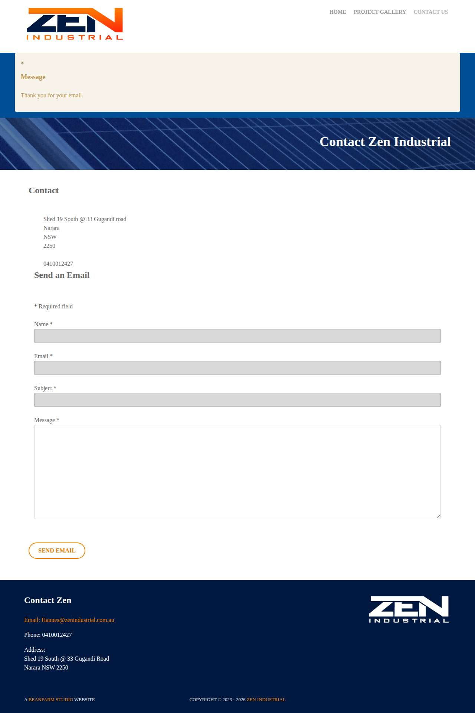

### bwnwincpainting.com — failed\_before\_submit (LIVE)

| | |
|---|---|
| Attempt ID | `72b12cfb-4b1d-4b6d-8917-63d79efca7a6` |
| Form URL | https://www.bwnwincpainting.com/contact/ |
| Final URL | — |
| Reserved | 2026-11-06 06:20:22 UTC |
| Submit attempted | — |
| Template | standard v2 |
| Confirmation text | none observed |
| Result / error | locator.fill: Error: Cannot type text into input\[type=number\] |

Exact message:

~~~text
Subject: Helping customers find your business in AI search (AEO + GEO)

Hi there,

I'm Arun from Devs Arun. More and more customers now ask ChatGPT, Gemini, Perplexity or Google's AI Overviews questions like "who should I hire for this in my area?" before they call anyone. These tools answer from websites they can clearly understand, and they tend to recommend businesses whose pages answer real customer questions.

That is what AEO + GEO (Answer Engine and Generative Engine Optimization) is for. I improve your existing service pages so they clearly answer the questions your customers ask, add structured data that matches the page, and make the call, quote or enquiry step obvious. The benefit: your business gets a better chance of being mentioned or linked in AI answers, and visitors who arrive find it easy to contact you.

The AEO + GEO Starter is a one-time $199 (about ₹16,999, negotiable) for one website: a basic audit, 10 customer questions, improvements to two existing pages, relevant structured data and an action plan, with one revision round.

You can read the full details, send an enquiry or book online here:
https://devsarun.io/aeo-geo/

If this isn't relevant, just reply and I won't contact you again.

Best,
Arun
Devs Arun
itschool408@gmail.com · +91 7654534323
~~~

Submitted field values:

- \#name-1151: Arun
- \#email-1151: itschool408@gmail.com
- \#phone-1151: +91 7654534323
- \#message-1151: Hi there, I'm Arun from Devs Arun. More and more customers now ask ChatGPT, Gemini, Perplexity or Google's AI Overviews 

**Inspected page** — `run-a4a26496_attempt-72b12cfb_inspection_2026-11-06T06-20-24-191Z.jpg`

### absoluterestorepa.com — failed\_before\_submit (LIVE)

| | |
|---|---|
| Attempt ID | `4ba9bbd3-de6b-4878-95ba-c71ff46c724a` |
| Form URL | https://absoluterestorepa.com/contact-us/ |
| Final URL | — |
| Reserved | 2026-11-06 06:20:29 UTC |
| Submit attempted | — |
| Template | standard v2 |
| Confirmation text | none observed |
| Result / error | locator.fill: Error: Cannot type text into input\[type=number\] |

Exact message:

~~~text
Subject: Helping customers find your business in AI search (AEO + GEO)

Hi there,

I'm Arun from Devs Arun. More and more customers now ask ChatGPT, Gemini, Perplexity or Google's AI Overviews questions like "who should I hire for this in my area?" before they call anyone. These tools answer from websites they can clearly understand, and they tend to recommend businesses whose pages answer real customer questions.

That is what AEO + GEO (Answer Engine and Generative Engine Optimization) is for. I improve your existing service pages so they clearly answer the questions your customers ask, add structured data that matches the page, and make the call, quote or enquiry step obvious. The benefit: your business gets a better chance of being mentioned or linked in AI answers, and visitors who arrive find it easy to contact you.

The AEO + GEO Starter is a one-time $199 (about ₹16,999, negotiable) for one website: a basic audit, 10 customer questions, improvements to two existing pages, relevant structured data and an action plan, with one revision round.

You can read the full details, send an enquiry or book online here:
https://devsarun.io/aeo-geo/

If this isn't relevant, just reply and I won't contact you again.

Best,
Arun
Devs Arun
itschool408@gmail.com · +91 7654534323
~~~

Submitted field values:

- \#form-field-name: Arun
- \#form-field-message: Hi there, I'm Arun from Devs Arun. More and more customers now ask ChatGPT, Gemini, Perplexity or Google's AI Overviews 
- \#form-field-field\_ed02ec2: +91 7654534323
- \#content \> div \> div \> div:nth-of-type(2) \> div \> div:nth-of-type(1) \> div:nth-of-type(2) \> div \> form \> div \> div:nth-of-type(3) \> input: itschool408@gmail.com

**Inspected page** — `run-a4a26496_attempt-4ba9bbd3_inspection_2026-11-06T06-20-31-712Z.jpg`

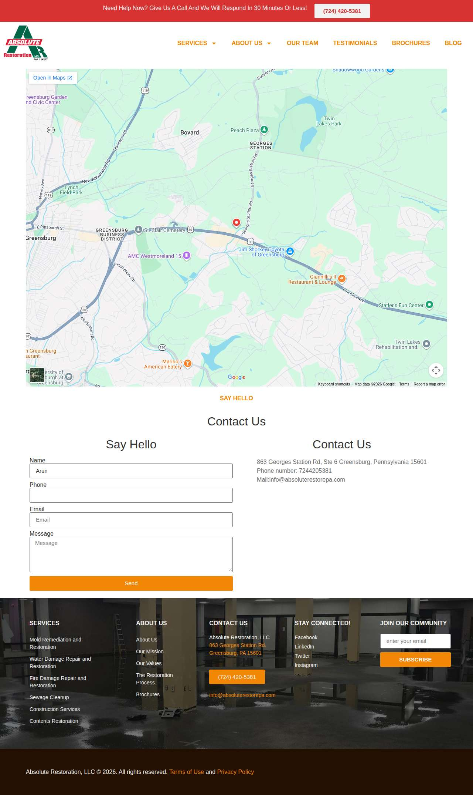

### masoudlawfirm.com — failed\_before\_submit (LIVE)

| | |
|---|---|
| Attempt ID | `e7d07e11-793e-45e8-8ea8-2270c1381bdd` |
| Form URL | https://masoudlawfirm.com/contact/ |
| Final URL | — |
| Reserved | 2026-11-06 06:20:36 UTC |
| Submit attempted | — |
| Template | standard v2 |
| Confirmation text | none observed |
| Result / error | locator.fill: Error: Cannot type text into input\[type=number\] |

Exact message:

~~~text
Subject: Helping customers find your business in AI search (AEO + GEO)

Hi there,

I'm Arun from Devs Arun. More and more customers now ask ChatGPT, Gemini, Perplexity or Google's AI Overviews questions like "who should I hire for this in my area?" before they call anyone. These tools answer from websites they can clearly understand, and they tend to recommend businesses whose pages answer real customer questions.

That is what AEO + GEO (Answer Engine and Generative Engine Optimization) is for. I improve your existing service pages so they clearly answer the questions your customers ask, add structured data that matches the page, and make the call, quote or enquiry step obvious. The benefit: your business gets a better chance of being mentioned or linked in AI answers, and visitors who arrive find it easy to contact you.

The AEO + GEO Starter is a one-time $199 (about ₹16,999, negotiable) for one website: a basic audit, 10 customer questions, improvements to two existing pages, relevant structured data and an action plan, with one revision round.

You can read the full details, send an enquiry or book online here:
https://devsarun.io/aeo-geo/

If this isn't relevant, just reply and I won't contact you again.

Best,
Arun
Devs Arun
itschool408@gmail.com · +91 7654534323
~~~

Submitted field values:

- \#form-field-name: Arun
- \#form-field-field\_3374379: Hi there, I'm Arun from Devs Arun. More and more customers now ask ChatGPT, Gemini, Perplexity or Google's AI Overviews 
- \#form-field-field\_7731784: +91 7654534323
- \#form-field-field\_8bd0f16: itschool408@gmail.com

**Inspected page** — `run-a4a26496_attempt-e7d07e11_inspection_2026-11-06T06-20-40-757Z.jpg`

### whiteolivecpa.com — failed\_before\_submit (LIVE)

| | |
|---|---|
| Attempt ID | `35322364-9ba6-4c29-ad1e-324facfc2989` |
| Form URL | https://whiteolivecpa.com/contact/ |
| Final URL | — |
| Reserved | 2026-11-06 06:20:45 UTC |
| Submit attempted | — |
| Template | standard v2 |
| Confirmation text | none observed |
| Result / error | locator.fill: Error: Cannot type text into input\[type=number\] |

Exact message:

~~~text
Subject: Helping customers find your business in AI search (AEO + GEO)

Hi there,

I'm Arun from Devs Arun. More and more customers now ask ChatGPT, Gemini, Perplexity or Google's AI Overviews questions like "who should I hire for this in my area?" before they call anyone. These tools answer from websites they can clearly understand, and they tend to recommend businesses whose pages answer real customer questions.

That is what AEO + GEO (Answer Engine and Generative Engine Optimization) is for. I improve your existing service pages so they clearly answer the questions your customers ask, add structured data that matches the page, and make the call, quote or enquiry step obvious. The benefit: your business gets a better chance of being mentioned or linked in AI answers, and visitors who arrive find it easy to contact you.

The AEO + GEO Starter is a one-time $199 (about ₹16,999, negotiable) for one website: a basic audit, 10 customer questions, improvements to two existing pages, relevant structured data and an action plan, with one revision round.

You can read the full details, send an enquiry or book online here:
https://devsarun.io/aeo-geo/

If this isn't relevant, just reply and I won't contact you again.

Best,
Arun
Devs Arun
itschool408@gmail.com · +91 7654534323
~~~

Submitted field values:

- \#ff\_1\_email: itschool408@gmail.com
- \#ff\_1\_message: Hi there, I'm Arun from Devs Arun. More and more customers now ask ChatGPT, Gemini, Perplexity or Google's AI Overviews 
- \#ff\_1\_numeric\_field: +91 7654534323
- \#ff\_1\_names\_first\_name\_: Arun

**Inspected page** — `run-a4a26496_attempt-35322364_inspection_2026-11-06T06-20-47-098Z.jpg`

### canterburyadvisor.com — failed\_before\_submit (LIVE)

| | |
|---|---|
| Attempt ID | `a6783e68-76a4-417c-902c-8be562e86b85` |
| Form URL | https://canterburyadvisor.com/ |
| Final URL | — |
| Reserved | 2026-11-06 06:20:52 UTC |
| Submit attempted | — |
| Template | standard v2 |
| Confirmation text | none observed |
| Result / error | locator.fill: Error: Cannot type text into input\[type=number\] |

Exact message:

~~~text
Subject: Helping customers find your business in AI search (AEO + GEO)

Hi there,

I'm Arun from Devs Arun. More and more customers now ask ChatGPT, Gemini, Perplexity or Google's AI Overviews questions like "who should I hire for this in my area?" before they call anyone. These tools answer from websites they can clearly understand, and they tend to recommend businesses whose pages answer real customer questions.

That is what AEO + GEO (Answer Engine and Generative Engine Optimization) is for. I improve your existing service pages so they clearly answer the questions your customers ask, add structured data that matches the page, and make the call, quote or enquiry step obvious. The benefit: your business gets a better chance of being mentioned or linked in AI answers, and visitors who arrive find it easy to contact you.

The AEO + GEO Starter is a one-time $199 (about ₹16,999, negotiable) for one website: a basic audit, 10 customer questions, improvements to two existing pages, relevant structured data and an action plan, with one revision round.

You can read the full details, send an enquiry or book online here:
https://devsarun.io/aeo-geo/

If this isn't relevant, just reply and I won't contact you again.

Best,
Arun
Devs Arun
itschool408@gmail.com · +91 7654534323
~~~

Submitted field values:

- \#form-field-name: Arun
- \#form-field-email: itschool408@gmail.com
- \#form-field-message: Hi there, I'm Arun from Devs Arun. More and more customers now ask ChatGPT, Gemini, Perplexity or Google's AI Overviews 
- \#form-field-field\_97f81fb: +91 7654534323

**Inspected page** — `run-a4a26496_attempt-a6783e68_inspection_2026-11-06T06-20-54-011Z.jpg`

### connectionzpcrepair.com — failed\_before\_submit (LIVE)

| | |
|---|---|
| Attempt ID | `ee6ab3ce-9f77-435b-8657-6f8246b4c2eb` |
| Form URL | https://connectionzpcrepair.com/contact/ |
| Final URL | — |
| Reserved | 2026-11-06 06:20:59 UTC |
| Submit attempted | — |
| Template | standard v2 |
| Confirmation text | none observed |
| Result / error | locator.fill: Error: Cannot type text into input\[type=number\] |

Exact message:

~~~text
Subject: Helping customers find your business in AI search (AEO + GEO)

Hi there,

I'm Arun from Devs Arun. More and more customers now ask ChatGPT, Gemini, Perplexity or Google's AI Overviews questions like "who should I hire for this in my area?" before they call anyone. These tools answer from websites they can clearly understand, and they tend to recommend businesses whose pages answer real customer questions.

That is what AEO + GEO (Answer Engine and Generative Engine Optimization) is for. I improve your existing service pages so they clearly answer the questions your customers ask, add structured data that matches the page, and make the call, quote or enquiry step obvious. The benefit: your business gets a better chance of being mentioned or linked in AI answers, and visitors who arrive find it easy to contact you.

The AEO + GEO Starter is a one-time $199 (about ₹16,999, negotiable) for one website: a basic audit, 10 customer questions, improvements to two existing pages, relevant structured data and an action plan, with one revision round.

You can read the full details, send an enquiry or book online here:
https://devsarun.io/aeo-geo/

If this isn't relevant, just reply and I won't contact you again.

Best,
Arun
Devs Arun
itschool408@gmail.com · +91 7654534323
~~~

Submitted field values:

- \#form-field-name: Arun
- \#form-field-email: itschool408@gmail.com
- \#form-field-message: Hi there, I'm Arun from Devs Arun. More and more customers now ask ChatGPT, Gemini, Perplexity or Google's AI Overviews 
- \#form-field-field\_99a8620: +91 7654534323

**Inspected page** — `run-a4a26496_attempt-ee6ab3ce_inspection_2026-11-06T06-21-01-135Z.jpg`

### ackavionics.com — failed\_before\_submit (LIVE)

| | |
|---|---|
| Attempt ID | `18d2b704-8c74-4c09-996c-bee970b95dad` |
| Form URL | https://www.ackavionics.com/contact-us-2/ |
| Final URL | — |
| Reserved | 2026-11-06 06:21:06 UTC |
| Submit attempted | — |
| Template | standard v2 |
| Confirmation text | none observed |
| Result / error | locator.fill: Error: Cannot type text into input\[type=number\] |

Exact message:

~~~text
Subject: Helping customers find your business in AI search (AEO + GEO)

Hi there,

I'm Arun from Devs Arun. More and more customers now ask ChatGPT, Gemini, Perplexity or Google's AI Overviews questions like "who should I hire for this in my area?" before they call anyone. These tools answer from websites they can clearly understand, and they tend to recommend businesses whose pages answer real customer questions.

That is what AEO + GEO (Answer Engine and Generative Engine Optimization) is for. I improve your existing service pages so they clearly answer the questions your customers ask, add structured data that matches the page, and make the call, quote or enquiry step obvious. The benefit: your business gets a better chance of being mentioned or linked in AI answers, and visitors who arrive find it easy to contact you.

The AEO + GEO Starter is a one-time $199 (about ₹16,999, negotiable) for one website: a basic audit, 10 customer questions, improvements to two existing pages, relevant structured data and an action plan, with one revision round.

You can read the full details, send an enquiry or book online here:
https://devsarun.io/aeo-geo/

If this isn't relevant, just reply and I won't contact you again.

Best,
Arun
Devs Arun
itschool408@gmail.com · +91 7654534323
~~~

Submitted field values:

- input\[name="text-30"\]: Arun
- input\[name="email-380"\]: itschool408@gmail.com
- input\[name="number-19"\]: +91 7654534323
- textarea\[name="textarea"\]: Hi there, I'm Arun from Devs Arun. More and more customers now ask ChatGPT, Gemini, Perplexity or Google's AI Overviews 

**Inspected page** — `run-a4a26496_attempt-18d2b704_inspection_2026-11-06T06-21-07-922Z.jpg`

## Events (193)

| Time (UTC) | Event | Website | Details |
|---|---|---|---|
| 06:11:33 | run\_queued | — | live run requested by github:itsDevsArun |
| 06:11:33 | run\_dispatched | — | dispatch disabled (local test mode) |
| 06:11:37 | run\_started | — | Runner claimed live run |
| 06:11:38 | offer\_verified | — | Service page offer facts verified |
| 06:11:38 | website\_selected | clearchoiceplumbingllc.com | Live target clearchoiceplumbingllc.com |
| 06:11:38 | attempt\_reserved | clearchoiceplumbingllc.com | Submission attempt reserved with template standard v2 |
| 06:11:39 | page\_opened | clearchoiceplumbingllc.com | Opened form page |
| 06:11:40 | screenshot\_saved | clearchoiceplumbingllc.com | inspection screenshot saved (145 KB) |
| 06:11:40 | review\_required | clearchoiceplumbingllc.com | failed before submit: locator.fill: Error: Cannot type text into input\[type=number\] |
| 06:11:45 | website\_selected | epssb.com.au | Live target epssb.com.au |
| 06:11:45 | attempt\_reserved | epssb.com.au | Submission attempt reserved with template standard v2 |
| 06:11:47 | page\_opened | epssb.com.au | Opened form page |
| 06:11:47 | fields\_filled | epssb.com.au | filled |
| 06:11:48 | screenshot\_saved | epssb.com.au | filled screenshot saved (212 KB) |
| 06:11:48 | submit\_attempted | epssb.com.au | submitting |
| 06:12:18 | screenshot\_saved | epssb.com.au | post\_attempt screenshot saved (251 KB) |
| 06:12:18 | review\_required | epssb.com.au | unclear: No new success marker observed |
| 06:12:27 | website\_selected | clarkiesplumbing.com.au | Live target clarkiesplumbing.com.au |
| 06:12:27 | attempt\_reserved | clarkiesplumbing.com.au | Submission attempt reserved with template standard v2 |
| 06:12:31 | page\_opened | clarkiesplumbing.com.au | Opened form page |
| 06:12:31 | fields\_filled | clarkiesplumbing.com.au | filled |
| 06:12:31 | screenshot\_saved | clarkiesplumbing.com.au | filled screenshot saved (170 KB) |
| 06:12:31 | submit\_attempted | clarkiesplumbing.com.au | submitting |
| 06:12:37 | screenshot\_saved | clarkiesplumbing.com.au | post\_attempt screenshot saved (186 KB) |
| 06:12:37 | confirmation\_observed | clarkiesplumbing.com.au | confirmed — ".com 38 Dunbar Street, Stockton, NSW 2295 Send Us A Message Thank you\! Form submitted successfully. SEND MESSAGE Got a b" |
| 06:12:46 | website\_selected | wantgas.com.au | Live target wantgas.com.au |
| 06:12:46 | attempt\_reserved | wantgas.com.au | Submission attempt reserved with template standard v2 |
| 06:12:48 | page\_opened | wantgas.com.au | Opened form page |
| 06:12:49 | fields\_filled | wantgas.com.au | filled |
| 06:12:49 | screenshot\_saved | wantgas.com.au | filled screenshot saved (234 KB) |
| 06:12:49 | submit\_attempted | wantgas.com.au | submitting |
| 06:12:54 | screenshot\_saved | wantgas.com.au | post\_attempt screenshot saved (226 KB) |
| 06:12:54 | confirmation\_observed | wantgas.com.au | confirmed — "d, Byron Bay, Alstonville, Lismore, Bangalow or Evans Head. Thank you for contacting Want Gas Plumbing (Ballina) . We wi" |
| 06:13:03 | website\_selected | acmplumbing.com.au | Live target acmplumbing.com.au |
| 06:13:03 | attempt\_reserved | acmplumbing.com.au | Submission attempt reserved with template standard v2 |
| 06:13:07 | page\_opened | acmplumbing.com.au | Opened form page |
| 06:13:07 | fields\_filled | acmplumbing.com.au | filled |
| 06:13:07 | screenshot\_saved | acmplumbing.com.au | filled screenshot saved (255 KB) |
| 06:13:07 | submit\_attempted | acmplumbing.com.au | submitting |
| 06:13:18 | screenshot\_saved | acmplumbing.com.au | post\_attempt screenshot saved (269 KB) |
| 06:13:18 | confirmation\_observed | acmplumbing.com.au | confirmed — "4:00pm Alternatively, you can get in touch via the form and we'll get back to you as soon as possible. Thank you for you" |
| 06:13:27 | website\_selected | dynamictradies.com.au | Live target dynamictradies.com.au |
| 06:13:27 | attempt\_reserved | dynamictradies.com.au | Submission attempt reserved with template standard v2 |
| 06:13:31 | page\_opened | dynamictradies.com.au | Opened form page |
| 06:13:32 | screenshot\_saved | dynamictradies.com.au | filled screenshot saved (201 KB) |
| 06:13:32 | review\_required | dynamictradies.com.au | failed before submit: Form validation would block sending: et\_pb\_contact\_phone\_number\_0: Please match the requested format. |
| 06:13:37 | website\_selected | oceansideservices.com.au | Live target oceansideservices.com.au |
| 06:13:37 | attempt\_reserved | oceansideservices.com.au | Submission attempt reserved with template standard v2 |
| 06:13:39 | page\_opened | oceansideservices.com.au | Opened form page |
| 06:13:39 | fields\_filled | oceansideservices.com.au | filled |
| 06:13:39 | screenshot\_saved | oceansideservices.com.au | filled screenshot saved (295 KB) |
| 06:13:39 | submit\_attempted | oceansideservices.com.au | submitting |
| 06:14:09 | screenshot\_saved | oceansideservices.com.au | post\_attempt screenshot saved (310 KB) |
| 06:14:09 | review\_required | oceansideservices.com.au | unclear: No new success marker observed |
| 06:14:18 | website\_selected | harrisandthorn.com.au | Live target harrisandthorn.com.au |
| 06:14:18 | attempt\_reserved | harrisandthorn.com.au | Submission attempt reserved with template standard v2 |
| 06:14:21 | page\_opened | harrisandthorn.com.au | Opened form page |
| 06:14:21 | fields\_filled | harrisandthorn.com.au | filled |
| 06:14:21 | screenshot\_saved | harrisandthorn.com.au | filled screenshot saved (202 KB) |
| 06:14:21 | submit\_attempted | harrisandthorn.com.au | submitting |
| 06:14:50 | screenshot\_saved | harrisandthorn.com.au | post\_attempt screenshot saved (202 KB) |
| 06:14:50 | review\_required | harrisandthorn.com.au | unclear: No new success marker observed |
| 06:14:58 | website\_selected | njdahl.com.au | Live target njdahl.com.au |
| 06:14:58 | attempt\_reserved | njdahl.com.au | Submission attempt reserved with template standard v2 |
| 06:15:01 | page\_opened | njdahl.com.au | Opened form page |
| 06:15:01 | fields\_filled | njdahl.com.au | filled |
| 06:15:01 | screenshot\_saved | njdahl.com.au | filled screenshot saved (95 KB) |
| 06:15:01 | submit\_attempted | njdahl.com.au | submitting |
| 06:15:08 | screenshot\_saved | njdahl.com.au | post\_attempt screenshot saved (137 KB) |
| 06:15:08 | error | njdahl.com.au | error after submit — "Hume ACT One or more fields have an error. Please check and try again. We do not accept spam emails, ADs and other type " |
| 06:15:17 | website\_selected | mcguinnessrefrigeration.com.au | Live target mcguinnessrefrigeration.com.au |
| 06:15:17 | attempt\_reserved | mcguinnessrefrigeration.com.au | Submission attempt reserved with template standard v2 |
| 06:15:22 | page\_opened | mcguinnessrefrigeration.com.au | Opened form page |
| 06:15:22 | screenshot\_saved | mcguinnessrefrigeration.com.au | filled screenshot saved (97 KB) |
| 06:15:22 | review\_required | mcguinnessrefrigeration.com.au | failed before submit: Form validation would block sending: contact\[phone\]: Please match the requested format. |
| 06:15:27 | website\_selected | apracs.com | Live target apracs.com |
| 06:15:27 | attempt\_reserved | apracs.com | Submission attempt reserved with template standard v2 |
| 06:15:31 | page\_opened | apracs.com | Opened form page |
| 06:15:31 | screenshot\_saved | apracs.com | filled screenshot saved (95 KB) |
| 06:15:31 | review\_required | apracs.com | failed before submit: Form validation would block sending: : Please check this box if you want to proceed. |
| 06:15:36 | website\_selected | airmech.com.au | Live target airmech.com.au |
| 06:15:36 | attempt\_reserved | airmech.com.au | Submission attempt reserved with template standard v2 |
| 06:15:40 | page\_opened | airmech.com.au | Opened form page |
| 06:15:40 | fields\_filled | airmech.com.au | filled |
| 06:15:40 | screenshot\_saved | airmech.com.au | filled screenshot saved (57 KB) |
| 06:15:40 | submit\_attempted | airmech.com.au | submitting |
| 06:15:45 | screenshot\_saved | airmech.com.au | post\_attempt screenshot saved (59 KB) |
| 06:15:45 | error | airmech.com.au | error after submit — "orrectly. Do you own this website? OK WHERE YOU CAN FIND US Failed to send your message. Please try later or contact the" |
| 06:15:54 | website\_selected | lawsonair.com.au | Live target lawsonair.com.au |
| 06:15:54 | attempt\_reserved | lawsonair.com.au | Submission attempt reserved with template standard v2 |
| 06:16:01 | page\_opened | lawsonair.com.au | Opened form page |
| 06:16:01 | fields\_filled | lawsonair.com.au | filled |
| 06:16:01 | screenshot\_saved | lawsonair.com.au | filled screenshot saved (219 KB) |
| 06:16:01 | submit\_attempted | lawsonair.com.au | submitting |
| 06:16:15 | screenshot\_saved | lawsonair.com.au | post\_attempt screenshot saved (126 KB) |
| 06:16:15 | confirmation\_observed | lawsonair.com.au | confirmed — "uire Online FOLLOW @LAWSONAIR ON INSTAGRAM HomeContact Us - Thank You Contact Us - Thank You Your message has been recei" |
| 06:16:24 | website\_selected | austclimate.com.au | Live target austclimate.com.au |
| 06:16:24 | attempt\_reserved | austclimate.com.au | Submission attempt reserved with template standard v2 |
| 06:16:25 | page\_opened | austclimate.com.au | Opened form page |
| 06:16:25 | fields\_filled | austclimate.com.au | filled |
| 06:16:25 | screenshot\_saved | austclimate.com.au | filled screenshot saved (178 KB) |
| 06:16:25 | submit\_attempted | austclimate.com.au | submitting |
| 06:16:30 | screenshot\_saved | austclimate.com.au | post\_attempt screenshot saved (176 KB) |
| 06:16:30 | confirmation\_observed | austclimate.com.au | confirmed — "r) AirHub Ducted System Controller MyAir Message (optional) ENQUIRY SENT We use your details to respond to your enquiry." |
| 06:16:39 | website\_selected | teamnt.com.au | Live target teamnt.com.au |
| 06:16:39 | attempt\_reserved | teamnt.com.au | Submission attempt reserved with template standard v2 |
| 06:16:41 | page\_opened | teamnt.com.au | Opened form page |
| 06:16:42 | fields\_filled | teamnt.com.au | filled |
| 06:16:42 | screenshot\_saved | teamnt.com.au | filled screenshot saved (146 KB) |
| 06:16:42 | submit\_attempted | teamnt.com.au | submitting |
| 06:16:47 | screenshot\_saved | teamnt.com.au | post\_attempt screenshot saved (119 KB) |
| 06:16:47 | confirmation\_observed | teamnt.com.au | confirmed — "rt care. We care about what we do and are here to help you. Thank you for contacting us. We will get back to you as soon" |
| 06:16:55 | website\_selected | armidale-electrical.com.au | Live target armidale-electrical.com.au |
| 06:16:55 | attempt\_reserved | armidale-electrical.com.au | Submission attempt reserved with template standard v2 |
| 06:16:57 | page\_opened | armidale-electrical.com.au | Opened form page |
| 06:16:57 | fields\_filled | armidale-electrical.com.au | filled |
| 06:16:58 | screenshot\_saved | armidale-electrical.com.au | filled screenshot saved (164 KB) |
| 06:16:58 | submit\_attempted | armidale-electrical.com.au | submitting |
| 06:17:28 | screenshot\_saved | armidale-electrical.com.au | post\_attempt screenshot saved (167 KB) |
| 06:17:28 | review\_required | armidale-electrical.com.au | unclear: No new success marker observed |
| 06:17:37 | website\_selected | ctmelectrical.com.au | Live target ctmelectrical.com.au |
| 06:17:37 | attempt\_reserved | ctmelectrical.com.au | Submission attempt reserved with template standard v2 |
| 06:17:41 | page\_opened | ctmelectrical.com.au | Opened form page |
| 06:17:41 | fields\_filled | ctmelectrical.com.au | filled |
| 06:17:41 | screenshot\_saved | ctmelectrical.com.au | filled screenshot saved (62 KB) |
| 06:17:41 | submit\_attempted | ctmelectrical.com.au | submitting |
| 06:18:12 | screenshot\_saved | ctmelectrical.com.au | post\_attempt screenshot saved (64 KB) |
| 06:18:12 | review\_required | ctmelectrical.com.au | unclear: No new success marker observed |
| 06:18:22 | website\_selected | kolbang.com.au | Live target kolbang.com.au |
| 06:18:22 | attempt\_reserved | kolbang.com.au | Submission attempt reserved with template standard v2 |
| 06:18:27 | page\_opened | kolbang.com.au | Opened form page |
| 06:18:27 | fields\_filled | kolbang.com.au | filled |
| 06:18:27 | screenshot\_saved | kolbang.com.au | filled screenshot saved (114 KB) |
| 06:18:27 | submit\_attempted | kolbang.com.au | submitting |
| 06:18:56 | screenshot\_saved | kolbang.com.au | post\_attempt screenshot saved (113 KB) |
| 06:18:56 | review\_required | kolbang.com.au | unclear: No new success marker observed |
| 06:19:05 | website\_selected | perthantennaservices.com.au | Live target perthantennaservices.com.au |
| 06:19:05 | attempt\_reserved | perthantennaservices.com.au | Submission attempt reserved with template standard v2 |
| 06:19:08 | page\_opened | perthantennaservices.com.au | Opened form page |
| 06:19:09 | screenshot\_saved | perthantennaservices.com.au | filled screenshot saved (152 KB) |
| 06:19:09 | review\_required | perthantennaservices.com.au | failed before submit: Field "Phone:\*" did not accept the value |
| 06:19:14 | website\_selected | electracare.com.au | Live target electracare.com.au |
| 06:19:14 | attempt\_reserved | electracare.com.au | Submission attempt reserved with template standard v2 |
| 06:19:16 | page\_opened | electracare.com.au | Opened form page |
| 06:19:17 | fields\_filled | electracare.com.au | filled |
| 06:19:17 | screenshot\_saved | electracare.com.au | filled screenshot saved (66 KB) |
| 06:19:17 | submit\_attempted | electracare.com.au | submitting |
| 06:19:54 | screenshot\_saved | electracare.com.au | post\_attempt screenshot saved (57 KB) |
| 06:19:54 | review\_required | electracare.com.au | unclear: No new success marker observed |
| 06:20:02 | website\_selected | zenindustrial.com.au | Live target zenindustrial.com.au |
| 06:20:02 | attempt\_reserved | zenindustrial.com.au | Submission attempt reserved with template standard v2 |
| 06:20:06 | page\_opened | zenindustrial.com.au | Opened form page |
| 06:20:06 | fields\_filled | zenindustrial.com.au | filled |
| 06:20:06 | screenshot\_saved | zenindustrial.com.au | filled screenshot saved (91 KB) |
| 06:20:06 | submit\_attempted | zenindustrial.com.au | submitting |
| 06:20:13 | screenshot\_saved | zenindustrial.com.au | post\_attempt screenshot saved (81 KB) |
| 06:20:13 | confirmation\_observed | zenindustrial.com.au | confirmed — "HOME PROJECT GALLERY CONTACT US × Message Thank you for your email. Contact Zen Industrial Contact Address Shed 19 South" |
| 06:20:22 | website\_selected | bwnwincpainting.com | Live target bwnwincpainting.com |
| 06:20:22 | attempt\_reserved | bwnwincpainting.com | Submission attempt reserved with template standard v2 |
| 06:20:24 | page\_opened | bwnwincpainting.com | Opened form page |
| 06:20:24 | screenshot\_saved | bwnwincpainting.com | inspection screenshot saved (118 KB) |
| 06:20:24 | review\_required | bwnwincpainting.com | failed before submit: locator.fill: Error: Cannot type text into input\[type=number\] |
| 06:20:29 | website\_selected | absoluterestorepa.com | Live target absoluterestorepa.com |
| 06:20:29 | attempt\_reserved | absoluterestorepa.com | Submission attempt reserved with template standard v2 |
| 06:20:31 | page\_opened | absoluterestorepa.com | Opened form page |
| 06:20:31 | screenshot\_saved | absoluterestorepa.com | inspection screenshot saved (174 KB) |
| 06:20:31 | review\_required | absoluterestorepa.com | failed before submit: locator.fill: Error: Cannot type text into input\[type=number\] |
| 06:20:36 | website\_selected | masoudlawfirm.com | Live target masoudlawfirm.com |
| 06:20:36 | attempt\_reserved | masoudlawfirm.com | Submission attempt reserved with template standard v2 |
| 06:20:40 | page\_opened | masoudlawfirm.com | Opened form page |
| 06:20:40 | screenshot\_saved | masoudlawfirm.com | inspection screenshot saved (168 KB) |
| 06:20:40 | review\_required | masoudlawfirm.com | failed before submit: locator.fill: Error: Cannot type text into input\[type=number\] |
| 06:20:45 | website\_selected | whiteolivecpa.com | Live target whiteolivecpa.com |
| 06:20:45 | attempt\_reserved | whiteolivecpa.com | Submission attempt reserved with template standard v2 |
| 06:20:46 | page\_opened | whiteolivecpa.com | Opened form page |
| 06:20:47 | screenshot\_saved | whiteolivecpa.com | inspection screenshot saved (197 KB) |
| 06:20:47 | review\_required | whiteolivecpa.com | failed before submit: locator.fill: Error: Cannot type text into input\[type=number\] |
| 06:20:52 | website\_selected | canterburyadvisor.com | Live target canterburyadvisor.com |
| 06:20:52 | attempt\_reserved | canterburyadvisor.com | Submission attempt reserved with template standard v2 |
| 06:20:53 | page\_opened | canterburyadvisor.com | Opened form page |
| 06:20:54 | screenshot\_saved | canterburyadvisor.com | inspection screenshot saved (350 KB) |
| 06:20:54 | review\_required | canterburyadvisor.com | failed before submit: locator.fill: Error: Cannot type text into input\[type=number\] |
| 06:20:59 | website\_selected | connectionzpcrepair.com | Live target connectionzpcrepair.com |
| 06:20:59 | attempt\_reserved | connectionzpcrepair.com | Submission attempt reserved with template standard v2 |
| 06:21:00 | page\_opened | connectionzpcrepair.com | Opened form page |
| 06:21:01 | screenshot\_saved | connectionzpcrepair.com | inspection screenshot saved (145 KB) |
| 06:21:01 | review\_required | connectionzpcrepair.com | failed before submit: locator.fill: Error: Cannot type text into input\[type=number\] |
| 06:21:06 | website\_selected | ackavionics.com | Live target ackavionics.com |
| 06:21:06 | attempt\_reserved | ackavionics.com | Submission attempt reserved with template standard v2 |
| 06:21:07 | page\_opened | ackavionics.com | Opened form page |
| 06:21:07 | screenshot\_saved | ackavionics.com | inspection screenshot saved (100 KB) |
| 06:21:07 | review\_required | ackavionics.com | failed before submit: locator.fill: Error: Cannot type text into input\[type=number\] |
| 06:21:12 | run\_completed | — | Run completed (queue\_exhausted) |
