# Run c516d43f — live — completed

| | |
|---|---|
| Run ID | `c516d43f-90d6-480a-a7fb-17ced4eca6af` |
| Requested by | github:itsDevsArun |
| Started | 2026-11-06 04:42:44 UTC |
| Finished | 2026-11-06 04:49:31 UTC |
| Finish reason | queue\_exhausted |
| GitHub Actions | https://github.com/itsDevsArun/aeo-geo/actions/runs/42148448245 |

CSV for this run: [runs/2026-11-06_live_c516d43f.csv](2026-11-06_live_c516d43f.csv)

## Attempts (25)

### clearchoiceplumbingllc.com — failed\_before\_submit (LIVE)

| | |
|---|---|
| Attempt ID | `7b28aed1-7a53-43af-b036-4cfa8ef52219` |
| Form URL | https://clearchoiceplumbingllc.com/contact/ |
| Final URL | — |
| Reserved | 2026-11-06 04:42:46 UTC |
| Submit attempted | — |
| Template | standard v2 |
| Confirmation text | none observed |
| Result / error | locator.fill: Error: Cannot type text into input\[type=number\] |

Exact message:

~~~text
Subject: Helping customers find your business in AI search (AEO + GEO)

Hi there,

I'm Arun from Devs Arun. More and more customers now ask ChatGPT, Gemini, Perplexity or Google's AI Overviews questions like "who should I hire for this in my area?" before they call anyone. These tools answer from websites they can clearly understand, and they tend to recommend businesses whose pages answer real customer questions.

That is what AEO + GEO (Answer Engine and Generative Engine Optimization) is for. I improve your existing service pages so they clearly answer the questions your customers ask, add structured data that matches the page, and make the call, quote or enquiry step obvious. The benefit: your business gets a better chance of being mentioned or linked in AI answers, and visitors who arrive find it easy to contact you.

The AEO + GEO Starter is a one-time $199 (about ₹16,999, negotiable) for one website: a basic audit, 10 customer questions, improvements to two existing pages, relevant structured data and an action plan, with one revision round.

You can read the full details, send an enquiry or book online here:
https://devsarun.io/aeo-geo/

If this isn't relevant, just reply and I won't contact you again.

Best,
Arun
Devs Arun
itschool408@gmail.com · +91 7654534323
~~~

Submitted field values:

- \#wpforms-51-field\_1: Arun
- \#wpforms-51-field\_2: itschool408@gmail.com
- \#wpforms-51-field\_3: Hi there, I'm Arun from Devs Arun. More and more customers now ask ChatGPT, Gemini, Perplexity or Google's AI Overviews 
- \#wpforms-51-field\_5: +91 7654534323

**Inspected page** — `run-c516d43f_attempt-7b28aed1_inspection_2026-11-06T04-42-47-649Z.jpg`

### bwnwincpainting.com — failed\_before\_submit (LIVE)

| | |
|---|---|
| Attempt ID | `23fe6085-949c-4e45-af07-572808670d26` |
| Form URL | https://www.bwnwincpainting.com/contact/ |
| Final URL | — |
| Reserved | 2026-11-06 04:42:52 UTC |
| Submit attempted | — |
| Template | standard v2 |
| Confirmation text | none observed |
| Result / error | locator.fill: Error: Cannot type text into input\[type=number\] |

Exact message:

~~~text
Subject: Helping customers find your business in AI search (AEO + GEO)

Hi there,

I'm Arun from Devs Arun. More and more customers now ask ChatGPT, Gemini, Perplexity or Google's AI Overviews questions like "who should I hire for this in my area?" before they call anyone. These tools answer from websites they can clearly understand, and they tend to recommend businesses whose pages answer real customer questions.

That is what AEO + GEO (Answer Engine and Generative Engine Optimization) is for. I improve your existing service pages so they clearly answer the questions your customers ask, add structured data that matches the page, and make the call, quote or enquiry step obvious. The benefit: your business gets a better chance of being mentioned or linked in AI answers, and visitors who arrive find it easy to contact you.

The AEO + GEO Starter is a one-time $199 (about ₹16,999, negotiable) for one website: a basic audit, 10 customer questions, improvements to two existing pages, relevant structured data and an action plan, with one revision round.

You can read the full details, send an enquiry or book online here:
https://devsarun.io/aeo-geo/

If this isn't relevant, just reply and I won't contact you again.

Best,
Arun
Devs Arun
itschool408@gmail.com · +91 7654534323
~~~

Submitted field values:

- \#name-1151: Arun
- \#email-1151: itschool408@gmail.com
- \#phone-1151: +91 7654534323
- \#message-1151: Hi there, I'm Arun from Devs Arun. More and more customers now ask ChatGPT, Gemini, Perplexity or Google's AI Overviews 

**Inspected page** — `run-c516d43f_attempt-23fe6085_inspection_2026-11-06T04-42-54-377Z.jpg`

### absoluterestorepa.com — failed\_before\_submit (LIVE)

| | |
|---|---|
| Attempt ID | `81350945-2107-4a1b-9469-d2429d07be6f` |
| Form URL | https://absoluterestorepa.com/contact-us/ |
| Final URL | — |
| Reserved | 2026-11-06 04:42:59 UTC |
| Submit attempted | — |
| Template | standard v2 |
| Confirmation text | none observed |
| Result / error | locator.fill: Error: Cannot type text into input\[type=number\] |

Exact message:

~~~text
Subject: Helping customers find your business in AI search (AEO + GEO)

Hi there,

I'm Arun from Devs Arun. More and more customers now ask ChatGPT, Gemini, Perplexity or Google's AI Overviews questions like "who should I hire for this in my area?" before they call anyone. These tools answer from websites they can clearly understand, and they tend to recommend businesses whose pages answer real customer questions.

That is what AEO + GEO (Answer Engine and Generative Engine Optimization) is for. I improve your existing service pages so they clearly answer the questions your customers ask, add structured data that matches the page, and make the call, quote or enquiry step obvious. The benefit: your business gets a better chance of being mentioned or linked in AI answers, and visitors who arrive find it easy to contact you.

The AEO + GEO Starter is a one-time $199 (about ₹16,999, negotiable) for one website: a basic audit, 10 customer questions, improvements to two existing pages, relevant structured data and an action plan, with one revision round.

You can read the full details, send an enquiry or book online here:
https://devsarun.io/aeo-geo/

If this isn't relevant, just reply and I won't contact you again.

Best,
Arun
Devs Arun
itschool408@gmail.com · +91 7654534323
~~~

Submitted field values:

- \#form-field-name: Arun
- \#form-field-message: Hi there, I'm Arun from Devs Arun. More and more customers now ask ChatGPT, Gemini, Perplexity or Google's AI Overviews 
- \#form-field-field\_ed02ec2: +91 7654534323
- \#content \> div \> div \> div:nth-of-type(2) \> div \> div:nth-of-type(1) \> div:nth-of-type(2) \> div \> form \> div \> div:nth-of-type(3) \> input: itschool408@gmail.com

**Inspected page** — `run-c516d43f_attempt-81350945_inspection_2026-11-06T04-43-02-496Z.jpg`

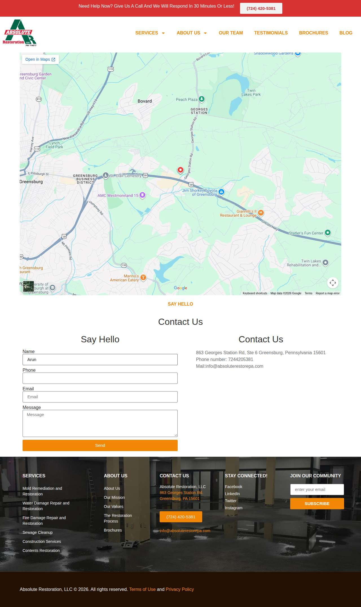

### masoudlawfirm.com — failed\_before\_submit (LIVE)

| | |
|---|---|
| Attempt ID | `3a0715c8-f4d7-47d7-9ce4-9e082603ab27` |
| Form URL | https://masoudlawfirm.com/contact/ |
| Final URL | — |
| Reserved | 2026-11-06 04:43:07 UTC |
| Submit attempted | — |
| Template | standard v2 |
| Confirmation text | none observed |
| Result / error | locator.fill: Error: Cannot type text into input\[type=number\] |

Exact message:

~~~text
Subject: Helping customers find your business in AI search (AEO + GEO)

Hi there,

I'm Arun from Devs Arun. More and more customers now ask ChatGPT, Gemini, Perplexity or Google's AI Overviews questions like "who should I hire for this in my area?" before they call anyone. These tools answer from websites they can clearly understand, and they tend to recommend businesses whose pages answer real customer questions.

That is what AEO + GEO (Answer Engine and Generative Engine Optimization) is for. I improve your existing service pages so they clearly answer the questions your customers ask, add structured data that matches the page, and make the call, quote or enquiry step obvious. The benefit: your business gets a better chance of being mentioned or linked in AI answers, and visitors who arrive find it easy to contact you.

The AEO + GEO Starter is a one-time $199 (about ₹16,999, negotiable) for one website: a basic audit, 10 customer questions, improvements to two existing pages, relevant structured data and an action plan, with one revision round.

You can read the full details, send an enquiry or book online here:
https://devsarun.io/aeo-geo/

If this isn't relevant, just reply and I won't contact you again.

Best,
Arun
Devs Arun
itschool408@gmail.com · +91 7654534323
~~~

Submitted field values:

- \#form-field-name: Arun
- \#form-field-field\_3374379: Hi there, I'm Arun from Devs Arun. More and more customers now ask ChatGPT, Gemini, Perplexity or Google's AI Overviews 
- \#form-field-field\_7731784: +91 7654534323
- \#form-field-field\_8bd0f16: itschool408@gmail.com

**Inspected page** — `run-c516d43f_attempt-3a0715c8_inspection_2026-11-06T04-43-11-411Z.jpg`

### whiteolivecpa.com — failed\_before\_submit (LIVE)

| | |
|---|---|
| Attempt ID | `be057f5d-67e5-48fb-a7d6-b6d36528ac47` |
| Form URL | https://whiteolivecpa.com/contact/ |
| Final URL | — |
| Reserved | 2026-11-06 04:43:16 UTC |
| Submit attempted | — |
| Template | standard v2 |
| Confirmation text | none observed |
| Result / error | locator.fill: Error: Cannot type text into input\[type=number\] |

Exact message:

~~~text
Subject: Helping customers find your business in AI search (AEO + GEO)

Hi there,

I'm Arun from Devs Arun. More and more customers now ask ChatGPT, Gemini, Perplexity or Google's AI Overviews questions like "who should I hire for this in my area?" before they call anyone. These tools answer from websites they can clearly understand, and they tend to recommend businesses whose pages answer real customer questions.

That is what AEO + GEO (Answer Engine and Generative Engine Optimization) is for. I improve your existing service pages so they clearly answer the questions your customers ask, add structured data that matches the page, and make the call, quote or enquiry step obvious. The benefit: your business gets a better chance of being mentioned or linked in AI answers, and visitors who arrive find it easy to contact you.

The AEO + GEO Starter is a one-time $199 (about ₹16,999, negotiable) for one website: a basic audit, 10 customer questions, improvements to two existing pages, relevant structured data and an action plan, with one revision round.

You can read the full details, send an enquiry or book online here:
https://devsarun.io/aeo-geo/

If this isn't relevant, just reply and I won't contact you again.

Best,
Arun
Devs Arun
itschool408@gmail.com · +91 7654534323
~~~

Submitted field values:

- \#ff\_1\_email: itschool408@gmail.com
- \#ff\_1\_message: Hi there, I'm Arun from Devs Arun. More and more customers now ask ChatGPT, Gemini, Perplexity or Google's AI Overviews 
- \#ff\_1\_numeric\_field: +91 7654534323
- \#ff\_1\_names\_first\_name\_: Arun

**Inspected page** — `run-c516d43f_attempt-be057f5d_inspection_2026-11-06T04-43-17-863Z.jpg`

### canterburyadvisor.com — failed\_before\_submit (LIVE)

| | |
|---|---|
| Attempt ID | `c34bd5bb-f7c1-489c-8cea-ea6545a87f48` |
| Form URL | https://canterburyadvisor.com/ |
| Final URL | — |
| Reserved | 2026-11-06 04:43:22 UTC |
| Submit attempted | — |
| Template | standard v2 |
| Confirmation text | none observed |
| Result / error | locator.fill: Error: Cannot type text into input\[type=number\] |

Exact message:

~~~text
Subject: Helping customers find your business in AI search (AEO + GEO)

Hi there,

I'm Arun from Devs Arun. More and more customers now ask ChatGPT, Gemini, Perplexity or Google's AI Overviews questions like "who should I hire for this in my area?" before they call anyone. These tools answer from websites they can clearly understand, and they tend to recommend businesses whose pages answer real customer questions.

That is what AEO + GEO (Answer Engine and Generative Engine Optimization) is for. I improve your existing service pages so they clearly answer the questions your customers ask, add structured data that matches the page, and make the call, quote or enquiry step obvious. The benefit: your business gets a better chance of being mentioned or linked in AI answers, and visitors who arrive find it easy to contact you.

The AEO + GEO Starter is a one-time $199 (about ₹16,999, negotiable) for one website: a basic audit, 10 customer questions, improvements to two existing pages, relevant structured data and an action plan, with one revision round.

You can read the full details, send an enquiry or book online here:
https://devsarun.io/aeo-geo/

If this isn't relevant, just reply and I won't contact you again.

Best,
Arun
Devs Arun
itschool408@gmail.com · +91 7654534323
~~~

Submitted field values:

- \#form-field-name: Arun
- \#form-field-email: itschool408@gmail.com
- \#form-field-message: Hi there, I'm Arun from Devs Arun. More and more customers now ask ChatGPT, Gemini, Perplexity or Google's AI Overviews 
- \#form-field-field\_97f81fb: +91 7654534323

**Inspected page** — `run-c516d43f_attempt-c34bd5bb_inspection_2026-11-06T04-43-24-769Z.jpg`

### connectionzpcrepair.com — failed\_before\_submit (LIVE)

| | |
|---|---|
| Attempt ID | `72994fca-cba2-4473-99d0-9f38b77a2767` |
| Form URL | https://connectionzpcrepair.com/contact/ |
| Final URL | — |
| Reserved | 2026-11-06 04:43:29 UTC |
| Submit attempted | — |
| Template | standard v2 |
| Confirmation text | none observed |
| Result / error | locator.fill: Error: Cannot type text into input\[type=number\] |

Exact message:

~~~text
Subject: Helping customers find your business in AI search (AEO + GEO)

Hi there,

I'm Arun from Devs Arun. More and more customers now ask ChatGPT, Gemini, Perplexity or Google's AI Overviews questions like "who should I hire for this in my area?" before they call anyone. These tools answer from websites they can clearly understand, and they tend to recommend businesses whose pages answer real customer questions.

That is what AEO + GEO (Answer Engine and Generative Engine Optimization) is for. I improve your existing service pages so they clearly answer the questions your customers ask, add structured data that matches the page, and make the call, quote or enquiry step obvious. The benefit: your business gets a better chance of being mentioned or linked in AI answers, and visitors who arrive find it easy to contact you.

The AEO + GEO Starter is a one-time $199 (about ₹16,999, negotiable) for one website: a basic audit, 10 customer questions, improvements to two existing pages, relevant structured data and an action plan, with one revision round.

You can read the full details, send an enquiry or book online here:
https://devsarun.io/aeo-geo/

If this isn't relevant, just reply and I won't contact you again.

Best,
Arun
Devs Arun
itschool408@gmail.com · +91 7654534323
~~~

Submitted field values:

- \#form-field-name: Arun
- \#form-field-email: itschool408@gmail.com
- \#form-field-message: Hi there, I'm Arun from Devs Arun. More and more customers now ask ChatGPT, Gemini, Perplexity or Google's AI Overviews 
- \#form-field-field\_99a8620: +91 7654534323

**Inspected page** — `run-c516d43f_attempt-72994fca_inspection_2026-11-06T04-43-31-793Z.jpg`

### ackavionics.com — failed\_before\_submit (LIVE)

| | |
|---|---|
| Attempt ID | `7ad38055-273c-4c06-8d28-edb830ec2100` |
| Form URL | https://www.ackavionics.com/contact-us-2/ |
| Final URL | — |
| Reserved | 2026-11-06 04:43:36 UTC |
| Submit attempted | — |
| Template | standard v2 |
| Confirmation text | none observed |
| Result / error | locator.fill: Error: Cannot type text into input\[type=number\] |

Exact message:

~~~text
Subject: Helping customers find your business in AI search (AEO + GEO)

Hi there,

I'm Arun from Devs Arun. More and more customers now ask ChatGPT, Gemini, Perplexity or Google's AI Overviews questions like "who should I hire for this in my area?" before they call anyone. These tools answer from websites they can clearly understand, and they tend to recommend businesses whose pages answer real customer questions.

That is what AEO + GEO (Answer Engine and Generative Engine Optimization) is for. I improve your existing service pages so they clearly answer the questions your customers ask, add structured data that matches the page, and make the call, quote or enquiry step obvious. The benefit: your business gets a better chance of being mentioned or linked in AI answers, and visitors who arrive find it easy to contact you.

The AEO + GEO Starter is a one-time $199 (about ₹16,999, negotiable) for one website: a basic audit, 10 customer questions, improvements to two existing pages, relevant structured data and an action plan, with one revision round.

You can read the full details, send an enquiry or book online here:
https://devsarun.io/aeo-geo/

If this isn't relevant, just reply and I won't contact you again.

Best,
Arun
Devs Arun
itschool408@gmail.com · +91 7654534323
~~~

Submitted field values:

- input\[name="text-30"\]: Arun
- input\[name="email-380"\]: itschool408@gmail.com
- input\[name="number-19"\]: +91 7654534323
- textarea\[name="textarea"\]: Hi there, I'm Arun from Devs Arun. More and more customers now ask ChatGPT, Gemini, Perplexity or Google's AI Overviews 

**Inspected page** — `run-c516d43f_attempt-7ad38055_inspection_2026-11-06T04-43-41-856Z.jpg`

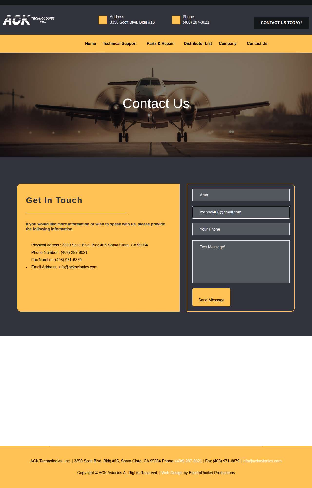

### marketingdirection.com — confirmed (LIVE)

| | |
|---|---|
| Attempt ID | `0e6f8ac3-5e92-4904-aaca-b214ef3c74cf` |
| Form URL | https://www.marketingdirection.com/contact-us/ |
| Final URL | https://www.marketingdirection.com/thank-you/ |
| Reserved | 2026-11-06 04:43:46 UTC |
| Submit attempted | 2026-11-06 04:43:49 UTC |
| Template | standard v2 |
| Confirmation text | MARKETING SERVICES RESOURCES ABOUT US CONTACT US Contact Us Thank You Thank you for reaching out\! We’ve received your request and are excited to learn more about your ne |
| Result / error | — |

Exact message:

~~~text
Subject: Helping customers find your business in AI search (AEO + GEO)

Hi there,

I'm Arun from Devs Arun. More and more customers now ask ChatGPT, Gemini, Perplexity or Google's AI Overviews questions like "who should I hire for this in my area?" before they call anyone. These tools answer from websites they can clearly understand, and they tend to recommend businesses whose pages answer real customer questions.

That is what AEO + GEO (Answer Engine and Generative Engine Optimization) is for. I improve your existing service pages so they clearly answer the questions your customers ask, add structured data that matches the page, and make the call, quote or enquiry step obvious. The benefit: your business gets a better chance of being mentioned or linked in AI answers, and visitors who arrive find it easy to contact you.

The AEO + GEO Starter is a one-time $199 (about ₹16,999, negotiable) for one website: a basic audit, 10 customer questions, improvements to two existing pages, relevant structured data and an action plan, with one revision round.

You can read the full details, send an enquiry or book online here:
https://devsarun.io/aeo-geo/

If this isn't relevant, just reply and I won't contact you again.

Best,
Arun
Devs Arun
itschool408@gmail.com · +91 7654534323
~~~

Submitted field values:

- Email \[email\]: itschool408@gmail.com
- Full Name \[name\]: Arun
- Company \[company\]: Devs Arun
- Message \[message\]: Hi there, I'm Arun from Devs Arun. More and more customers now ask ChatGPT, Gemini, Perplexity or Google's AI Overviews 

**Filled form (before submit)** — `run-c516d43f_attempt-0e6f8ac3_filled_2026-11-06T04-43-49-358Z.jpg`

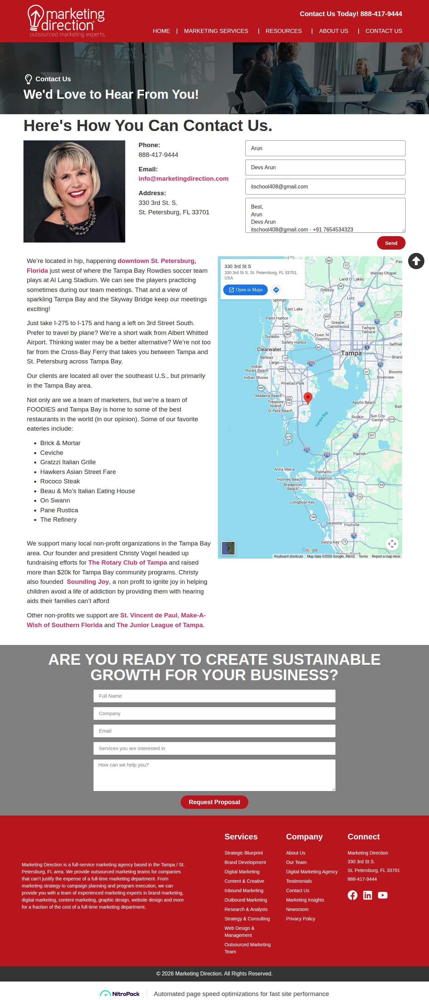

**After submit** — `run-c516d43f_attempt-0e6f8ac3_post_attempt_2026-11-06T04-43-56-641Z.jpg`

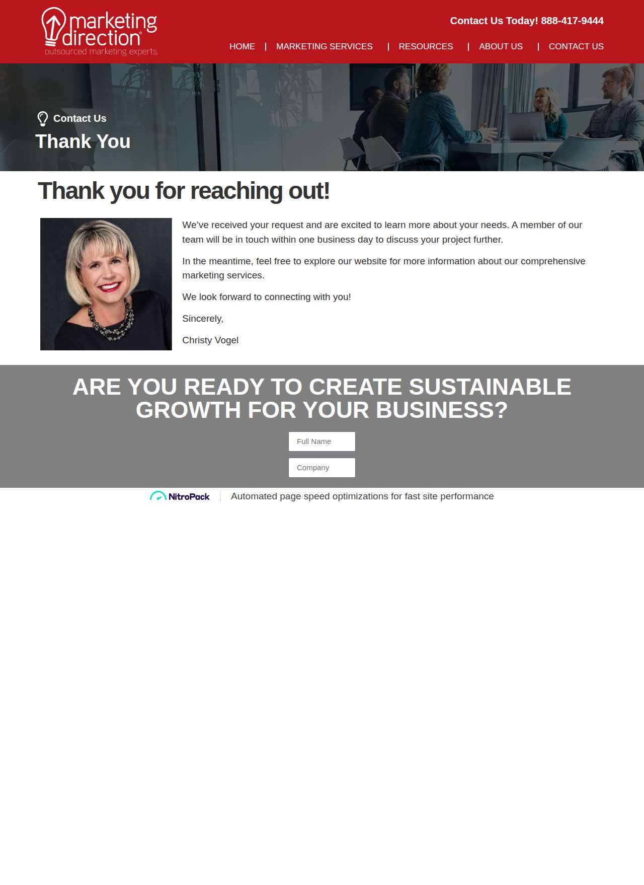

### designups.com — confirmed (LIVE)

| | |
|---|---|
| Attempt ID | `bc1354a0-2d78-46c1-9f4e-fb7f55e63be3` |
| Form URL | https://designups.com/contact/ |
| Final URL | https://designups.com/contact/ |
| Reserved | 2026-11-06 04:44:05 UTC |
| Submit attempted | 2026-11-06 04:44:06 UTC |
| Template | standard v2 |
| Confirmation text | e, TN, with clients and collaborators worldwide. Let's Talk Thanks for contacting us\! We will get in touch with you shortly. Contact Information Project Inquiries hi@designups.com J |
| Result / error | — |

Exact message:

~~~text
Subject: Helping customers find your business in AI search (AEO + GEO)

Hi there,

I'm Arun from Devs Arun. More and more customers now ask ChatGPT, Gemini, Perplexity or Google's AI Overviews questions like "who should I hire for this in my area?" before they call anyone. These tools answer from websites they can clearly understand, and they tend to recommend businesses whose pages answer real customer questions.

That is what AEO + GEO (Answer Engine and Generative Engine Optimization) is for. I improve your existing service pages so they clearly answer the questions your customers ask, add structured data that matches the page, and make the call, quote or enquiry step obvious. The benefit: your business gets a better chance of being mentioned or linked in AI answers, and visitors who arrive find it easy to contact you.

The AEO + GEO Starter is a one-time $199 (about ₹16,999, negotiable) for one website: a basic audit, 10 customer questions, improvements to two existing pages, relevant structured data and an action plan, with one revision round.

You can read the full details, send an enquiry or book online here:
https://devsarun.io/aeo-geo/

If this isn't relevant, just reply and I won't contact you again.

Best,
Arun
Devs Arun
itschool408@gmail.com · +91 7654534323
~~~

Submitted field values:

- Name \[name\]: Arun
- Email \[email\]: itschool408@gmail.com
- Tell us about your company and what you are looking for. \[message\]: Hi there, I'm Arun from Devs Arun. More and more customers now ask ChatGPT, Gemini, Perplexity or Google's AI Overviews 

**Filled form (before submit)** — `run-c516d43f_attempt-bc1354a0_filled_2026-11-06T04-44-06-778Z.jpg`

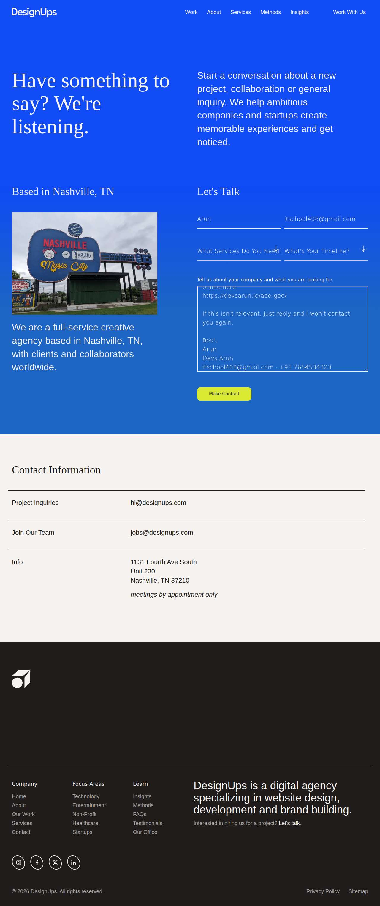

**After submit** — `run-c516d43f_attempt-bc1354a0_post_attempt_2026-11-06T04-44-12-748Z.jpg`

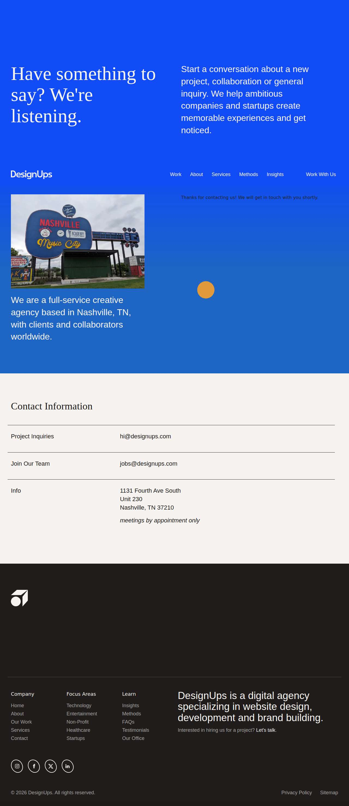

### livgroup.media — unclear (LIVE)

| | |
|---|---|
| Attempt ID | `2a517e0e-f28b-49a7-b4af-1b70da354142` |
| Form URL | https://www.newparadigmms.com/contact-us |
| Final URL | https://www.newparadigmms.com/contact-us |
| Reserved | 2026-11-06 04:44:21 UTC |
| Submit attempted | 2026-11-06 04:44:23 UTC |
| Template | standard v2 |
| Confirmation text | none observed |
| Result / error | No new success marker observed |

Exact message:

~~~text
Subject: Helping customers find your business in AI search (AEO + GEO)

Hi there,

I'm Arun from Devs Arun. More and more customers now ask ChatGPT, Gemini, Perplexity or Google's AI Overviews questions like "who should I hire for this in my area?" before they call anyone. These tools answer from websites they can clearly understand, and they tend to recommend businesses whose pages answer real customer questions.

That is what AEO + GEO (Answer Engine and Generative Engine Optimization) is for. I improve your existing service pages so they clearly answer the questions your customers ask, add structured data that matches the page, and make the call, quote or enquiry step obvious. The benefit: your business gets a better chance of being mentioned or linked in AI answers, and visitors who arrive find it easy to contact you.

The AEO + GEO Starter is a one-time $199 (about ₹16,999, negotiable) for one website: a basic audit, 10 customer questions, improvements to two existing pages, relevant structured data and an action plan, with one revision round.

You can read the full details, send an enquiry or book online here:
https://devsarun.io/aeo-geo/

If this isn't relevant, just reply and I won't contact you again.

Best,
Arun
Devs Arun
itschool408@gmail.com · +91 7654534323
~~~

Submitted field values:

- email \[email\]: itschool408@gmail.com
- phone \[phone\]: +91 7654534323
- first-name \[first\_name\]: Arun
- Type your message here... \[message\]: Hi there, I'm Arun from Devs Arun. More and more customers now ask ChatGPT, Gemini, Perplexity or Google's AI Overviews 

**Filled form (before submit)** — `run-c516d43f_attempt-2a517e0e_filled_2026-11-06T04-44-23-924Z.jpg`

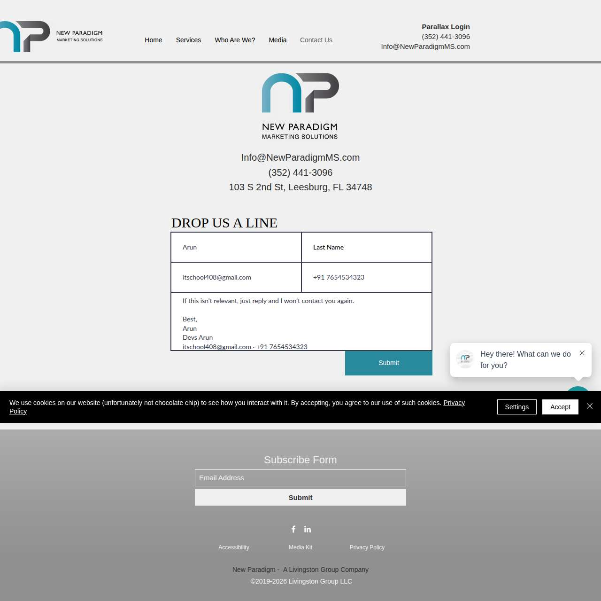

**After submit** — `run-c516d43f_attempt-2a517e0e_post_attempt_2026-11-06T04-44-52-858Z.jpg`

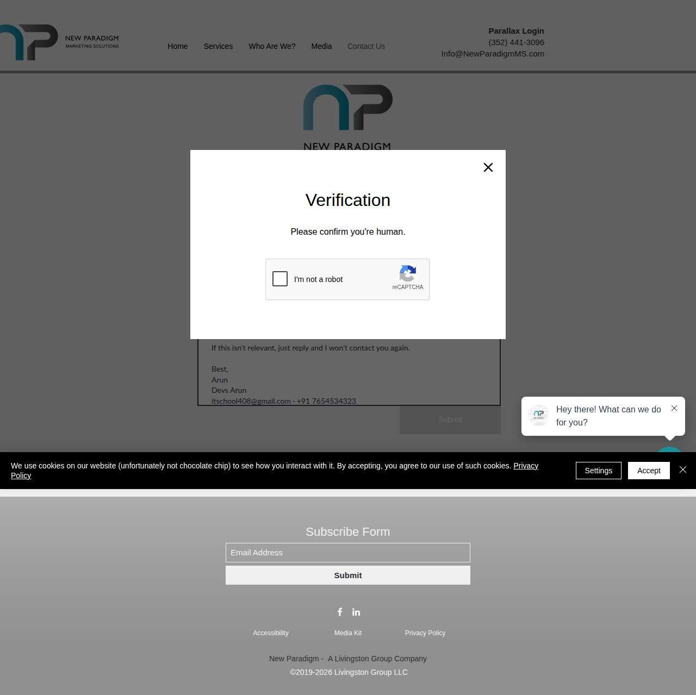

### d7m.tg — error\_after\_submit (LIVE)

| | |
|---|---|
| Attempt ID | `2f5757a3-9ef7-4d55-a17a-4e7b6c6dee47` |
| Form URL | https://d7m.tg/contact |
| Final URL | https://d7m.tg/contact |
| Reserved | 2026-11-06 04:45:01 UTC |
| Submit attempted | 2026-11-06 04:45:04 UTC |
| Template | standard v2 |
| Confirmation text | ontent Work Archive Writing Contact Message not sent Please try again. Email hello@d7mtg.com Call 845-671-2116 Try the form again Or reach out directly D7mtg is a UX and |
| Result / error | — |

Exact message:

~~~text
Subject: Helping customers find your business in AI search (AEO + GEO)

Hi there,

I'm Arun from Devs Arun. More and more customers now ask ChatGPT, Gemini, Perplexity or Google's AI Overviews questions like "who should I hire for this in my area?" before they call anyone. These tools answer from websites they can clearly understand, and they tend to recommend businesses whose pages answer real customer questions.

That is what AEO + GEO (Answer Engine and Generative Engine Optimization) is for. I improve your existing service pages so they clearly answer the questions your customers ask, add structured data that matches the page, and make the call, quote or enquiry step obvious. The benefit: your business gets a better chance of being mentioned or linked in AI answers, and visitors who arrive find it easy to contact you.

The AEO + GEO Starter is a one-time $199 (about ₹16,999, negotiable) for one website: a basic audit, 10 customer questions, improvements to two existing pages, relevant structured data and an action plan, with one revision round.

You can read the full details, send an enquiry or book online here:
https://devsarun.io/aeo-geo/

If this isn't relevant, just reply and I won't contact you again.

Best,
Arun
Devs Arun
itschool408@gmail.com · +91 7654534323
~~~

Submitted field values:

- Your name \* \[name\]: Arun
- Email address \* \[email\]: itschool408@gmail.com
- Can you tell us a little bit more? \[message\]: Hi there, I'm Arun from Devs Arun. More and more customers now ask ChatGPT, Gemini, Perplexity or Google's AI Overviews 

**Filled form (before submit)** — `run-c516d43f_attempt-2f5757a3_filled_2026-11-06T04-45-04-476Z.jpg`

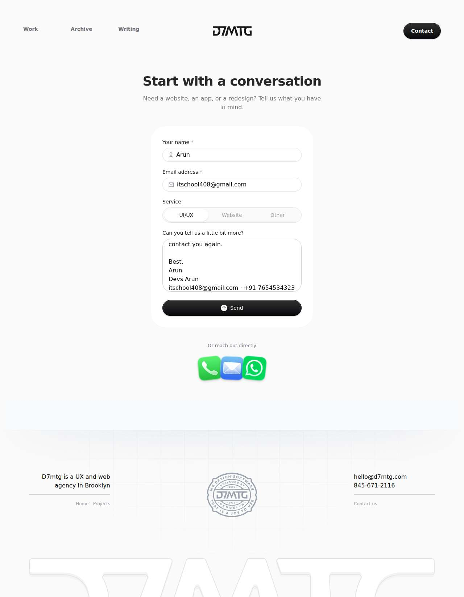

**After submit** — `run-c516d43f_attempt-2f5757a3_post_attempt_2026-11-06T04-45-11-202Z.jpg`

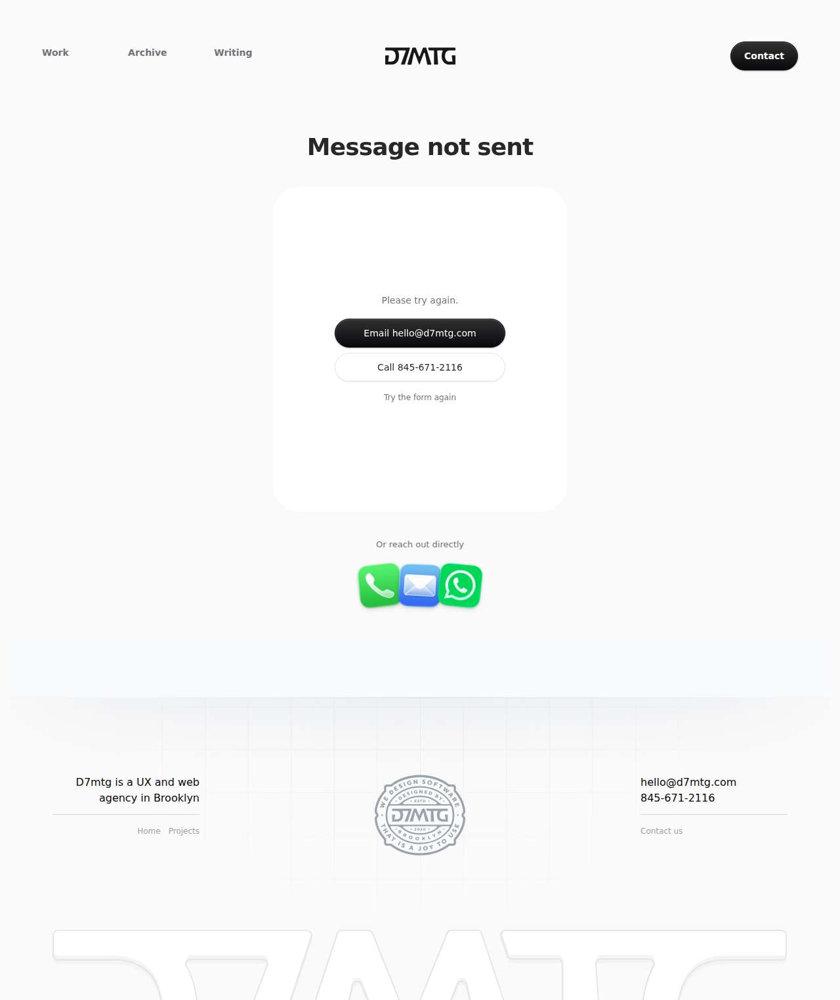

### smpny.com — failed\_before\_submit (LIVE)

| | |
|---|---|
| Attempt ID | `f6aa5c58-a358-4316-99f6-c7b33c631218` |
| Form URL | https://smpny.com/pages/contact |
| Final URL | https://smpny.com/pages/contact |
| Reserved | 2026-11-06 04:45:19 UTC |
| Submit attempted | — |
| Template | standard v2 |
| Confirmation text | none observed |
| Result / error | Form validation would block sending: contact\[Phone number\]: Please match the requested format. |

Exact message:

~~~text
Subject: Helping customers find your business in AI search (AEO + GEO)

Hi there,

I'm Arun from Devs Arun. More and more customers now ask ChatGPT, Gemini, Perplexity or Google's AI Overviews questions like "who should I hire for this in my area?" before they call anyone. These tools answer from websites they can clearly understand, and they tend to recommend businesses whose pages answer real customer questions.

That is what AEO + GEO (Answer Engine and Generative Engine Optimization) is for. I improve your existing service pages so they clearly answer the questions your customers ask, add structured data that matches the page, and make the call, quote or enquiry step obvious. The benefit: your business gets a better chance of being mentioned or linked in AI answers, and visitors who arrive find it easy to contact you.

The AEO + GEO Starter is a one-time $199 (about ₹16,999, negotiable) for one website: a basic audit, 10 customer questions, improvements to two existing pages, relevant structured data and an action plan, with one revision round.

You can read the full details, send an enquiry or book online here:
https://devsarun.io/aeo-geo/

If this isn't relevant, just reply and I won't contact you again.

Best,
Arun
Devs Arun
itschool408@gmail.com · +91 7654534323
~~~

Submitted field values:

- \#ContactForm-body: Hi there, I'm Arun from Devs Arun. More and more customers now ask ChatGPT, Gemini, Perplexity or Google's AI Overviews 
- \#ContactForm-name: Arun
- \#ContactForm-email: itschool408@gmail.com
- \#ContactForm-phone: +91 7654534323

**Filled form (before submit)** — `run-c516d43f_attempt-f6aa5c58_filled_2026-11-06T04-45-24-259Z.jpg`

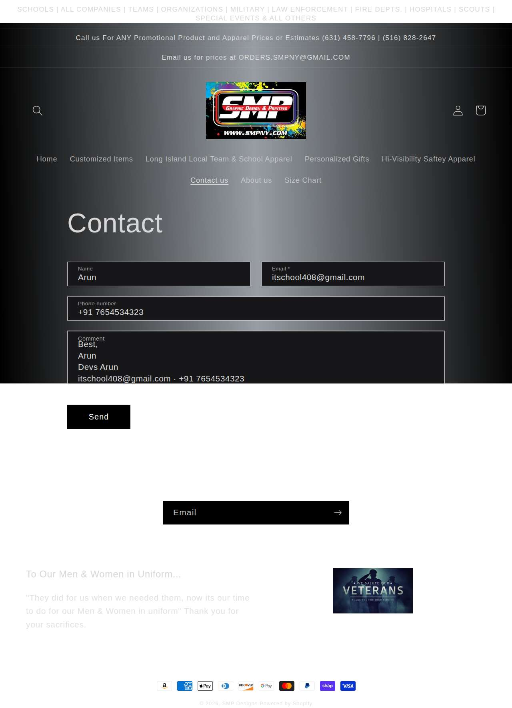

### lookmedia.com — confirmed (LIVE)

| | |
|---|---|
| Attempt ID | `af124e43-dcfc-4cf8-ba6c-35811ddf203f` |
| Form URL | https://www.lookmedia.com/inquiry/ |
| Final URL | https://www.lookmedia.com/inquiry/ |
| Reserved | 2026-11-06 04:45:29 UTC |
| Submit attempted | 2026-11-06 04:45:30 UTC |
| Template | standard v2 |
| Confirmation text | d the message. You can always contact us at (800) 363-5665. Thank you\! SPAM Content Detected\! Please revise your message using only western characters and resend. You ca |
| Result / error | — |

Exact message:

~~~text
Subject: Helping customers find your business in AI search (AEO + GEO)

Hi there,

I'm Arun from Devs Arun. More and more customers now ask ChatGPT, Gemini, Perplexity or Google's AI Overviews questions like "who should I hire for this in my area?" before they call anyone. These tools answer from websites they can clearly understand, and they tend to recommend businesses whose pages answer real customer questions.

That is what AEO + GEO (Answer Engine and Generative Engine Optimization) is for. I improve your existing service pages so they clearly answer the questions your customers ask, add structured data that matches the page, and make the call, quote or enquiry step obvious. The benefit: your business gets a better chance of being mentioned or linked in AI answers, and visitors who arrive find it easy to contact you.

The AEO + GEO Starter is a one-time $199 (about ₹16,999, negotiable) for one website: a basic audit, 10 customer questions, improvements to two existing pages, relevant structured data and an action plan, with one revision round.

You can read the full details, send an enquiry or book online here:
https://devsarun.io/aeo-geo/

If this isn't relevant, just reply and I won't contact you again.

Best,
Arun
Devs Arun
itschool408@gmail.com · +91 7654534323
~~~

Submitted field values:

- Name \[name\]: Arun
- Email \[email\]: itschool408@gmail.com
- Your Message \[message\]: Hi there, I'm Arun from Devs Arun. More and more customers now ask ChatGPT, Gemini, Perplexity or Google's AI Overviews 

**Filled form (before submit)** — `run-c516d43f_attempt-af124e43_filled_2026-11-06T04-45-30-732Z.jpg`

**After submit** — `run-c516d43f_attempt-af124e43_post_attempt_2026-11-06T04-45-35-614Z.jpg`

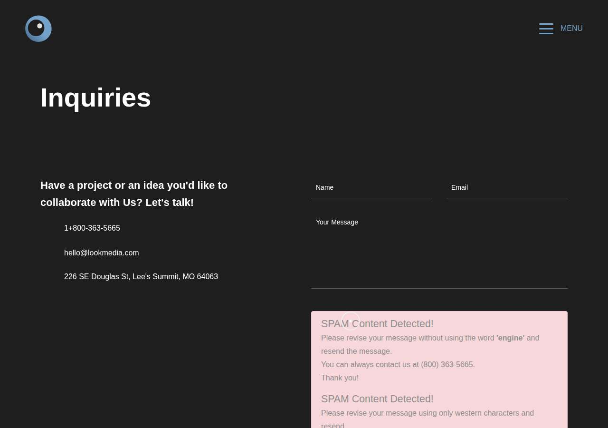

### romanelli.com — confirmed (LIVE)

| | |
|---|---|
| Attempt ID | `195096c2-5d5c-4f96-ab0a-ae2819de8981` |
| Form URL | https://www.romanelli.com/ |
| Final URL | https://www.romanelli.com/ |
| Reserved | 2026-11-06 04:45:44 UTC |
| Submit attempted | 2026-11-06 04:45:45 UTC |
| Template | standard v2 |
| Confirmation text | munications PO Box 227, 2 College Street, Clinton, NY 13323 Thanks for contacting us\! We will get in touch with you shortly. Notifications Thanks for contacting us\! We will get in t |
| Result / error | — |

Exact message:

~~~text
Subject: Helping customers find your business in AI search (AEO + GEO)

Hi there,

I'm Arun from Devs Arun. More and more customers now ask ChatGPT, Gemini, Perplexity or Google's AI Overviews questions like "who should I hire for this in my area?" before they call anyone. These tools answer from websites they can clearly understand, and they tend to recommend businesses whose pages answer real customer questions.

That is what AEO + GEO (Answer Engine and Generative Engine Optimization) is for. I improve your existing service pages so they clearly answer the questions your customers ask, add structured data that matches the page, and make the call, quote or enquiry step obvious. The benefit: your business gets a better chance of being mentioned or linked in AI answers, and visitors who arrive find it easy to contact you.

The AEO + GEO Starter is a one-time $199 (about ₹16,999, negotiable) for one website: a basic audit, 10 customer questions, improvements to two existing pages, relevant structured data and an action plan, with one revision round.

You can read the full details, send an enquiry or book online here:
https://devsarun.io/aeo-geo/

If this isn't relevant, just reply and I won't contact you again.

Best,
Arun
Devs Arun
itschool408@gmail.com · +91 7654534323
~~~

Submitted field values:

- name\* \[name\]: Arun
- email:\* \[email\]: itschool408@gmail.com
- comments: \[message\]: Hi there, I'm Arun from Devs Arun. More and more customers now ask ChatGPT, Gemini, Perplexity or Google's AI Overviews 

**Filled form (before submit)** — `run-c516d43f_attempt-195096c2_filled_2026-11-06T04-45-45-873Z.jpg`

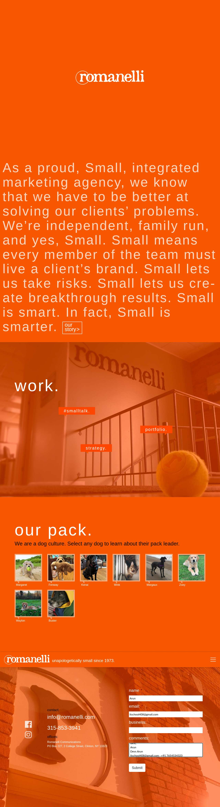

**After submit** — `run-c516d43f_attempt-195096c2_post_attempt_2026-11-06T04-45-54-229Z.jpg`

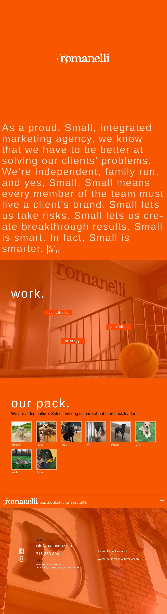

### indigodesignllc.com — unclear (LIVE)

| | |
|---|---|
| Attempt ID | `1d5ce6c7-e093-47d3-b1ae-19d1d7c18662` |
| Form URL | https://www.indigodesignllc.com/contact |
| Final URL | https://www.indigodesignllc.com/contact |
| Reserved | 2026-11-06 04:46:02 UTC |
| Submit attempted | 2026-11-06 04:46:05 UTC |
| Template | standard v2 |
| Confirmation text | none observed |
| Result / error | No new success marker observed |

Exact message:

~~~text
Subject: Helping customers find your business in AI search (AEO + GEO)

Hi there,

I'm Arun from Devs Arun. More and more customers now ask ChatGPT, Gemini, Perplexity or Google's AI Overviews questions like "who should I hire for this in my area?" before they call anyone. These tools answer from websites they can clearly understand, and they tend to recommend businesses whose pages answer real customer questions.

That is what AEO + GEO (Answer Engine and Generative Engine Optimization) is for. I improve your existing service pages so they clearly answer the questions your customers ask, add structured data that matches the page, and make the call, quote or enquiry step obvious. The benefit: your business gets a better chance of being mentioned or linked in AI answers, and visitors who arrive find it easy to contact you.

The AEO + GEO Starter is a one-time $199 (about ₹16,999, negotiable) for one website: a basic audit, 10 customer questions, improvements to two existing pages, relevant structured data and an action plan, with one revision round.

You can read the full details, send an enquiry or book online here:
https://devsarun.io/aeo-geo/

If this isn't relevant, just reply and I won't contact you again.

Best,
Arun
Devs Arun
itschool408@gmail.com · +91 7654534323
~~~

Submitted field values:

- email \[email\]: itschool408@gmail.com
- phone \[phone\]: +91 7654534323
- company \[company\]: Devs Arun
- first-name \[first\_name\]: Arun
- Type your message here \[message\]: Hi there, I'm Arun from Devs Arun. More and more customers now ask ChatGPT, Gemini, Perplexity or Google's AI Overviews 

**Filled form (before submit)** — `run-c516d43f_attempt-1d5ce6c7_filled_2026-11-06T04-46-05-573Z.jpg`

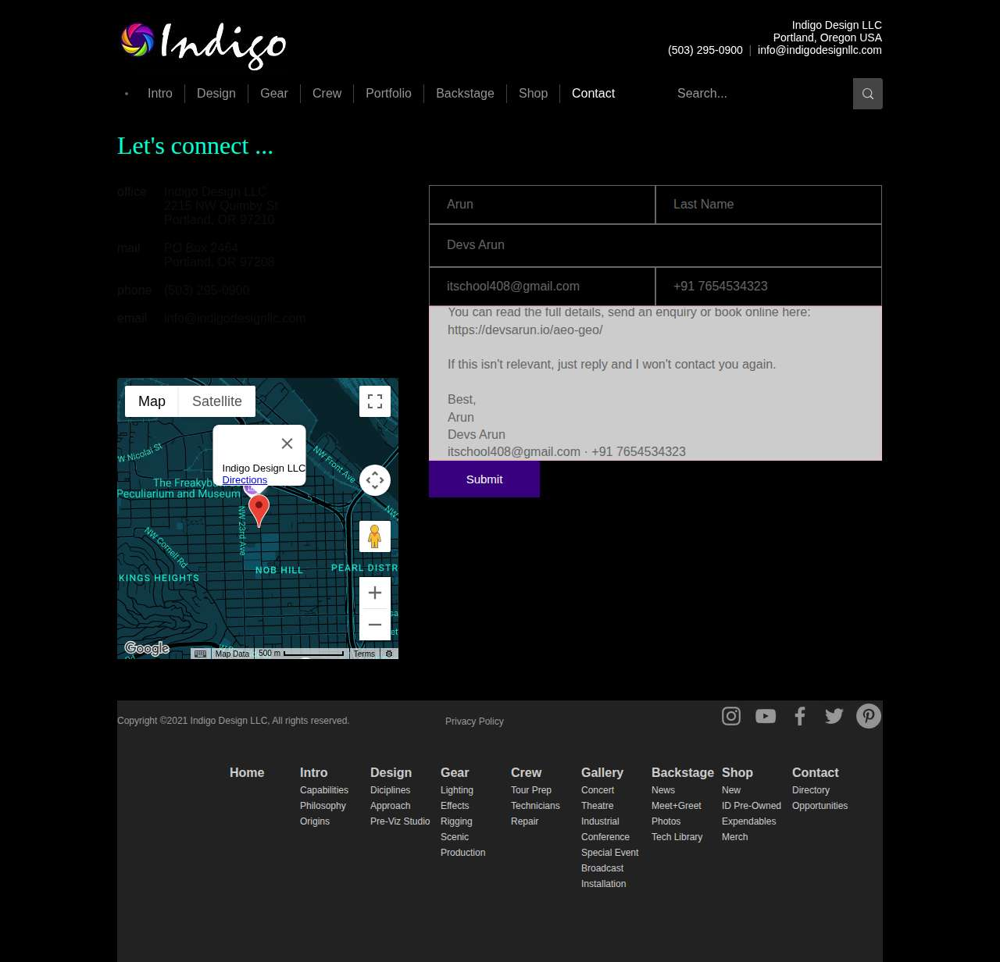

**After submit** — `run-c516d43f_attempt-1d5ce6c7_post_attempt_2026-11-06T04-46-34-356Z.jpg`

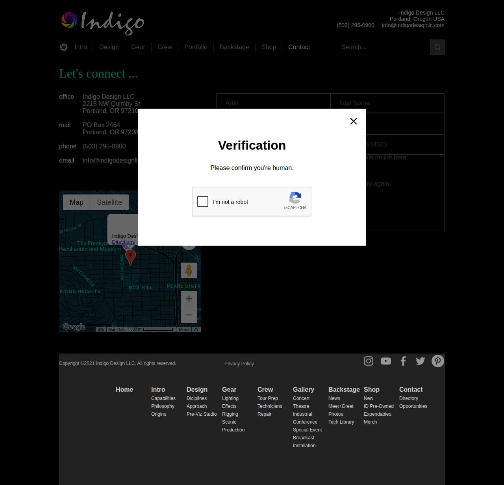

### northwesternmarketingconcepts.com — confirmed (LIVE)

| | |
|---|---|
| Attempt ID | `5ec53983-465a-454b-9077-841053238cab` |
| Form URL | https://northwesternmarketingconcepts.com/contact/ |
| Final URL | https://northwesternmarketingconcepts.com/contact/ |
| Reserved | 2026-11-06 04:46:43 UTC |
| Submit attempted | 2026-11-06 04:46:46 UTC |
| Template | standard v2 |
| Confirmation text | il: hr@northwesternmarketingconcepts.com Address: Boise, ID Thank you for your message. It has been sent. Your Name (required) Your Email (required) Phone Number Your Message Thank you f |
| Result / error | — |

Exact message:

~~~text
Subject: Helping customers find your business in AI search (AEO + GEO)

Hi there,

I'm Arun from Devs Arun. More and more customers now ask ChatGPT, Gemini, Perplexity or Google's AI Overviews questions like "who should I hire for this in my area?" before they call anyone. These tools answer from websites they can clearly understand, and they tend to recommend businesses whose pages answer real customer questions.

That is what AEO + GEO (Answer Engine and Generative Engine Optimization) is for. I improve your existing service pages so they clearly answer the questions your customers ask, add structured data that matches the page, and make the call, quote or enquiry step obvious. The benefit: your business gets a better chance of being mentioned or linked in AI answers, and visitors who arrive find it easy to contact you.

The AEO + GEO Starter is a one-time $199 (about ₹16,999, negotiable) for one website: a basic audit, 10 customer questions, improvements to two existing pages, relevant structured data and an action plan, with one revision round.

You can read the full details, send an enquiry or book online here:
https://devsarun.io/aeo-geo/

If this isn't relevant, just reply and I won't contact you again.

Best,
Arun
Devs Arun
itschool408@gmail.com · +91 7654534323
~~~

Submitted field values:

- Phone Number \[phone\]: +91 7654534323
- Your Message \[message\]: Hi there, I'm Arun from Devs Arun. More and more customers now ask ChatGPT, Gemini, Perplexity or Google's AI Overviews 
- Your Name (required) \[name\]: Arun
- Your Email (required) \[email\]: itschool408@gmail.com

**Filled form (before submit)** — `run-c516d43f_attempt-5ec53983_filled_2026-11-06T04-46-46-414Z.jpg`

**After submit** — `run-c516d43f_attempt-5ec53983_post_attempt_2026-11-06T04-46-51-418Z.jpg`

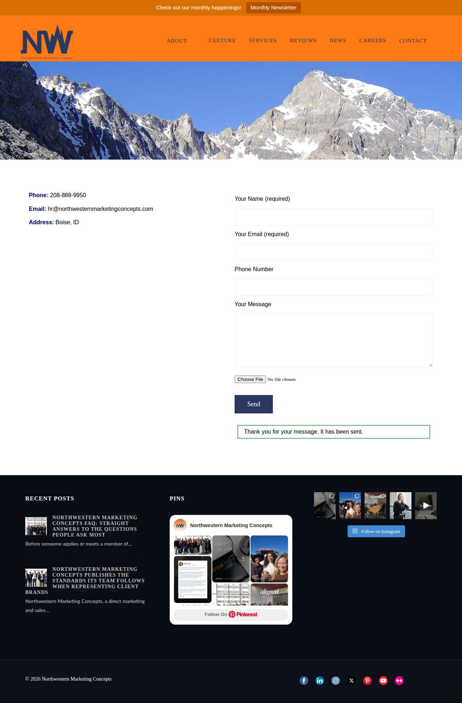

### stambaughdesigns.co — error\_after\_submit (LIVE)

| | |
|---|---|
| Attempt ID | `c62a0cd5-3732-40f8-b178-e42e1df6660f` |
| Form URL | https://www.stambaughdesigns.co/contact/ |
| Final URL | https://www.stambaughdesigns.co/contact/ |
| Reserved | 2026-11-06 04:47:00 UTC |
| Submit attempted | 2026-11-06 04:47:02 UTC |
| Template | standard v2 |
| Confirmation text | Hours Mon-Fri: 9am - 5pm Schedule Call Name \* Email \* Phone Please enter a valid phone number Company Service of Interest Select a service (optional) Drupal Development Web |
| Result / error | — |

Exact message:

~~~text
Subject: Helping customers find your business in AI search (AEO + GEO)

Hi there,

I'm Arun from Devs Arun. More and more customers now ask ChatGPT, Gemini, Perplexity or Google's AI Overviews questions like "who should I hire for this in my area?" before they call anyone. These tools answer from websites they can clearly understand, and they tend to recommend businesses whose pages answer real customer questions.

That is what AEO + GEO (Answer Engine and Generative Engine Optimization) is for. I improve your existing service pages so they clearly answer the questions your customers ask, add structured data that matches the page, and make the call, quote or enquiry step obvious. The benefit: your business gets a better chance of being mentioned or linked in AI answers, and visitors who arrive find it easy to contact you.

The AEO + GEO Starter is a one-time $199 (about ₹16,999, negotiable) for one website: a basic audit, 10 customer questions, improvements to two existing pages, relevant structured data and an action plan, with one revision round.

You can read the full details, send an enquiry or book online here:
https://devsarun.io/aeo-geo/

If this isn't relevant, just reply and I won't contact you again.

Best,
Arun
Devs Arun
itschool408@gmail.com · +91 7654534323
~~~

Submitted field values:

- Name \* \[name\]: Arun
- Phone \[phone\]: +91 7654534323
- Email \* \[email\]: itschool408@gmail.com
- Company \[company\]: Devs Arun
- Message \* \[message\]: Hi there, I'm Arun from Devs Arun. More and more customers now ask ChatGPT, Gemini, Perplexity or Google's AI Overviews 

**Filled form (before submit)** — `run-c516d43f_attempt-c62a0cd5_filled_2026-11-06T04-47-01-990Z.jpg`

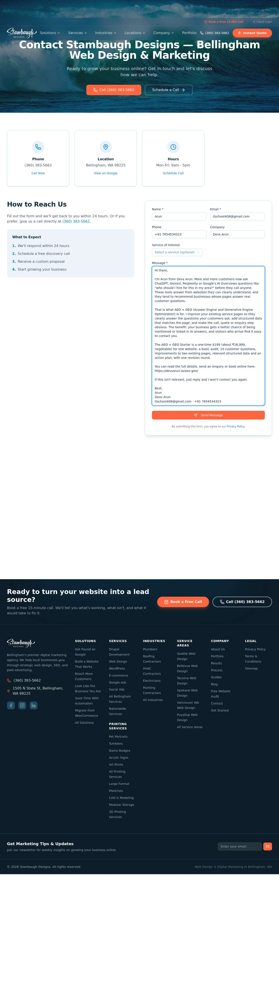

**After submit** — `run-c516d43f_attempt-c62a0cd5_post_attempt_2026-11-06T04-47-06-111Z.jpg`

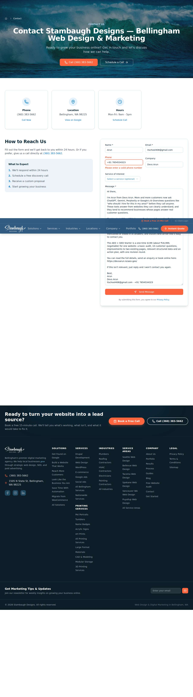

### 1330wraps.com — confirmed (LIVE)

| | |
|---|---|
| Attempt ID | `c8a50395-0b12-44a5-b2ba-eeca5b01fb63` |
| Form URL | https://1330.co/contact/ |
| Final URL | https://1330.co/contact/ |
| Reserved | 2026-11-06 04:47:14 UTC |
| Submit attempted | 2026-11-06 04:47:17 UTC |
| Template | standard v2 |
| Confirmation text | ebook Instagram CONTACT FORM Send Message Alternative: Your message has been sent. Keyboard shortcuts Map data ©2026 Google 1 km Terms PUTTING BRANDS IN THEIR PLACE. PUTTING BRANDS |
| Result / error | — |

Exact message:

~~~text
Subject: Helping customers find your business in AI search (AEO + GEO)

Hi there,

I'm Arun from Devs Arun. More and more customers now ask ChatGPT, Gemini, Perplexity or Google's AI Overviews questions like "who should I hire for this in my area?" before they call anyone. These tools answer from websites they can clearly understand, and they tend to recommend businesses whose pages answer real customer questions.

That is what AEO + GEO (Answer Engine and Generative Engine Optimization) is for. I improve your existing service pages so they clearly answer the questions your customers ask, add structured data that matches the page, and make the call, quote or enquiry step obvious. The benefit: your business gets a better chance of being mentioned or linked in AI answers, and visitors who arrive find it easy to contact you.

The AEO + GEO Starter is a one-time $199 (about ₹16,999, negotiable) for one website: a basic audit, 10 customer questions, improvements to two existing pages, relevant structured data and an action plan, with one revision round.

You can read the full details, send an enquiry or book online here:
https://devsarun.io/aeo-geo/

If this isn't relevant, just reply and I won't contact you again.

Best,
Arun
Devs Arun
itschool408@gmail.com · +91 7654534323
~~~

Submitted field values:

- form\_fields\[name\] \[name\]: Arun
- form\_fields\[email\] \[email\]: itschool408@gmail.com
- form\_fields\[message\] \[message\]: Hi there, I'm Arun from Devs Arun. More and more customers now ask ChatGPT, Gemini, Perplexity or Google's AI Overviews 
- form\_fields\[field\_fa52438\] \[phone\]: +91 7654534323

**Filled form (before submit)** — `run-c516d43f_attempt-c8a50395_filled_2026-11-06T04-47-17-053Z.jpg`

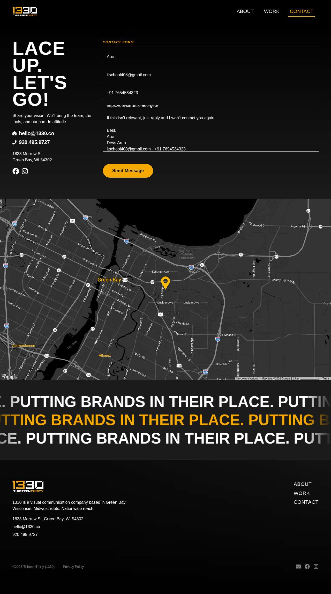

**After submit** — `run-c516d43f_attempt-c8a50395_post_attempt_2026-11-06T04-47-24-601Z.jpg`

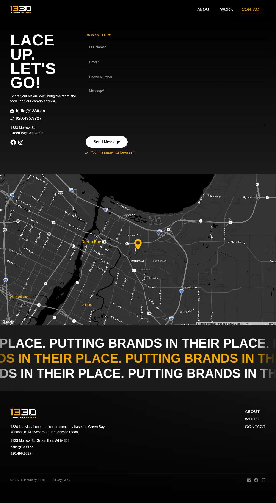

### cook-communications.com — failed\_before\_submit (LIVE)

| | |
|---|---|
| Attempt ID | `ea8a2de8-fc53-428e-8913-fde7928132d2` |
| Form URL | https://cook-communications.com/contact |
| Final URL | https://cook-communications.com/contact |
| Reserved | 2026-11-06 04:47:33 UTC |
| Submit attempted | — |
| Template | standard v2 |
| Confirmation text | none observed |
| Result / error | Field "Phone \* (required)" did not accept the value |

Exact message:

~~~text
Subject: Helping customers find your business in AI search (AEO + GEO)

Hi there,

I'm Arun from Devs Arun. More and more customers now ask ChatGPT, Gemini, Perplexity or Google's AI Overviews questions like "who should I hire for this in my area?" before they call anyone. These tools answer from websites they can clearly understand, and they tend to recommend businesses whose pages answer real customer questions.

That is what AEO + GEO (Answer Engine and Generative Engine Optimization) is for. I improve your existing service pages so they clearly answer the questions your customers ask, add structured data that matches the page, and make the call, quote or enquiry step obvious. The benefit: your business gets a better chance of being mentioned or linked in AI answers, and visitors who arrive find it easy to contact you.

The AEO + GEO Starter is a one-time $199 (about ₹16,999, negotiable) for one website: a basic audit, 10 customer questions, improvements to two existing pages, relevant structured data and an action plan, with one revision round.

You can read the full details, send an enquiry or book online here:
https://devsarun.io/aeo-geo/

If this isn't relevant, just reply and I won't contact you again.

Best,
Arun
Devs Arun
itschool408@gmail.com · +91 7654534323
~~~

Submitted field values:

- \#form\_f\_5: Arun
- \#form\_f\_6: +91 7654534323
- \#form\_f\_7: itschool408@gmail.com
- \#form\_f\_8: Hi there, I'm Arun from Devs Arun. More and more customers now ask ChatGPT, Gemini, Perplexity or Google's AI Overviews 

**Filled form (before submit)** — `run-c516d43f_attempt-ea8a2de8_filled_2026-11-06T04-47-35-894Z.jpg`

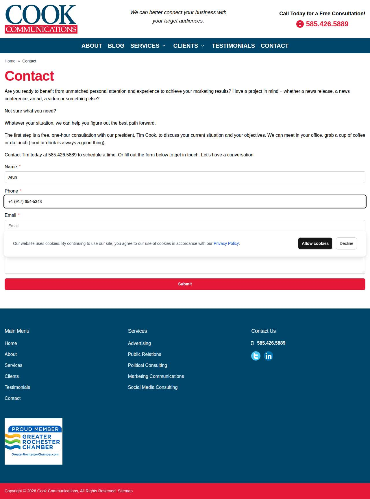

### newparadigmmarketing.com — failed\_before\_submit (LIVE)

| | |
|---|---|
| Attempt ID | `6042b515-73b5-469e-86df-493d069ca9d2` |
| Form URL | https://newparadigmmarketing.com/contact/ |
| Final URL | https://newparadigmmarketing.com/contact/ |
| Reserved | 2026-11-06 04:47:40 UTC |
| Submit attempted | — |
| Template | standard v2 |
| Confirmation text | none observed |
| Result / error | Message field altered the text (length limit?) |

Exact message:

~~~text
Subject: Helping customers find your business in AI search (AEO + GEO)

Hi there,

I'm Arun from Devs Arun. More and more customers now ask ChatGPT, Gemini, Perplexity or Google's AI Overviews questions like "who should I hire for this in my area?" before they call anyone. These tools answer from websites they can clearly understand, and they tend to recommend businesses whose pages answer real customer questions.

That is what AEO + GEO (Answer Engine and Generative Engine Optimization) is for. I improve your existing service pages so they clearly answer the questions your customers ask, add structured data that matches the page, and make the call, quote or enquiry step obvious. The benefit: your business gets a better chance of being mentioned or linked in AI answers, and visitors who arrive find it easy to contact you.

The AEO + GEO Starter is a one-time $199 (about ₹16,999, negotiable) for one website: a basic audit, 10 customer questions, improvements to two existing pages, relevant structured data and an action plan, with one revision round.

You can read the full details, send an enquiry or book online here:
https://devsarun.io/aeo-geo/

If this isn't relevant, just reply and I won't contact you again.

Best,
Arun
Devs Arun
itschool408@gmail.com · +91 7654534323
~~~

Submitted field values:

- \#nf-field-22: Arun
- \#nf-field-23: itschool408@gmail.com
- \#nf-field-24: +91 7654534323
- \#nf-field-25: Hi there, I'm Arun from Devs Arun. More and more customers now ask ChatGPT, Gemini, Perplexity or Google's AI Overviews 

**Filled form (before submit)** — `run-c516d43f_attempt-6042b515_filled_2026-11-06T04-47-43-255Z.jpg`

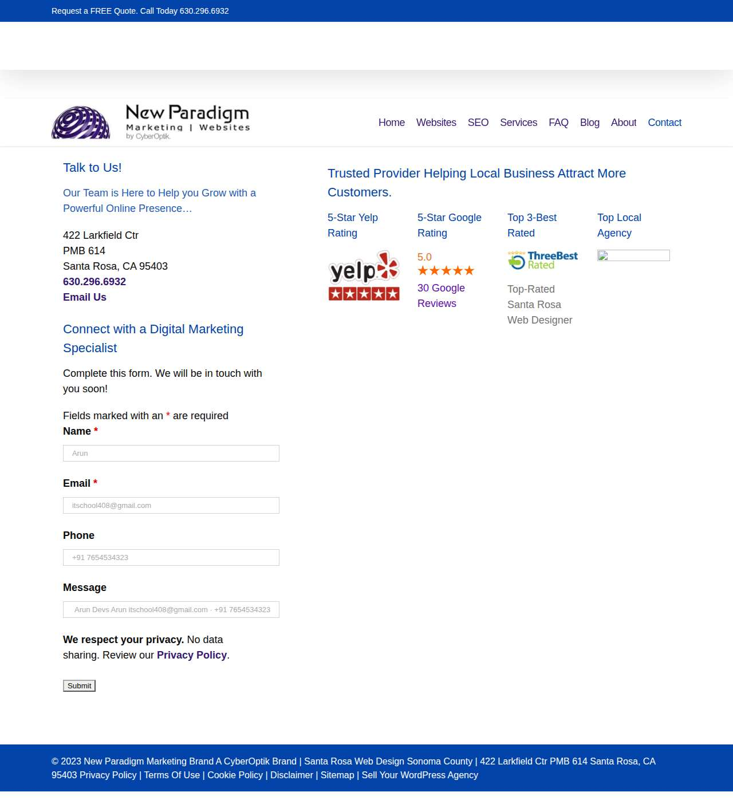

### novaadvertising.com — failed\_before\_submit (LIVE)

| | |
|---|---|
| Attempt ID | `bf9c9df4-205d-421f-8ecf-e6f53b45ff84` |
| Form URL | https://www.novaadvertising.com/contact-us/ |
| Final URL | https://www.novaadvertising.com/contact-us/ |
| Reserved | 2026-11-06 04:47:48 UTC |
| Submit attempted | — |
| Template | standard v2 |
| Confirmation text | none observed |
| Result / error | Field "Phone\*" did not accept the value |

Exact message:

~~~text
Subject: Helping customers find your business in AI search (AEO + GEO)

Hi there,

I'm Arun from Devs Arun. More and more customers now ask ChatGPT, Gemini, Perplexity or Google's AI Overviews questions like "who should I hire for this in my area?" before they call anyone. These tools answer from websites they can clearly understand, and they tend to recommend businesses whose pages answer real customer questions.

That is what AEO + GEO (Answer Engine and Generative Engine Optimization) is for. I improve your existing service pages so they clearly answer the questions your customers ask, add structured data that matches the page, and make the call, quote or enquiry step obvious. The benefit: your business gets a better chance of being mentioned or linked in AI answers, and visitors who arrive find it easy to contact you.

The AEO + GEO Starter is a one-time $199 (about ₹16,999, negotiable) for one website: a basic audit, 10 customer questions, improvements to two existing pages, relevant structured data and an action plan, with one revision round.

You can read the full details, send an enquiry or book online here:
https://devsarun.io/aeo-geo/

If this isn't relevant, just reply and I won't contact you again.

Best,
Arun
Devs Arun
itschool408@gmail.com · +91 7654534323
~~~

Submitted field values:

- div \> div:nth-of-type(2) \> div \> div \> div \> div:nth-of-type(1) \> form \> div:nth-of-type(1) \> div \> div:nth-of-type(1) \> div \> input: Arun
- div \> div:nth-of-type(2) \> div \> div \> div \> div:nth-of-type(1) \> form \> div:nth-of-type(1) \> div \> div:nth-of-type(2) \> div \> input: +91 7654534323
- div \> div:nth-of-type(2) \> div \> div \> div \> div:nth-of-type(1) \> form \> div:nth-of-type(1) \> div \> div:nth-of-type(3) \> div \> input: itschool408@gmail.com
- div \> div:nth-of-type(2) \> div \> div \> div \> div:nth-of-type(1) \> form \> div:nth-of-type(1) \> div \> div:nth-of-type(4) \> div \> textarea: Hi there, I'm Arun from Devs Arun. More and more customers now ask ChatGPT, Gemini, Perplexity or Google's AI Overviews 

**Filled form (before submit)** — `run-c516d43f_attempt-bf9c9df4_filled_2026-11-06T04-47-50-947Z.jpg`

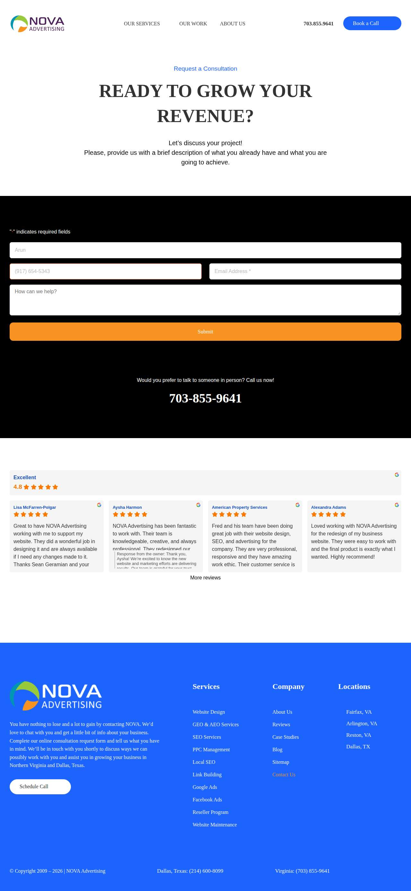

### cfx-inc.com — unclear (LIVE)

| | |
|---|---|
| Attempt ID | `228a98c5-6115-41e9-aa6f-08344c3a343e` |
| Form URL | https://www.cfx-inc.com/contact |
| Final URL | https://www.cfx-inc.com/contact |
| Reserved | 2026-11-06 04:47:56 UTC |
| Submit attempted | 2026-11-06 04:47:57 UTC |
| Template | standard v2 |
| Confirmation text | none observed |
| Result / error | No new success marker observed |

Exact message:

~~~text
Subject: Helping customers find your business in AI search (AEO + GEO)

Hi there,

I'm Arun from Devs Arun. More and more customers now ask ChatGPT, Gemini, Perplexity or Google's AI Overviews questions like "who should I hire for this in my area?" before they call anyone. These tools answer from websites they can clearly understand, and they tend to recommend businesses whose pages answer real customer questions.

That is what AEO + GEO (Answer Engine and Generative Engine Optimization) is for. I improve your existing service pages so they clearly answer the questions your customers ask, add structured data that matches the page, and make the call, quote or enquiry step obvious. The benefit: your business gets a better chance of being mentioned or linked in AI answers, and visitors who arrive find it easy to contact you.

The AEO + GEO Starter is a one-time $199 (about ₹16,999, negotiable) for one website: a basic audit, 10 customer questions, improvements to two existing pages, relevant structured data and an action plan, with one revision round.

You can read the full details, send an enquiry or book online here:
https://devsarun.io/aeo-geo/

If this isn't relevant, just reply and I won't contact you again.

Best,
Arun
Devs Arun
itschool408@gmail.com · +91 7654534323
~~~

Submitted field values:

- Message \* \[message\]: Hi there, I'm Arun from Devs Arun. More and more customers now ask ChatGPT, Gemini, Perplexity or Google's AI Overviews 
- Subject \* \[subject\]: Helping customers find your business in AI search (AEO + GEO)
- Email Address \* \[email\]: itschool408@gmail.com
- First Name \[first\_name\]: Arun

**Filled form (before submit)** — `run-c516d43f_attempt-228a98c5_filled_2026-11-06T04-47-57-784Z.jpg`

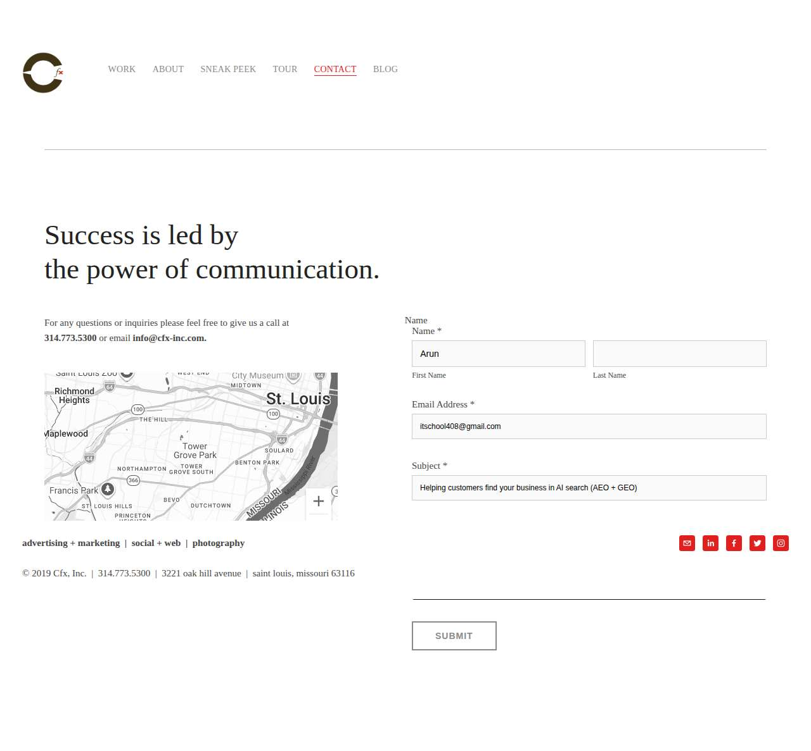

**After submit** — `run-c516d43f_attempt-228a98c5_post_attempt_2026-11-06T04-48-26-997Z.jpg`

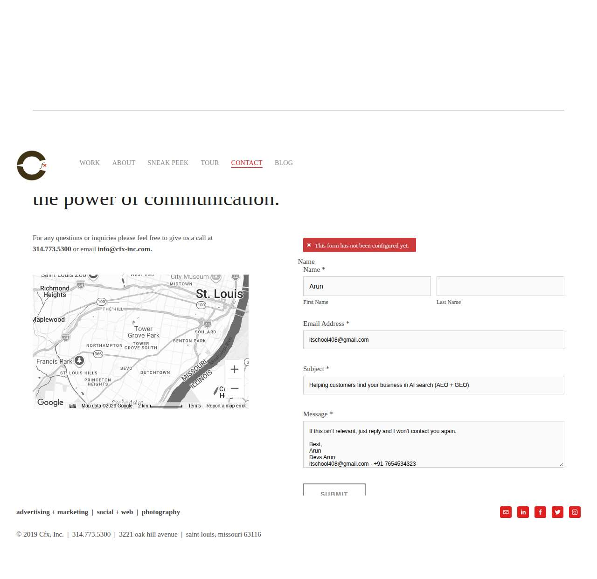

### brandigo.com — unclear (LIVE)

| | |
|---|---|
| Attempt ID | `82bb929f-3ac4-4ab0-b3f5-4080a6c6dceb` |
| Form URL | https://www.brandigo.com/contact-us |
| Final URL | https://www.brandigo.com/contact-us |
| Reserved | 2026-11-06 04:48:35 UTC |
| Submit attempted | 2026-11-06 04:48:37 UTC |
| Template | standard v2 |
| Confirmation text | none observed |
| Result / error | No new success marker observed |

Exact message:

~~~text
Subject: Helping customers find your business in AI search (AEO + GEO)

Hi there,

I'm Arun from Devs Arun. More and more customers now ask ChatGPT, Gemini, Perplexity or Google's AI Overviews questions like "who should I hire for this in my area?" before they call anyone. These tools answer from websites they can clearly understand, and they tend to recommend businesses whose pages answer real customer questions.

That is what AEO + GEO (Answer Engine and Generative Engine Optimization) is for. I improve your existing service pages so they clearly answer the questions your customers ask, add structured data that matches the page, and make the call, quote or enquiry step obvious. The benefit: your business gets a better chance of being mentioned or linked in AI answers, and visitors who arrive find it easy to contact you.

The AEO + GEO Starter is a one-time $199 (about ₹16,999, negotiable) for one website: a basic audit, 10 customer questions, improvements to two existing pages, relevant structured data and an action plan, with one revision round.

You can read the full details, send an enquiry or book online here:
https://devsarun.io/aeo-geo/

If this isn't relevant, just reply and I won't contact you again.

Best,
Arun
Devs Arun
itschool408@gmail.com · +91 7654534323
~~~

Submitted field values:

- Email \[email\]: itschool408@gmail.com
- Phone \[phone\]: +91 7654534323
- Message \[message\]: Hi there, I'm Arun from Devs Arun. More and more customers now ask ChatGPT, Gemini, Perplexity or Google's AI Overviews 
- First Name \[first\_name\]: Arun

**Filled form (before submit)** — `run-c516d43f_attempt-82bb929f_filled_2026-11-06T04-48-37-101Z.jpg`

**After submit** — `run-c516d43f_attempt-82bb929f_post_attempt_2026-11-06T04-49-06-960Z.jpg`

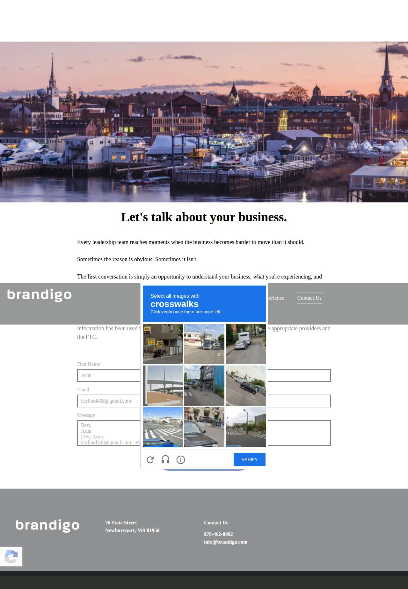

### digitalimpactsolutions.net — confirmed (LIVE)

| | |
|---|---|
| Attempt ID | `1c71d222-3ff7-42c3-9585-73b40eaee290` |
| Form URL | https://digitalimpactsolutions.net/contact |
| Final URL | https://digitalimpactsolutions.net/contact |
| Reserved | 2026-11-06 04:49:15 UTC |
| Submit attempted | 2026-11-06 04:49:17 UTC |
| Template | standard v2 |
| Confirmation text | – 5:00 PM Friday 8:00 AM – 3:00 PM Saturday – Sunday Closed Message Sent\! Thanks for reaching out\! Scott and the team will get back to you shortly — usually within a few ho |
| Result / error | — |

Exact message:

~~~text
Subject: Helping customers find your business in AI search (AEO + GEO)

Hi there,

I'm Arun from Devs Arun. More and more customers now ask ChatGPT, Gemini, Perplexity or Google's AI Overviews questions like "who should I hire for this in my area?" before they call anyone. These tools answer from websites they can clearly understand, and they tend to recommend businesses whose pages answer real customer questions.

That is what AEO + GEO (Answer Engine and Generative Engine Optimization) is for. I improve your existing service pages so they clearly answer the questions your customers ask, add structured data that matches the page, and make the call, quote or enquiry step obvious. The benefit: your business gets a better chance of being mentioned or linked in AI answers, and visitors who arrive find it easy to contact you.

The AEO + GEO Starter is a one-time $199 (about ₹16,999, negotiable) for one website: a basic audit, 10 customer questions, improvements to two existing pages, relevant structured data and an action plan, with one revision round.

You can read the full details, send an enquiry or book online here:
https://devsarun.io/aeo-geo/

If this isn't relevant, just reply and I won't contact you again.

Best,
Arun
Devs Arun
itschool408@gmail.com · +91 7654534323
~~~

Submitted field values:

- Full Name \* \[name\]: Arun
- Phone Number \[phone\]: +91 7654534323
- Email Address \* \[email\]: itschool408@gmail.com
- Service Needed \* \[fixed\]: Other
- Project Details \* \[message\]: Hi there, I'm Arun from Devs Arun. More and more customers now ask ChatGPT, Gemini, Perplexity or Google's AI Overviews 
- Company / Business \[company\]: Devs Arun

**Filled form (before submit)** — `run-c516d43f_attempt-1c71d222_filled_2026-11-06T04-49-17-062Z.jpg`

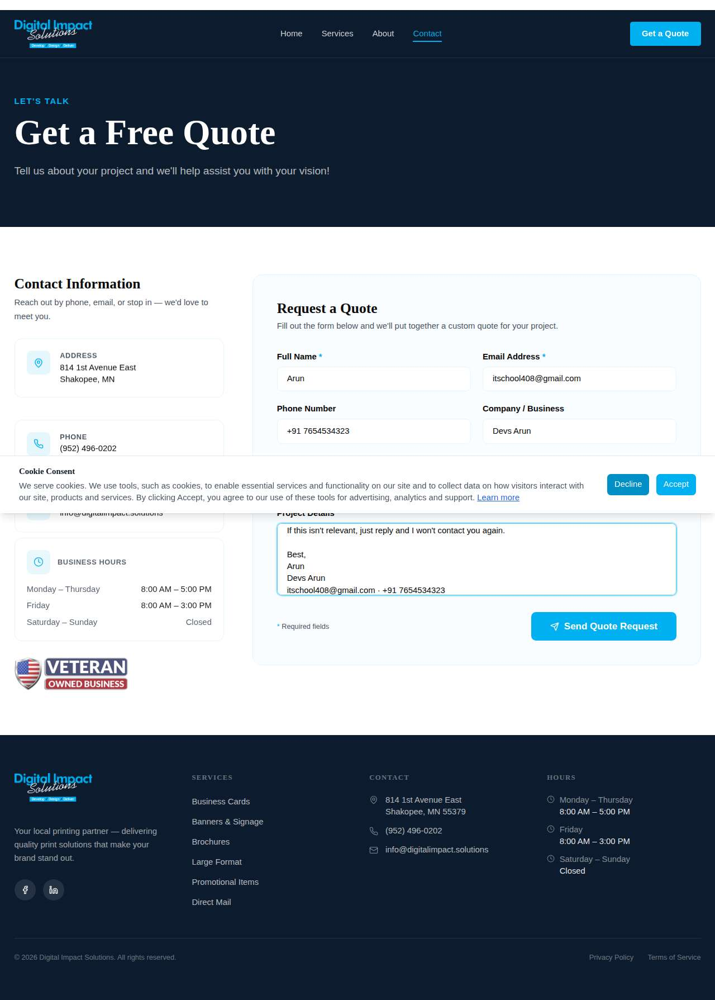

**After submit** — `run-c516d43f_attempt-1c71d222_post_attempt_2026-11-06T04-49-22-687Z.jpg`

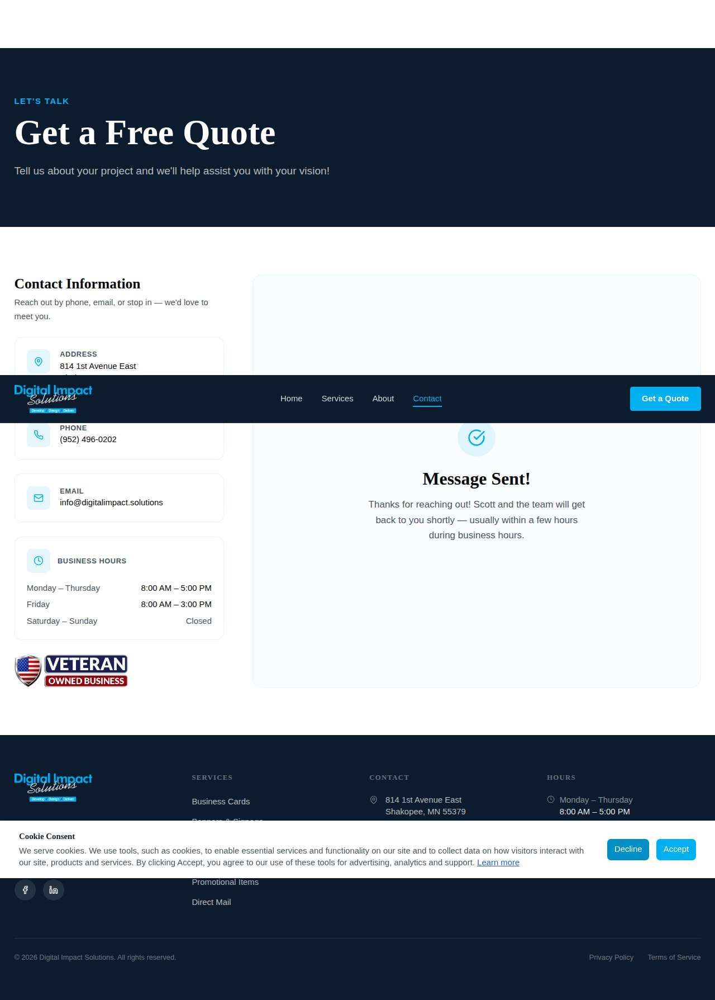

## Events (169)

| Time (UTC) | Event | Website | Details |
|---|---|---|---|
| 04:42:41 | run\_queued | — | live run requested by github:itsDevsArun |
| 04:42:41 | run\_dispatched | — | dispatch disabled (local test mode) |
| 04:42:44 | run\_started | — | Runner claimed live run |
| 04:42:46 | offer\_verified | — | Service page offer facts verified |
| 04:42:46 | website\_selected | clearchoiceplumbingllc.com | Live target clearchoiceplumbingllc.com |
| 04:42:46 | attempt\_reserved | clearchoiceplumbingllc.com | Submission attempt reserved with template standard v2 |
| 04:42:47 | page\_opened | clearchoiceplumbingllc.com | Opened form page |
| 04:42:47 | screenshot\_saved | clearchoiceplumbingllc.com | inspection screenshot saved (145 KB) |
| 04:42:47 | review\_required | clearchoiceplumbingllc.com | failed before submit: locator.fill: Error: Cannot type text into input\[type=number\] |
| 04:42:52 | website\_selected | bwnwincpainting.com | Live target bwnwincpainting.com |
| 04:42:52 | attempt\_reserved | bwnwincpainting.com | Submission attempt reserved with template standard v2 |
| 04:42:54 | page\_opened | bwnwincpainting.com | Opened form page |
| 04:42:54 | screenshot\_saved | bwnwincpainting.com | inspection screenshot saved (118 KB) |
| 04:42:54 | review\_required | bwnwincpainting.com | failed before submit: locator.fill: Error: Cannot type text into input\[type=number\] |
| 04:42:59 | website\_selected | absoluterestorepa.com | Live target absoluterestorepa.com |
| 04:42:59 | attempt\_reserved | absoluterestorepa.com | Submission attempt reserved with template standard v2 |
| 04:43:02 | page\_opened | absoluterestorepa.com | Opened form page |
| 04:43:02 | screenshot\_saved | absoluterestorepa.com | inspection screenshot saved (174 KB) |
| 04:43:02 | review\_required | absoluterestorepa.com | failed before submit: locator.fill: Error: Cannot type text into input\[type=number\] |
| 04:43:07 | website\_selected | masoudlawfirm.com | Live target masoudlawfirm.com |
| 04:43:07 | attempt\_reserved | masoudlawfirm.com | Submission attempt reserved with template standard v2 |
| 04:43:11 | page\_opened | masoudlawfirm.com | Opened form page |
| 04:43:11 | screenshot\_saved | masoudlawfirm.com | inspection screenshot saved (168 KB) |
| 04:43:11 | review\_required | masoudlawfirm.com | failed before submit: locator.fill: Error: Cannot type text into input\[type=number\] |
| 04:43:16 | website\_selected | whiteolivecpa.com | Live target whiteolivecpa.com |
| 04:43:16 | attempt\_reserved | whiteolivecpa.com | Submission attempt reserved with template standard v2 |
| 04:43:17 | page\_opened | whiteolivecpa.com | Opened form page |
| 04:43:17 | screenshot\_saved | whiteolivecpa.com | inspection screenshot saved (197 KB) |
| 04:43:17 | review\_required | whiteolivecpa.com | failed before submit: locator.fill: Error: Cannot type text into input\[type=number\] |
| 04:43:22 | website\_selected | canterburyadvisor.com | Live target canterburyadvisor.com |
| 04:43:22 | attempt\_reserved | canterburyadvisor.com | Submission attempt reserved with template standard v2 |
| 04:43:24 | page\_opened | canterburyadvisor.com | Opened form page |
| 04:43:24 | screenshot\_saved | canterburyadvisor.com | inspection screenshot saved (350 KB) |
| 04:43:24 | review\_required | canterburyadvisor.com | failed before submit: locator.fill: Error: Cannot type text into input\[type=number\] |
| 04:43:29 | website\_selected | connectionzpcrepair.com | Live target connectionzpcrepair.com |
| 04:43:29 | attempt\_reserved | connectionzpcrepair.com | Submission attempt reserved with template standard v2 |
| 04:43:31 | page\_opened | connectionzpcrepair.com | Opened form page |
| 04:43:31 | screenshot\_saved | connectionzpcrepair.com | inspection screenshot saved (145 KB) |
| 04:43:31 | review\_required | connectionzpcrepair.com | failed before submit: locator.fill: Error: Cannot type text into input\[type=number\] |
| 04:43:36 | website\_selected | ackavionics.com | Live target ackavionics.com |
| 04:43:36 | attempt\_reserved | ackavionics.com | Submission attempt reserved with template standard v2 |
| 04:43:41 | page\_opened | ackavionics.com | Opened form page |
| 04:43:41 | screenshot\_saved | ackavionics.com | inspection screenshot saved (100 KB) |
| 04:43:41 | review\_required | ackavionics.com | failed before submit: locator.fill: Error: Cannot type text into input\[type=number\] |
| 04:43:46 | website\_selected | marketingdirection.com | Live target marketingdirection.com |
| 04:43:46 | attempt\_reserved | marketingdirection.com | Submission attempt reserved with template standard v2 |
| 04:43:49 | page\_opened | marketingdirection.com | Opened form page |
| 04:43:49 | fields\_filled | marketingdirection.com | filled |
| 04:43:49 | screenshot\_saved | marketingdirection.com | filled screenshot saved (324 KB) |
| 04:43:49 | submit\_attempted | marketingdirection.com | submitting |
| 04:43:56 | screenshot\_saved | marketingdirection.com | post\_attempt screenshot saved (103 KB) |
| 04:43:56 | confirmation\_observed | marketingdirection.com | confirmed — "MARKETING SERVICES RESOURCES ABOUT US CONTACT US Contact Us Thank You Thank you for reaching out\! We’ve received your re" |
| 04:44:05 | website\_selected | designups.com | Live target designups.com |
| 04:44:05 | attempt\_reserved | designups.com | Submission attempt reserved with template standard v2 |
| 04:44:06 | page\_opened | designups.com | Opened form page |
| 04:44:06 | fields\_filled | designups.com | filled |
| 04:44:06 | screenshot\_saved | designups.com | filled screenshot saved (185 KB) |
| 04:44:06 | submit\_attempted | designups.com | submitting |
| 04:44:12 | screenshot\_saved | designups.com | post\_attempt screenshot saved (159 KB) |
| 04:44:12 | confirmation\_observed | designups.com | confirmed — "e, TN, with clients and collaborators worldwide. Let's Talk Thanks for contacting us\! We will get in touch with you shor" |
| 04:44:21 | website\_selected | livgroup.media | Live target livgroup.media |
| 04:44:21 | attempt\_reserved | livgroup.media | Submission attempt reserved with template standard v2 |
| 04:44:23 | page\_opened | livgroup.media | Opened form page |
| 04:44:23 | fields\_filled | livgroup.media | filled |
| 04:44:23 | screenshot\_saved | livgroup.media | filled screenshot saved (65 KB) |
| 04:44:23 | submit\_attempted | livgroup.media | submitting |
| 04:44:52 | screenshot\_saved | livgroup.media | post\_attempt screenshot saved (52 KB) |
| 04:44:52 | review\_required | livgroup.media | unclear: No new success marker observed |
| 04:45:01 | website\_selected | d7m.tg | Live target d7m.tg |
| 04:45:01 | attempt\_reserved | d7m.tg | Submission attempt reserved with template standard v2 |
| 04:45:04 | page\_opened | d7m.tg | Opened form page |
| 04:45:04 | fields\_filled | d7m.tg | filled |
| 04:45:04 | screenshot\_saved | d7m.tg | filled screenshot saved (57 KB) |
| 04:45:04 | submit\_attempted | d7m.tg | submitting |
| 04:45:11 | screenshot\_saved | d7m.tg | post\_attempt screenshot saved (41 KB) |
| 04:45:11 | error | d7m.tg | error after submit — "ontent Work Archive Writing Contact Message not sent Please try again. Email hello@d7mtg.com Call 845-671-2116 Try the f" |
| 04:45:19 | website\_selected | smpny.com | Live target smpny.com |
| 04:45:19 | attempt\_reserved | smpny.com | Submission attempt reserved with template standard v2 |
| 04:45:24 | page\_opened | smpny.com | Opened form page |
| 04:45:24 | screenshot\_saved | smpny.com | filled screenshot saved (85 KB) |
| 04:45:24 | review\_required | smpny.com | failed before submit: Form validation would block sending: contact\[Phone number\]: Please match the requested format. |
| 04:45:29 | website\_selected | lookmedia.com | Live target lookmedia.com |
| 04:45:29 | attempt\_reserved | lookmedia.com | Submission attempt reserved with template standard v2 |
| 04:45:30 | page\_opened | lookmedia.com | Opened form page |
| 04:45:30 | fields\_filled | lookmedia.com | filled |
| 04:45:30 | screenshot\_saved | lookmedia.com | filled screenshot saved (8 KB) |
| 04:45:30 | submit\_attempted | lookmedia.com | submitting |
| 04:45:35 | screenshot\_saved | lookmedia.com | post\_attempt screenshot saved (35 KB) |
| 04:45:35 | confirmation\_observed | lookmedia.com | confirmed — "d the message. You can always contact us at (800) 363-5665. Thank you\! SPAM Content Detected\! Please revise your message" |
| 04:45:44 | website\_selected | romanelli.com | Live target romanelli.com |
| 04:45:44 | attempt\_reserved | romanelli.com | Submission attempt reserved with template standard v2 |
| 04:45:45 | page\_opened | romanelli.com | Opened form page |
| 04:45:45 | fields\_filled | romanelli.com | filled |
| 04:45:45 | screenshot\_saved | romanelli.com | filled screenshot saved (325 KB) |
| 04:45:45 | submit\_attempted | romanelli.com | submitting |
| 04:45:54 | screenshot\_saved | romanelli.com | post\_attempt screenshot saved (320 KB) |
| 04:45:54 | confirmation\_observed | romanelli.com | confirmed — "munications PO Box 227, 2 College Street, Clinton, NY 13323 Thanks for contacting us\! We will get in touch with you shor" |
| 04:46:02 | website\_selected | indigodesignllc.com | Live target indigodesignllc.com |
| 04:46:02 | attempt\_reserved | indigodesignllc.com | Submission attempt reserved with template standard v2 |
| 04:46:05 | page\_opened | indigodesignllc.com | Opened form page |
| 04:46:05 | fields\_filled | indigodesignllc.com | filled |
| 04:46:05 | screenshot\_saved | indigodesignllc.com | filled screenshot saved (78 KB) |
| 04:46:05 | submit\_attempted | indigodesignllc.com | submitting |
| 04:46:34 | screenshot\_saved | indigodesignllc.com | post\_attempt screenshot saved (60 KB) |
| 04:46:34 | review\_required | indigodesignllc.com | unclear: No new success marker observed |
| 04:46:43 | website\_selected | northwesternmarketingconcepts.com | Live target northwesternmarketingconcepts.com |
| 04:46:43 | attempt\_reserved | northwesternmarketingconcepts.com | Submission attempt reserved with template standard v2 |
| 04:46:46 | page\_opened | northwesternmarketingconcepts.com | Opened form page |
| 04:46:46 | fields\_filled | northwesternmarketingconcepts.com | filled |
| 04:46:46 | screenshot\_saved | northwesternmarketingconcepts.com | filled screenshot saved (142 KB) |
| 04:46:46 | submit\_attempted | northwesternmarketingconcepts.com | submitting |
| 04:46:51 | screenshot\_saved | northwesternmarketingconcepts.com | post\_attempt screenshot saved (141 KB) |
| 04:46:51 | confirmation\_observed | northwesternmarketingconcepts.com | confirmed — "il: hr@northwesternmarketingconcepts.com Address: Boise, ID Thank you for your message. It has been sent. Your Name (req" |
| 04:47:00 | website\_selected | stambaughdesigns.co | Live target stambaughdesigns.co |
| 04:47:00 | attempt\_reserved | stambaughdesigns.co | Submission attempt reserved with template standard v2 |
| 04:47:01 | page\_opened | stambaughdesigns.co | Opened form page |
| 04:47:01 | fields\_filled | stambaughdesigns.co | filled |
| 04:47:01 | screenshot\_saved | stambaughdesigns.co | filled screenshot saved (292 KB) |
| 04:47:02 | submit\_attempted | stambaughdesigns.co | submitting |
| 04:47:06 | screenshot\_saved | stambaughdesigns.co | post\_attempt screenshot saved (283 KB) |
| 04:47:06 | error | stambaughdesigns.co | error after submit — "Hours Mon-Fri: 9am - 5pm Schedule Call Name \* Email \* Phone Please enter a valid phone number Company Service of Interes" |
| 04:47:14 | website\_selected | 1330wraps.com | Live target 1330wraps.com |
| 04:47:14 | attempt\_reserved | 1330wraps.com | Submission attempt reserved with template standard v2 |
| 04:47:16 | page\_opened | 1330wraps.com | Opened form page |
| 04:47:16 | fields\_filled | 1330wraps.com | filled |
| 04:47:17 | screenshot\_saved | 1330wraps.com | filled screenshot saved (191 KB) |
| 04:47:17 | submit\_attempted | 1330wraps.com | submitting |
| 04:47:24 | screenshot\_saved | 1330wraps.com | post\_attempt screenshot saved (184 KB) |
| 04:47:24 | confirmation\_observed | 1330wraps.com | confirmed — "ebook Instagram CONTACT FORM Send Message Alternative: Your message has been sent. Keyboard shortcuts Map data ©2026 Goo" |
| 04:47:33 | website\_selected | cook-communications.com | Live target cook-communications.com |
| 04:47:33 | attempt\_reserved | cook-communications.com | Submission attempt reserved with template standard v2 |
| 04:47:35 | page\_opened | cook-communications.com | Opened form page |
| 04:47:35 | screenshot\_saved | cook-communications.com | filled screenshot saved (125 KB) |
| 04:47:35 | review\_required | cook-communications.com | failed before submit: Field "Phone \* (required)" did not accept the value |
| 04:47:40 | website\_selected | newparadigmmarketing.com | Live target newparadigmmarketing.com |
| 04:47:40 | attempt\_reserved | newparadigmmarketing.com | Submission attempt reserved with template standard v2 |
| 04:47:43 | page\_opened | newparadigmmarketing.com | Opened form page |
| 04:47:43 | screenshot\_saved | newparadigmmarketing.com | filled screenshot saved (94 KB) |
| 04:47:43 | review\_required | newparadigmmarketing.com | failed before submit: Message field altered the text (length limit?) |
| 04:47:48 | website\_selected | novaadvertising.com | Live target novaadvertising.com |
| 04:47:48 | attempt\_reserved | novaadvertising.com | Submission attempt reserved with template standard v2 |
| 04:47:50 | page\_opened | novaadvertising.com | Opened form page |
| 04:47:50 | screenshot\_saved | novaadvertising.com | filled screenshot saved (173 KB) |
| 04:47:50 | review\_required | novaadvertising.com | failed before submit: Field "Phone\*" did not accept the value |
| 04:47:56 | website\_selected | cfx-inc.com | Live target cfx-inc.com |
| 04:47:56 | attempt\_reserved | cfx-inc.com | Submission attempt reserved with template standard v2 |
| 04:47:57 | page\_opened | cfx-inc.com | Opened form page |
| 04:47:57 | fields\_filled | cfx-inc.com | filled |
| 04:47:57 | screenshot\_saved | cfx-inc.com | filled screenshot saved (61 KB) |
| 04:47:57 | submit\_attempted | cfx-inc.com | submitting |
| 04:48:26 | screenshot\_saved | cfx-inc.com | post\_attempt screenshot saved (69 KB) |
| 04:48:27 | review\_required | cfx-inc.com | unclear: No new success marker observed |
| 04:48:35 | website\_selected | brandigo.com | Live target brandigo.com |
| 04:48:35 | attempt\_reserved | brandigo.com | Submission attempt reserved with template standard v2 |
| 04:48:36 | page\_opened | brandigo.com | Opened form page |
| 04:48:36 | fields\_filled | brandigo.com | filled |
| 04:48:37 | screenshot\_saved | brandigo.com | filled screenshot saved (138 KB) |
| 04:48:37 | submit\_attempted | brandigo.com | submitting |
| 04:49:06 | screenshot\_saved | brandigo.com | post\_attempt screenshot saved (151 KB) |
| 04:49:06 | review\_required | brandigo.com | unclear: No new success marker observed |
| 04:49:15 | website\_selected | digitalimpactsolutions.net | Live target digitalimpactsolutions.net |
| 04:49:15 | attempt\_reserved | digitalimpactsolutions.net | Submission attempt reserved with template standard v2 |
| 04:49:16 | page\_opened | digitalimpactsolutions.net | Opened form page |
| 04:49:16 | fields\_filled | digitalimpactsolutions.net | filled |
| 04:49:17 | screenshot\_saved | digitalimpactsolutions.net | filled screenshot saved (115 KB) |
| 04:49:17 | submit\_attempted | digitalimpactsolutions.net | submitting |
| 04:49:22 | screenshot\_saved | digitalimpactsolutions.net | post\_attempt screenshot saved (96 KB) |
| 04:49:22 | confirmation\_observed | digitalimpactsolutions.net | confirmed — "– 5:00 PM Friday 8:00 AM – 3:00 PM Saturday – Sunday Closed Message Sent\! Thanks for reaching out\! Scott and the team wi" |
| 04:49:31 | run\_completed | — | Run completed (queue\_exhausted) |
