# Run d9c1e7ce — live — completed

| | |
|---|---|
| Run ID | `d9c1e7ce-8a94-4432-95c3-a2c6e2457fe6` |
| Requested by | github:itsDevsArun |
| Started | 2026-11-06 04:00:46 UTC |
| Finished | 2026-11-06 04:09:26 UTC |
| Finish reason | queue\_exhausted |
| GitHub Actions | https://github.com/itsDevsArun/aeo-geo/actions/runs/42148448245 |

CSV for this run: [runs/2026-11-06_live_d9c1e7ce.csv](2026-11-06_live_d9c1e7ce.csv)

## Attempts (25)

### clearchoiceplumbingllc.com — failed\_before\_submit (LIVE)

| | |
|---|---|
| Attempt ID | `48697f34-8ca6-4cd7-a724-2b53e4e99247` |
| Form URL | https://clearchoiceplumbingllc.com/contact/ |
| Final URL | — |
| Reserved | 2026-11-06 04:00:47 UTC |
| Submit attempted | — |
| Template | standard v2 |
| Confirmation text | none observed |
| Result / error | locator.fill: Error: Cannot type text into input\[type=number\] |

Exact message:

~~~text
Subject: Helping customers find your business in AI search (AEO + GEO)

Hi there,

I'm Arun from Devs Arun. More and more customers now ask ChatGPT, Gemini, Perplexity or Google's AI Overviews questions like "who should I hire for this in my area?" before they call anyone. These tools answer from websites they can clearly understand, and they tend to recommend businesses whose pages answer real customer questions.

That is what AEO + GEO (Answer Engine and Generative Engine Optimization) is for. I improve your existing service pages so they clearly answer the questions your customers ask, add structured data that matches the page, and make the call, quote or enquiry step obvious. The benefit: your business gets a better chance of being mentioned or linked in AI answers, and visitors who arrive find it easy to contact you.

The AEO + GEO Starter is a one-time $199 (about ₹16,999, negotiable) for one website: a basic audit, 10 customer questions, improvements to two existing pages, relevant structured data and an action plan, with one revision round.

You can read the full details, send an enquiry or book online here:
https://devsarun.io/aeo-geo/

If this isn't relevant, just reply and I won't contact you again.

Best,
Arun
Devs Arun
itschool408@gmail.com · +91 7654534323
~~~

Submitted field values:

- \#wpforms-51-field\_1: Arun
- \#wpforms-51-field\_2: itschool408@gmail.com
- \#wpforms-51-field\_3: Hi there, I'm Arun from Devs Arun. More and more customers now ask ChatGPT, Gemini, Perplexity or Google's AI Overviews 
- \#wpforms-51-field\_5: +91 7654534323

**Inspected page** — `run-d9c1e7ce_attempt-48697f34_inspection_2026-11-06T04-00-48-684Z.jpg`

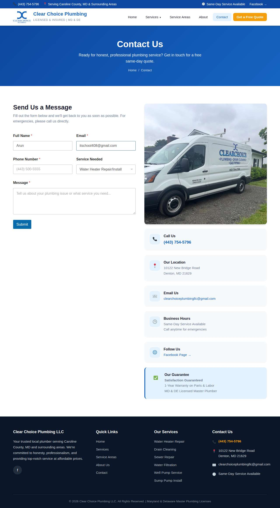

### bwnwincpainting.com — failed\_before\_submit (LIVE)

| | |
|---|---|
| Attempt ID | `e704e8e0-71fb-4578-a4fd-269b7f642c7e` |
| Form URL | https://www.bwnwincpainting.com/contact/ |
| Final URL | — |
| Reserved | 2026-11-06 04:00:53 UTC |
| Submit attempted | — |
| Template | standard v2 |
| Confirmation text | none observed |
| Result / error | locator.fill: Error: Cannot type text into input\[type=number\] |

Exact message:

~~~text
Subject: Helping customers find your business in AI search (AEO + GEO)

Hi there,

I'm Arun from Devs Arun. More and more customers now ask ChatGPT, Gemini, Perplexity or Google's AI Overviews questions like "who should I hire for this in my area?" before they call anyone. These tools answer from websites they can clearly understand, and they tend to recommend businesses whose pages answer real customer questions.

That is what AEO + GEO (Answer Engine and Generative Engine Optimization) is for. I improve your existing service pages so they clearly answer the questions your customers ask, add structured data that matches the page, and make the call, quote or enquiry step obvious. The benefit: your business gets a better chance of being mentioned or linked in AI answers, and visitors who arrive find it easy to contact you.

The AEO + GEO Starter is a one-time $199 (about ₹16,999, negotiable) for one website: a basic audit, 10 customer questions, improvements to two existing pages, relevant structured data and an action plan, with one revision round.

You can read the full details, send an enquiry or book online here:
https://devsarun.io/aeo-geo/

If this isn't relevant, just reply and I won't contact you again.

Best,
Arun
Devs Arun
itschool408@gmail.com · +91 7654534323
~~~

Submitted field values:

- \#name-1151: Arun
- \#email-1151: itschool408@gmail.com
- \#phone-1151: +91 7654534323
- \#message-1151: Hi there, I'm Arun from Devs Arun. More and more customers now ask ChatGPT, Gemini, Perplexity or Google's AI Overviews 

**Inspected page** — `run-d9c1e7ce_attempt-e704e8e0_inspection_2026-11-06T04-00-55-893Z.jpg`

### absoluterestorepa.com — failed\_before\_submit (LIVE)

| | |
|---|---|
| Attempt ID | `a0b2ed3d-e93d-4d5e-9c14-eb397163aa41` |
| Form URL | https://absoluterestorepa.com/contact-us/ |
| Final URL | — |
| Reserved | 2026-11-06 04:01:00 UTC |
| Submit attempted | — |
| Template | standard v2 |
| Confirmation text | none observed |
| Result / error | locator.fill: Error: Cannot type text into input\[type=number\] |

Exact message:

~~~text
Subject: Helping customers find your business in AI search (AEO + GEO)

Hi there,

I'm Arun from Devs Arun. More and more customers now ask ChatGPT, Gemini, Perplexity or Google's AI Overviews questions like "who should I hire for this in my area?" before they call anyone. These tools answer from websites they can clearly understand, and they tend to recommend businesses whose pages answer real customer questions.

That is what AEO + GEO (Answer Engine and Generative Engine Optimization) is for. I improve your existing service pages so they clearly answer the questions your customers ask, add structured data that matches the page, and make the call, quote or enquiry step obvious. The benefit: your business gets a better chance of being mentioned or linked in AI answers, and visitors who arrive find it easy to contact you.

The AEO + GEO Starter is a one-time $199 (about ₹16,999, negotiable) for one website: a basic audit, 10 customer questions, improvements to two existing pages, relevant structured data and an action plan, with one revision round.

You can read the full details, send an enquiry or book online here:
https://devsarun.io/aeo-geo/

If this isn't relevant, just reply and I won't contact you again.

Best,
Arun
Devs Arun
itschool408@gmail.com · +91 7654534323
~~~

Submitted field values:

- \#form-field-name: Arun
- \#form-field-message: Hi there, I'm Arun from Devs Arun. More and more customers now ask ChatGPT, Gemini, Perplexity or Google's AI Overviews 
- \#form-field-field\_ed02ec2: +91 7654534323
- \#content \> div \> div \> div:nth-of-type(2) \> div \> div:nth-of-type(1) \> div:nth-of-type(2) \> div \> form \> div \> div:nth-of-type(3) \> input: itschool408@gmail.com

**Inspected page** — `run-d9c1e7ce_attempt-a0b2ed3d_inspection_2026-11-06T04-01-04-613Z.jpg`

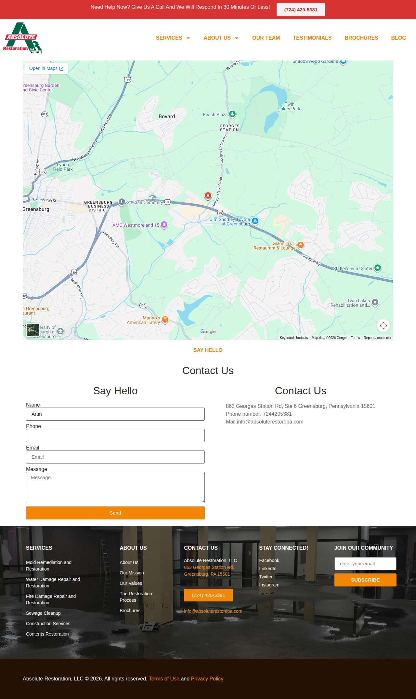

### masoudlawfirm.com — failed\_before\_submit (LIVE)

| | |
|---|---|
| Attempt ID | `f5a4c71f-16ef-4dba-b96c-ee3a0effbde5` |
| Form URL | https://masoudlawfirm.com/contact/ |
| Final URL | — |
| Reserved | 2026-11-06 04:01:09 UTC |
| Submit attempted | — |
| Template | standard v2 |
| Confirmation text | none observed |
| Result / error | locator.fill: Error: Cannot type text into input\[type=number\] |

Exact message:

~~~text
Subject: Helping customers find your business in AI search (AEO + GEO)

Hi there,

I'm Arun from Devs Arun. More and more customers now ask ChatGPT, Gemini, Perplexity or Google's AI Overviews questions like "who should I hire for this in my area?" before they call anyone. These tools answer from websites they can clearly understand, and they tend to recommend businesses whose pages answer real customer questions.

That is what AEO + GEO (Answer Engine and Generative Engine Optimization) is for. I improve your existing service pages so they clearly answer the questions your customers ask, add structured data that matches the page, and make the call, quote or enquiry step obvious. The benefit: your business gets a better chance of being mentioned or linked in AI answers, and visitors who arrive find it easy to contact you.

The AEO + GEO Starter is a one-time $199 (about ₹16,999, negotiable) for one website: a basic audit, 10 customer questions, improvements to two existing pages, relevant structured data and an action plan, with one revision round.

You can read the full details, send an enquiry or book online here:
https://devsarun.io/aeo-geo/

If this isn't relevant, just reply and I won't contact you again.

Best,
Arun
Devs Arun
itschool408@gmail.com · +91 7654534323
~~~

Submitted field values:

- \#form-field-name: Arun
- \#form-field-field\_3374379: Hi there, I'm Arun from Devs Arun. More and more customers now ask ChatGPT, Gemini, Perplexity or Google's AI Overviews 
- \#form-field-field\_7731784: +91 7654534323
- \#form-field-field\_8bd0f16: itschool408@gmail.com

**Inspected page** — `run-d9c1e7ce_attempt-f5a4c71f_inspection_2026-11-06T04-01-13-608Z.jpg`

### whiteolivecpa.com — failed\_before\_submit (LIVE)

| | |
|---|---|
| Attempt ID | `d8a0be0a-1f18-4e07-8f09-41ca13c3eb55` |
| Form URL | https://whiteolivecpa.com/contact/ |
| Final URL | — |
| Reserved | 2026-11-06 04:01:18 UTC |
| Submit attempted | — |
| Template | standard v2 |
| Confirmation text | none observed |
| Result / error | locator.fill: Error: Cannot type text into input\[type=number\] |

Exact message:

~~~text
Subject: Helping customers find your business in AI search (AEO + GEO)

Hi there,

I'm Arun from Devs Arun. More and more customers now ask ChatGPT, Gemini, Perplexity or Google's AI Overviews questions like "who should I hire for this in my area?" before they call anyone. These tools answer from websites they can clearly understand, and they tend to recommend businesses whose pages answer real customer questions.

That is what AEO + GEO (Answer Engine and Generative Engine Optimization) is for. I improve your existing service pages so they clearly answer the questions your customers ask, add structured data that matches the page, and make the call, quote or enquiry step obvious. The benefit: your business gets a better chance of being mentioned or linked in AI answers, and visitors who arrive find it easy to contact you.

The AEO + GEO Starter is a one-time $199 (about ₹16,999, negotiable) for one website: a basic audit, 10 customer questions, improvements to two existing pages, relevant structured data and an action plan, with one revision round.

You can read the full details, send an enquiry or book online here:
https://devsarun.io/aeo-geo/

If this isn't relevant, just reply and I won't contact you again.

Best,
Arun
Devs Arun
itschool408@gmail.com · +91 7654534323
~~~

Submitted field values:

- \#ff\_1\_email: itschool408@gmail.com
- \#ff\_1\_message: Hi there, I'm Arun from Devs Arun. More and more customers now ask ChatGPT, Gemini, Perplexity or Google's AI Overviews 
- \#ff\_1\_numeric\_field: +91 7654534323
- \#ff\_1\_names\_first\_name\_: Arun

**Inspected page** — `run-d9c1e7ce_attempt-d8a0be0a_inspection_2026-11-06T04-01-20-066Z.jpg`

### canterburyadvisor.com — failed\_before\_submit (LIVE)

| | |
|---|---|
| Attempt ID | `9104d377-8e11-4e32-b162-e818bff91306` |
| Form URL | https://canterburyadvisor.com/ |
| Final URL | — |
| Reserved | 2026-11-06 04:01:25 UTC |
| Submit attempted | — |
| Template | standard v2 |
| Confirmation text | none observed |
| Result / error | locator.fill: Error: Cannot type text into input\[type=number\] |

Exact message:

~~~text
Subject: Helping customers find your business in AI search (AEO + GEO)

Hi there,

I'm Arun from Devs Arun. More and more customers now ask ChatGPT, Gemini, Perplexity or Google's AI Overviews questions like "who should I hire for this in my area?" before they call anyone. These tools answer from websites they can clearly understand, and they tend to recommend businesses whose pages answer real customer questions.

That is what AEO + GEO (Answer Engine and Generative Engine Optimization) is for. I improve your existing service pages so they clearly answer the questions your customers ask, add structured data that matches the page, and make the call, quote or enquiry step obvious. The benefit: your business gets a better chance of being mentioned or linked in AI answers, and visitors who arrive find it easy to contact you.

The AEO + GEO Starter is a one-time $199 (about ₹16,999, negotiable) for one website: a basic audit, 10 customer questions, improvements to two existing pages, relevant structured data and an action plan, with one revision round.

You can read the full details, send an enquiry or book online here:
https://devsarun.io/aeo-geo/

If this isn't relevant, just reply and I won't contact you again.

Best,
Arun
Devs Arun
itschool408@gmail.com · +91 7654534323
~~~

Submitted field values:

- \#form-field-name: Arun
- \#form-field-email: itschool408@gmail.com
- \#form-field-message: Hi there, I'm Arun from Devs Arun. More and more customers now ask ChatGPT, Gemini, Perplexity or Google's AI Overviews 
- \#form-field-field\_97f81fb: +91 7654534323

**Inspected page** — `run-d9c1e7ce_attempt-9104d377_inspection_2026-11-06T04-01-27-083Z.jpg`

### connectionzpcrepair.com — failed\_before\_submit (LIVE)

| | |
|---|---|
| Attempt ID | `6033610a-82a7-439c-81f6-7b102433249c` |
| Form URL | https://connectionzpcrepair.com/contact/ |
| Final URL | — |
| Reserved | 2026-11-06 04:01:32 UTC |
| Submit attempted | — |
| Template | standard v2 |
| Confirmation text | none observed |
| Result / error | locator.fill: Error: Cannot type text into input\[type=number\] |

Exact message:

~~~text
Subject: Helping customers find your business in AI search (AEO + GEO)

Hi there,

I'm Arun from Devs Arun. More and more customers now ask ChatGPT, Gemini, Perplexity or Google's AI Overviews questions like "who should I hire for this in my area?" before they call anyone. These tools answer from websites they can clearly understand, and they tend to recommend businesses whose pages answer real customer questions.

That is what AEO + GEO (Answer Engine and Generative Engine Optimization) is for. I improve your existing service pages so they clearly answer the questions your customers ask, add structured data that matches the page, and make the call, quote or enquiry step obvious. The benefit: your business gets a better chance of being mentioned or linked in AI answers, and visitors who arrive find it easy to contact you.

The AEO + GEO Starter is a one-time $199 (about ₹16,999, negotiable) for one website: a basic audit, 10 customer questions, improvements to two existing pages, relevant structured data and an action plan, with one revision round.

You can read the full details, send an enquiry or book online here:
https://devsarun.io/aeo-geo/

If this isn't relevant, just reply and I won't contact you again.

Best,
Arun
Devs Arun
itschool408@gmail.com · +91 7654534323
~~~

Submitted field values:

- \#form-field-name: Arun
- \#form-field-email: itschool408@gmail.com
- \#form-field-message: Hi there, I'm Arun from Devs Arun. More and more customers now ask ChatGPT, Gemini, Perplexity or Google's AI Overviews 
- \#form-field-field\_99a8620: +91 7654534323

**Inspected page** — `run-d9c1e7ce_attempt-6033610a_inspection_2026-11-06T04-01-33-952Z.jpg`

### jamsys.com — unclear (LIVE)

| | |
|---|---|
| Attempt ID | `bd8e3f34-63f7-42b1-81a7-5c76c14964fd` |
| Form URL | https://www.jamsys.com/contact |
| Final URL | https://www.jamsys.com/ |
| Reserved | 2026-11-06 04:01:38 UTC |
| Submit attempted | 2026-11-06 04:01:40 UTC |
| Template | standard v2 |
| Confirmation text | none observed |
| Result / error | No new success marker observed |

Exact message:

~~~text
Subject: Helping customers find your business in AI search (AEO + GEO)

Hi there,

I'm Arun from Devs Arun. More and more customers now ask ChatGPT, Gemini, Perplexity or Google's AI Overviews questions like "who should I hire for this in my area?" before they call anyone. These tools answer from websites they can clearly understand, and they tend to recommend businesses whose pages answer real customer questions.

That is what AEO + GEO (Answer Engine and Generative Engine Optimization) is for. I improve your existing service pages so they clearly answer the questions your customers ask, add structured data that matches the page, and make the call, quote or enquiry step obvious. The benefit: your business gets a better chance of being mentioned or linked in AI answers, and visitors who arrive find it easy to contact you.

The AEO + GEO Starter is a one-time $199 (about ₹16,999, negotiable) for one website: a basic audit, 10 customer questions, improvements to two existing pages, relevant structured data and an action plan, with one revision round.

You can read the full details, send an enquiry or book online here:
https://devsarun.io/aeo-geo/

If this isn't relevant, just reply and I won't contact you again.

Best,
Arun
Devs Arun
itschool408@gmail.com · +91 7654534323
~~~

Submitted field values:

- Name \[name\]: Arun
- Email \[email\]: itschool408@gmail.com
- Company \[company\]: Devs Arun
- Phone Number \[phone\]: +91 7654534323
- Additional Information \[message\]: Hi there, I'm Arun from Devs Arun. More and more customers now ask ChatGPT, Gemini, Perplexity or Google's AI Overviews 

**Filled form (before submit)** — `run-d9c1e7ce_attempt-bd8e3f34_filled_2026-11-06T04-01-40-584Z.jpg`

**After submit** — `run-d9c1e7ce_attempt-bd8e3f34_post_attempt_2026-11-06T04-02-11-328Z.jpg`

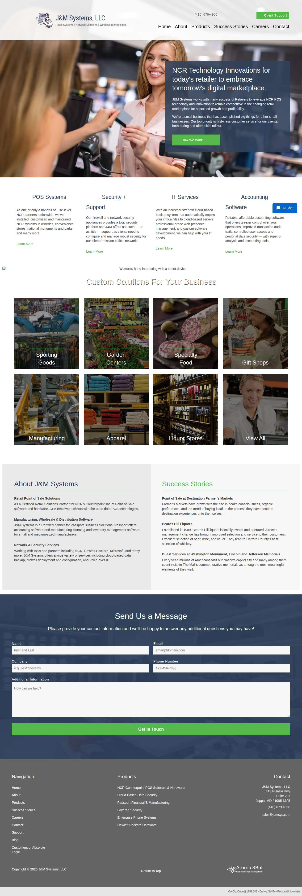

### actionvideoservice.com — error\_after\_submit (LIVE)

| | |
|---|---|
| Attempt ID | `404b82b3-46a5-41f7-856c-9dc1433d33ad` |
| Form URL | https://actionvideoservice.com/contact/ |
| Final URL | https://actionvideoservice.com/contact/ |
| Reserved | 2026-11-06 04:02:19 UTC |
| Submit attempted | 2026-11-06 04:02:21 UTC |
| Template | standard v2 |
| Confirmation text | none observed |
| Result / error | Submit click error (outcome unknown, not retried): locator.click: Timeout 10000ms exceeded. |

Exact message:

~~~text
Subject: Helping customers find your business in AI search (AEO + GEO)

Hi there,

I'm Arun from Devs Arun. More and more customers now ask ChatGPT, Gemini, Perplexity or Google's AI Overviews questions like "who should I hire for this in my area?" before they call anyone. These tools answer from websites they can clearly understand, and they tend to recommend businesses whose pages answer real customer questions.

That is what AEO + GEO (Answer Engine and Generative Engine Optimization) is for. I improve your existing service pages so they clearly answer the questions your customers ask, add structured data that matches the page, and make the call, quote or enquiry step obvious. The benefit: your business gets a better chance of being mentioned or linked in AI answers, and visitors who arrive find it easy to contact you.

The AEO + GEO Starter is a one-time $199 (about ₹16,999, negotiable) for one website: a basic audit, 10 customer questions, improvements to two existing pages, relevant structured data and an action plan, with one revision round.

You can read the full details, send an enquiry or book online here:
https://devsarun.io/aeo-geo/

If this isn't relevant, just reply and I won't contact you again.

Best,
Arun
Devs Arun
itschool408@gmail.com · +91 7654534323
~~~

Submitted field values:

- Name \[name\]: Arun
- Email\* \[email\]: itschool408@gmail.com
- Subject \[subject\]: Helping customers find your business in AI search (AEO + GEO)
- Message\* \[message\]: Hi there, I'm Arun from Devs Arun. More and more customers now ask ChatGPT, Gemini, Perplexity or Google's AI Overviews 

**Filled form (before submit)** — `run-d9c1e7ce_attempt-404b82b3_filled_2026-11-06T04-02-21-182Z.jpg`

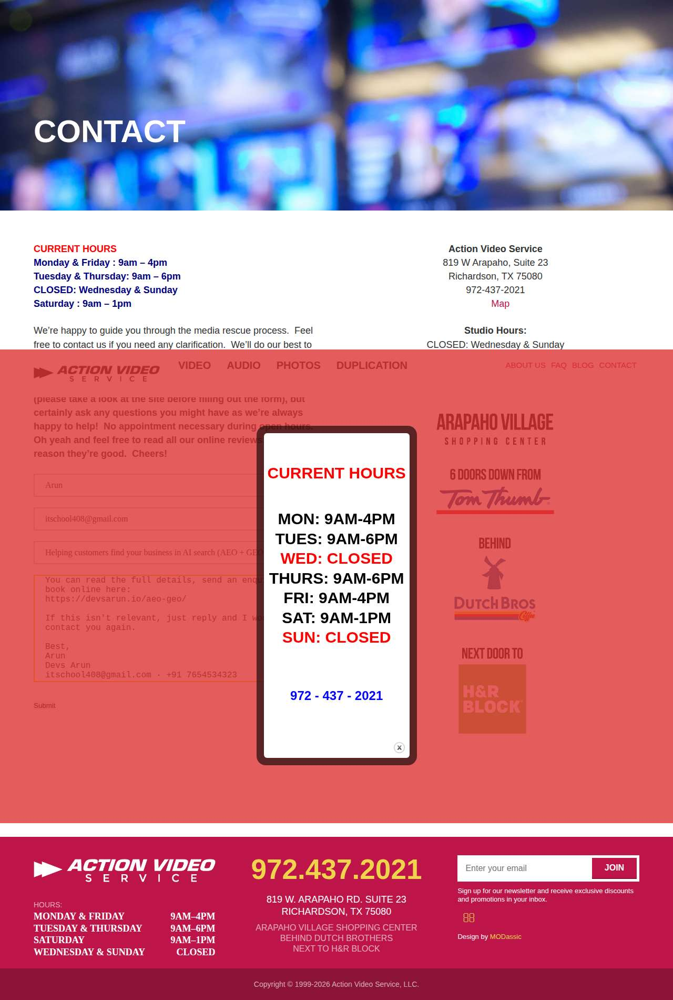

**After submit** — `run-d9c1e7ce_attempt-404b82b3_post_attempt_2026-11-06T04-02-34-761Z.jpg`

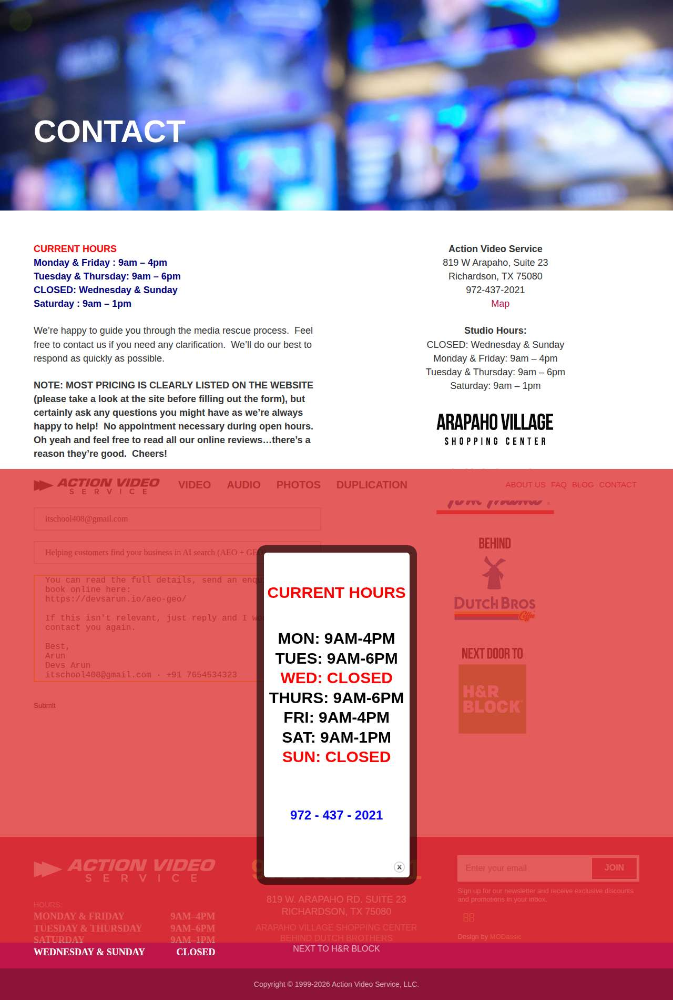

### ackavionics.com — failed\_before\_submit (LIVE)

| | |
|---|---|
| Attempt ID | `2e3fa7e7-902b-41e0-b276-8bf513e20c8d` |
| Form URL | https://www.ackavionics.com/contact-us-2/ |
| Final URL | — |
| Reserved | 2026-11-06 04:02:43 UTC |
| Submit attempted | — |
| Template | standard v2 |
| Confirmation text | none observed |
| Result / error | locator.fill: Error: Cannot type text into input\[type=number\] |

Exact message:

~~~text
Subject: Helping customers find your business in AI search (AEO + GEO)

Hi there,

I'm Arun from Devs Arun. More and more customers now ask ChatGPT, Gemini, Perplexity or Google's AI Overviews questions like "who should I hire for this in my area?" before they call anyone. These tools answer from websites they can clearly understand, and they tend to recommend businesses whose pages answer real customer questions.

That is what AEO + GEO (Answer Engine and Generative Engine Optimization) is for. I improve your existing service pages so they clearly answer the questions your customers ask, add structured data that matches the page, and make the call, quote or enquiry step obvious. The benefit: your business gets a better chance of being mentioned or linked in AI answers, and visitors who arrive find it easy to contact you.

The AEO + GEO Starter is a one-time $199 (about ₹16,999, negotiable) for one website: a basic audit, 10 customer questions, improvements to two existing pages, relevant structured data and an action plan, with one revision round.

You can read the full details, send an enquiry or book online here:
https://devsarun.io/aeo-geo/

If this isn't relevant, just reply and I won't contact you again.

Best,
Arun
Devs Arun
itschool408@gmail.com · +91 7654534323
~~~

Submitted field values:

- input\[name="text-30"\]: Arun
- input\[name="email-380"\]: itschool408@gmail.com
- input\[name="number-19"\]: +91 7654534323
- textarea\[name="textarea"\]: Hi there, I'm Arun from Devs Arun. More and more customers now ask ChatGPT, Gemini, Perplexity or Google's AI Overviews 

**Inspected page** — `run-d9c1e7ce_attempt-2e3fa7e7_inspection_2026-11-06T04-02-45-020Z.jpg`

### atomicmachines.com — confirmed (LIVE)

| | |
|---|---|
| Attempt ID | `0f1d1701-baf0-4d8a-b82b-297439135c1b` |
| Form URL | https://www.atomicmachines.com/contact |
| Final URL | https://www.atomicmachines.com/contact |
| Reserved | 2026-11-06 04:02:50 UTC |
| Submit attempted | 2026-11-06 04:02:51 UTC |
| Template | standard v2 |
| Confirmation text | MPANY NAME HOW DID YOU HEAR ABOUT US? MESSAGE\* Send message Message sent. Thank you: we’ll be in touch. © 2026 Atomic Machines, Inc. v0.1.0 Atomic Machines It’s time for AI |
| Result / error | — |

Exact message:

~~~text
Subject: Helping customers find your business in AI search (AEO + GEO)

Hi there,

I'm Arun from Devs Arun. More and more customers now ask ChatGPT, Gemini, Perplexity or Google's AI Overviews questions like "who should I hire for this in my area?" before they call anyone. These tools answer from websites they can clearly understand, and they tend to recommend businesses whose pages answer real customer questions.

That is what AEO + GEO (Answer Engine and Generative Engine Optimization) is for. I improve your existing service pages so they clearly answer the questions your customers ask, add structured data that matches the page, and make the call, quote or enquiry step obvious. The benefit: your business gets a better chance of being mentioned or linked in AI answers, and visitors who arrive find it easy to contact you.

The AEO + GEO Starter is a one-time $199 (about ₹16,999, negotiable) for one website: a basic audit, 10 customer questions, improvements to two existing pages, relevant structured data and an action plan, with one revision round.

You can read the full details, send an enquiry or book online here:
https://devsarun.io/aeo-geo/

If this isn't relevant, just reply and I won't contact you again.

Best,
Arun
Devs Arun
itschool408@gmail.com · +91 7654534323
~~~

Submitted field values:

- NAME\* \[name\]: Arun
- MESSAGE\* \[message\]: Hi there, I'm Arun from Devs Arun. More and more customers now ask ChatGPT, Gemini, Perplexity or Google's AI Overviews 
- WORK EMAIL\* \[email\]: itschool408@gmail.com
- COMPANY NAME \[company\]: Devs Arun

**Filled form (before submit)** — `run-d9c1e7ce_attempt-0f1d1701_filled_2026-11-06T04-02-50-993Z.jpg`

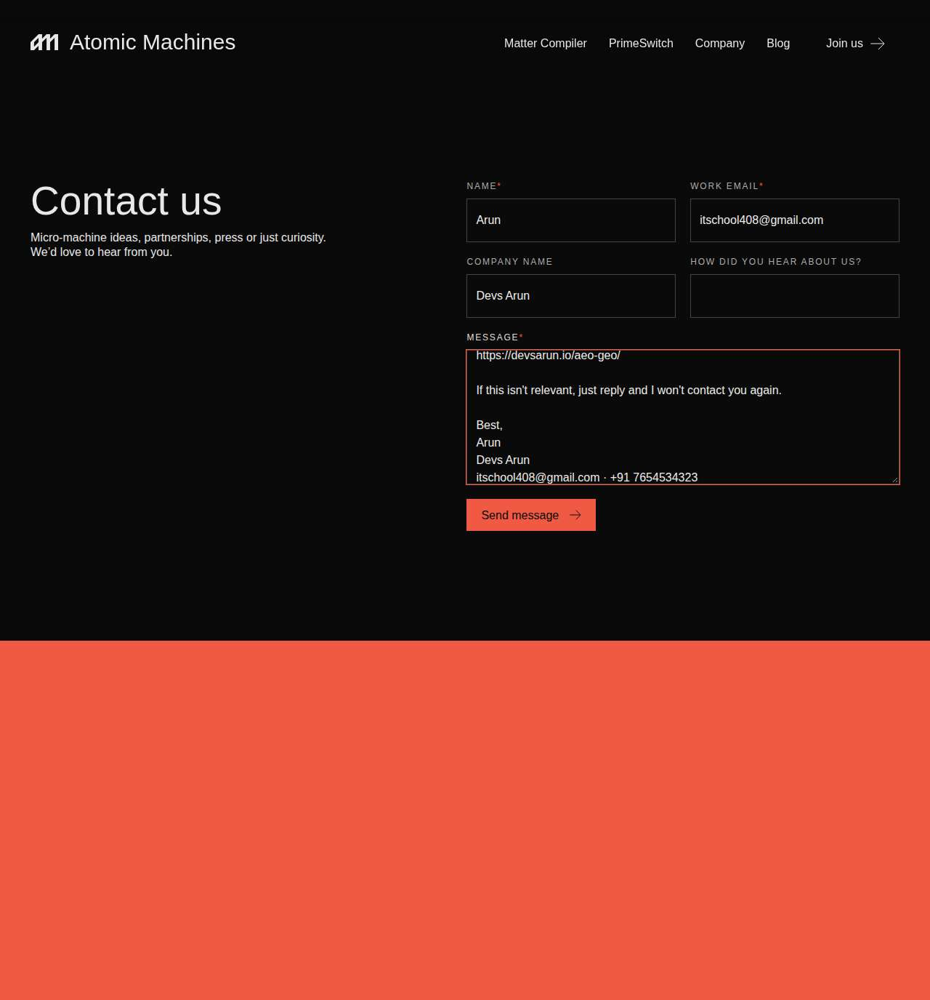

**After submit** — `run-d9c1e7ce_attempt-0f1d1701_post_attempt_2026-11-06T04-02-55-840Z.jpg`

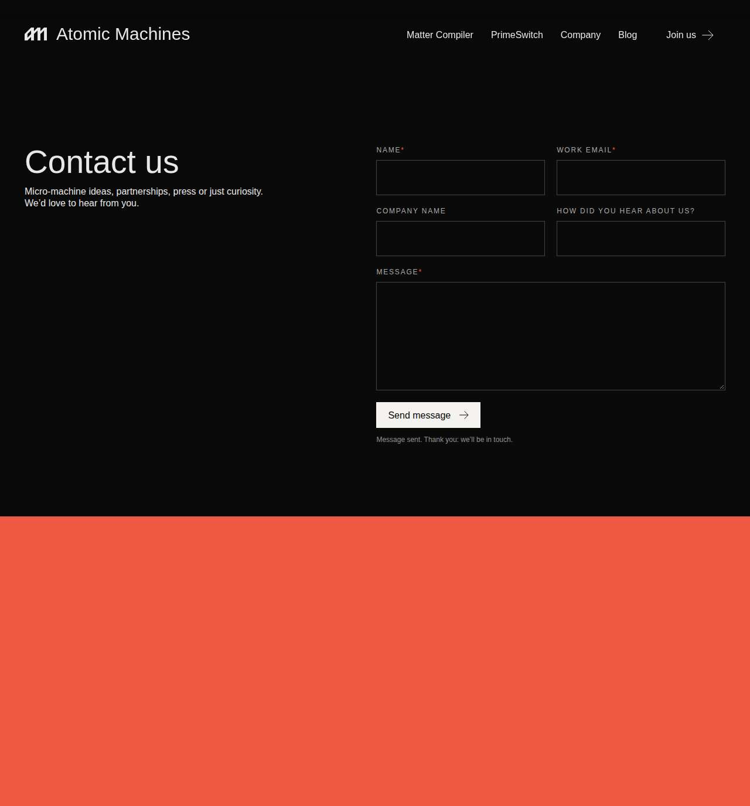

### oactel.com — unclear (LIVE)

| | |
|---|---|
| Attempt ID | `a2ae01b4-a24a-4218-8bee-4b4448913101` |
| Form URL | https://oactel.com/contact-page/ |
| Final URL | https://oactel.com/contact-page/\#4674706d61f4f1b1e937a12b067f61b0372330fd |
| Reserved | 2026-11-06 04:03:04 UTC |
| Submit attempted | 2026-11-06 04:03:09 UTC |
| Template | standard v2 |
| Confirmation text | none observed |
| Result / error | No new success marker observed |

Exact message:

~~~text
Subject: Helping customers find your business in AI search (AEO + GEO)

Hi there,

I'm Arun from Devs Arun. More and more customers now ask ChatGPT, Gemini, Perplexity or Google's AI Overviews questions like "who should I hire for this in my area?" before they call anyone. These tools answer from websites they can clearly understand, and they tend to recommend businesses whose pages answer real customer questions.

That is what AEO + GEO (Answer Engine and Generative Engine Optimization) is for. I improve your existing service pages so they clearly answer the questions your customers ask, add structured data that matches the page, and make the call, quote or enquiry step obvious. The benefit: your business gets a better chance of being mentioned or linked in AI answers, and visitors who arrive find it easy to contact you.

The AEO + GEO Starter is a one-time $199 (about ₹16,999, negotiable) for one website: a basic audit, 10 customer questions, improvements to two existing pages, relevant structured data and an action plan, with one revision round.

You can read the full details, send an enquiry or book online here:
https://devsarun.io/aeo-geo/

If this isn't relevant, just reply and I won't contact you again.

Best,
Arun
Devs Arun
itschool408@gmail.com · +91 7654534323
~~~

Submitted field values:

- Email \[email\]: itschool408@gmail.com
- Message \[message\]: Hi there, I'm Arun from Devs Arun. More and more customers now ask ChatGPT, Gemini, Perplexity or Google's AI Overviews 
- field-name\[value\] \[name\]: Arun
- field-phone\[value\] \[phone\]: +91 7654534323

**Filled form (before submit)** — `run-d9c1e7ce_attempt-a2ae01b4_filled_2026-11-06T04-03-09-047Z.jpg`

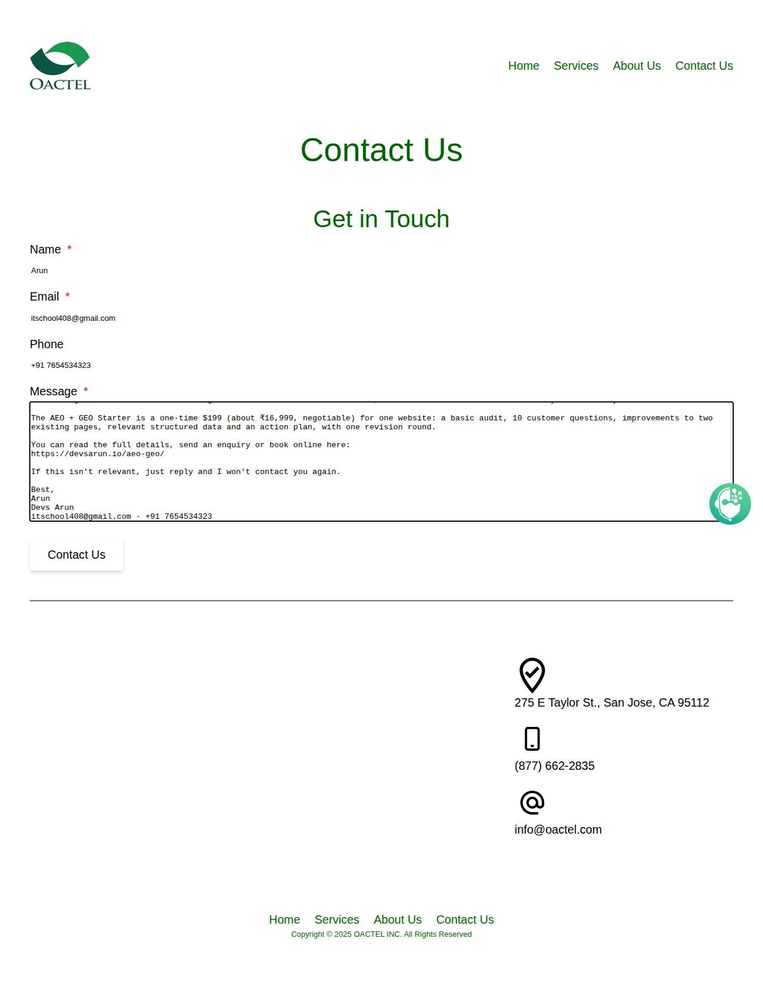

**After submit** — `run-d9c1e7ce_attempt-a2ae01b4_post_attempt_2026-11-06T04-03-46-177Z.jpg`

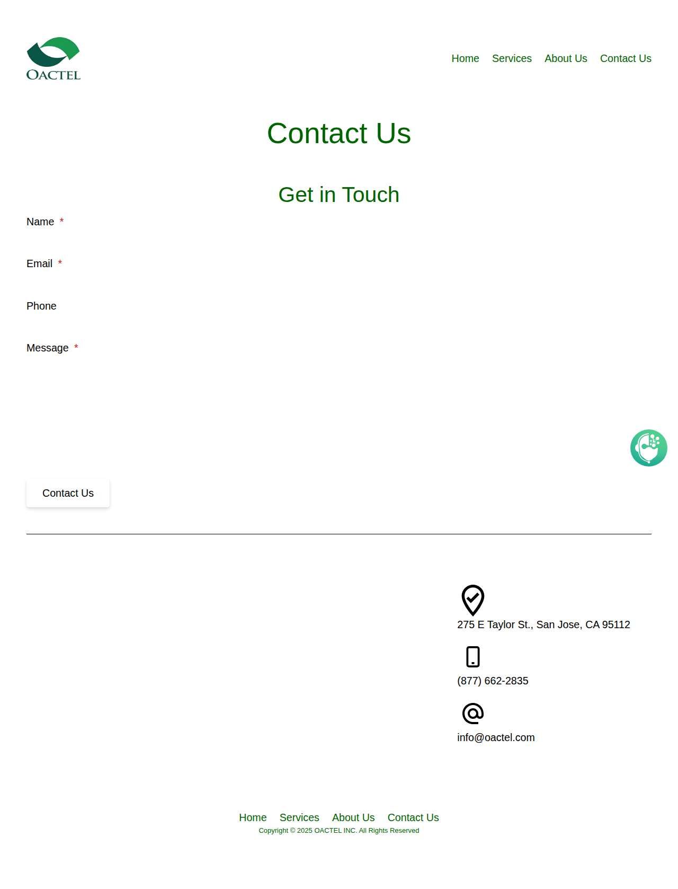

### 1845solutions.com — confirmed (LIVE)

| | |
|---|---|
| Attempt ID | `a863a1c1-226a-4546-bf19-d01b363bdd85` |
| Form URL | https://1845solutions.com/contact-us/ |
| Final URL | https://1845solutions.com/contact-us/ |
| Reserved | 2026-11-06 04:03:54 UTC |
| Submit attempted | 2026-11-06 04:03:58 UTC |
| Template | standard v2 |
| Confirmation text | ? Comments? Or suggestions? Feel free to send us a message\! Thank you for your message. It has been sent. Your name Your email Subject Your message (optional) Thank you for your message. |
| Result / error | — |

Exact message:

~~~text
Subject: Helping customers find your business in AI search (AEO + GEO)

Hi there,

I'm Arun from Devs Arun. More and more customers now ask ChatGPT, Gemini, Perplexity or Google's AI Overviews questions like "who should I hire for this in my area?" before they call anyone. These tools answer from websites they can clearly understand, and they tend to recommend businesses whose pages answer real customer questions.

That is what AEO + GEO (Answer Engine and Generative Engine Optimization) is for. I improve your existing service pages so they clearly answer the questions your customers ask, add structured data that matches the page, and make the call, quote or enquiry step obvious. The benefit: your business gets a better chance of being mentioned or linked in AI answers, and visitors who arrive find it easy to contact you.

The AEO + GEO Starter is a one-time $199 (about ₹16,999, negotiable) for one website: a basic audit, 10 customer questions, improvements to two existing pages, relevant structured data and an action plan, with one revision round.

You can read the full details, send an enquiry or book online here:
https://devsarun.io/aeo-geo/

If this isn't relevant, just reply and I won't contact you again.

Best,
Arun
Devs Arun
itschool408@gmail.com · +91 7654534323
~~~

Submitted field values:

- Your name \[name\]: Arun
- Subject \[subject\]: Helping customers find your business in AI search (AEO + GEO)
- Your email \[email\]: itschool408@gmail.com
- Your message (optional) \[message\]: Hi there, I'm Arun from Devs Arun. More and more customers now ask ChatGPT, Gemini, Perplexity or Google's AI Overviews 

**Filled form (before submit)** — `run-d9c1e7ce_attempt-a863a1c1_filled_2026-11-06T04-03-58-594Z.jpg`

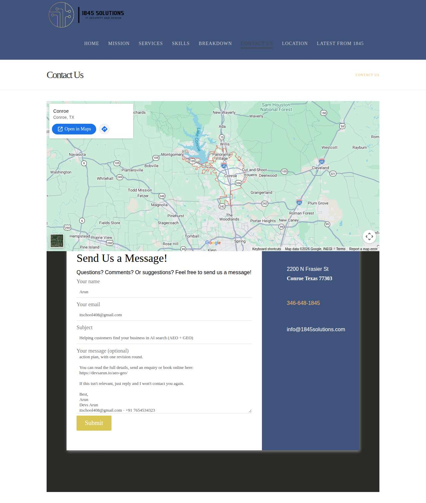

**After submit** — `run-d9c1e7ce_attempt-a863a1c1_post_attempt_2026-11-06T04-04-04-097Z.jpg`

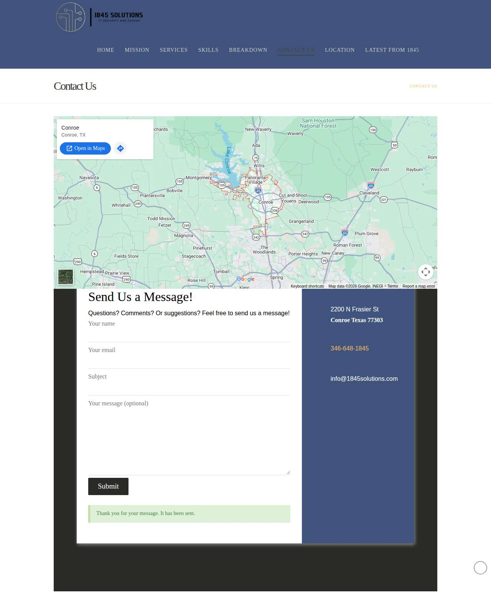

### rebaca.com — confirmed (LIVE)

| | |
|---|---|
| Attempt ID | `f10aab66-b959-495b-8fe4-3f0252783fcf` |
| Form URL | https://rebaca.com/contact-us/ |
| Final URL | https://rebaca.com/contact-us/ |
| Reserved | 2026-11-06 04:04:12 UTC |
| Submit attempted | 2026-11-06 04:04:14 UTC |
| Template | standard v2 |
| Confirmation text | or services. We’ll get back to you within 2 business days. Thanks for contacting us\! We will be in touch with you shortly. US OFFICE Rebaca Technologies 5201 Great America Pkwy, Su |
| Result / error | — |

Exact message:

~~~text
Subject: Helping customers find your business in AI search (AEO + GEO)

Hi there,

I'm Arun from Devs Arun. More and more customers now ask ChatGPT, Gemini, Perplexity or Google's AI Overviews questions like "who should I hire for this in my area?" before they call anyone. These tools answer from websites they can clearly understand, and they tend to recommend businesses whose pages answer real customer questions.

That is what AEO + GEO (Answer Engine and Generative Engine Optimization) is for. I improve your existing service pages so they clearly answer the questions your customers ask, add structured data that matches the page, and make the call, quote or enquiry step obvious. The benefit: your business gets a better chance of being mentioned or linked in AI answers, and visitors who arrive find it easy to contact you.

The AEO + GEO Starter is a one-time $199 (about ₹16,999, negotiable) for one website: a basic audit, 10 customer questions, improvements to two existing pages, relevant structured data and an action plan, with one revision round.

You can read the full details, send an enquiry or book online here:
https://devsarun.io/aeo-geo/

If this isn't relevant, just reply and I won't contact you again.

Best,
Arun
Devs Arun
itschool408@gmail.com · +91 7654534323
~~~

Submitted field values:

- Name \* \[name\]: Arun
- Phone \[phone\]: +91 7654534323
- Email \* \[email\]: itschool408@gmail.com
- Subject \[subject\]: Helping customers find your business in AI search (AEO + GEO)
- Comments or Message \[message\]: Hi there, I'm Arun from Devs Arun. More and more customers now ask ChatGPT, Gemini, Perplexity or Google's AI Overviews 

**Filled form (before submit)** — `run-d9c1e7ce_attempt-f10aab66_filled_2026-11-06T04-04-14-736Z.jpg`

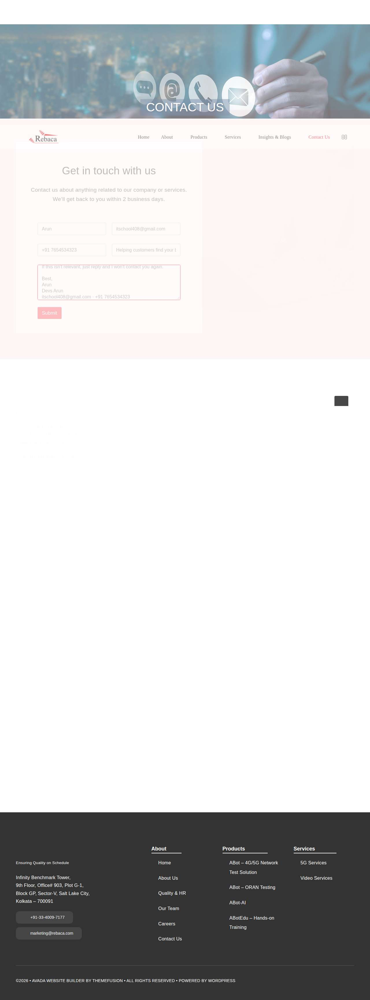

**After submit** — `run-d9c1e7ce_attempt-f10aab66_post_attempt_2026-11-06T04-04-21-670Z.jpg`

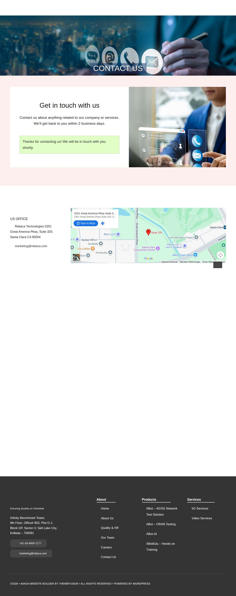

### anytechsystems.com — failed\_before\_submit (LIVE)

| | |
|---|---|
| Attempt ID | `cf8beab5-25fe-42ed-b18a-ac999c790d61` |
| Form URL | https://anytechsystems.com/ |
| Final URL | https://anytechsystems.com/ |
| Reserved | 2026-11-06 04:04:30 UTC |
| Submit attempted | — |
| Template | standard v2 |
| Confirmation text | none observed |
| Result / error | Field "Phone\*" did not accept the value |

Exact message:

~~~text
Subject: Helping customers find your business in AI search (AEO + GEO)

Hi there,

I'm Arun from Devs Arun. More and more customers now ask ChatGPT, Gemini, Perplexity or Google's AI Overviews questions like "who should I hire for this in my area?" before they call anyone. These tools answer from websites they can clearly understand, and they tend to recommend businesses whose pages answer real customer questions.

That is what AEO + GEO (Answer Engine and Generative Engine Optimization) is for. I improve your existing service pages so they clearly answer the questions your customers ask, add structured data that matches the page, and make the call, quote or enquiry step obvious. The benefit: your business gets a better chance of being mentioned or linked in AI answers, and visitors who arrive find it easy to contact you.

The AEO + GEO Starter is a one-time $199 (about ₹16,999, negotiable) for one website: a basic audit, 10 customer questions, improvements to two existing pages, relevant structured data and an action plan, with one revision round.

You can read the full details, send an enquiry or book online here:
https://devsarun.io/aeo-geo/

If this isn't relevant, just reply and I won't contact you again.

Best,
Arun
Devs Arun
itschool408@gmail.com · +91 7654534323
~~~

Submitted field values:

- \#input\_1\_1: Arun
- \#input\_1\_2: itschool408@gmail.com
- \#input\_1\_3: +91 7654534323
- \#input\_1\_4: Hi there, I'm Arun from Devs Arun. More and more customers now ask ChatGPT, Gemini, Perplexity or Google's AI Overviews 

**Filled form (before submit)** — `run-d9c1e7ce_attempt-cf8beab5_filled_2026-11-06T04-04-34-774Z.jpg`

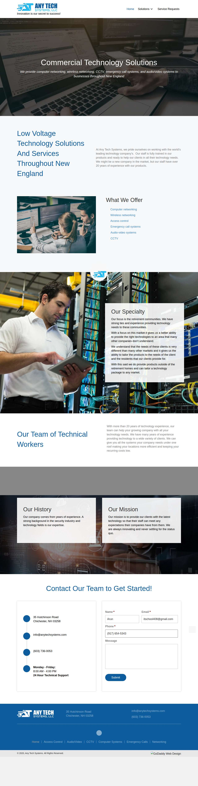

### scarlettculture.com — confirmed (LIVE)

| | |
|---|---|
| Attempt ID | `79d77f93-5889-4454-bc33-328c4e905a18` |
| Form URL | https://www.scarlettgroup.com/about-us/contact-us |
| Final URL | https://www.scarlettgroup.com/about-us/contact-us-success |
| Reserved | 2026-11-06 04:04:39 UTC |
| Submit attempted | 2026-11-06 04:04:45 UTC |
| Template | standard v2 |
| Confirmation text | ervices in Raleigh, NC Managed IT Services in Charlotte, NC Message Sent\! Your message has been successfully sent. Thank you for your interest in The Scarlett Group. We wil |
| Result / error | — |

Exact message:

~~~text
Subject: Helping customers find your business in AI search (AEO + GEO)

Hi there,

I'm Arun from Devs Arun. More and more customers now ask ChatGPT, Gemini, Perplexity or Google's AI Overviews questions like "who should I hire for this in my area?" before they call anyone. These tools answer from websites they can clearly understand, and they tend to recommend businesses whose pages answer real customer questions.

That is what AEO + GEO (Answer Engine and Generative Engine Optimization) is for. I improve your existing service pages so they clearly answer the questions your customers ask, add structured data that matches the page, and make the call, quote or enquiry step obvious. The benefit: your business gets a better chance of being mentioned or linked in AI answers, and visitors who arrive find it easy to contact you.

The AEO + GEO Starter is a one-time $199 (about ₹16,999, negotiable) for one website: a basic audit, 10 customer questions, improvements to two existing pages, relevant structured data and an action plan, with one revision round.

You can read the full details, send an enquiry or book online here:
https://devsarun.io/aeo-geo/

If this isn't relevant, just reply and I won't contact you again.

Best,
Arun
Devs Arun
itschool408@gmail.com · +91 7654534323
~~~

Submitted field values:

- Name \[name\]: Arun
- Email \[email\]: itschool408@gmail.com
- Phone \[phone\]: +91 7654534323
- Title \[subject\]: Helping customers find your business in AI search (AEO + GEO)
- Company \[company\]: Devs Arun
- Message \[message\]: Hi there, I'm Arun from Devs Arun. More and more customers now ask ChatGPT, Gemini, Perplexity or Google's AI Overviews 

**Filled form (before submit)** — `run-d9c1e7ce_attempt-79d77f93_filled_2026-11-06T04-04-45-018Z.jpg`

**After submit** — `run-d9c1e7ce_attempt-79d77f93_post_attempt_2026-11-06T04-04-58-218Z.jpg`

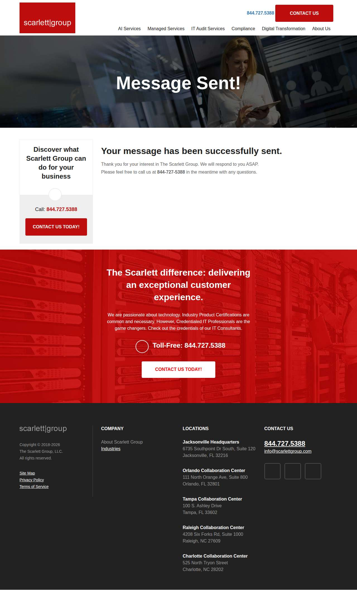

### computech.biz — confirmed (LIVE)

| | |
|---|---|
| Attempt ID | `d95f6abe-e8c9-4a61-829d-4450c6753b32` |
| Form URL | https://www.computech.biz/contact |
| Final URL | https://www.computech.biz/thank-you |
| Reserved | 2026-11-06 04:05:06 UTC |
| Submit attempted | 2026-11-06 04:05:08 UTC |
| Template | standard v2 |
| Confirmation text | S WHY COMPUTECH RESOURCES CONTACT 801.298.2155 CONTACT INFO Thank you for submitting your information A member of our team will be in touch with you shortly to answer yo |
| Result / error | — |

Exact message:

~~~text
Subject: Helping customers find your business in AI search (AEO + GEO)

Hi there,

I'm Arun from Devs Arun. More and more customers now ask ChatGPT, Gemini, Perplexity or Google's AI Overviews questions like "who should I hire for this in my area?" before they call anyone. These tools answer from websites they can clearly understand, and they tend to recommend businesses whose pages answer real customer questions.

That is what AEO + GEO (Answer Engine and Generative Engine Optimization) is for. I improve your existing service pages so they clearly answer the questions your customers ask, add structured data that matches the page, and make the call, quote or enquiry step obvious. The benefit: your business gets a better chance of being mentioned or linked in AI answers, and visitors who arrive find it easy to contact you.

The AEO + GEO Starter is a one-time $199 (about ₹16,999, negotiable) for one website: a basic audit, 10 customer questions, improvements to two existing pages, relevant structured data and an action plan, with one revision round.

You can read the full details, send an enquiry or book online here:
https://devsarun.io/aeo-geo/

If this isn't relevant, just reply and I won't contact you again.

Best,
Arun
Devs Arun
itschool408@gmail.com · +91 7654534323
~~~

Submitted field values:

- Name \[name\]: Arun
- Email \[email\]: itschool408@gmail.com
- Phone \[phone\]: +91 7654534323
- Company \[company\]: Devs Arun
- Comments \[message\]: Hi there, I'm Arun from Devs Arun. More and more customers now ask ChatGPT, Gemini, Perplexity or Google's AI Overviews 

**Filled form (before submit)** — `run-d9c1e7ce_attempt-d95f6abe_filled_2026-11-06T04-05-08-321Z.jpg`

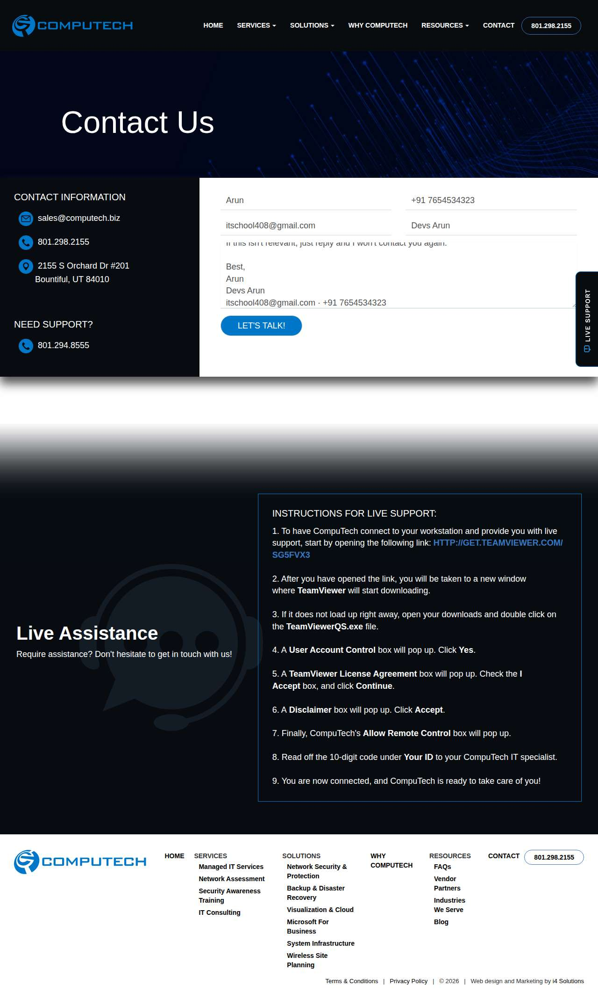

**After submit** — `run-d9c1e7ce_attempt-d95f6abe_post_attempt_2026-11-06T04-05-13-094Z.jpg`

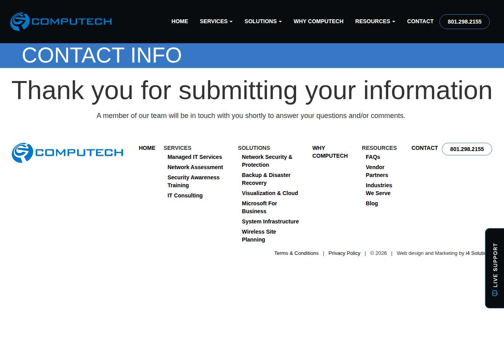

### trinoor.com — unclear (LIVE)

| | |
|---|---|
| Attempt ID | `af1c432e-2c83-49e7-b695-424ba74ba818` |
| Form URL | https://www.trinoor.com/contact\#contact |
| Final URL | https://www.trinoor.com/contact\#contact |
| Reserved | 2026-11-06 04:05:21 UTC |
| Submit attempted | 2026-11-06 04:05:28 UTC |
| Template | standard v2 |
| Confirmation text | none observed |
| Result / error | No new success marker observed |

Exact message:

~~~text
Subject: Helping customers find your business in AI search (AEO + GEO)

Hi there,

I'm Arun from Devs Arun. More and more customers now ask ChatGPT, Gemini, Perplexity or Google's AI Overviews questions like "who should I hire for this in my area?" before they call anyone. These tools answer from websites they can clearly understand, and they tend to recommend businesses whose pages answer real customer questions.

That is what AEO + GEO (Answer Engine and Generative Engine Optimization) is for. I improve your existing service pages so they clearly answer the questions your customers ask, add structured data that matches the page, and make the call, quote or enquiry step obvious. The benefit: your business gets a better chance of being mentioned or linked in AI answers, and visitors who arrive find it easy to contact you.

The AEO + GEO Starter is a one-time $199 (about ₹16,999, negotiable) for one website: a basic audit, 10 customer questions, improvements to two existing pages, relevant structured data and an action plan, with one revision round.

You can read the full details, send an enquiry or book online here:
https://devsarun.io/aeo-geo/

If this isn't relevant, just reply and I won't contact you again.

Best,
Arun
Devs Arun
itschool408@gmail.com · +91 7654534323
~~~

Submitted field values:

- Name \[name\]: Arun
- Email \[email\]: itschool408@gmail.com
- Company \[company\]: Devs Arun
- Message \[message\]: Hi there, I'm Arun from Devs Arun. More and more customers now ask ChatGPT, Gemini, Perplexity or Google's AI Overviews 

**Filled form (before submit)** — `run-d9c1e7ce_attempt-af1c432e_filled_2026-11-06T04-05-28-204Z.jpg`

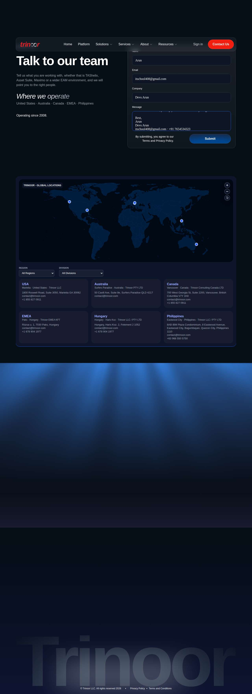

**After submit** — `run-d9c1e7ce_attempt-af1c432e_post_attempt_2026-11-06T04-06-04-649Z.jpg`

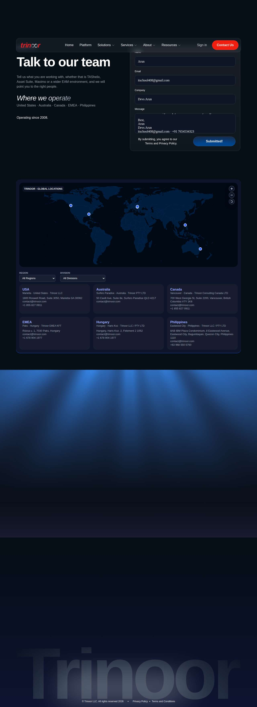

### copiersnw.com — failed\_before\_submit (LIVE)

| | |
|---|---|
| Attempt ID | `8a979bef-2cc0-43a0-abe4-f8d289451551` |
| Form URL | https://copiersnw.com/contact/ |
| Final URL | https://copiersnw.com/contact/ |
| Reserved | 2026-11-06 04:06:14 UTC |
| Submit attempted | — |
| Template | standard v2 |
| Confirmation text | none observed |
| Result / error | Field "Business Phone Number\*" did not accept the value |

Exact message:

~~~text
Subject: Helping customers find your business in AI search (AEO + GEO)

Hi there,

I'm Arun from Devs Arun. More and more customers now ask ChatGPT, Gemini, Perplexity or Google's AI Overviews questions like "who should I hire for this in my area?" before they call anyone. These tools answer from websites they can clearly understand, and they tend to recommend businesses whose pages answer real customer questions.

That is what AEO + GEO (Answer Engine and Generative Engine Optimization) is for. I improve your existing service pages so they clearly answer the questions your customers ask, add structured data that matches the page, and make the call, quote or enquiry step obvious. The benefit: your business gets a better chance of being mentioned or linked in AI answers, and visitors who arrive find it easy to contact you.

The AEO + GEO Starter is a one-time $199 (about ₹16,999, negotiable) for one website: a basic audit, 10 customer questions, improvements to two existing pages, relevant structured data and an action plan, with one revision round.

You can read the full details, send an enquiry or book online here:
https://devsarun.io/aeo-geo/

If this isn't relevant, just reply and I won't contact you again.

Best,
Arun
Devs Arun
itschool408@gmail.com · +91 7654534323
~~~

Submitted field values:

- \#input\_2\_1: Devs Arun
- \#input\_2\_3: itschool408@gmail.com
- \#input\_2\_4: +91 7654534323
- \#input\_2\_6: Hi there, I'm Arun from Devs Arun. More and more customers now ask ChatGPT, Gemini, Perplexity or Google's AI Overviews 
- \#input\_2\_9: itschool408@gmail.com
- \#input\_2\_12: Arun

**Filled form (before submit)** — `run-d9c1e7ce_attempt-8a979bef_filled_2026-11-06T04-06-18-796Z.jpg`

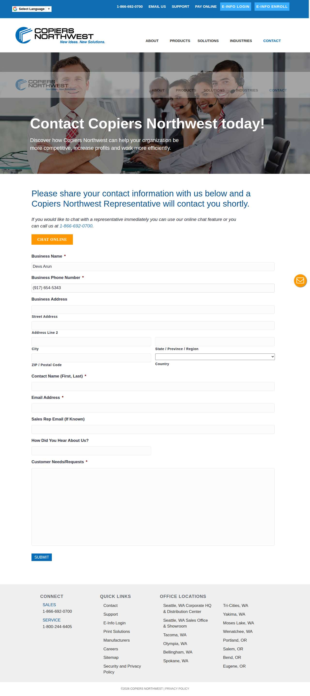

### whoisowenjones.com — unclear (LIVE)

| | |
|---|---|
| Attempt ID | `8454a82d-8284-4fbc-a8a7-3ad9b7f7df3a` |
| Form URL | https://weareowen.co/contact/ |
| Final URL | https://weareowen.co/contact/ |
| Reserved | 2026-11-06 04:06:23 UTC |
| Submit attempted | 2026-11-06 04:06:26 UTC |
| Template | standard v2 |
| Confirmation text | none observed |
| Result / error | No new success marker observed |

Exact message:

~~~text
Subject: Helping customers find your business in AI search (AEO + GEO)

Hi there,

I'm Arun from Devs Arun. More and more customers now ask ChatGPT, Gemini, Perplexity or Google's AI Overviews questions like "who should I hire for this in my area?" before they call anyone. These tools answer from websites they can clearly understand, and they tend to recommend businesses whose pages answer real customer questions.

That is what AEO + GEO (Answer Engine and Generative Engine Optimization) is for. I improve your existing service pages so they clearly answer the questions your customers ask, add structured data that matches the page, and make the call, quote or enquiry step obvious. The benefit: your business gets a better chance of being mentioned or linked in AI answers, and visitors who arrive find it easy to contact you.

The AEO + GEO Starter is a one-time $199 (about ₹16,999, negotiable) for one website: a basic audit, 10 customer questions, improvements to two existing pages, relevant structured data and an action plan, with one revision round.

You can read the full details, send an enquiry or book online here:
https://devsarun.io/aeo-geo/

If this isn't relevant, just reply and I won't contact you again.

Best,
Arun
Devs Arun
itschool408@gmail.com · +91 7654534323
~~~

Submitted field values:

- Email \[email\]: itschool408@gmail.com
- Company Name \[company\]: Devs Arun
- First & Last Name \[name\]: Arun
- Project details \[message\]: Hi there, I'm Arun from Devs Arun. More and more customers now ask ChatGPT, Gemini, Perplexity or Google's AI Overviews 

**Filled form (before submit)** — `run-d9c1e7ce_attempt-8454a82d_filled_2026-11-06T04-06-26-003Z.jpg`

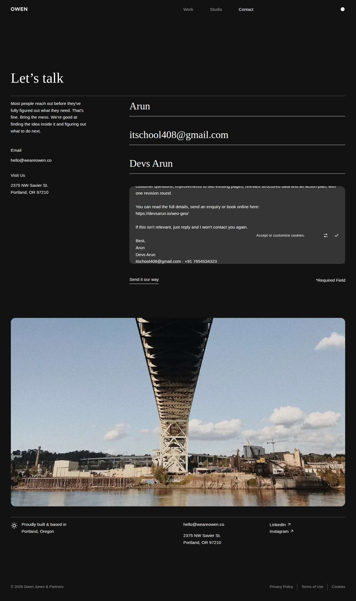

**After submit** — `run-d9c1e7ce_attempt-8454a82d_post_attempt_2026-11-06T04-06-54-869Z.jpg`

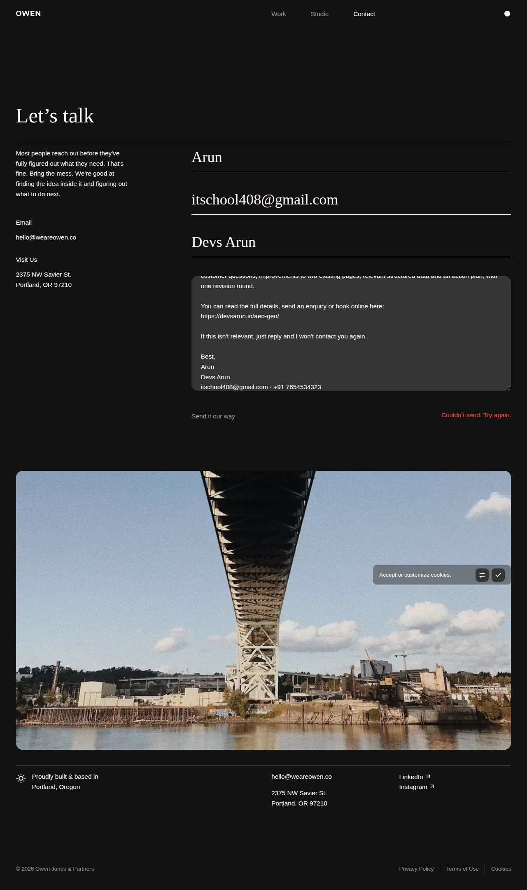

### 206agency.com — confirmed (LIVE)

| | |
|---|---|
| Attempt ID | `f2d2c407-2410-4a12-8278-0224fa3c01cf` |
| Form URL | https://206agency.com/ |
| Final URL | https://206agency.com/ |
| Reserved | 2026-11-06 04:07:03 UTC |
| Submit attempted | 2026-11-06 04:07:05 UTC |
| Template | standard v2 |
| Confirmation text | n and cultural impact. Name\* Email\* Message\* Submit Inquiry Thank you for your inquiry. We will be in touch shortly. Connect Confidential Inquiries We are curating our roster and strateg |
| Result / error | — |

Exact message:

~~~text
Subject: Helping customers find your business in AI search (AEO + GEO)

Hi there,

I'm Arun from Devs Arun. More and more customers now ask ChatGPT, Gemini, Perplexity or Google's AI Overviews questions like "who should I hire for this in my area?" before they call anyone. These tools answer from websites they can clearly understand, and they tend to recommend businesses whose pages answer real customer questions.

That is what AEO + GEO (Answer Engine and Generative Engine Optimization) is for. I improve your existing service pages so they clearly answer the questions your customers ask, add structured data that matches the page, and make the call, quote or enquiry step obvious. The benefit: your business gets a better chance of being mentioned or linked in AI answers, and visitors who arrive find it easy to contact you.

The AEO + GEO Starter is a one-time $199 (about ₹16,999, negotiable) for one website: a basic audit, 10 customer questions, improvements to two existing pages, relevant structured data and an action plan, with one revision round.

You can read the full details, send an enquiry or book online here:
https://devsarun.io/aeo-geo/

If this isn't relevant, just reply and I won't contact you again.

Best,
Arun
Devs Arun
itschool408@gmail.com · +91 7654534323
~~~

Submitted field values:

- Name\* \[name\]: Arun
- Email\* \[email\]: itschool408@gmail.com
- Message\* \[message\]: Hi there, I'm Arun from Devs Arun. More and more customers now ask ChatGPT, Gemini, Perplexity or Google's AI Overviews 

**Filled form (before submit)** — `run-d9c1e7ce_attempt-f2d2c407_filled_2026-11-06T04-07-05-039Z.jpg`

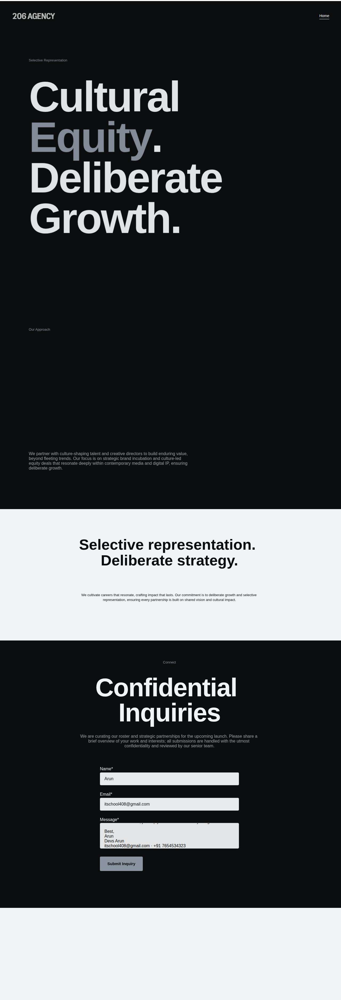

**After submit** — `run-d9c1e7ce_attempt-f2d2c407_post_attempt_2026-11-06T04-07-09-750Z.jpg`

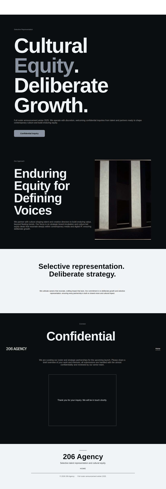

### completemediainc.com — confirmed (LIVE)

| | |
|---|---|
| Attempt ID | `9f79503a-8f1c-4644-8487-cf3f93d160be` |
| Form URL | https://complete.media/contact |
| Final URL | https://complete.media/contact |
| Reserved | 2026-11-06 04:07:18 UTC |
| Submit attempted | 2026-11-06 04:07:21 UTC |
| Template | standard v2 |
| Confirmation text | ng on and we'll reach out within one business day. Got it — thanks\! We'll reach out within one business day. If it's urgent, call us at 605.360.2259. CALL 605.360.225 |
| Result / error | — |

Exact message:

~~~text
Subject: Helping customers find your business in AI search (AEO + GEO)

Hi there,

I'm Arun from Devs Arun. More and more customers now ask ChatGPT, Gemini, Perplexity or Google's AI Overviews questions like "who should I hire for this in my area?" before they call anyone. These tools answer from websites they can clearly understand, and they tend to recommend businesses whose pages answer real customer questions.

That is what AEO + GEO (Answer Engine and Generative Engine Optimization) is for. I improve your existing service pages so they clearly answer the questions your customers ask, add structured data that matches the page, and make the call, quote or enquiry step obvious. The benefit: your business gets a better chance of being mentioned or linked in AI answers, and visitors who arrive find it easy to contact you.

The AEO + GEO Starter is a one-time $199 (about ₹16,999, negotiable) for one website: a basic audit, 10 customer questions, improvements to two existing pages, relevant structured data and an action plan, with one revision round.

You can read the full details, send an enquiry or book online here:
https://devsarun.io/aeo-geo/

If this isn't relevant, just reply and I won't contact you again.

Best,
Arun
Devs Arun
itschool408@gmail.com · +91 7654534323
~~~

Submitted field values:

- Email \* \[email\]: itschool408@gmail.com
- Phone \* \[phone\]: +91 7654534323
- Your name \* \[name\]: Arun
- Business name \* \[company\]: Devs Arun
- What's on your mind? \[message\]: Hi there, I'm Arun from Devs Arun. More and more customers now ask ChatGPT, Gemini, Perplexity or Google's AI Overviews 

**Filled form (before submit)** — `run-d9c1e7ce_attempt-9f79503a_filled_2026-11-06T04-07-21-164Z.jpg`

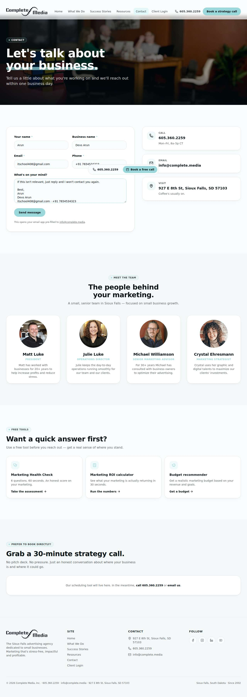

**After submit** — `run-d9c1e7ce_attempt-9f79503a_post_attempt_2026-11-06T04-07-24-912Z.jpg`

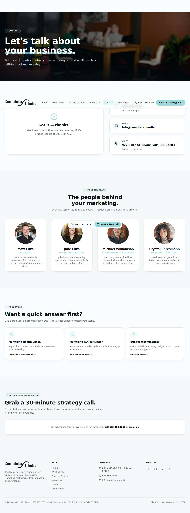

### i5810media.com — confirmed (LIVE)

| | |
|---|---|
| Attempt ID | `314ef67f-1967-49ca-a05d-9a2899486bca` |
| Form URL | https://missionactivate.com/contact/ |
| Final URL | https://missionactivate.com/contact-typ/ |
| Reserved | 2026-11-06 04:07:33 UTC |
| Submit attempted | 2026-11-06 04:07:34 UTC |
| Template | standard v2 |
| Confirmation text | p to content home about services speaking resources contact Thanks. Your message has been received. Let’s grow your good. We’ve received your note and a team member w |
| Result / error | — |

Exact message:

~~~text
Subject: Helping customers find your business in AI search (AEO + GEO)

Hi there,

I'm Arun from Devs Arun. More and more customers now ask ChatGPT, Gemini, Perplexity or Google's AI Overviews questions like "who should I hire for this in my area?" before they call anyone. These tools answer from websites they can clearly understand, and they tend to recommend businesses whose pages answer real customer questions.

That is what AEO + GEO (Answer Engine and Generative Engine Optimization) is for. I improve your existing service pages so they clearly answer the questions your customers ask, add structured data that matches the page, and make the call, quote or enquiry step obvious. The benefit: your business gets a better chance of being mentioned or linked in AI answers, and visitors who arrive find it easy to contact you.

The AEO + GEO Starter is a one-time $199 (about ₹16,999, negotiable) for one website: a basic audit, 10 customer questions, improvements to two existing pages, relevant structured data and an action plan, with one revision round.

You can read the full details, send an enquiry or book online here:
https://devsarun.io/aeo-geo/

If this isn't relevant, just reply and I won't contact you again.

Best,
Arun
Devs Arun
itschool408@gmail.com · +91 7654534323
~~~

Submitted field values:

- Name \[name\]: Arun
- Email \[email\]: itschool408@gmail.com
- Company \[company\]: Devs Arun
- Message \[message\]: Hi there, I'm Arun from Devs Arun. More and more customers now ask ChatGPT, Gemini, Perplexity or Google's AI Overviews 

**Filled form (before submit)** — `run-d9c1e7ce_attempt-314ef67f_filled_2026-11-06T04-07-34-876Z.jpg`

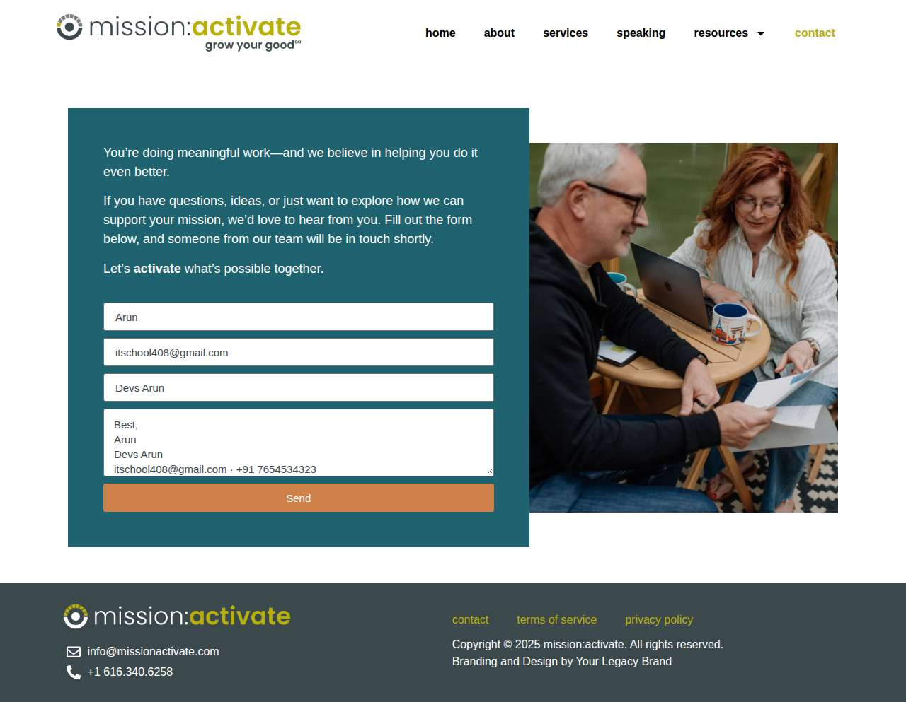

**After submit** — `run-d9c1e7ce_attempt-314ef67f_post_attempt_2026-11-06T04-07-45-639Z.jpg`

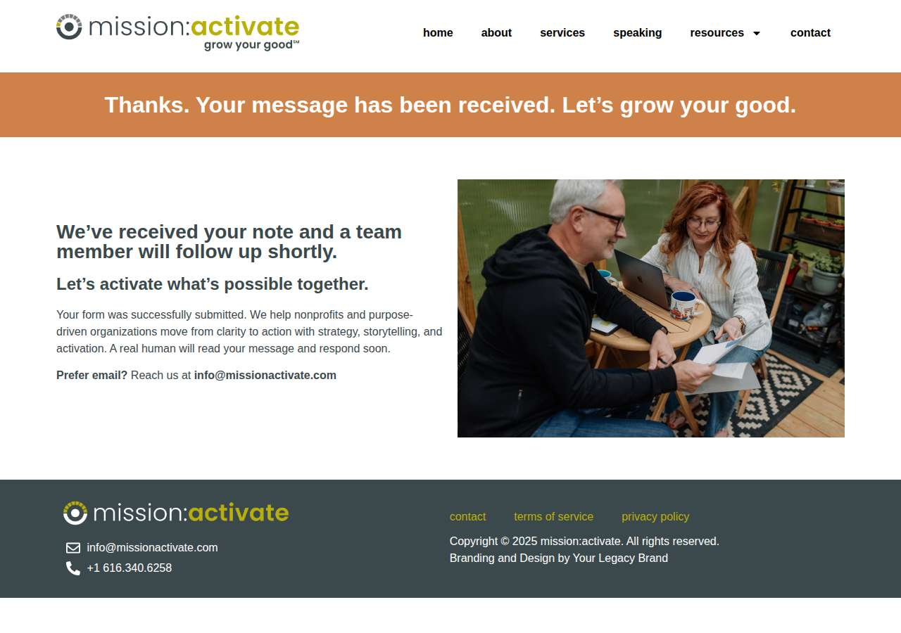

### docu-source.com — unclear (LIVE)

| | |
|---|---|
| Attempt ID | `de0fd182-f96f-4cb4-8d34-e7b99c889ea3` |
| Form URL | http://www.docu-source.com/ |
| Final URL | http://www.docu-source.com/ |
| Reserved | 2026-11-06 04:07:54 UTC |
| Submit attempted | 2026-11-06 04:07:57 UTC |
| Template | standard v2 |
| Confirmation text | none observed |
| Result / error | No new success marker observed |

Exact message:

~~~text
Subject: Helping customers find your business in AI search (AEO + GEO)

Hi there,

I'm Arun from Devs Arun. More and more customers now ask ChatGPT, Gemini, Perplexity or Google's AI Overviews questions like "who should I hire for this in my area?" before they call anyone. These tools answer from websites they can clearly understand, and they tend to recommend businesses whose pages answer real customer questions.

That is what AEO + GEO (Answer Engine and Generative Engine Optimization) is for. I improve your existing service pages so they clearly answer the questions your customers ask, add structured data that matches the page, and make the call, quote or enquiry step obvious. The benefit: your business gets a better chance of being mentioned or linked in AI answers, and visitors who arrive find it easy to contact you.

The AEO + GEO Starter is a one-time $199 (about ₹16,999, negotiable) for one website: a basic audit, 10 customer questions, improvements to two existing pages, relevant structured data and an action plan, with one revision round.

You can read the full details, send an enquiry or book online here:
https://devsarun.io/aeo-geo/

If this isn't relevant, just reply and I won't contact you again.

Best,
Arun
Devs Arun
itschool408@gmail.com · +91 7654534323
~~~

Submitted field values:

- Name \[name\]: Arun
- Email \[email\]: itschool408@gmail.com
- Write your message here... \[message\]: Hi there, I'm Arun from Devs Arun. More and more customers now ask ChatGPT, Gemini, Perplexity or Google's AI Overviews 

**Filled form (before submit)** — `run-d9c1e7ce_attempt-de0fd182_filled_2026-11-06T04-07-57-209Z.jpg`

**After submit** — `run-d9c1e7ce_attempt-de0fd182_post_attempt_2026-11-06T04-08-26-376Z.jpg`

### alphagraphics.com — unclear (LIVE)

| | |
|---|---|
| Attempt ID | `6b4cf229-f37b-4ac8-af3c-fbf3e28bd953` |
| Form URL | https://www.alphagraphics.com/contact-us/ |
| Final URL | https://www.alphagraphics.com/contact-us/ |
| Reserved | 2026-11-06 04:08:35 UTC |
| Submit attempted | 2026-11-06 04:08:39 UTC |
| Template | standard v2 |
| Confirmation text | none observed |
| Result / error | No new success marker observed |

Exact message:

~~~text
Subject: Helping customers find your business in AI search (AEO + GEO)

Hi there,

I'm Arun from Devs Arun. More and more customers now ask ChatGPT, Gemini, Perplexity or Google's AI Overviews questions like "who should I hire for this in my area?" before they call anyone. These tools answer from websites they can clearly understand, and they tend to recommend businesses whose pages answer real customer questions.

That is what AEO + GEO (Answer Engine and Generative Engine Optimization) is for. I improve your existing service pages so they clearly answer the questions your customers ask, add structured data that matches the page, and make the call, quote or enquiry step obvious. The benefit: your business gets a better chance of being mentioned or linked in AI answers, and visitors who arrive find it easy to contact you.

The AEO + GEO Starter is a one-time $199 (about ₹16,999, negotiable) for one website: a basic audit, 10 customer questions, improvements to two existing pages, relevant structured data and an action plan, with one revision round.

You can read the full details, send an enquiry or book online here:
https://devsarun.io/aeo-geo/

If this isn't relevant, just reply and I won't contact you again.

Best,
Arun
Devs Arun
itschool408@gmail.com · +91 7654534323
~~~

Submitted field values:

- Email \[email\]: itschool408@gmail.com
- Full Name \[name\]: Arun
- Company \[company\]: Devs Arun
- Message \[message\]: Hi there, I'm Arun from Devs Arun. More and more customers now ask ChatGPT, Gemini, Perplexity or Google's AI Overviews 

**Filled form (before submit)** — `run-d9c1e7ce_attempt-6b4cf229_filled_2026-11-06T04-08-39-608Z.jpg`

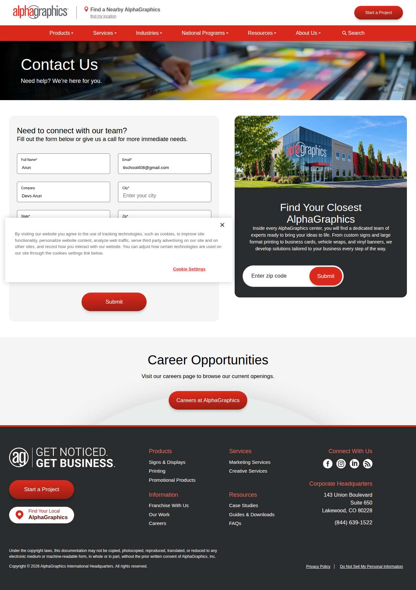

**After submit** — `run-d9c1e7ce_attempt-6b4cf229_post_attempt_2026-11-06T04-09-17-764Z.jpg`

## Events (175)

| Time (UTC) | Event | Website | Details |
|---|---|---|---|
| 04:00:42 | run\_queued | — | live run requested by github:itsDevsArun |
| 04:00:42 | run\_dispatched | — | dispatch disabled (local test mode) |
| 04:00:46 | run\_started | — | Runner claimed live run |
| 04:00:47 | offer\_verified | — | Service page offer facts verified |
| 04:00:47 | website\_selected | clearchoiceplumbingllc.com | Live target clearchoiceplumbingllc.com |
| 04:00:47 | attempt\_reserved | clearchoiceplumbingllc.com | Submission attempt reserved with template standard v2 |
| 04:00:48 | page\_opened | clearchoiceplumbingllc.com | Opened form page |
| 04:00:48 | screenshot\_saved | clearchoiceplumbingllc.com | inspection screenshot saved (144 KB) |
| 04:00:48 | review\_required | clearchoiceplumbingllc.com | failed before submit: locator.fill: Error: Cannot type text into input\[type=number\] |
| 04:00:53 | website\_selected | bwnwincpainting.com | Live target bwnwincpainting.com |
| 04:00:53 | attempt\_reserved | bwnwincpainting.com | Submission attempt reserved with template standard v2 |
| 04:00:55 | page\_opened | bwnwincpainting.com | Opened form page |
| 04:00:55 | screenshot\_saved | bwnwincpainting.com | inspection screenshot saved (118 KB) |
| 04:00:55 | review\_required | bwnwincpainting.com | failed before submit: locator.fill: Error: Cannot type text into input\[type=number\] |
| 04:01:00 | website\_selected | absoluterestorepa.com | Live target absoluterestorepa.com |
| 04:01:00 | attempt\_reserved | absoluterestorepa.com | Submission attempt reserved with template standard v2 |
| 04:01:04 | page\_opened | absoluterestorepa.com | Opened form page |
| 04:01:04 | screenshot\_saved | absoluterestorepa.com | inspection screenshot saved (175 KB) |
| 04:01:04 | review\_required | absoluterestorepa.com | failed before submit: locator.fill: Error: Cannot type text into input\[type=number\] |
| 04:01:09 | website\_selected | masoudlawfirm.com | Live target masoudlawfirm.com |
| 04:01:09 | attempt\_reserved | masoudlawfirm.com | Submission attempt reserved with template standard v2 |
| 04:01:13 | page\_opened | masoudlawfirm.com | Opened form page |
| 04:01:13 | screenshot\_saved | masoudlawfirm.com | inspection screenshot saved (169 KB) |
| 04:01:13 | review\_required | masoudlawfirm.com | failed before submit: locator.fill: Error: Cannot type text into input\[type=number\] |
| 04:01:18 | website\_selected | whiteolivecpa.com | Live target whiteolivecpa.com |
| 04:01:18 | attempt\_reserved | whiteolivecpa.com | Submission attempt reserved with template standard v2 |
| 04:01:19 | page\_opened | whiteolivecpa.com | Opened form page |
| 04:01:20 | screenshot\_saved | whiteolivecpa.com | inspection screenshot saved (197 KB) |
| 04:01:20 | review\_required | whiteolivecpa.com | failed before submit: locator.fill: Error: Cannot type text into input\[type=number\] |
| 04:01:25 | website\_selected | canterburyadvisor.com | Live target canterburyadvisor.com |
| 04:01:25 | attempt\_reserved | canterburyadvisor.com | Submission attempt reserved with template standard v2 |
| 04:01:26 | page\_opened | canterburyadvisor.com | Opened form page |
| 04:01:27 | screenshot\_saved | canterburyadvisor.com | inspection screenshot saved (350 KB) |
| 04:01:27 | review\_required | canterburyadvisor.com | failed before submit: locator.fill: Error: Cannot type text into input\[type=number\] |
| 04:01:32 | website\_selected | connectionzpcrepair.com | Live target connectionzpcrepair.com |
| 04:01:32 | attempt\_reserved | connectionzpcrepair.com | Submission attempt reserved with template standard v2 |
| 04:01:33 | page\_opened | connectionzpcrepair.com | Opened form page |
| 04:01:33 | screenshot\_saved | connectionzpcrepair.com | inspection screenshot saved (145 KB) |
| 04:01:33 | review\_required | connectionzpcrepair.com | failed before submit: locator.fill: Error: Cannot type text into input\[type=number\] |
| 04:01:38 | website\_selected | jamsys.com | Live target jamsys.com |
| 04:01:38 | attempt\_reserved | jamsys.com | Submission attempt reserved with template standard v2 |
| 04:01:40 | page\_opened | jamsys.com | Opened form page |
| 04:01:40 | fields\_filled | jamsys.com | filled |
| 04:01:40 | screenshot\_saved | jamsys.com | filled screenshot saved (174 KB) |
| 04:01:40 | submit\_attempted | jamsys.com | submitting |
| 04:02:11 | screenshot\_saved | jamsys.com | post\_attempt screenshot saved (358 KB) |
| 04:02:11 | review\_required | jamsys.com | unclear: No new success marker observed |
| 04:02:19 | website\_selected | actionvideoservice.com | Live target actionvideoservice.com |
| 04:02:19 | attempt\_reserved | actionvideoservice.com | Submission attempt reserved with template standard v2 |
| 04:02:20 | page\_opened | actionvideoservice.com | Opened form page |
| 04:02:21 | fields\_filled | actionvideoservice.com | filled |
| 04:02:21 | screenshot\_saved | actionvideoservice.com | filled screenshot saved (151 KB) |
| 04:02:21 | submit\_attempted | actionvideoservice.com | submitting |
| 04:02:34 | screenshot\_saved | actionvideoservice.com | post\_attempt screenshot saved (155 KB) |
| 04:02:34 | error | actionvideoservice.com | error after submit: Submit click error (outcome unknown, not retried): locator.click: Timeout 10000ms exceeded. |
| 04:02:43 | website\_selected | ackavionics.com | Live target ackavionics.com |
| 04:02:43 | attempt\_reserved | ackavionics.com | Submission attempt reserved with template standard v2 |
| 04:02:44 | page\_opened | ackavionics.com | Opened form page |
| 04:02:45 | screenshot\_saved | ackavionics.com | inspection screenshot saved (100 KB) |
| 04:02:45 | review\_required | ackavionics.com | failed before submit: locator.fill: Error: Cannot type text into input\[type=number\] |
| 04:02:50 | website\_selected | atomicmachines.com | Live target atomicmachines.com |
| 04:02:50 | attempt\_reserved | atomicmachines.com | Submission attempt reserved with template standard v2 |
| 04:02:50 | page\_opened | atomicmachines.com | Opened form page |
| 04:02:50 | fields\_filled | atomicmachines.com | filled |
| 04:02:50 | screenshot\_saved | atomicmachines.com | filled screenshot saved (45 KB) |
| 04:02:51 | submit\_attempted | atomicmachines.com | submitting |
| 04:02:55 | screenshot\_saved | atomicmachines.com | post\_attempt screenshot saved (36 KB) |
| 04:02:55 | confirmation\_observed | atomicmachines.com | confirmed — "MPANY NAME HOW DID YOU HEAR ABOUT US? MESSAGE\* Send message Message sent. Thank you: we’ll be in touch. © 2026 Atomic Ma" |
| 04:03:04 | website\_selected | oactel.com | Live target oactel.com |
| 04:03:04 | attempt\_reserved | oactel.com | Submission attempt reserved with template standard v2 |
| 04:03:08 | page\_opened | oactel.com | Opened form page |
| 04:03:08 | fields\_filled | oactel.com | filled |
| 04:03:09 | screenshot\_saved | oactel.com | filled screenshot saved (70 KB) |
| 04:03:09 | submit\_attempted | oactel.com | submitting |
| 04:03:46 | screenshot\_saved | oactel.com | post\_attempt screenshot saved (42 KB) |
| 04:03:46 | review\_required | oactel.com | unclear: No new success marker observed |
| 04:03:54 | website\_selected | 1845solutions.com | Live target 1845solutions.com |
| 04:03:54 | attempt\_reserved | 1845solutions.com | Submission attempt reserved with template standard v2 |
| 04:03:58 | page\_opened | 1845solutions.com | Opened form page |
| 04:03:58 | fields\_filled | 1845solutions.com | filled |
| 04:03:58 | screenshot\_saved | 1845solutions.com | filled screenshot saved (105 KB) |
| 04:03:58 | submit\_attempted | 1845solutions.com | submitting |
| 04:04:04 | screenshot\_saved | 1845solutions.com | post\_attempt screenshot saved (99 KB) |
| 04:04:04 | confirmation\_observed | 1845solutions.com | confirmed — "? Comments? Or suggestions? Feel free to send us a message\! Thank you for your message. It has been sent. Your name Your" |
| 04:04:12 | website\_selected | rebaca.com | Live target rebaca.com |
| 04:04:12 | attempt\_reserved | rebaca.com | Submission attempt reserved with template standard v2 |
| 04:04:14 | page\_opened | rebaca.com | Opened form page |
| 04:04:14 | fields\_filled | rebaca.com | filled |
| 04:04:14 | screenshot\_saved | rebaca.com | filled screenshot saved (91 KB) |
| 04:04:14 | submit\_attempted | rebaca.com | submitting |
| 04:04:21 | screenshot\_saved | rebaca.com | post\_attempt screenshot saved (155 KB) |
| 04:04:21 | confirmation\_observed | rebaca.com | confirmed — "or services. We’ll get back to you within 2 business days. Thanks for contacting us\! We will be in touch with you shortl" |
| 04:04:30 | website\_selected | anytechsystems.com | Live target anytechsystems.com |
| 04:04:30 | attempt\_reserved | anytechsystems.com | Submission attempt reserved with template standard v2 |
| 04:04:34 | page\_opened | anytechsystems.com | Opened form page |
| 04:04:34 | screenshot\_saved | anytechsystems.com | filled screenshot saved (407 KB) |
| 04:04:34 | review\_required | anytechsystems.com | failed before submit: Field "Phone\*" did not accept the value |
| 04:04:39 | website\_selected | scarlettculture.com | Live target scarlettculture.com |
| 04:04:39 | attempt\_reserved | scarlettculture.com | Submission attempt reserved with template standard v2 |
| 04:04:44 | page\_opened | scarlettculture.com | Opened form page |
| 04:04:44 | fields\_filled | scarlettculture.com | filled |
| 04:04:45 | screenshot\_saved | scarlettculture.com | filled screenshot saved (231 KB) |
| 04:04:45 | submit\_attempted | scarlettculture.com | submitting |
| 04:04:58 | screenshot\_saved | scarlettculture.com | post\_attempt screenshot saved (165 KB) |
| 04:04:58 | confirmation\_observed | scarlettculture.com | confirmed — "ervices in Raleigh, NC Managed IT Services in Charlotte, NC Message Sent\! Your message has been successfully sent. Thank" |
| 04:05:06 | website\_selected | computech.biz | Live target computech.biz |
| 04:05:06 | attempt\_reserved | computech.biz | Submission attempt reserved with template standard v2 |
| 04:05:08 | page\_opened | computech.biz | Opened form page |
| 04:05:08 | fields\_filled | computech.biz | filled |
| 04:05:08 | screenshot\_saved | computech.biz | filled screenshot saved (162 KB) |
| 04:05:08 | submit\_attempted | computech.biz | submitting |
| 04:05:13 | screenshot\_saved | computech.biz | post\_attempt screenshot saved (64 KB) |
| 04:05:13 | confirmation\_observed | computech.biz | confirmed — "S WHY COMPUTECH RESOURCES CONTACT 801.298.2155 CONTACT INFO Thank you for submitting your information A member of our te" |
| 04:05:21 | website\_selected | trinoor.com | Live target trinoor.com |
| 04:05:21 | attempt\_reserved | trinoor.com | Submission attempt reserved with template standard v2 |
| 04:05:23 | page\_opened | trinoor.com | Opened form page |
| 04:05:27 | fields\_filled | trinoor.com | filled |
| 04:05:28 | screenshot\_saved | trinoor.com | filled screenshot saved (127 KB) |
| 04:05:28 | submit\_attempted | trinoor.com | submitting |
| 04:06:04 | screenshot\_saved | trinoor.com | post\_attempt screenshot saved (127 KB) |
| 04:06:04 | review\_required | trinoor.com | unclear: No new success marker observed |
| 04:06:14 | website\_selected | copiersnw.com | Live target copiersnw.com |
| 04:06:14 | attempt\_reserved | copiersnw.com | Submission attempt reserved with template standard v2 |
| 04:06:18 | page\_opened | copiersnw.com | Opened form page |
| 04:06:18 | screenshot\_saved | copiersnw.com | filled screenshot saved (175 KB) |
| 04:06:18 | review\_required | copiersnw.com | failed before submit: Field "Business Phone Number\*" did not accept the value |
| 04:06:23 | website\_selected | whoisowenjones.com | Live target whoisowenjones.com |
| 04:06:23 | attempt\_reserved | whoisowenjones.com | Submission attempt reserved with template standard v2 |
| 04:06:25 | page\_opened | whoisowenjones.com | Opened form page |
| 04:06:25 | fields\_filled | whoisowenjones.com | filled |
| 04:06:26 | screenshot\_saved | whoisowenjones.com | filled screenshot saved (145 KB) |
| 04:06:26 | submit\_attempted | whoisowenjones.com | submitting |
| 04:06:54 | screenshot\_saved | whoisowenjones.com | post\_attempt screenshot saved (145 KB) |
| 04:06:54 | review\_required | whoisowenjones.com | unclear: No new success marker observed |
| 04:07:03 | website\_selected | 206agency.com | Live target 206agency.com |
| 04:07:03 | attempt\_reserved | 206agency.com | Submission attempt reserved with template standard v2 |
| 04:07:04 | page\_opened | 206agency.com | Opened form page |
| 04:07:04 | fields\_filled | 206agency.com | filled |
| 04:07:05 | screenshot\_saved | 206agency.com | filled screenshot saved (131 KB) |
| 04:07:05 | submit\_attempted | 206agency.com | submitting |
| 04:07:09 | screenshot\_saved | 206agency.com | post\_attempt screenshot saved (167 KB) |
| 04:07:09 | confirmation\_observed | 206agency.com | confirmed — "n and cultural impact. Name\* Email\* Message\* Submit Inquiry Thank you for your inquiry. We will be in touch shortly. Con" |
| 04:07:18 | website\_selected | completemediainc.com | Live target completemediainc.com |
| 04:07:18 | attempt\_reserved | completemediainc.com | Submission attempt reserved with template standard v2 |
| 04:07:20 | page\_opened | completemediainc.com | Opened form page |
| 04:07:21 | fields\_filled | completemediainc.com | filled |
| 04:07:21 | screenshot\_saved | completemediainc.com | filled screenshot saved (216 KB) |
| 04:07:21 | submit\_attempted | completemediainc.com | submitting |
| 04:07:24 | screenshot\_saved | completemediainc.com | post\_attempt screenshot saved (200 KB) |
| 04:07:24 | confirmation\_observed | completemediainc.com | confirmed — "ng on and we'll reach out within one business day. Got it — thanks\! We'll reach out within one business day. If it's urg" |
| 04:07:33 | website\_selected | i5810media.com | Live target i5810media.com |
| 04:07:33 | attempt\_reserved | i5810media.com | Submission attempt reserved with template standard v2 |
| 04:07:34 | page\_opened | i5810media.com | Opened form page |
| 04:07:34 | fields\_filled | i5810media.com | filled |
| 04:07:34 | screenshot\_saved | i5810media.com | filled screenshot saved (82 KB) |
| 04:07:34 | submit\_attempted | i5810media.com | submitting |
| 04:07:45 | screenshot\_saved | i5810media.com | post\_attempt screenshot saved (86 KB) |
| 04:07:45 | confirmation\_observed | i5810media.com | confirmed — "p to content home about services speaking resources contact Thanks. Your message has been received. Let’s grow your good" |
| 04:07:54 | website\_selected | docu-source.com | Live target docu-source.com |
| 04:07:54 | attempt\_reserved | docu-source.com | Submission attempt reserved with template standard v2 |
| 04:07:56 | page\_opened | docu-source.com | Opened form page |
| 04:07:56 | fields\_filled | docu-source.com | filled |
| 04:07:57 | screenshot\_saved | docu-source.com | filled screenshot saved (578 KB) |
| 04:07:57 | submit\_attempted | docu-source.com | submitting |
| 04:08:26 | screenshot\_saved | docu-source.com | post\_attempt screenshot saved (577 KB) |
| 04:08:26 | review\_required | docu-source.com | unclear: No new success marker observed |
| 04:08:35 | website\_selected | alphagraphics.com | Live target alphagraphics.com |
| 04:08:35 | attempt\_reserved | alphagraphics.com | Submission attempt reserved with template standard v2 |
| 04:08:39 | page\_opened | alphagraphics.com | Opened form page |
| 04:08:39 | fields\_filled | alphagraphics.com | filled |
| 04:08:39 | screenshot\_saved | alphagraphics.com | filled screenshot saved (172 KB) |
| 04:08:39 | submit\_attempted | alphagraphics.com | submitting |
| 04:09:17 | screenshot\_saved | alphagraphics.com | post\_attempt screenshot saved (172 KB) |
| 04:09:17 | review\_required | alphagraphics.com | unclear: No new success marker observed |
| 04:09:26 | run\_completed | — | Run completed (queue\_exhausted) |
