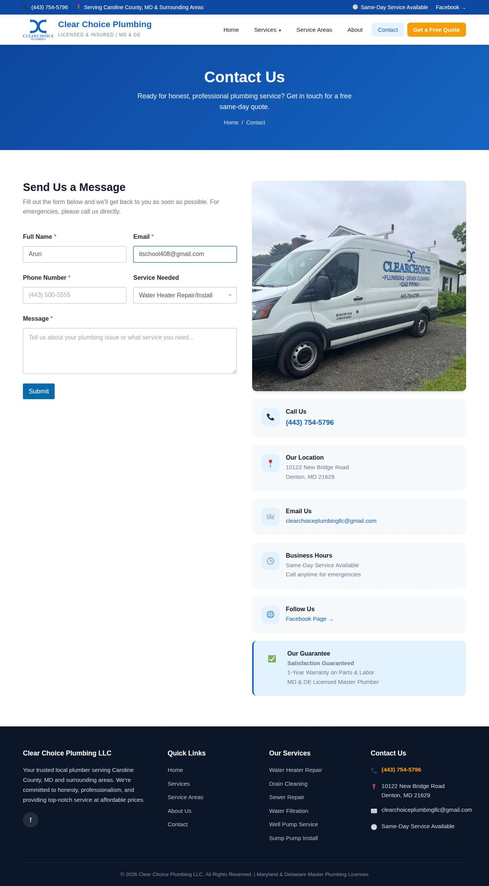
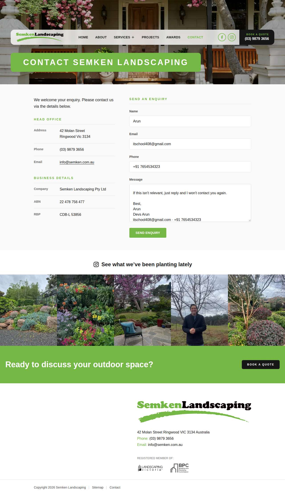
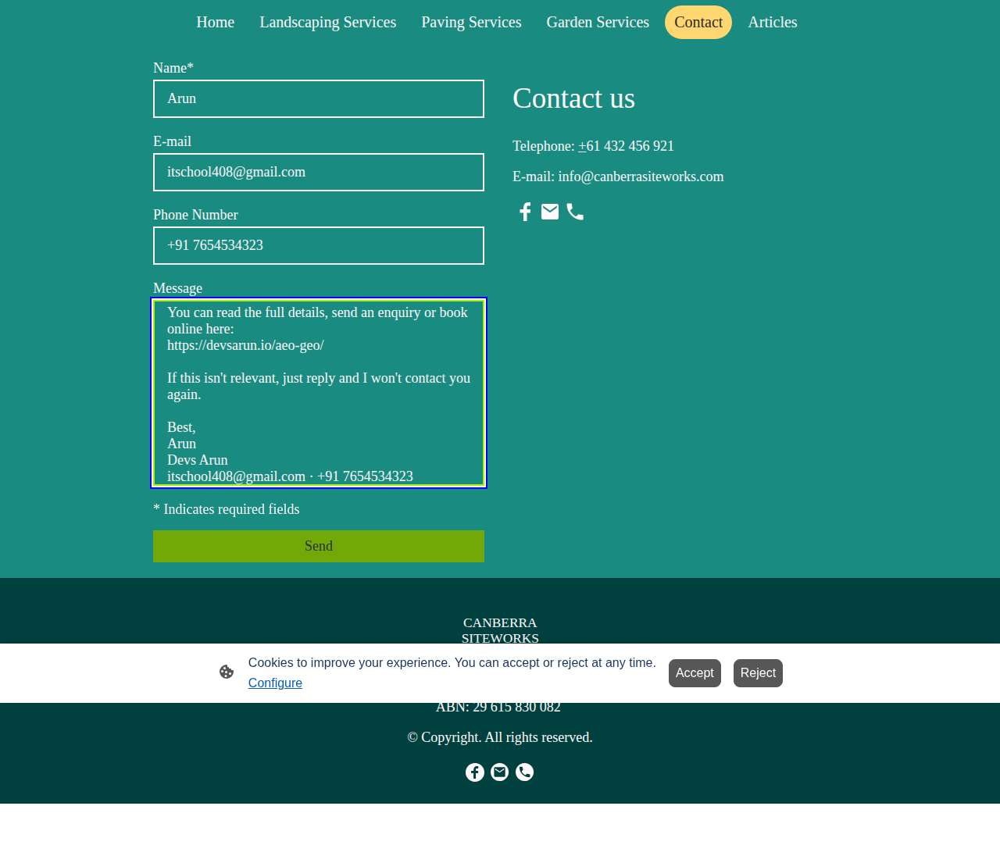
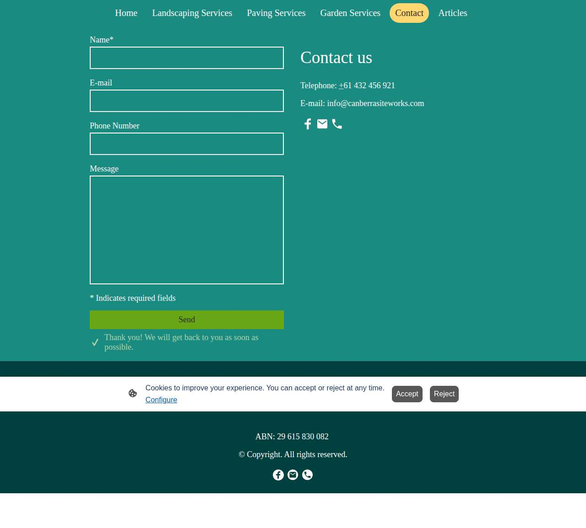
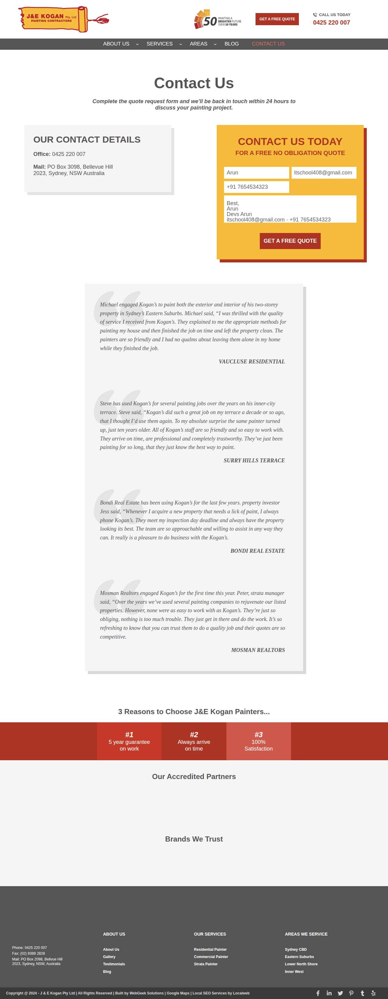
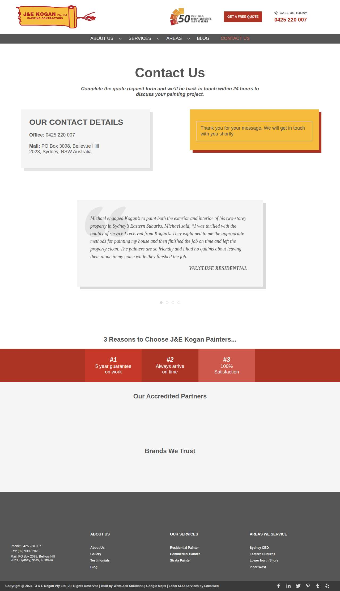

# Run e0521b61 — live — completed

| | |
|---|---|
| Run ID | `e0521b61-59cc-41a5-9e47-5681fe62fc6e` |
| Requested by | github:itsDevsArun |
| Started | 2026-11-06 06:45:40 UTC |
| Finished | 2026-11-06 06:47:07 UTC |
| Finish reason | limit\_reached |
| GitHub Actions | https://github.com/itsDevsArun/aeo-geo/actions/runs/42148448245 |

CSV for this run: [runs/2026-11-06_live_e0521b61.csv](2026-11-06_live_e0521b61.csv)

## Attempts (5)

### clearchoiceplumbingllc.com — failed\_before\_submit (LIVE)

| | |
|---|---|
| Attempt ID | `8a93e96c-6d63-4999-a39f-0bd624e509a0` |
| Form URL | https://clearchoiceplumbingllc.com/contact/ |
| Final URL | — |
| Reserved | 2026-11-06 06:45:42 UTC |
| Submit attempted | — |
| Template | standard v2 |
| Confirmation text | none observed |
| Result / error | locator.fill: Error: Cannot type text into input\[type=number\] |

Exact message:

~~~text
Subject: Helping customers find your business in AI search (AEO + GEO)

Hi there,

I'm Arun from Devs Arun. More and more customers now ask ChatGPT, Gemini, Perplexity or Google's AI Overviews questions like "who should I hire for this in my area?" before they call anyone. These tools answer from websites they can clearly understand, and they tend to recommend businesses whose pages answer real customer questions.

That is what AEO + GEO (Answer Engine and Generative Engine Optimization) is for. I improve your existing service pages so they clearly answer the questions your customers ask, add structured data that matches the page, and make the call, quote or enquiry step obvious. The benefit: your business gets a better chance of being mentioned or linked in AI answers, and visitors who arrive find it easy to contact you.

The AEO + GEO Starter is a one-time $199 (about ₹16,999, negotiable) for one website: a basic audit, 10 customer questions, improvements to two existing pages, relevant structured data and an action plan, with one revision round.

You can read the full details, send an enquiry or book online here:
https://devsarun.io/aeo-geo/

If this isn't relevant, just reply and I won't contact you again.

Best,
Arun
Devs Arun
itschool408@gmail.com · +91 7654534323
~~~

Submitted field values:

- \#wpforms-51-field\_1: Arun
- \#wpforms-51-field\_2: itschool408@gmail.com
- \#wpforms-51-field\_3: Hi there, I'm Arun from Devs Arun. More and more customers now ask ChatGPT, Gemini, Perplexity or Google's AI Overviews 
- \#wpforms-51-field\_5: +91 7654534323

**Inspected page** — `run-e0521b61_attempt-8a93e96c_inspection_2026-11-06T06-45-43-787Z.jpg`

### semken.com.au — unclear (LIVE)

| | |
|---|---|
| Attempt ID | `cb206e68-5702-4efe-9b92-4d3da2165ad6` |
| Form URL | https://www.semken.com.au/contact |
| Final URL | chrome-error://chromewebdata/ |
| Reserved | 2026-11-06 06:45:48 UTC |
| Submit attempted | 2026-11-06 06:45:50 UTC |
| Template | standard v2 |
| Confirmation text | none observed |
| Result / error | No new success marker observed |

Exact message:

~~~text
Subject: Helping customers find your business in AI search (AEO + GEO)

Hi there,

I'm Arun from Devs Arun. More and more customers now ask ChatGPT, Gemini, Perplexity or Google's AI Overviews questions like "who should I hire for this in my area?" before they call anyone. These tools answer from websites they can clearly understand, and they tend to recommend businesses whose pages answer real customer questions.

That is what AEO + GEO (Answer Engine and Generative Engine Optimization) is for. I improve your existing service pages so they clearly answer the questions your customers ask, add structured data that matches the page, and make the call, quote or enquiry step obvious. The benefit: your business gets a better chance of being mentioned or linked in AI answers, and visitors who arrive find it easy to contact you.

The AEO + GEO Starter is a one-time $199 (about ₹16,999, negotiable) for one website: a basic audit, 10 customer questions, improvements to two existing pages, relevant structured data and an action plan, with one revision round.

You can read the full details, send an enquiry or book online here:
https://devsarun.io/aeo-geo/

If this isn't relevant, just reply and I won't contact you again.

Best,
Arun
Devs Arun
itschool408@gmail.com · +91 7654534323
~~~

Submitted field values:

- Name \[name\]: Arun
- Email \[email\]: itschool408@gmail.com
- Phone \[phone\]: +91 7654534323
- Message \[message\]: Hi there, I'm Arun from Devs Arun. More and more customers now ask ChatGPT, Gemini, Perplexity or Google's AI Overviews 

**Filled form (before submit)** — `run-e0521b61_attempt-cb206e68_filled_2026-11-06T06-45-50-247Z.jpg`

**After submit** — `run-e0521b61_attempt-cb206e68_post_attempt_2026-11-06T06-46-19-539Z.jpg`

### canberrasiteworks.com — confirmed (LIVE)

| | |
|---|---|
| Attempt ID | `b6602e8a-389b-4a04-a627-d87f5d6a64c4` |
| Form URL | https://www.canberrasiteworks.com/contact |
| Final URL | https://www.canberrasiteworks.com/contact |
| Reserved | 2026-11-06 06:46:28 UTC |
| Submit attempted | 2026-11-06 06:46:29 UTC |
| Template | standard v2 |
| Confirmation text | -mail Phone Number Message \* Indicates required fields Send Thank you\! We will get back to you as soon as possible. Contact us Telephone: +61 432 456 921 E-mail: info@ca |
| Result / error | — |

Exact message:

~~~text
Subject: Helping customers find your business in AI search (AEO + GEO)

Hi there,

I'm Arun from Devs Arun. More and more customers now ask ChatGPT, Gemini, Perplexity or Google's AI Overviews questions like "who should I hire for this in my area?" before they call anyone. These tools answer from websites they can clearly understand, and they tend to recommend businesses whose pages answer real customer questions.

That is what AEO + GEO (Answer Engine and Generative Engine Optimization) is for. I improve your existing service pages so they clearly answer the questions your customers ask, add structured data that matches the page, and make the call, quote or enquiry step obvious. The benefit: your business gets a better chance of being mentioned or linked in AI answers, and visitors who arrive find it easy to contact you.

The AEO + GEO Starter is a one-time $199 (about ₹16,999, negotiable) for one website: a basic audit, 10 customer questions, improvements to two existing pages, relevant structured data and an action plan, with one revision round.

You can read the full details, send an enquiry or book online here:
https://devsarun.io/aeo-geo/

If this isn't relevant, just reply and I won't contact you again.

Best,
Arun
Devs Arun
itschool408@gmail.com · +91 7654534323
~~~

Submitted field values:

- Name\* \[name\]: Arun
- E-mail \[email\]: itschool408@gmail.com
- Message \[message\]: Hi there, I'm Arun from Devs Arun. More and more customers now ask ChatGPT, Gemini, Perplexity or Google's AI Overviews 
- Phone Number \[phone\]: +91 7654534323

**Filled form (before submit)** — `run-e0521b61_attempt-b6602e8a_filled_2026-11-06T06-46-29-878Z.jpg`

**After submit** — `run-e0521b61_attempt-b6602e8a_post_attempt_2026-11-06T06-46-34-661Z.jpg`

### bwnwincpainting.com — failed\_before\_submit (LIVE)

| | |
|---|---|
| Attempt ID | `6afcfa4c-c1f0-4f5f-a2f2-238903cd1cc4` |
| Form URL | https://www.bwnwincpainting.com/contact/ |
| Final URL | — |
| Reserved | 2026-11-06 06:46:43 UTC |
| Submit attempted | — |
| Template | standard v2 |
| Confirmation text | none observed |
| Result / error | locator.fill: Error: Cannot type text into input\[type=number\] |

Exact message:

~~~text
Subject: Helping customers find your business in AI search (AEO + GEO)

Hi there,

I'm Arun from Devs Arun. More and more customers now ask ChatGPT, Gemini, Perplexity or Google's AI Overviews questions like "who should I hire for this in my area?" before they call anyone. These tools answer from websites they can clearly understand, and they tend to recommend businesses whose pages answer real customer questions.

That is what AEO + GEO (Answer Engine and Generative Engine Optimization) is for. I improve your existing service pages so they clearly answer the questions your customers ask, add structured data that matches the page, and make the call, quote or enquiry step obvious. The benefit: your business gets a better chance of being mentioned or linked in AI answers, and visitors who arrive find it easy to contact you.

The AEO + GEO Starter is a one-time $199 (about ₹16,999, negotiable) for one website: a basic audit, 10 customer questions, improvements to two existing pages, relevant structured data and an action plan, with one revision round.

You can read the full details, send an enquiry or book online here:
https://devsarun.io/aeo-geo/

If this isn't relevant, just reply and I won't contact you again.

Best,
Arun
Devs Arun
itschool408@gmail.com · +91 7654534323
~~~

Submitted field values:

- \#name-1151: Arun
- \#email-1151: itschool408@gmail.com
- \#phone-1151: +91 7654534323
- \#message-1151: Hi there, I'm Arun from Devs Arun. More and more customers now ask ChatGPT, Gemini, Perplexity or Google's AI Overviews 

**Inspected page** — `run-e0521b61_attempt-6afcfa4c_inspection_2026-11-06T06-46-45-594Z.jpg`

### jekoganpainting.com.au — confirmed (LIVE)

| | |
|---|---|
| Attempt ID | `77c7e852-79b3-4412-bdfd-bafaae221089` |
| Form URL | https://www.jekoganpainting.com.au/contact-us/ |
| Final URL | https://www.jekoganpainting.com.au/contact-us/ |
| Reserved | 2026-11-06 06:46:50 UTC |
| Submit attempted | 2026-11-06 06:46:52 UTC |
| Template | standard v2 |
| Confirmation text | ail: PO Box 3098, Bellevue Hill 2023, Sydney, NSW Australia Thank you for your message. We will get in touch with you shortly slide 2 of 4 Mosman Realtors engaged Kogan’s for the first t |
| Result / error | — |

Exact message:

~~~text
Subject: Helping customers find your business in AI search (AEO + GEO)

Hi there,

I'm Arun from Devs Arun. More and more customers now ask ChatGPT, Gemini, Perplexity or Google's AI Overviews questions like "who should I hire for this in my area?" before they call anyone. These tools answer from websites they can clearly understand, and they tend to recommend businesses whose pages answer real customer questions.

That is what AEO + GEO (Answer Engine and Generative Engine Optimization) is for. I improve your existing service pages so they clearly answer the questions your customers ask, add structured data that matches the page, and make the call, quote or enquiry step obvious. The benefit: your business gets a better chance of being mentioned or linked in AI answers, and visitors who arrive find it easy to contact you.

The AEO + GEO Starter is a one-time $199 (about ₹16,999, negotiable) for one website: a basic audit, 10 customer questions, improvements to two existing pages, relevant structured data and an action plan, with one revision round.

You can read the full details, send an enquiry or book online here:
https://devsarun.io/aeo-geo/

If this isn't relevant, just reply and I won't contact you again.

Best,
Arun
Devs Arun
itschool408@gmail.com · +91 7654534323
~~~

Submitted field values:

- message \[message\]: Hi there, I'm Arun from Devs Arun. More and more customers now ask ChatGPT, Gemini, Perplexity or Google's AI Overviews 
- input\_text \[phone\]: +91 7654534323
- input\_text\_1 \[name\]: Arun
- input\_text\_2 \[email\]: itschool408@gmail.com

**Filled form (before submit)** — `run-e0521b61_attempt-77c7e852_filled_2026-11-06T06-46-52-733Z.jpg`

**After submit** — `run-e0521b61_attempt-77c7e852_post_attempt_2026-11-06T06-46-58-930Z.jpg`

## Events (39)

| Time (UTC) | Event | Website | Details |
|---|---|---|---|
| 06:45:36 | run\_queued | — | live run requested by github:itsDevsArun |
| 06:45:36 | run\_dispatched | — | dispatch disabled (local test mode) |
| 06:45:40 | run\_started | — | Runner claimed live run |
| 06:45:42 | offer\_verified | — | Service page offer facts verified |
| 06:45:42 | website\_selected | clearchoiceplumbingllc.com | Live target clearchoiceplumbingllc.com |
| 06:45:42 | attempt\_reserved | clearchoiceplumbingllc.com | Submission attempt reserved with template standard v2 |
| 06:45:43 | page\_opened | clearchoiceplumbingllc.com | Opened form page |
| 06:45:43 | screenshot\_saved | clearchoiceplumbingllc.com | inspection screenshot saved (145 KB) |
| 06:45:43 | review\_required | clearchoiceplumbingllc.com | failed before submit: locator.fill: Error: Cannot type text into input\[type=number\] |
| 06:45:48 | website\_selected | semken.com.au | Live target semken.com.au |
| 06:45:48 | attempt\_reserved | semken.com.au | Submission attempt reserved with template standard v2 |
| 06:45:50 | page\_opened | semken.com.au | Opened form page |
| 06:45:50 | fields\_filled | semken.com.au | filled |
| 06:45:50 | screenshot\_saved | semken.com.au | filled screenshot saved (215 KB) |
| 06:45:50 | submit\_attempted | semken.com.au | submitting |
| 06:46:19 | screenshot\_saved | semken.com.au | post\_attempt screenshot saved (7 KB) |
| 06:46:19 | review\_required | semken.com.au | unclear: No new success marker observed |
| 06:46:28 | website\_selected | canberrasiteworks.com | Live target canberrasiteworks.com |
| 06:46:28 | attempt\_reserved | canberrasiteworks.com | Submission attempt reserved with template standard v2 |
| 06:46:29 | page\_opened | canberrasiteworks.com | Opened form page |
| 06:46:29 | fields\_filled | canberrasiteworks.com | filled |
| 06:46:29 | screenshot\_saved | canberrasiteworks.com | filled screenshot saved (60 KB) |
| 06:46:29 | submit\_attempted | canberrasiteworks.com | submitting |
| 06:46:34 | screenshot\_saved | canberrasiteworks.com | post\_attempt screenshot saved (48 KB) |
| 06:46:34 | confirmation\_observed | canberrasiteworks.com | confirmed — "-mail Phone Number Message \* Indicates required fields Send Thank you\! We will get back to you as soon as possible. Cont" |
| 06:46:43 | website\_selected | bwnwincpainting.com | Live target bwnwincpainting.com |
| 06:46:43 | attempt\_reserved | bwnwincpainting.com | Submission attempt reserved with template standard v2 |
| 06:46:45 | page\_opened | bwnwincpainting.com | Opened form page |
| 06:46:45 | screenshot\_saved | bwnwincpainting.com | inspection screenshot saved (118 KB) |
| 06:46:45 | review\_required | bwnwincpainting.com | failed before submit: locator.fill: Error: Cannot type text into input\[type=number\] |
| 06:46:50 | website\_selected | jekoganpainting.com.au | Live target jekoganpainting.com.au |
| 06:46:50 | attempt\_reserved | jekoganpainting.com.au | Submission attempt reserved with template standard v2 |
| 06:46:52 | page\_opened | jekoganpainting.com.au | Opened form page |
| 06:46:52 | fields\_filled | jekoganpainting.com.au | filled |
| 06:46:52 | screenshot\_saved | jekoganpainting.com.au | filled screenshot saved (197 KB) |
| 06:46:52 | submit\_attempted | jekoganpainting.com.au | submitting |
| 06:46:58 | screenshot\_saved | jekoganpainting.com.au | post\_attempt screenshot saved (116 KB) |
| 06:46:58 | confirmation\_observed | jekoganpainting.com.au | confirmed — "ail: PO Box 3098, Bellevue Hill 2023, Sydney, NSW Australia Thank you for your message. We will get in touch with you sh" |
| 06:47:07 | run\_completed | — | Run completed (limit\_reached) |
