# Run 25cfebab — dry\_run — completed

| | |
|---|---|
| Run ID | `25cfebab-ea49-4d41-8d83-d39f7d5233e7` |
| Requested by | github:itsDevsArun |
| Started | 2026-11-09 03:53:18 UTC |
| Finished | 2026-11-09 03:59:16 UTC |
| Finish reason | queue\_exhausted |
| GitHub Actions | https://github.com/itsDevsArun/aeo-geo/actions/runs/42552962078 |

CSV for this run: [runs/2026-11-09_dry_run_25cfebab.csv](2026-11-09_dry_run_25cfebab.csv)

## Attempts (41)

### helixmechanical.com — dry\_run\_failed (dry run)

| | |
|---|---|
| Attempt ID | `cc5d8f07-88e3-44b2-afef-eca32e8e09f3` |
| Form URL | https://helixmechanical.com/contact/ |
| Final URL | https://helixmechanical.com/contact/ |
| Reserved | 2026-11-09 03:53:18 UTC |
| Submit attempted | — |
| Template | standard v2 |
| Confirmation text | none observed |
| Result / error | Mapped field "First Name \*" not found uniquely |

Exact message:

~~~text
Subject: Helping customers find your business in AI search (AEO + GEO)

Hi there,

I'm Arun from Devs Arun. More and more customers now ask ChatGPT, Gemini, Perplexity or Google's AI Overviews questions like "who should I hire for this in my area?" before they call anyone. These tools answer from websites they can clearly understand, and they tend to recommend businesses whose pages answer real customer questions.

That is what AEO + GEO (Answer Engine and Generative Engine Optimization) is for. I improve your existing service pages so they clearly answer the questions your customers ask, add structured data that matches the page, and make the call, quote or enquiry step obvious. The benefit: your business gets a better chance of being mentioned or linked in AI answers, and visitors who arrive find it easy to contact you.

The AEO + GEO Starter is a one-time $199 (about ₹16,999, negotiable) for one website: a basic audit, 10 customer questions, improvements to two existing pages, relevant structured data and an action plan, with one revision round.

You can read the full details, send an enquiry or book online here:
https://devsarun.io/aeo-geo/

If this isn't relevant, just reply and I won't contact you again.

Best,
Arun
Devs Arun
itschool408@gmail.com · +91 7654534323
~~~

Submitted field values:

- \#forminator-field-name-1\_6ae7ff023fd3c: Arun
- \#forminator-field-email-1\_6ae7ff023fd3c: itschool408@gmail.com
- \#forminator-field-phone-1\_6ae7ff023fd3c: +91 7654534323
- \#forminator-field-textarea-1\_6ae7ff023fd3c: Hi there, I'm Arun from Devs Arun. More and more customers now ask ChatGPT, Gemini, Perplexity or Google's AI Overviews 

**Inspected page** — `run-25cfebab_attempt-cc5d8f07_inspection_2026-11-09T03-53-21-041Z.jpg`

### eurola.com.au — dry\_run\_failed (dry run)

| | |
|---|---|
| Attempt ID | `4f1ec0d5-ec2b-4ddd-a59c-99db43baa9a7` |
| Form URL | https://www.eurola.com.au/contact/ |
| Final URL | https://www.eurola.com.au/contact/ |
| Reserved | 2026-11-09 03:53:26 UTC |
| Submit attempted | — |
| Template | standard v2 |
| Confirmation text | none observed |
| Result / error | Mapped field "field2" not found uniquely |

Exact message:

~~~text
Subject: Helping customers find your business in AI search (AEO + GEO)

Hi there,

I'm Arun from Devs Arun. More and more customers now ask ChatGPT, Gemini, Perplexity or Google's AI Overviews questions like "who should I hire for this in my area?" before they call anyone. These tools answer from websites they can clearly understand, and they tend to recommend businesses whose pages answer real customer questions.

That is what AEO + GEO (Answer Engine and Generative Engine Optimization) is for. I improve your existing service pages so they clearly answer the questions your customers ask, add structured data that matches the page, and make the call, quote or enquiry step obvious. The benefit: your business gets a better chance of being mentioned or linked in AI answers, and visitors who arrive find it easy to contact you.

The AEO + GEO Starter is a one-time $199 (about ₹16,999, negotiable) for one website: a basic audit, 10 customer questions, improvements to two existing pages, relevant structured data and an action plan, with one revision round.

You can read the full details, send an enquiry or book online here:
https://devsarun.io/aeo-geo/

If this isn't relevant, just reply and I won't contact you again.

Best,
Arun
Devs Arun
itschool408@gmail.com · +91 7654534323
~~~

Submitted field values:

- input\[name="field7\[\]"\]: Arun
- div \> div \> div:nth-of-type(2) \> form \> div \> div \> div:nth-of-type(2) \> div \> div \> div \> div \> input: itschool408@gmail.com
- div \> div \> div:nth-of-type(2) \> form \> div \> div \> div:nth-of-type(3) \> div \> div \> div \> div \> input: +91 7654534323
- div \> div \> div:nth-of-type(2) \> form \> div \> div \> div:nth-of-type(5) \> div \> div \> div \> div \> textarea: Hi there, I'm Arun from Devs Arun. More and more customers now ask ChatGPT, Gemini, Perplexity or Google's AI Overviews 

**Inspected page** — `run-25cfebab_attempt-4f1ec0d5_inspection_2026-11-09T03-53-33-252Z.jpg`

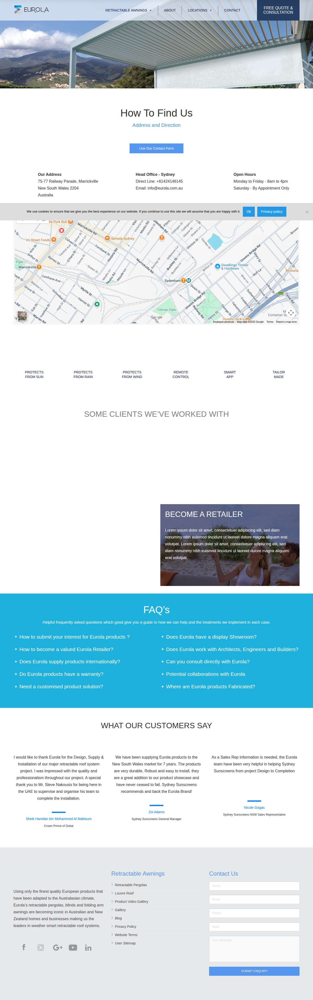

### knoxvilleelectrician.com — dry\_run\_failed (dry run)

| | |
|---|---|
| Attempt ID | `b6aaa20e-db29-4622-b04d-478a0da2d80f` |
| Form URL | https://knoxvilleelectrician.com/contact-us/ |
| Final URL | https://knoxvilleelectrician.com/contact-us/ |
| Reserved | 2026-11-09 03:53:38 UTC |
| Submit attempted | — |
| Template | standard v2 |
| Confirmation text | none observed |
| Result / error | Mapped field "Name" not found uniquely |

Exact message:

~~~text
Subject: Helping customers find your business in AI search (AEO + GEO)

Hi there,

I'm Arun from Devs Arun. More and more customers now ask ChatGPT, Gemini, Perplexity or Google's AI Overviews questions like "who should I hire for this in my area?" before they call anyone. These tools answer from websites they can clearly understand, and they tend to recommend businesses whose pages answer real customer questions.

That is what AEO + GEO (Answer Engine and Generative Engine Optimization) is for. I improve your existing service pages so they clearly answer the questions your customers ask, add structured data that matches the page, and make the call, quote or enquiry step obvious. The benefit: your business gets a better chance of being mentioned or linked in AI answers, and visitors who arrive find it easy to contact you.

The AEO + GEO Starter is a one-time $199 (about ₹16,999, negotiable) for one website: a basic audit, 10 customer questions, improvements to two existing pages, relevant structured data and an action plan, with one revision round.

You can read the full details, send an enquiry or book online here:
https://devsarun.io/aeo-geo/

If this isn't relevant, just reply and I won't contact you again.

Best,
Arun
Devs Arun
itschool408@gmail.com · +91 7654534323
~~~

Submitted field values:

- \#form-field-1b7221: itschool408@gmail.com
- \#form-field-2fa3ac: +91 7654534323
- \#form-field-96f51f: Arun
- \#form-field-fed9d8: Hi there, I'm Arun from Devs Arun. More and more customers now ask ChatGPT, Gemini, Perplexity or Google's AI Overviews 

**Inspected page** — `run-25cfebab_attempt-b6aaa20e_inspection_2026-11-09T03-53-41-043Z.jpg`

### smjcabinets.com — dry\_run\_ok (dry run)

| | |
|---|---|
| Attempt ID | `e487bf25-c593-4d81-96b2-c50fdc3ef437` |
| Form URL | https://www.smjcabinets.com/contact |
| Final URL | https://www.smjcabinets.com/contact |
| Reserved | 2026-11-09 03:53:46 UTC |
| Submit attempted | — |
| Template | standard v2 |
| Confirmation text | none observed |
| Result / error | Selectors verified; fields not typed (domain not in dry-run fill list); not submitted |

Exact message:

~~~text
Subject: Helping customers find your business in AI search (AEO + GEO)

Hi there,

I'm Arun from Devs Arun. More and more customers now ask ChatGPT, Gemini, Perplexity or Google's AI Overviews questions like "who should I hire for this in my area?" before they call anyone. These tools answer from websites they can clearly understand, and they tend to recommend businesses whose pages answer real customer questions.

That is what AEO + GEO (Answer Engine and Generative Engine Optimization) is for. I improve your existing service pages so they clearly answer the questions your customers ask, add structured data that matches the page, and make the call, quote or enquiry step obvious. The benefit: your business gets a better chance of being mentioned or linked in AI answers, and visitors who arrive find it easy to contact you.

The AEO + GEO Starter is a one-time $199 (about ₹16,999, negotiable) for one website: a basic audit, 10 customer questions, improvements to two existing pages, relevant structured data and an action plan, with one revision round.

You can read the full details, send an enquiry or book online here:
https://devsarun.io/aeo-geo/

If this isn't relevant, just reply and I won't contact you again.

Best,
Arun
Devs Arun
itschool408@gmail.com · +91 7654534323
~~~

Submitted field values:

- \#\\31 339511958: +91 7654534323
- \#\\31 426162544: Hi there, I'm Arun from Devs Arun. More and more customers now ask ChatGPT, Gemini, Perplexity or Google's AI Overviews 
- \#\\31 561108112: Arun
- \#\\31 678128578: itschool408@gmail.com

**Inspected page** — `run-25cfebab_attempt-e487bf25_inspection_2026-11-09T03-53-47-529Z.jpg`

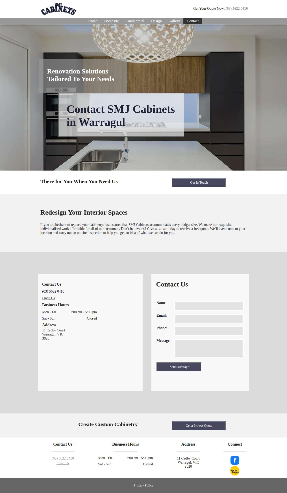

### mehrtensunderpinning.com.au — dry\_run\_ok (dry run)

| | |
|---|---|
| Attempt ID | `764aadb7-99aa-4a13-92ce-ab8ca430aa29` |
| Form URL | https://mehrtensunderpinning.com.au/ |
| Final URL | https://mehrtensunderpinning.com.au/ |
| Reserved | 2026-11-09 03:53:52 UTC |
| Submit attempted | — |
| Template | standard v2 |
| Confirmation text | none observed |
| Result / error | Selectors verified; fields not typed (domain not in dry-run fill list); not submitted |

Exact message:

~~~text
Subject: Helping customers find your business in AI search (AEO + GEO)

Hi there,

I'm Arun from Devs Arun. More and more customers now ask ChatGPT, Gemini, Perplexity or Google's AI Overviews questions like "who should I hire for this in my area?" before they call anyone. These tools answer from websites they can clearly understand, and they tend to recommend businesses whose pages answer real customer questions.

That is what AEO + GEO (Answer Engine and Generative Engine Optimization) is for. I improve your existing service pages so they clearly answer the questions your customers ask, add structured data that matches the page, and make the call, quote or enquiry step obvious. The benefit: your business gets a better chance of being mentioned or linked in AI answers, and visitors who arrive find it easy to contact you.

The AEO + GEO Starter is a one-time $199 (about ₹16,999, negotiable) for one website: a basic audit, 10 customer questions, improvements to two existing pages, relevant structured data and an action plan, with one revision round.

You can read the full details, send an enquiry or book online here:
https://devsarun.io/aeo-geo/

If this isn't relevant, just reply and I won't contact you again.

Best,
Arun
Devs Arun
itschool408@gmail.com · +91 7654534323
~~~

Submitted field values:

- input\[name="your-name"\]: Arun
- input\[name="your-email"\]: itschool408@gmail.com
- input\[name="your-subject"\]: Helping customers find your business in AI search (AEO + GEO)
- textarea\[name="your-message"\]: Hi there, I'm Arun from Devs Arun. More and more customers now ask ChatGPT, Gemini, Perplexity or Google's AI Overviews 

**Inspected page** — `run-25cfebab_attempt-764aadb7_inspection_2026-11-09T03-53-57-626Z.jpg`

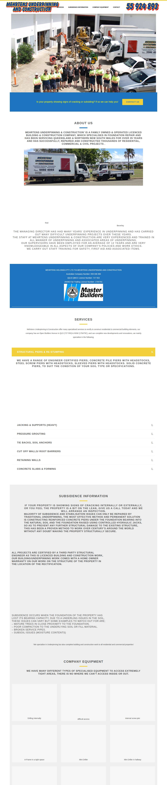

### streamlinehomes.com.au — dry\_run\_ok (dry run)

| | |
|---|---|
| Attempt ID | `290d4366-6694-4d1a-99a6-1340731b50f7` |
| Form URL | https://streamlinehomes.com.au/contact-us/ |
| Final URL | https://streamlinehomes.com.au/contact-us/ |
| Reserved | 2026-11-09 03:54:02 UTC |
| Submit attempted | — |
| Template | standard v2 |
| Confirmation text | none observed |
| Result / error | Selectors verified; fields not typed (domain not in dry-run fill list); not submitted |

Exact message:

~~~text
Subject: Helping customers find your business in AI search (AEO + GEO)

Hi there,

I'm Arun from Devs Arun. More and more customers now ask ChatGPT, Gemini, Perplexity or Google's AI Overviews questions like "who should I hire for this in my area?" before they call anyone. These tools answer from websites they can clearly understand, and they tend to recommend businesses whose pages answer real customer questions.

That is what AEO + GEO (Answer Engine and Generative Engine Optimization) is for. I improve your existing service pages so they clearly answer the questions your customers ask, add structured data that matches the page, and make the call, quote or enquiry step obvious. The benefit: your business gets a better chance of being mentioned or linked in AI answers, and visitors who arrive find it easy to contact you.

The AEO + GEO Starter is a one-time $199 (about ₹16,999, negotiable) for one website: a basic audit, 10 customer questions, improvements to two existing pages, relevant structured data and an action plan, with one revision round.

You can read the full details, send an enquiry or book online here:
https://devsarun.io/aeo-geo/

If this isn't relevant, just reply and I won't contact you again.

Best,
Arun
Devs Arun
itschool408@gmail.com · +91 7654534323
~~~

Submitted field values:

- input\[name="your-name"\]: Arun
- input\[name="your-email"\]: itschool408@gmail.com
- textarea\[name="your-message"\]: Hi there, I'm Arun from Devs Arun. More and more customers now ask ChatGPT, Gemini, Perplexity or Google's AI Overviews 

**Inspected page** — `run-25cfebab_attempt-290d4366_inspection_2026-11-09T03-54-09-495Z.jpg`

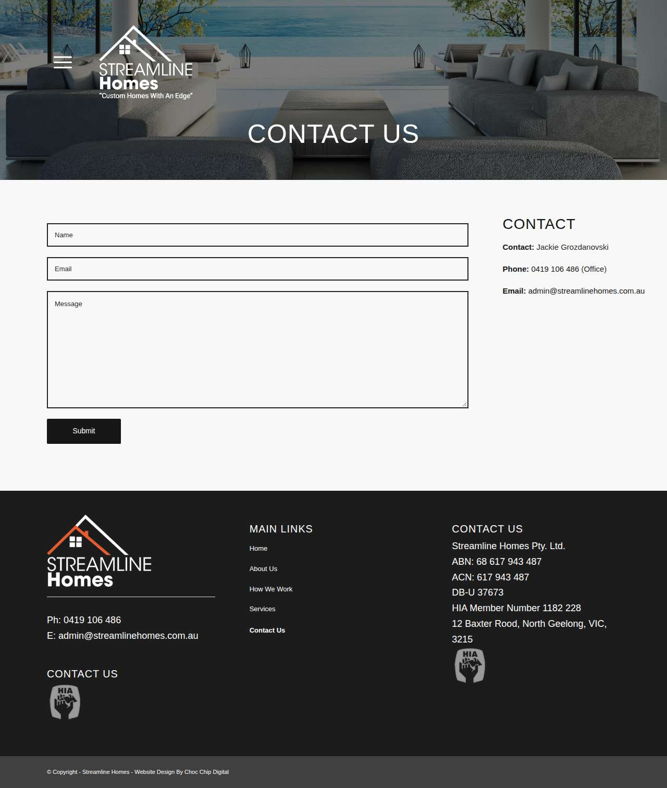

### goldcoastpatios.com.au — dry\_run\_ok (dry run)

| | |
|---|---|
| Attempt ID | `85b52e46-5d94-47aa-9ecc-979359c2ebf2` |
| Form URL | https://goldcoastpatios.com.au/contact/ |
| Final URL | https://goldcoastpatios.com.au/contact/ |
| Reserved | 2026-11-09 03:54:14 UTC |
| Submit attempted | — |
| Template | standard v2 |
| Confirmation text | none observed |
| Result / error | Selectors verified; fields not typed (domain not in dry-run fill list); not submitted |

Exact message:

~~~text
Subject: Helping customers find your business in AI search (AEO + GEO)

Hi there,

I'm Arun from Devs Arun. More and more customers now ask ChatGPT, Gemini, Perplexity or Google's AI Overviews questions like "who should I hire for this in my area?" before they call anyone. These tools answer from websites they can clearly understand, and they tend to recommend businesses whose pages answer real customer questions.

That is what AEO + GEO (Answer Engine and Generative Engine Optimization) is for. I improve your existing service pages so they clearly answer the questions your customers ask, add structured data that matches the page, and make the call, quote or enquiry step obvious. The benefit: your business gets a better chance of being mentioned or linked in AI answers, and visitors who arrive find it easy to contact you.

The AEO + GEO Starter is a one-time $199 (about ₹16,999, negotiable) for one website: a basic audit, 10 customer questions, improvements to two existing pages, relevant structured data and an action plan, with one revision round.

You can read the full details, send an enquiry or book online here:
https://devsarun.io/aeo-geo/

If this isn't relevant, just reply and I won't contact you again.

Best,
Arun
Devs Arun
itschool408@gmail.com · +91 7654534323
~~~

Submitted field values:

- \#input\_2\_4: Arun
- \#input\_2\_5: itschool408@gmail.com
- \#input\_2\_7: +91 7654534323
- \#input\_2\_8: Bangalore
- \#input\_2\_10: Hi there, I'm Arun from Devs Arun. More and more customers now ask ChatGPT, Gemini, Perplexity or Google's AI Overviews 

**Inspected page** — `run-25cfebab_attempt-85b52e46_inspection_2026-11-09T03-54-21-506Z.jpg`

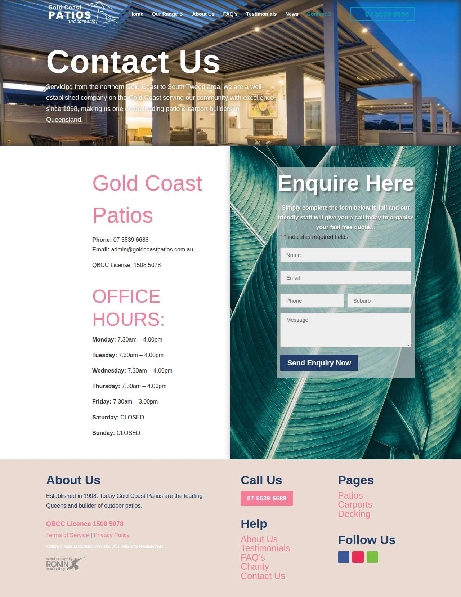

### igniteremovals.com.au — dry\_run\_ok (dry run)

| | |
|---|---|
| Attempt ID | `c4eaa238-be49-4e8d-9d9b-41447fcb8e4c` |
| Form URL | https://igniteremovals.com.au/contact/ |
| Final URL | https://igniteremovals.com.au/contact/ |
| Reserved | 2026-11-09 03:54:26 UTC |
| Submit attempted | — |
| Template | standard v2 |
| Confirmation text | none observed |
| Result / error | Selectors verified; fields not typed (domain not in dry-run fill list); not submitted |

Exact message:

~~~text
Subject: Helping customers find your business in AI search (AEO + GEO)

Hi there,

I'm Arun from Devs Arun. More and more customers now ask ChatGPT, Gemini, Perplexity or Google's AI Overviews questions like "who should I hire for this in my area?" before they call anyone. These tools answer from websites they can clearly understand, and they tend to recommend businesses whose pages answer real customer questions.

That is what AEO + GEO (Answer Engine and Generative Engine Optimization) is for. I improve your existing service pages so they clearly answer the questions your customers ask, add structured data that matches the page, and make the call, quote or enquiry step obvious. The benefit: your business gets a better chance of being mentioned or linked in AI answers, and visitors who arrive find it easy to contact you.

The AEO + GEO Starter is a one-time $199 (about ₹16,999, negotiable) for one website: a basic audit, 10 customer questions, improvements to two existing pages, relevant structured data and an action plan, with one revision round.

You can read the full details, send an enquiry or book online here:
https://devsarun.io/aeo-geo/

If this isn't relevant, just reply and I won't contact you again.

Best,
Arun
Devs Arun
itschool408@gmail.com · +91 7654534323
~~~

Submitted field values:

- \#form-field-name: Arun
- \#form-field-email: itschool408@gmail.com
- \#form-field-message: Hi there, I'm Arun from Devs Arun. More and more customers now ask ChatGPT, Gemini, Perplexity or Google's AI Overviews 

**Inspected page** — `run-25cfebab_attempt-c4eaa238_inspection_2026-11-09T03-54-32-584Z.jpg`

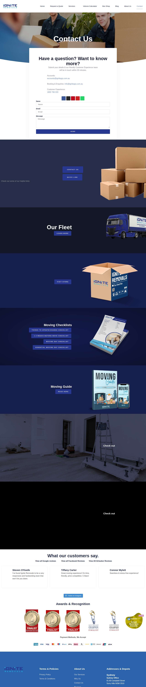

### smallloadremovalist.com.au — dry\_run\_ok (dry run)

| | |
|---|---|
| Attempt ID | `b020a16c-3649-428f-9073-0ffcb2855fec` |
| Form URL | https://smallloadremovalist.com.au/contact-us/ |
| Final URL | https://smallloadremovalist.com.au/contact-us/ |
| Reserved | 2026-11-09 03:54:37 UTC |
| Submit attempted | — |
| Template | standard v2 |
| Confirmation text | none observed |
| Result / error | Selectors verified; fields not typed (domain not in dry-run fill list); not submitted |

Exact message:

~~~text
Subject: Helping customers find your business in AI search (AEO + GEO)

Hi there,

I'm Arun from Devs Arun. More and more customers now ask ChatGPT, Gemini, Perplexity or Google's AI Overviews questions like "who should I hire for this in my area?" before they call anyone. These tools answer from websites they can clearly understand, and they tend to recommend businesses whose pages answer real customer questions.

That is what AEO + GEO (Answer Engine and Generative Engine Optimization) is for. I improve your existing service pages so they clearly answer the questions your customers ask, add structured data that matches the page, and make the call, quote or enquiry step obvious. The benefit: your business gets a better chance of being mentioned or linked in AI answers, and visitors who arrive find it easy to contact you.

The AEO + GEO Starter is a one-time $199 (about ₹16,999, negotiable) for one website: a basic audit, 10 customer questions, improvements to two existing pages, relevant structured data and an action plan, with one revision round.

You can read the full details, send an enquiry or book online here:
https://devsarun.io/aeo-geo/

If this isn't relevant, just reply and I won't contact you again.

Best,
Arun
Devs Arun
itschool408@gmail.com · +91 7654534323
~~~

Submitted field values:

- \#form-field-name: Arun
- \#form-field-email: itschool408@gmail.com
- \#form-field-message: Hi there, I'm Arun from Devs Arun. More and more customers now ask ChatGPT, Gemini, Perplexity or Google's AI Overviews 
- \#form-field-field\_403a13b: +91 7654534323

**Inspected page** — `run-25cfebab_attempt-b020a16c_inspection_2026-11-09T03-54-40-816Z.jpg`

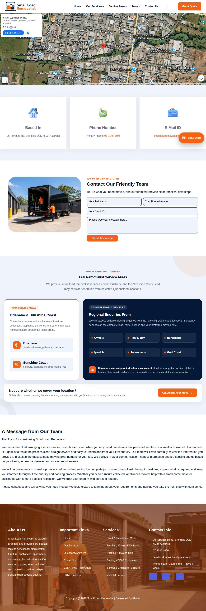

### quickpickmovers.com.au — dry\_run\_ok (dry run)

| | |
|---|---|
| Attempt ID | `9b26b4cc-e200-4daa-80bc-c0b1281ccbc1` |
| Form URL | https://quickpickmovers.com.au/contact-us/ |
| Final URL | https://quickpickmovers.com.au/contact-us/ |
| Reserved | 2026-11-09 03:54:45 UTC |
| Submit attempted | — |
| Template | standard v2 |
| Confirmation text | none observed |
| Result / error | Selectors verified; fields not typed (domain not in dry-run fill list); not submitted |

Exact message:

~~~text
Subject: Helping customers find your business in AI search (AEO + GEO)

Hi there,

I'm Arun from Devs Arun. More and more customers now ask ChatGPT, Gemini, Perplexity or Google's AI Overviews questions like "who should I hire for this in my area?" before they call anyone. These tools answer from websites they can clearly understand, and they tend to recommend businesses whose pages answer real customer questions.

That is what AEO + GEO (Answer Engine and Generative Engine Optimization) is for. I improve your existing service pages so they clearly answer the questions your customers ask, add structured data that matches the page, and make the call, quote or enquiry step obvious. The benefit: your business gets a better chance of being mentioned or linked in AI answers, and visitors who arrive find it easy to contact you.

The AEO + GEO Starter is a one-time $199 (about ₹16,999, negotiable) for one website: a basic audit, 10 customer questions, improvements to two existing pages, relevant structured data and an action plan, with one revision round.

You can read the full details, send an enquiry or book online here:
https://devsarun.io/aeo-geo/

If this isn't relevant, just reply and I won't contact you again.

Best,
Arun
Devs Arun
itschool408@gmail.com · +91 7654534323
~~~

Submitted field values:

- \#name: Arun
- \#email: itschool408@gmail.com
- \#phone: +91 7654534323
- \#message: Hi there, I'm Arun from Devs Arun. More and more customers now ask ChatGPT, Gemini, Perplexity or Google's AI Overviews 

**Inspected page** — `run-25cfebab_attempt-9b26b4cc_inspection_2026-11-09T03-54-47-309Z.jpg`

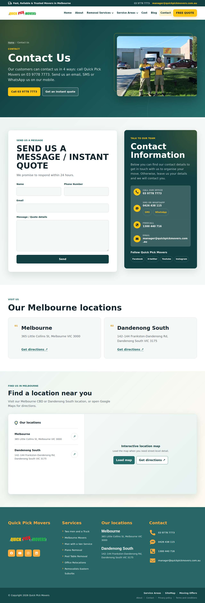

### vicpalmerremovals.com.au — dry\_run\_ok (dry run)

| | |
|---|---|
| Attempt ID | `6dcc8cb0-bd91-4905-af52-244f88ae081f` |
| Form URL | https://www.vicpalmerremovals.com.au/contact.html |
| Final URL | https://www.vicpalmerremovals.com.au/contact.html |
| Reserved | 2026-11-09 03:54:52 UTC |
| Submit attempted | — |
| Template | standard v2 |
| Confirmation text | none observed |
| Result / error | Selectors verified; fields not typed (domain not in dry-run fill list); not submitted |

Exact message:

~~~text
Subject: Helping customers find your business in AI search (AEO + GEO)

Hi there,

I'm Arun from Devs Arun. More and more customers now ask ChatGPT, Gemini, Perplexity or Google's AI Overviews questions like "who should I hire for this in my area?" before they call anyone. These tools answer from websites they can clearly understand, and they tend to recommend businesses whose pages answer real customer questions.

That is what AEO + GEO (Answer Engine and Generative Engine Optimization) is for. I improve your existing service pages so they clearly answer the questions your customers ask, add structured data that matches the page, and make the call, quote or enquiry step obvious. The benefit: your business gets a better chance of being mentioned or linked in AI answers, and visitors who arrive find it easy to contact you.

The AEO + GEO Starter is a one-time $199 (about ₹16,999, negotiable) for one website: a basic audit, 10 customer questions, improvements to two existing pages, relevant structured data and an action plan, with one revision round.

You can read the full details, send an enquiry or book online here:
https://devsarun.io/aeo-geo/

If this isn't relevant, just reply and I won't contact you again.

Best,
Arun
Devs Arun
itschool408@gmail.com · +91 7654534323
~~~

Submitted field values:

- \#name\_contact: Arun
- \#email\_contact: itschool408@gmail.com
- \#phone\_contact: +91 7654534323
- \#message\_contact: Hi there, I'm Arun from Devs Arun. More and more customers now ask ChatGPT, Gemini, Perplexity or Google's AI Overviews 

**Inspected page** — `run-25cfebab_attempt-6dcc8cb0_inspection_2026-11-09T03-54-56-801Z.jpg`

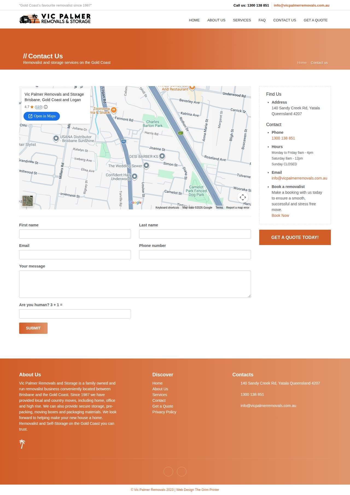

### extracareremovals.com.au — dry\_run\_ok (dry run)

| | |
|---|---|
| Attempt ID | `752a3ef3-cd3f-4890-bed1-86adc2d9fcac` |
| Form URL | https://extracareremovals.com.au/contact/ |
| Final URL | https://extracareremovals.com.au/contact/ |
| Reserved | 2026-11-09 03:55:01 UTC |
| Submit attempted | — |
| Template | standard v2 |
| Confirmation text | none observed |
| Result / error | Selectors verified; fields not typed (domain not in dry-run fill list); not submitted |

Exact message:

~~~text
Subject: Helping customers find your business in AI search (AEO + GEO)

Hi there,

I'm Arun from Devs Arun. More and more customers now ask ChatGPT, Gemini, Perplexity or Google's AI Overviews questions like "who should I hire for this in my area?" before they call anyone. These tools answer from websites they can clearly understand, and they tend to recommend businesses whose pages answer real customer questions.

That is what AEO + GEO (Answer Engine and Generative Engine Optimization) is for. I improve your existing service pages so they clearly answer the questions your customers ask, add structured data that matches the page, and make the call, quote or enquiry step obvious. The benefit: your business gets a better chance of being mentioned or linked in AI answers, and visitors who arrive find it easy to contact you.

The AEO + GEO Starter is a one-time $199 (about ₹16,999, negotiable) for one website: a basic audit, 10 customer questions, improvements to two existing pages, relevant structured data and an action plan, with one revision round.

You can read the full details, send an enquiry or book online here:
https://devsarun.io/aeo-geo/

If this isn't relevant, just reply and I won't contact you again.

Best,
Arun
Devs Arun
itschool408@gmail.com · +91 7654534323
~~~

Submitted field values:

- \#form-field-name: Arun
- \#form-field-email: itschool408@gmail.com
- \#form-field-phone: +91 7654534323
- \#form-field-message: Hi there, I'm Arun from Devs Arun. More and more customers now ask ChatGPT, Gemini, Perplexity or Google's AI Overviews 
- \#form-field-subject: Helping customers find your business in AI search (AEO + GEO)

**Inspected page** — `run-25cfebab_attempt-752a3ef3_inspection_2026-11-09T03-55-06-822Z.jpg`

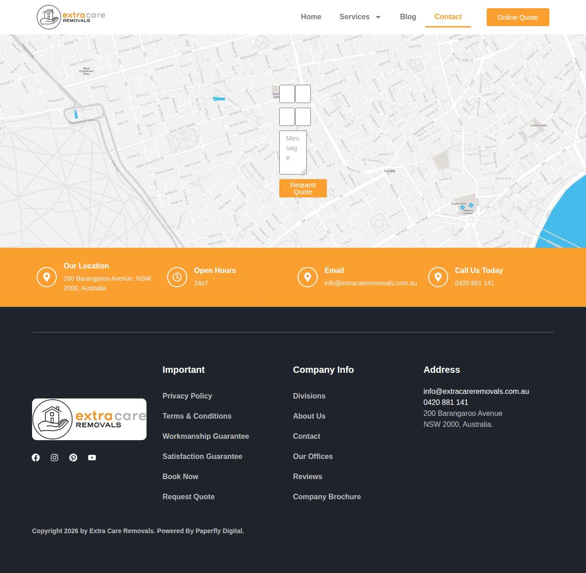

### cdlawyers.com.au — dry\_run\_ok (dry run)

| | |
|---|---|
| Attempt ID | `34dd5004-be3e-4a6d-bc3c-ca3e34781419` |
| Form URL | https://www.cdlawyers.com.au/contact-us |
| Final URL | https://www.cdlawyers.com.au/contact-us |
| Reserved | 2026-11-09 03:55:11 UTC |
| Submit attempted | — |
| Template | standard v2 |
| Confirmation text | none observed |
| Result / error | Selectors verified; fields not typed (domain not in dry-run fill list); not submitted |

Exact message:

~~~text
Subject: Helping customers find your business in AI search (AEO + GEO)

Hi there,

I'm Arun from Devs Arun. More and more customers now ask ChatGPT, Gemini, Perplexity or Google's AI Overviews questions like "who should I hire for this in my area?" before they call anyone. These tools answer from websites they can clearly understand, and they tend to recommend businesses whose pages answer real customer questions.

That is what AEO + GEO (Answer Engine and Generative Engine Optimization) is for. I improve your existing service pages so they clearly answer the questions your customers ask, add structured data that matches the page, and make the call, quote or enquiry step obvious. The benefit: your business gets a better chance of being mentioned or linked in AI answers, and visitors who arrive find it easy to contact you.

The AEO + GEO Starter is a one-time $199 (about ₹16,999, negotiable) for one website: a basic audit, 10 customer questions, improvements to two existing pages, relevant structured data and an action plan, with one revision round.

You can read the full details, send an enquiry or book online here:
https://devsarun.io/aeo-geo/

If this isn't relevant, just reply and I won't contact you again.

Best,
Arun
Devs Arun
itschool408@gmail.com · +91 7654534323
~~~

Submitted field values:

- \#input\_comp-lidwwkgf: Arun
- \#input\_comp-lidwwkgk2: +91 7654534323
- \#input\_comp-lidwwkgp5: itschool408@gmail.com
- \#textarea\_comp-lidwwkgq4: Hi there, I'm Arun from Devs Arun. More and more customers now ask ChatGPT, Gemini, Perplexity or Google's AI Overviews 

**Inspected page** — `run-25cfebab_attempt-34dd5004_inspection_2026-11-09T03-55-14-959Z.jpg`

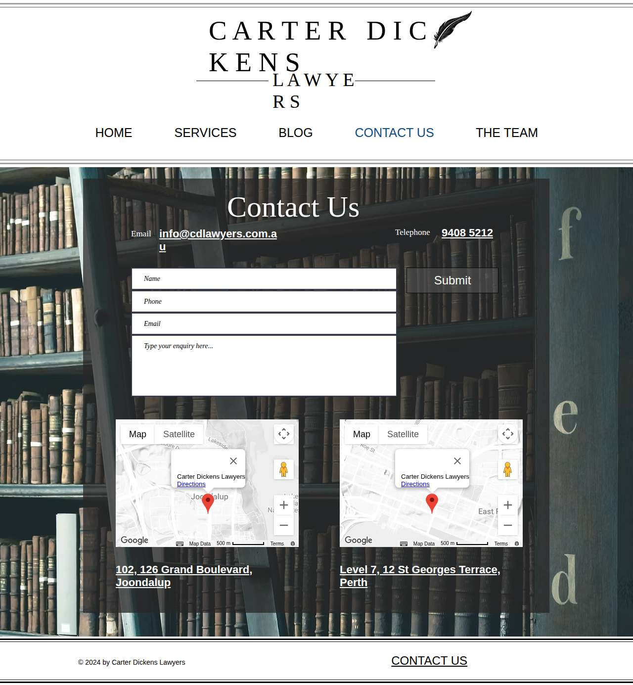

### iconlegal.com.au — dry\_run\_ok (dry run)

| | |
|---|---|
| Attempt ID | `cb0cc2bd-d995-4e45-8dab-776e33477f08` |
| Form URL | https://iconlegal.com.au/contact-us/ |
| Final URL | https://iconlegal.com.au/contact-us/ |
| Reserved | 2026-11-09 03:55:19 UTC |
| Submit attempted | — |
| Template | standard v2 |
| Confirmation text | none observed |
| Result / error | Selectors verified; fields not typed (domain not in dry-run fill list); not submitted |

Exact message:

~~~text
Subject: Helping customers find your business in AI search (AEO + GEO)

Hi there,

I'm Arun from Devs Arun. More and more customers now ask ChatGPT, Gemini, Perplexity or Google's AI Overviews questions like "who should I hire for this in my area?" before they call anyone. These tools answer from websites they can clearly understand, and they tend to recommend businesses whose pages answer real customer questions.

That is what AEO + GEO (Answer Engine and Generative Engine Optimization) is for. I improve your existing service pages so they clearly answer the questions your customers ask, add structured data that matches the page, and make the call, quote or enquiry step obvious. The benefit: your business gets a better chance of being mentioned or linked in AI answers, and visitors who arrive find it easy to contact you.

The AEO + GEO Starter is a one-time $199 (about ₹16,999, negotiable) for one website: a basic audit, 10 customer questions, improvements to two existing pages, relevant structured data and an action plan, with one revision round.

You can read the full details, send an enquiry or book online here:
https://devsarun.io/aeo-geo/

If this isn't relevant, just reply and I won't contact you again.

Best,
Arun
Devs Arun
itschool408@gmail.com · +91 7654534323
~~~

Submitted field values:

- \#form-field-name: Arun
- \#form-field-email: itschool408@gmail.com
- \#form-field-message: Hi there, I'm Arun from Devs Arun. More and more customers now ask ChatGPT, Gemini, Perplexity or Google's AI Overviews 
- \#form-field-field\_5815981: +91 7654534323

**Inspected page** — `run-25cfebab_attempt-cb0cc2bd_inspection_2026-11-09T03-55-24-016Z.jpg`

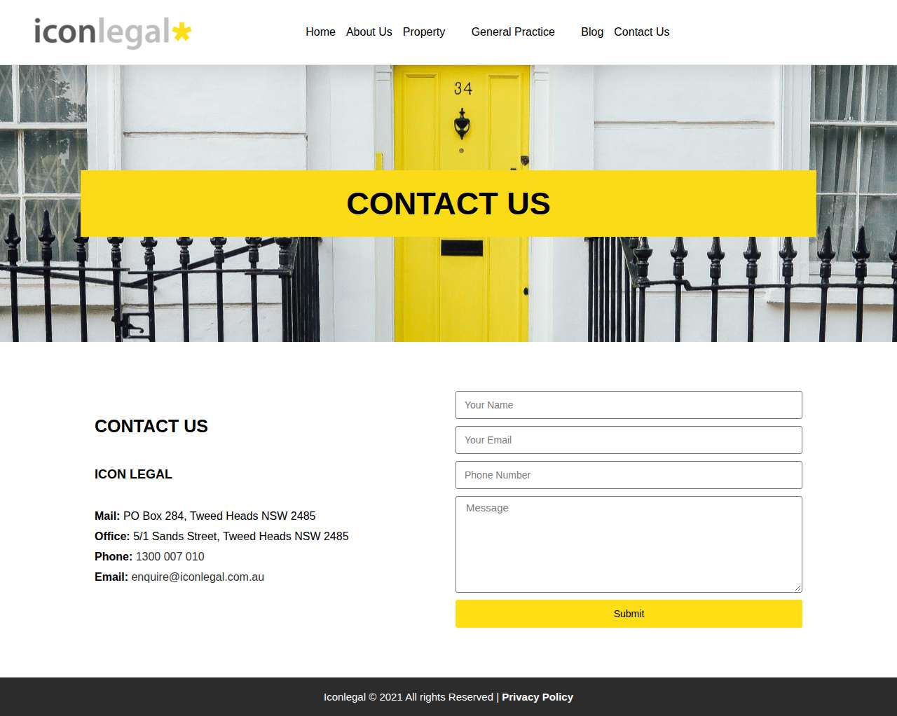

### gotocourt.com.au — dry\_run\_ok (dry run)

| | |
|---|---|
| Attempt ID | `c3ff9d9f-3f70-43ad-a3e0-167d0283b787` |
| Form URL | https://www.gotocourt.com.au/contact |
| Final URL | https://www.gotocourt.com.au/contact |
| Reserved | 2026-11-09 03:55:29 UTC |
| Submit attempted | — |
| Template | standard v2 |
| Confirmation text | none observed |
| Result / error | Selectors verified; fields not typed (domain not in dry-run fill list); not submitted |

Exact message:

~~~text
Subject: Helping customers find your business in AI search (AEO + GEO)

Hi there,

I'm Arun from Devs Arun. More and more customers now ask ChatGPT, Gemini, Perplexity or Google's AI Overviews questions like "who should I hire for this in my area?" before they call anyone. These tools answer from websites they can clearly understand, and they tend to recommend businesses whose pages answer real customer questions.

That is what AEO + GEO (Answer Engine and Generative Engine Optimization) is for. I improve your existing service pages so they clearly answer the questions your customers ask, add structured data that matches the page, and make the call, quote or enquiry step obvious. The benefit: your business gets a better chance of being mentioned or linked in AI answers, and visitors who arrive find it easy to contact you.

The AEO + GEO Starter is a one-time $199 (about ₹16,999, negotiable) for one website: a basic audit, 10 customer questions, improvements to two existing pages, relevant structured data and an action plan, with one revision round.

You can read the full details, send an enquiry or book online here:
https://devsarun.io/aeo-geo/

If this isn't relevant, just reply and I won't contact you again.

Best,
Arun
Devs Arun
itschool408@gmail.com · +91 7654534323
~~~

Submitted field values:

- \#contact-name: Arun
- \#contact-email: itschool408@gmail.com
- \#contact-phone: +91 7654534323
- \#contact-message: Hi there, I'm Arun from Devs Arun. More and more customers now ask ChatGPT, Gemini, Perplexity or Google's AI Overviews 

**Inspected page** — `run-25cfebab_attempt-c3ff9d9f_inspection_2026-11-09T03-55-29-960Z.jpg`

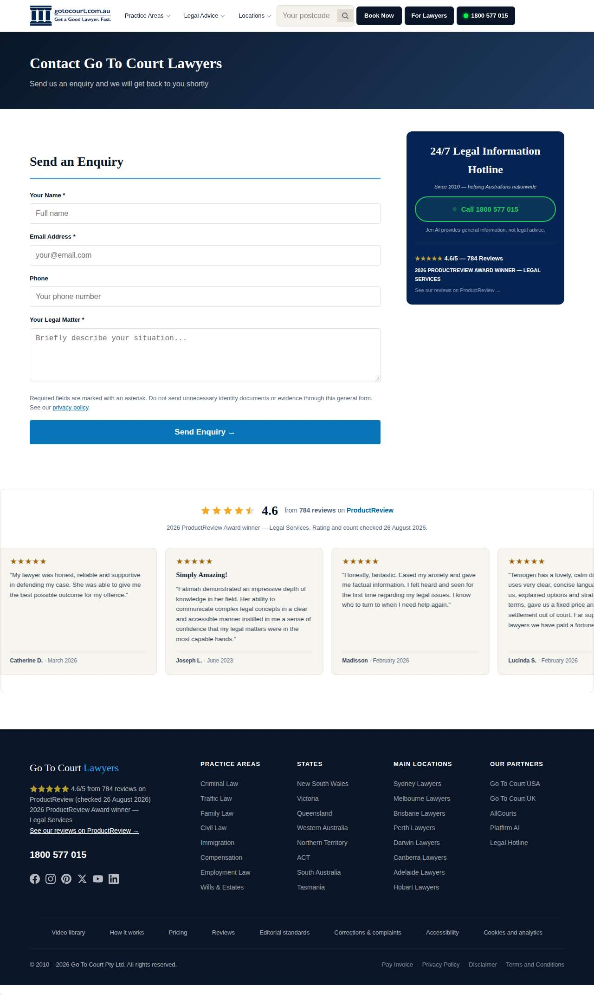

### pattenrobins.com.au — dry\_run\_ok (dry run)

| | |
|---|---|
| Attempt ID | `e9f61c55-723b-4395-8ae5-000c4d89f856` |
| Form URL | https://pattenrobins.com.au/contact/ |
| Final URL | https://pattenrobins.com.au/contact/ |
| Reserved | 2026-11-09 03:55:34 UTC |
| Submit attempted | — |
| Template | standard v2 |
| Confirmation text | none observed |
| Result / error | Selectors verified; fields not typed (domain not in dry-run fill list); not submitted |

Exact message:

~~~text
Subject: Helping customers find your business in AI search (AEO + GEO)

Hi there,

I'm Arun from Devs Arun. More and more customers now ask ChatGPT, Gemini, Perplexity or Google's AI Overviews questions like "who should I hire for this in my area?" before they call anyone. These tools answer from websites they can clearly understand, and they tend to recommend businesses whose pages answer real customer questions.

That is what AEO + GEO (Answer Engine and Generative Engine Optimization) is for. I improve your existing service pages so they clearly answer the questions your customers ask, add structured data that matches the page, and make the call, quote or enquiry step obvious. The benefit: your business gets a better chance of being mentioned or linked in AI answers, and visitors who arrive find it easy to contact you.

The AEO + GEO Starter is a one-time $199 (about ₹16,999, negotiable) for one website: a basic audit, 10 customer questions, improvements to two existing pages, relevant structured data and an action plan, with one revision round.

You can read the full details, send an enquiry or book online here:
https://devsarun.io/aeo-geo/

If this isn't relevant, just reply and I won't contact you again.

Best,
Arun
Devs Arun
itschool408@gmail.com · +91 7654534323
~~~

Submitted field values:

- \#input\_1\_1: Arun
- \#input\_1\_3: itschool408@gmail.com
- \#input\_1\_4: Hi there, I'm Arun from Devs Arun. More and more customers now ask ChatGPT, Gemini, Perplexity or Google's AI Overviews 
- \#input\_1\_5: Other

**Inspected page** — `run-25cfebab_attempt-e9f61c55_inspection_2026-11-09T03-55-39-423Z.jpg`

### ppconvey.com.au — dry\_run\_ok (dry run)

| | |
|---|---|
| Attempt ID | `586e1bf3-9970-4e46-b8f9-0786ff4815d7` |
| Form URL | https://www.ppconvey.com.au/contact |
| Final URL | https://www.ppconvey.com.au/contact |
| Reserved | 2026-11-09 03:55:44 UTC |
| Submit attempted | — |
| Template | standard v2 |
| Confirmation text | none observed |
| Result / error | Selectors verified; fields not typed (domain not in dry-run fill list); not submitted |

Exact message:

~~~text
Subject: Helping customers find your business in AI search (AEO + GEO)

Hi there,

I'm Arun from Devs Arun. More and more customers now ask ChatGPT, Gemini, Perplexity or Google's AI Overviews questions like "who should I hire for this in my area?" before they call anyone. These tools answer from websites they can clearly understand, and they tend to recommend businesses whose pages answer real customer questions.

That is what AEO + GEO (Answer Engine and Generative Engine Optimization) is for. I improve your existing service pages so they clearly answer the questions your customers ask, add structured data that matches the page, and make the call, quote or enquiry step obvious. The benefit: your business gets a better chance of being mentioned or linked in AI answers, and visitors who arrive find it easy to contact you.

The AEO + GEO Starter is a one-time $199 (about ₹16,999, negotiable) for one website: a basic audit, 10 customer questions, improvements to two existing pages, relevant structured data and an action plan, with one revision round.

You can read the full details, send an enquiry or book online here:
https://devsarun.io/aeo-geo/

If this isn't relevant, just reply and I won't contact you again.

Best,
Arun
Devs Arun
itschool408@gmail.com · +91 7654534323
~~~

Submitted field values:

- \#\\31 113089831: Hi there, I'm Arun from Devs Arun. More and more customers now ask ChatGPT, Gemini, Perplexity or Google's AI Overviews 
- \#\\31 124339597: itschool408@gmail.com
- \#\\31 133312817: +91 7654534323
- \#\\31 452777420: Arun

**Inspected page** — `run-25cfebab_attempt-586e1bf3_inspection_2026-11-09T03-55-47-129Z.jpg`

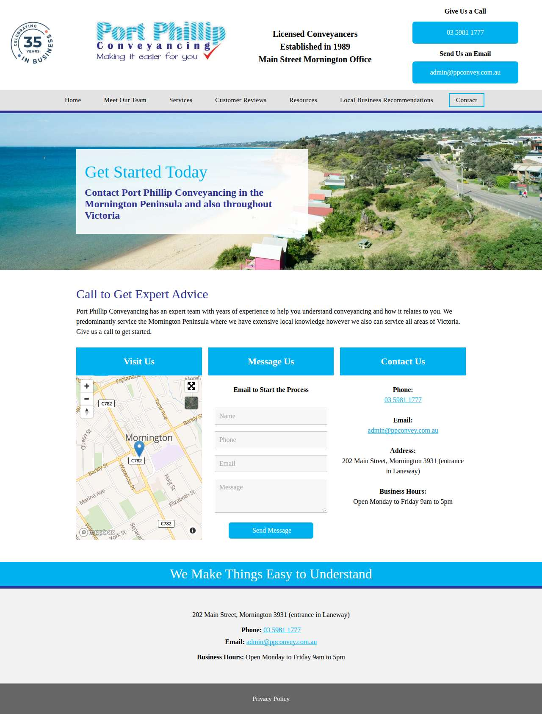

### alrm.org.au — dry\_run\_ok (dry run)

| | |
|---|---|
| Attempt ID | `4b1692fd-7dc2-42f9-ad66-ebc57b0525b0` |
| Form URL | https://www.alrm.org.au/contact-us/ |
| Final URL | https://www.alrm.org.au/contact-us/ |
| Reserved | 2026-11-09 03:55:52 UTC |
| Submit attempted | — |
| Template | standard v2 |
| Confirmation text | none observed |
| Result / error | Selectors verified; fields not typed (domain not in dry-run fill list); not submitted |

Exact message:

~~~text
Subject: Helping customers find your business in AI search (AEO + GEO)

Hi there,

I'm Arun from Devs Arun. More and more customers now ask ChatGPT, Gemini, Perplexity or Google's AI Overviews questions like "who should I hire for this in my area?" before they call anyone. These tools answer from websites they can clearly understand, and they tend to recommend businesses whose pages answer real customer questions.

That is what AEO + GEO (Answer Engine and Generative Engine Optimization) is for. I improve your existing service pages so they clearly answer the questions your customers ask, add structured data that matches the page, and make the call, quote or enquiry step obvious. The benefit: your business gets a better chance of being mentioned or linked in AI answers, and visitors who arrive find it easy to contact you.

The AEO + GEO Starter is a one-time $199 (about ₹16,999, negotiable) for one website: a basic audit, 10 customer questions, improvements to two existing pages, relevant structured data and an action plan, with one revision round.

You can read the full details, send an enquiry or book online here:
https://devsarun.io/aeo-geo/

If this isn't relevant, just reply and I won't contact you again.

Best,
Arun
Devs Arun
itschool408@gmail.com · +91 7654534323
~~~

Submitted field values:

- \#wpforms-352-field\_0: Arun
- \#wpforms-352-field\_1: itschool408@gmail.com
- \#wpforms-352-field\_2: Hi there, I'm Arun from Devs Arun. More and more customers now ask ChatGPT, Gemini, Perplexity or Google's AI Overviews 
- \#wpforms-352-field\_4: +91 7654534323

**Inspected page** — `run-25cfebab_attempt-4b1692fd_inspection_2026-11-09T03-55-54-878Z.jpg`

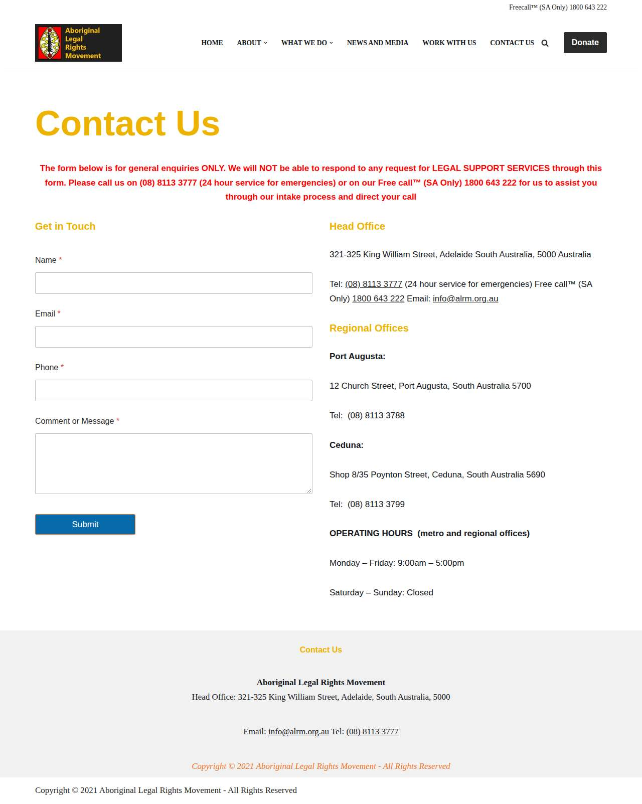

### clickvisa.com.au — dry\_run\_ok (dry run)

| | |
|---|---|
| Attempt ID | `e4b63b32-2375-471e-8d9d-50ebf2992b03` |
| Form URL | https://www.clickvisa.com.au/contact-us |
| Final URL | https://www.clickvisa.com.au/contact-us |
| Reserved | 2026-11-09 03:55:59 UTC |
| Submit attempted | — |
| Template | standard v2 |
| Confirmation text | none observed |
| Result / error | Selectors verified; fields not typed (domain not in dry-run fill list); not submitted |

Exact message:

~~~text
Subject: Helping customers find your business in AI search (AEO + GEO)

Hi there,

I'm Arun from Devs Arun. More and more customers now ask ChatGPT, Gemini, Perplexity or Google's AI Overviews questions like "who should I hire for this in my area?" before they call anyone. These tools answer from websites they can clearly understand, and they tend to recommend businesses whose pages answer real customer questions.

That is what AEO + GEO (Answer Engine and Generative Engine Optimization) is for. I improve your existing service pages so they clearly answer the questions your customers ask, add structured data that matches the page, and make the call, quote or enquiry step obvious. The benefit: your business gets a better chance of being mentioned or linked in AI answers, and visitors who arrive find it easy to contact you.

The AEO + GEO Starter is a one-time $199 (about ₹16,999, negotiable) for one website: a basic audit, 10 customer questions, improvements to two existing pages, relevant structured data and an action plan, with one revision round.

You can read the full details, send an enquiry or book online here:
https://devsarun.io/aeo-geo/

If this isn't relevant, just reply and I won't contact you again.

Best,
Arun
Devs Arun
itschool408@gmail.com · +91 7654534323
~~~

Submitted field values:

- \#\\:Rdcttsda\\:-form-item: Arun
- \#\\:R15cttsda\\:-form-item: Hi there, I'm Arun from Devs Arun. More and more customers now ask ChatGPT, Gemini, Perplexity or Google's AI Overviews 
- \#\\:R2lcttsda\\:-form-item: itschool408@gmail.com
- \#\\:R4lcttsda\\:-form-item: +91 7654534323

**Inspected page** — `run-25cfebab_attempt-e4b63b32_inspection_2026-11-09T03-56-01-035Z.jpg`

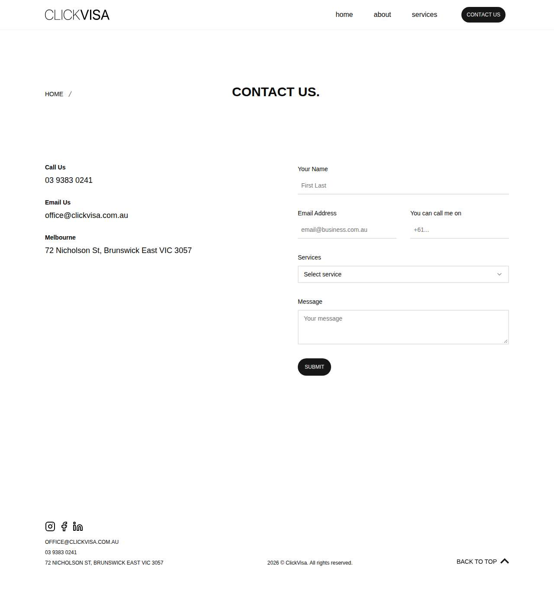

### accesslaw.biz — dry\_run\_ok (dry run)

| | |
|---|---|
| Attempt ID | `a628835d-2f63-4bef-a676-a01514166d2a` |
| Form URL | https://accesslaw.biz/contact/ |
| Final URL | https://accesslaw.biz/contact/ |
| Reserved | 2026-11-09 03:56:06 UTC |
| Submit attempted | — |
| Template | standard v2 |
| Confirmation text | none observed |
| Result / error | Selectors verified; fields not typed (domain not in dry-run fill list); not submitted |

Exact message:

~~~text
Subject: Helping customers find your business in AI search (AEO + GEO)

Hi there,

I'm Arun from Devs Arun. More and more customers now ask ChatGPT, Gemini, Perplexity or Google's AI Overviews questions like "who should I hire for this in my area?" before they call anyone. These tools answer from websites they can clearly understand, and they tend to recommend businesses whose pages answer real customer questions.

That is what AEO + GEO (Answer Engine and Generative Engine Optimization) is for. I improve your existing service pages so they clearly answer the questions your customers ask, add structured data that matches the page, and make the call, quote or enquiry step obvious. The benefit: your business gets a better chance of being mentioned or linked in AI answers, and visitors who arrive find it easy to contact you.

The AEO + GEO Starter is a one-time $199 (about ₹16,999, negotiable) for one website: a basic audit, 10 customer questions, improvements to two existing pages, relevant structured data and an action plan, with one revision round.

You can read the full details, send an enquiry or book online here:
https://devsarun.io/aeo-geo/

If this isn't relevant, just reply and I won't contact you again.

Best,
Arun
Devs Arun
itschool408@gmail.com · +91 7654534323
~~~

Submitted field values:

- input\[name="your-tel"\]: +91 7654534323
- input\[name="your-name"\]: Arun
- input\[name="your-email"\]: itschool408@gmail.com
- input\[name="your-subject"\]: Helping customers find your business in AI search (AEO + GEO)
- textarea\[name="your-message"\]: Hi there, I'm Arun from Devs Arun. More and more customers now ask ChatGPT, Gemini, Perplexity or Google's AI Overviews 

**Inspected page** — `run-25cfebab_attempt-a628835d_inspection_2026-11-09T03-56-10-691Z.jpg`

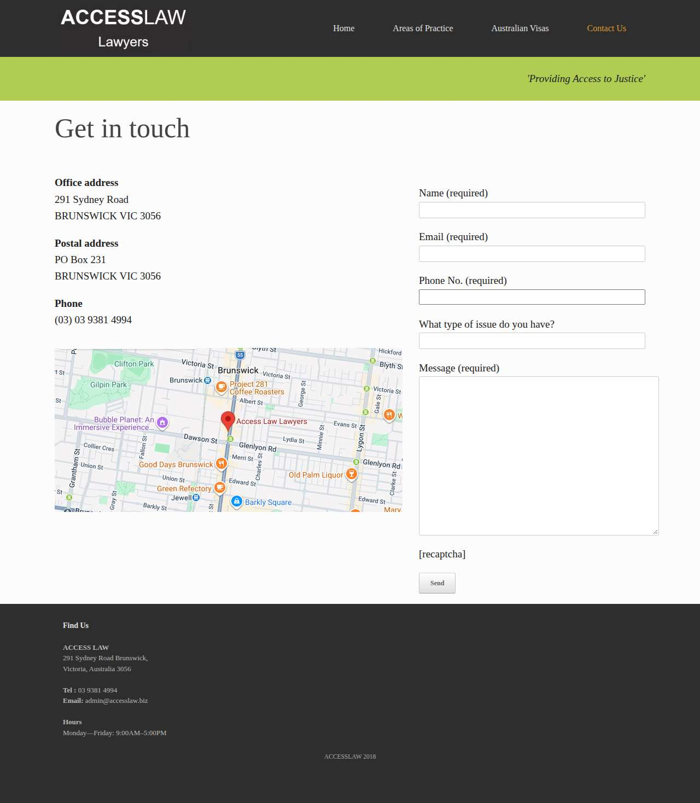

### birdsey.com.au — dry\_run\_ok (dry run)

| | |
|---|---|
| Attempt ID | `3b494898-7536-48c2-9c0f-fae584d1484e` |
| Form URL | https://birdsey.com.au/contact.html |
| Final URL | https://birdsey.com.au/contact.html |
| Reserved | 2026-11-09 03:56:15 UTC |
| Submit attempted | — |
| Template | standard v2 |
| Confirmation text | none observed |
| Result / error | Selectors verified; fields not typed (domain not in dry-run fill list); not submitted |

Exact message:

~~~text
Subject: Helping customers find your business in AI search (AEO + GEO)

Hi there,

I'm Arun from Devs Arun. More and more customers now ask ChatGPT, Gemini, Perplexity or Google's AI Overviews questions like "who should I hire for this in my area?" before they call anyone. These tools answer from websites they can clearly understand, and they tend to recommend businesses whose pages answer real customer questions.

That is what AEO + GEO (Answer Engine and Generative Engine Optimization) is for. I improve your existing service pages so they clearly answer the questions your customers ask, add structured data that matches the page, and make the call, quote or enquiry step obvious. The benefit: your business gets a better chance of being mentioned or linked in AI answers, and visitors who arrive find it easy to contact you.

The AEO + GEO Starter is a one-time $199 (about ₹16,999, negotiable) for one website: a basic audit, 10 customer questions, improvements to two existing pages, relevant structured data and an action plan, with one revision round.

You can read the full details, send an enquiry or book online here:
https://devsarun.io/aeo-geo/

If this isn't relevant, just reply and I won't contact you again.

Best,
Arun
Devs Arun
itschool408@gmail.com · +91 7654534323
~~~

Submitted field values:

- \#Email\_ID: itschool408@gmail.com
- \#Phone\_ID: +91 7654534323
- input\[name="name"\]: Arun
- textarea\[name="request"\]: Hi there, I'm Arun from Devs Arun. More and more customers now ask ChatGPT, Gemini, Perplexity or Google's AI Overviews 

**Inspected page** — `run-25cfebab_attempt-3b494898_inspection_2026-11-09T03-56-17-847Z.jpg`

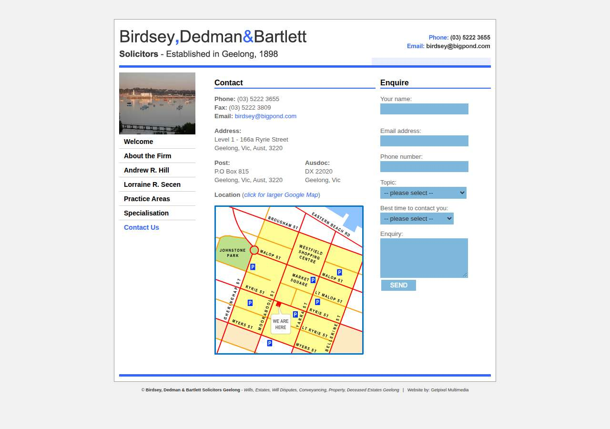

### munrodoig.com.au — dry\_run\_ok (dry run)

| | |
|---|---|
| Attempt ID | `0e01109a-bdeb-449c-9343-fc6abe02f4d3` |
| Form URL | https://www.munrodoig.com.au/contact-us/ |
| Final URL | https://www.munrodoig.com.au/contact-us/ |
| Reserved | 2026-11-09 03:56:22 UTC |
| Submit attempted | — |
| Template | standard v2 |
| Confirmation text | none observed |
| Result / error | Selectors verified; fields not typed (domain not in dry-run fill list); not submitted |

Exact message:

~~~text
Subject: Helping customers find your business in AI search (AEO + GEO)

Hi there,

I'm Arun from Devs Arun. More and more customers now ask ChatGPT, Gemini, Perplexity or Google's AI Overviews questions like "who should I hire for this in my area?" before they call anyone. These tools answer from websites they can clearly understand, and they tend to recommend businesses whose pages answer real customer questions.

That is what AEO + GEO (Answer Engine and Generative Engine Optimization) is for. I improve your existing service pages so they clearly answer the questions your customers ask, add structured data that matches the page, and make the call, quote or enquiry step obvious. The benefit: your business gets a better chance of being mentioned or linked in AI answers, and visitors who arrive find it easy to contact you.

The AEO + GEO Starter is a one-time $199 (about ₹16,999, negotiable) for one website: a basic audit, 10 customer questions, improvements to two existing pages, relevant structured data and an action plan, with one revision round.

You can read the full details, send an enquiry or book online here:
https://devsarun.io/aeo-geo/

If this isn't relevant, just reply and I won't contact you again.

Best,
Arun
Devs Arun
itschool408@gmail.com · +91 7654534323
~~~

Submitted field values:

- input\[name="your-name"\]: Arun
- input\[name="your-email"\]: itschool408@gmail.com
- input\[name="your-phone"\]: +91 7654534323
- textarea\[name="case-details"\]: Hi there, I'm Arun from Devs Arun. More and more customers now ask ChatGPT, Gemini, Perplexity or Google's AI Overviews 

**Inspected page** — `run-25cfebab_attempt-0e01109a_inspection_2026-11-09T03-56-28-468Z.jpg`

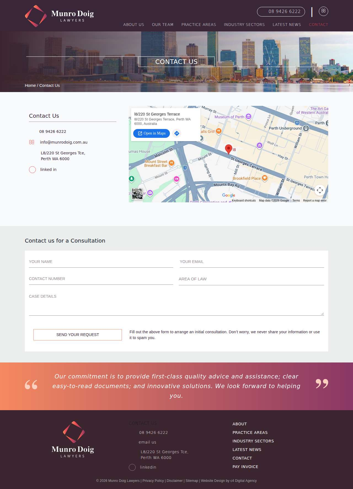

### elvinlawyers.com.au — dry\_run\_ok (dry run)

| | |
|---|---|
| Attempt ID | `451cb927-4aff-4fc6-ad55-e010c6d77cf2` |
| Form URL | https://elvinlawyers.com.au/contact-us/ |
| Final URL | https://elvinlawyers.com.au/contact-us/ |
| Reserved | 2026-11-09 03:56:33 UTC |
| Submit attempted | — |
| Template | standard v2 |
| Confirmation text | none observed |
| Result / error | Selectors verified; fields not typed (domain not in dry-run fill list); not submitted |

Exact message:

~~~text
Subject: Helping customers find your business in AI search (AEO + GEO)

Hi there,

I'm Arun from Devs Arun. More and more customers now ask ChatGPT, Gemini, Perplexity or Google's AI Overviews questions like "who should I hire for this in my area?" before they call anyone. These tools answer from websites they can clearly understand, and they tend to recommend businesses whose pages answer real customer questions.

That is what AEO + GEO (Answer Engine and Generative Engine Optimization) is for. I improve your existing service pages so they clearly answer the questions your customers ask, add structured data that matches the page, and make the call, quote or enquiry step obvious. The benefit: your business gets a better chance of being mentioned or linked in AI answers, and visitors who arrive find it easy to contact you.

The AEO + GEO Starter is a one-time $199 (about ₹16,999, negotiable) for one website: a basic audit, 10 customer questions, improvements to two existing pages, relevant structured data and an action plan, with one revision round.

You can read the full details, send an enquiry or book online here:
https://devsarun.io/aeo-geo/

If this isn't relevant, just reply and I won't contact you again.

Best,
Arun
Devs Arun
itschool408@gmail.com · +91 7654534323
~~~

Submitted field values:

- \#nf-field-1: Arun
- \#nf-field-2: itschool408@gmail.com
- \#nf-field-3: Hi there, I'm Arun from Devs Arun. More and more customers now ask ChatGPT, Gemini, Perplexity or Google's AI Overviews 
- \#nf-field-5: +91 7654534323

**Inspected page** — `run-25cfebab_attempt-451cb927_inspection_2026-11-09T03-56-36-814Z.jpg`

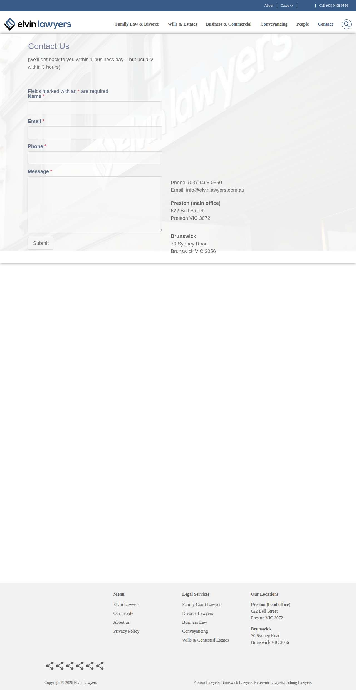

### cannlegal.com.au — dry\_run\_ok (dry run)

| | |
|---|---|
| Attempt ID | `ed2d8e56-3a56-4c30-9b4d-120f2fd6304f` |
| Form URL | https://www.cannlegal.com.au/contact/ |
| Final URL | https://www.cannlegal.com.au/contact/ |
| Reserved | 2026-11-09 03:56:41 UTC |
| Submit attempted | — |
| Template | standard v2 |
| Confirmation text | none observed |
| Result / error | Selectors verified; fields not typed (domain not in dry-run fill list); not submitted |

Exact message:

~~~text
Subject: Helping customers find your business in AI search (AEO + GEO)

Hi there,

I'm Arun from Devs Arun. More and more customers now ask ChatGPT, Gemini, Perplexity or Google's AI Overviews questions like "who should I hire for this in my area?" before they call anyone. These tools answer from websites they can clearly understand, and they tend to recommend businesses whose pages answer real customer questions.

That is what AEO + GEO (Answer Engine and Generative Engine Optimization) is for. I improve your existing service pages so they clearly answer the questions your customers ask, add structured data that matches the page, and make the call, quote or enquiry step obvious. The benefit: your business gets a better chance of being mentioned or linked in AI answers, and visitors who arrive find it easy to contact you.

The AEO + GEO Starter is a one-time $199 (about ₹16,999, negotiable) for one website: a basic audit, 10 customer questions, improvements to two existing pages, relevant structured data and an action plan, with one revision round.

You can read the full details, send an enquiry or book online here:
https://devsarun.io/aeo-geo/

If this isn't relevant, just reply and I won't contact you again.

Best,
Arun
Devs Arun
itschool408@gmail.com · +91 7654534323
~~~

Submitted field values:

- input\[name="your-name"\]: Arun
- input\[name="your-email"\]: itschool408@gmail.com
- input\[name="your-subject"\]: Helping customers find your business in AI search (AEO + GEO)
- textarea\[name="your-message"\]: Hi there, I'm Arun from Devs Arun. More and more customers now ask ChatGPT, Gemini, Perplexity or Google's AI Overviews 

**Inspected page** — `run-25cfebab_attempt-ed2d8e56_inspection_2026-11-09T03-56-49-524Z.jpg`

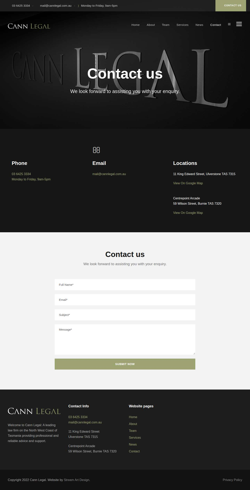

### fuseadvisory.com — dry\_run\_ok (dry run)

| | |
|---|---|
| Attempt ID | `739e0027-51f1-4871-939f-620d5dce7788` |
| Form URL | https://fuselaw.com.au/lets-talk |
| Final URL | https://fuselaw.com.au/lets-talk |
| Reserved | 2026-11-09 03:56:54 UTC |
| Submit attempted | — |
| Template | standard v2 |
| Confirmation text | none observed |
| Result / error | Selectors verified; fields not typed (domain not in dry-run fill list); not submitted |

Exact message:

~~~text
Subject: Helping customers find your business in AI search (AEO + GEO)

Hi there,

I'm Arun from Devs Arun. More and more customers now ask ChatGPT, Gemini, Perplexity or Google's AI Overviews questions like "who should I hire for this in my area?" before they call anyone. These tools answer from websites they can clearly understand, and they tend to recommend businesses whose pages answer real customer questions.

That is what AEO + GEO (Answer Engine and Generative Engine Optimization) is for. I improve your existing service pages so they clearly answer the questions your customers ask, add structured data that matches the page, and make the call, quote or enquiry step obvious. The benefit: your business gets a better chance of being mentioned or linked in AI answers, and visitors who arrive find it easy to contact you.

The AEO + GEO Starter is a one-time $199 (about ₹16,999, negotiable) for one website: a basic audit, 10 customer questions, improvements to two existing pages, relevant structured data and an action plan, with one revision round.

You can read the full details, send an enquiry or book online here:
https://devsarun.io/aeo-geo/

If this isn't relevant, just reply and I won't contact you again.

Best,
Arun
Devs Arun
itschool408@gmail.com · +91 7654534323
~~~

Submitted field values:

- \#contact-name: Arun
- \#contact-email: itschool408@gmail.com
- \#contact-company: Devs Arun
- \#contact-message: Hi there, I'm Arun from Devs Arun. More and more customers now ask ChatGPT, Gemini, Perplexity or Google's AI Overviews 

**Inspected page** — `run-25cfebab_attempt-739e0027_inspection_2026-11-09T03-56-55-794Z.jpg`

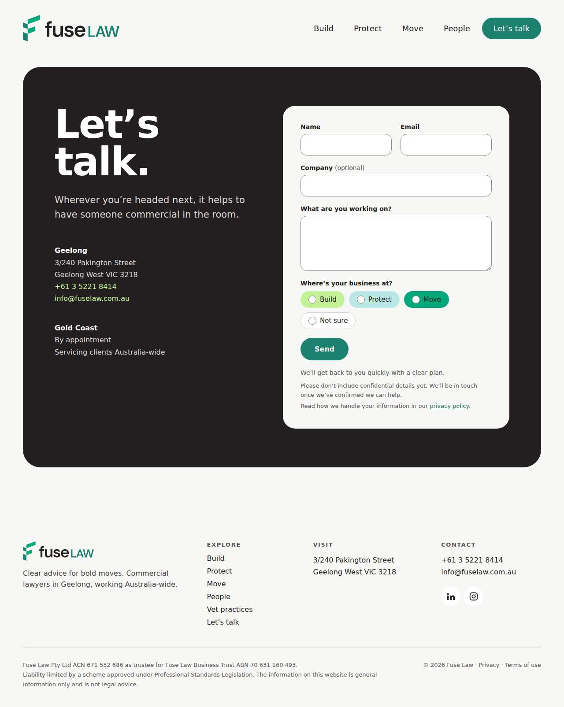

### splawyerssg.com.au — dry\_run\_ok (dry run)

| | |
|---|---|
| Attempt ID | `5bd12f9f-25ca-48d3-8808-74bfd326d790` |
| Form URL | https://www.spgarrett.com.au/contact-us/ |
| Final URL | https://www.spgarrett.com.au/contact-us/ |
| Reserved | 2026-11-09 03:57:00 UTC |
| Submit attempted | — |
| Template | standard v2 |
| Confirmation text | none observed |
| Result / error | Selectors verified; fields not typed (domain not in dry-run fill list); not submitted |

Exact message:

~~~text
Subject: Helping customers find your business in AI search (AEO + GEO)

Hi there,

I'm Arun from Devs Arun. More and more customers now ask ChatGPT, Gemini, Perplexity or Google's AI Overviews questions like "who should I hire for this in my area?" before they call anyone. These tools answer from websites they can clearly understand, and they tend to recommend businesses whose pages answer real customer questions.

That is what AEO + GEO (Answer Engine and Generative Engine Optimization) is for. I improve your existing service pages so they clearly answer the questions your customers ask, add structured data that matches the page, and make the call, quote or enquiry step obvious. The benefit: your business gets a better chance of being mentioned or linked in AI answers, and visitors who arrive find it easy to contact you.

The AEO + GEO Starter is a one-time $199 (about ₹16,999, negotiable) for one website: a basic audit, 10 customer questions, improvements to two existing pages, relevant structured data and an action plan, with one revision round.

You can read the full details, send an enquiry or book online here:
https://devsarun.io/aeo-geo/

If this isn't relevant, just reply and I won't contact you again.

Best,
Arun
Devs Arun
itschool408@gmail.com · +91 7654534323
~~~

Submitted field values:

- input\[name="tel-149"\]: +91 7654534323
- input\[name="your-name"\]: Arun
- input\[name="your-email"\]: itschool408@gmail.com
- textarea\[name="your-message"\]: Hi there, I'm Arun from Devs Arun. More and more customers now ask ChatGPT, Gemini, Perplexity or Google's AI Overviews 

**Inspected page** — `run-25cfebab_attempt-5bd12f9f_inspection_2026-11-09T03-57-07-150Z.jpg`

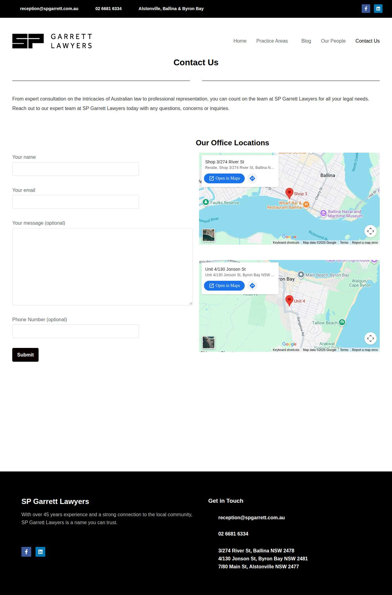

### forgelegal.net — dry\_run\_ok (dry run)

| | |
|---|---|
| Attempt ID | `7d0ed13e-d89e-4a5a-9f04-a6ce6076b261` |
| Form URL | https://forgelegal.com.au/contact |
| Final URL | https://forgelegal.com.au/contact |
| Reserved | 2026-11-09 03:57:12 UTC |
| Submit attempted | — |
| Template | standard v2 |
| Confirmation text | none observed |
| Result / error | Selectors verified; fields not typed (domain not in dry-run fill list); not submitted |

Exact message:

~~~text
Subject: Helping customers find your business in AI search (AEO + GEO)

Hi there,

I'm Arun from Devs Arun. More and more customers now ask ChatGPT, Gemini, Perplexity or Google's AI Overviews questions like "who should I hire for this in my area?" before they call anyone. These tools answer from websites they can clearly understand, and they tend to recommend businesses whose pages answer real customer questions.

That is what AEO + GEO (Answer Engine and Generative Engine Optimization) is for. I improve your existing service pages so they clearly answer the questions your customers ask, add structured data that matches the page, and make the call, quote or enquiry step obvious. The benefit: your business gets a better chance of being mentioned or linked in AI answers, and visitors who arrive find it easy to contact you.

The AEO + GEO Starter is a one-time $199 (about ₹16,999, negotiable) for one website: a basic audit, 10 customer questions, improvements to two existing pages, relevant structured data and an action plan, with one revision round.

You can read the full details, send an enquiry or book online here:
https://devsarun.io/aeo-geo/

If this isn't relevant, just reply and I won't contact you again.

Best,
Arun
Devs Arun
itschool408@gmail.com · +91 7654534323
~~~

Submitted field values:

- \#contact-name: Arun
- \#contact-email: itschool408@gmail.com
- \#contact-notes: Hi there, I'm Arun from Devs Arun. More and more customers now ask ChatGPT, Gemini, Perplexity or Google's AI Overviews 
- \#contact-phone: +91 7654534323

**Inspected page** — `run-25cfebab_attempt-7d0ed13e_inspection_2026-11-09T03-57-14-476Z.jpg`

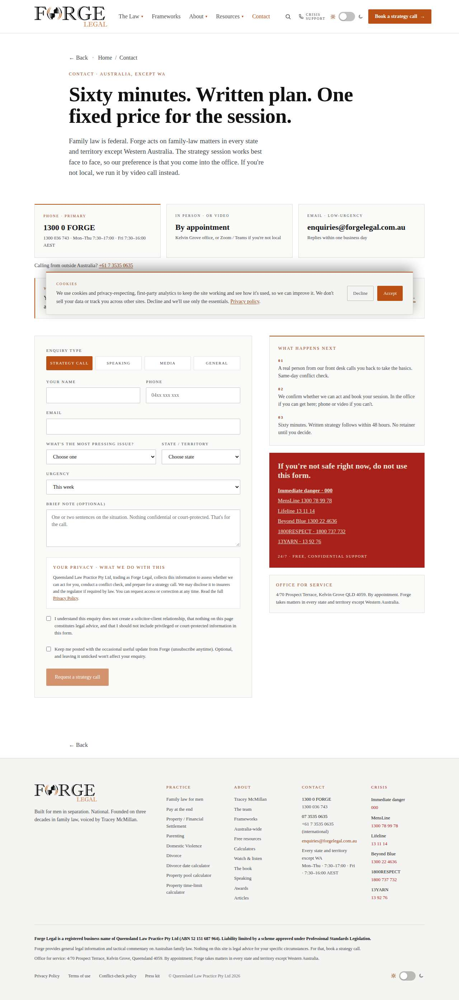

### leadconveyancing.com.au — dry\_run\_ok (dry run)

| | |
|---|---|
| Attempt ID | `2da2014f-f5bb-43f7-817a-59803f71a10b` |
| Form URL | https://leadconveyancing.com.au/contact-us/ |
| Final URL | https://leadconveyancing.com.au/contact-us/ |
| Reserved | 2026-11-09 03:57:19 UTC |
| Submit attempted | — |
| Template | standard v2 |
| Confirmation text | none observed |
| Result / error | Selectors verified; fields not typed (domain not in dry-run fill list); not submitted |

Exact message:

~~~text
Subject: Helping customers find your business in AI search (AEO + GEO)

Hi there,

I'm Arun from Devs Arun. More and more customers now ask ChatGPT, Gemini, Perplexity or Google's AI Overviews questions like "who should I hire for this in my area?" before they call anyone. These tools answer from websites they can clearly understand, and they tend to recommend businesses whose pages answer real customer questions.

That is what AEO + GEO (Answer Engine and Generative Engine Optimization) is for. I improve your existing service pages so they clearly answer the questions your customers ask, add structured data that matches the page, and make the call, quote or enquiry step obvious. The benefit: your business gets a better chance of being mentioned or linked in AI answers, and visitors who arrive find it easy to contact you.

The AEO + GEO Starter is a one-time $199 (about ₹16,999, negotiable) for one website: a basic audit, 10 customer questions, improvements to two existing pages, relevant structured data and an action plan, with one revision round.

You can read the full details, send an enquiry or book online here:
https://devsarun.io/aeo-geo/

If this isn't relevant, just reply and I won't contact you again.

Best,
Arun
Devs Arun
itschool408@gmail.com · +91 7654534323
~~~

Submitted field values:

- \#input\_2\_1: Arun
- \#input\_2\_3: +91 7654534323
- \#input\_2\_4: itschool408@gmail.com
- \#input\_2\_6: Hi there, I'm Arun from Devs Arun. More and more customers now ask ChatGPT, Gemini, Perplexity or Google's AI Overviews 

**Inspected page** — `run-25cfebab_attempt-2da2014f_inspection_2026-11-09T03-57-23-001Z.jpg`

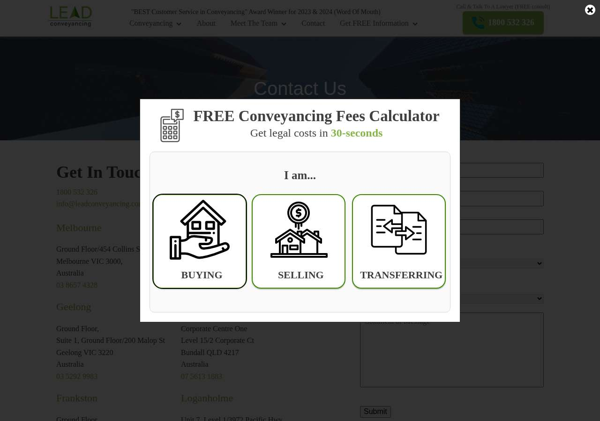

### caraccidentlawyersperth.com.au — dry\_run\_ok (dry run)

| | |
|---|---|
| Attempt ID | `797d75f2-1219-4a05-8e26-1f1b5eeb4b21` |
| Form URL | https://www.caraccidentlawyersperth.com.au/contact-us |
| Final URL | https://www.caraccidentlawyersperth.com.au/contact-us |
| Reserved | 2026-11-09 03:57:28 UTC |
| Submit attempted | — |
| Template | standard v2 |
| Confirmation text | none observed |
| Result / error | Selectors verified; fields not typed (domain not in dry-run fill list); not submitted |

Exact message:

~~~text
Subject: Helping customers find your business in AI search (AEO + GEO)

Hi there,

I'm Arun from Devs Arun. More and more customers now ask ChatGPT, Gemini, Perplexity or Google's AI Overviews questions like "who should I hire for this in my area?" before they call anyone. These tools answer from websites they can clearly understand, and they tend to recommend businesses whose pages answer real customer questions.

That is what AEO + GEO (Answer Engine and Generative Engine Optimization) is for. I improve your existing service pages so they clearly answer the questions your customers ask, add structured data that matches the page, and make the call, quote or enquiry step obvious. The benefit: your business gets a better chance of being mentioned or linked in AI answers, and visitors who arrive find it easy to contact you.

The AEO + GEO Starter is a one-time $199 (about ₹16,999, negotiable) for one website: a basic audit, 10 customer questions, improvements to two existing pages, relevant structured data and an action plan, with one revision round.

You can read the full details, send an enquiry or book online here:
https://devsarun.io/aeo-geo/

If this isn't relevant, just reply and I won't contact you again.

Best,
Arun
Devs Arun
itschool408@gmail.com · +91 7654534323
~~~

Submitted field values:

- \#input\_comp-lbdo7l2m: +91 7654534323
- \#input\_comp-lbdf75al1: Arun
- \#input\_comp-lbdf75az2: itschool408@gmail.com
- \#textarea\_comp-lbdf75b23: Hi there, I'm Arun from Devs Arun. More and more customers now ask ChatGPT, Gemini, Perplexity or Google's AI Overviews 

**Inspected page** — `run-25cfebab_attempt-797d75f2_inspection_2026-11-09T03-57-32-657Z.jpg`

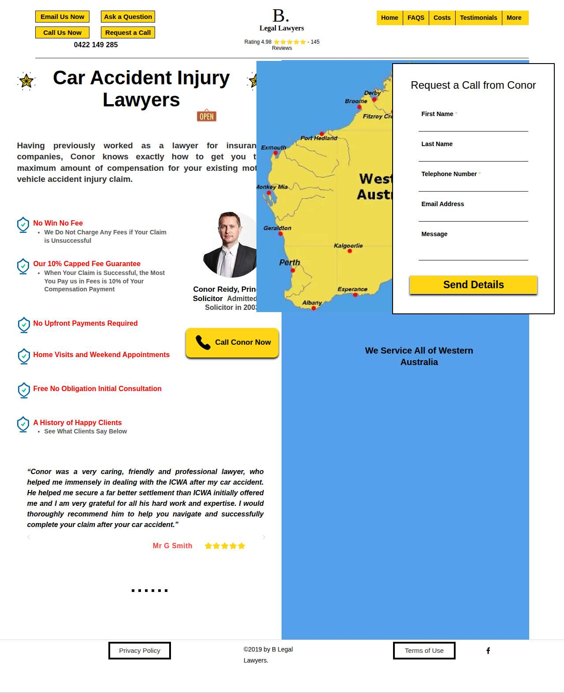

### trewinnorman.com.au — dry\_run\_ok (dry run)

| | |
|---|---|
| Attempt ID | `bf1e6d9e-ccd0-4355-aef0-1a4fca63256d` |
| Form URL | https://www.trewinnorman.com.au/contact-us |
| Final URL | https://www.trewinnorman.com.au/contact-us |
| Reserved | 2026-11-09 03:57:37 UTC |
| Submit attempted | — |
| Template | standard v2 |
| Confirmation text | none observed |
| Result / error | Selectors verified; fields not typed (domain not in dry-run fill list); not submitted |

Exact message:

~~~text
Subject: Helping customers find your business in AI search (AEO + GEO)

Hi there,

I'm Arun from Devs Arun. More and more customers now ask ChatGPT, Gemini, Perplexity or Google's AI Overviews questions like "who should I hire for this in my area?" before they call anyone. These tools answer from websites they can clearly understand, and they tend to recommend businesses whose pages answer real customer questions.

That is what AEO + GEO (Answer Engine and Generative Engine Optimization) is for. I improve your existing service pages so they clearly answer the questions your customers ask, add structured data that matches the page, and make the call, quote or enquiry step obvious. The benefit: your business gets a better chance of being mentioned or linked in AI answers, and visitors who arrive find it easy to contact you.

The AEO + GEO Starter is a one-time $199 (about ₹16,999, negotiable) for one website: a basic audit, 10 customer questions, improvements to two existing pages, relevant structured data and an action plan, with one revision round.

You can read the full details, send an enquiry or book online here:
https://devsarun.io/aeo-geo/

If this isn't relevant, just reply and I won't contact you again.

Best,
Arun
Devs Arun
itschool408@gmail.com · +91 7654534323
~~~

Submitted field values:

- \#\\31 033317198: +91 7654534323
- \#\\31 335676984: itschool408@gmail.com
- \#\\31 709335374: Hi there, I'm Arun from Devs Arun. More and more customers now ask ChatGPT, Gemini, Perplexity or Google's AI Overviews 
- \#\\31 764814440: Arun

**Inspected page** — `run-25cfebab_attempt-bf1e6d9e_inspection_2026-11-09T03-57-40-166Z.jpg`

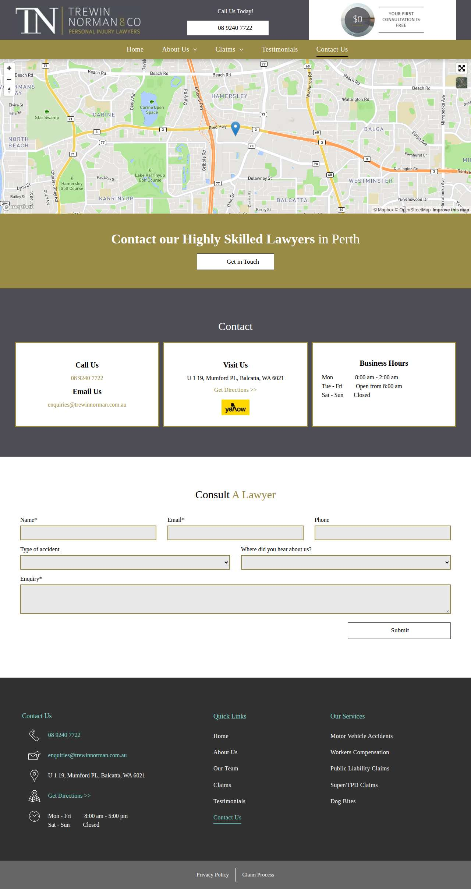

### ownitconveyancing.com — dry\_run\_ok (dry run)

| | |
|---|---|
| Attempt ID | `52adec68-bad4-4ec3-92d9-a0cfc6b6997e` |
| Form URL | https://ownitconveyancing.com/contact-us |
| Final URL | https://ownitconveyancing.com/contact-us |
| Reserved | 2026-11-09 03:57:45 UTC |
| Submit attempted | — |
| Template | standard v2 |
| Confirmation text | none observed |
| Result / error | Selectors verified; fields not typed (domain not in dry-run fill list); not submitted |

Exact message:

~~~text
Subject: Helping customers find your business in AI search (AEO + GEO)

Hi there,

I'm Arun from Devs Arun. More and more customers now ask ChatGPT, Gemini, Perplexity or Google's AI Overviews questions like "who should I hire for this in my area?" before they call anyone. These tools answer from websites they can clearly understand, and they tend to recommend businesses whose pages answer real customer questions.

That is what AEO + GEO (Answer Engine and Generative Engine Optimization) is for. I improve your existing service pages so they clearly answer the questions your customers ask, add structured data that matches the page, and make the call, quote or enquiry step obvious. The benefit: your business gets a better chance of being mentioned or linked in AI answers, and visitors who arrive find it easy to contact you.

The AEO + GEO Starter is a one-time $199 (about ₹16,999, negotiable) for one website: a basic audit, 10 customer questions, improvements to two existing pages, relevant structured data and an action plan, with one revision round.

You can read the full details, send an enquiry or book online here:
https://devsarun.io/aeo-geo/

If this isn't relevant, just reply and I won't contact you again.

Best,
Arun
Devs Arun
itschool408@gmail.com · +91 7654534323
~~~

Submitted field values:

- \#cu-email: itschool408@gmail.com
- \#cu-mobile: +91 7654534323
- \#cu-message: Hi there, I'm Arun from Devs Arun. More and more customers now ask ChatGPT, Gemini, Perplexity or Google's AI Overviews 
- \#cu-firstName: Arun

**Inspected page** — `run-25cfebab_attempt-52adec68_inspection_2026-11-09T03-57-50-979Z.jpg`

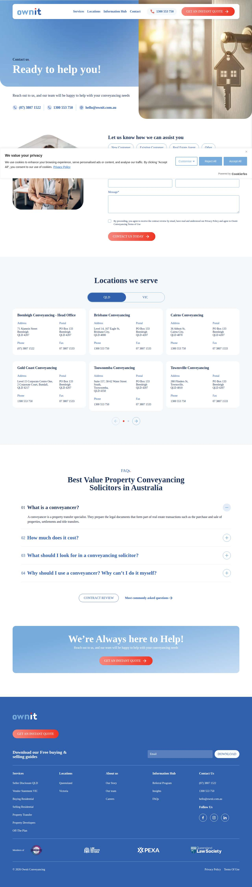

### jht.com.au — dry\_run\_ok (dry run)

| | |
|---|---|
| Attempt ID | `723c198c-745c-44d6-847e-571c8fd5e430` |
| Form URL | https://jht.com.au/contact/ |
| Final URL | https://jht.com.au/contact/ |
| Reserved | 2026-11-09 03:57:56 UTC |
| Submit attempted | — |
| Template | standard v2 |
| Confirmation text | none observed |
| Result / error | Selectors verified; fields not typed (domain not in dry-run fill list); not submitted |

Exact message:

~~~text
Subject: Helping customers find your business in AI search (AEO + GEO)

Hi there,

I'm Arun from Devs Arun. More and more customers now ask ChatGPT, Gemini, Perplexity or Google's AI Overviews questions like "who should I hire for this in my area?" before they call anyone. These tools answer from websites they can clearly understand, and they tend to recommend businesses whose pages answer real customer questions.

That is what AEO + GEO (Answer Engine and Generative Engine Optimization) is for. I improve your existing service pages so they clearly answer the questions your customers ask, add structured data that matches the page, and make the call, quote or enquiry step obvious. The benefit: your business gets a better chance of being mentioned or linked in AI answers, and visitors who arrive find it easy to contact you.

The AEO + GEO Starter is a one-time $199 (about ₹16,999, negotiable) for one website: a basic audit, 10 customer questions, improvements to two existing pages, relevant structured data and an action plan, with one revision round.

You can read the full details, send an enquiry or book online here:
https://devsarun.io/aeo-geo/

If this isn't relevant, just reply and I won't contact you again.

Best,
Arun
Devs Arun
itschool408@gmail.com · +91 7654534323
~~~

Submitted field values:

- \#nf-field-1\_1: Arun
- \#nf-field-2\_1: itschool408@gmail.com
- \#nf-field-3\_1: Hi there, I'm Arun from Devs Arun. More and more customers now ask ChatGPT, Gemini, Perplexity or Google's AI Overviews 
- \#nf-field-5\_1: +91 7654534323

**Inspected page** — `run-25cfebab_attempt-723c198c_inspection_2026-11-09T03-57-59-761Z.jpg`

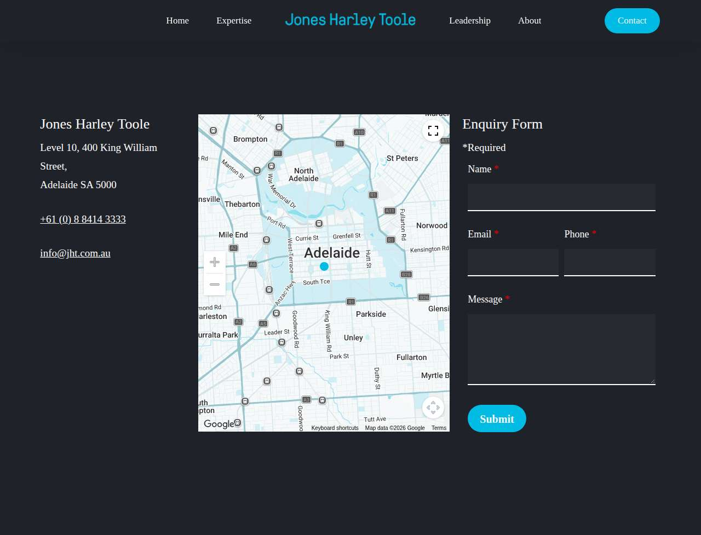

### baxterssolicitors.com.au — dry\_run\_ok (dry run)

| | |
|---|---|
| Attempt ID | `504e0f03-26d7-499d-b558-dcdc5c980d62` |
| Form URL | https://baxterssolicitors.com.au/contact-us/ |
| Final URL | https://baxterssolicitors.com.au/contact-us/ |
| Reserved | 2026-11-09 03:58:04 UTC |
| Submit attempted | — |
| Template | standard v2 |
| Confirmation text | none observed |
| Result / error | Selectors verified; fields not typed (domain not in dry-run fill list); not submitted |

Exact message:

~~~text
Subject: Helping customers find your business in AI search (AEO + GEO)

Hi there,

I'm Arun from Devs Arun. More and more customers now ask ChatGPT, Gemini, Perplexity or Google's AI Overviews questions like "who should I hire for this in my area?" before they call anyone. These tools answer from websites they can clearly understand, and they tend to recommend businesses whose pages answer real customer questions.

That is what AEO + GEO (Answer Engine and Generative Engine Optimization) is for. I improve your existing service pages so they clearly answer the questions your customers ask, add structured data that matches the page, and make the call, quote or enquiry step obvious. The benefit: your business gets a better chance of being mentioned or linked in AI answers, and visitors who arrive find it easy to contact you.

The AEO + GEO Starter is a one-time $199 (about ₹16,999, negotiable) for one website: a basic audit, 10 customer questions, improvements to two existing pages, relevant structured data and an action plan, with one revision round.

You can read the full details, send an enquiry or book online here:
https://devsarun.io/aeo-geo/

If this isn't relevant, just reply and I won't contact you again.

Best,
Arun
Devs Arun
itschool408@gmail.com · +91 7654534323
~~~

Submitted field values:

- input\[name="your-name"\]: Arun
- input\[name="your-email"\]: itschool408@gmail.com
- input\[name="your-subject"\]: Helping customers find your business in AI search (AEO + GEO)
- textarea\[name="your-message"\]: Hi there, I'm Arun from Devs Arun. More and more customers now ask ChatGPT, Gemini, Perplexity or Google's AI Overviews 

**Inspected page** — `run-25cfebab_attempt-504e0f03_inspection_2026-11-09T03-58-06-898Z.jpg`

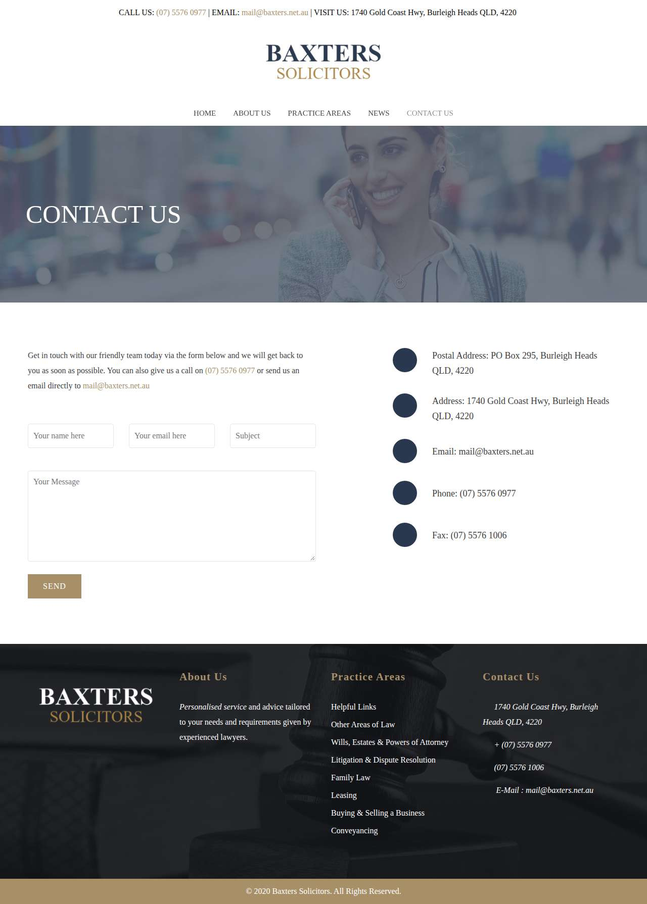

### sblawpartners.com.au — dry\_run\_failed (dry run)

| | |
|---|---|
| Attempt ID | `0d0e3f67-96eb-4c30-b163-5badb60c2e22` |
| Form URL | https://sblawpartners.com.au/contact-us/ |
| Final URL | https://sblawpartners.com.au/contact-us/ |
| Reserved | 2026-11-09 03:58:11 UTC |
| Submit attempted | — |
| Template | standard v2 |
| Confirmation text | none observed |
| Result / error | Mapped field "Name \*" not found uniquely |

Exact message:

~~~text
Subject: Helping customers find your business in AI search (AEO + GEO)

Hi there,

I'm Arun from Devs Arun. More and more customers now ask ChatGPT, Gemini, Perplexity or Google's AI Overviews questions like "who should I hire for this in my area?" before they call anyone. These tools answer from websites they can clearly understand, and they tend to recommend businesses whose pages answer real customer questions.

That is what AEO + GEO (Answer Engine and Generative Engine Optimization) is for. I improve your existing service pages so they clearly answer the questions your customers ask, add structured data that matches the page, and make the call, quote or enquiry step obvious. The benefit: your business gets a better chance of being mentioned or linked in AI answers, and visitors who arrive find it easy to contact you.

The AEO + GEO Starter is a one-time $199 (about ₹16,999, negotiable) for one website: a basic audit, 10 customer questions, improvements to two existing pages, relevant structured data and an action plan, with one revision round.

You can read the full details, send an enquiry or book online here:
https://devsarun.io/aeo-geo/

If this isn't relevant, just reply and I won't contact you again.

Best,
Arun
Devs Arun
itschool408@gmail.com · +91 7654534323
~~~

Submitted field values:

- \#forminator-field-name-1\_6af14060364ef: Arun
- \#forminator-field-email-1\_6af14060364ef: itschool408@gmail.com
- \#forminator-field-phone-1\_6af14060364ef: +91 7654534323
- \#forminator-field-textarea-1\_6af14060364ef: Hi there, I'm Arun from Devs Arun. More and more customers now ask ChatGPT, Gemini, Perplexity or Google's AI Overviews 

**Inspected page** — `run-25cfebab_attempt-0d0e3f67_inspection_2026-11-09T03-58-15-002Z.jpg`

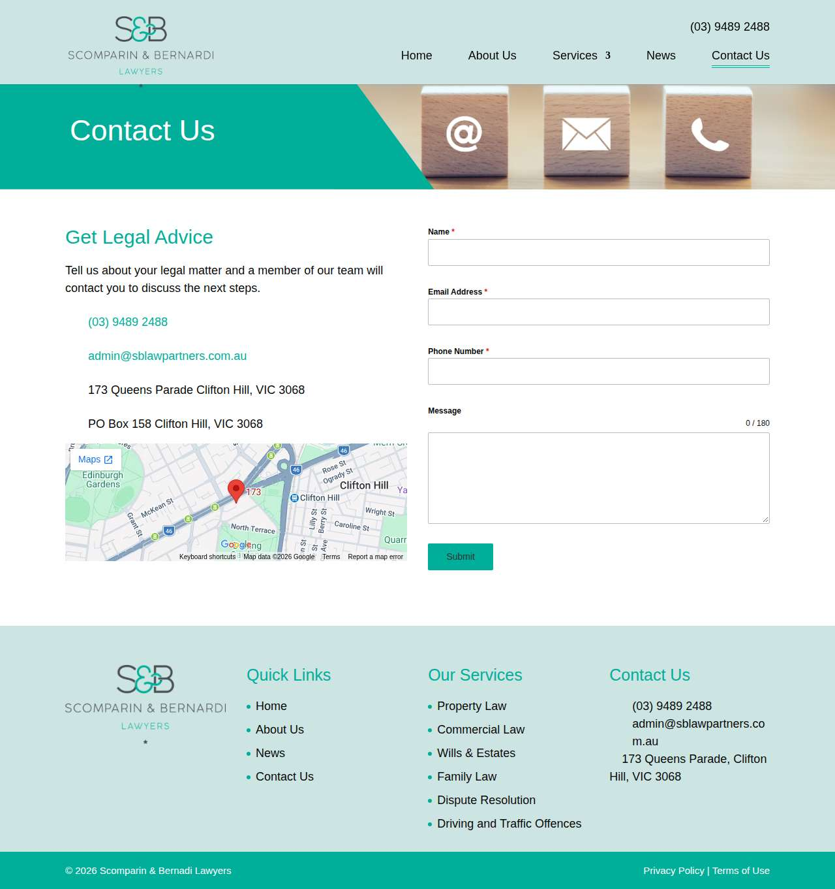

### tartaglia.com.au — dry\_run\_ok (dry run)

| | |
|---|---|
| Attempt ID | `614d48b4-d926-4baf-9d9a-8aba895700ec` |
| Form URL | https://tartaglia.com.au/contact-us/ |
| Final URL | https://tartaglia.com.au/contact-us/ |
| Reserved | 2026-11-09 03:58:20 UTC |
| Submit attempted | — |
| Template | standard v2 |
| Confirmation text | none observed |
| Result / error | Selectors verified; fields not typed (domain not in dry-run fill list); not submitted |

Exact message:

~~~text
Subject: Helping customers find your business in AI search (AEO + GEO)

Hi there,

I'm Arun from Devs Arun. More and more customers now ask ChatGPT, Gemini, Perplexity or Google's AI Overviews questions like "who should I hire for this in my area?" before they call anyone. These tools answer from websites they can clearly understand, and they tend to recommend businesses whose pages answer real customer questions.

That is what AEO + GEO (Answer Engine and Generative Engine Optimization) is for. I improve your existing service pages so they clearly answer the questions your customers ask, add structured data that matches the page, and make the call, quote or enquiry step obvious. The benefit: your business gets a better chance of being mentioned or linked in AI answers, and visitors who arrive find it easy to contact you.

The AEO + GEO Starter is a one-time $199 (about ₹16,999, negotiable) for one website: a basic audit, 10 customer questions, improvements to two existing pages, relevant structured data and an action plan, with one revision round.

You can read the full details, send an enquiry or book online here:
https://devsarun.io/aeo-geo/

If this isn't relevant, just reply and I won't contact you again.

Best,
Arun
Devs Arun
itschool408@gmail.com · +91 7654534323
~~~

Submitted field values:

- \#wpforms-2766-field\_0: Arun
- \#wpforms-2766-field\_1: itschool408@gmail.com
- \#wpforms-2766-field\_2: Hi there, I'm Arun from Devs Arun. More and more customers now ask ChatGPT, Gemini, Perplexity or Google's AI Overviews 
- \#wpforms-2766-field\_3: Hi there, I'm Arun from Devs Arun. More and more customers now ask ChatGPT, Gemini, Perplexity or Google's AI Overviews 
- \#wpforms-2766-field\_5: +91 7654534323

**Inspected page** — `run-25cfebab_attempt-614d48b4_inspection_2026-11-09T03-58-22-101Z.jpg`

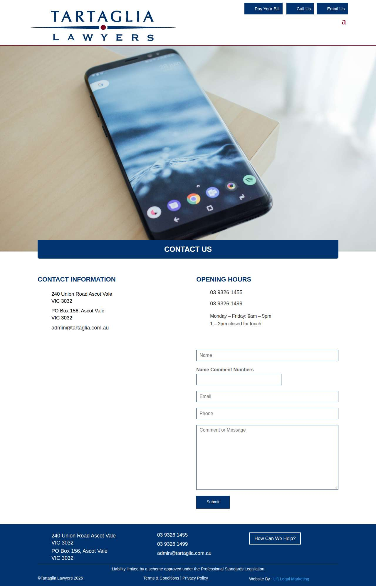

### littletonhackford.com.au — dry\_run\_ok (dry run)

| | |
|---|---|
| Attempt ID | `db33b692-c761-4ffe-a6af-8efb7f97558c` |
| Form URL | https://littletonhackford.com.au/contact-us/ |
| Final URL | https://littletonhackford.com.au/contact-us/ |
| Reserved | 2026-11-09 03:58:27 UTC |
| Submit attempted | — |
| Template | standard v2 |
| Confirmation text | none observed |
| Result / error | Selectors verified; fields not typed (domain not in dry-run fill list); not submitted |

Exact message:

~~~text
Subject: Helping customers find your business in AI search (AEO + GEO)

Hi there,

I'm Arun from Devs Arun. More and more customers now ask ChatGPT, Gemini, Perplexity or Google's AI Overviews questions like "who should I hire for this in my area?" before they call anyone. These tools answer from websites they can clearly understand, and they tend to recommend businesses whose pages answer real customer questions.

That is what AEO + GEO (Answer Engine and Generative Engine Optimization) is for. I improve your existing service pages so they clearly answer the questions your customers ask, add structured data that matches the page, and make the call, quote or enquiry step obvious. The benefit: your business gets a better chance of being mentioned or linked in AI answers, and visitors who arrive find it easy to contact you.

The AEO + GEO Starter is a one-time $199 (about ₹16,999, negotiable) for one website: a basic audit, 10 customer questions, improvements to two existing pages, relevant structured data and an action plan, with one revision round.

You can read the full details, send an enquiry or book online here:
https://devsarun.io/aeo-geo/

If this isn't relevant, just reply and I won't contact you again.

Best,
Arun
Devs Arun
itschool408@gmail.com · +91 7654534323
~~~

Submitted field values:

- \#wpforms-2766-field\_0: Arun
- \#wpforms-2766-field\_1: itschool408@gmail.com
- \#wpforms-2766-field\_2: Hi there, I'm Arun from Devs Arun. More and more customers now ask ChatGPT, Gemini, Perplexity or Google's AI Overviews 
- \#wpforms-2766-field\_5: +91 7654534323

**Inspected page** — `run-25cfebab_attempt-db33b692_inspection_2026-11-09T03-58-31-210Z.jpg`

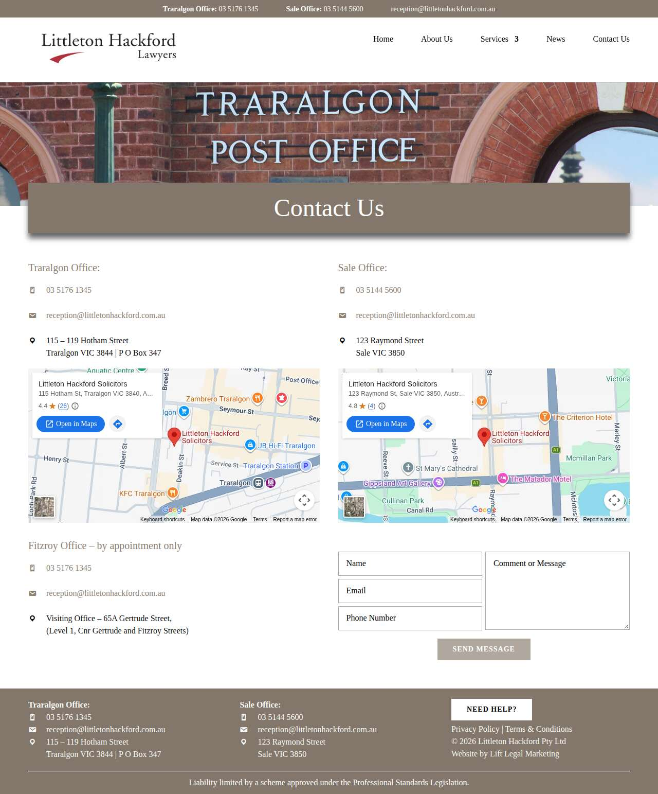

### mprcasino.com.au — dry\_run\_ok (dry run)

| | |
|---|---|
| Attempt ID | `1ba100cd-ea9d-43bf-b2de-60d3eea07471` |
| Form URL | https://www.mprsolicitors.com.au/contact |
| Final URL | https://www.mprsolicitors.com.au/contact |
| Reserved | 2026-11-09 03:58:36 UTC |
| Submit attempted | — |
| Template | standard v2 |
| Confirmation text | none observed |
| Result / error | Selectors verified; fields not typed (domain not in dry-run fill list); not submitted |

Exact message:

~~~text
Subject: Helping customers find your business in AI search (AEO + GEO)

Hi there,

I'm Arun from Devs Arun. More and more customers now ask ChatGPT, Gemini, Perplexity or Google's AI Overviews questions like "who should I hire for this in my area?" before they call anyone. These tools answer from websites they can clearly understand, and they tend to recommend businesses whose pages answer real customer questions.

That is what AEO + GEO (Answer Engine and Generative Engine Optimization) is for. I improve your existing service pages so they clearly answer the questions your customers ask, add structured data that matches the page, and make the call, quote or enquiry step obvious. The benefit: your business gets a better chance of being mentioned or linked in AI answers, and visitors who arrive find it easy to contact you.

The AEO + GEO Starter is a one-time $199 (about ₹16,999, negotiable) for one website: a basic audit, 10 customer questions, improvements to two existing pages, relevant structured data and an action plan, with one revision round.

You can read the full details, send an enquiry or book online here:
https://devsarun.io/aeo-geo/

If this isn't relevant, just reply and I won't contact you again.

Best,
Arun
Devs Arun
itschool408@gmail.com · +91 7654534323
~~~

Submitted field values:

- \#\\31 329520492: Arun
- \#\\31 782110772: itschool408@gmail.com
- \#\\31 841570146: Hi there, I'm Arun from Devs Arun. More and more customers now ask ChatGPT, Gemini, Perplexity or Google's AI Overviews 
- \#\\31 925006967: +91 7654534323

**Inspected page** — `run-25cfebab_attempt-1ba100cd_inspection_2026-11-09T03-58-39-392Z.jpg`

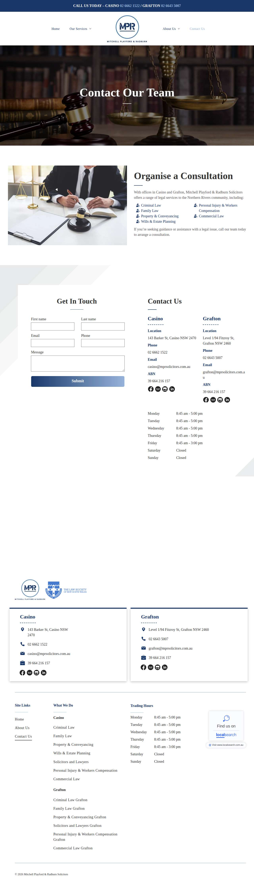

### bazylegal.com.au — dry\_run\_ok (dry run)

| | |
|---|---|
| Attempt ID | `de0aa74d-0116-4c51-beda-933047bc9532` |
| Form URL | https://bazylegal.com.au/contact |
| Final URL | https://bazylegal.com.au/contact |
| Reserved | 2026-11-09 03:58:44 UTC |
| Submit attempted | — |
| Template | standard v2 |
| Confirmation text | none observed |
| Result / error | Selectors verified; fields not typed (domain not in dry-run fill list); not submitted |

Exact message:

~~~text
Subject: Helping customers find your business in AI search (AEO + GEO)

Hi there,

I'm Arun from Devs Arun. More and more customers now ask ChatGPT, Gemini, Perplexity or Google's AI Overviews questions like "who should I hire for this in my area?" before they call anyone. These tools answer from websites they can clearly understand, and they tend to recommend businesses whose pages answer real customer questions.

That is what AEO + GEO (Answer Engine and Generative Engine Optimization) is for. I improve your existing service pages so they clearly answer the questions your customers ask, add structured data that matches the page, and make the call, quote or enquiry step obvious. The benefit: your business gets a better chance of being mentioned or linked in AI answers, and visitors who arrive find it easy to contact you.

The AEO + GEO Starter is a one-time $199 (about ₹16,999, negotiable) for one website: a basic audit, 10 customer questions, improvements to two existing pages, relevant structured data and an action plan, with one revision round.

You can read the full details, send an enquiry or book online here:
https://devsarun.io/aeo-geo/

If this isn't relevant, just reply and I won't contact you again.

Best,
Arun
Devs Arun
itschool408@gmail.com · +91 7654534323
~~~

Submitted field values:

- \#«r0»-form-item: Arun
- \#«r1»-form-item: +91 7654534323
- \#«r2»-form-item: itschool408@gmail.com
- \#«rc»-form-item: Hi there, I'm Arun from Devs Arun. More and more customers now ask ChatGPT, Gemini, Perplexity or Google's AI Overviews 

**Inspected page** — `run-25cfebab_attempt-de0aa74d_inspection_2026-11-09T03-58-45-988Z.jpg`

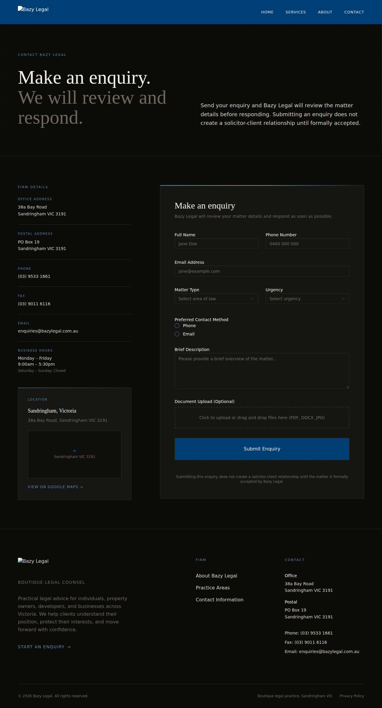

### easternlegal.com.au — dry\_run\_ok (dry run)

| | |
|---|---|
| Attempt ID | `8174c1dc-7b3a-46c7-879d-d1bfccdf811e` |
| Form URL | https://www.easternlegal.com.au/ |
| Final URL | https://www.easternlegal.com.au/ |
| Reserved | 2026-11-09 03:58:51 UTC |
| Submit attempted | — |
| Template | standard v2 |
| Confirmation text | none observed |
| Result / error | Selectors verified; fields not typed (domain not in dry-run fill list); not submitted |

Exact message:

~~~text
Subject: Helping customers find your business in AI search (AEO + GEO)

Hi there,

I'm Arun from Devs Arun. More and more customers now ask ChatGPT, Gemini, Perplexity or Google's AI Overviews questions like "who should I hire for this in my area?" before they call anyone. These tools answer from websites they can clearly understand, and they tend to recommend businesses whose pages answer real customer questions.

That is what AEO + GEO (Answer Engine and Generative Engine Optimization) is for. I improve your existing service pages so they clearly answer the questions your customers ask, add structured data that matches the page, and make the call, quote or enquiry step obvious. The benefit: your business gets a better chance of being mentioned or linked in AI answers, and visitors who arrive find it easy to contact you.

The AEO + GEO Starter is a one-time $199 (about ₹16,999, negotiable) for one website: a basic audit, 10 customer questions, improvements to two existing pages, relevant structured data and an action plan, with one revision round.

You can read the full details, send an enquiry or book online here:
https://devsarun.io/aeo-geo/

If this isn't relevant, just reply and I won't contact you again.

Best,
Arun
Devs Arun
itschool408@gmail.com · +91 7654534323
~~~

Submitted field values:

- \#input\_comp-l0gb9xq6: Arun
- \#input\_comp-l0gb9xse: itschool408@gmail.com
- \#input\_comp-l2zdj3w9: +91 7654534323
- \#textarea\_comp-l0gb9xsr: Hi there, I'm Arun from Devs Arun. More and more customers now ask ChatGPT, Gemini, Perplexity or Google's AI Overviews 

**Inspected page** — `run-25cfebab_attempt-8174c1dc_inspection_2026-11-09T03-58-53-264Z.jpg`

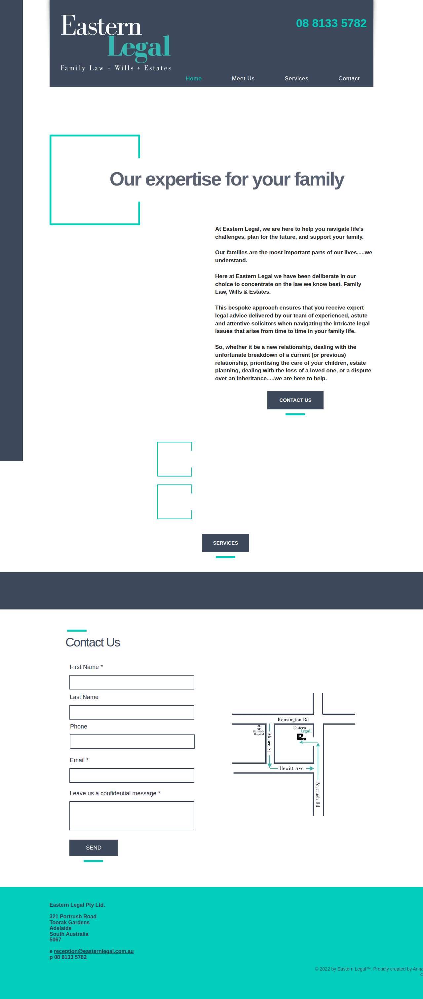

### kcrconveyancing.com.au — dry\_run\_ok (dry run)

| | |
|---|---|
| Attempt ID | `99b66173-272d-48ec-badd-139b7474cd5d` |
| Form URL | https://kcrconveyancing.com.au/ |
| Final URL | https://kcrconveyancing.com.au/ |
| Reserved | 2026-11-09 03:58:58 UTC |
| Submit attempted | — |
| Template | standard v2 |
| Confirmation text | none observed |
| Result / error | Selectors verified; fields not typed (domain not in dry-run fill list); not submitted |

Exact message:

~~~text
Subject: Helping customers find your business in AI search (AEO + GEO)

Hi there,

I'm Arun from Devs Arun. More and more customers now ask ChatGPT, Gemini, Perplexity or Google's AI Overviews questions like "who should I hire for this in my area?" before they call anyone. These tools answer from websites they can clearly understand, and they tend to recommend businesses whose pages answer real customer questions.

That is what AEO + GEO (Answer Engine and Generative Engine Optimization) is for. I improve your existing service pages so they clearly answer the questions your customers ask, add structured data that matches the page, and make the call, quote or enquiry step obvious. The benefit: your business gets a better chance of being mentioned or linked in AI answers, and visitors who arrive find it easy to contact you.

The AEO + GEO Starter is a one-time $199 (about ₹16,999, negotiable) for one website: a basic audit, 10 customer questions, improvements to two existing pages, relevant structured data and an action plan, with one revision round.

You can read the full details, send an enquiry or book online here:
https://devsarun.io/aeo-geo/

If this isn't relevant, just reply and I won't contact you again.

Best,
Arun
Devs Arun
itschool408@gmail.com · +91 7654534323
~~~

Submitted field values:

- \#form-field-field\_2e59e94: +91 7654534323
- \#form-field-field\_fb9bfe3: Hi there, I'm Arun from Devs Arun. More and more customers now ask ChatGPT, Gemini, Perplexity or Google's AI Overviews 
- div \> div \> section \> div \> div:nth-of-type(2) \> div \> div \> div \> form \> div \> div:nth-of-type(1) \> input: itschool408@gmail.com
- div \> div \> section \> div \> div:nth-of-type(2) \> div \> div \> div \> form \> div \> div:nth-of-type(2) \> input: itschool408@gmail.com

**Inspected page** — `run-25cfebab_attempt-99b66173_inspection_2026-11-09T03-59-01-964Z.jpg`

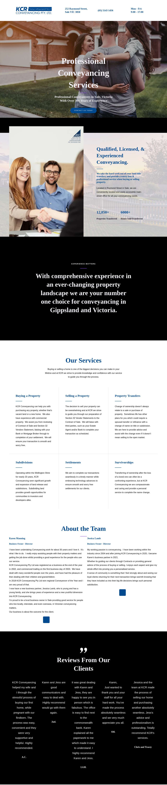

### mspc.cpa — dry\_run\_failed (dry run)

| | |
|---|---|
| Attempt ID | `f6cc2979-abce-4f64-aa1b-6f1dc46ddcaa` |
| Form URL | https://www.mspc.cpa/contact/ |
| Final URL | https://www.mspc.cpa/contact/ |
| Reserved | 2026-11-09 03:59:07 UTC |
| Submit attempted | — |
| Template | standard v2 |
| Confirmation text | none observed |
| Result / error | Mapped field "Full Name \*" not found uniquely |

Exact message:

~~~text
Subject: Helping customers find your business in AI search (AEO + GEO)

Hi there,

I'm Arun from Devs Arun. More and more customers now ask ChatGPT, Gemini, Perplexity or Google's AI Overviews questions like "who should I hire for this in my area?" before they call anyone. These tools answer from websites they can clearly understand, and they tend to recommend businesses whose pages answer real customer questions.

That is what AEO + GEO (Answer Engine and Generative Engine Optimization) is for. I improve your existing service pages so they clearly answer the questions your customers ask, add structured data that matches the page, and make the call, quote or enquiry step obvious. The benefit: your business gets a better chance of being mentioned or linked in AI answers, and visitors who arrive find it easy to contact you.

The AEO + GEO Starter is a one-time $199 (about ₹16,999, negotiable) for one website: a basic audit, 10 customer questions, improvements to two existing pages, relevant structured data and an action plan, with one revision round.

You can read the full details, send an enquiry or book online here:
https://devsarun.io/aeo-geo/

If this isn't relevant, just reply and I won't contact you again.

Best,
Arun
Devs Arun
itschool408@gmail.com · +91 7654534323
~~~

Submitted field values:

- \#forminator-field-name-1\_6aeaca2579f24: Arun
- \#forminator-field-text-1\_6aeaca2579f24: Devs Arun
- \#forminator-field-email-1\_6aeaca2579f24: itschool408@gmail.com
- \#forminator-field-phone-1\_6aeaca2579f24: +91 7654534323
- \#forminator-field-textarea-1\_6aeaca2579f24: Hi there, I'm Arun from Devs Arun. More and more customers now ask ChatGPT, Gemini, Perplexity or Google's AI Overviews 

**Inspected page** — `run-25cfebab_attempt-f6cc2979_inspection_2026-11-09T03-59-11-849Z.jpg`

## Events (209)

| Time (UTC) | Event | Website | Details |
|---|---|---|---|
| 03:53:14 | run\_queued | — | dry\_run run requested by github:itsDevsArun |
| 03:53:14 | run\_dispatched | — | dispatch disabled (local test mode) |
| 03:53:18 | run\_started | — | Runner claimed dry\_run run |
| 03:53:18 | website\_selected | helixmechanical.com | Dry-run target helixmechanical.com |
| 03:53:18 | draft\_prepared | helixmechanical.com | Draft prepared with template standard v2 |
| 03:53:20 | page\_opened | helixmechanical.com | Opened form page |
| 03:53:21 | screenshot\_saved | helixmechanical.com | inspection screenshot saved (54 KB) |
| 03:53:21 | review\_required | helixmechanical.com | dry run failed: Mapped field "First Name \*" not found uniquely |
| 03:53:26 | website\_selected | eurola.com.au | Dry-run target eurola.com.au |
| 03:53:26 | draft\_prepared | eurola.com.au | Draft prepared with template standard v2 |
| 03:53:32 | page\_opened | eurola.com.au | Opened form page |
| 03:53:33 | screenshot\_saved | eurola.com.au | inspection screenshot saved (313 KB) |
| 03:53:33 | review\_required | eurola.com.au | dry run failed: Mapped field "field2" not found uniquely |
| 03:53:38 | website\_selected | knoxvilleelectrician.com | Dry-run target knoxvilleelectrician.com |
| 03:53:38 | draft\_prepared | knoxvilleelectrician.com | Draft prepared with template standard v2 |
| 03:53:40 | page\_opened | knoxvilleelectrician.com | Opened form page |
| 03:53:41 | screenshot\_saved | knoxvilleelectrician.com | inspection screenshot saved (137 KB) |
| 03:53:41 | review\_required | knoxvilleelectrician.com | dry run failed: Mapped field "Name" not found uniquely |
| 03:53:46 | website\_selected | smjcabinets.com | Dry-run target smjcabinets.com |
| 03:53:46 | draft\_prepared | smjcabinets.com | Draft prepared with template standard v2 |
| 03:53:47 | page\_opened | smjcabinets.com | Opened form page |
| 03:53:47 | screenshot\_saved | smjcabinets.com | inspection screenshot saved (122 KB) |
| 03:53:47 | dry\_run\_checked | smjcabinets.com | dry run ok: Selectors verified; fields not typed (domain not in dry-run fill list); not submitted |
| 03:53:52 | website\_selected | mehrtensunderpinning.com.au | Dry-run target mehrtensunderpinning.com.au |
| 03:53:52 | draft\_prepared | mehrtensunderpinning.com.au | Draft prepared with template standard v2 |
| 03:53:57 | page\_opened | mehrtensunderpinning.com.au | Opened form page |
| 03:53:57 | screenshot\_saved | mehrtensunderpinning.com.au | inspection screenshot saved (464 KB) |
| 03:53:57 | dry\_run\_checked | mehrtensunderpinning.com.au | dry run ok: Selectors verified; fields not typed (domain not in dry-run fill list); not submitted |
| 03:54:02 | website\_selected | streamlinehomes.com.au | Dry-run target streamlinehomes.com.au |
| 03:54:02 | draft\_prepared | streamlinehomes.com.au | Draft prepared with template standard v2 |
| 03:54:09 | page\_opened | streamlinehomes.com.au | Opened form page |
| 03:54:09 | screenshot\_saved | streamlinehomes.com.au | inspection screenshot saved (102 KB) |
| 03:54:09 | dry\_run\_checked | streamlinehomes.com.au | dry run ok: Selectors verified; fields not typed (domain not in dry-run fill list); not submitted |
| 03:54:14 | website\_selected | goldcoastpatios.com.au | Dry-run target goldcoastpatios.com.au |
| 03:54:14 | draft\_prepared | goldcoastpatios.com.au | Draft prepared with template standard v2 |
| 03:54:21 | page\_opened | goldcoastpatios.com.au | Opened form page |
| 03:54:21 | screenshot\_saved | goldcoastpatios.com.au | inspection screenshot saved (192 KB) |
| 03:54:21 | dry\_run\_checked | goldcoastpatios.com.au | dry run ok: Selectors verified; fields not typed (domain not in dry-run fill list); not submitted |
| 03:54:26 | website\_selected | igniteremovals.com.au | Dry-run target igniteremovals.com.au |
| 03:54:26 | draft\_prepared | igniteremovals.com.au | Draft prepared with template standard v2 |
| 03:54:32 | page\_opened | igniteremovals.com.au | Opened form page |
| 03:54:32 | screenshot\_saved | igniteremovals.com.au | inspection screenshot saved (289 KB) |
| 03:54:32 | dry\_run\_checked | igniteremovals.com.au | dry run ok: Selectors verified; fields not typed (domain not in dry-run fill list); not submitted |
| 03:54:37 | website\_selected | smallloadremovalist.com.au | Dry-run target smallloadremovalist.com.au |
| 03:54:37 | draft\_prepared | smallloadremovalist.com.au | Draft prepared with template standard v2 |
| 03:54:40 | page\_opened | smallloadremovalist.com.au | Opened form page |
| 03:54:40 | screenshot\_saved | smallloadremovalist.com.au | inspection screenshot saved (447 KB) |
| 03:54:40 | dry\_run\_checked | smallloadremovalist.com.au | dry run ok: Selectors verified; fields not typed (domain not in dry-run fill list); not submitted |
| 03:54:45 | website\_selected | quickpickmovers.com.au | Dry-run target quickpickmovers.com.au |
| 03:54:45 | draft\_prepared | quickpickmovers.com.au | Draft prepared with template standard v2 |
| 03:54:47 | page\_opened | quickpickmovers.com.au | Opened form page |
| 03:54:47 | screenshot\_saved | quickpickmovers.com.au | inspection screenshot saved (244 KB) |
| 03:54:47 | dry\_run\_checked | quickpickmovers.com.au | dry run ok: Selectors verified; fields not typed (domain not in dry-run fill list); not submitted |
| 03:54:52 | website\_selected | vicpalmerremovals.com.au | Dry-run target vicpalmerremovals.com.au |
| 03:54:52 | draft\_prepared | vicpalmerremovals.com.au | Draft prepared with template standard v2 |
| 03:54:56 | page\_opened | vicpalmerremovals.com.au | Opened form page |
| 03:54:56 | screenshot\_saved | vicpalmerremovals.com.au | inspection screenshot saved (129 KB) |
| 03:54:56 | dry\_run\_checked | vicpalmerremovals.com.au | dry run ok: Selectors verified; fields not typed (domain not in dry-run fill list); not submitted |
| 03:55:01 | website\_selected | extracareremovals.com.au | Dry-run target extracareremovals.com.au |
| 03:55:01 | draft\_prepared | extracareremovals.com.au | Draft prepared with template standard v2 |
| 03:55:06 | page\_opened | extracareremovals.com.au | Opened form page |
| 03:55:06 | screenshot\_saved | extracareremovals.com.au | inspection screenshot saved (91 KB) |
| 03:55:06 | dry\_run\_checked | extracareremovals.com.au | dry run ok: Selectors verified; fields not typed (domain not in dry-run fill list); not submitted |
| 03:55:11 | website\_selected | cdlawyers.com.au | Dry-run target cdlawyers.com.au |
| 03:55:11 | draft\_prepared | cdlawyers.com.au | Draft prepared with template standard v2 |
| 03:55:14 | page\_opened | cdlawyers.com.au | Opened form page |
| 03:55:14 | screenshot\_saved | cdlawyers.com.au | inspection screenshot saved (142 KB) |
| 03:55:14 | dry\_run\_checked | cdlawyers.com.au | dry run ok: Selectors verified; fields not typed (domain not in dry-run fill list); not submitted |
| 03:55:19 | website\_selected | iconlegal.com.au | Dry-run target iconlegal.com.au |
| 03:55:19 | draft\_prepared | iconlegal.com.au | Draft prepared with template standard v2 |
| 03:55:23 | page\_opened | iconlegal.com.au | Opened form page |
| 03:55:24 | screenshot\_saved | iconlegal.com.au | inspection screenshot saved (81 KB) |
| 03:55:24 | dry\_run\_checked | iconlegal.com.au | dry run ok: Selectors verified; fields not typed (domain not in dry-run fill list); not submitted |
| 03:55:29 | website\_selected | gotocourt.com.au | Dry-run target gotocourt.com.au |
| 03:55:29 | draft\_prepared | gotocourt.com.au | Draft prepared with template standard v2 |
| 03:55:29 | page\_opened | gotocourt.com.au | Opened form page |
| 03:55:29 | screenshot\_saved | gotocourt.com.au | inspection screenshot saved (150 KB) |
| 03:55:29 | dry\_run\_checked | gotocourt.com.au | dry run ok: Selectors verified; fields not typed (domain not in dry-run fill list); not submitted |
| 03:55:34 | website\_selected | pattenrobins.com.au | Dry-run target pattenrobins.com.au |
| 03:55:34 | draft\_prepared | pattenrobins.com.au | Draft prepared with template standard v2 |
| 03:55:39 | page\_opened | pattenrobins.com.au | Opened form page |
| 03:55:39 | screenshot\_saved | pattenrobins.com.au | inspection screenshot saved (175 KB) |
| 03:55:39 | dry\_run\_checked | pattenrobins.com.au | dry run ok: Selectors verified; fields not typed (domain not in dry-run fill list); not submitted |
| 03:55:44 | website\_selected | ppconvey.com.au | Dry-run target ppconvey.com.au |
| 03:55:44 | draft\_prepared | ppconvey.com.au | Draft prepared with template standard v2 |
| 03:55:46 | page\_opened | ppconvey.com.au | Opened form page |
| 03:55:47 | screenshot\_saved | ppconvey.com.au | inspection screenshot saved (173 KB) |
| 03:55:47 | dry\_run\_checked | ppconvey.com.au | dry run ok: Selectors verified; fields not typed (domain not in dry-run fill list); not submitted |
| 03:55:52 | website\_selected | alrm.org.au | Dry-run target alrm.org.au |
| 03:55:52 | draft\_prepared | alrm.org.au | Draft prepared with template standard v2 |
| 03:55:54 | page\_opened | alrm.org.au | Opened form page |
| 03:55:54 | screenshot\_saved | alrm.org.au | inspection screenshot saved (100 KB) |
| 03:55:54 | dry\_run\_checked | alrm.org.au | dry run ok: Selectors verified; fields not typed (domain not in dry-run fill list); not submitted |
| 03:55:59 | website\_selected | clickvisa.com.au | Dry-run target clickvisa.com.au |
| 03:55:59 | draft\_prepared | clickvisa.com.au | Draft prepared with template standard v2 |
| 03:56:00 | page\_opened | clickvisa.com.au | Opened form page |
| 03:56:01 | screenshot\_saved | clickvisa.com.au | inspection screenshot saved (40 KB) |
| 03:56:01 | dry\_run\_checked | clickvisa.com.au | dry run ok: Selectors verified; fields not typed (domain not in dry-run fill list); not submitted |
| 03:56:06 | website\_selected | accesslaw.biz | Dry-run target accesslaw.biz |
| 03:56:06 | draft\_prepared | accesslaw.biz | Draft prepared with template standard v2 |
| 03:56:10 | page\_opened | accesslaw.biz | Opened form page |
| 03:56:10 | screenshot\_saved | accesslaw.biz | inspection screenshot saved (79 KB) |
| 03:56:10 | dry\_run\_checked | accesslaw.biz | dry run ok: Selectors verified; fields not typed (domain not in dry-run fill list); not submitted |
| 03:56:15 | website\_selected | birdsey.com.au | Dry-run target birdsey.com.au |
| 03:56:15 | draft\_prepared | birdsey.com.au | Draft prepared with template standard v2 |
| 03:56:17 | page\_opened | birdsey.com.au | Opened form page |
| 03:56:17 | screenshot\_saved | birdsey.com.au | inspection screenshot saved (74 KB) |
| 03:56:17 | dry\_run\_checked | birdsey.com.au | dry run ok: Selectors verified; fields not typed (domain not in dry-run fill list); not submitted |
| 03:56:22 | website\_selected | munrodoig.com.au | Dry-run target munrodoig.com.au |
| 03:56:22 | draft\_prepared | munrodoig.com.au | Draft prepared with template standard v2 |
| 03:56:28 | page\_opened | munrodoig.com.au | Opened form page |
| 03:56:28 | screenshot\_saved | munrodoig.com.au | inspection screenshot saved (140 KB) |
| 03:56:28 | dry\_run\_checked | munrodoig.com.au | dry run ok: Selectors verified; fields not typed (domain not in dry-run fill list); not submitted |
| 03:56:33 | website\_selected | elvinlawyers.com.au | Dry-run target elvinlawyers.com.au |
| 03:56:33 | draft\_prepared | elvinlawyers.com.au | Draft prepared with template standard v2 |
| 03:56:36 | page\_opened | elvinlawyers.com.au | Opened form page |
| 03:56:36 | screenshot\_saved | elvinlawyers.com.au | inspection screenshot saved (74 KB) |
| 03:56:36 | dry\_run\_checked | elvinlawyers.com.au | dry run ok: Selectors verified; fields not typed (domain not in dry-run fill list); not submitted |
| 03:56:41 | website\_selected | cannlegal.com.au | Dry-run target cannlegal.com.au |
| 03:56:41 | draft\_prepared | cannlegal.com.au | Draft prepared with template standard v2 |
| 03:56:49 | page\_opened | cannlegal.com.au | Opened form page |
| 03:56:49 | screenshot\_saved | cannlegal.com.au | inspection screenshot saved (96 KB) |
| 03:56:49 | dry\_run\_checked | cannlegal.com.au | dry run ok: Selectors verified; fields not typed (domain not in dry-run fill list); not submitted |
| 03:56:54 | website\_selected | fuseadvisory.com | Dry-run target fuseadvisory.com |
| 03:56:54 | draft\_prepared | fuseadvisory.com | Draft prepared with template standard v2 |
| 03:56:55 | page\_opened | fuseadvisory.com | Opened form page |
| 03:56:55 | screenshot\_saved | fuseadvisory.com | inspection screenshot saved (89 KB) |
| 03:56:55 | dry\_run\_checked | fuseadvisory.com | dry run ok: Selectors verified; fields not typed (domain not in dry-run fill list); not submitted |
| 03:57:00 | website\_selected | splawyerssg.com.au | Dry-run target splawyerssg.com.au |
| 03:57:00 | draft\_prepared | splawyerssg.com.au | Draft prepared with template standard v2 |
| 03:57:06 | page\_opened | splawyerssg.com.au | Opened form page |
| 03:57:07 | screenshot\_saved | splawyerssg.com.au | inspection screenshot saved (114 KB) |
| 03:57:07 | dry\_run\_checked | splawyerssg.com.au | dry run ok: Selectors verified; fields not typed (domain not in dry-run fill list); not submitted |
| 03:57:12 | website\_selected | forgelegal.net | Dry-run target forgelegal.net |
| 03:57:12 | draft\_prepared | forgelegal.net | Draft prepared with template standard v2 |
| 03:57:14 | page\_opened | forgelegal.net | Opened form page |
| 03:57:14 | screenshot\_saved | forgelegal.net | inspection screenshot saved (202 KB) |
| 03:57:14 | dry\_run\_checked | forgelegal.net | dry run ok: Selectors verified; fields not typed (domain not in dry-run fill list); not submitted |
| 03:57:19 | website\_selected | leadconveyancing.com.au | Dry-run target leadconveyancing.com.au |
| 03:57:19 | draft\_prepared | leadconveyancing.com.au | Draft prepared with template standard v2 |
| 03:57:22 | page\_opened | leadconveyancing.com.au | Opened form page |
| 03:57:23 | screenshot\_saved | leadconveyancing.com.au | inspection screenshot saved (54 KB) |
| 03:57:23 | dry\_run\_checked | leadconveyancing.com.au | dry run ok: Selectors verified; fields not typed (domain not in dry-run fill list); not submitted |
| 03:57:28 | website\_selected | caraccidentlawyersperth.com.au | Dry-run target caraccidentlawyersperth.com.au |
| 03:57:28 | draft\_prepared | caraccidentlawyersperth.com.au | Draft prepared with template standard v2 |
| 03:57:32 | page\_opened | caraccidentlawyersperth.com.au | Opened form page |
| 03:57:32 | screenshot\_saved | caraccidentlawyersperth.com.au | inspection screenshot saved (136 KB) |
| 03:57:32 | dry\_run\_checked | caraccidentlawyersperth.com.au | dry run ok: Selectors verified; fields not typed (domain not in dry-run fill list); not submitted |
| 03:57:37 | website\_selected | trewinnorman.com.au | Dry-run target trewinnorman.com.au |
| 03:57:37 | draft\_prepared | trewinnorman.com.au | Draft prepared with template standard v2 |
| 03:57:39 | page\_opened | trewinnorman.com.au | Opened form page |
| 03:57:40 | screenshot\_saved | trewinnorman.com.au | inspection screenshot saved (161 KB) |
| 03:57:40 | dry\_run\_checked | trewinnorman.com.au | dry run ok: Selectors verified; fields not typed (domain not in dry-run fill list); not submitted |
| 03:57:45 | website\_selected | ownitconveyancing.com | Dry-run target ownitconveyancing.com |
| 03:57:45 | draft\_prepared | ownitconveyancing.com | Draft prepared with template standard v2 |
| 03:57:50 | page\_opened | ownitconveyancing.com | Opened form page |
| 03:57:50 | screenshot\_saved | ownitconveyancing.com | inspection screenshot saved (240 KB) |
| 03:57:50 | dry\_run\_checked | ownitconveyancing.com | dry run ok: Selectors verified; fields not typed (domain not in dry-run fill list); not submitted |
| 03:57:56 | website\_selected | jht.com.au | Dry-run target jht.com.au |
| 03:57:56 | draft\_prepared | jht.com.au | Draft prepared with template standard v2 |
| 03:57:59 | page\_opened | jht.com.au | Opened form page |
| 03:57:59 | screenshot\_saved | jht.com.au | inspection screenshot saved (68 KB) |
| 03:57:59 | dry\_run\_checked | jht.com.au | dry run ok: Selectors verified; fields not typed (domain not in dry-run fill list); not submitted |
| 03:58:04 | website\_selected | baxterssolicitors.com.au | Dry-run target baxterssolicitors.com.au |
| 03:58:04 | draft\_prepared | baxterssolicitors.com.au | Draft prepared with template standard v2 |
| 03:58:06 | page\_opened | baxterssolicitors.com.au | Opened form page |
| 03:58:06 | screenshot\_saved | baxterssolicitors.com.au | inspection screenshot saved (99 KB) |
| 03:58:06 | dry\_run\_checked | baxterssolicitors.com.au | dry run ok: Selectors verified; fields not typed (domain not in dry-run fill list); not submitted |
| 03:58:11 | website\_selected | sblawpartners.com.au | Dry-run target sblawpartners.com.au |
| 03:58:11 | draft\_prepared | sblawpartners.com.au | Draft prepared with template standard v2 |
| 03:58:14 | page\_opened | sblawpartners.com.au | Opened form page |
| 03:58:15 | screenshot\_saved | sblawpartners.com.au | inspection screenshot saved (95 KB) |
| 03:58:15 | review\_required | sblawpartners.com.au | dry run failed: Mapped field "Name \*" not found uniquely |
| 03:58:20 | website\_selected | tartaglia.com.au | Dry-run target tartaglia.com.au |
| 03:58:20 | draft\_prepared | tartaglia.com.au | Draft prepared with template standard v2 |
| 03:58:21 | page\_opened | tartaglia.com.au | Opened form page |
| 03:58:22 | screenshot\_saved | tartaglia.com.au | inspection screenshot saved (103 KB) |
| 03:58:22 | dry\_run\_checked | tartaglia.com.au | dry run ok: Selectors verified; fields not typed (domain not in dry-run fill list); not submitted |
| 03:58:27 | website\_selected | littletonhackford.com.au | Dry-run target littletonhackford.com.au |
| 03:58:27 | draft\_prepared | littletonhackford.com.au | Draft prepared with template standard v2 |
| 03:58:31 | page\_opened | littletonhackford.com.au | Opened form page |
| 03:58:31 | screenshot\_saved | littletonhackford.com.au | inspection screenshot saved (149 KB) |
| 03:58:31 | dry\_run\_checked | littletonhackford.com.au | dry run ok: Selectors verified; fields not typed (domain not in dry-run fill list); not submitted |
| 03:58:36 | website\_selected | mprcasino.com.au | Dry-run target mprcasino.com.au |
| 03:58:36 | draft\_prepared | mprcasino.com.au | Draft prepared with template standard v2 |
| 03:58:39 | page\_opened | mprcasino.com.au | Opened form page |
| 03:58:39 | screenshot\_saved | mprcasino.com.au | inspection screenshot saved (236 KB) |
| 03:58:39 | dry\_run\_checked | mprcasino.com.au | dry run ok: Selectors verified; fields not typed (domain not in dry-run fill list); not submitted |
| 03:58:44 | website\_selected | bazylegal.com.au | Dry-run target bazylegal.com.au |
| 03:58:44 | draft\_prepared | bazylegal.com.au | Draft prepared with template standard v2 |
| 03:58:45 | page\_opened | bazylegal.com.au | Opened form page |
| 03:58:45 | screenshot\_saved | bazylegal.com.au | inspection screenshot saved (118 KB) |
| 03:58:45 | dry\_run\_checked | bazylegal.com.au | dry run ok: Selectors verified; fields not typed (domain not in dry-run fill list); not submitted |
| 03:58:51 | website\_selected | easternlegal.com.au | Dry-run target easternlegal.com.au |
| 03:58:51 | draft\_prepared | easternlegal.com.au | Draft prepared with template standard v2 |
| 03:58:53 | page\_opened | easternlegal.com.au | Opened form page |
| 03:58:53 | screenshot\_saved | easternlegal.com.au | inspection screenshot saved (132 KB) |
| 03:58:53 | dry\_run\_checked | easternlegal.com.au | dry run ok: Selectors verified; fields not typed (domain not in dry-run fill list); not submitted |
| 03:58:58 | website\_selected | kcrconveyancing.com.au | Dry-run target kcrconveyancing.com.au |
| 03:58:58 | draft\_prepared | kcrconveyancing.com.au | Draft prepared with template standard v2 |
| 03:59:01 | page\_opened | kcrconveyancing.com.au | Opened form page |
| 03:59:01 | screenshot\_saved | kcrconveyancing.com.au | inspection screenshot saved (525 KB) |
| 03:59:01 | dry\_run\_checked | kcrconveyancing.com.au | dry run ok: Selectors verified; fields not typed (domain not in dry-run fill list); not submitted |
| 03:59:07 | website\_selected | mspc.cpa | Dry-run target mspc.cpa |
| 03:59:07 | draft\_prepared | mspc.cpa | Draft prepared with template standard v2 |
| 03:59:11 | page\_opened | mspc.cpa | Opened form page |
| 03:59:11 | screenshot\_saved | mspc.cpa | inspection screenshot saved (162 KB) |
| 03:59:11 | review\_required | mspc.cpa | dry run failed: Mapped field "Full Name \*" not found uniquely |
| 03:59:16 | run\_completed | — | Run completed (queue\_exhausted) |
