# Run 3969e193 — live — completed

| | |
|---|---|
| Run ID | `3969e193-d08e-45b8-b46d-e5c8f0643596` |
| Requested by | github:itsDevsArun |
| Started | 2026-11-09 03:59:26 UTC |
| Finished | 2026-11-09 04:16:12 UTC |
| Finish reason | queue\_exhausted |
| GitHub Actions | https://github.com/itsDevsArun/aeo-geo/actions/runs/42552962078 |

CSV for this run: [runs/2026-11-09_live_3969e193.csv](2026-11-09_live_3969e193.csv)

## Attempts (44)

### clearchoiceplumbingllc.com — failed\_before\_submit (LIVE)

| | |
|---|---|
| Attempt ID | `85b23348-2d7d-45fa-a911-97c75158ea0a` |
| Form URL | https://clearchoiceplumbingllc.com/contact/ |
| Final URL | — |
| Reserved | 2026-11-09 03:59:27 UTC |
| Submit attempted | — |
| Template | standard v2 |
| Confirmation text | none observed |
| Result / error | locator.fill: Error: Cannot type text into input\[type=number\] |

Exact message:

~~~text
Subject: Helping customers find your business in AI search (AEO + GEO)

Hi there,

I'm Arun from Devs Arun. More and more customers now ask ChatGPT, Gemini, Perplexity or Google's AI Overviews questions like "who should I hire for this in my area?" before they call anyone. These tools answer from websites they can clearly understand, and they tend to recommend businesses whose pages answer real customer questions.

That is what AEO + GEO (Answer Engine and Generative Engine Optimization) is for. I improve your existing service pages so they clearly answer the questions your customers ask, add structured data that matches the page, and make the call, quote or enquiry step obvious. The benefit: your business gets a better chance of being mentioned or linked in AI answers, and visitors who arrive find it easy to contact you.

The AEO + GEO Starter is a one-time $199 (about ₹16,999, negotiable) for one website: a basic audit, 10 customer questions, improvements to two existing pages, relevant structured data and an action plan, with one revision round.

You can read the full details, send an enquiry or book online here:
https://devsarun.io/aeo-geo/

If this isn't relevant, just reply and I won't contact you again.

Best,
Arun
Devs Arun
itschool408@gmail.com · +91 7654534323
~~~

Submitted field values:

- \#wpforms-51-field\_1: Arun
- \#wpforms-51-field\_2: itschool408@gmail.com
- \#wpforms-51-field\_3: Hi there, I'm Arun from Devs Arun. More and more customers now ask ChatGPT, Gemini, Perplexity or Google's AI Overviews 
- \#wpforms-51-field\_5: +91 7654534323

**Inspected page** — `run-3969e193_attempt-85b23348_inspection_2026-11-09T03-59-29-319Z.jpg`

### bwnwincpainting.com — failed\_before\_submit (LIVE)

| | |
|---|---|
| Attempt ID | `9f02d8be-5d24-4a04-b69a-724b291b6476` |
| Form URL | https://www.bwnwincpainting.com/contact/ |
| Final URL | — |
| Reserved | 2026-11-09 03:59:34 UTC |
| Submit attempted | — |
| Template | standard v2 |
| Confirmation text | none observed |
| Result / error | locator.fill: Error: Cannot type text into input\[type=number\] |

Exact message:

~~~text
Subject: Helping customers find your business in AI search (AEO + GEO)

Hi there,

I'm Arun from Devs Arun. More and more customers now ask ChatGPT, Gemini, Perplexity or Google's AI Overviews questions like "who should I hire for this in my area?" before they call anyone. These tools answer from websites they can clearly understand, and they tend to recommend businesses whose pages answer real customer questions.

That is what AEO + GEO (Answer Engine and Generative Engine Optimization) is for. I improve your existing service pages so they clearly answer the questions your customers ask, add structured data that matches the page, and make the call, quote or enquiry step obvious. The benefit: your business gets a better chance of being mentioned or linked in AI answers, and visitors who arrive find it easy to contact you.

The AEO + GEO Starter is a one-time $199 (about ₹16,999, negotiable) for one website: a basic audit, 10 customer questions, improvements to two existing pages, relevant structured data and an action plan, with one revision round.

You can read the full details, send an enquiry or book online here:
https://devsarun.io/aeo-geo/

If this isn't relevant, just reply and I won't contact you again.

Best,
Arun
Devs Arun
itschool408@gmail.com · +91 7654534323
~~~

Submitted field values:

- \#name-1151: Arun
- \#email-1151: itschool408@gmail.com
- \#phone-1151: +91 7654534323
- \#message-1151: Hi there, I'm Arun from Devs Arun. More and more customers now ask ChatGPT, Gemini, Perplexity or Google's AI Overviews 

**Inspected page** — `run-3969e193_attempt-9f02d8be_inspection_2026-11-09T03-59-36-628Z.jpg`

### smjcabinets.com — error\_after\_submit (LIVE)

| | |
|---|---|
| Attempt ID | `90a6f26a-2ff8-4767-be50-fdbe42f57bd9` |
| Form URL | https://www.smjcabinets.com/contact |
| Final URL | https://www.smjcabinets.com/contact |
| Reserved | 2026-11-09 03:59:41 UTC |
| Submit attempted | 2026-11-09 03:59:43 UTC |
| Template | standard v2 |
| Confirmation text | Contact Us Name: Email: Phone: Message: Oops, there was an error sending your message. Please try again later Create Custom Cabinetry Get a Project Quote Contact Us (03) 56 |
| Result / error | — |

Exact message:

~~~text
Subject: Helping customers find your business in AI search (AEO + GEO)

Hi there,

I'm Arun from Devs Arun. More and more customers now ask ChatGPT, Gemini, Perplexity or Google's AI Overviews questions like "who should I hire for this in my area?" before they call anyone. These tools answer from websites they can clearly understand, and they tend to recommend businesses whose pages answer real customer questions.

That is what AEO + GEO (Answer Engine and Generative Engine Optimization) is for. I improve your existing service pages so they clearly answer the questions your customers ask, add structured data that matches the page, and make the call, quote or enquiry step obvious. The benefit: your business gets a better chance of being mentioned or linked in AI answers, and visitors who arrive find it easy to contact you.

The AEO + GEO Starter is a one-time $199 (about ₹16,999, negotiable) for one website: a basic audit, 10 customer questions, improvements to two existing pages, relevant structured data and an action plan, with one revision round.

You can read the full details, send an enquiry or book online here:
https://devsarun.io/aeo-geo/

If this isn't relevant, just reply and I won't contact you again.

Best,
Arun
Devs Arun
itschool408@gmail.com · +91 7654534323
~~~

Submitted field values:

- Name: \[name\]: Arun
- Email: \[email\]: itschool408@gmail.com
- Phone: \[phone\]: +91 7654534323
- Message: \[message\]: Hi there, I'm Arun from Devs Arun. More and more customers now ask ChatGPT, Gemini, Perplexity or Google's AI Overviews 

**Filled form (before submit)** — `run-3969e193_attempt-90a6f26a_filled_2026-11-09T03-59-43-339Z.jpg`

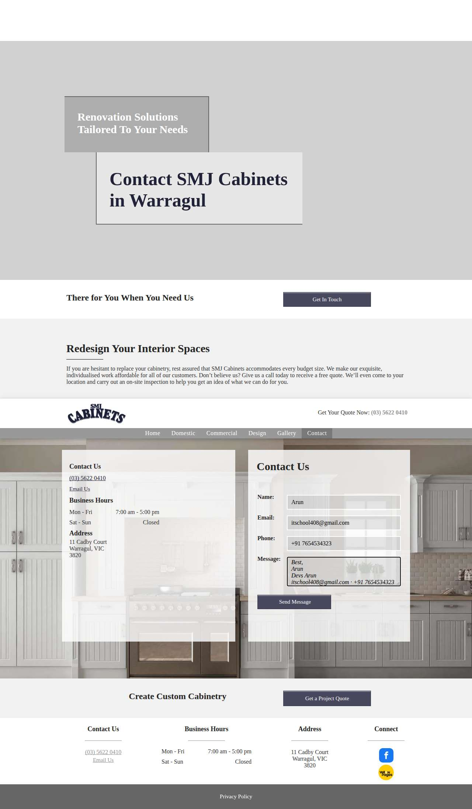

**After submit** — `run-3969e193_attempt-90a6f26a_post_attempt_2026-11-09T03-59-49-401Z.jpg`

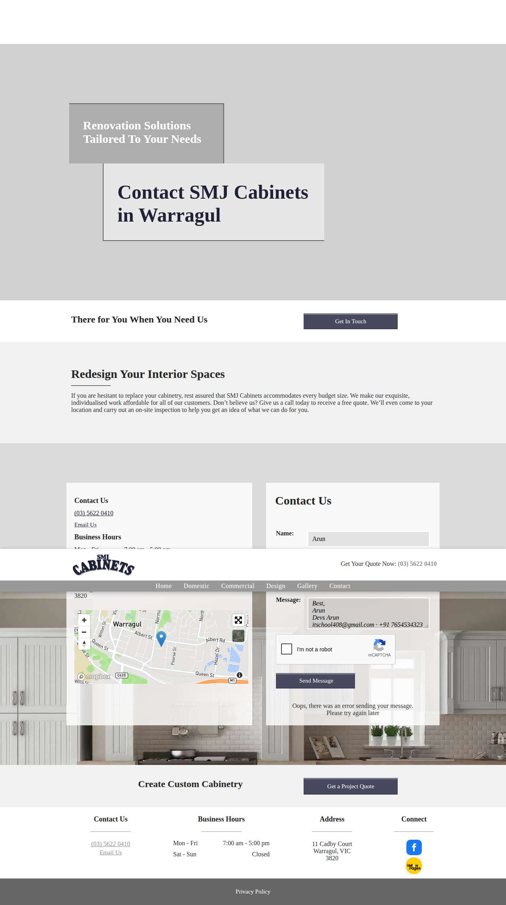

### absoluterestorepa.com — failed\_before\_submit (LIVE)

| | |
|---|---|
| Attempt ID | `50fe96fb-75cb-4f07-a4db-fbb142135bde` |
| Form URL | https://absoluterestorepa.com/contact-us/ |
| Final URL | — |
| Reserved | 2026-11-09 03:59:58 UTC |
| Submit attempted | — |
| Template | standard v2 |
| Confirmation text | none observed |
| Result / error | locator.fill: Error: Cannot type text into input\[type=number\] |

Exact message:

~~~text
Subject: Helping customers find your business in AI search (AEO + GEO)

Hi there,

I'm Arun from Devs Arun. More and more customers now ask ChatGPT, Gemini, Perplexity or Google's AI Overviews questions like "who should I hire for this in my area?" before they call anyone. These tools answer from websites they can clearly understand, and they tend to recommend businesses whose pages answer real customer questions.

That is what AEO + GEO (Answer Engine and Generative Engine Optimization) is for. I improve your existing service pages so they clearly answer the questions your customers ask, add structured data that matches the page, and make the call, quote or enquiry step obvious. The benefit: your business gets a better chance of being mentioned or linked in AI answers, and visitors who arrive find it easy to contact you.

The AEO + GEO Starter is a one-time $199 (about ₹16,999, negotiable) for one website: a basic audit, 10 customer questions, improvements to two existing pages, relevant structured data and an action plan, with one revision round.

You can read the full details, send an enquiry or book online here:
https://devsarun.io/aeo-geo/

If this isn't relevant, just reply and I won't contact you again.

Best,
Arun
Devs Arun
itschool408@gmail.com · +91 7654534323
~~~

Submitted field values:

- \#form-field-name: Arun
- \#form-field-message: Hi there, I'm Arun from Devs Arun. More and more customers now ask ChatGPT, Gemini, Perplexity or Google's AI Overviews 
- \#form-field-field\_ed02ec2: +91 7654534323
- \#content \> div \> div \> div:nth-of-type(2) \> div \> div:nth-of-type(1) \> div:nth-of-type(2) \> div \> form \> div \> div:nth-of-type(3) \> input: itschool408@gmail.com

**Inspected page** — `run-3969e193_attempt-50fe96fb_inspection_2026-11-09T04-00-01-566Z.jpg`

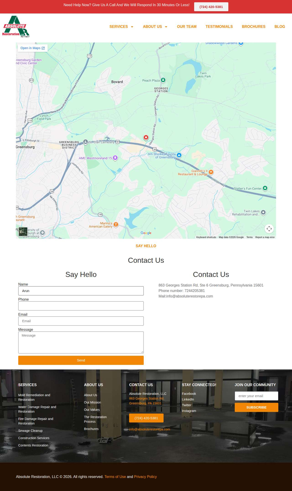

### goldcoastpatios.com.au — confirmed (LIVE)

| | |
|---|---|
| Attempt ID | `3cee56fe-8ad6-48c0-b0d0-06753f4ac4c5` |
| Form URL | https://goldcoastpatios.com.au/contact/ |
| Final URL | https://goldcoastpatios.com.au/thanks/ |
| Reserved | 2026-11-09 04:00:06 UTC |
| Submit attempted | 2026-11-09 04:00:15 UTC |
| Template | standard v2 |
| Confirmation text | Range About Us FAQ’s Testimonials News Contact 07 5539 6688 Thank You Thanks for sending through an enquiry, one of our team will get back in touch with you shortly. In |
| Result / error | — |

Exact message:

~~~text
Subject: Helping customers find your business in AI search (AEO + GEO)

Hi there,

I'm Arun from Devs Arun. More and more customers now ask ChatGPT, Gemini, Perplexity or Google's AI Overviews questions like "who should I hire for this in my area?" before they call anyone. These tools answer from websites they can clearly understand, and they tend to recommend businesses whose pages answer real customer questions.

That is what AEO + GEO (Answer Engine and Generative Engine Optimization) is for. I improve your existing service pages so they clearly answer the questions your customers ask, add structured data that matches the page, and make the call, quote or enquiry step obvious. The benefit: your business gets a better chance of being mentioned or linked in AI answers, and visitors who arrive find it easy to contact you.

The AEO + GEO Starter is a one-time $199 (about ₹16,999, negotiable) for one website: a basic audit, 10 customer questions, improvements to two existing pages, relevant structured data and an action plan, with one revision round.

You can read the full details, send an enquiry or book online here:
https://devsarun.io/aeo-geo/

If this isn't relevant, just reply and I won't contact you again.

Best,
Arun
Devs Arun
itschool408@gmail.com · +91 7654534323
~~~

Submitted field values:

- Name\* \[name\]: Arun
- Email\* \[email\]: itschool408@gmail.com
- Phone\* \[phone\]: +91 7654534323
- Suburb\* \[city\]: Bangalore
- Message\* \[message\]: Hi there, I'm Arun from Devs Arun. More and more customers now ask ChatGPT, Gemini, Perplexity or Google's AI Overviews 

**Filled form (before submit)** — `run-3969e193_attempt-3cee56fe_filled_2026-11-09T04-00-15-273Z.jpg`

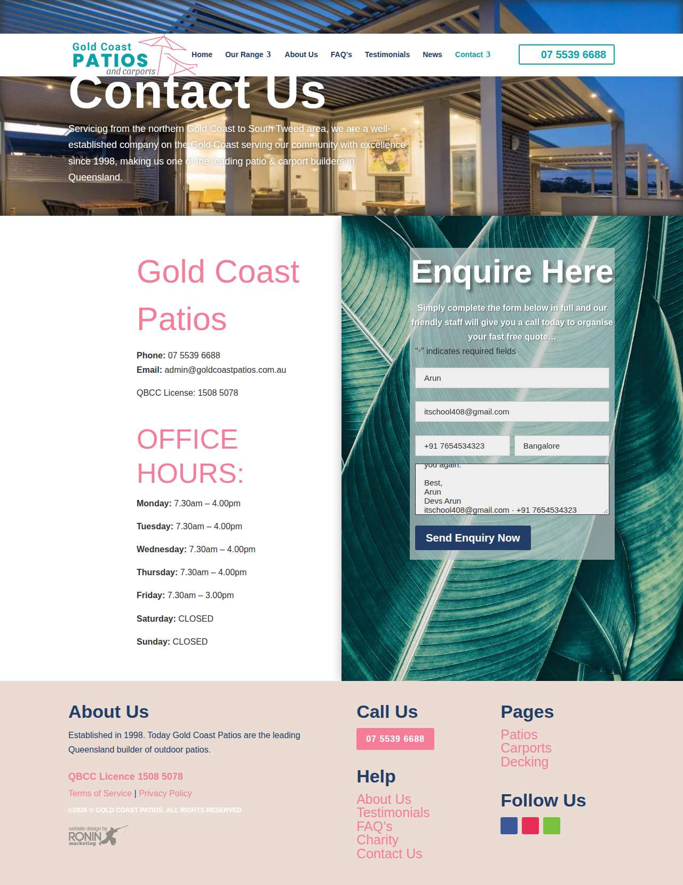

**After submit** — `run-3969e193_attempt-3cee56fe_post_attempt_2026-11-09T04-00-24-342Z.jpg`

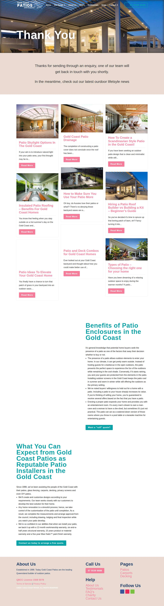

### mehrtensunderpinning.com.au — confirmed (LIVE)

| | |
|---|---|
| Attempt ID | `258aa366-ba53-4496-a532-d3fb08424b45` |
| Form URL | https://mehrtensunderpinning.com.au/ |
| Final URL | https://mehrtensunderpinning.com.au/ |
| Reserved | 2026-11-09 04:00:33 UTC |
| Submit attempted | 2026-11-09 04:00:38 UTC |
| Template | standard v2 |
| Confirmation text | D, 4214 Email: admin@mehrtens.com.au Phone: (07) 55 924 893 Thank you for your message. It has been sent. Your Name (required) Your Email (required) Subject Your Message THANK YOU FOR YO |
| Result / error | — |

Exact message:

~~~text
Subject: Helping customers find your business in AI search (AEO + GEO)

Hi there,

I'm Arun from Devs Arun. More and more customers now ask ChatGPT, Gemini, Perplexity or Google's AI Overviews questions like "who should I hire for this in my area?" before they call anyone. These tools answer from websites they can clearly understand, and they tend to recommend businesses whose pages answer real customer questions.

That is what AEO + GEO (Answer Engine and Generative Engine Optimization) is for. I improve your existing service pages so they clearly answer the questions your customers ask, add structured data that matches the page, and make the call, quote or enquiry step obvious. The benefit: your business gets a better chance of being mentioned or linked in AI answers, and visitors who arrive find it easy to contact you.

The AEO + GEO Starter is a one-time $199 (about ₹16,999, negotiable) for one website: a basic audit, 10 customer questions, improvements to two existing pages, relevant structured data and an action plan, with one revision round.

You can read the full details, send an enquiry or book online here:
https://devsarun.io/aeo-geo/

If this isn't relevant, just reply and I won't contact you again.

Best,
Arun
Devs Arun
itschool408@gmail.com · +91 7654534323
~~~

Submitted field values:

- Subject \[subject\]: Helping customers find your business in AI search (AEO + GEO)
- Your Message \[message\]: Hi there, I'm Arun from Devs Arun. More and more customers now ask ChatGPT, Gemini, Perplexity or Google's AI Overviews 
- Your Name (required) \[name\]: Arun
- Your Email (required) \[email\]: itschool408@gmail.com

**Filled form (before submit)** — `run-3969e193_attempt-258aa366_filled_2026-11-09T04-00-38-916Z.jpg`

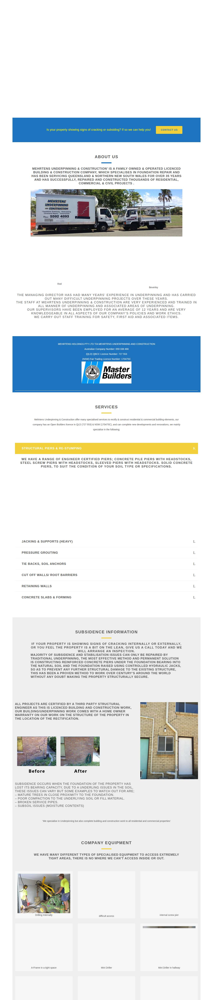

**After submit** — `run-3969e193_attempt-258aa366_post_attempt_2026-11-09T04-00-51-414Z.jpg`

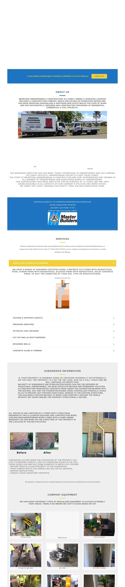

### streamlinehomes.com.au — confirmed (LIVE)

| | |
|---|---|
| Attempt ID | `42dbe7d5-3f8c-4ff9-a2b9-6c7517212200` |
| Form URL | https://streamlinehomes.com.au/contact-us/ |
| Final URL | https://streamlinehomes.com.au/contact-us/ |
| Reserved | 2026-11-09 04:01:00 UTC |
| Submit attempted | 2026-11-09 04:01:06 UTC |
| Template | standard v2 |
| Confirmation text | CONTACT US Thank you for your message. It has been sent. CONTACT Contact: Jackie Grozdanovski Phone: 0419 106 486 (Office) Email: admin@s |
| Result / error | — |

Exact message:

~~~text
Subject: Helping customers find your business in AI search (AEO + GEO)

Hi there,

I'm Arun from Devs Arun. More and more customers now ask ChatGPT, Gemini, Perplexity or Google's AI Overviews questions like "who should I hire for this in my area?" before they call anyone. These tools answer from websites they can clearly understand, and they tend to recommend businesses whose pages answer real customer questions.

That is what AEO + GEO (Answer Engine and Generative Engine Optimization) is for. I improve your existing service pages so they clearly answer the questions your customers ask, add structured data that matches the page, and make the call, quote or enquiry step obvious. The benefit: your business gets a better chance of being mentioned or linked in AI answers, and visitors who arrive find it easy to contact you.

The AEO + GEO Starter is a one-time $199 (about ₹16,999, negotiable) for one website: a basic audit, 10 customer questions, improvements to two existing pages, relevant structured data and an action plan, with one revision round.

You can read the full details, send an enquiry or book online here:
https://devsarun.io/aeo-geo/

If this isn't relevant, just reply and I won't contact you again.

Best,
Arun
Devs Arun
itschool408@gmail.com · +91 7654534323
~~~

Submitted field values:

- your-name \[name\]: Arun
- your-email \[email\]: itschool408@gmail.com
- your-message \[message\]: Hi there, I'm Arun from Devs Arun. More and more customers now ask ChatGPT, Gemini, Perplexity or Google's AI Overviews 

**Filled form (before submit)** — `run-3969e193_attempt-42dbe7d5_filled_2026-11-09T04-01-06-680Z.jpg`

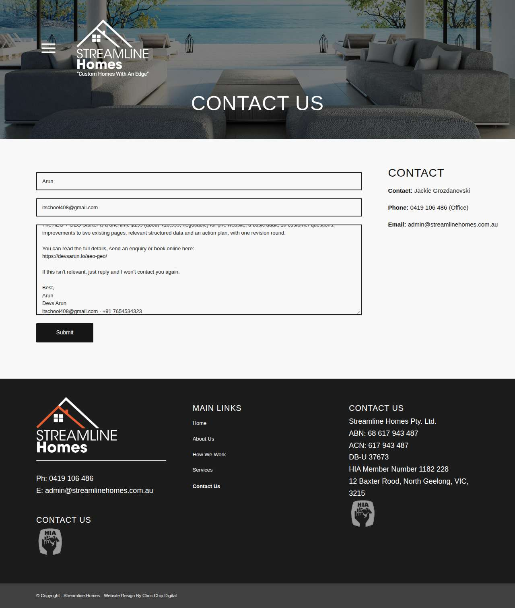

**After submit** — `run-3969e193_attempt-42dbe7d5_post_attempt_2026-11-09T04-01-12-995Z.jpg`

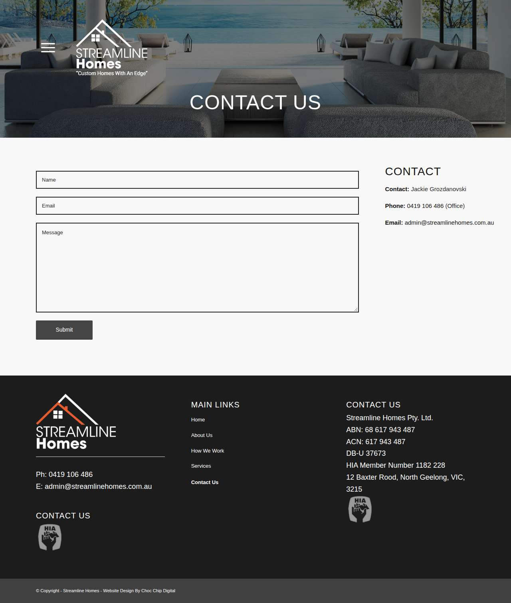

### quickpickmovers.com.au — confirmed (LIVE)

| | |
|---|---|
| Attempt ID | `71e60f99-c56d-4e87-9140-afafaf908de9` |
| Form URL | https://quickpickmovers.com.au/contact-us/ |
| Final URL | https://quickpickmovers.com.au/thank-you-contact-us/ |
| Reserved | 2026-11-09 04:01:21 UTC |
| Submit attempted | 2026-11-09 04:01:23 UTC |
| Template | standard v2 |
| Confirmation text | moval Services Service Areas Cost Blog Contact FREE QUOTE ✓ MESSAGE RECEIVED Thank you for getting in touch We’ve received your message. Our team will review the details and ge |
| Result / error | — |

Exact message:

~~~text
Subject: Helping customers find your business in AI search (AEO + GEO)

Hi there,

I'm Arun from Devs Arun. More and more customers now ask ChatGPT, Gemini, Perplexity or Google's AI Overviews questions like "who should I hire for this in my area?" before they call anyone. These tools answer from websites they can clearly understand, and they tend to recommend businesses whose pages answer real customer questions.

That is what AEO + GEO (Answer Engine and Generative Engine Optimization) is for. I improve your existing service pages so they clearly answer the questions your customers ask, add structured data that matches the page, and make the call, quote or enquiry step obvious. The benefit: your business gets a better chance of being mentioned or linked in AI answers, and visitors who arrive find it easy to contact you.

The AEO + GEO Starter is a one-time $199 (about ₹16,999, negotiable) for one website: a basic audit, 10 customer questions, improvements to two existing pages, relevant structured data and an action plan, with one revision round.

You can read the full details, send an enquiry or book online here:
https://devsarun.io/aeo-geo/

If this isn't relevant, just reply and I won't contact you again.

Best,
Arun
Devs Arun
itschool408@gmail.com · +91 7654534323
~~~

Submitted field values:

- Name \[name\]: Arun
- Email \[email\]: itschool408@gmail.com
- Phone Number \[phone\]: +91 7654534323
- Message / Quote details \[message\]: Hi there, I'm Arun from Devs Arun. More and more customers now ask ChatGPT, Gemini, Perplexity or Google's AI Overviews 

**Filled form (before submit)** — `run-3969e193_attempt-71e60f99_filled_2026-11-09T04-01-23-517Z.jpg`

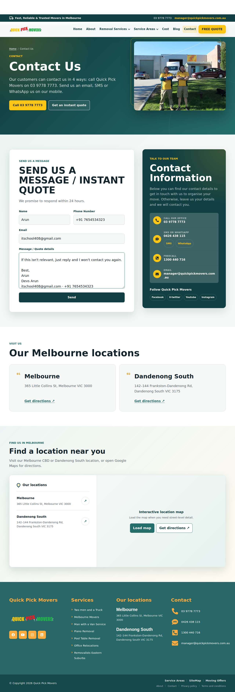

**After submit** — `run-3969e193_attempt-71e60f99_post_attempt_2026-11-09T04-01-31-843Z.jpg`

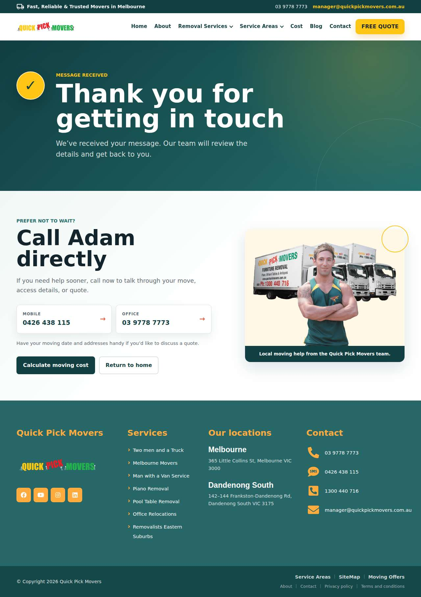

### vicpalmerremovals.com.au — unclear (LIVE)

| | |
|---|---|
| Attempt ID | `b7c3eafe-3794-4971-bdc3-477310ee67b2` |
| Form URL | https://www.vicpalmerremovals.com.au/contact.html |
| Final URL | https://www.vicpalmerremovals.com.au/contact.html |
| Reserved | 2026-11-09 04:01:41 UTC |
| Submit attempted | 2026-11-09 04:01:45 UTC |
| Template | standard v2 |
| Confirmation text | none observed |
| Result / error | No new success marker observed |

Exact message:

~~~text
Subject: Helping customers find your business in AI search (AEO + GEO)

Hi there,

I'm Arun from Devs Arun. More and more customers now ask ChatGPT, Gemini, Perplexity or Google's AI Overviews questions like "who should I hire for this in my area?" before they call anyone. These tools answer from websites they can clearly understand, and they tend to recommend businesses whose pages answer real customer questions.

That is what AEO + GEO (Answer Engine and Generative Engine Optimization) is for. I improve your existing service pages so they clearly answer the questions your customers ask, add structured data that matches the page, and make the call, quote or enquiry step obvious. The benefit: your business gets a better chance of being mentioned or linked in AI answers, and visitors who arrive find it easy to contact you.

The AEO + GEO Starter is a one-time $199 (about ₹16,999, negotiable) for one website: a basic audit, 10 customer questions, improvements to two existing pages, relevant structured data and an action plan, with one revision round.

You can read the full details, send an enquiry or book online here:
https://devsarun.io/aeo-geo/

If this isn't relevant, just reply and I won't contact you again.

Best,
Arun
Devs Arun
itschool408@gmail.com · +91 7654534323
~~~

Submitted field values:

- Email \[email\]: itschool408@gmail.com
- Phone number \[phone\]: +91 7654534323
- Your message \[message\]: Hi there, I'm Arun from Devs Arun. More and more customers now ask ChatGPT, Gemini, Perplexity or Google's AI Overviews 
- First name \[first\_name\]: Arun

**Filled form (before submit)** — `run-3969e193_attempt-b7c3eafe_filled_2026-11-09T04-01-45-819Z.jpg`

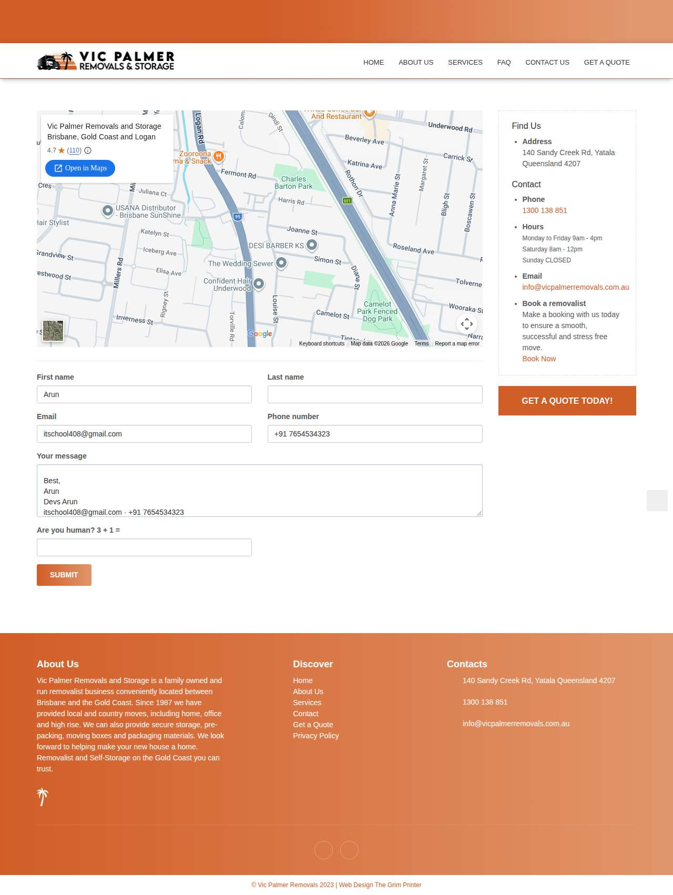

**After submit** — `run-3969e193_attempt-b7c3eafe_post_attempt_2026-11-09T04-02-15-351Z.jpg`

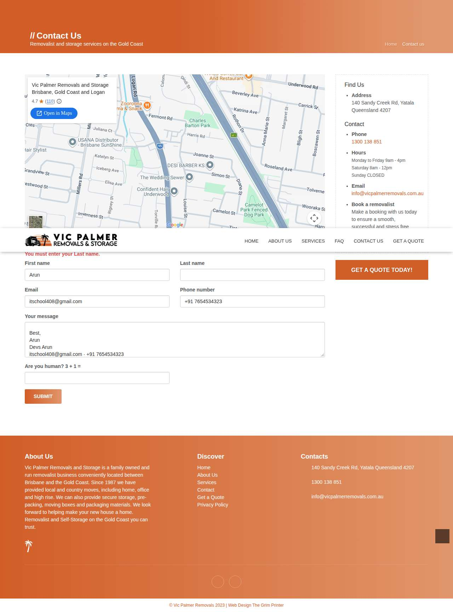

### extracareremovals.com.au — unclear (LIVE)

| | |
|---|---|
| Attempt ID | `95207733-1683-4ed5-8425-6bdb1b3fced3` |
| Form URL | https://extracareremovals.com.au/contact/ |
| Final URL | https://extracareremovals.com.au/contact/ |
| Reserved | 2026-11-09 04:02:24 UTC |
| Submit attempted | 2026-11-09 04:02:29 UTC |
| Template | standard v2 |
| Confirmation text | none observed |
| Result / error | No new success marker observed |

Exact message:

~~~text
Subject: Helping customers find your business in AI search (AEO + GEO)

Hi there,

I'm Arun from Devs Arun. More and more customers now ask ChatGPT, Gemini, Perplexity or Google's AI Overviews questions like "who should I hire for this in my area?" before they call anyone. These tools answer from websites they can clearly understand, and they tend to recommend businesses whose pages answer real customer questions.

That is what AEO + GEO (Answer Engine and Generative Engine Optimization) is for. I improve your existing service pages so they clearly answer the questions your customers ask, add structured data that matches the page, and make the call, quote or enquiry step obvious. The benefit: your business gets a better chance of being mentioned or linked in AI answers, and visitors who arrive find it easy to contact you.

The AEO + GEO Starter is a one-time $199 (about ₹16,999, negotiable) for one website: a basic audit, 10 customer questions, improvements to two existing pages, relevant structured data and an action plan, with one revision round.

You can read the full details, send an enquiry or book online here:
https://devsarun.io/aeo-geo/

If this isn't relevant, just reply and I won't contact you again.

Best,
Arun
Devs Arun
itschool408@gmail.com · +91 7654534323
~~~

Submitted field values:

- Name \[name\]: Arun
- Email \[email\]: itschool408@gmail.com
- Message \[message\]: Hi there, I'm Arun from Devs Arun. More and more customers now ask ChatGPT, Gemini, Perplexity or Google's AI Overviews 
- Subject \[subject\]: Helping customers find your business in AI search (AEO + GEO)
- Phone Number \[phone\]: +91 7654534323

**Filled form (before submit)** — `run-3969e193_attempt-95207733_filled_2026-11-09T04-02-29-288Z.jpg`

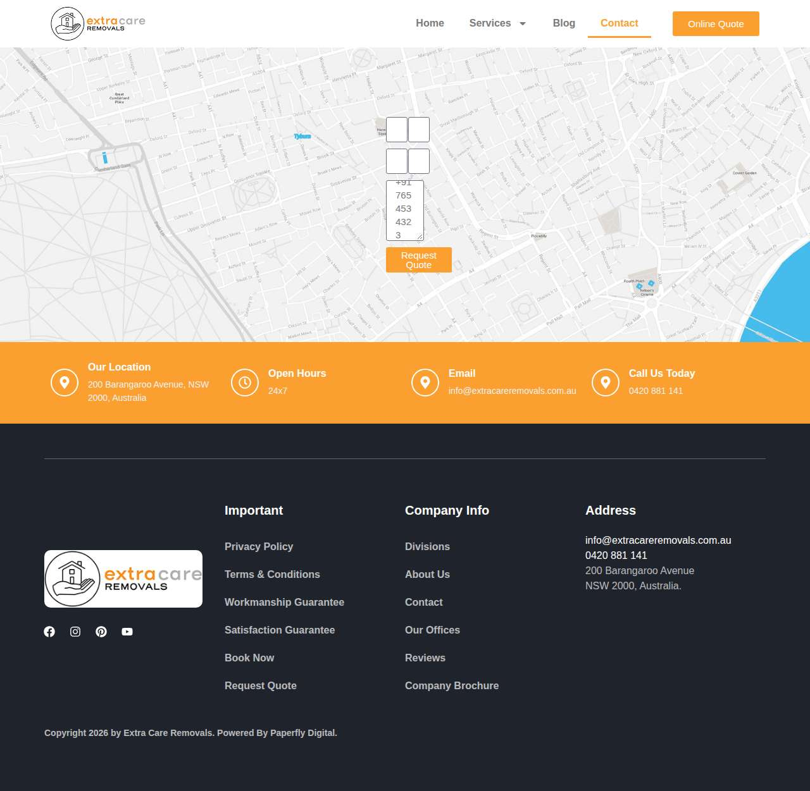

**After submit** — `run-3969e193_attempt-95207733_post_attempt_2026-11-09T04-03-07-262Z.jpg`

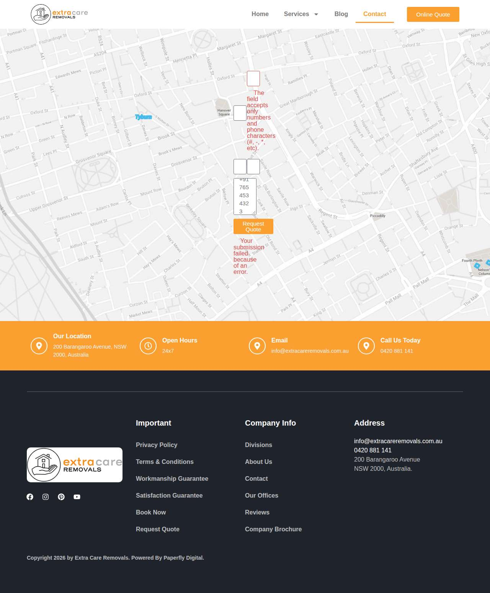

### smallloadremovalist.com.au — unclear (LIVE)

| | |
|---|---|
| Attempt ID | `2a3b51d8-559b-4268-985d-3c3770bb3ad8` |
| Form URL | https://smallloadremovalist.com.au/contact-us/ |
| Final URL | https://smallloadremovalist.com.au/contact-us/ |
| Reserved | 2026-11-09 04:03:16 UTC |
| Submit attempted | 2026-11-09 04:03:19 UTC |
| Template | standard v2 |
| Confirmation text | none observed |
| Result / error | No new success marker observed |

Exact message:

~~~text
Subject: Helping customers find your business in AI search (AEO + GEO)

Hi there,

I'm Arun from Devs Arun. More and more customers now ask ChatGPT, Gemini, Perplexity or Google's AI Overviews questions like "who should I hire for this in my area?" before they call anyone. These tools answer from websites they can clearly understand, and they tend to recommend businesses whose pages answer real customer questions.

That is what AEO + GEO (Answer Engine and Generative Engine Optimization) is for. I improve your existing service pages so they clearly answer the questions your customers ask, add structured data that matches the page, and make the call, quote or enquiry step obvious. The benefit: your business gets a better chance of being mentioned or linked in AI answers, and visitors who arrive find it easy to contact you.

The AEO + GEO Starter is a one-time $199 (about ₹16,999, negotiable) for one website: a basic audit, 10 customer questions, improvements to two existing pages, relevant structured data and an action plan, with one revision round.

You can read the full details, send an enquiry or book online here:
https://devsarun.io/aeo-geo/

If this isn't relevant, just reply and I won't contact you again.

Best,
Arun
Devs Arun
itschool408@gmail.com · +91 7654534323
~~~

Submitted field values:

- Email ID \[email\]: itschool408@gmail.com
- Full Name \[name\]: Arun
- Message \[message\]: Hi there, I'm Arun from Devs Arun. More and more customers now ask ChatGPT, Gemini, Perplexity or Google's AI Overviews 
- Phone Number \[phone\]: +91 7654534323

**Filled form (before submit)** — `run-3969e193_attempt-2a3b51d8_filled_2026-11-09T04-03-19-320Z.jpg`

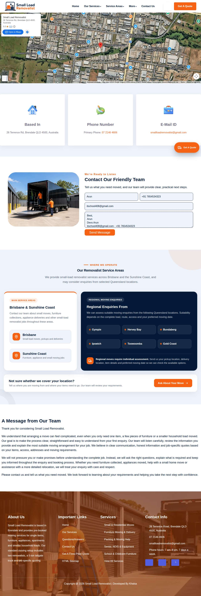

**After submit** — `run-3969e193_attempt-2a3b51d8_post_attempt_2026-11-09T04-03-48-976Z.jpg`

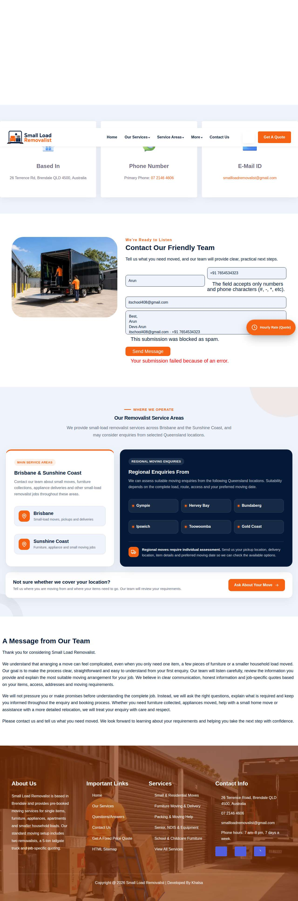

### igniteremovals.com.au — unclear (LIVE)

| | |
|---|---|
| Attempt ID | `196f00fe-66d0-4ed8-a1cc-e86c8cd7050f` |
| Form URL | https://igniteremovals.com.au/contact/ |
| Final URL | https://igniteremovals.com.au/contact/ |
| Reserved | 2026-11-09 04:03:58 UTC |
| Submit attempted | 2026-11-09 04:04:03 UTC |
| Template | standard v2 |
| Confirmation text | none observed |
| Result / error | No new success marker observed |

Exact message:

~~~text
Subject: Helping customers find your business in AI search (AEO + GEO)

Hi there,

I'm Arun from Devs Arun. More and more customers now ask ChatGPT, Gemini, Perplexity or Google's AI Overviews questions like "who should I hire for this in my area?" before they call anyone. These tools answer from websites they can clearly understand, and they tend to recommend businesses whose pages answer real customer questions.

That is what AEO + GEO (Answer Engine and Generative Engine Optimization) is for. I improve your existing service pages so they clearly answer the questions your customers ask, add structured data that matches the page, and make the call, quote or enquiry step obvious. The benefit: your business gets a better chance of being mentioned or linked in AI answers, and visitors who arrive find it easy to contact you.

The AEO + GEO Starter is a one-time $199 (about ₹16,999, negotiable) for one website: a basic audit, 10 customer questions, improvements to two existing pages, relevant structured data and an action plan, with one revision round.

You can read the full details, send an enquiry or book online here:
https://devsarun.io/aeo-geo/

If this isn't relevant, just reply and I won't contact you again.

Best,
Arun
Devs Arun
itschool408@gmail.com · +91 7654534323
~~~

Submitted field values:

- Name \[name\]: Arun
- Email \[email\]: itschool408@gmail.com
- Message \[message\]: Hi there, I'm Arun from Devs Arun. More and more customers now ask ChatGPT, Gemini, Perplexity or Google's AI Overviews 

**Filled form (before submit)** — `run-3969e193_attempt-196f00fe_filled_2026-11-09T04-04-03-702Z.jpg`

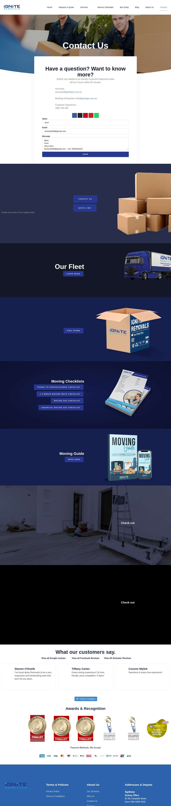

**After submit** — `run-3969e193_attempt-196f00fe_post_attempt_2026-11-09T04-04-41-197Z.jpg`

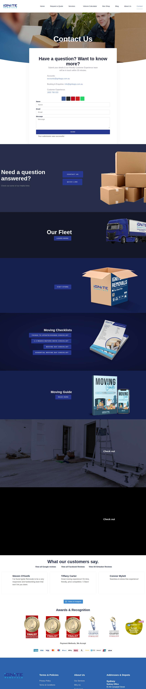

### masoudlawfirm.com — failed\_before\_submit (LIVE)

| | |
|---|---|
| Attempt ID | `473f2a28-5bf7-4790-bdc3-f6bb2de54bfb` |
| Form URL | https://masoudlawfirm.com/contact/ |
| Final URL | — |
| Reserved | 2026-11-09 04:04:50 UTC |
| Submit attempted | — |
| Template | standard v2 |
| Confirmation text | none observed |
| Result / error | locator.fill: Error: Cannot type text into input\[type=number\] |

Exact message:

~~~text
Subject: Helping customers find your business in AI search (AEO + GEO)

Hi there,

I'm Arun from Devs Arun. More and more customers now ask ChatGPT, Gemini, Perplexity or Google's AI Overviews questions like "who should I hire for this in my area?" before they call anyone. These tools answer from websites they can clearly understand, and they tend to recommend businesses whose pages answer real customer questions.

That is what AEO + GEO (Answer Engine and Generative Engine Optimization) is for. I improve your existing service pages so they clearly answer the questions your customers ask, add structured data that matches the page, and make the call, quote or enquiry step obvious. The benefit: your business gets a better chance of being mentioned or linked in AI answers, and visitors who arrive find it easy to contact you.

The AEO + GEO Starter is a one-time $199 (about ₹16,999, negotiable) for one website: a basic audit, 10 customer questions, improvements to two existing pages, relevant structured data and an action plan, with one revision round.

You can read the full details, send an enquiry or book online here:
https://devsarun.io/aeo-geo/

If this isn't relevant, just reply and I won't contact you again.

Best,
Arun
Devs Arun
itschool408@gmail.com · +91 7654534323
~~~

Submitted field values:

- \#form-field-name: Arun
- \#form-field-field\_3374379: Hi there, I'm Arun from Devs Arun. More and more customers now ask ChatGPT, Gemini, Perplexity or Google's AI Overviews 
- \#form-field-field\_7731784: +91 7654534323
- \#form-field-field\_8bd0f16: itschool408@gmail.com

**Inspected page** — `run-3969e193_attempt-473f2a28_inspection_2026-11-09T04-04-54-419Z.jpg`

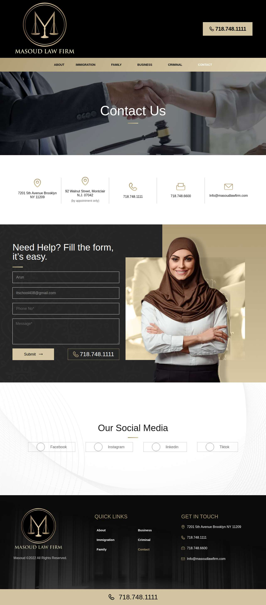

### gotocourt.com.au — unclear (LIVE)

| | |
|---|---|
| Attempt ID | `ddb271aa-0e6e-4a67-af36-6540fa0b6f82` |
| Form URL | https://www.gotocourt.com.au/contact |
| Final URL | https://www.gotocourt.com.au/contact/submit |
| Reserved | 2026-11-09 04:04:59 UTC |
| Submit attempted | 2026-11-09 04:05:00 UTC |
| Template | standard v2 |
| Confirmation text | none observed |
| Result / error | No new success marker observed |

Exact message:

~~~text
Subject: Helping customers find your business in AI search (AEO + GEO)

Hi there,

I'm Arun from Devs Arun. More and more customers now ask ChatGPT, Gemini, Perplexity or Google's AI Overviews questions like "who should I hire for this in my area?" before they call anyone. These tools answer from websites they can clearly understand, and they tend to recommend businesses whose pages answer real customer questions.

That is what AEO + GEO (Answer Engine and Generative Engine Optimization) is for. I improve your existing service pages so they clearly answer the questions your customers ask, add structured data that matches the page, and make the call, quote or enquiry step obvious. The benefit: your business gets a better chance of being mentioned or linked in AI answers, and visitors who arrive find it easy to contact you.

The AEO + GEO Starter is a one-time $199 (about ₹16,999, negotiable) for one website: a basic audit, 10 customer questions, improvements to two existing pages, relevant structured data and an action plan, with one revision round.

You can read the full details, send an enquiry or book online here:
https://devsarun.io/aeo-geo/

If this isn't relevant, just reply and I won't contact you again.

Best,
Arun
Devs Arun
itschool408@gmail.com · +91 7654534323
~~~

Submitted field values:

- Phone \[phone\]: +91 7654534323
- Your Name \* \[name\]: Arun
- Email Address \* \[email\]: itschool408@gmail.com
- Your Legal Matter \* \[message\]: Hi there, I'm Arun from Devs Arun. More and more customers now ask ChatGPT, Gemini, Perplexity or Google's AI Overviews 

**Filled form (before submit)** — `run-3969e193_attempt-ddb271aa_filled_2026-11-09T04-05-00-455Z.jpg`

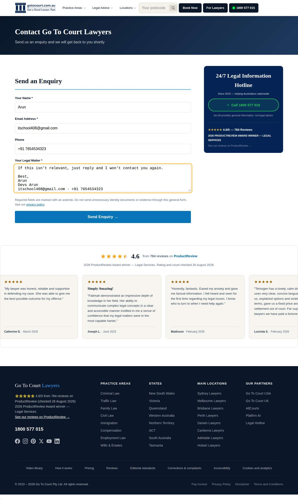

**After submit** — `run-3969e193_attempt-ddb271aa_post_attempt_2026-11-09T04-05-30-803Z.jpg`

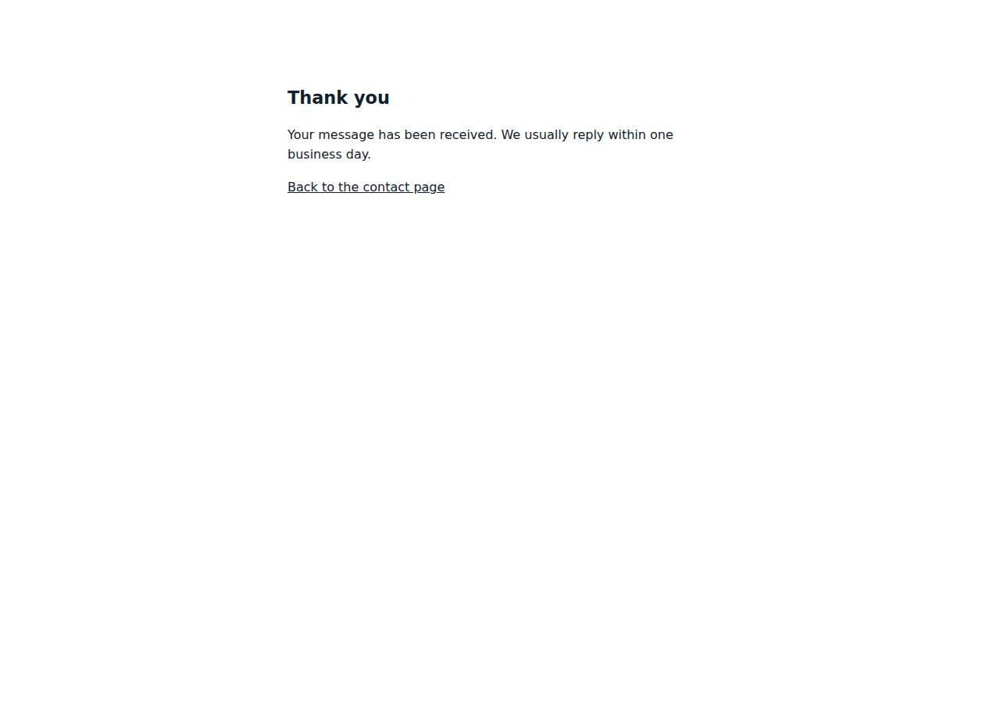

### ppconvey.com.au — unclear (LIVE)

| | |
|---|---|
| Attempt ID | `f9f35813-20b0-480d-89af-f4f421454cbf` |
| Form URL | https://www.ppconvey.com.au/contact |
| Final URL | https://www.ppconvey.com.au/contact |
| Reserved | 2026-11-09 04:05:39 UTC |
| Submit attempted | 2026-11-09 04:05:42 UTC |
| Template | standard v2 |
| Confirmation text | none observed |
| Result / error | No new success marker observed |

Exact message:

~~~text
Subject: Helping customers find your business in AI search (AEO + GEO)

Hi there,

I'm Arun from Devs Arun. More and more customers now ask ChatGPT, Gemini, Perplexity or Google's AI Overviews questions like "who should I hire for this in my area?" before they call anyone. These tools answer from websites they can clearly understand, and they tend to recommend businesses whose pages answer real customer questions.

That is what AEO + GEO (Answer Engine and Generative Engine Optimization) is for. I improve your existing service pages so they clearly answer the questions your customers ask, add structured data that matches the page, and make the call, quote or enquiry step obvious. The benefit: your business gets a better chance of being mentioned or linked in AI answers, and visitors who arrive find it easy to contact you.

The AEO + GEO Starter is a one-time $199 (about ₹16,999, negotiable) for one website: a basic audit, 10 customer questions, improvements to two existing pages, relevant structured data and an action plan, with one revision round.

You can read the full details, send an enquiry or book online here:
https://devsarun.io/aeo-geo/

If this isn't relevant, just reply and I won't contact you again.

Best,
Arun
Devs Arun
itschool408@gmail.com · +91 7654534323
~~~

Submitted field values:

- Name: \[name\]: Arun
- Email: \[email\]: itschool408@gmail.com
- Phone: \[phone\]: +91 7654534323
- Message: \[message\]: Hi there, I'm Arun from Devs Arun. More and more customers now ask ChatGPT, Gemini, Perplexity or Google's AI Overviews 

**Filled form (before submit)** — `run-3969e193_attempt-f9f35813_filled_2026-11-09T04-05-42-601Z.jpg`

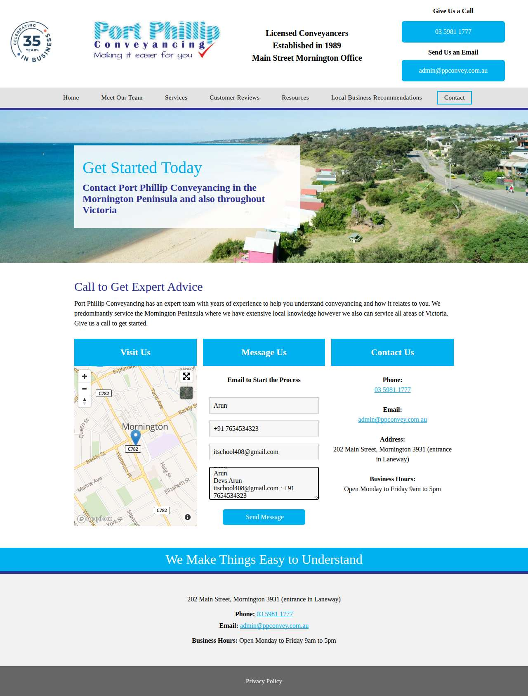

**After submit** — `run-3969e193_attempt-f9f35813_post_attempt_2026-11-09T04-06-13-558Z.jpg`

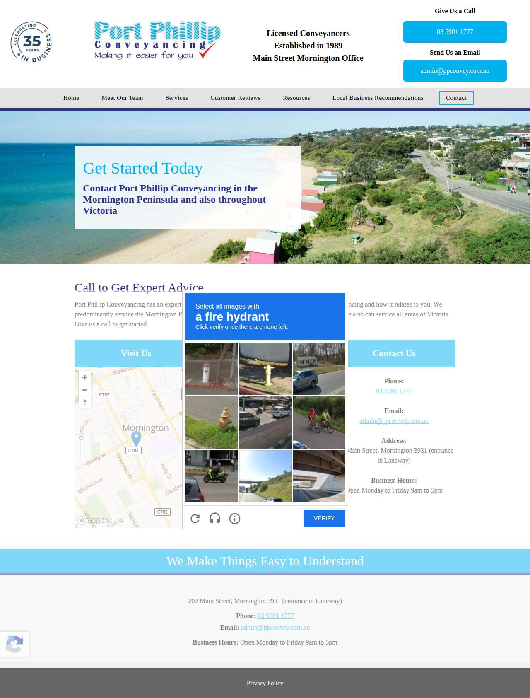

### alrm.org.au — failed\_before\_submit (LIVE)

| | |
|---|---|
| Attempt ID | `79c1b5a2-f5bc-4d8d-a20c-9c3a54e403da` |
| Form URL | https://www.alrm.org.au/contact-us/ |
| Final URL | — |
| Reserved | 2026-11-09 04:06:22 UTC |
| Submit attempted | — |
| Template | standard v2 |
| Confirmation text | none observed |
| Result / error | locator.fill: Error: Cannot type text into input\[type=number\] |

Exact message:

~~~text
Subject: Helping customers find your business in AI search (AEO + GEO)

Hi there,

I'm Arun from Devs Arun. More and more customers now ask ChatGPT, Gemini, Perplexity or Google's AI Overviews questions like "who should I hire for this in my area?" before they call anyone. These tools answer from websites they can clearly understand, and they tend to recommend businesses whose pages answer real customer questions.

That is what AEO + GEO (Answer Engine and Generative Engine Optimization) is for. I improve your existing service pages so they clearly answer the questions your customers ask, add structured data that matches the page, and make the call, quote or enquiry step obvious. The benefit: your business gets a better chance of being mentioned or linked in AI answers, and visitors who arrive find it easy to contact you.

The AEO + GEO Starter is a one-time $199 (about ₹16,999, negotiable) for one website: a basic audit, 10 customer questions, improvements to two existing pages, relevant structured data and an action plan, with one revision round.

You can read the full details, send an enquiry or book online here:
https://devsarun.io/aeo-geo/

If this isn't relevant, just reply and I won't contact you again.

Best,
Arun
Devs Arun
itschool408@gmail.com · +91 7654534323
~~~

Submitted field values:

- \#wpforms-352-field\_0: Arun
- \#wpforms-352-field\_1: itschool408@gmail.com
- \#wpforms-352-field\_2: Hi there, I'm Arun from Devs Arun. More and more customers now ask ChatGPT, Gemini, Perplexity or Google's AI Overviews 
- \#wpforms-352-field\_4: +91 7654534323

**Inspected page** — `run-3969e193_attempt-79c1b5a2_inspection_2026-11-09T04-06-26-413Z.jpg`

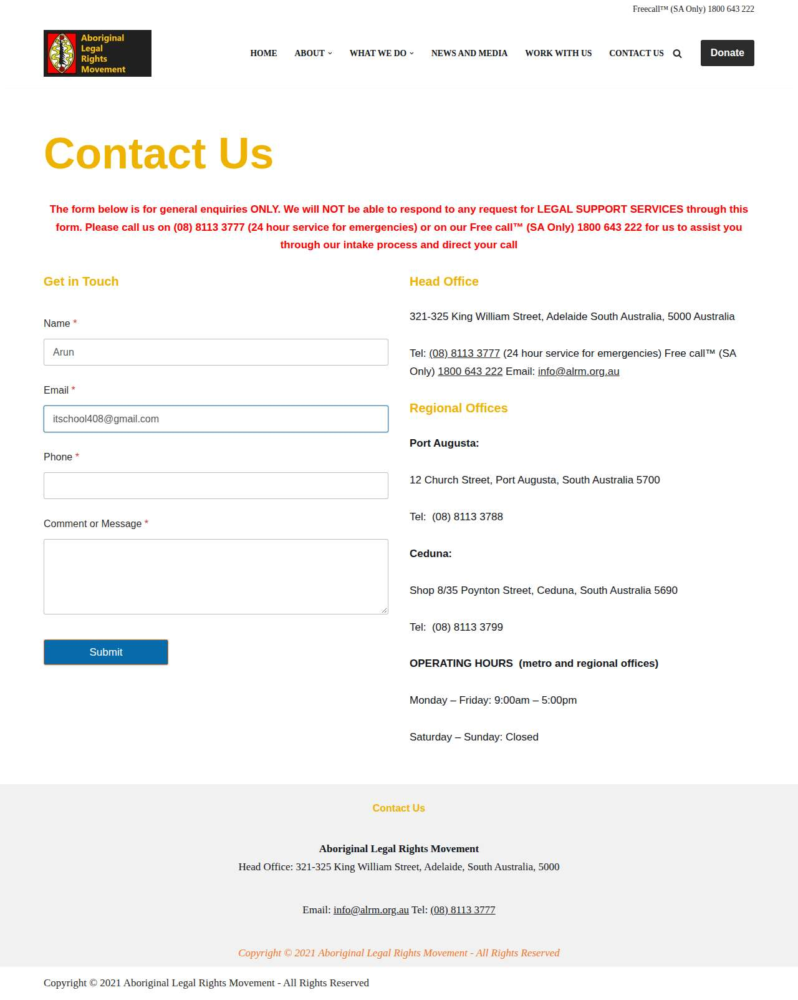

### accesslaw.biz — confirmed (LIVE)

| | |
|---|---|
| Attempt ID | `b05e5664-a140-4b6a-8a53-3fee1bdc1381` |
| Form URL | https://accesslaw.biz/contact/ |
| Final URL | https://accesslaw.biz/contact/ |
| Reserved | 2026-11-09 04:06:31 UTC |
| Submit attempted | 2026-11-09 04:06:35 UTC |
| Template | standard v2 |
| Confirmation text | dress PO Box 231 BRUNSWICK VIC 3056 Phone (03) 03 9381 4994 Thank you for your message. It has been sent. Name (required) Email (required) Phone No. (required) What type of issue do you |
| Result / error | — |

Exact message:

~~~text
Subject: Helping customers find your business in AI search (AEO + GEO)

Hi there,

I'm Arun from Devs Arun. More and more customers now ask ChatGPT, Gemini, Perplexity or Google's AI Overviews questions like "who should I hire for this in my area?" before they call anyone. These tools answer from websites they can clearly understand, and they tend to recommend businesses whose pages answer real customer questions.

That is what AEO + GEO (Answer Engine and Generative Engine Optimization) is for. I improve your existing service pages so they clearly answer the questions your customers ask, add structured data that matches the page, and make the call, quote or enquiry step obvious. The benefit: your business gets a better chance of being mentioned or linked in AI answers, and visitors who arrive find it easy to contact you.

The AEO + GEO Starter is a one-time $199 (about ₹16,999, negotiable) for one website: a basic audit, 10 customer questions, improvements to two existing pages, relevant structured data and an action plan, with one revision round.

You can read the full details, send an enquiry or book online here:
https://devsarun.io/aeo-geo/

If this isn't relevant, just reply and I won't contact you again.

Best,
Arun
Devs Arun
itschool408@gmail.com · +91 7654534323
~~~

Submitted field values:

- Name (required) \[name\]: Arun
- Email (required) \[email\]: itschool408@gmail.com
- Message (required) \[message\]: Hi there, I'm Arun from Devs Arun. More and more customers now ask ChatGPT, Gemini, Perplexity or Google's AI Overviews 
- Phone No. (required) \[phone\]: +91 7654534323
- What type of issue do you have? \[subject\]: Helping customers find your business in AI search (AEO + GEO)

**Filled form (before submit)** — `run-3969e193_attempt-b05e5664_filled_2026-11-09T04-06-35-869Z.jpg`

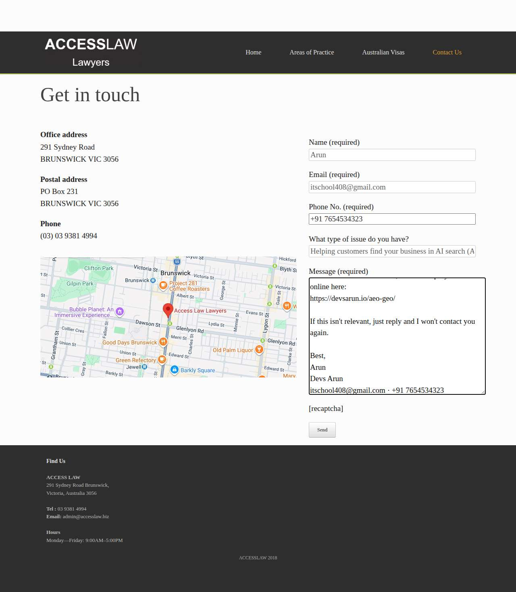

**After submit** — `run-3969e193_attempt-b05e5664_post_attempt_2026-11-09T04-06-41-109Z.jpg`

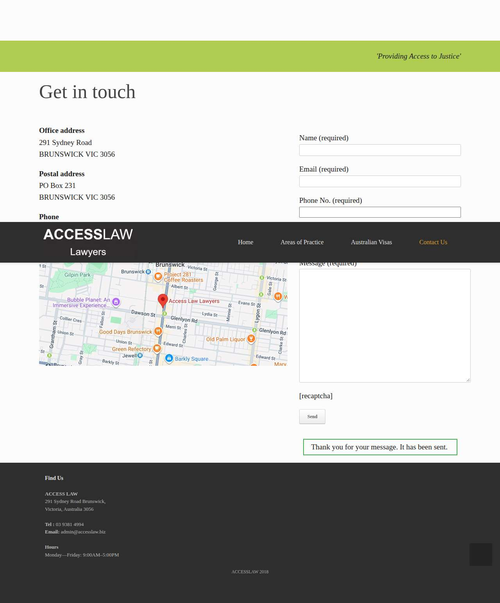

### munrodoig.com.au — unclear (LIVE)

| | |
|---|---|
| Attempt ID | `05b58a5c-e0b0-4d01-88a6-c520c4c40193` |
| Form URL | https://www.munrodoig.com.au/contact-us/ |
| Final URL | https://www.munrodoig.com.au/contact-us/ |
| Reserved | 2026-11-09 04:06:50 UTC |
| Submit attempted | 2026-11-09 04:06:56 UTC |
| Template | standard v2 |
| Confirmation text | none observed |
| Result / error | No new success marker observed |

Exact message:

~~~text
Subject: Helping customers find your business in AI search (AEO + GEO)

Hi there,

I'm Arun from Devs Arun. More and more customers now ask ChatGPT, Gemini, Perplexity or Google's AI Overviews questions like "who should I hire for this in my area?" before they call anyone. These tools answer from websites they can clearly understand, and they tend to recommend businesses whose pages answer real customer questions.

That is what AEO + GEO (Answer Engine and Generative Engine Optimization) is for. I improve your existing service pages so they clearly answer the questions your customers ask, add structured data that matches the page, and make the call, quote or enquiry step obvious. The benefit: your business gets a better chance of being mentioned or linked in AI answers, and visitors who arrive find it easy to contact you.

The AEO + GEO Starter is a one-time $199 (about ₹16,999, negotiable) for one website: a basic audit, 10 customer questions, improvements to two existing pages, relevant structured data and an action plan, with one revision round.

You can read the full details, send an enquiry or book online here:
https://devsarun.io/aeo-geo/

If this isn't relevant, just reply and I won't contact you again.

Best,
Arun
Devs Arun
itschool408@gmail.com · +91 7654534323
~~~

Submitted field values:

- your-name \[name\]: Arun
- your-email \[email\]: itschool408@gmail.com
- your-phone \[phone\]: +91 7654534323
- case-details \[message\]: Hi there, I'm Arun from Devs Arun. More and more customers now ask ChatGPT, Gemini, Perplexity or Google's AI Overviews 

**Filled form (before submit)** — `run-3969e193_attempt-05b58a5c_filled_2026-11-09T04-06-56-545Z.jpg`

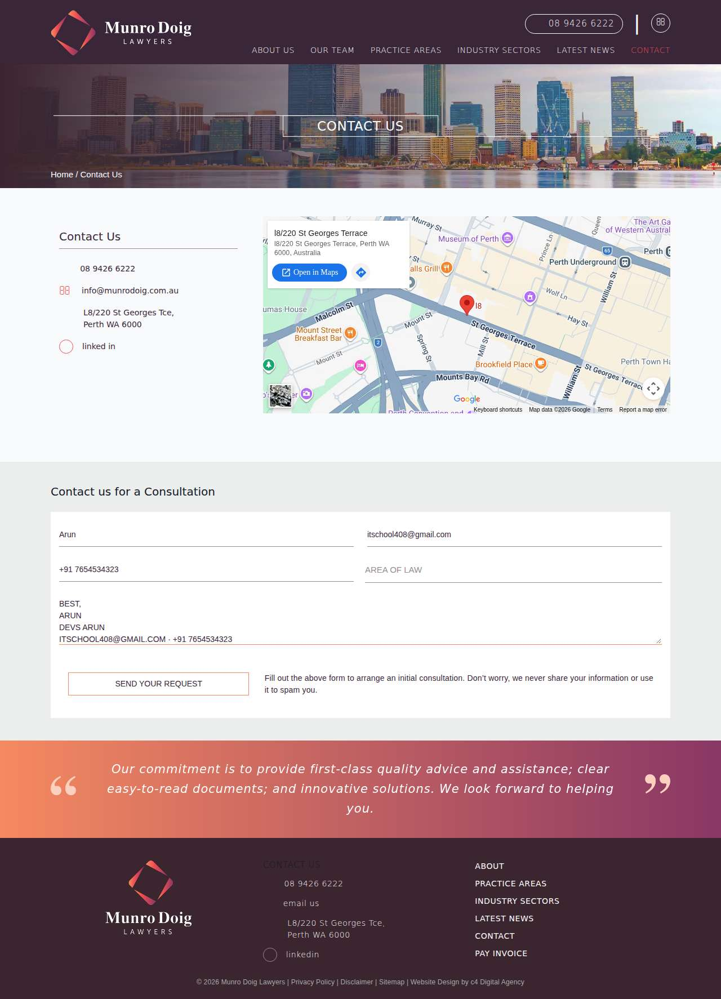

**After submit** — `run-3969e193_attempt-05b58a5c_post_attempt_2026-11-09T04-07-29-859Z.jpg`

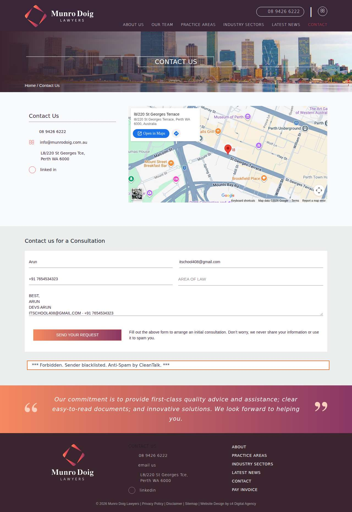

### elvinlawyers.com.au — confirmed (LIVE)

| | |
|---|---|
| Attempt ID | `5075812b-c643-4033-9a32-9f908e4c0ce7` |
| Form URL | https://elvinlawyers.com.au/contact-us/ |
| Final URL | https://elvinlawyers.com.au/contact-us/ |
| Reserved | 2026-11-09 04:07:39 UTC |
| Submit attempted | 2026-11-09 04:07:42 UTC |
| Template | standard v2 |
| Confirmation text | to you within 1 business day – but usually within 3 hours) Form submitted successfully. A confirmation email was sent to itschool408@gmail.com. Phone: (03) 9498 0550 Email: |
| Result / error | — |

Exact message:

~~~text
Subject: Helping customers find your business in AI search (AEO + GEO)

Hi there,

I'm Arun from Devs Arun. More and more customers now ask ChatGPT, Gemini, Perplexity or Google's AI Overviews questions like "who should I hire for this in my area?" before they call anyone. These tools answer from websites they can clearly understand, and they tend to recommend businesses whose pages answer real customer questions.

That is what AEO + GEO (Answer Engine and Generative Engine Optimization) is for. I improve your existing service pages so they clearly answer the questions your customers ask, add structured data that matches the page, and make the call, quote or enquiry step obvious. The benefit: your business gets a better chance of being mentioned or linked in AI answers, and visitors who arrive find it easy to contact you.

The AEO + GEO Starter is a one-time $199 (about ₹16,999, negotiable) for one website: a basic audit, 10 customer questions, improvements to two existing pages, relevant structured data and an action plan, with one revision round.

You can read the full details, send an enquiry or book online here:
https://devsarun.io/aeo-geo/

If this isn't relevant, just reply and I won't contact you again.

Best,
Arun
Devs Arun
itschool408@gmail.com · +91 7654534323
~~~

Submitted field values:

- Name \* \[name\]: Arun
- Email \* \[email\]: itschool408@gmail.com
- Phone \* \[phone\]: +91 7654534323
- Message \* \[message\]: Hi there, I'm Arun from Devs Arun. More and more customers now ask ChatGPT, Gemini, Perplexity or Google's AI Overviews 

**Filled form (before submit)** — `run-3969e193_attempt-5075812b_filled_2026-11-09T04-07-42-632Z.jpg`

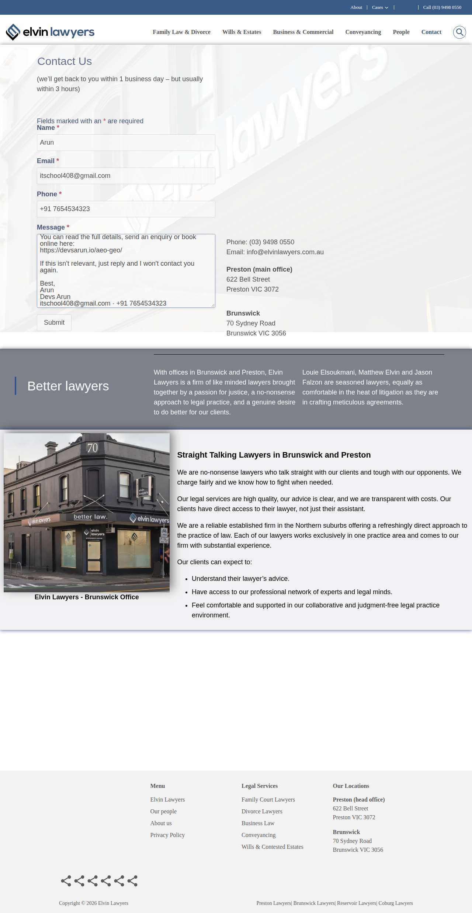

**After submit** — `run-3969e193_attempt-5075812b_post_attempt_2026-11-09T04-07-53-182Z.jpg`

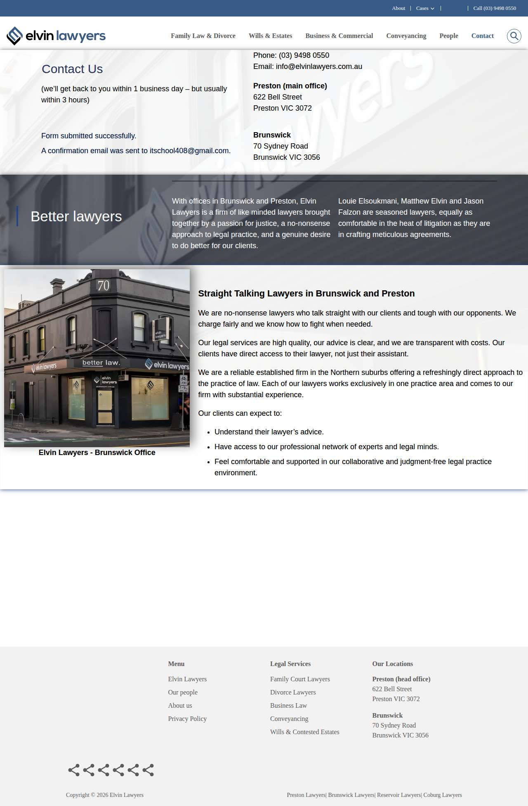

### cannlegal.com.au — unclear (LIVE)

| | |
|---|---|
| Attempt ID | `1f0f293e-84bc-4954-a2c8-50372dd46638` |
| Form URL | https://www.cannlegal.com.au/contact/ |
| Final URL | https://www.cannlegal.com.au/contact/ |
| Reserved | 2026-11-09 04:08:02 UTC |
| Submit attempted | 2026-11-09 04:08:09 UTC |
| Template | standard v2 |
| Confirmation text | none observed |
| Result / error | No new success marker observed |

Exact message:

~~~text
Subject: Helping customers find your business in AI search (AEO + GEO)

Hi there,

I'm Arun from Devs Arun. More and more customers now ask ChatGPT, Gemini, Perplexity or Google's AI Overviews questions like "who should I hire for this in my area?" before they call anyone. These tools answer from websites they can clearly understand, and they tend to recommend businesses whose pages answer real customer questions.

That is what AEO + GEO (Answer Engine and Generative Engine Optimization) is for. I improve your existing service pages so they clearly answer the questions your customers ask, add structured data that matches the page, and make the call, quote or enquiry step obvious. The benefit: your business gets a better chance of being mentioned or linked in AI answers, and visitors who arrive find it easy to contact you.

The AEO + GEO Starter is a one-time $199 (about ₹16,999, negotiable) for one website: a basic audit, 10 customer questions, improvements to two existing pages, relevant structured data and an action plan, with one revision round.

You can read the full details, send an enquiry or book online here:
https://devsarun.io/aeo-geo/

If this isn't relevant, just reply and I won't contact you again.

Best,
Arun
Devs Arun
itschool408@gmail.com · +91 7654534323
~~~

Submitted field values:

- your-name \[name\]: Arun
- your-email \[email\]: itschool408@gmail.com
- your-message \[message\]: Hi there, I'm Arun from Devs Arun. More and more customers now ask ChatGPT, Gemini, Perplexity or Google's AI Overviews 
- your-subject \[subject\]: Helping customers find your business in AI search (AEO + GEO)

**Filled form (before submit)** — `run-3969e193_attempt-1f0f293e_filled_2026-11-09T04-08-09-385Z.jpg`

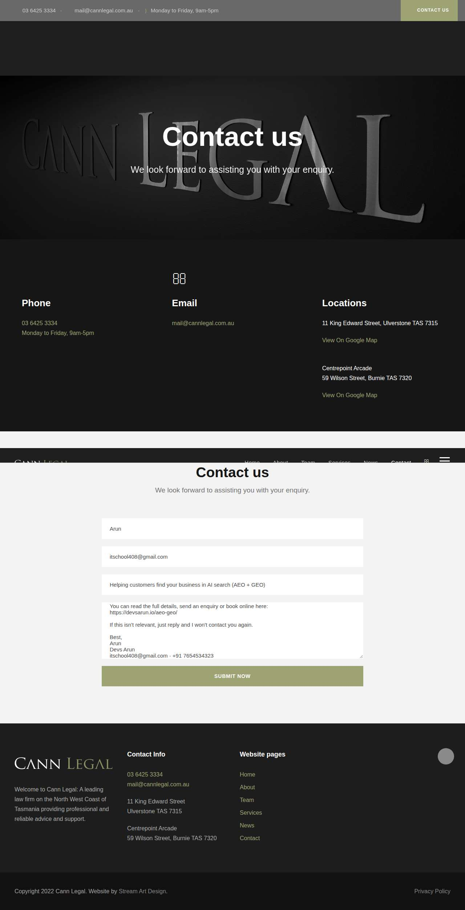

**After submit** — `run-3969e193_attempt-1f0f293e_post_attempt_2026-11-09T04-08-38-786Z.jpg`

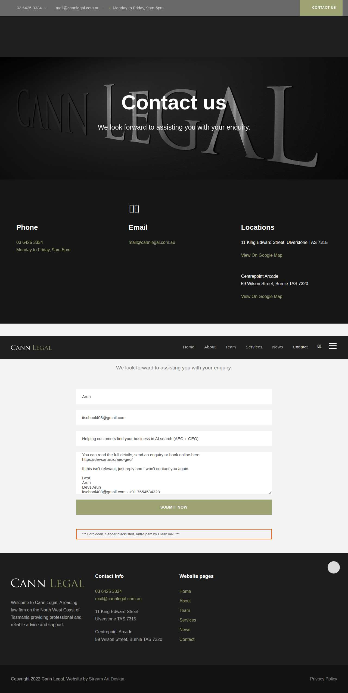

### splawyerssg.com.au — confirmed (LIVE)

| | |
|---|---|
| Attempt ID | `014173ae-ad8a-428d-ab80-c006842267ee` |
| Form URL | https://www.spgarrett.com.au/contact-us/ |
| Final URL | https://www.spgarrett.com.au/contact-us/ |
| Reserved | 2026-11-09 04:08:47 UTC |
| Submit attempted | 2026-11-09 04:08:54 UTC |
| Template | standard v2 |
| Confirmation text | any questions, concerns or inquiries. Our Office Locations Thank you for your message. It has been sent. Your name Your email Your message (optional) Phone Number (optional) SP Garrett |
| Result / error | — |

Exact message:

~~~text
Subject: Helping customers find your business in AI search (AEO + GEO)

Hi there,

I'm Arun from Devs Arun. More and more customers now ask ChatGPT, Gemini, Perplexity or Google's AI Overviews questions like "who should I hire for this in my area?" before they call anyone. These tools answer from websites they can clearly understand, and they tend to recommend businesses whose pages answer real customer questions.

That is what AEO + GEO (Answer Engine and Generative Engine Optimization) is for. I improve your existing service pages so they clearly answer the questions your customers ask, add structured data that matches the page, and make the call, quote or enquiry step obvious. The benefit: your business gets a better chance of being mentioned or linked in AI answers, and visitors who arrive find it easy to contact you.

The AEO + GEO Starter is a one-time $199 (about ₹16,999, negotiable) for one website: a basic audit, 10 customer questions, improvements to two existing pages, relevant structured data and an action plan, with one revision round.

You can read the full details, send an enquiry or book online here:
https://devsarun.io/aeo-geo/

If this isn't relevant, just reply and I won't contact you again.

Best,
Arun
Devs Arun
itschool408@gmail.com · +91 7654534323
~~~

Submitted field values:

- Your name \[name\]: Arun
- Your email \[email\]: itschool408@gmail.com
- Phone Number (optional) \[phone\]: +91 7654534323
- Your message (optional) \[message\]: Hi there, I'm Arun from Devs Arun. More and more customers now ask ChatGPT, Gemini, Perplexity or Google's AI Overviews 

**Filled form (before submit)** — `run-3969e193_attempt-014173ae_filled_2026-11-09T04-08-53-997Z.jpg`

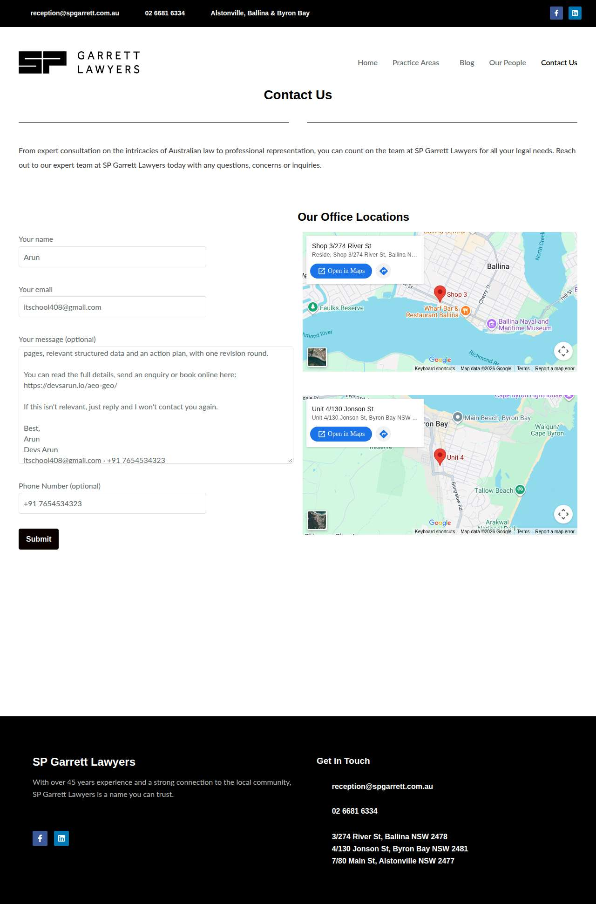

**After submit** — `run-3969e193_attempt-014173ae_post_attempt_2026-11-09T04-09-06-025Z.jpg`

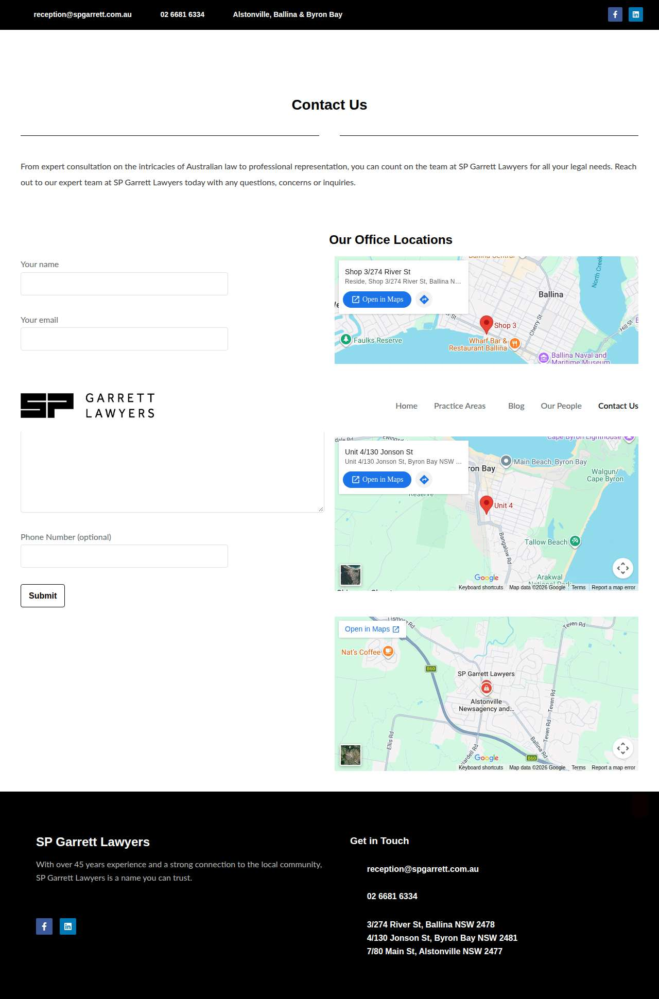

### caraccidentlawyersperth.com.au — unclear (LIVE)

| | |
|---|---|
| Attempt ID | `65b15e7b-47e0-47cf-907d-0800979416ea` |
| Form URL | https://www.caraccidentlawyersperth.com.au/contact-us |
| Final URL | https://www.caraccidentlawyersperth.com.au/contact-us |
| Reserved | 2026-11-09 04:09:15 UTC |
| Submit attempted | 2026-11-09 04:09:20 UTC |
| Template | standard v2 |
| Confirmation text | none observed |
| Result / error | No new success marker observed |

Exact message:

~~~text
Subject: Helping customers find your business in AI search (AEO + GEO)

Hi there,

I'm Arun from Devs Arun. More and more customers now ask ChatGPT, Gemini, Perplexity or Google's AI Overviews questions like "who should I hire for this in my area?" before they call anyone. These tools answer from websites they can clearly understand, and they tend to recommend businesses whose pages answer real customer questions.

That is what AEO + GEO (Answer Engine and Generative Engine Optimization) is for. I improve your existing service pages so they clearly answer the questions your customers ask, add structured data that matches the page, and make the call, quote or enquiry step obvious. The benefit: your business gets a better chance of being mentioned or linked in AI answers, and visitors who arrive find it easy to contact you.

The AEO + GEO Starter is a one-time $199 (about ₹16,999, negotiable) for one website: a basic audit, 10 customer questions, improvements to two existing pages, relevant structured data and an action plan, with one revision round.

You can read the full details, send an enquiry or book online here:
https://devsarun.io/aeo-geo/

If this isn't relevant, just reply and I won't contact you again.

Best,
Arun
Devs Arun
itschool408@gmail.com · +91 7654534323
~~~

Submitted field values:

- Message \[message\]: Hi there, I'm Arun from Devs Arun. More and more customers now ask ChatGPT, Gemini, Perplexity or Google's AI Overviews 
- Email Address \[email\]: itschool408@gmail.com
- First Name \[first\_name\]: Arun
- Telephone Number \[phone\]: +91 7654534323

**Filled form (before submit)** — `run-3969e193_attempt-65b15e7b_filled_2026-11-09T04-09-20-429Z.jpg`

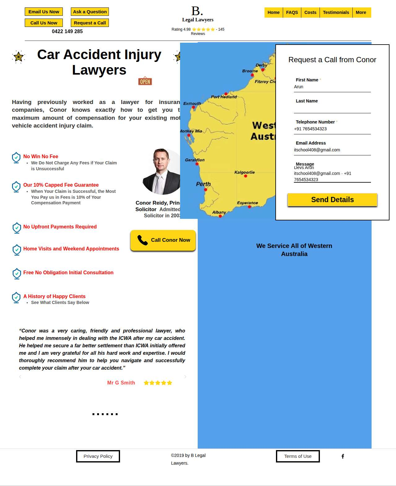

**After submit** — `run-3969e193_attempt-65b15e7b_post_attempt_2026-11-09T04-09-57-630Z.jpg`

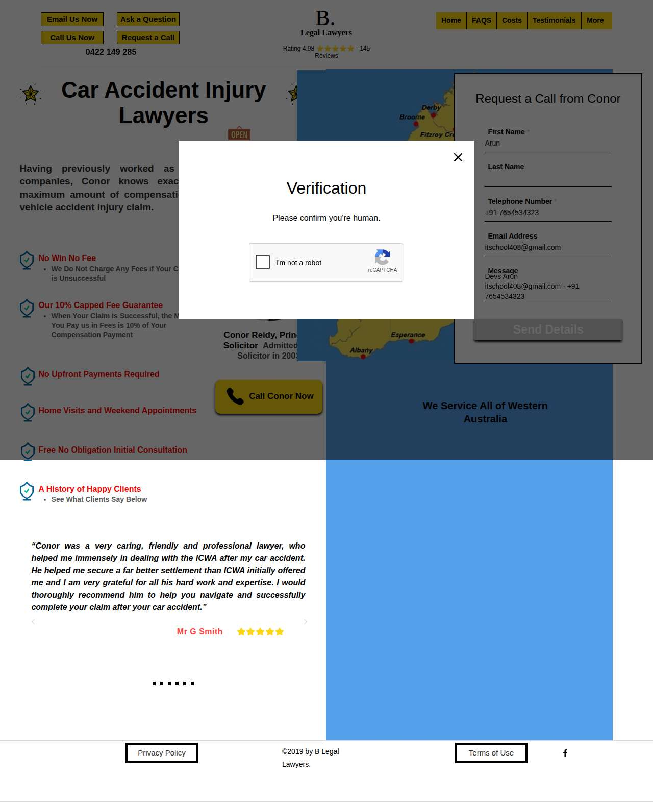

### ownitconveyancing.com — error\_after\_submit (LIVE)

| | |
|---|---|
| Attempt ID | `3bef5155-08c8-46ba-866b-037f9df8c054` |
| Form URL | https://ownitconveyancing.com/contact-us |
| Final URL | https://ownitconveyancing.com/contact-us |
| Reserved | 2026-11-09 04:10:07 UTC |
| Submit attempted | 2026-11-09 04:10:10 UTC |
| Template | standard v2 |
| Confirmation text | you New Customer Existing Customer Real Estate Agent Other This field is required. First name\* Last name\* This field is required. Email\* Mobile\* Invalid mobile number. Message\* By p |
| Result / error | — |

Exact message:

~~~text
Subject: Helping customers find your business in AI search (AEO + GEO)

Hi there,

I'm Arun from Devs Arun. More and more customers now ask ChatGPT, Gemini, Perplexity or Google's AI Overviews questions like "who should I hire for this in my area?" before they call anyone. These tools answer from websites they can clearly understand, and they tend to recommend businesses whose pages answer real customer questions.

That is what AEO + GEO (Answer Engine and Generative Engine Optimization) is for. I improve your existing service pages so they clearly answer the questions your customers ask, add structured data that matches the page, and make the call, quote or enquiry step obvious. The benefit: your business gets a better chance of being mentioned or linked in AI answers, and visitors who arrive find it easy to contact you.

The AEO + GEO Starter is a one-time $199 (about ₹16,999, negotiable) for one website: a basic audit, 10 customer questions, improvements to two existing pages, relevant structured data and an action plan, with one revision round.

You can read the full details, send an enquiry or book online here:
https://devsarun.io/aeo-geo/

If this isn't relevant, just reply and I won't contact you again.

Best,
Arun
Devs Arun
itschool408@gmail.com · +91 7654534323
~~~

Submitted field values:

- Email\* \[email\]: itschool408@gmail.com
- Mobile\* \[phone\]: +91 7654534323
- Message\* \[message\]: Hi there, I'm Arun from Devs Arun. More and more customers now ask ChatGPT, Gemini, Perplexity or Google's AI Overviews 
- First name\* \[first\_name\]: Arun

**Filled form (before submit)** — `run-3969e193_attempt-3bef5155_filled_2026-11-09T04-10-10-607Z.jpg`

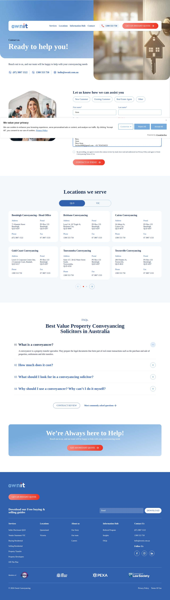

**After submit** — `run-3969e193_attempt-3bef5155_post_attempt_2026-11-09T04-10-15-126Z.jpg`

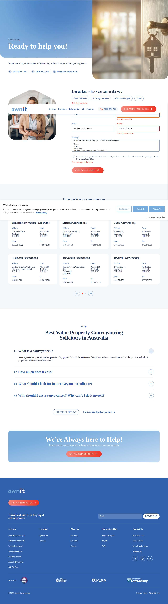

### jht.com.au — confirmed (LIVE)

| | |
|---|---|
| Attempt ID | `aaa799e0-bf36-4d29-a3ba-56dac0116a36` |
| Form URL | https://jht.com.au/contact/ |
| Final URL | https://jht.com.au/contact/ |
| Reserved | 2026-11-09 04:10:24 UTC |
| Submit attempted | 2026-11-09 04:10:28 UTC |
| Template | standard v2 |
| Confirmation text | Keyboard shortcuts Map data ©2026 Google Terms Enquiry Form Thank you. Form submitted successfully. We will respond promptly. Menu Close Menu |
| Result / error | — |

Exact message:

~~~text
Subject: Helping customers find your business in AI search (AEO + GEO)

Hi there,

I'm Arun from Devs Arun. More and more customers now ask ChatGPT, Gemini, Perplexity or Google's AI Overviews questions like "who should I hire for this in my area?" before they call anyone. These tools answer from websites they can clearly understand, and they tend to recommend businesses whose pages answer real customer questions.

That is what AEO + GEO (Answer Engine and Generative Engine Optimization) is for. I improve your existing service pages so they clearly answer the questions your customers ask, add structured data that matches the page, and make the call, quote or enquiry step obvious. The benefit: your business gets a better chance of being mentioned or linked in AI answers, and visitors who arrive find it easy to contact you.

The AEO + GEO Starter is a one-time $199 (about ₹16,999, negotiable) for one website: a basic audit, 10 customer questions, improvements to two existing pages, relevant structured data and an action plan, with one revision round.

You can read the full details, send an enquiry or book online here:
https://devsarun.io/aeo-geo/

If this isn't relevant, just reply and I won't contact you again.

Best,
Arun
Devs Arun
itschool408@gmail.com · +91 7654534323
~~~

Submitted field values:

- Name \* \[name\]: Arun
- Email \* \[email\]: itschool408@gmail.com
- Phone \* \[phone\]: +91 7654534323
- Message \* \[message\]: Hi there, I'm Arun from Devs Arun. More and more customers now ask ChatGPT, Gemini, Perplexity or Google's AI Overviews 

**Filled form (before submit)** — `run-3969e193_attempt-aaa799e0_filled_2026-11-09T04-10-28-381Z.jpg`

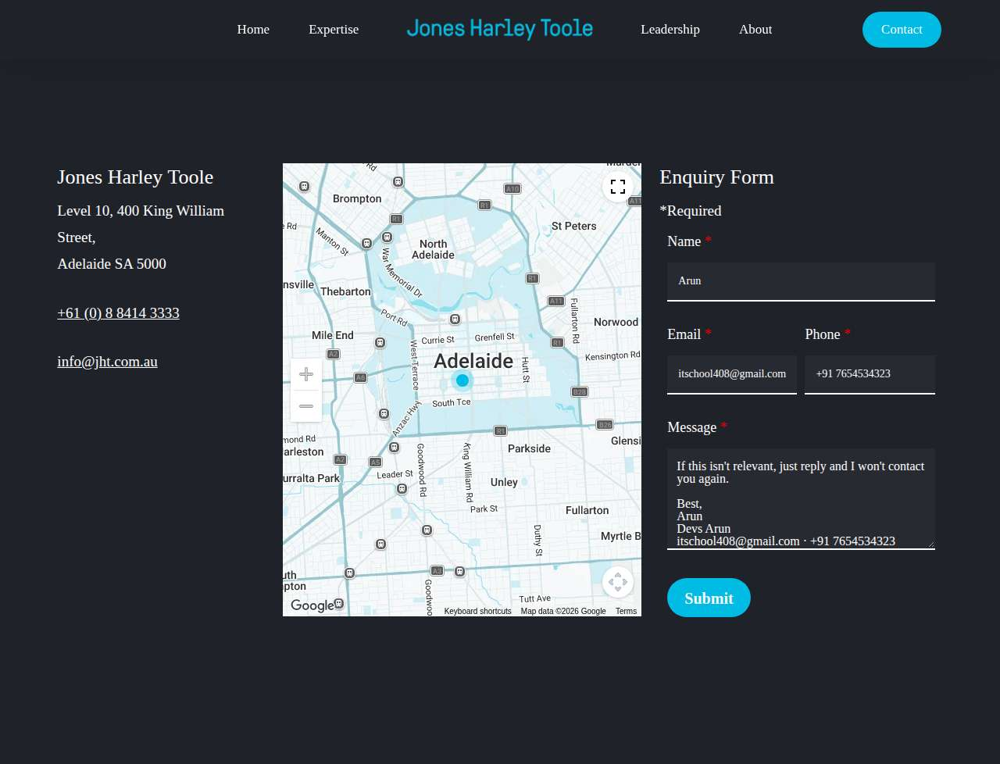

**After submit** — `run-3969e193_attempt-aaa799e0_post_attempt_2026-11-09T04-10-36-646Z.jpg`

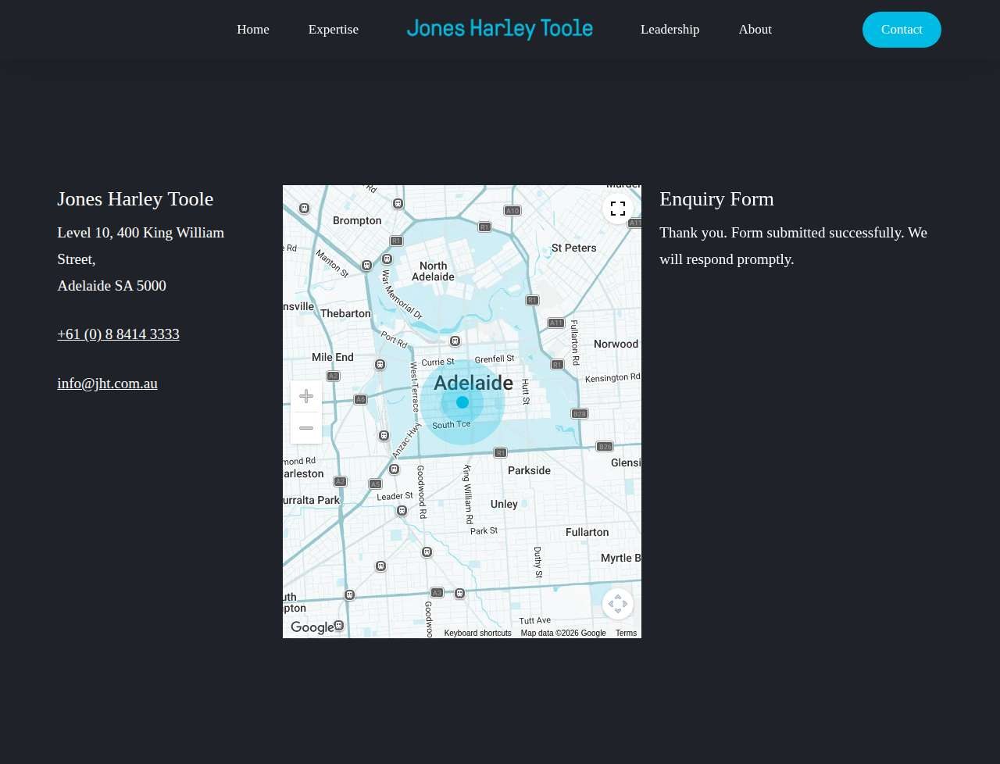

### baxterssolicitors.com.au — confirmed (LIVE)

| | |
|---|---|
| Attempt ID | `05b6585b-a3dc-472b-936c-0e01a5b02e36` |
| Form URL | https://baxterssolicitors.com.au/contact-us/ |
| Final URL | https://baxterssolicitors.com.au/contact-us/ |
| Reserved | 2026-11-09 04:10:45 UTC |
| Submit attempted | 2026-11-09 04:10:50 UTC |
| Template | standard v2 |
| Confirmation text | n touch with our friendly team today via the form below and we will get back to you as soon as possible. You can also give us a call on (07) 5576 0977 or send us an email direc |
| Result / error | — |

Exact message:

~~~text
Subject: Helping customers find your business in AI search (AEO + GEO)

Hi there,

I'm Arun from Devs Arun. More and more customers now ask ChatGPT, Gemini, Perplexity or Google's AI Overviews questions like "who should I hire for this in my area?" before they call anyone. These tools answer from websites they can clearly understand, and they tend to recommend businesses whose pages answer real customer questions.

That is what AEO + GEO (Answer Engine and Generative Engine Optimization) is for. I improve your existing service pages so they clearly answer the questions your customers ask, add structured data that matches the page, and make the call, quote or enquiry step obvious. The benefit: your business gets a better chance of being mentioned or linked in AI answers, and visitors who arrive find it easy to contact you.

The AEO + GEO Starter is a one-time $199 (about ₹16,999, negotiable) for one website: a basic audit, 10 customer questions, improvements to two existing pages, relevant structured data and an action plan, with one revision round.

You can read the full details, send an enquiry or book online here:
https://devsarun.io/aeo-geo/

If this isn't relevant, just reply and I won't contact you again.

Best,
Arun
Devs Arun
itschool408@gmail.com · +91 7654534323
~~~

Submitted field values:

- your-name \[name\]: Arun
- your-email \[email\]: itschool408@gmail.com
- your-message \[message\]: Hi there, I'm Arun from Devs Arun. More and more customers now ask ChatGPT, Gemini, Perplexity or Google's AI Overviews 
- your-subject \[subject\]: Helping customers find your business in AI search (AEO + GEO)

**Filled form (before submit)** — `run-3969e193_attempt-05b6585b_filled_2026-11-09T04-10-50-521Z.jpg`

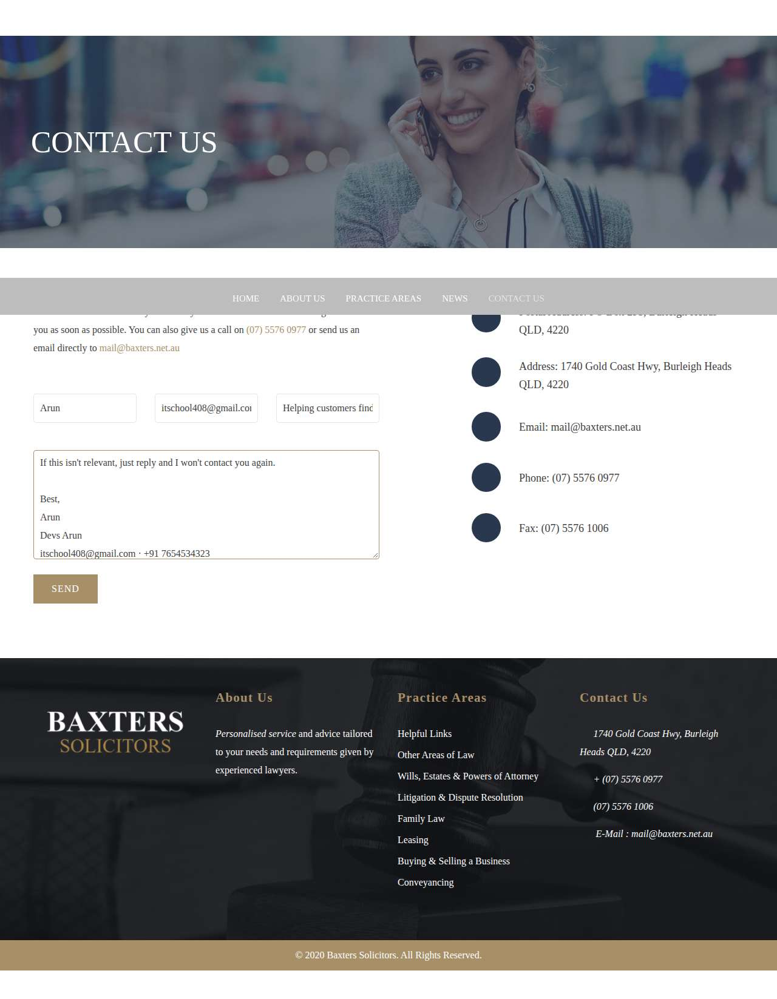

**After submit** — `run-3969e193_attempt-05b6585b_post_attempt_2026-11-09T04-10-55-810Z.jpg`

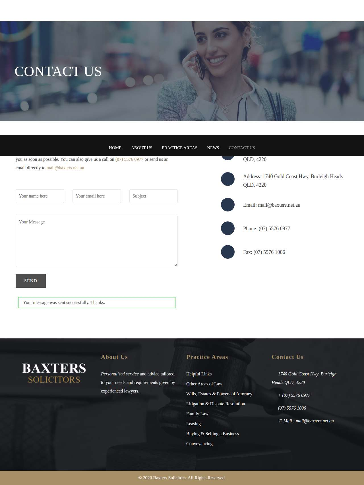

### littletonhackford.com.au — error\_after\_submit (LIVE)

| | |
|---|---|
| Attempt ID | `27031b10-17b7-4cb2-bcd6-626725f864ac` |
| Form URL | https://littletonhackford.com.au/contact-us/ |
| Final URL | https://littletonhackford.com.au/contact-us/ |
| Reserved | 2026-11-09 04:11:04 UTC |
| Submit attempted | 2026-11-09 04:11:07 UTC |
| Template | standard v2 |
| Confirmation text | none observed |
| Result / error | Submit click error (outcome unknown, not retried): locator.click: Timeout 10000ms exceeded. |

Exact message:

~~~text
Subject: Helping customers find your business in AI search (AEO + GEO)

Hi there,

I'm Arun from Devs Arun. More and more customers now ask ChatGPT, Gemini, Perplexity or Google's AI Overviews questions like "who should I hire for this in my area?" before they call anyone. These tools answer from websites they can clearly understand, and they tend to recommend businesses whose pages answer real customer questions.

That is what AEO + GEO (Answer Engine and Generative Engine Optimization) is for. I improve your existing service pages so they clearly answer the questions your customers ask, add structured data that matches the page, and make the call, quote or enquiry step obvious. The benefit: your business gets a better chance of being mentioned or linked in AI answers, and visitors who arrive find it easy to contact you.

The AEO + GEO Starter is a one-time $199 (about ₹16,999, negotiable) for one website: a basic audit, 10 customer questions, improvements to two existing pages, relevant structured data and an action plan, with one revision round.

You can read the full details, send an enquiry or book online here:
https://devsarun.io/aeo-geo/

If this isn't relevant, just reply and I won't contact you again.

Best,
Arun
Devs Arun
itschool408@gmail.com · +91 7654534323
~~~

Submitted field values:

- Name \* \[name\]: Arun
- Email \* \[email\]: itschool408@gmail.com
- Phone Number \* \[phone\]: +91 7654534323
- Comment or Message \* \[message\]: Hi there, I'm Arun from Devs Arun. More and more customers now ask ChatGPT, Gemini, Perplexity or Google's AI Overviews 

**Filled form (before submit)** — `run-3969e193_attempt-27031b10_filled_2026-11-09T04-11-07-518Z.jpg`

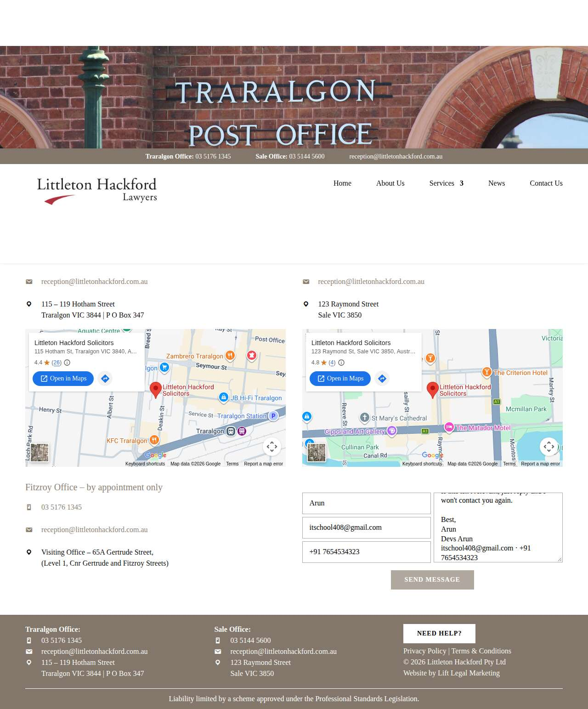

**After submit** — `run-3969e193_attempt-27031b10_post_attempt_2026-11-09T04-11-33-208Z.jpg`

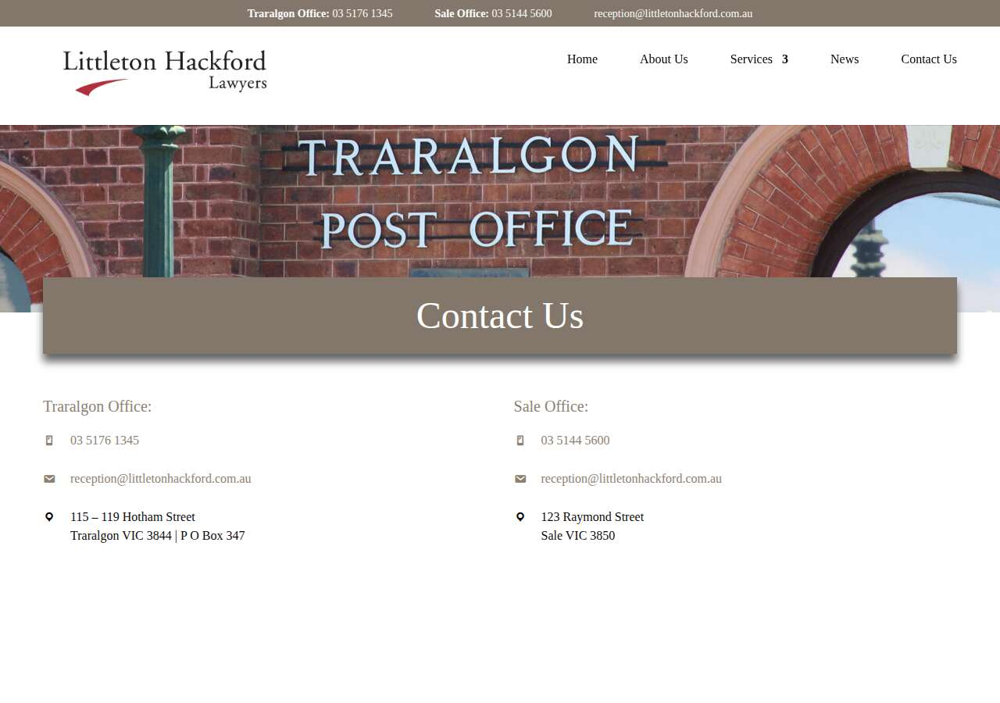

### bazylegal.com.au — failed\_before\_submit (LIVE)

| | |
|---|---|
| Attempt ID | `71c3e294-19a8-4296-9f05-bed03b461ca6` |
| Form URL | https://bazylegal.com.au/contact |
| Final URL | https://bazylegal.com.au/contact |
| Reserved | 2026-11-09 04:11:42 UTC |
| Submit attempted | — |
| Template | standard v2 |
| Confirmation text | none observed |
| Result / error | Reviewed form not found on page (site changed) |

Exact message:

~~~text
Subject: Helping customers find your business in AI search (AEO + GEO)

Hi there,

I'm Arun from Devs Arun. More and more customers now ask ChatGPT, Gemini, Perplexity or Google's AI Overviews questions like "who should I hire for this in my area?" before they call anyone. These tools answer from websites they can clearly understand, and they tend to recommend businesses whose pages answer real customer questions.

That is what AEO + GEO (Answer Engine and Generative Engine Optimization) is for. I improve your existing service pages so they clearly answer the questions your customers ask, add structured data that matches the page, and make the call, quote or enquiry step obvious. The benefit: your business gets a better chance of being mentioned or linked in AI answers, and visitors who arrive find it easy to contact you.

The AEO + GEO Starter is a one-time $199 (about ₹16,999, negotiable) for one website: a basic audit, 10 customer questions, improvements to two existing pages, relevant structured data and an action plan, with one revision round.

You can read the full details, send an enquiry or book online here:
https://devsarun.io/aeo-geo/

If this isn't relevant, just reply and I won't contact you again.

Best,
Arun
Devs Arun
itschool408@gmail.com · +91 7654534323
~~~

Submitted field values:

- \#«r0»-form-item: Arun
- \#«r1»-form-item: +91 7654534323
- \#«r2»-form-item: itschool408@gmail.com
- \#«rc»-form-item: Hi there, I'm Arun from Devs Arun. More and more customers now ask ChatGPT, Gemini, Perplexity or Google's AI Overviews 

**Inspected page** — `run-3969e193_attempt-71c3e294_inspection_2026-11-09T04-11-45-283Z.jpg`

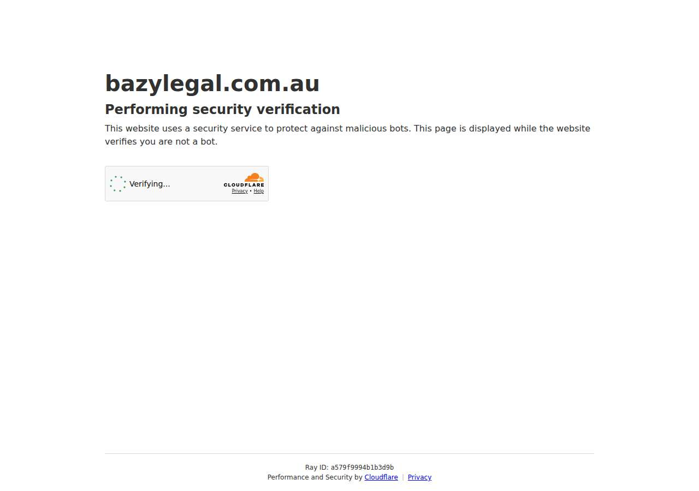

### easternlegal.com.au — failed\_before\_submit (LIVE)

| | |
|---|---|
| Attempt ID | `2b3b8d65-e4bc-49c3-8ff5-e5f4f4fdf269` |
| Form URL | https://www.easternlegal.com.au/ |
| Final URL | https://www.easternlegal.com.au/ |
| Reserved | 2026-11-09 04:11:50 UTC |
| Submit attempted | — |
| Template | standard v2 |
| Confirmation text | none observed |
| Result / error | Form validation would block sending: phone: Please enter between 4 to 17 digits. You can include hyphens (-) or start with a (+), e.g., 555-123-4567 or +(222)987654321. |

Exact message:

~~~text
Subject: Helping customers find your business in AI search (AEO + GEO)

Hi there,

I'm Arun from Devs Arun. More and more customers now ask ChatGPT, Gemini, Perplexity or Google's AI Overviews questions like "who should I hire for this in my area?" before they call anyone. These tools answer from websites they can clearly understand, and they tend to recommend businesses whose pages answer real customer questions.

That is what AEO + GEO (Answer Engine and Generative Engine Optimization) is for. I improve your existing service pages so they clearly answer the questions your customers ask, add structured data that matches the page, and make the call, quote or enquiry step obvious. The benefit: your business gets a better chance of being mentioned or linked in AI answers, and visitors who arrive find it easy to contact you.

The AEO + GEO Starter is a one-time $199 (about ₹16,999, negotiable) for one website: a basic audit, 10 customer questions, improvements to two existing pages, relevant structured data and an action plan, with one revision round.

You can read the full details, send an enquiry or book online here:
https://devsarun.io/aeo-geo/

If this isn't relevant, just reply and I won't contact you again.

Best,
Arun
Devs Arun
itschool408@gmail.com · +91 7654534323
~~~

Submitted field values:

- \#input\_comp-l0gb9xq6: Arun
- \#input\_comp-l0gb9xse: itschool408@gmail.com
- \#input\_comp-l2zdj3w9: +91 7654534323
- \#textarea\_comp-l0gb9xsr: Hi there, I'm Arun from Devs Arun. More and more customers now ask ChatGPT, Gemini, Perplexity or Google's AI Overviews 

**Filled form (before submit)** — `run-3969e193_attempt-2b3b8d65_filled_2026-11-09T04-11-52-429Z.jpg`

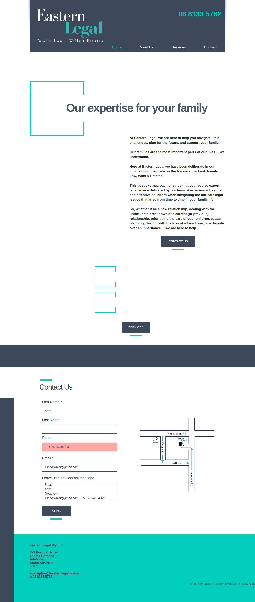

### cdlawyers.com.au — failed\_before\_submit (LIVE)

| | |
|---|---|
| Attempt ID | `055c8533-6307-425a-a99d-feb470348a24` |
| Form URL | https://www.cdlawyers.com.au/contact-us |
| Final URL | https://www.cdlawyers.com.au/contact-us |
| Reserved | 2026-11-09 04:11:57 UTC |
| Submit attempted | — |
| Template | standard v2 |
| Confirmation text | none observed |
| Result / error | Form validation would block sending: phone: Please enter between 4 to 17 digits. You can include hyphens (-) or start with a (+), e.g., 555-123-4567 or +(222)987654321. |

Exact message:

~~~text
Subject: Helping customers find your business in AI search (AEO + GEO)

Hi there,

I'm Arun from Devs Arun. More and more customers now ask ChatGPT, Gemini, Perplexity or Google's AI Overviews questions like "who should I hire for this in my area?" before they call anyone. These tools answer from websites they can clearly understand, and they tend to recommend businesses whose pages answer real customer questions.

That is what AEO + GEO (Answer Engine and Generative Engine Optimization) is for. I improve your existing service pages so they clearly answer the questions your customers ask, add structured data that matches the page, and make the call, quote or enquiry step obvious. The benefit: your business gets a better chance of being mentioned or linked in AI answers, and visitors who arrive find it easy to contact you.

The AEO + GEO Starter is a one-time $199 (about ₹16,999, negotiable) for one website: a basic audit, 10 customer questions, improvements to two existing pages, relevant structured data and an action plan, with one revision round.

You can read the full details, send an enquiry or book online here:
https://devsarun.io/aeo-geo/

If this isn't relevant, just reply and I won't contact you again.

Best,
Arun
Devs Arun
itschool408@gmail.com · +91 7654534323
~~~

Submitted field values:

- \#input\_comp-lidwwkgf: Arun
- \#input\_comp-lidwwkgk2: +91 7654534323
- \#input\_comp-lidwwkgp5: itschool408@gmail.com
- \#textarea\_comp-lidwwkgq4: Hi there, I'm Arun from Devs Arun. More and more customers now ask ChatGPT, Gemini, Perplexity or Google's AI Overviews 

**Filled form (before submit)** — `run-3969e193_attempt-055c8533_filled_2026-11-09T04-12-00-522Z.jpg`

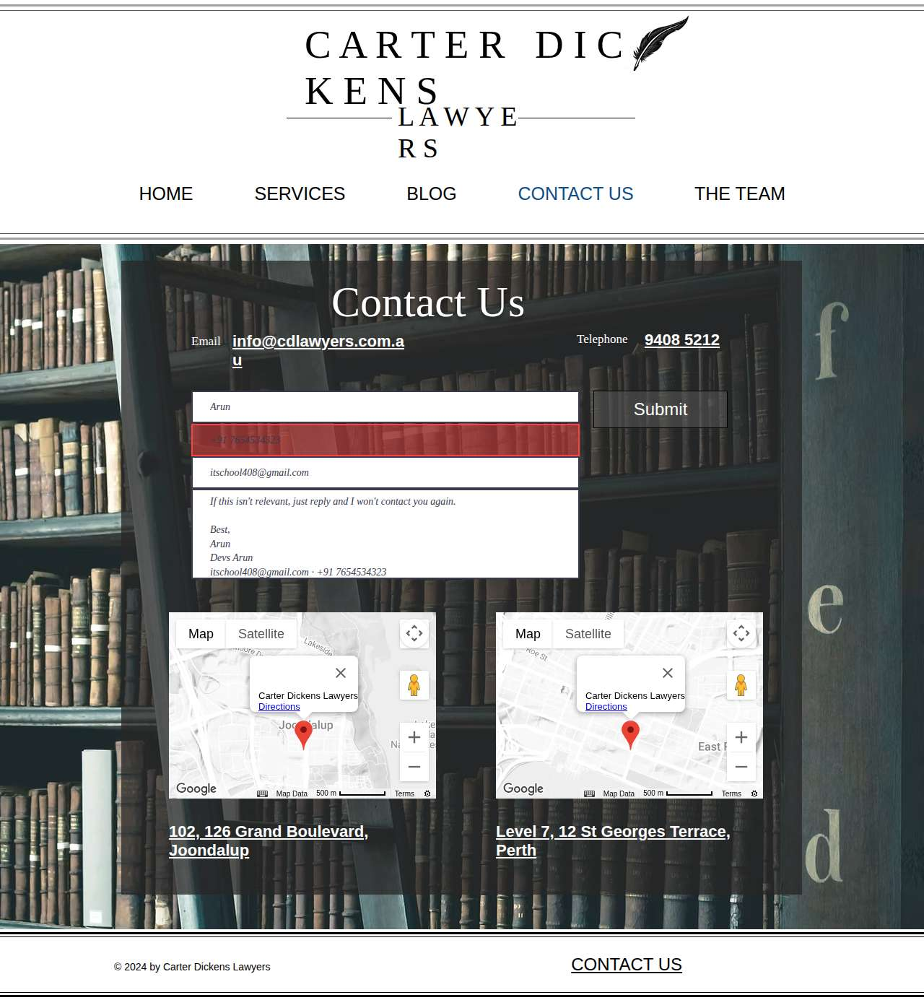

### forgelegal.net — error\_after\_submit (LIVE)

| | |
|---|---|
| Attempt ID | `108c12c6-ce5e-4e0d-b3d0-5e80a04e8b64` |
| Form URL | https://forgelegal.com.au/contact |
| Final URL | https://forgelegal.com.au/contact |
| Reserved | 2026-11-09 04:12:05 UTC |
| Submit attempted | 2026-11-09 04:12:08 UTC |
| Template | standard v2 |
| Confirmation text | none observed |
| Result / error | Submit click error (outcome unknown, not retried): locator.click: Timeout 10000ms exceeded. |

Exact message:

~~~text
Subject: Helping customers find your business in AI search (AEO + GEO)

Hi there,

I'm Arun from Devs Arun. More and more customers now ask ChatGPT, Gemini, Perplexity or Google's AI Overviews questions like "who should I hire for this in my area?" before they call anyone. These tools answer from websites they can clearly understand, and they tend to recommend businesses whose pages answer real customer questions.

That is what AEO + GEO (Answer Engine and Generative Engine Optimization) is for. I improve your existing service pages so they clearly answer the questions your customers ask, add structured data that matches the page, and make the call, quote or enquiry step obvious. The benefit: your business gets a better chance of being mentioned or linked in AI answers, and visitors who arrive find it easy to contact you.

The AEO + GEO Starter is a one-time $199 (about ₹16,999, negotiable) for one website: a basic audit, 10 customer questions, improvements to two existing pages, relevant structured data and an action plan, with one revision round.

You can read the full details, send an enquiry or book online here:
https://devsarun.io/aeo-geo/

If this isn't relevant, just reply and I won't contact you again.

Best,
Arun
Devs Arun
itschool408@gmail.com · +91 7654534323
~~~

Submitted field values:

- EMAIL \[email\]: itschool408@gmail.com
- PHONE \[phone\]: +91 7654534323
- YOUR NAME \[name\]: Arun
- BRIEF NOTE (OPTIONAL) \[message\]: Hi there, I'm Arun from Devs Arun. More and more customers now ask ChatGPT, Gemini, Perplexity or Google's AI Overviews 

**Filled form (before submit)** — `run-3969e193_attempt-108c12c6_filled_2026-11-09T04-12-08-057Z.jpg`

**After submit** — `run-3969e193_attempt-108c12c6_post_attempt_2026-11-09T04-12-22-944Z.jpg`

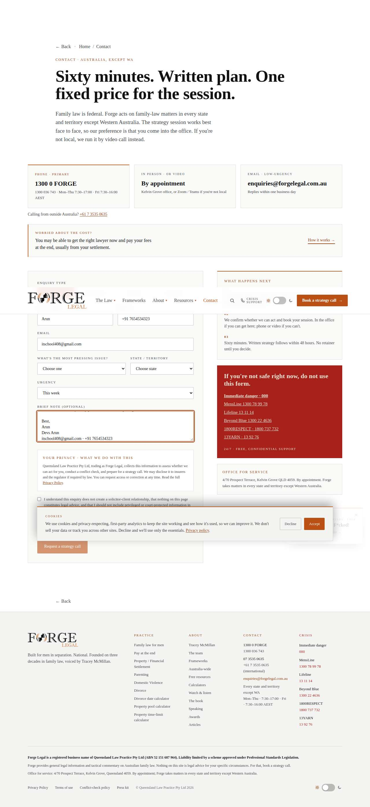

### iconlegal.com.au — unclear (LIVE)

| | |
|---|---|
| Attempt ID | `a3c991d3-1528-4a41-8d27-805323ffc46a` |
| Form URL | https://iconlegal.com.au/contact-us/ |
| Final URL | https://iconlegal.com.au/contact-us/ |
| Reserved | 2026-11-09 04:12:31 UTC |
| Submit attempted | 2026-11-09 04:12:35 UTC |
| Template | standard v2 |
| Confirmation text | none observed |
| Result / error | No new success marker observed |

Exact message:

~~~text
Subject: Helping customers find your business in AI search (AEO + GEO)

Hi there,

I'm Arun from Devs Arun. More and more customers now ask ChatGPT, Gemini, Perplexity or Google's AI Overviews questions like "who should I hire for this in my area?" before they call anyone. These tools answer from websites they can clearly understand, and they tend to recommend businesses whose pages answer real customer questions.

That is what AEO + GEO (Answer Engine and Generative Engine Optimization) is for. I improve your existing service pages so they clearly answer the questions your customers ask, add structured data that matches the page, and make the call, quote or enquiry step obvious. The benefit: your business gets a better chance of being mentioned or linked in AI answers, and visitors who arrive find it easy to contact you.

The AEO + GEO Starter is a one-time $199 (about ₹16,999, negotiable) for one website: a basic audit, 10 customer questions, improvements to two existing pages, relevant structured data and an action plan, with one revision round.

You can read the full details, send an enquiry or book online here:
https://devsarun.io/aeo-geo/

If this isn't relevant, just reply and I won't contact you again.

Best,
Arun
Devs Arun
itschool408@gmail.com · +91 7654534323
~~~

Submitted field values:

- Your Name \[name\]: Arun
- Message \[message\]: Hi there, I'm Arun from Devs Arun. More and more customers now ask ChatGPT, Gemini, Perplexity or Google's AI Overviews 
- Your Email \[email\]: itschool408@gmail.com
- Phone Number \[phone\]: +91 7654534323

**Filled form (before submit)** — `run-3969e193_attempt-a3c991d3_filled_2026-11-09T04-12-35-861Z.jpg`

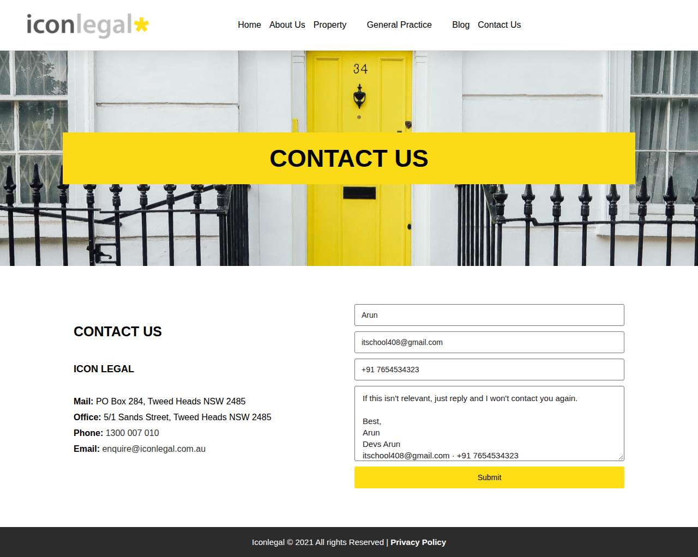

**After submit** — `run-3969e193_attempt-a3c991d3_post_attempt_2026-11-09T04-13-05-143Z.jpg`

### fuseadvisory.com — confirmed (LIVE)

| | |
|---|---|
| Attempt ID | `30c5e886-854e-4fb6-8ee3-697519f056f9` |
| Form URL | https://fuselaw.com.au/lets-talk |
| Final URL | https://fuselaw.com.au/lets-talk |
| Reserved | 2026-11-09 04:13:14 UTC |
| Submit attempted | 2026-11-09 04:13:15 UTC |
| Template | standard v2 |
| Confirmation text | Gold Coast By appointment Servicing clients Australia-wide Thanks, we’ve got your message. We’ll get back to you quickly with a clear plan. Clear advice for bold mov |
| Result / error | — |

Exact message:

~~~text
Subject: Helping customers find your business in AI search (AEO + GEO)

Hi there,

I'm Arun from Devs Arun. More and more customers now ask ChatGPT, Gemini, Perplexity or Google's AI Overviews questions like "who should I hire for this in my area?" before they call anyone. These tools answer from websites they can clearly understand, and they tend to recommend businesses whose pages answer real customer questions.

That is what AEO + GEO (Answer Engine and Generative Engine Optimization) is for. I improve your existing service pages so they clearly answer the questions your customers ask, add structured data that matches the page, and make the call, quote or enquiry step obvious. The benefit: your business gets a better chance of being mentioned or linked in AI answers, and visitors who arrive find it easy to contact you.

The AEO + GEO Starter is a one-time $199 (about ₹16,999, negotiable) for one website: a basic audit, 10 customer questions, improvements to two existing pages, relevant structured data and an action plan, with one revision round.

You can read the full details, send an enquiry or book online here:
https://devsarun.io/aeo-geo/

If this isn't relevant, just reply and I won't contact you again.

Best,
Arun
Devs Arun
itschool408@gmail.com · +91 7654534323
~~~

Submitted field values:

- Name \[name\]: Arun
- Email \[email\]: itschool408@gmail.com
- Company (optional) \[company\]: Devs Arun
- What are you working on? \[message\]: Hi there, I'm Arun from Devs Arun. More and more customers now ask ChatGPT, Gemini, Perplexity or Google's AI Overviews 

**Filled form (before submit)** — `run-3969e193_attempt-30c5e886_filled_2026-11-09T04-13-15-672Z.jpg`

**After submit** — `run-3969e193_attempt-30c5e886_post_attempt_2026-11-09T04-13-21-114Z.jpg`

### tartaglia.com.au — failed\_before\_submit (LIVE)

| | |
|---|---|
| Attempt ID | `9e01a77a-ca2f-46a1-99de-900fd936ae85` |
| Form URL | https://tartaglia.com.au/contact-us/ |
| Final URL | https://tartaglia.com.au/contact-us/ |
| Reserved | 2026-11-09 04:13:30 UTC |
| Submit attempted | — |
| Template | standard v2 |
| Confirmation text | none observed |
| Result / error | Message field altered the text (length limit?) |

Exact message:

~~~text
Subject: Helping customers find your business in AI search (AEO + GEO)

Hi there,

I'm Arun from Devs Arun. More and more customers now ask ChatGPT, Gemini, Perplexity or Google's AI Overviews questions like "who should I hire for this in my area?" before they call anyone. These tools answer from websites they can clearly understand, and they tend to recommend businesses whose pages answer real customer questions.

That is what AEO + GEO (Answer Engine and Generative Engine Optimization) is for. I improve your existing service pages so they clearly answer the questions your customers ask, add structured data that matches the page, and make the call, quote or enquiry step obvious. The benefit: your business gets a better chance of being mentioned or linked in AI answers, and visitors who arrive find it easy to contact you.

The AEO + GEO Starter is a one-time $199 (about ₹16,999, negotiable) for one website: a basic audit, 10 customer questions, improvements to two existing pages, relevant structured data and an action plan, with one revision round.

You can read the full details, send an enquiry or book online here:
https://devsarun.io/aeo-geo/

If this isn't relevant, just reply and I won't contact you again.

Best,
Arun
Devs Arun
itschool408@gmail.com · +91 7654534323
~~~

Submitted field values:

- \#wpforms-2766-field\_0: Arun
- \#wpforms-2766-field\_1: itschool408@gmail.com
- \#wpforms-2766-field\_2: Hi there, I'm Arun from Devs Arun. More and more customers now ask ChatGPT, Gemini, Perplexity or Google's AI Overviews 
- \#wpforms-2766-field\_3: Hi there, I'm Arun from Devs Arun. More and more customers now ask ChatGPT, Gemini, Perplexity or Google's AI Overviews 
- \#wpforms-2766-field\_5: +91 7654534323

**Filled form (before submit)** — `run-3969e193_attempt-9e01a77a_filled_2026-11-09T04-13-33-638Z.jpg`

### pattenrobins.com.au — error\_after\_submit (LIVE)

| | |
|---|---|
| Attempt ID | `b99583e2-7b21-4a6c-a509-977a9c2c1038` |
| Form URL | https://pattenrobins.com.au/contact/ |
| Final URL | https://pattenrobins.com.au/contact/ |
| Reserved | 2026-11-09 04:13:38 UTC |
| Submit attempted | 2026-11-09 04:13:43 UTC |
| Template | standard v2 |
| Confirmation text | Estates Commercial Litigation Other Other Detail(Required) This field is required. Your Message Submit See what we’ve been up to on social media pattenrobins Melbourne \| Bass Coast |
| Result / error | — |

Exact message:

~~~text
Subject: Helping customers find your business in AI search (AEO + GEO)

Hi there,

I'm Arun from Devs Arun. More and more customers now ask ChatGPT, Gemini, Perplexity or Google's AI Overviews questions like "who should I hire for this in my area?" before they call anyone. These tools answer from websites they can clearly understand, and they tend to recommend businesses whose pages answer real customer questions.

That is what AEO + GEO (Answer Engine and Generative Engine Optimization) is for. I improve your existing service pages so they clearly answer the questions your customers ask, add structured data that matches the page, and make the call, quote or enquiry step obvious. The benefit: your business gets a better chance of being mentioned or linked in AI answers, and visitors who arrive find it easy to contact you.

The AEO + GEO Starter is a one-time $199 (about ₹16,999, negotiable) for one website: a basic audit, 10 customer questions, improvements to two existing pages, relevant structured data and an action plan, with one revision round.

You can read the full details, send an enquiry or book online here:
https://devsarun.io/aeo-geo/

If this isn't relevant, just reply and I won't contact you again.

Best,
Arun
Devs Arun
itschool408@gmail.com · +91 7654534323
~~~

Submitted field values:

- Your Name \[name\]: Arun
- Your Message \[message\]: Hi there, I'm Arun from Devs Arun. More and more customers now ask ChatGPT, Gemini, Perplexity or Google's AI Overviews 
- Your Email(Required) \[email\]: itschool408@gmail.com
- Enquiry Type:(Required) \[fixed\]: Other

**Filled form (before submit)** — `run-3969e193_attempt-b99583e2_filled_2026-11-09T04-13-43-332Z.jpg`

**After submit** — `run-3969e193_attempt-b99583e2_post_attempt_2026-11-09T04-13-51-083Z.jpg`

### birdsey.com.au — confirmed (LIVE)

| | |
|---|---|
| Attempt ID | `4de58f2d-31d5-4e42-bdc6-7c3b4bc90a4c` |
| Form URL | https://birdsey.com.au/contact.html |
| Final URL | https://birdsey.com.au/thankyou.php |
| Reserved | 2026-11-09 04:14:00 UTC |
| Submit attempted | 2026-11-09 04:14:02 UTC |
| Template | standard v2 |
| Confirmation text | ic Location (click for larger Google Map) Enquire Thankyou, your enquiry has been sent. We will get back to your as soon as possible. © Birdsey, Dedman & Bartlett Solicitors Geelong - Wi |
| Result / error | — |

Exact message:

~~~text
Subject: Helping customers find your business in AI search (AEO + GEO)

Hi there,

I'm Arun from Devs Arun. More and more customers now ask ChatGPT, Gemini, Perplexity or Google's AI Overviews questions like "who should I hire for this in my area?" before they call anyone. These tools answer from websites they can clearly understand, and they tend to recommend businesses whose pages answer real customer questions.

That is what AEO + GEO (Answer Engine and Generative Engine Optimization) is for. I improve your existing service pages so they clearly answer the questions your customers ask, add structured data that matches the page, and make the call, quote or enquiry step obvious. The benefit: your business gets a better chance of being mentioned or linked in AI answers, and visitors who arrive find it easy to contact you.

The AEO + GEO Starter is a one-time $199 (about ₹16,999, negotiable) for one website: a basic audit, 10 customer questions, improvements to two existing pages, relevant structured data and an action plan, with one revision round.

You can read the full details, send an enquiry or book online here:
https://devsarun.io/aeo-geo/

If this isn't relevant, just reply and I won't contact you again.

Best,
Arun
Devs Arun
itschool408@gmail.com · +91 7654534323
~~~

Submitted field values:

- name \[name\]: Arun
- email \[email\]: itschool408@gmail.com
- phone \[phone\]: +91 7654534323
- request \[message\]: Hi there, I'm Arun from Devs Arun. More and more customers now ask ChatGPT, Gemini, Perplexity or Google's AI Overviews 

**Filled form (before submit)** — `run-3969e193_attempt-4de58f2d_filled_2026-11-09T04-14-02-403Z.jpg`

**After submit** — `run-3969e193_attempt-4de58f2d_post_attempt_2026-11-09T04-14-07-918Z.jpg`

### trewinnorman.com.au — error\_after\_submit (LIVE)

| | |
|---|---|
| Attempt ID | `fac74cb4-dc05-4775-b929-3d1384a2baa5` |
| Form URL | https://www.trewinnorman.com.au/contact-us |
| Final URL | https://www.trewinnorman.com.au/contact-us |
| Reserved | 2026-11-09 04:14:16 UTC |
| Submit attempted | 2026-11-09 04:14:19 UTC |
| Template | standard v2 |
| Confirmation text | rch Engines Word of Mouth Other Enquiry\* Oops, there was an error sending your message. Please try again later. Contact Us 08 9240 7722 enquiries@trewinnorman.com.au U 1 19, |
| Result / error | — |

Exact message:

~~~text
Subject: Helping customers find your business in AI search (AEO + GEO)

Hi there,

I'm Arun from Devs Arun. More and more customers now ask ChatGPT, Gemini, Perplexity or Google's AI Overviews questions like "who should I hire for this in my area?" before they call anyone. These tools answer from websites they can clearly understand, and they tend to recommend businesses whose pages answer real customer questions.

That is what AEO + GEO (Answer Engine and Generative Engine Optimization) is for. I improve your existing service pages so they clearly answer the questions your customers ask, add structured data that matches the page, and make the call, quote or enquiry step obvious. The benefit: your business gets a better chance of being mentioned or linked in AI answers, and visitors who arrive find it easy to contact you.

The AEO + GEO Starter is a one-time $199 (about ₹16,999, negotiable) for one website: a basic audit, 10 customer questions, improvements to two existing pages, relevant structured data and an action plan, with one revision round.

You can read the full details, send an enquiry or book online here:
https://devsarun.io/aeo-geo/

If this isn't relevant, just reply and I won't contact you again.

Best,
Arun
Devs Arun
itschool408@gmail.com · +91 7654534323
~~~

Submitted field values:

- Name\* \[name\]: Arun
- Phone \[phone\]: +91 7654534323
- Email\* \[email\]: itschool408@gmail.com
- Enquiry\* \[message\]: Hi there, I'm Arun from Devs Arun. More and more customers now ask ChatGPT, Gemini, Perplexity or Google's AI Overviews 

**Filled form (before submit)** — `run-3969e193_attempt-fac74cb4_filled_2026-11-09T04-14-19-549Z.jpg`

**After submit** — `run-3969e193_attempt-fac74cb4_post_attempt_2026-11-09T04-14-25-288Z.jpg`

### kcrconveyancing.com.au — failed\_before\_submit (LIVE)

| | |
|---|---|
| Attempt ID | `21dd9bff-d820-452f-beb1-9b1df58684ee` |
| Form URL | https://kcrconveyancing.com.au/ |
| Final URL | https://kcrconveyancing.com.au/ |
| Reserved | 2026-11-09 04:14:34 UTC |
| Submit attempted | — |
| Template | standard v2 |
| Confirmation text | none observed |
| Result / error | Message field altered the text (length limit?) |

Exact message:

~~~text
Subject: Helping customers find your business in AI search (AEO + GEO)

Hi there,

I'm Arun from Devs Arun. More and more customers now ask ChatGPT, Gemini, Perplexity or Google's AI Overviews questions like "who should I hire for this in my area?" before they call anyone. These tools answer from websites they can clearly understand, and they tend to recommend businesses whose pages answer real customer questions.

That is what AEO + GEO (Answer Engine and Generative Engine Optimization) is for. I improve your existing service pages so they clearly answer the questions your customers ask, add structured data that matches the page, and make the call, quote or enquiry step obvious. The benefit: your business gets a better chance of being mentioned or linked in AI answers, and visitors who arrive find it easy to contact you.

The AEO + GEO Starter is a one-time $199 (about ₹16,999, negotiable) for one website: a basic audit, 10 customer questions, improvements to two existing pages, relevant structured data and an action plan, with one revision round.

You can read the full details, send an enquiry or book online here:
https://devsarun.io/aeo-geo/

If this isn't relevant, just reply and I won't contact you again.

Best,
Arun
Devs Arun
itschool408@gmail.com · +91 7654534323
~~~

Submitted field values:

- \#form-field-field\_2e59e94: +91 7654534323
- \#form-field-field\_fb9bfe3: Hi there, I'm Arun from Devs Arun. More and more customers now ask ChatGPT, Gemini, Perplexity or Google's AI Overviews 
- div \> div \> section \> div \> div:nth-of-type(2) \> div \> div \> div \> form \> div \> div:nth-of-type(1) \> input: itschool408@gmail.com
- div \> div \> section \> div \> div:nth-of-type(2) \> div \> div \> div \> form \> div \> div:nth-of-type(2) \> input: itschool408@gmail.com

**Filled form (before submit)** — `run-3969e193_attempt-21dd9bff_filled_2026-11-09T04-14-38-295Z.jpg`

### clickvisa.com.au — error\_after\_submit (LIVE)

| | |
|---|---|
| Attempt ID | `87f17fa8-49ea-4fce-b4db-1dac4a607f5f` |
| Form URL | https://www.clickvisa.com.au/contact-us |
| Final URL | https://www.clickvisa.com.au/contact-us |
| Reserved | 2026-11-09 04:14:43 UTC |
| Submit attempted | 2026-11-09 04:14:44 UTC |
| Template | standard v2 |
| Confirmation text | pic, schedule 3 & waivers complex matters citizenship other Please enter a valid service Message SUBMIT SUBMIT INSTAGRAM FACEBOOK LINKEDIN OFFICE@CLICKVISA.COM.AU 03 9383 0 |
| Result / error | — |

Exact message:

~~~text
Subject: Helping customers find your business in AI search (AEO + GEO)

Hi there,

I'm Arun from Devs Arun. More and more customers now ask ChatGPT, Gemini, Perplexity or Google's AI Overviews questions like "who should I hire for this in my area?" before they call anyone. These tools answer from websites they can clearly understand, and they tend to recommend businesses whose pages answer real customer questions.

That is what AEO + GEO (Answer Engine and Generative Engine Optimization) is for. I improve your existing service pages so they clearly answer the questions your customers ask, add structured data that matches the page, and make the call, quote or enquiry step obvious. The benefit: your business gets a better chance of being mentioned or linked in AI answers, and visitors who arrive find it easy to contact you.

The AEO + GEO Starter is a one-time $199 (about ₹16,999, negotiable) for one website: a basic audit, 10 customer questions, improvements to two existing pages, relevant structured data and an action plan, with one revision round.

You can read the full details, send an enquiry or book online here:
https://devsarun.io/aeo-geo/

If this isn't relevant, just reply and I won't contact you again.

Best,
Arun
Devs Arun
itschool408@gmail.com · +91 7654534323
~~~

Submitted field values:

- Your Name \[name\]: Arun
- Message \[message\]: Hi there, I'm Arun from Devs Arun. More and more customers now ask ChatGPT, Gemini, Perplexity or Google's AI Overviews 
- Email Address \[email\]: itschool408@gmail.com
- You can call me on \[phone\]: +91 7654534323

**Filled form (before submit)** — `run-3969e193_attempt-87f17fa8_filled_2026-11-09T04-14-44-526Z.jpg`

**After submit** — `run-3969e193_attempt-87f17fa8_post_attempt_2026-11-09T04-14-49-257Z.jpg`

### leadconveyancing.com.au — error\_after\_submit (LIVE)

| | |
|---|---|
| Attempt ID | `fb9d13dc-9579-479a-803e-470c5a17c275` |
| Form URL | https://leadconveyancing.com.au/contact-us/ |
| Final URL | https://leadconveyancing.com.au/contact-us/ |
| Reserved | 2026-11-09 04:14:58 UTC |
| Submit attempted | 2026-11-09 04:15:01 UTC |
| Template | standard v2 |
| Confirmation text | none observed |
| Result / error | Submit click error (outcome unknown, not retried): locator.click: Timeout 10000ms exceeded. |

Exact message:

~~~text
Subject: Helping customers find your business in AI search (AEO + GEO)

Hi there,

I'm Arun from Devs Arun. More and more customers now ask ChatGPT, Gemini, Perplexity or Google's AI Overviews questions like "who should I hire for this in my area?" before they call anyone. These tools answer from websites they can clearly understand, and they tend to recommend businesses whose pages answer real customer questions.

That is what AEO + GEO (Answer Engine and Generative Engine Optimization) is for. I improve your existing service pages so they clearly answer the questions your customers ask, add structured data that matches the page, and make the call, quote or enquiry step obvious. The benefit: your business gets a better chance of being mentioned or linked in AI answers, and visitors who arrive find it easy to contact you.

The AEO + GEO Starter is a one-time $199 (about ₹16,999, negotiable) for one website: a basic audit, 10 customer questions, improvements to two existing pages, relevant structured data and an action plan, with one revision round.

You can read the full details, send an enquiry or book online here:
https://devsarun.io/aeo-geo/

If this isn't relevant, just reply and I won't contact you again.

Best,
Arun
Devs Arun
itschool408@gmail.com · +91 7654534323
~~~

Submitted field values:

- Name\* \[name\]: Arun
- Email\* \[email\]: itschool408@gmail.com
- Phone\* \[phone\]: +91 7654534323
- Comment or Message \[message\]: Hi there, I'm Arun from Devs Arun. More and more customers now ask ChatGPT, Gemini, Perplexity or Google's AI Overviews 

**Filled form (before submit)** — `run-3969e193_attempt-fb9d13dc_filled_2026-11-09T04-15-01-863Z.jpg`

**After submit** — `run-3969e193_attempt-fb9d13dc_post_attempt_2026-11-09T04-15-15-900Z.jpg`

### mprcasino.com.au — error\_after\_submit (LIVE)

| | |
|---|---|
| Attempt ID | `7d87cdff-80dd-4e3e-877c-07e0ec17e3af` |
| Form URL | https://www.mprsolicitors.com.au/contact |
| Final URL | https://www.mprsolicitors.com.au/contact |
| Reserved | 2026-11-09 04:15:24 UTC |
| Submit attempted | 2026-11-09 04:15:28 UTC |
| Template | standard v2 |
| Confirmation text | o arrange a consultation. Get In Touch First name Last name This field is required Email Phone Message Contact Us Casino Location 143 Barker St, Casino NSW 2470 Phone 02 6662 1522 Em |
| Result / error | — |

Exact message:

~~~text
Subject: Helping customers find your business in AI search (AEO + GEO)

Hi there,

I'm Arun from Devs Arun. More and more customers now ask ChatGPT, Gemini, Perplexity or Google's AI Overviews questions like "who should I hire for this in my area?" before they call anyone. These tools answer from websites they can clearly understand, and they tend to recommend businesses whose pages answer real customer questions.

That is what AEO + GEO (Answer Engine and Generative Engine Optimization) is for. I improve your existing service pages so they clearly answer the questions your customers ask, add structured data that matches the page, and make the call, quote or enquiry step obvious. The benefit: your business gets a better chance of being mentioned or linked in AI answers, and visitors who arrive find it easy to contact you.

The AEO + GEO Starter is a one-time $199 (about ₹16,999, negotiable) for one website: a basic audit, 10 customer questions, improvements to two existing pages, relevant structured data and an action plan, with one revision round.

You can read the full details, send an enquiry or book online here:
https://devsarun.io/aeo-geo/

If this isn't relevant, just reply and I won't contact you again.

Best,
Arun
Devs Arun
itschool408@gmail.com · +91 7654534323
~~~

Submitted field values:

- Email \[email\]: itschool408@gmail.com
- Phone \[phone\]: +91 7654534323
- Message \[message\]: Hi there, I'm Arun from Devs Arun. More and more customers now ask ChatGPT, Gemini, Perplexity or Google's AI Overviews 
- First name \[first\_name\]: Arun

**Filled form (before submit)** — `run-3969e193_attempt-7d87cdff_filled_2026-11-09T04-15-28-701Z.jpg`

**After submit** — `run-3969e193_attempt-7d87cdff_post_attempt_2026-11-09T04-15-33-710Z.jpg`

### whiteolivecpa.com — failed\_before\_submit (LIVE)

| | |
|---|---|
| Attempt ID | `fda0b5fc-ab56-4112-9ab4-e01fb995a534` |
| Form URL | https://whiteolivecpa.com/contact/ |
| Final URL | — |
| Reserved | 2026-11-09 04:15:43 UTC |
| Submit attempted | — |
| Template | standard v2 |
| Confirmation text | none observed |
| Result / error | locator.fill: Error: Cannot type text into input\[type=number\] |

Exact message:

~~~text
Subject: Helping customers find your business in AI search (AEO + GEO)

Hi there,

I'm Arun from Devs Arun. More and more customers now ask ChatGPT, Gemini, Perplexity or Google's AI Overviews questions like "who should I hire for this in my area?" before they call anyone. These tools answer from websites they can clearly understand, and they tend to recommend businesses whose pages answer real customer questions.

That is what AEO + GEO (Answer Engine and Generative Engine Optimization) is for. I improve your existing service pages so they clearly answer the questions your customers ask, add structured data that matches the page, and make the call, quote or enquiry step obvious. The benefit: your business gets a better chance of being mentioned or linked in AI answers, and visitors who arrive find it easy to contact you.

The AEO + GEO Starter is a one-time $199 (about ₹16,999, negotiable) for one website: a basic audit, 10 customer questions, improvements to two existing pages, relevant structured data and an action plan, with one revision round.

You can read the full details, send an enquiry or book online here:
https://devsarun.io/aeo-geo/

If this isn't relevant, just reply and I won't contact you again.

Best,
Arun
Devs Arun
itschool408@gmail.com · +91 7654534323
~~~

Submitted field values:

- \#ff\_1\_email: itschool408@gmail.com
- \#ff\_1\_message: Hi there, I'm Arun from Devs Arun. More and more customers now ask ChatGPT, Gemini, Perplexity or Google's AI Overviews 
- \#ff\_1\_numeric\_field: +91 7654534323
- \#ff\_1\_names\_first\_name\_: Arun

**Inspected page** — `run-3969e193_attempt-fda0b5fc_inspection_2026-11-09T04-15-44-713Z.jpg`

### canterburyadvisor.com — failed\_before\_submit (LIVE)

| | |
|---|---|
| Attempt ID | `c9604f9c-60e9-495e-8b94-5762993149ca` |
| Form URL | https://canterburyadvisor.com/ |
| Final URL | — |
| Reserved | 2026-11-09 04:15:49 UTC |
| Submit attempted | — |
| Template | standard v2 |
| Confirmation text | none observed |
| Result / error | locator.fill: Error: Cannot type text into input\[type=number\] |

Exact message:

~~~text
Subject: Helping customers find your business in AI search (AEO + GEO)

Hi there,

I'm Arun from Devs Arun. More and more customers now ask ChatGPT, Gemini, Perplexity or Google's AI Overviews questions like "who should I hire for this in my area?" before they call anyone. These tools answer from websites they can clearly understand, and they tend to recommend businesses whose pages answer real customer questions.

That is what AEO + GEO (Answer Engine and Generative Engine Optimization) is for. I improve your existing service pages so they clearly answer the questions your customers ask, add structured data that matches the page, and make the call, quote or enquiry step obvious. The benefit: your business gets a better chance of being mentioned or linked in AI answers, and visitors who arrive find it easy to contact you.

The AEO + GEO Starter is a one-time $199 (about ₹16,999, negotiable) for one website: a basic audit, 10 customer questions, improvements to two existing pages, relevant structured data and an action plan, with one revision round.

You can read the full details, send an enquiry or book online here:
https://devsarun.io/aeo-geo/

If this isn't relevant, just reply and I won't contact you again.

Best,
Arun
Devs Arun
itschool408@gmail.com · +91 7654534323
~~~

Submitted field values:

- \#form-field-name: Arun
- \#form-field-email: itschool408@gmail.com
- \#form-field-message: Hi there, I'm Arun from Devs Arun. More and more customers now ask ChatGPT, Gemini, Perplexity or Google's AI Overviews 
- \#form-field-field\_97f81fb: +91 7654534323

**Inspected page** — `run-3969e193_attempt-c9604f9c_inspection_2026-11-09T04-15-53-304Z.jpg`

### connectionzpcrepair.com — failed\_before\_submit (LIVE)

| | |
|---|---|
| Attempt ID | `ae5de96b-d3ef-4fed-b18b-9281888b43fa` |
| Form URL | https://connectionzpcrepair.com/contact/ |
| Final URL | — |
| Reserved | 2026-11-09 04:15:58 UTC |
| Submit attempted | — |
| Template | standard v2 |
| Confirmation text | none observed |
| Result / error | locator.fill: Error: Cannot type text into input\[type=number\] |

Exact message:

~~~text
Subject: Helping customers find your business in AI search (AEO + GEO)

Hi there,

I'm Arun from Devs Arun. More and more customers now ask ChatGPT, Gemini, Perplexity or Google's AI Overviews questions like "who should I hire for this in my area?" before they call anyone. These tools answer from websites they can clearly understand, and they tend to recommend businesses whose pages answer real customer questions.

That is what AEO + GEO (Answer Engine and Generative Engine Optimization) is for. I improve your existing service pages so they clearly answer the questions your customers ask, add structured data that matches the page, and make the call, quote or enquiry step obvious. The benefit: your business gets a better chance of being mentioned or linked in AI answers, and visitors who arrive find it easy to contact you.

The AEO + GEO Starter is a one-time $199 (about ₹16,999, negotiable) for one website: a basic audit, 10 customer questions, improvements to two existing pages, relevant structured data and an action plan, with one revision round.

You can read the full details, send an enquiry or book online here:
https://devsarun.io/aeo-geo/

If this isn't relevant, just reply and I won't contact you again.

Best,
Arun
Devs Arun
itschool408@gmail.com · +91 7654534323
~~~

Submitted field values:

- \#form-field-name: Arun
- \#form-field-email: itschool408@gmail.com
- \#form-field-message: Hi there, I'm Arun from Devs Arun. More and more customers now ask ChatGPT, Gemini, Perplexity or Google's AI Overviews 
- \#form-field-field\_99a8620: +91 7654534323

**Inspected page** — `run-3969e193_attempt-ae5de96b_inspection_2026-11-09T04-16-00-768Z.jpg`

### ackavionics.com — failed\_before\_submit (LIVE)

| | |
|---|---|
| Attempt ID | `fa0f565a-2812-423a-9ad5-b19de2b0993e` |
| Form URL | https://www.ackavionics.com/contact-us-2/ |
| Final URL | — |
| Reserved | 2026-11-09 04:16:05 UTC |
| Submit attempted | — |
| Template | standard v2 |
| Confirmation text | none observed |
| Result / error | locator.fill: Error: Cannot type text into input\[type=number\] |

Exact message:

~~~text
Subject: Helping customers find your business in AI search (AEO + GEO)

Hi there,

I'm Arun from Devs Arun. More and more customers now ask ChatGPT, Gemini, Perplexity or Google's AI Overviews questions like "who should I hire for this in my area?" before they call anyone. These tools answer from websites they can clearly understand, and they tend to recommend businesses whose pages answer real customer questions.

That is what AEO + GEO (Answer Engine and Generative Engine Optimization) is for. I improve your existing service pages so they clearly answer the questions your customers ask, add structured data that matches the page, and make the call, quote or enquiry step obvious. The benefit: your business gets a better chance of being mentioned or linked in AI answers, and visitors who arrive find it easy to contact you.

The AEO + GEO Starter is a one-time $199 (about ₹16,999, negotiable) for one website: a basic audit, 10 customer questions, improvements to two existing pages, relevant structured data and an action plan, with one revision round.

You can read the full details, send an enquiry or book online here:
https://devsarun.io/aeo-geo/

If this isn't relevant, just reply and I won't contact you again.

Best,
Arun
Devs Arun
itschool408@gmail.com · +91 7654534323
~~~

Submitted field values:

- input\[name="text-30"\]: Arun
- input\[name="email-380"\]: itschool408@gmail.com
- input\[name="number-19"\]: +91 7654534323
- textarea\[name="textarea"\]: Hi there, I'm Arun from Devs Arun. More and more customers now ask ChatGPT, Gemini, Perplexity or Google's AI Overviews 

**Inspected page** — `run-3969e193_attempt-fa0f565a_inspection_2026-11-09T04-16-07-734Z.jpg`

## Events (315)

| Time (UTC) | Event | Website | Details |
|---|---|---|---|
| 03:59:21 | run\_queued | — | live run requested by github:itsDevsArun |
| 03:59:21 | run\_dispatched | — | dispatch disabled (local test mode) |
| 03:59:26 | run\_started | — | Runner claimed live run |
| 03:59:27 | offer\_verified | — | Service page offer facts verified |
| 03:59:27 | website\_selected | clearchoiceplumbingllc.com | Live target clearchoiceplumbingllc.com |
| 03:59:27 | attempt\_reserved | clearchoiceplumbingllc.com | Submission attempt reserved with template standard v2 |
| 03:59:29 | page\_opened | clearchoiceplumbingllc.com | Opened form page |
| 03:59:29 | screenshot\_saved | clearchoiceplumbingllc.com | inspection screenshot saved (145 KB) |
| 03:59:29 | review\_required | clearchoiceplumbingllc.com | failed before submit: locator.fill: Error: Cannot type text into input\[type=number\] |
| 03:59:34 | website\_selected | bwnwincpainting.com | Live target bwnwincpainting.com |
| 03:59:34 | attempt\_reserved | bwnwincpainting.com | Submission attempt reserved with template standard v2 |
| 03:59:36 | page\_opened | bwnwincpainting.com | Opened form page |
| 03:59:36 | screenshot\_saved | bwnwincpainting.com | inspection screenshot saved (118 KB) |
| 03:59:36 | review\_required | bwnwincpainting.com | failed before submit: locator.fill: Error: Cannot type text into input\[type=number\] |
| 03:59:41 | website\_selected | smjcabinets.com | Live target smjcabinets.com |
| 03:59:41 | attempt\_reserved | smjcabinets.com | Submission attempt reserved with template standard v2 |
| 03:59:42 | page\_opened | smjcabinets.com | Opened form page |
| 03:59:43 | fields\_filled | smjcabinets.com | filled |
| 03:59:43 | screenshot\_saved | smjcabinets.com | filled screenshot saved (130 KB) |
| 03:59:43 | submit\_attempted | smjcabinets.com | submitting |
| 03:59:49 | screenshot\_saved | smjcabinets.com | post\_attempt screenshot saved (133 KB) |
| 03:59:49 | error | smjcabinets.com | error after submit — "Contact Us Name: Email: Phone: Message: Oops, there was an error sending your message. Please try again later Create Cus" |
| 03:59:58 | website\_selected | absoluterestorepa.com | Live target absoluterestorepa.com |
| 03:59:58 | attempt\_reserved | absoluterestorepa.com | Submission attempt reserved with template standard v2 |
| 04:00:01 | page\_opened | absoluterestorepa.com | Opened form page |
| 04:00:01 | screenshot\_saved | absoluterestorepa.com | inspection screenshot saved (175 KB) |
| 04:00:01 | review\_required | absoluterestorepa.com | failed before submit: locator.fill: Error: Cannot type text into input\[type=number\] |
| 04:00:06 | website\_selected | goldcoastpatios.com.au | Live target goldcoastpatios.com.au |
| 04:00:06 | attempt\_reserved | goldcoastpatios.com.au | Submission attempt reserved with template standard v2 |
| 04:00:14 | page\_opened | goldcoastpatios.com.au | Opened form page |
| 04:00:15 | fields\_filled | goldcoastpatios.com.au | filled |
| 04:00:15 | screenshot\_saved | goldcoastpatios.com.au | filled screenshot saved (194 KB) |
| 04:00:15 | submit\_attempted | goldcoastpatios.com.au | submitting |
| 04:00:24 | screenshot\_saved | goldcoastpatios.com.au | post\_attempt screenshot saved (441 KB) |
| 04:00:24 | confirmation\_observed | goldcoastpatios.com.au | confirmed — "Range About Us FAQ’s Testimonials News Contact 07 5539 6688 Thank You Thanks for sending through an enquiry, one of our " |
| 04:00:33 | website\_selected | mehrtensunderpinning.com.au | Live target mehrtensunderpinning.com.au |
| 04:00:33 | attempt\_reserved | mehrtensunderpinning.com.au | Submission attempt reserved with template standard v2 |
| 04:00:38 | page\_opened | mehrtensunderpinning.com.au | Opened form page |
| 04:00:38 | fields\_filled | mehrtensunderpinning.com.au | filled |
| 04:00:38 | screenshot\_saved | mehrtensunderpinning.com.au | filled screenshot saved (414 KB) |
| 04:00:38 | submit\_attempted | mehrtensunderpinning.com.au | submitting |
| 04:00:51 | screenshot\_saved | mehrtensunderpinning.com.au | post\_attempt screenshot saved (471 KB) |
| 04:00:51 | confirmation\_observed | mehrtensunderpinning.com.au | confirmed — "D, 4214 Email: admin@mehrtens.com.au Phone: (07) 55 924 893 Thank you for your message. It has been sent. Your Name (req" |
| 04:01:00 | website\_selected | streamlinehomes.com.au | Live target streamlinehomes.com.au |
| 04:01:00 | attempt\_reserved | streamlinehomes.com.au | Submission attempt reserved with template standard v2 |
| 04:01:06 | page\_opened | streamlinehomes.com.au | Opened form page |
| 04:01:06 | fields\_filled | streamlinehomes.com.au | filled |
| 04:01:06 | screenshot\_saved | streamlinehomes.com.au | filled screenshot saved (114 KB) |
| 04:01:06 | submit\_attempted | streamlinehomes.com.au | submitting |
| 04:01:12 | screenshot\_saved | streamlinehomes.com.au | post\_attempt screenshot saved (102 KB) |
| 04:01:12 | confirmation\_observed | streamlinehomes.com.au | confirmed — "CONTACT US Thank you for your message. It has been sent. CONTACT Contact: Jackie Grozdanovski Phone: 0419 106 486 (Offic" |
| 04:01:21 | website\_selected | quickpickmovers.com.au | Live target quickpickmovers.com.au |
| 04:01:21 | attempt\_reserved | quickpickmovers.com.au | Submission attempt reserved with template standard v2 |
| 04:01:23 | page\_opened | quickpickmovers.com.au | Opened form page |
| 04:01:23 | fields\_filled | quickpickmovers.com.au | filled |
| 04:01:23 | screenshot\_saved | quickpickmovers.com.au | filled screenshot saved (258 KB) |
| 04:01:23 | submit\_attempted | quickpickmovers.com.au | submitting |
| 04:01:31 | screenshot\_saved | quickpickmovers.com.au | post\_attempt screenshot saved (134 KB) |
| 04:01:31 | confirmation\_observed | quickpickmovers.com.au | confirmed — "moval Services Service Areas Cost Blog Contact FREE QUOTE ✓ MESSAGE RECEIVED Thank you for getting in touch We’ve receiv" |
| 04:01:41 | website\_selected | vicpalmerremovals.com.au | Live target vicpalmerremovals.com.au |
| 04:01:41 | attempt\_reserved | vicpalmerremovals.com.au | Submission attempt reserved with template standard v2 |
| 04:01:45 | page\_opened | vicpalmerremovals.com.au | Opened form page |
| 04:01:45 | fields\_filled | vicpalmerremovals.com.au | filled |
| 04:01:45 | screenshot\_saved | vicpalmerremovals.com.au | filled screenshot saved (127 KB) |
| 04:01:45 | submit\_attempted | vicpalmerremovals.com.au | submitting |
| 04:02:15 | screenshot\_saved | vicpalmerremovals.com.au | post\_attempt screenshot saved (130 KB) |
| 04:02:15 | review\_required | vicpalmerremovals.com.au | unclear: No new success marker observed |
| 04:02:24 | website\_selected | extracareremovals.com.au | Live target extracareremovals.com.au |
| 04:02:24 | attempt\_reserved | extracareremovals.com.au | Submission attempt reserved with template standard v2 |
| 04:02:29 | page\_opened | extracareremovals.com.au | Opened form page |
| 04:02:29 | fields\_filled | extracareremovals.com.au | filled |
| 04:02:29 | screenshot\_saved | extracareremovals.com.au | filled screenshot saved (92 KB) |
| 04:02:29 | submit\_attempted | extracareremovals.com.au | submitting |
| 04:03:07 | screenshot\_saved | extracareremovals.com.au | post\_attempt screenshot saved (111 KB) |
| 04:03:07 | review\_required | extracareremovals.com.au | unclear: No new success marker observed |
| 04:03:16 | website\_selected | smallloadremovalist.com.au | Live target smallloadremovalist.com.au |
| 04:03:16 | attempt\_reserved | smallloadremovalist.com.au | Submission attempt reserved with template standard v2 |
| 04:03:18 | page\_opened | smallloadremovalist.com.au | Opened form page |
| 04:03:19 | fields\_filled | smallloadremovalist.com.au | filled |
| 04:03:19 | screenshot\_saved | smallloadremovalist.com.au | filled screenshot saved (449 KB) |
| 04:03:19 | submit\_attempted | smallloadremovalist.com.au | submitting |
| 04:03:48 | screenshot\_saved | smallloadremovalist.com.au | post\_attempt screenshot saved (318 KB) |
| 04:03:48 | review\_required | smallloadremovalist.com.au | unclear: No new success marker observed |
| 04:03:58 | website\_selected | igniteremovals.com.au | Live target igniteremovals.com.au |
| 04:03:58 | attempt\_reserved | igniteremovals.com.au | Submission attempt reserved with template standard v2 |
| 04:04:03 | page\_opened | igniteremovals.com.au | Opened form page |
| 04:04:03 | fields\_filled | igniteremovals.com.au | filled |
| 04:04:03 | screenshot\_saved | igniteremovals.com.au | filled screenshot saved (293 KB) |
| 04:04:03 | submit\_attempted | igniteremovals.com.au | submitting |
| 04:04:41 | screenshot\_saved | igniteremovals.com.au | post\_attempt screenshot saved (293 KB) |
| 04:04:41 | review\_required | igniteremovals.com.au | unclear: No new success marker observed |
| 04:04:50 | website\_selected | masoudlawfirm.com | Live target masoudlawfirm.com |
| 04:04:50 | attempt\_reserved | masoudlawfirm.com | Submission attempt reserved with template standard v2 |
| 04:04:54 | page\_opened | masoudlawfirm.com | Opened form page |
| 04:04:54 | screenshot\_saved | masoudlawfirm.com | inspection screenshot saved (168 KB) |
| 04:04:54 | review\_required | masoudlawfirm.com | failed before submit: locator.fill: Error: Cannot type text into input\[type=number\] |
| 04:04:59 | website\_selected | gotocourt.com.au | Live target gotocourt.com.au |
| 04:04:59 | attempt\_reserved | gotocourt.com.au | Submission attempt reserved with template standard v2 |
| 04:05:00 | page\_opened | gotocourt.com.au | Opened form page |
| 04:05:00 | fields\_filled | gotocourt.com.au | filled |
| 04:05:00 | screenshot\_saved | gotocourt.com.au | filled screenshot saved (165 KB) |
| 04:05:00 | submit\_attempted | gotocourt.com.au | submitting |
| 04:05:30 | screenshot\_saved | gotocourt.com.au | post\_attempt screenshot saved (15 KB) |
| 04:05:30 | review\_required | gotocourt.com.au | unclear: No new success marker observed |
| 04:05:39 | website\_selected | ppconvey.com.au | Live target ppconvey.com.au |
| 04:05:39 | attempt\_reserved | ppconvey.com.au | Submission attempt reserved with template standard v2 |
| 04:05:42 | page\_opened | ppconvey.com.au | Opened form page |
| 04:05:42 | fields\_filled | ppconvey.com.au | filled |
| 04:05:42 | screenshot\_saved | ppconvey.com.au | filled screenshot saved (177 KB) |
| 04:05:42 | submit\_attempted | ppconvey.com.au | submitting |
| 04:06:13 | screenshot\_saved | ppconvey.com.au | post\_attempt screenshot saved (170 KB) |
| 04:06:13 | review\_required | ppconvey.com.au | unclear: No new success marker observed |
| 04:06:22 | website\_selected | alrm.org.au | Live target alrm.org.au |
| 04:06:22 | attempt\_reserved | alrm.org.au | Submission attempt reserved with template standard v2 |
| 04:06:26 | page\_opened | alrm.org.au | Opened form page |
| 04:06:26 | screenshot\_saved | alrm.org.au | inspection screenshot saved (102 KB) |
| 04:06:26 | review\_required | alrm.org.au | failed before submit: locator.fill: Error: Cannot type text into input\[type=number\] |
| 04:06:31 | website\_selected | accesslaw.biz | Live target accesslaw.biz |
| 04:06:31 | attempt\_reserved | accesslaw.biz | Submission attempt reserved with template standard v2 |
| 04:06:35 | page\_opened | accesslaw.biz | Opened form page |
| 04:06:35 | fields\_filled | accesslaw.biz | filled |
| 04:06:35 | screenshot\_saved | accesslaw.biz | filled screenshot saved (95 KB) |
| 04:06:35 | submit\_attempted | accesslaw.biz | submitting |
| 04:06:41 | screenshot\_saved | accesslaw.biz | post\_attempt screenshot saved (77 KB) |
| 04:06:41 | confirmation\_observed | accesslaw.biz | confirmed — "dress PO Box 231 BRUNSWICK VIC 3056 Phone (03) 03 9381 4994 Thank you for your message. It has been sent. Name (required" |
| 04:06:50 | website\_selected | munrodoig.com.au | Live target munrodoig.com.au |
| 04:06:50 | attempt\_reserved | munrodoig.com.au | Submission attempt reserved with template standard v2 |
| 04:06:56 | page\_opened | munrodoig.com.au | Opened form page |
| 04:06:56 | fields\_filled | munrodoig.com.au | filled |
| 04:06:56 | screenshot\_saved | munrodoig.com.au | filled screenshot saved (143 KB) |
| 04:06:56 | submit\_attempted | munrodoig.com.au | submitting |
| 04:07:29 | screenshot\_saved | munrodoig.com.au | post\_attempt screenshot saved (153 KB) |
| 04:07:29 | review\_required | munrodoig.com.au | unclear: No new success marker observed |
| 04:07:39 | website\_selected | elvinlawyers.com.au | Live target elvinlawyers.com.au |
| 04:07:39 | attempt\_reserved | elvinlawyers.com.au | Submission attempt reserved with template standard v2 |
| 04:07:42 | page\_opened | elvinlawyers.com.au | Opened form page |
| 04:07:42 | fields\_filled | elvinlawyers.com.au | filled |
| 04:07:42 | screenshot\_saved | elvinlawyers.com.au | filled screenshot saved (185 KB) |
| 04:07:42 | submit\_attempted | elvinlawyers.com.au | submitting |
| 04:07:53 | screenshot\_saved | elvinlawyers.com.au | post\_attempt screenshot saved (175 KB) |
| 04:07:53 | confirmation\_observed | elvinlawyers.com.au | confirmed — "to you within 1 business day – but usually within 3 hours) Form submitted successfully. A confirmation email was sent to" |
| 04:08:02 | website\_selected | cannlegal.com.au | Live target cannlegal.com.au |
| 04:08:02 | attempt\_reserved | cannlegal.com.au | Submission attempt reserved with template standard v2 |
| 04:08:09 | page\_opened | cannlegal.com.au | Opened form page |
| 04:08:09 | fields\_filled | cannlegal.com.au | filled |
| 04:08:09 | screenshot\_saved | cannlegal.com.au | filled screenshot saved (103 KB) |
| 04:08:09 | submit\_attempted | cannlegal.com.au | submitting |
| 04:08:38 | screenshot\_saved | cannlegal.com.au | post\_attempt screenshot saved (109 KB) |
| 04:08:38 | review\_required | cannlegal.com.au | unclear: No new success marker observed |
| 04:08:47 | website\_selected | splawyerssg.com.au | Live target splawyerssg.com.au |
| 04:08:47 | attempt\_reserved | splawyerssg.com.au | Submission attempt reserved with template standard v2 |
| 04:08:53 | page\_opened | splawyerssg.com.au | Opened form page |
| 04:08:53 | fields\_filled | splawyerssg.com.au | filled |
| 04:08:53 | screenshot\_saved | splawyerssg.com.au | filled screenshot saved (126 KB) |
| 04:08:54 | submit\_attempted | splawyerssg.com.au | submitting |
| 04:09:06 | screenshot\_saved | splawyerssg.com.au | post\_attempt screenshot saved (124 KB) |
| 04:09:06 | confirmation\_observed | splawyerssg.com.au | confirmed — "any questions, concerns or inquiries. Our Office Locations Thank you for your message. It has been sent. Your name Your " |
| 04:09:15 | website\_selected | caraccidentlawyersperth.com.au | Live target caraccidentlawyersperth.com.au |
| 04:09:15 | attempt\_reserved | caraccidentlawyersperth.com.au | Submission attempt reserved with template standard v2 |
| 04:09:20 | page\_opened | caraccidentlawyersperth.com.au | Opened form page |
| 04:09:20 | fields\_filled | caraccidentlawyersperth.com.au | filled |
| 04:09:20 | screenshot\_saved | caraccidentlawyersperth.com.au | filled screenshot saved (141 KB) |
| 04:09:20 | submit\_attempted | caraccidentlawyersperth.com.au | submitting |
| 04:09:57 | screenshot\_saved | caraccidentlawyersperth.com.au | post\_attempt screenshot saved (105 KB) |
| 04:09:57 | review\_required | caraccidentlawyersperth.com.au | unclear: No new success marker observed |
| 04:10:07 | website\_selected | ownitconveyancing.com | Live target ownitconveyancing.com |
| 04:10:07 | attempt\_reserved | ownitconveyancing.com | Submission attempt reserved with template standard v2 |
| 04:10:10 | page\_opened | ownitconveyancing.com | Opened form page |
| 04:10:10 | fields\_filled | ownitconveyancing.com | filled |
| 04:10:10 | screenshot\_saved | ownitconveyancing.com | filled screenshot saved (244 KB) |
| 04:10:10 | submit\_attempted | ownitconveyancing.com | submitting |
| 04:10:15 | screenshot\_saved | ownitconveyancing.com | post\_attempt screenshot saved (255 KB) |
| 04:10:15 | error | ownitconveyancing.com | error after submit — "you New Customer Existing Customer Real Estate Agent Other This field is required. First name\* Last name\* This field is " |
| 04:10:24 | website\_selected | jht.com.au | Live target jht.com.au |
| 04:10:24 | attempt\_reserved | jht.com.au | Submission attempt reserved with template standard v2 |
| 04:10:28 | page\_opened | jht.com.au | Opened form page |
| 04:10:28 | fields\_filled | jht.com.au | filled |
| 04:10:28 | screenshot\_saved | jht.com.au | filled screenshot saved (75 KB) |
| 04:10:28 | submit\_attempted | jht.com.au | submitting |
| 04:10:36 | screenshot\_saved | jht.com.au | post\_attempt screenshot saved (65 KB) |
| 04:10:36 | confirmation\_observed | jht.com.au | confirmed — "Keyboard shortcuts Map data ©2026 Google Terms Enquiry Form Thank you. Form submitted successfully. We will respond prom" |
| 04:10:45 | website\_selected | baxterssolicitors.com.au | Live target baxterssolicitors.com.au |
| 04:10:45 | attempt\_reserved | baxterssolicitors.com.au | Submission attempt reserved with template standard v2 |
| 04:10:50 | page\_opened | baxterssolicitors.com.au | Opened form page |
| 04:10:50 | fields\_filled | baxterssolicitors.com.au | filled |
| 04:10:50 | screenshot\_saved | baxterssolicitors.com.au | filled screenshot saved (98 KB) |
| 04:10:50 | submit\_attempted | baxterssolicitors.com.au | submitting |
| 04:10:55 | screenshot\_saved | baxterssolicitors.com.au | post\_attempt screenshot saved (98 KB) |
| 04:10:55 | confirmation\_observed | baxterssolicitors.com.au | confirmed — "n touch with our friendly team today via the form below and we will get back to you as soon as possible. You can also gi" |
| 04:11:04 | website\_selected | littletonhackford.com.au | Live target littletonhackford.com.au |
| 04:11:04 | attempt\_reserved | littletonhackford.com.au | Submission attempt reserved with template standard v2 |
| 04:11:07 | page\_opened | littletonhackford.com.au | Opened form page |
| 04:11:07 | fields\_filled | littletonhackford.com.au | filled |
| 04:11:07 | screenshot\_saved | littletonhackford.com.au | filled screenshot saved (154 KB) |
| 04:11:07 | submit\_attempted | littletonhackford.com.au | submitting |
| 04:11:33 | screenshot\_saved | littletonhackford.com.au | post\_attempt screenshot saved (66 KB) |
| 04:11:33 | error | littletonhackford.com.au | error after submit: Submit click error (outcome unknown, not retried): locator.click: Timeout 10000ms exceeded. |
| 04:11:42 | website\_selected | bazylegal.com.au | Live target bazylegal.com.au |
| 04:11:42 | attempt\_reserved | bazylegal.com.au | Submission attempt reserved with template standard v2 |
| 04:11:45 | page\_opened | bazylegal.com.au | Opened form page |
| 04:11:45 | screenshot\_saved | bazylegal.com.au | inspection screenshot saved (28 KB) |
| 04:11:45 | review\_required | bazylegal.com.au | failed before submit: Reviewed form not found on page (site changed) |
| 04:11:50 | website\_selected | easternlegal.com.au | Live target easternlegal.com.au |
| 04:11:50 | attempt\_reserved | easternlegal.com.au | Submission attempt reserved with template standard v2 |
| 04:11:52 | page\_opened | easternlegal.com.au | Opened form page |
| 04:11:52 | screenshot\_saved | easternlegal.com.au | filled screenshot saved (137 KB) |
| 04:11:52 | review\_required | easternlegal.com.au | failed before submit: Form validation would block sending: phone: Please enter between 4 to 17 digits. You can include hyphens (-) or start with a (+), e.g., 555-123-4567 or +(222)987654321. |
| 04:11:57 | website\_selected | cdlawyers.com.au | Live target cdlawyers.com.au |
| 04:11:57 | attempt\_reserved | cdlawyers.com.au | Submission attempt reserved with template standard v2 |
| 04:12:00 | page\_opened | cdlawyers.com.au | Opened form page |
| 04:12:00 | screenshot\_saved | cdlawyers.com.au | filled screenshot saved (147 KB) |
| 04:12:00 | review\_required | cdlawyers.com.au | failed before submit: Form validation would block sending: phone: Please enter between 4 to 17 digits. You can include hyphens (-) or start with a (+), e.g., 555-123-4567 or +(222)987654321. |
| 04:12:05 | website\_selected | forgelegal.net | Live target forgelegal.net |
| 04:12:05 | attempt\_reserved | forgelegal.net | Submission attempt reserved with template standard v2 |
| 04:12:07 | page\_opened | forgelegal.net | Opened form page |
| 04:12:07 | fields\_filled | forgelegal.net | filled |
| 04:12:08 | screenshot\_saved | forgelegal.net | filled screenshot saved (203 KB) |
| 04:12:08 | submit\_attempted | forgelegal.net | submitting |
| 04:12:22 | screenshot\_saved | forgelegal.net | post\_attempt screenshot saved (204 KB) |
| 04:12:22 | error | forgelegal.net | error after submit: Submit click error (outcome unknown, not retried): locator.click: Timeout 10000ms exceeded. |
| 04:12:31 | website\_selected | iconlegal.com.au | Live target iconlegal.com.au |
| 04:12:31 | attempt\_reserved | iconlegal.com.au | Submission attempt reserved with template standard v2 |
| 04:12:35 | page\_opened | iconlegal.com.au | Opened form page |
| 04:12:35 | fields\_filled | iconlegal.com.au | filled |
| 04:12:35 | screenshot\_saved | iconlegal.com.au | filled screenshot saved (86 KB) |
| 04:12:35 | submit\_attempted | iconlegal.com.au | submitting |
| 04:13:05 | screenshot\_saved | iconlegal.com.au | post\_attempt screenshot saved (92 KB) |
| 04:13:05 | review\_required | iconlegal.com.au | unclear: No new success marker observed |
| 04:13:14 | website\_selected | fuseadvisory.com | Live target fuseadvisory.com |
| 04:13:14 | attempt\_reserved | fuseadvisory.com | Submission attempt reserved with template standard v2 |
| 04:13:15 | page\_opened | fuseadvisory.com | Opened form page |
| 04:13:15 | fields\_filled | fuseadvisory.com | filled |
| 04:13:15 | screenshot\_saved | fuseadvisory.com | filled screenshot saved (98 KB) |
| 04:13:15 | submit\_attempted | fuseadvisory.com | submitting |
| 04:13:21 | screenshot\_saved | fuseadvisory.com | post\_attempt screenshot saved (75 KB) |
| 04:13:21 | confirmation\_observed | fuseadvisory.com | confirmed — "Gold Coast By appointment Servicing clients Australia-wide Thanks, we’ve got your message. We’ll get back to you quickly" |
| 04:13:30 | website\_selected | tartaglia.com.au | Live target tartaglia.com.au |
| 04:13:30 | attempt\_reserved | tartaglia.com.au | Submission attempt reserved with template standard v2 |
| 04:13:33 | page\_opened | tartaglia.com.au | Opened form page |
| 04:13:33 | screenshot\_saved | tartaglia.com.au | filled screenshot saved (128 KB) |
| 04:13:33 | review\_required | tartaglia.com.au | failed before submit: Message field altered the text (length limit?) |
| 04:13:38 | website\_selected | pattenrobins.com.au | Live target pattenrobins.com.au |
| 04:13:38 | attempt\_reserved | pattenrobins.com.au | Submission attempt reserved with template standard v2 |
| 04:13:43 | page\_opened | pattenrobins.com.au | Opened form page |
| 04:13:43 | fields\_filled | pattenrobins.com.au | filled |
| 04:13:43 | screenshot\_saved | pattenrobins.com.au | filled screenshot saved (198 KB) |
| 04:13:43 | submit\_attempted | pattenrobins.com.au | submitting |
| 04:13:51 | screenshot\_saved | pattenrobins.com.au | post\_attempt screenshot saved (214 KB) |
| 04:13:51 | error | pattenrobins.com.au | error after submit — "Estates Commercial Litigation Other Other Detail(Required) This field is required. Your Message Submit See what we’ve be" |
| 04:14:00 | website\_selected | birdsey.com.au | Live target birdsey.com.au |
| 04:14:00 | attempt\_reserved | birdsey.com.au | Submission attempt reserved with template standard v2 |
| 04:14:02 | page\_opened | birdsey.com.au | Opened form page |
| 04:14:02 | fields\_filled | birdsey.com.au | filled |
| 04:14:02 | screenshot\_saved | birdsey.com.au | filled screenshot saved (77 KB) |
| 04:14:02 | submit\_attempted | birdsey.com.au | submitting |
| 04:14:07 | screenshot\_saved | birdsey.com.au | post\_attempt screenshot saved (70 KB) |
| 04:14:07 | confirmation\_observed | birdsey.com.au | confirmed — "ic Location (click for larger Google Map) Enquire Thankyou, your enquiry has been sent. We will get back to your as soon" |
| 04:14:16 | website\_selected | trewinnorman.com.au | Live target trewinnorman.com.au |
| 04:14:16 | attempt\_reserved | trewinnorman.com.au | Submission attempt reserved with template standard v2 |
| 04:14:19 | page\_opened | trewinnorman.com.au | Opened form page |
| 04:14:19 | fields\_filled | trewinnorman.com.au | filled |
| 04:14:19 | screenshot\_saved | trewinnorman.com.au | filled screenshot saved (169 KB) |
| 04:14:19 | submit\_attempted | trewinnorman.com.au | submitting |
| 04:14:25 | screenshot\_saved | trewinnorman.com.au | post\_attempt screenshot saved (170 KB) |
| 04:14:25 | error | trewinnorman.com.au | error after submit — "rch Engines Word of Mouth Other Enquiry\* Oops, there was an error sending your message. Please try again later. Contact " |
| 04:14:34 | website\_selected | kcrconveyancing.com.au | Live target kcrconveyancing.com.au |
| 04:14:34 | attempt\_reserved | kcrconveyancing.com.au | Submission attempt reserved with template standard v2 |
| 04:14:37 | page\_opened | kcrconveyancing.com.au | Opened form page |
| 04:14:38 | screenshot\_saved | kcrconveyancing.com.au | filled screenshot saved (532 KB) |
| 04:14:38 | review\_required | kcrconveyancing.com.au | failed before submit: Message field altered the text (length limit?) |
| 04:14:43 | website\_selected | clickvisa.com.au | Live target clickvisa.com.au |
| 04:14:43 | attempt\_reserved | clickvisa.com.au | Submission attempt reserved with template standard v2 |
| 04:14:44 | page\_opened | clickvisa.com.au | Opened form page |
| 04:14:44 | fields\_filled | clickvisa.com.au | filled |
| 04:14:44 | screenshot\_saved | clickvisa.com.au | filled screenshot saved (45 KB) |
| 04:14:44 | submit\_attempted | clickvisa.com.au | submitting |
| 04:14:49 | screenshot\_saved | clickvisa.com.au | post\_attempt screenshot saved (45 KB) |
| 04:14:49 | error | clickvisa.com.au | error after submit — "pic, schedule 3 & waivers complex matters citizenship other Please enter a valid service Message SUBMIT SUBMIT INSTAGRAM" |
| 04:14:58 | website\_selected | leadconveyancing.com.au | Live target leadconveyancing.com.au |
| 04:14:58 | attempt\_reserved | leadconveyancing.com.au | Submission attempt reserved with template standard v2 |
| 04:15:01 | page\_opened | leadconveyancing.com.au | Opened form page |
| 04:15:01 | fields\_filled | leadconveyancing.com.au | filled |
| 04:15:01 | screenshot\_saved | leadconveyancing.com.au | filled screenshot saved (57 KB) |
| 04:15:01 | submit\_attempted | leadconveyancing.com.au | submitting |
| 04:15:15 | screenshot\_saved | leadconveyancing.com.au | post\_attempt screenshot saved (57 KB) |
| 04:15:15 | error | leadconveyancing.com.au | error after submit: Submit click error (outcome unknown, not retried): locator.click: Timeout 10000ms exceeded. |
| 04:15:24 | website\_selected | mprcasino.com.au | Live target mprcasino.com.au |
| 04:15:24 | attempt\_reserved | mprcasino.com.au | Submission attempt reserved with template standard v2 |
| 04:15:28 | page\_opened | mprcasino.com.au | Opened form page |
| 04:15:28 | fields\_filled | mprcasino.com.au | filled |
| 04:15:28 | screenshot\_saved | mprcasino.com.au | filled screenshot saved (239 KB) |
| 04:15:28 | submit\_attempted | mprcasino.com.au | submitting |
| 04:15:33 | screenshot\_saved | mprcasino.com.au | post\_attempt screenshot saved (238 KB) |
| 04:15:33 | error | mprcasino.com.au | error after submit — "o arrange a consultation. Get In Touch First name Last name This field is required Email Phone Message Contact Us Casino" |
| 04:15:43 | website\_selected | whiteolivecpa.com | Live target whiteolivecpa.com |
| 04:15:43 | attempt\_reserved | whiteolivecpa.com | Submission attempt reserved with template standard v2 |
| 04:15:44 | page\_opened | whiteolivecpa.com | Opened form page |
| 04:15:44 | screenshot\_saved | whiteolivecpa.com | inspection screenshot saved (198 KB) |
| 04:15:44 | review\_required | whiteolivecpa.com | failed before submit: locator.fill: Error: Cannot type text into input\[type=number\] |
| 04:15:49 | website\_selected | canterburyadvisor.com | Live target canterburyadvisor.com |
| 04:15:49 | attempt\_reserved | canterburyadvisor.com | Submission attempt reserved with template standard v2 |
| 04:15:52 | page\_opened | canterburyadvisor.com | Opened form page |
| 04:15:53 | screenshot\_saved | canterburyadvisor.com | inspection screenshot saved (350 KB) |
| 04:15:53 | review\_required | canterburyadvisor.com | failed before submit: locator.fill: Error: Cannot type text into input\[type=number\] |
| 04:15:58 | website\_selected | connectionzpcrepair.com | Live target connectionzpcrepair.com |
| 04:15:58 | attempt\_reserved | connectionzpcrepair.com | Submission attempt reserved with template standard v2 |
| 04:16:00 | page\_opened | connectionzpcrepair.com | Opened form page |
| 04:16:00 | screenshot\_saved | connectionzpcrepair.com | inspection screenshot saved (133 KB) |
| 04:16:00 | review\_required | connectionzpcrepair.com | failed before submit: locator.fill: Error: Cannot type text into input\[type=number\] |
| 04:16:05 | website\_selected | ackavionics.com | Live target ackavionics.com |
| 04:16:05 | attempt\_reserved | ackavionics.com | Submission attempt reserved with template standard v2 |
| 04:16:07 | page\_opened | ackavionics.com | Opened form page |
| 04:16:07 | screenshot\_saved | ackavionics.com | inspection screenshot saved (100 KB) |
| 04:16:07 | review\_required | ackavionics.com | failed before submit: locator.fill: Error: Cannot type text into input\[type=number\] |
| 04:16:12 | run\_completed | — | Run completed (queue\_exhausted) |
